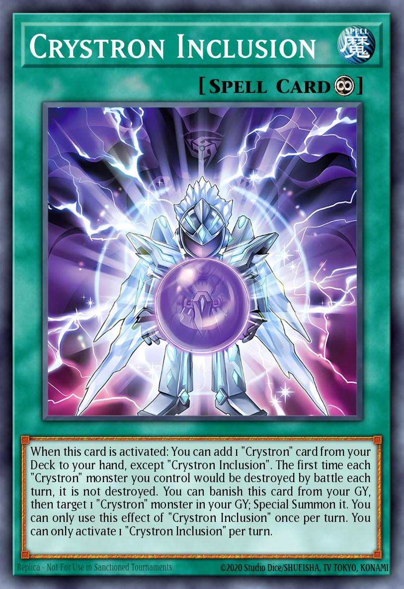
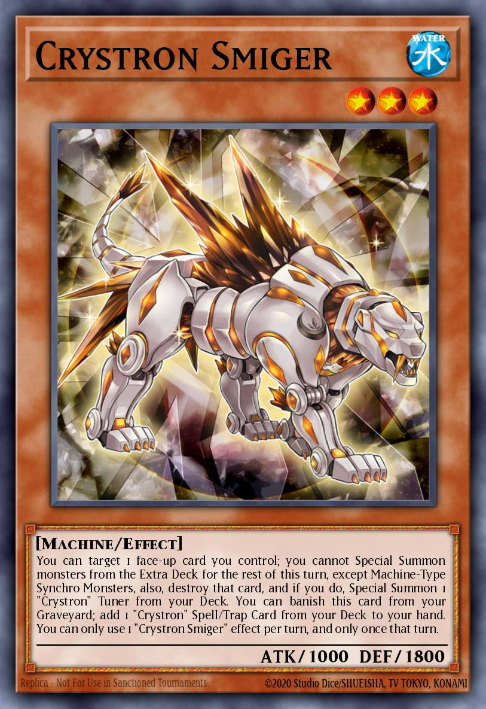
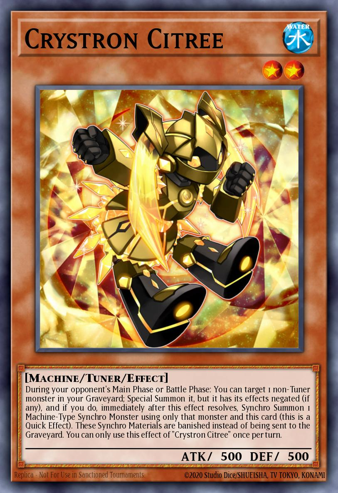
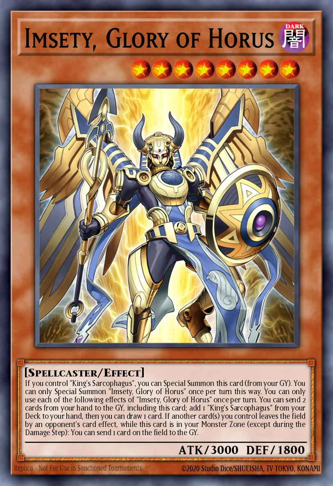
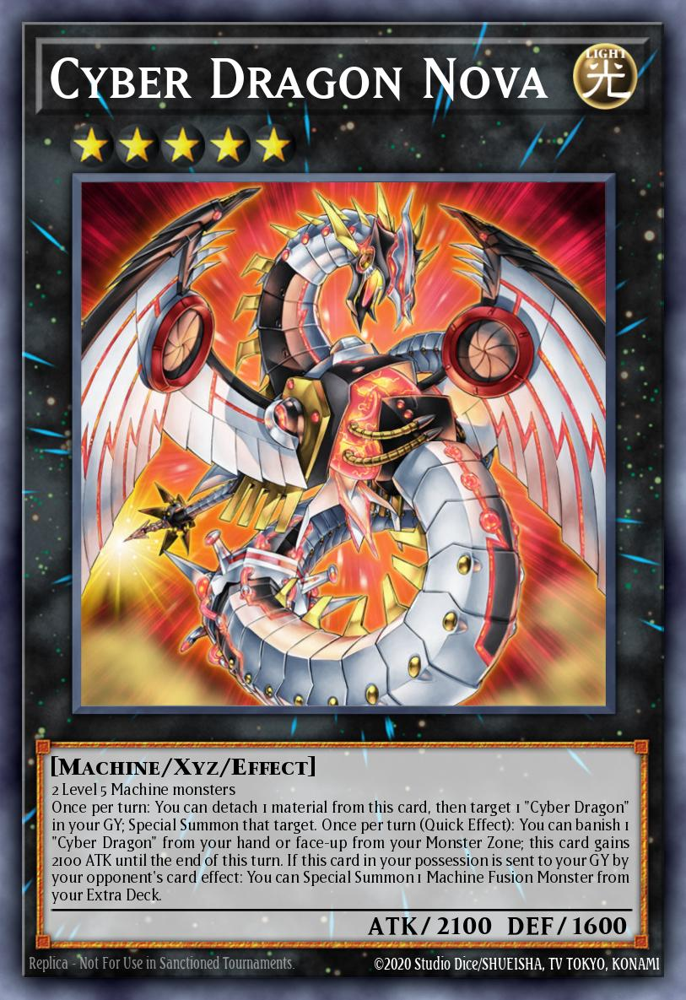

# Cristron / Horus — estudio individual A01–A10, profundización v3 (17-11-2026)

> **CRITERIO DEL INVENTARIO FÍSICO (V41):** Las cartas y sus cantidades se conservan exactamente como fueron documentadas. El análisis A01–A10 se basa en sus efectos, materiales, ventanas, zonas, cadenas y recursos; no evalúa listas externas de prohibidas o limitadas. No se atribuyen partidas ni simulaciones ejecutadas a estos análisis documentales.

<a id="actualizacion-v37"></a>

> **ESTADO VIGENTE CONCILIADO (17-11-2026).** Deck real **677**, formato registrado **TCG Advanced**, con inventario **40 Main / 15 Extra / 15 Side** ya asociado e importación V40 registrada en Station X. Las 39/39 imágenes auténticas por CID están en la carpeta (20 JPG y 19 PNG); los avisos históricos de fotos ausentes no son pendientes actuales. A01–A10 tienen análisis documental; **0 replays acreditados**, sin atribuir ejecución de jugadas. Guía visual: [abrir](guias/GUIA_VISUAL_A01_A10.html). Inventario intacto.


## IDENTIDAD BÁSICA

- `deck_id` confirmado de Station X: **677** (`Crystron`, formato registrado `tcg_advanced`). `NUEVO_13` es solamente el nombre histórico de la carpeta, no otro deck.
- Fuente de inventario: listado completo compartido por Miguel el **16-11-2026**; nombres y cantidades conservados exactamente como fueron proporcionados.
- **Main: 40** (27 monstruos, 12 mágicas, 1 trampa); **Extra: 15**; **Side: 15**; **Reserva: 0**; **total: 70 copias**.

## CONTROL_DE_TAREAS_A01_A10 — Crystron/Horus 677 · contrato de 35 tareas (22-11-2026)

**Asignación expresa:** el usuario asignó en orden **A01**, **A02**, **A03**, **A04**, **A05**, **A06**, **A07** y **A08**, únicamente del deck `677` (formato `tcg_advanced`). Inventario del paquete: **40 Main / 15 Extra / 15 Side / 0 Reserva, 70 copias, 39 CID únicos**, siete rutas C01–C07 más siete variantes V01–V07. No se modifica la lista ni se estudia otro deck.

**Corte del checklist vigente:** **27/35 tareas acreditadas en A01–A04, A05-T1/T2/T3, A06-T1/T2/T3/T4, A07-T1/T2/T3/T4 y A08-T1/T2/T3/T4; 8/35 quedan por conciliar y certificar contra el contrato nuevo**, aunque el registro editorial histórico de abajo marque A02–A10 como documentados. Las etiquetas históricas no son evidencia automática para el checklist nuevo: cada casilla exige fuentes, inventario, prueba y acta independientes. **A10B no solicitada** y fuera de los 35 obligatorios; no se ejecutan reglas ni replays, no se importa ni publica el mazo con esta asignación.

**Alcance del cierre A01:** se verifica identidad/plan/riesgos (A01-T1), texto visible sincronizado con `record.profile` (A01-T2), y correspondencia CID / referencia oficial / IDs portátiles existentes / rutas reales (A01-T3). Los IDs portátiles mencionados son **solo los actualmente presentes**; no representan un censo completo de todos los efectos, cuya auditoría corresponde a A05. Condiciones de ejecución y legalidad final de cada combo corresponden a A07/A09; visual/navegador/importación a A10A.

### A01 — auditado A01
- [x] **A01-T1** Identificar arquetipo, estrategia, condición de victoria y riesgos propios, con CIDs de piezas y evidencia oficial; adjuntar evidencia por CID/ID, fuente y control verificado, o bloqueo con causa y siguiente acción — evidencia A01.2/A01.3, perfil y paquete; auditoría específica verificada en PR #25.
- [x] **A01-T2** Escribir Estilo breve y Resumen para ficha sin jerga de auditoría, con precondiciones reales de las acciones citadas; adjuntar evidencia por CID/ID, fuente y control verificado, o bloqueo con causa y siguiente acción — evidencia A01.2/A01.3, perfil y paquete; auditoría específica verificada en PR #25.
- [x] **A01-T3** Vincular cada propósito/objetivo a IDs de cartas, efectos y futuras rutas sin fabricar secuencias; adjuntar evidencia por CID/ID, fuente y control verificado, o bloqueo con causa y siguiente acción — evidencia A01.2/A01.3, perfil y paquete; auditoría específica verificada en PR #25.

### A02 — identidad e importación documental auditadas
- [x] **A02-T1** Verificar deck_id real, formato, identidad del paquete y referencia al inventario aprobado — evidencia A02.4 / 39 CID, 40 filas nativas, inventario 40/15/15/0 aprobado; comparación con fuente V40; auditor read-only `audit-deck-a02-identity.cjs`.
- [x] **A02-T2** Comprobar compatibilidad documental del ZIP y `datos/stationx-deck.json` — evidencia A02.4; prueba PHP nativa `test-deck-a02-crystron-preflight.php`: ZIP de una carpeta, preparación temporal del importador, sin publicación y 13 rechazos negativos; 13 variantes portátiles conservadas, no ejecutadas.
- [x] **A02-T3** Asignar IDs estables y registrar procedencia/versionado del único contrato — evidencia A02.4 y `datos/stationx-deck.json` con SHA del blob V40; 40 card_id, 39 CID, 14 route_id, `record.schema=station-x-curated-v62`, 0 Skills, sin hash ficticio ni mutaciones de otros decks.

### A03 — inventario aprobado y congelado contra V40
- [x] **A03-T1** Cotejar el 100 % de Main, Extra, Side, Reserva y Skill por zona, cantidad y copia física real — matriz A06 CRYH-001–039 contra 40 `record.cards[].slots` e inventario V40, 40/15/15/0 = 70 copias; Purulia 2 Main + 1 Side; Skill 0; auditor `scripts/audit-deck-a03-inventory.cjs`.
- [x] **A03-T2** Comprobar correspondencia unívoca card_id↔CID↔nombre oficial, sin duplicados o alias inseguros — 40 `card_id` distintos asociados a 39 CID oficiales por Konami, con nombre de la ficha coincidente con matriz curada y snapshot V40; Purulia posee dos IDs nativos para zonas distintas sin duplicar identidad. Nombres de presentación se preservan, fuente normativa identificada por CID; auditor A03.
- [x] **A03-T3** Congelar la lista aprobada y producir denominadores de identidades, copias, efectos y rutas para los reportes posteriores — aprobación expresa del 18-11-2026 respaldada en A03.1, 39 CID, 40 filas físicas, 70 copias, 14 rutas/60 pasos y 13 variantes portátiles (NO 13 efectos oficiales). **Conteo exhaustivo de `effect_id` queda pendiente A05-T2**; congelación por paridad con V40 y rechazo de drift.

### A04 — biblioteca HD CID y mapas de zonas auditados
- [x] **A04-T1** Acreditar CID, fuente oficial, formato y foto auténtica de todas las identidades — evidencia A04.2 y `datos/A04_HD_IMAGE_PROVENANCE.json`: 39/39 CID Konami unidos sin ambigüedad a imágenes reales English TCG de YGOPRODeck 813×1185; fuente normativa Konami conservada por CID y hash de origen/archivo.
- [x] **A04-T2** Validar ruta de imagen, calidad y correspondencia física con el `card_id`/slot — evidencia A04.2, auditor genérico de imágenes y `scripts/audit-deck-a04-photo-integrity.cjs`: 20 JPG + 19 PNG, 39/39 firmas SHA-256/bytes/dimensiones exactas, 39 CID en ficha y guía, 96 referencias HTML y enlaces Markdown válidos, 40 slots nativos del inventario; rutas y extensiones originales intactas.
- [x] **A04-T3** Registrar mapa de disponibilidad y zonas compartidas por A05/A07/A09/A10A — evidencia A04.3 y `record.routes[].endboard.variants`: 14 rutas, 60 pasos, 151 fotos enlazadas a pasos, 15 mapas finales ilustrativos, 60 entradas de zonas; 0 cartas FOTO_PENDIENTE; no se inventan posiciones M1–M5/EMZ (`spatial_verified=false` en todas).

### A05 — 92 cláusulas documentadas; T1–T3 acreditadas y T4 pendiente
- [x] **A05-T1** Fichar 100 % de identidades: 39/39 CID, 40 card_id originales, 39 fotos HD, fuentes Konami y funciones concretas A05.1/A06, por auditor `scripts/audit-deck-a05-profiles.cjs`.
- [x] **A05-T2** Inventariar 92 cláusulas oficiales A05.2 para las 39 identidades, ID documental estable `677:a05:CID:slug`, tipo ACT/QCK/TRG/SPL/PRO/CONT y fuente Konami por CID. 13 variantes portátiles existentes no equivalen a 92 acciones ejecutables; auditor `scripts/audit-deck-a05-registry.cjs`.
- [x] **A05-T3** Matriz semántica de 92 efectos/procedimientos: actor, zona, ventana, guarda, coste, target/no-target, resolución, uso OPT/HOPT, negación/conservación, estado posterior y fuente oficial. 34 invariantes de alto riesgo contrastados por oráculo separado; **especificación documental, no ejecución de A10B**.
- [ ] **A05-T4** Casos de papel positivos/negativos: 184 descripciones, 7 casos positivos `NO_APLICA_INVENTARIO_677` y vínculos A06/A07/A09 por CID en A05.3. **Pendiente verificar individualmente estado físico antes/después, cadena, recursos y negaciones; 0/184 `CASO_LOGICO_VERIFICADO`.** No marcar COMPLETA por solo existir borradores.

### A06 — sinergias y casos de papel verificados documentalmente (4/4)
- [x] **A06-T1** Identificar motores **M-CRY**, **M-HOR**, puente indirecto **M-PUE** y respuestas M-RESP; 21/21 relaciones R01–R21 con 32 `effect_id` distintos existentes de A05.2 y recursos físicos de Crystron 677. Evidencia A06.0, A06.4, A06.5 y auditor `scripts/audit-deck-a06-crystron.cjs`.
- [x] **A06-T2** Registrar los bloqueos Extra **Sincronía Máquina** (Smiger/Thystvern) frente a **Máquinas** (Sulfador), límites alternativos por nombre, costes pagados, reemplazo Azufafnir, ventanas Citree/Tristaros, acceso a 13/13 Extra y dependencias de materiales con fuente CID de A05. Evidencia A06.2/A06.3/A06.5, RGL01–15 y auditor A06.
- [x] **A06-T3** Documentar elecciones primero/segundo, recuperación y medio/tardío con recursos reales y alternativas: C01/C02/C03/V01, Horus C04/C05/V07, Nova→Infinito C06, puente C07, rompedor Super Poli R17–18; evitar rutas incompatibles y considerar interrupciones. Evidencia A06.0/A06.4/A06.5, A02.1–3 y decisiones A08 D01–D20.
- [x] **A06-T4** Derivar **42 casos de sinergias** `677:A06:P01–P21` y `677:A06:N01–N21` con estado anterior/posterior parcial tipado, precondiciones y fallo cerrado; cada R01–R21 enlaza un `effect_id` válido, control A07, decisión A08 y ruta A09 real o **SIN_RUTA_IDENTIFICADA**. Evidencia A06.5 y auditor CI A06; **no confundir con los 184 casos A05-T4 sin certificar**.

### A07 — especificación documental de 92 cláusulas y 644 casos de papel, auditada (4/4)
- [x] **A07-T1** Tipar 92/92 cláusulas A05 para formato real `tcg_advanced`: 16 ACT, 17 TRG, 15 QCK, 12 SPL, 17 PRO, 13 CONT y 2 RES; CID, `card_id`, fuente Konami, chain_mode y velocidad en A07.5, sin crear Skill Rush ni eslabones de procedimientos.
- [x] **A07-T2** Especificar los 92 registros A07.5 con estado previo del actor/zona/ventana, guarda física, coste activado, selección/target, resolución y estado posterior, negación, límite OPT/HOPT y bloqueos Extra; corrección oficial de las dos secuelas RES Mulcharmy sin segundo eslabón.
- [x] **A07-T3** Matriz A07.6 de 644 escenarios documentales `677:A07:E001–E092:{P,R,T,Z,U,N,F}`: positivo con guarda, requisito faltante, ventana, zona/material, uso previo, negación y formato; cada caso incluye `state_before`, `expected_legal`, `expected_costs`, `expected_events`, `expected_state_after` y motivo. **Son casos de papel, no replays; 7 positivos NO_APLICA y A05-T4 sigue sin verificación independiente.**
- [x] **A07-T4** Auditoría `scripts/audit-deck-a07-crystron.cjs` de 92 effect_id → 644 case_id (7/efecto) → 39 fuentes CID, 7 NO_APLICA con causa, modos de cadena, velocidad 1/2/3 y necesidades `operator_requirement`. Las 13 variantes portátiles quedan sin cambios y **ningún operador se declara probado A10B**.

### A08 — estrategia y Side auditados (4/4 alcance documental)
- [x] **A08-T1** 26 decisiones D01–D26 vinculadas a CIDs físicos, efecto oficial A05, estado inicial y 14 rutas existentes o `SIN_JUGADA_ACREDITADA`; A08.5 y auditor `scripts/audit-deck-a08-crystron.cjs`.
- [x] **A08-T2** 52 casos de papel (26 positivos + 26 negativos) con precondiciones y fallo cerrado, seis Side S01–S06 y tres matchups históricos A08.3. Sin replays ni partidas atribuidas.
- [x] **A08-T3** Por cada decisión contrastar CIDs del inventario, enlaces effect_id, ventana, recursos, consumo y restricciones; cada intercambio Side mantiene 40/15/15/0. A08.7 acredita seis copias excedentes contra F&L oficial sin cambiar la lista.
- [x] **A08-T4** Clasificar cada decisión en route_id A09 real o `SIN_JUGADA_ACREDITADA`; se conservan C01–C07/V01–V07 y los 13 rule variants portátiles sin ejecutarlos. CI específica A08 y A05-T4 abierto.

### A09 — pendiente de auditoría del contrato vigente
- [ ] **A09-T1** Identificar cada ruta con route_id y starter/estado físico inicial: mano, GY, campo, recursos, fase, prioridades y cartas desconocidas
- [ ] **A09-T2** Por cada step_id enlazar effect_id/procedimiento, requisito, coste real, materiales, ventana, resolución y estado antes/después
- [ ] **A09-T3** Incluir casos lógicos positivos y de interrupción para pasos críticos, con causa, coste pagado y SIN_CONTINUACION_DEMOSTRADA si aplica
- [ ] **A09-T4** Verificar campo final, recursos, materiales y restricciones sin casillas inventadas, conservando los mismos IDs que usarán A10A y A10B

### A10A — pendiente de auditoría del contrato vigente
- [ ] **A10A-T1** A10A: crear guía visual de cada route_id con apertura correcta, imágenes por CID, pasos step_id, detalles y recursos reales
- [ ] **A10A-T2** A10A: comprobar paridad exacta A05/A07/A09→ficha/combos/guía (CID, efecto, costes, estados y campo final); denunciar posiciones ilustrativas
- [ ] **A10A-T3** A10A: verificar paquete y navegación visual/importación de contenido en móvil y escritorio; nunca exigir motor de calculadora

**Siguiente tarea pendiente por orden de cierre:** A05-T4 (184 casos sin transición certificada); luego A09 (4) y A10A (3). A08 cerrada documentalmente; quedan **8/35**. No A10B, importación, despliegue ni merge.

---

## CONTROL INDIVIDUAL DE AVANCE A01–A10 — Cristron / Horus

**Alcance y corte:** primera iteración, ampliaciones v2/v3 y conciliación del 17-11-2026, exclusivamente para el deck **677**. **Main 40, Extra 15, Side 15, Reserva 0; 70 copias y 39 identidades documentadas.** Se conservan **siete rutas principales C01–C07 y siete variantes V01–V07**; son trazas documentales, no simuladas, cuyos resultados dependen de supuestos explícitos. La importación V40 y las imágenes están registradas; la aprobación editorial expresa del inventario, si se considera trámite separado, no consta de forma independiente.

| Apartado | Estado propio del deck | Progreso o evidencia comprobable | Pendiente para cerrar |
|---|---|---|---|
| **A01** Rol y propósito | **COMPLETA — IDENTIDAD Y DECISIONES DOCUMENTALES (18-11-2026)** | Dos motores y tres ritmos diferenciados; siete rutas C01–C07, alternativas incompatibles, cortes y prioridades contra Memento/Purrely/Salamangreat vinculadas a A08.3 y A09 | **Sin pendiente propio de definición del rol.** Los desenlaces siguen sujetos a ventanas, inventario y respuestas descritas en A07–A09; sin tasa de victoria ni prueba de simulador |
| **A02** Planes y estilos | **COMPLETA — PLANES DOCUMENTALES Y DESVÍOS (18-11-2026)** | Prioridades para primero/segundo/turno rival/medio-tardío, comparación C01–C07 y V01–V07, **24 manos H01–H24**, seis cortes ejemplificados y probabilidades de coincidencia separadas del desempeño | **Sin pendiente documental del plan.** La medición empírica de duelos queda fuera del cierre y no se infieren porcentajes de resolución o victorias |
| **A03** Inventario | **COMPLETA — INVENTARIO APROBADO POR MIGUEL (18-11-2026)** | Auditoría independiente de 39 filas CRYH-001–039: **Main 40 / Extra 15 / Side 15 / Reserva 0 = 70 copias**; Purulia 2 Main+1 Side; ID 677. **Miguel aprobó expresamente las cuatro cantidades en este diálogo** | **Sin pendiente propio de inventario.** Conservar identidades, zonas y copias sin cambios; aprobación no certifica efectos ni autoriza sustituciones |
| **A04** Identidad, CID y fotos | **COMPLETA — INTEGRIDAD DOCUMENTAL DE CID, FOTOS Y RUTAS (18-11-2026)** | **39/39 CID distintos**, 39/39 imágenes locales (20 JPG + 19 PNG); **96/96 referencias HTML** y **55/55 referencias relativas MD** con archivo de destino presente; V40 histórica registrada | **Sin pendiente propio de archivos A04.** Render visual en navegador, datos realmente importados y nueva publicación son controles externos A10/integración, no pruebas realizadas aquí |
| **A05** Efectos y uso | **COMPLETA_DOCUMENTAL (sin pruebas de juego)** | **39/39 identidades con ficha funcional**, zona/cantidad/CID en matriz A06 y requisitos, ventana, recurso, límite y riesgo en A05.1; fuentes oficiales enlazadas por CID | Sin pendiente editorial propio; interacciones situacionales y ejecución corresponden a A07–A09, no a la certificación documental A05 |
| **A06** Sinergias y Extra | **COMPLETA_DOCUMENTAL (accesos condicionados no certificados)** | **39/39 filas**, dictamen de compatibilidad y construcción por identidad en A06.4; 21 vínculos R01–R21; 13/13 Extra con materiales/función, 8 accesos en rutas y **5 alternativas ACC01–ACC05** condicionadas | **Sin pendiente de clasificación editorial A06**; existencia de materiales rivales y legalidad de cada secuencia quedan expresamente en A07–A09, no se consideran demostradas por A06 |
| **A07** Reglas y cadenas | **COMPLETA_DOCUMENTAL_CONTEXTUAL (no certificada por simulador)** | **21 controles RGL01–RGL21** (RGL16 sustituida por control mecánico), **14 interrupciones INT01–INT14**, **6 auditorías CR-A01–06** y **4 cadenas SC-X01–04**; ficha de formato, ventanas y riesgos en A07.4 | Legalidad técnica integral, casos con cambios de zona y respuesta bajo Lancea siguen `PENDIENTE_DE_RULING`/`SIN_REPLAY`, sin bloquear el cierre editorial de este apartado |
| **A08** Estrategia y Side | **COMPLETA_DOCUMENTAL (rutas no certificadas)** | **26 decisiones D01–D26**, clasificación de las siete familias C01–C07, siete variantes V01–V07 e interacciones elementales en A08.4; **6 planes Side S01–S06** con intercambios exactos y **3/3 matchups seleccionados** | Sin pendiente de exploración/clasificación editorial en el alcance documentado; cadenas, accesos situacionales, resultados y rendimiento permanecen condicionados a A07/A09, no medidos |
| **A09** Jugadas y manos | **COMPLETA_EDITORIAL_CONDICIONAL (sin certificación técnica)** | **7 rutas C01–C07**, **7 variantes V01–V07**, **24 manos H01–H24**, estados finales por zonas, controles de riesgo y seis situaciones estratégicas A09.3; **0 replays** | Sin pendiente de ficha/recorrido documental; las rutas reactivas, las interacciones ocultas y los casos A07 pendientes no son secuencias certificadas ni resultados de simulador |
| **A10** Guías visuales | **COMPLETA_GUIA_DOCUMENTAL — QA NAVEGADOR PENDIENTE** | **14/14 paneles C01–C07/V01–V07**, pasos verticales con referencias fotográficas y cierres condicionados en HTML; 39/39 fotos del inventario, mapa nuevo de 22 entradas válidas; contrato de evidencia por ruta A10.1 | La ejecución del navegador gráfico quedó impedida en este entorno; importación vigente y publicación nueva NO comprobadas. Legalidad/cadenas A07–A09 no certificadas por simulador |

**Control documental:** respetar los materiales, costes, zonas, ventanas, límites por turno y recursos del inventario físico; no se atribuyen simulaciones ejecutadas.

## APARTADO_01 — Identidad y propósito de esta construcción

**Dictamen:** híbrido de **control reactivo por Sincronía Máquina (Cristron)** y **presencia autónoma de Nivel 8 / Xyz (Horus)**; las distintas cartas de interacción/respuestas no convierten por sí solas todas las manos en un tablero. Objetivo 1: sobrevivir e interrumpir desde **Tristaros/Citree**, obtener ventaja con **Elesqueletus** y convertir recursos en presión; objetivo 2: desarrollar **Amset + Hapi** a **Número 90** para negar efecto de monstruo o a **Vampiro Zombi** para moler y extender; objetivo 3: llegar a **Nova → Infinito con dos Nivel 5 Máquina** (C06) para negar la activación de cartas/efectos; objetivo 4: ganar tempo con **Gotas Prohibidas / Súper Polimerización** antes de aplicar bloqueos del Extra. Son **objetivos tácticos**, no victorias garantizadas.

**Conflictos estructurales reales:** (a) **Smiger/Thystvern en campo** restringen el resto del turno a **Sincronías Máquina** si usan su efecto de destruir; (b) **Sulfador al invocarse por su efecto propio** restringe a **Máquinas** del Extra por el resto del turno; (c) tras cualquiera de esas restricciones, **S:P, Número 90, Vampiro Zombi, Garura y Fangodragón** pueden quedar inaccesibles ese turno según el caso; (d) la segunda habilidad de **Hagoita** exige un Cantante «Velociroid» que esta lista no lleva. No declarar «puedo sacar cualquier Extra».

**Fortalezas:** dos motores que pueden trabajar en turnos distintos, recuperación de Cristron mediante Inclusión/Elesqueletus, descarte Horus que alimenta Cementerio, acceso alternativo a Infinito sin Normal (C06), sinergia Amset→Smiger de Cementerio (C07), salidas Máquina mediante las restricciones y cartas disruptivas genéricas. **Debilidades:** dependencia de Normal para algunos starters, escasez de Cantantes frente a 15 Extra, gastar Smiger en Campo impide usar su búsqueda de Cementerio ese mismo turno, C06 consume otra copia de Azufafnir del Deck y el Side puede bloquear nuestras propias búsquedas o destierros.

### A01.1 — Prioridad de motor frente a adversidades concretas

**Regla de identidad:** Crystron/Horus no es un motor único que produce simultáneamente sus mejores campos. Elegir **una prioridad por mano y ventana**; el segundo motor solo complementa cuando conserva recursos reales y no contradice un bloqueo de Extra. La siguiente tabla es una **decisión documental** basada en A02, A07, A08.3 y A09, no evidencia de duelos ejecutados.

| Escenario y amenaza constatada | Primera elección si hay recursos | Alternativa si no hay acceso | Conflicto que impide prometer ambos resultados |
|---|---|---|---|
| **Primero; mano solo Smiger** | **C01**: poner Citree; Hagoita solo si la activación en Main/Battle rival resuelve | Con Tristaros ya en mano, **C03** prepara respuesta a activación rival | No anunciar Sincronía ni negación al cerrar turno propio; Smiger Campo activa bloqueo de Sincronía Máquina ese turno |
| **Primero; Inclusión + Sulfador** | **C02**: Elesqueletus + Smiger y recuperar Inclusión | Si también hay Azufafnir y segundo ejemplar en Deck, elegir **C06** si se necesita negación inmediata | C02 usa Smiger en Campo y restringe a Sincronías Máquina; **no** se convierte después en Nova/Infinito en ese turno |
| **Primero; Amset + Hapi / Sarcófago** | **C04** para N.º 90 con negación de monstruo; **C05** para Vampiro Zombi si Hapi sigue en Deck | **C07** con Amset+Smiger para un Horus y Tristaros reactivo | Los dos Horus usados como materiales Xyz dejan de ser monstruos independientes; bloqueo previo de Smiger/Sulfador puede impedir el Xyz elegido |
| **Contra Memento 671**: búsqueda Angbruja y cadena Tatsun → Fusión | **C06/Infinito**, solo con sus tres piezas y segundo Azufafnir en Deck; reservar negación para activación válida | **C01/C03/C07** como Sincronía reactiva, o Ash/Droll en ventana correcta | Tristaros **sincroniza pero no niega** la Fusión; si se niega una búsqueda no se cuenta el recurso; no atribuir retirada automática de los dos jefes |
| **Contra Purrely 660**: acumulación de materiales Xyz | **Interrumpir búsquedas o desarrollo antes** de Noir con cinco materiales; C06 solo si mano y ventana lo permiten | **C02** como recuperación y siguiente turno, con respuesta autónoma Ash/Droll si es legal | Noir con cinco o más materiales no se declara vulnerable a una negación activada que no lo afecta; C02 no genera negación universal |
| **Contra Salamangreat 673**: Link y Rugido colocado | **Segundo:** comprobar materiales concretos para Súper Polimerización **antes** de restringir el Extra | **Primero:** C01/C03 y sus ventanas; C04 si hay Horus y Extra libre | Rugido puede negar la Mágica si cumple sus requisitos; Garura no se invoca con cualquier par; bloqueo Cristron puede impedir Fusión/Link no Máquina |

**Prioridad de respuesta:** antes de cada decisión identificar (1) turno/fase y cartas propias **realmente en mano/Deck/GY**; (2) si el objetivo rival está presente y es afectable; (3) si se activó bloqueo de Extra; (4) si la intervención ocurrió **antes o después** de una búsqueda/envío; (5) qué cuerpo y recurso permanecen **al acabar la cadena**. Cuando una condición falta, la ruta se registra como alternativa no acreditada, no como resultado logrado. Los seis Side S01–S06 son configuraciones **entre duelos**, no recursos disponibles en juego 1.

### A01.2 — textos de la ficha sincronizados con el paquete nativo

Los siguientes valores coinciden literalmente con `record.profile` de `datos/stationx-deck.json`. Son contenido del deck para el jugador, no metadatos de la auditoría.

- **Arquetipo:** Cristron / Horus
- **Tipo de estrategia:** Control reactivo por Sincronía Máquina con motor Horus de Nivel 8 y acceso Xyz condicionado.
- **Estilo breve:** Control Cristron con Sincronías Máquina y recuperación; Horus aporta presión mediante Xyz de Rango 8 cuando el Extra Deck sigue disponible.
- **Resumen para ficha:** Inicia con Smiger y Citree o Inclusión y Sulfador para preparar Sincronías y recuperar recursos con Elesqueletus. Horus ofrece Xyz de Rango 8 si el Extra está libre; gana por control y presión.
- **Qué vigilar:** Smiger y Thystvern, al utilizar sus efectos de destrucción en Campo, restringen el resto del turno a Sincronías Máquina; Sulfador limita el Extra Deck a Máquinas si se Invoca por su efecto. C01/C03 dependen de la ventana rival y C04/C05 exigen recursos Horus y Extra libre. No se acreditan victorias ni replays.

`Estilo breve` = 139 caracteres (máximo 190); `Resumen para ficha` = 193 (máximo 250). `Cómo se juega` mantiene explicación detallada en el mismo `record.profile`: plan primero/segundo, recuperación medio/tardío, restricciones y condiciones de salida. No hay texto «Catálogo completo», objetivo automático de calculadora ni garantía de victoria.

### A01.3 — trazabilidad de propósitos a cartas, fuentes y rutas existentes

Los CID de esta matriz se cotejaron con las **39 identidades físicas** de `record.cards`. Los `rule.id` son referencias de **las 13 variantes portátiles ya existentes**, no efectos nuevos ni cobertura reglamentaria completa. Cuando no existe un ID portátil apropiado se señala expresamente, sin inventarlo. Las rutas se cotejaron con los **14 `record.routes[].id`** existentes (7 C y 7 V).

| Ref. | Propósito / condición de victoria | CID físicos | `rule.id` existente | `route_id` real | Guarda / riesgo específico | Fuente oficial |
|---|---|---|---|---|---|---|
| `A01-R01` | Control reactivo / Sincronía de turno rival | `12608`, `12606`, `20758`, `20778`, `12157` | `677:smiger:destroy-citree` | `677:A09:C01`, `677:A09:C03`, `677:A09:V05` | Smiger en Campo solo habilita Citree si la destrucción y el envío resuelven; Citree/Tristaros precisan ventana o activación rival, y la Sincronía no niega por sí misma. | [Konami CID 12608](https://www.db.yugioh-card.com/yugiohdb/card_search.action?cid=12608&ope=2&request_locale=en); [Konami CID 12606](https://www.db.yugioh-card.com/yugiohdb/card_search.action?cid=12606&ope=2&request_locale=en) |
| `A01-R02` | Recuperación de recursos | `20798`, `20759`, `20778` | SIN_REGLA_PORTATIL_ACREDITADA_A01 | `677:A09:C02`, `677:A09:V02`, `677:A09:V04` | Inclusión y Sulfador requieren recursos reales; Elesqueletus recupera solo si se produce su evento y cumple la condición. No inventar otro Cantante ni retorno. | [Konami CID 20798](https://www.db.yugioh-card.com/yugiohdb/card_search.action?cid=20798&ope=2&request_locale=en); [Konami CID 20759](https://www.db.yugioh-card.com/yugiohdb/card_search.action?cid=20759&ope=2&request_locale=en) |
| `A01-R03` | Presión Horus y acceso Xyz | `19153`, `19155`, `19200`, `13826`, `16850` | `677:horus-gy:19153`, `677:horus-gy:19155`, `677:sarcophagus:send-horus` | `677:A09:C04`, `677:A09:C05`, `677:A09:V07` | Amset/Hapi y Sarcófago deben estar donde indique la apertura; elegir Número 90 o Vampiro Zombi, no ambos con las mismas dos copias. | [Konami CID 19153](https://www.db.yugioh-card.com/yugiohdb/card_search.action?cid=19153&ope=2&request_locale=en); [Konami CID 19155](https://www.db.yugioh-card.com/yugiohdb/card_search.action?cid=19155&ope=2&request_locale=en) |
| `A01-R04` | Negación de activación con Infinito | `20798`, `20759`, `12756`, `10870`, `11765` | SIN_REGLA_PORTATIL_ACREDITADA_A01 | `677:A09:C06` | Necesita dos Nivel 5 Máquina reales y segundo Azufafnir en Deck; el bloqueo de Sulfador permite el Xyz Máquina, no cualquier Extra. | [Konami CID 20798](https://www.db.yugioh-card.com/yugiohdb/card_search.action?cid=20798&ope=2&request_locale=en); [Konami CID 20759](https://www.db.yugioh-card.com/yugiohdb/card_search.action?cid=20759&ope=2&request_locale=en) |
| `A01-R05` | Puente Horus/Cristron | `19153`, `12608`, `20758`, `20778` | `677:horus-gy:19153`, `677:smiger:graveyard-search` | `677:A09:C07` | Se evita activar la destrucción de Smiger en Campo antes de un Xyz incompatible; la Sincronía de Tristaros depende de la activación rival. | [Konami CID 19153](https://www.db.yugioh-card.com/yugiohdb/card_search.action?cid=19153&ope=2&request_locale=en); [Konami CID 12608](https://www.db.yugioh-card.com/yugiohdb/card_search.action?cid=12608&ope=2&request_locale=en) |
| `A01-R06` | Cartas de respuesta sin combo garantizado | `7445`, `15299` | SIN_REGLA_PORTATIL_ACREDITADA_A01 | SIN_RUTA_A09_ACREDITADA | Súper Polimerización y Gotas exigen materiales, costes y ventanas observables. Decisiones A08.3, SIN_RUTA_A09_ACREDITADA para una apertura independiente. | [Konami CID 7445](https://www.db.yugioh-card.com/yugiohdb/card_search.action?cid=7445&ope=2&request_locale=en); [Konami CID 15299](https://www.db.yugioh-card.com/yugiohdb/card_search.action?cid=15299&ope=2&request_locale=en) |

**Regla de resultado:** controlar el turno rival, conservar recursos y después convertir un tablero real en presión y daño. Sin objetivos inventados, no asumir cadenas negadas, ni tratar Hagoita o Tristaros como negación universal. El control contra Memento, Purrely y Salamangreat sigue siendo **análisis contextual**, no tasa de victoria ni simulación. La clasificación de todos los efectos impresos, cadenas, costes y respuestas se hará en A05/A07; los endboards se validarán en A09 y los gráficos/importación en A10A.

**Criterio de cierre A01:** identidad principal **control reactivo Cristron**, identidad secundaria **presión Horus/Rango 8**, alternativa **negación inmediata con Nova→Infinito** si C06 es accesible. Las prioridades en los tres enfrentamientos seleccionados y los conflictos entre rutas están definidos arriba. **A01 `COMPLETA` en su alcance de rol y decisiones documentales**; la exactitud causal de cada cadena queda bajo A07/A09 y la experiencia visual/importación bajo A10. Sin calculadora, replays ni superioridad competitiva medida. **Siguiente apartado cuando se solicite: A02**.

## APARTADO_02 — Identidad del inventario y planes

1. **Primero (línea Cristron):** priorizar la pieza que deja **Tristaros** o **Citree** operativa en turno rival; reservar la interrupción para el punto adecuado. C01/C02/C03 dependen del starter y las piezas disponibles.
2. **Primero (línea Horus):** con **Amset + Hapi** o **Sarcófago + Amset**, construir un Xyz de Rango 8 **antes** de activar efectos que cierren el Extra; C04/C05. Con **Amset + Smiger**, considerar la salida híbrida C07: un Horus 8 y Tristaros listo, sin bloquear el Extra en el turno propio.
3. **Segundo:** determinar primero si hay material compatible para Súper Polimerización, negar con Gotas o impedir una búsqueda; **después** desarrollar Smiger/Sulfador. No activar una restricción de Sincronía antes de decidir una Fusión, Link o Xyz no Máquina.
4. **Turno rival:** Tristaros responde a activación de carta/efecto y hace Sincronía Máquina con el monstruo que trae; Citree usa únicamente ella y un no Cantante revivido del Cementerio en Main/Battle rival.
5. **Recuperación:** Inclusión en Cementerio revive un Cristron, Elesqueletus recupera uno del Cementerio/destierro tras su Sincronía, **Thystvern se destierra desde el Cementerio para buscar un monstruo Cristron del Deck**; Sarcófago habilita Horus del Cementerio. No contabilizar recursos usados/desterrados como disponibles en mano. **Azufafnir destruido desde Campo** puede sustituirse por otra pieza del Deck (C06/V03), pero requiere que esa copia siga allí.

### A02.1 — Cómo conservar recursos de turno en turno

| Momento | Prioridad del jugador | Recurso que no debes dar por supuesto |
|---|---|---|
| Turno 1, mano corta | Si solo hay Smiger/Tristaros, preparar Citree o Tristaros reactivo **antes** de gastar herramientas para un tablero irreal | Que Hagoita/Elesqueletus ya está en Campo al pasar turno; sin respuesta rival aún no está |
| Turno 1, mano de tres piezas | Comparar C02 con C06: **recuperación + futuro Quarion** frente a **Infinito con negación inmediata** | Que Nova/Infinito sea legal después del efecto de Campo de Smiger: no lo es ese turno |
| Tras un efecto negado | Revisar cartas que realmente permanecen en Campo, GY y Deck; elegir Horus o segunda ruta del motor | Smiger destruido/buscado, Inclusión recuperada o robo opcional que jamás se resolvió |
| Turno rival | Guardar Citree para Main/Battle, Tristaros para activación; Agrupamiento solo si se colocó en turno anterior | Una cadena de negación que Tristaros o Elesqueletus **no** posee |
| Turno 3+ | Con Sarcófago sobreviviente, reutilizar Amset/Hapi que estén en GY; con Elesqueletus, recuperar Inclusión/Smiger del lugar real | Horus convertido en material Xyz **no** está en GY; primero debe desacoplarse o ir el Xyz al GY |
| Segundo contra campo amplio | Evaluar Gotas/Súper Polimerización **antes** de bloquear el Extra y conservar un starter Cristron viable | Que un par cualquiera de monstruos cumple Garura/Fangodragón o que la carta responda a todo |

### A02.2 — Frecuencia matemática de ver los starters, NO de ganar

**Supuesto reproducible:** 40 cartas Main y mano inicial de **5 cartas tomadas al azar sin reemplazo**, sin mulligan, búsquedas, robos ni efectos rivales. Cada fila mide **solamente** la probabilidad combinatoria de tener al menos una copia de **cada nombre solicitado**; **NO** mide que el combo pueda resolverse (puede haberse robado su único objetivo del Deck, faltar otra copia en Deck, ser negado o no existir la ventana rival). Fórmula para dos grupos: `1 − C(40−a,5)/C(40,5) − C(40−b,5)/C(40,5) + C(40−a−b,5)/C(40,5)`; para tres grupos, inclusión-exclusión análoga. `C(n,k)` es combinación.

| Apertura por nombres confirmados | Copias en Main | Frecuencia teórica de la coincidencia |
|---|---|---:|
| Al menos **Smiger** para C01 | 3 | **33,76 %** |
| **Inclusión + Sulfador** para C02 | 3 + 2 | **6,81 %** |
| **Inclusión + Sulfador + Azufafnir** para C06 | 3 + 2 + 3 | **1,58 %** |
| **Amset + Smiger** para C07 | 3 + 3 | **9,80 %** |
| **Amset + Hapi** para C04 | 3 + 1 | **3,55 %** |
| **Azufafnir + Smiger** para V03 | 3 + 3 | **9,80 %** |

**Lectura para jugar:** C06 produce la negación más general de estas aperturas, pero **su combinación exacta de tres nombres es poco frecuente en cinco cartas**; conviene practicar C01/C07/V03 también. **No sumar los porcentajes**: las manos se superponen. La probabilidad real de completar una ruta debe descontar objetivos fuera del Deck y estudiar interrupciones, sin extrapolar estas cifras a victoria/competitividad.

**Identidad:** híbrido Cristron/Horus según cartas transcritas; `deck_id` real **677**, registrado como TCG Advanced. No se modifican cantidades, nombres ni zonas.

### A02.3 — Cierre de planes comparados y respuesta tras fallos (18-11-2026)

**Objeto de esta pasada:** resolver la comparación **documental** que faltaba en el control A02. Cada fila utiliza las condiciones realmente descritas por A09 y las decisiones A08; no transforma una apertura en partida disputada, ni calcula frecuencias de victoria.

| Momento y necesidad | Plan principal si la mano lo permite | Alternativa tras corte / recurso ausente | Qué se conserva y qué NO se promete |
|---|---|---|---|
| **Primero; control reactivo con un solo iniciador** | Smiger→Citree (**C01**) o Tristaros (**C03/V05**) | Si Citree única fue robada (**H24**), escoger Tristaros desde Deck; si Smiger fue negado (**H19**), detener esa apertura | Sincronía solo en ventana del rival, con material presente; **no** existe Hagoita/Elesqueletus automáticamente al pasar turno |
| **Primero; recuperar recursos** | Inclusión+Sulfador→Elesqueletus (**C02**) | Si Inclusión no busca o Sulfador no destruye, no contar Smiger ni carta recuperada; revisar recursos realmente conservados | Puede dejar Smiger y recuperar Inclusión, **no** negar de modo genérico; bloqueo solo Sincronía Máquina después del efecto de Campo de Smiger |
| **Primero; negación inmediata** | Inclusión+Sulfador+Azufafnir→Nova→Infinito (**C06**) | Si falta otro Azufafnir en Deck (**H17**), elegir ruta de recursos C02 solo si permanecen materiales legales | Infinito requiere **dos Máquinas Nivel 5** antes de Xyz; C06 no usa Normal ni Smiger de Campo; no confundir disponibilidad de tres nombres con resolución asegurada |
| **Primero; Xyz Horus** | Amset+Hapi→Número 90 (**C04**) | Sarcófago+Amset, Hapi aún en Deck→Vampiro (**C05**); con Hapi ya en GY (**H18**), recalcular movimiento real | Dos Horus son **materiales** y no pueden formar otro Xyz al mismo tiempo; Vampiro no garantiza extensor ni molino favorable |
| **Segundo; romper campo antes de invocar** | Gotas con coste y objetivo válidos; o Súper Polimerización con materiales exactos (**H16**) | Sin objetivos compatibles no anunciar Fusión; evaluar Horus/Cristron accesibles sin atribuir retiro enemigo | El rompedor se resuelve **antes** del bloqueo de Extra Cristron; las negaciones/inmunidades reales del rival pueden cambiar el plan |
| **Turno rival; responder sin fingir negación** | Citree en Main/Battle (**C01**) o Tristaros tras activación rival (**C03/C07**) | Si el rival no activa o retira el Cantante/objetivo, conservar el estado real y no atribuir Sincronía | Tristaros **no niega** la activación inicial; cada recurso enviado o desterrado se mueve a su zona correcta |
| **Medio/tardío; reconstruir tras negación** | Sarcófago y Horus que estén efectivamente en GY; o Inclusión/Elesqueletus para recuperación Cristron | Tras Droll a C07 (**H20**), Sarcófago puede permanecer, pero Smiger no añade Inclusión; no repetir la búsqueda | Sin Xyz desde monstruos ya acoplados; sin segunda copia de una carta única del Deck; confirmar si hay Normal y qué efectos ya se gastaron |

**Control de las 24 manos:** H01–H12 ilustran aperturas e interrupciones; H13–H20 verifican desvíos y ausencia de recursos; H21–H24 fijan **cinco cartas reales**, incluidas piezas únicas ya robadas y copias desplazadas fuera del Deck. Su función es comprobar la coherencia de las decisiones, **no** medir probabilidad de victoria ni certificar una secuencia en simulador. Los porcentajes A02.2 solo describen **coincidencias de cartas** bajo extracción aleatoria sin reemplazo; no se suman entre sí ni se aplican como porcentaje de combo exitoso.

### A02.4 — identidad técnica, procedencia y compatibilidad ZIP (22-11-2026)

**Alcance:** esta acta corresponde al A02 del **único deck seleccionado 677**, no al A02 histórico de planes A02.1–A02.3. Es un **deck existente** con inventario aprobado el 18-11-2026, no un alta nueva. El nombre de carpeta histórico **`DECK_NUEVO_13_CRISTRON_HORUS`** no modifica su identidad nativa `677`, nombre visible `Crystron` ni formato literal `tcg_advanced`. No se declara lectura de la base de datos en producción. La referencia de cotejo es el archivo versionado histórico de Platform.

| Contrato A02 | Evidencia verificable | Condición / rechazo |
|---|---|---|
| Identidad y formato | `deck_id=677`, `record.deck_id=677`, `record.format=tcg_advanced`, `inventory_binding=deck-slots-v1`, `content_mode=structured` | No aceptar `rush_duel`, `goat`, otro ID o carpeta |
| Inventario físico | 39 CID únicos en `record.cards`; **40 filas de card_id** originales incluyendo Purulia en Main+Side; **40 Main / 15 Extra / 15 Side / 0 Reserva** = 70 copias; 0 Skills | Concordancia exacta entre `inventory`, `record.cards[].slots` y la fuente V40; no rellenar Side ni duplicar copias |
| Identidad visual y documental | `DECK_NUEVO_13_CRISTRON_HORUS_CONTENIDO_CURADO.md`, `datos/stationx-deck.json`, `guias/GUIA_VISUAL_A01_A10.html` y 39 imágenes `CID.jpg/png` en una sola carpeta | Rechazar archivos faltantes, otras carpetas o fotos sin referencia física |
| Importación estructurada | `station-x-deck-package/1` envuelve `record.schema=station-x-curated-v62`; `source_document` apunta al MD original; clasificación: **ESTRUCTURADA_IMPORTABLE** en contrato y preparación aislada | Se conservan las 14 rutas C01–C07/V01–V07 y sus **60 pasos**; el MD es fuente complementaria, no sustituto de `record` |
| Proveniencia | <https://github.com/senior23enginer-coder/platform-yugioh-md/blob/base/torneos_yugioh/assets/editorial/20261117-folder-delivery-v40/677.json> · blob Git `1c23d72192199d9324a4b55dd1ced3d0bdd43997` registrado en `provenance.native_snapshot_blob_sha` | Se comprueba paridad de filas/ID/formatos/rutas con esa instantánea; no implica afirmar el estado vivo de Station X |
| Huella de inventario | No existe `inventory_sha256` inventado en el paquete portátil; el importador comparará su propia firma auténtica si corresponde | Si cambia la lista viva o formato de Station X, **fallo cerrado**; exportar de nuevo desde la aplicación antes de reemplazarla |
| Reglas de calculadora | Se retienen las 13 variantes originales en `record.calculator.rules`; IDs existentes sin crear nuevas reglas | No interpretar disponibilidad de regla como eficacia, legalidad de duelo ni ejecución A10B |

**Pruebas de aceptación automatizadas:** `scripts/audit-deck-a02-identity.cjs` compara el paquete contra inventario V40, nombres, `card_id`, CID, zonas, rutas, fotos y los archivos esenciales, sin tocar ningún deck ajeno; `scripts/test-deck-a02-crystron-preflight.php` utiliza en **solo lectura** el importador nativo `ygo_data_validate_portable_inventory` y `ygo_data_prepare` con un ZIP efímero de **42 archivos** (3 obligatorios + 39 imágenes) y **13 escenarios inválidos** para confirmar rechazo de desajustes. El test **prepara** el registro en un directorio temporal, no lo publica, no importa a producción y no prueba el motor.

**Criterio de cierre del A02 técnico (T1–T3):** identidad, procedencia, paridad documental, ZIP válido y fallos de importación controlados. La inspección de actualización real de una cuenta Station X, navegación gráfica y persistencia autenticada corresponde a A10A; la certificación funcional de reglas a A10B opcional. La aprobación del inventario no autoriza sustituir ninguna carta ni modificar sus cantidades.

**Criterio de cierre A02:** están diferenciados los planes **primero**, **segundo**, **respuesta en turno rival** y **recuperación a medio/tardío**, con acceso, alternativa y límite explícitos. A02 queda **`COMPLETA` en alcance documental** sin requerir partidas o calculadora. La legalidad fina de acciones pertenece a A07/A09, el Side 1:1 a A08 y la experiencia visual a A10. **Siguiente apartado: A03**, cuya aprobación editorial no se presupone.

## APARTADO_03 y APARTADO_04 — Inventario y fuentes

La matriz A06 de abajo conserva **cada carta y copia** del inventario comunicado, con una sola fila por identidad y dos columnas de zona si una misma carta aparece en Main y Side.

**A03:** nombres y cantidades de Miguel inalterados: 40 Main (27 monstruos, 12 mágicas, 1 trampa), 15 Extra y 15 Side. Ninguna carta del Side se cuenta como inicial; el cotejo es numérico y de zonas.

### A03.1 — Acta de cotejo de inventario y puerta de aprobación (18-11-2026)

**Auditoría ejecutada:** suma independiente de las columnas `Main`, `Extra`, `Side` y `Reserva` de las 39 filas únicas `CRYH-001` a `CRYH-039` de la matriz A06 del mismo archivo. Resultado: **40 Main + 15 Extra + 15 Side + 0 Reserva = 70 copias**. No aparecen identidades adicionales en el recuento de esas filas; la carta `CRYH-012` Purulia se registra **2 Main + 1 Side** en una sola identidad, no como dos cartas distintas. La composición Main documentada sigue siendo **27 monstruos, 12 mágicas y 1 trampa**.

| Puerta A03 | Resultado | Alcance |
|---|---|---|
| Identidad del deck | `COTEJADA` | Crystron/Cristron + Horus, ID real **677**, formato registrado `tcg_advanced` |
| Copias y zonas | `COTEJADO_NUMERICAMENTE` | **39 identidades; 40/15/15/0 = 70**; sin cambiar inventario |
| Separación Side/Main | `COTEJADA` | La tercera Purulia es del Side; ninguna carta Side se atribuye a duelo 1 |
| Fotos y CID | `REFERENCIA_A04` | La verificación de 39/39 identidades/fotos pertenece a A04, no sustituye la aprobación del mazo |
| **Aprobación editorial de Miguel** | **`APROBADO_EXPRESAMENTE_18-11-2026`** | Miguel declaró: «Sí, apruebo el inventario de Cristron/Horus: 40 Main, 15 Extra, 15 Side y 0 Reserva. Cierra A03.» La aprobación corresponde a las cantidades y zonas de esta lista existente, no a cambios de cartas |

**Dictamen A03:** `COMPLETA_APROBADA`. Transcripción y auditoría numérica terminadas, con **aprobación expresa del propietario** para Main 40 / Extra 15 / Side 15 / Reserva 0. **No se añadió, retiró ni modificó ninguna carta.** La validación reglamentaria de rutas pertenece a A07/A09 y la comprobación visual a A04/A10; la aprobación del inventario no implica simulación ni prueba funcional. **Siguiente apartado: A04.**

### A03.2 — auditoría del contrato físico, copias y congelación verificable (22-11-2026)

Esta comprobación A03 reaprovecha la aprobación explícita del inventario del **18-11-2026**, sin inventar una nueva lista ni pedir otra aprobación. La fuente física declarada sigue siendo el deck real `677` en formato `tcg_advanced`, con comparación triple **matriz original CRYH-001–039**, **`datos/stationx-deck.json`** (inventario + `record.cards[].slots`) e instantánea histórica de Platform **V40**. No se consulta la base de datos de producción ni se declara un `inventory_sha256` de Station X que no exista en el paquete.

| Control | Denominador y evidencia | Garantía concreta |
|---|---|---|
| A03-T1 — Inventario y zonas | **40 Main, 15 Extra, 15 Side, 0 Reserva**, 70 copias; 39 CID; 40 filas `card_id`; 0 Skills | Cada CID físico conserva exactamente sus cantidades, sección, `card_id` y nombre de la lista aprobada; todas las secciones obligatorias están presentes |
| A03-T2 — Identidad por copia | **39/39 CID Konami** enlazados en matriz original, con **40 IDs nativos sin duplicados** | Una misma identidad puede ocupar dos zonas con dos `card_id`, pero jamás se confunden los IDs: `CRYH-012` Purulia CID `20206` = 2 Main (`card_id=533`) + 1 Side (`card_id=534`) |
| A03-T3 — Congelación del inventario | **39 identidades**, **40 filas nativas**, **70 copias**, **14 rutas** (C01–C07/V01–V07), **60 pasos**; **13 variantes portátiles** | Se rechazan alteraciones de ID, CID, nombre, cantidad, sección y rutas frente al V40; las 13 variantes **NO son** el total de efectos reglamentarios del deck |
| Límite de certificación | El recuento exhaustivo de `effect_id` oficiales no ha sido realizado para Crystron en el contrato nuevo | Se declara **`effectCount=NO_CENSADO_A05`**, sin inventar un denominador ni marcar A05 completado |

**Auditor reproducible:** `scripts/audit-deck-a03-inventory.cjs`, incluido en CI del PR #25. Su entrada está restringida al paquete del único deck asignado y al `677.json` de Platform V40 en modo de lectura; exige 39/39 entradas `CRYH-xxx`, URLs Konami por CID, 40 IDs distintos, nombres/slots/cantidades coincidentes, aprobación histórica textual, 14 rutas originales y 60 pasos. El reporte señala explícitamente ausencia de cálculo de efectos totales, de partidas ejecutadas y de importación de producción.

**Cierre A03:** se conserva el inventario sin añadir/quitar cartas, sin convertir una carta de Side en mano inicial, sin modificar Skills, motor o imágenes. La revisión de autenticidad/calidad visual corresponde a A04 y la semántica completa de efectos a A05. El cierre no certifica juego ejecutable, tablas espaciales ni legalidad de torneo.

**A04:** las 39 filas siguientes contienen **CID y enlace a la ficha individual Konami oficial**. «Cristron» es el nombre español de **Crystron**; «Caballero Mecánico» es **Clockwork Knight Link-1**. Las **39 imágenes reales** ya están en esta carpeta: 20 JPG iniciales y 19 PNG agregadas en V37, con nombre de CID exacto; la indicación anterior de 19 fotografías faltantes era histórica. El CID documental identifica la carta; el ID del deck es **677**. El texto Konami es evidencia de identidad/efecto, no de una partida ejecutada.

**Fotos locales útiles para esta iteración:** [Amset](imagenes/19153.jpg), [Hapi](imagenes/19155.jpg), [Sarcófago](imagenes/19200.jpg), [Flor de Ceniza](imagenes/12950.jpg), [Droll](imagenes/9279.jpg), [Fuwalos](imagenes/20500.jpg), [Purulia](imagenes/20206.jpg), [Gotas](imagenes/15299.jpg), [Súper Polimerización](imagenes/7445.jpg) y [Número 90](imagenes/13826.png). Las 39 identidades disponen de fotografía local, no solo estas diez.

### A04.1 — Acta de integridad local (18-11-2026)

**Prueba estática ejecutada:** cotejo de las 39 filas CRYH-001–039 de la matriz A06 con sus CID de ficha Konami y los nombres de archivo de `imagenes/`. Los **39 CID son diferentes**; la carpeta contiene **39 archivos** con esos nombres CID (20 `.jpg`, 19 `.png`), **0 CID sin foto** y **0 fotos ajenas al inventario**. Se comprobaron además los destinos físicos de **96 referencias `src`/`href` a `../imagenes/`** en `guias/GUIA_VISUAL_A01_A10.html` (**0 rotas**) y **55 referencias relativas** `imagenes/` o `guias/` dentro de este documento (**0 rotas**).

| Criterio A04 | Resultado comprobado | Alcance conservado |
|---|---|---|
| Identidad de cartas | **39/39 CID únicos** | La fila A06 y el nombre de archivo identifican la misma CID; las copias físicas corresponden al inventario A03 aprobado |
| Carpeta visual autocontenida | **39/39 archivos** | Solo 20 JPG + 19 PNG del deck 677, sin requerir fotos de otro deck |
| Guía HTML | **96/96 rutas de imagen existentes** | Existencia de archivo; no equivale a que el navegador lo haya renderizado bien |
| Documento MD | **55/55 destinos relativos existentes** | Enlaces de fotos y guía resuelven dentro de la carpeta del deck |
| Importación y publicación | **NO PROBADAS EN ESTA PASADA** | V40 consta históricamente; este cotejo no prueba contenido de base de datos, aplicación ni nueva versión publicada |

**Dictamen:** A04 `COMPLETA_DOCUMENTAL` por identidad, procedencia de CID y autocontención de recursos. Se conserva la separación Main/Extra/Side/Reserva de A03 y el inventario 40/15/15/0 aprobado. Si se regeneran archivos, habrá que repetir el chequeo de rutas; no es una deuda sobre la versión presente. **Siguiente apartado: A05** (efectos y condiciones), sin atribuir jugadas ejecutadas.

### A04.2 — biblioteca HD y trazabilidad real por CID (22-11-2026)

**Alcance real de A04-T1/T2:** las **39/39** fotos del mazo Crystron/Horus `677` se reemplazaron por representaciones completas auténticas **English TCG de 813 × 1185 píxeles** descargadas de YGOPRODeck y emparejadas mediante `misc_info.konami_id` con el **CID oficial** de cada una de las 39 identidades. Las 20 imágenes `.jpg` y 19 `.png` conservan **exactamente** el nombre y extensión `imagenes/<CID>.jpg/png`, evitando modificaciones de URLs de la ficha, los 14 combos y la guía existente. Los antiguos ejemplares de menor resolución permanecen recuperables en el historial Git; el idioma de las explicaciones y nombres de la ficha no se modificó.

**Fuentes y protección:** `datos/A04_HD_IMAGE_PROVENANCE.json` contiene por CID nombre del inventario, nombre del origen en inglés, `konami_id`, ID de imagen de YGOPRODeck, URL de la imagen completa, `dimensions`, `previous_sha256`, `source_sha256`, `saved_sha256` y longitud de bytes. El auditor de calidad comprueba el **archivo local decodificable** y su SHA-256 frente al manifiesto, no solo una cadena de procedencia declarada. Las fichas `record.cards[].sources` y las filas CRYH-001–039 siguen apuntando al texto normativo de **Konami Neuron**, que es distinto de la fuente visual externa. Ninguna imagen generada por IA, foto de mazo distinto o tarjeta sin CID fue aceptada.

| Comprobación | Resultado | Límite de la prueba |
|---|---|---|
| Correspondencia de identidad | **39/39** CID distintos en Konami + `record.cards` + procedencia HD | Foto auténtica no equivale a validación de efecto o ruling |
| Resolución técnica real | **39/39** archivos de al menos 600 × 850; nueva colección **813 × 1185** | Mide claridad/resolución y SHA, no legalidad ni visibilidad en producción |
| Inventario y rutas | **40** filas `card_id` / **40 Main + 15 Extra + 15 Side + 0 Reserva**; **14** rutas, **60** pasos | No se alteran cartas, fotos por CID en cada ruta ni cantidades |
| Guía HTML | **96/96** referencias `src/href` a fotos con CID y extensión válidos; **39** CID presentes | A10A comprobará visualmente la aplicación real en navegador |
| Documento curado | Todos los enlaces locales `imagenes/` y `guias/` con destino comprobable | El Markdown complementa, no sustituye el JSON nativo |
| Guía por pasos y zonas | **151** fotografías de paso y **60** referencias por zona ligadas a los CID cargados | No certificar jugadas o coordenadas a partir de imágenes |

**Validación reproducible:** `scripts/audit-deck-images.cjs`, `scripts/audit-deck-visual-zone-links.cjs` y el auditor específico `scripts/audit-deck-a04-photo-integrity.cjs` en el CI del PR. El manifiesto guarda hashes SHA-256 antes/después para detectar intercambios o imágenes obsoletas. Todos los recursos son **locales dentro de la misma carpeta** y pueden viajar en el ZIP individual sin depender de enlaces efímeros.

### A04.3 — mapa de disponibilidad y zonas compartido con A05/A07/A09/A10A

El siguiente es el **contrato de disponibilidad por zona**, no un resultado de un duelo ni una localización espacial de un monstruo en M1–M5/EMZ. Se conserva el mismo `CID` y la misma `card_id` nativa al trasladar una copia; **Xyz materiales no cuentan simultáneamente como monstruos independientes**.

| Origen o reserva | Condición de disponibilidad física | Destino o checkpoint posible | Regla para A05/A07/A09/A10A |
|---|---|---|---|
| **Main 40** | Carta realmente robada en **mano** o realmente localizada en **Deck**; sus copias son finitas | Mano → zona de monstruos, magia/trampa o de campo según tipo; mano/Deck → Cementerio o destierro solo mediante efecto/acción válida | No confundir foto del deck con carta en mano ni crear una copia adicional |
| **Extra 15** | Monstruo en Extra, procedimiento Invocación disponible y materiales reales; comprobar restricciones Máquina/Sincronía | Extra → zona de monstruos permitida; materiales → Cementerio, destierro o adjuntos Xyz según efecto/procedimiento | No afirmar S:P / Rango 8 / Fusión después de bloqueo incompatible ni ubicar cuerpos Xyz en dos zonas |
| **Side 15** | **No participa en el duelo 1** salvo intercambio explícito antes del duelo según plan Side con la misma cantidad de entradas/salidas | Side ↔ Main/Extra solo entre duelos | No dibujar Ash, Lancea u otras piezas como disponibles si están exclusivamente en Side |
| **Reserva 0 / Skills 0** | No hay copias adicionales ni Skill habilitada | Ningún traslado permitido sin aprobación de nuevo inventario | No inventar recursos ni sumar habilidades a la mano |
| **Cementerio / destierro** | Solo cartas físicamente movidas allí en pasos previos | Recuperación, banish como coste, reanimación o devolución si texto y ventana lo permiten | Mantener identidad de la copia, usos y costes; no tratar Xyz acoplados como si estuvieran en GY |
| **Campo, equipos, M/T y materiales Xyz** | Monstruos y permanentes presentes en la zona correcta; materiales adjuntos a un Xyz conocido | Resolución de efecto: movimientos reales hacia GY, mano, destierro o Extra | No utilizar zonas ilustrativas como coordenadas certificadas ni asumir objetivos rivales ocultos |

**Campos A09/A10A:** `record.routes[].endboard.variants` incluye **15** mapas ilustrativos para **14** rutas (V07 tiene dos salidas alternativas) y **60** objetos de zona; cada guía enlaza sus **60** pasos a **151** referencias fotográficas. Todos los `endboard.spatial_verified` permanecen `false`: no se han certificado posiciones M1–M5/EMZ ni cadenas y materiales de cada posible respuesta rival. Esa certificación se evaluará en A09/A10A, **no** se rellena artificialmente en A04.

**Estado de fotografías:** `FOTO_PENDIENTE=0` para las 39 identidades físicas; los huecos de estado del campo que dependen de una activación, coste, material o carta rival permanecen **CONDICIONALES**, no son fotos faltantes. A04-T3 queda cerrado como **mapa de disponibilidad/zonas** sin promoverlo a replay ejecutado ni fingir el estado exacto de la mesa.

## APARTADO_05 y APARTADO_06 — Matriz ÚNICA por identidad, función y sinergia

<a id="APARTADO_05"></a>

**APARTADO_05 — Fichas documentadas; T1–T3 acreditadas y T4 ABIERTA.** La matriz canónica A06 inmediatamente posterior conserva nombre, zona, copias, CID, función y vínculo causal, sin volver a contar una identidad que esté en Main y Side. A05.1 añade por cada ID la condición operativa y su consecuencia para **este** deck. `Cxx`, `Vxx`, `Dxx`, `Sxx` y `Rxx` se refieren a los apartados A06/A08/A09 existentes: son vínculos documentales, **no replays**. Las cartas autónomas sin combo propio se clasifican `SIN_COMBO_IDENTIFICADO` porque su objetivo es interrumpir, romper campo o entrar por Side; eso no significa sinergia nula.

### A05.1 — Requisito, ventana, recurso y riesgo de cada identidad

**Motor Cristron (Main, 6 identidades):**

- **CRYH-001 · Sulfador (2):** desde mano/GY selecciona y destruye **una carta Cristron propia en Campo** para Invocarse; al ser Invocado puede enviar **hasta dos nombres Cristron diferentes** del Deck al GY. Cada efecto una vez por turno. Produce cuerpo Nivel 5 y recursos de GY para R04/R07/C02/C06; **tras el primer efecto, Extra solo Máquina** por el resto del turno. No declarar la salida Xyz Horus después del bloqueo.
- **CRYH-002 · Smiger (3):** en Campo destruye una carta propia boca arriba para sacar Cantante Cristron del Deck; su alternativa en GY se destierra para buscar M/T Cristron. **Solo uno de esos dos efectos por turno**, no ambos. Aporta Citree o acceso a Inclusión/Agrupamiento, R02/R03/C01/C07; la vía de Campo restringe el Extra a **Sincronías Máquina** ese turno, incompatible con Nova/Links/Fusiones después.
- **CRYH-003 · Tristaros (2):** Cantante Nivel 2; su efecto rápido responde a **activación de carta o efecto rival**, trae otro Cristron desde Deck y, tras resolver, Sincroniza una Máquina con ese monstruo entre los materiales; exige niveles y cuerpos legales **en ese momento**. En GY se destierra para destruir una Sincronía propia y traer dos Cristron del Deck, tras lo que limita Extra a Máquina. Cada efecto una vez por turno. R07/R08/C03/V01; **no niega la activación rival**.
- **CRYH-004 · Azufafnir (3):** descarta **otro** Cristron para Invocarse desde mano/GY en Defensa y después destruye una carta propia; destruido en Campo, invoca un Cristron del Deck en Defensa. Cada efecto una vez por turno. Gasta mano y abre destrucción/reemplazo R12/C06; comprobar que la **segunda copia** requerida por Nova sigue en Deck, y no declarar el reemplazo si la destrucción no ocurrió.
- **CRYH-005 · Citree (1):** Cantante Nivel 2; **Main o Battle Phase rival**, selecciona un no Cantante propio en GY, lo Invoca con efectos negados y acto seguido Sincroniza **una Máquina solo con esos dos materiales**, que quedan desterrados; una vez por turno. R06/C01/C02: exige Nivel exacto en GY; no conservar esos materiales ficticiamente en Cementerio.
- **CRYH-006 · Thystvern (1):** en Campo destruye carta propia boca arriba para acceder a Cantante Cristron del Deck, pero desde GY se destierra para buscar **monstruo** Cristron. **Solo uno de sus dos efectos por turno**; R11/C02. Elegir entre extensor de Campo y buscador GY; la vía Campo restringe a Sincronías Máquina y puede bloquear el Extra no Sincro.

**Motor Horus (Main, 3 identidades):**

- **CRYH-007 · Amset (3):** envía **dos cartas de mano, incluida ella misma**, para buscar Sarcófago; el robo posterior es opcional y no asegura un nombre. Desde GY puede Invocarse si controlas Sarcófago; sus condiciones por turno se respetan por separado. R13–R15/C04/C07; el descarte de Smiger alimenta GY, pero gastar la mano deja menos interacción.
- **CRYH-008 · Hapi (1):** se Invoca desde GY controlando Sarcófago; su recuperación de **hasta dos cartas** de GY/destierro se dispara solo si una carta que controlas deja Campo por efecto rival y su ventana es legal. R14/R15/C04/C05; no contar esa recuperación contra un oponente que aún no hizo nada.
- **CRYH-014 · Sarcófago del Rey (2):** Mágica Continua; envía **una carta de mano al GY** para enviar al GY un Horus de Deck, con sus límites de activación/uso (hasta cuatro veces por turno según texto). R14/C04/C05: prepara Amset/Hapi pero consume mano y no transforma dos Horus en tres cuerpos; comprobar presencia continua de Sarcófago antes de revivir.

**Interacciones y soporte Main (9 identidades):**

- **CRYH-009 · Flor de Ceniza (3):** descartar ante una activación que incluya añadir, Invocar o enviar desde Deck; niega ese **efecto**, no todas las activaciones futuras. Una vez por turno. D09, `SIN_COMBO_IDENTIFICADO`: reservar para el acceso rival crítico; no presentarla como buscador propio.
- **CRYH-010 · Bufón/Pájaro del Candado (3):** después de que una carta pase del Deck a la mano **fuera del robo**, se descarta para impedir nuevas adiciones por **ambos jugadores** durante el turno. D10, `SIN_COMBO_IDENTIFICADO`: si se usa antes de Inclusión/Amset/Smiger GY también frena las búsquedas propias.
- **CRYH-011 · Fuwalos Multivadora (3):** solo si **no controlas cartas**, descartar como efecto rápido: robas por Invocaciones Especiales rivales **desde Deck o Extra**, no desde GY/mano. En End Phase puede devolver cartas aleatorias de tu mano al Deck si supera el umbral del texto; limita el uso de otro efecto Mulcharmy ese turno. D09, `SIN_COMBO_IDENTIFICADO`: no prometer retener todos los robos.
- **CRYH-012 · Purulia Multivadora (2 Main + 1 Side):** exige controlar **cero cartas** al descartar; roba por Invocaciones Normales/Especiales de monstruos rivales **desde la mano**, con ajuste de mano en End Phase y restricción Mulcharmy. D09/S03, `SIN_COMBO_IDENTIFICADO`: no duplicar la copia Side en duelo 1 ni confundir su disparador con Fuwalos.
- **CRYH-013 · Inclusión Cristron (3):** al activar la Continua busca **otra carta Cristron**; desde GY desterrarse permite revivir un Cristron. Efectos sujetos a sus límites por turno. R01/R04/R05/C02/C07: aporta acceso y cuerpo; no declarar dos búsquedas mediante dos Inclusiones en el mismo turno cuando el texto limita esa acción.
- **CRYH-015 · Súper Polimerización (3):** Mágica Rápida, **descarta una carta** y Fusiona con monstruos de ambos Campos según materiales exactos del Extra; ninguna carta/efecto puede activarse en respuesta a su **activación**, lo que no vuelve legales materiales ausentes. R17/R18/A08-I03: usarla antes de quedar restringido a Sincronías/Máquinas; `SIN_COMBO_IDENTIFICADO` sin Campo compatible.
- **CRYH-016 · Gotas Prohibidas (3):** envía otras cartas desde mano/Campo al GY y selecciona **igual número** de monstruos de efecto rivales para dividir ATK y negar efectos; la respuesta rival depende de los tipos de cartas enviados. D08, `SIN_COMBO_IDENTIFICADO`: vigilar gasto real de recursos y que los objetivos sigan siendo válidos.
- **CRYH-017 · Entierro Insensato (1):** Mágica Normal, envía **un monstruo** desde Deck a GY, sin invocarlo ni activar automáticamente una habilidad ajena. D04: prepara Thystvern/Tristaros o Horus con Sarcófago; comprobar ventanas y restricciones individuales al intentar usar lo enviado.
- **CRYH-018 · Agrupamiento Cristron (1):** Trampa Continua: Cristron propios protegidos de destierro **por efectos rivales**; recicla desde GY/destierro una carta Cristron distinta de Agrupamiento para destruir **uno o dos objetivos boca arriba**, dos solo con Sincro Cristron propia. R21/D06: requiere Colocación/ventana de Trampa legal; no activa inmediatamente una trampa recién Colocada por regla general.

**Extra Deck (13 identidades, acceso separado de uso):**

- **CRYH-019 · F.A. Coche Trucado (2):** Sincronía Máquina Nivel 7 con Cantante + no Cantante; Citree 2 + Sulfador 5 es **material posible si los cuerpos están disponibles**. Gasta niveles para negar M/T bajo condición de nivel; `SIN_COMBO_IDENTIFICADO` como ruta principal, ACC01. No anunciar negación sin niveles suficientes.
- **CRYH-020 · Elesqueletus (2):** Sincro Máquina Nivel 7, recupera Cristron desde GY/destierro al Sincronizar; destruido tras ser Invocado por Sincro permite revivir Cristron. R09/R10/C02/C03: valor de largo plazo, condicionado a materiales y a destrucción posterior.
- **CRYH-021 · Quariongandrax (1):** Sincro Máquina Nivel 9 que exige **dos o más Cantantes y exactamente un no Cantante**; al Sincronizar puede desterrar monstruos rivales de Campo/GY hasta el número de materiales utilizados. R07/V01: sin esa distribución y niveles no hay Invocación legal.
- **CRYH-022 · S:P Pequeña Caballera (1):** Link-2 de **dos monstruos de efecto**; destierra temporalmente/según su efecto en ventanas específicas. D03/ACC02, `SIN_COMBO_IDENTIFICADO`: necesita dos cuerpos y debe preceder a cualquier bloqueo del Extra a Máquina/Sincro.
- **CRYH-023 · Caballero Mecánico (1):** Link-1 de Máquina **no Link con ATK original ≤1000**; su búsqueda de Noche Mecánica no tiene objetivo en esta lista; su otro efecto puede tributar Máquina para revivir Máquina pequeña del GY. R20/ACC03, `SIN_COMBO_IDENTIFICADO`: no adjudicar búsqueda inexistente y comprobar cuerpo/objetivo.
- **CRYH-024 · Ciber Dragón del Infinito (1):** se superpone legalmente sobre Nova; puede absorber monstruo rival en Posición de Ataque y negar activación desacoplando material. R19/C06: elegir recursos para negar o absorber; no es salida tras bloqueo a **solo Sincronías** de Smiger.
- **CRYH-025 · Ciber Dragón Nova (1):** Xyz Máquina Rango 5 con **dos Máquinas Nivel 5**; Sulfador + Azufafnir solo si ambas están simultáneamente libres. R19/C06: no existe Ciber Dragón en Main para su reanimación nominal; la ruta sirve principalmente para subir a Infinito.
- **CRYH-026 · Hagoita de Alta-Velociroid (1):** Sincro Máquina Nivel 5 (Cantante + no Cantante), puede tributar su cuerpo para modificar niveles; revivir desde GY exige **Cantante Velociroid**, ausente del Main. R06/C01: gastar su cuerpo para niveles no deja todavía un material presente.
- **CRYH-027 · Número 90 (1):** Xyz Rango 8 con dos Horus Nivel 8; desacopla para negar efecto de monstruo. R15/C04: con materiales Horus **no destruye** al negado por la condición Fotón/Galaxia ni obtiene protección reservada a esos materiales.
- **CRYH-028 · Vampiro Zombi (1):** Xyz Rango 8 con dos Nivel 8; desacopla para mandar cartas superiores de **ambos Decks** al GY y condicionalmente Invocar uno de los monstruos mandados. R16/C05: no elegir ni garantizar la carta enviada; el resultado depende de los Decks.
- **CRYH-029 · Destructor Samurái (1):** Sincronía Máquina Nivel 7 (Citree 2 + Sulfador 5 si disponibles); al combatir reduce opciones de respuesta/efectos del rival **en esa batalla**. D05: sirve para presión, no es negación general del tablero.
- **CRYH-030 · Garura (1):** Fusión exige **dos monstruos del mismo Tipo y Atributo con nombres diferentes**; con Súper Polimerización solo si existen materiales compatibles en Campos. R17/ACC04, `SIN_COMBO_IDENTIFICADO` sin rivales adecuados; su robo al ir al GY no es robo automático al Invocarla.
- **CRYH-031 · Fangodragón del Pantano (1):** Fusión exige **dos monstruos del mismo Atributo y distinto Tipo**; Súper Polimerización puede aprovechar Campo rival compatible. R18/ACC05, `SIN_COMBO_IDENTIFICADO` sin esa pareja: no confundir esta receta con la de Garura ni usarla tras bloqueo Extra incompatible.

**Side Deck (8 identidades exclusivas + 1 Purulia compartida):** Solo se habilitan **tras sustitución entre duelos** documentada en A08/Sxx, nunca como cartas de la mano inicial del Main aprobado.

- **CRYH-032 · Cazadora del Caos (2 Side):** ante Invocación Especial rival puede Invocarse desde mano descartando **una carta**; mientras esté boca arriba impide **al rival** desterrar cartas. S01, `SIN_COMBO_IDENTIFICADO`: requiere disparador y descartar recurso; no impide tus propios destierros.
- **CRYH-033 · Artefacto Lancea (2 Side):** en turno rival se tributa de mano/Campo y **ningún jugador** puede desterrar el resto del turno. S01, `SIN_COMBO_IDENTIFICADO`: puede inutilizar Citree, Smiger GY y Tristaros GY; no usarlo suponiendo que el bloqueo es solo rival.
- **CRYH-034 · Regaño Solemne (1 Side):** Contratrampa, paga LP y exige **ninguna otra carta propia Colocada** para negar la activación o Invocación apropiada. S04, `SIN_COMBO_IDENTIFICADO`: si colocaste Agrupamiento/Juicio, su activación queda impedida.
- **CRYH-035 · Llamado por la Tumba (1 Side):** Mágica Rápida, selecciona monstruo en GY rival, lo destierra y niega efectos de ese nombre hasta el final del turno siguiente conforme al texto. S02, `SIN_COMBO_IDENTIFICADO`: sin objetivo en GY no sirve de respuesta y puede afectarte si compartes nombre.
- **CRYH-036 · Talento de Tácticas Triples (1 Side):** Mágica Normal en tu Main Phase, solo si rival activó efecto de monstruo durante **tu Main Phase** ese turno; eliges uno de sus modos sujetos a requisitos. S02, `SIN_COMBO_IDENTIFICADO`: una activación únicamente en turno rival no basta.
- **CRYH-037 · Prohibida la Venta (2 Side):** Mágica Normal declara nombre: adversario no activa efectos del nombre ese turno, pero tú no podrás activar ese nombre el resto del Duelo. S03, `SIN_COMBO_IDENTIFICADO`: prohibición propia a largo plazo, sobre todo si nombras pieza de tu lista.
- **CRYH-038 · Arresto Erróneo (2 Side):** Mágica Rápida, impide a **ambos** añadir del Deck a la mano excepto robando hasta final de tu próximo turno. S03, `SIN_COMBO_IDENTIFICADO`: bloquea Inclusión, Amset, búsquedas GY de Smiger/Thystvern; comprobar que tu motor ya buscó antes.
- **CRYH-039 · Juicio Solemne (3 Side):** Contratrampa, paga **la mitad de LP** para negar la Invocación apropiada o **activación** de Mágica/Trampa. S04, `SIN_COMBO_IDENTIFICADO`: no es negación libre de efectos de monstruos; requiere estar Colocada y ventana legal.

**Auditoría A05:** 39/39 identidades (17 Main exclusivas, 13 Extra, 8 Side exclusivas y Purulia compartida Main/Side), **39/39 fichas operativas** con CID y cantidad en matriz A06, condición de uso, recurso gastado/obtenido, restricción/ventana y riesgo aquí, y referencia causal. Por zonas: Main **18/18 identidades**, Extra **13/13**, Side **9/9** (incluida Purulia), Reserva **0/0, no aplica**. Las 70 copias conservan su reparto aprobado **40/15/15/0**. Se ha contrastado directamente el texto Neuron de Sulfador, Tristaros, Fuwalos y Agrupamiento en este pase; los otros 35 CID conservan su enlace a fuente oficial en matriz, **sin atribuirles un nuevo cotejo línea a línea**. La revisión minuciosa de cadenas, targets dependientes del oponente y accesos condicionados se traslada a A07/A08/A09; **no se ejecutó calculadora ni partida física**. **Siguiente: A06**, sin alterar inventario.

<a id="APARTADO_06"></a>

**APARTADO_06 — Matriz canónica de trazabilidad.** IDs `CRYH-###` son locales documentales; la columna CID identifica la ficha oficial Konami. **Rol preliminar** significa texto/finalidad estudiados, pero no resultado de simulación. Cada relación Rxx se explica inmediatamente después de esta matriz. `Cxx` y `Vxx` enlazan a las secuencias A09; cuando no existe una secuencia propia, la carta puede seguir siendo funcional (staple, interrupción o Side). **Se conserva una sola matriz, sin archivos paralelos por carta.**

| ID local | Carta del inventario original | Main | Extra | Side | Reserva | CID oficial | Función, condición y enlace causal (A05/A06/A08/A09) | Evidencia |
|---|---|---:|---:|---:|---:|---|---|---|
| CRYH-001 | Cristron Sulfador | 2 | 0 | 0 | 0 | [20759](https://www.db.yugioh-card.com/yugiohdb/card_search.action?cid=20759&ope=2&request_locale=es) | Nivel 5 no Cantante; destruye una carta Cristron propia para invocarse desde mano/GY y después manda hasta 2 Cristron distintos del Deck al GY; **bloqueo a Máquinas** Extra. R04/R07/R19; C02/C06/C07/V01. | Texto oficial; foto local; combo lógico |
| CRYH-002 | Cristron Smiger | 3 | 0 | 0 | 0 | [12608](https://www.db.yugioh-card.com/yugiohdb/card_search.action?cid=12608&ope=2&request_locale=es) | Nivel 3 no Cantante; destruye boca arriba propia y trae Cantante del Deck; **bloqueo a Sincronías Máquina**. GY destierro busca M/T Cristron, pero **solo 1 de sus efectos por turno**. R02/R03; C01/C02/C06 como coste/C07 como GY/V03. | Texto oficial; foto local; combo lógico |
| CRYH-003 | Cristron Tristaros | 2 | 0 | 0 | 0 | [20758](https://www.db.yugioh-card.com/yugiohdb/card_search.action?cid=20758&ope=2&request_locale=es) | Nivel 2 Cantante; al responder a activación rival trae Cristron del Deck y hace Sincronía Máquina **incluyéndolo**; GY destierro destruye Sincronía propia para traer 2 Cristron del Deck; bloqueo a Máquinas. R07/R08; C03/V01. | Texto oficial; foto local; combo lógico |
| CRYH-004 | Cristron Azufafnir | 3 | 0 | 0 | 0 | [12756](https://www.db.yugioh-card.com/yugiohdb/card_search.action?cid=12756&ope=2&request_locale=es) | Nivel 5 no Cantante; descarta otro Cristron para invocarse en DEF, después destruye carta propia; si se destruye en Campo puede traer Cristron del Deck en DEF. R12/R19; C06 con segundo Azufafnir en Deck, V01/V03. | Texto oficial; foto local; combo lógico condicional |
| CRYH-005 | Cristron Citree | 1 | 0 | 0 | 0 | [12606](https://www.db.yugioh-card.com/yugiohdb/card_search.action?cid=12606&ope=2&request_locale=es) | Nivel 2 Cantante; en Main/Battle rival revive **un no Cantante** del GY con efecto negado y hace Sincronía Máquina **solo con esos dos**, desterrándolos. R06; C01/C02/V01. | Texto oficial; foto local; combo lógico |
| CRYH-006 | Cristron Thystvern | 1 | 0 | 0 | 0 | [12609](https://www.db.yugioh-card.com/yugiohdb/card_search.action?cid=12609&ope=2&request_locale=es) | Nivel 3 no Cantante; como Smiger desde Campo pero en GY destierra para **buscar monstruo Cristron**; solo uno de sus dos efectos por turno. R11; C02. | Texto oficial; foto local; función comprobada |
| CRYH-007 | Amset, Gloria de Horus | 3 | 0 | 0 | 0 | [19153](https://www.db.yugioh-card.com/yugiohdb/card_search.action?cid=19153&ope=2&request_locale=es) | Nivel 8; manda de mano 2 cartas **incluyéndose** para buscar Sarcófago y opcionalmente robar 1; desde GY se invoca si controlas Sarcófago. R13/R14/R15; C04/C05/C07 (descarta Smiger). | Oficial; foto local; combo lógico |
| CRYH-008 | Hapi, Guía de Horus | 1 | 0 | 0 | 0 | [19155](https://www.db.yugioh-card.com/yugiohdb/card_search.action?cid=19155&ope=2&request_locale=es) | Nivel 8; reaparece de GY con Sarcófago; si carta propia deja Campo por efecto rival puede recuperar 2 cartas de GY/destierro, condicional. R14/R15; C04/C05. | Oficial; foto local; combo lógico |
| CRYH-009 | Flor de Ceniza & Primavera Feliz | 3 | 0 | 0 | 0 | [12950](https://www.db.yugioh-card.com/yugiohdb/card_search.action?cid=12950&ope=2&request_locale=es) | Handtrap; impide un efecto que añada del Deck, invoque del Deck o mande del Deck al GY; proteger puntos críticos, no es extender Crystron. D09. | Oficial; foto local; utilidad autónoma |
| CRYH-010 | El Bufón y el Pájaro del Candado | 3 | 0 | 0 | 0 | [9279](https://www.db.yugioh-card.com/yugiohdb/card_search.action?cid=9279&ope=2&request_locale=es) | Handtrap tras una adición del Deck a mano; bloquea nuevas adiciones ese turno, **también propias** si se resuelve. D10. | Oficial; foto local; conflicto identificado |
| CRYH-011 | Fuwalos Multivadora | 3 | 0 | 0 | 0 | [20500](https://www.db.yugioh-card.com/yugiohdb/card_search.action?cid=20500&ope=2&request_locale=es) | Handtrap de robo condicionada por especiales del adversario desde Deck/Extra; sus requisitos de campo/turno se comprueban antes de usar. D09. | Oficial; foto local; autonomía |
| CRYH-012 | Purulia Multivadora | 2 | 0 | 1 | 0 | [20206](https://www.db.yugioh-card.com/yugiohdb/card_search.action?cid=20206&ope=2&request_locale=es) | Handtrap para determinadas invocaciones del adversario desde mano; **2 Main + 1 Side** sin duplicar el total. D09/S03. | Oficial; foto local; Side condicionado |
| CRYH-013 | Inclusión Cristron | 3 | 0 | 0 | 0 | [20798](https://www.db.yugioh-card.com/yugiohdb/card_search.action?cid=20798&ope=2&request_locale=es) | Mágica Continua: al activarla busca otra carta Cristron, protege primera destrucción por batalla de cada Cristron; desde GY se destierra para revivir Cristron. R01/R04/R05; C02/C06/C07/V04. | Oficial; foto local; combo lógico |
| CRYH-014 | Sarcófago del Rey | 2 | 0 | 0 | 0 | [19200](https://www.db.yugioh-card.com/yugiohdb/card_search.action?cid=19200&ope=2&request_locale=es) | Mágica Continua; envía carta de mano al GY para mandar un Horus del Deck al GY hasta 4 usos/turno, protege y habilita revivir Amset/Hapi. R14; C04/C05. | Oficial; foto local; combo lógico |
| CRYH-015 | Súper Polimerización | 3 | 0 | 0 | 0 | [7445](https://www.db.yugioh-card.com/yugiohdb/card_search.action?cid=7445&ope=2&request_locale=es) | Rompecampos de Fusión usando materiales válidos de cualquier Campo; descartar 1 carta, oponente no responde a activación; **usar antes de bloqueo a Sincronías/Máquinas**. R17/R18; A08-I03. | Oficial; foto local; materiales condicionales |
| CRYH-016 | Gotas Prohibidas | 3 | 0 | 0 | 0 | [15299](https://www.db.yugioh-card.com/yugiohdb/card_search.action?cid=15299&ope=2&request_locale=es) | Negación/mitad de ATK de monstruos de efecto rivales mediante envío de otras cartas de mano/Campo; coste/ratio y tipos enviados importan. D08. | Oficial; foto local; autonomía |
| CRYH-017 | Entierro Insensato | 1 | 0 | 0 | 0 | [5236](https://www.db.yugioh-card.com/yugiohdb/card_search.action?cid=5236&ope=2&request_locale=es) | Envía monstruo del Deck al GY; habilita Thystvern/Tristaros de Cementerio o Amset/Hapi si ya hay Sarcófago. D04. | Oficial; foto local; utilidad causal |
| CRYH-018 | Agrupamiento Cristron | 1 | 0 | 0 | 0 | [20817](https://www.db.yugioh-card.com/yugiohdb/card_search.action?cid=20817&ope=2&request_locale=es) | Trampa Continua: protege Cristron de destierro por efectos rivales; recicla Cristron de GY/destierro al Deck para destruir 1–2 cartas boca arriba seleccionadas. R21; D06. | Oficial; foto local; trampa requiere turno legal |
| CRYH-019 | F.A. Coche Trucado del Amanecer | 0 | 2 | 0 | 0 | [13710](https://www.db.yugioh-card.com/yugiohdb/card_search.action?cid=13710&ope=2&request_locale=es) | Nivel 7 **Máquina Sincronía** (1 Cantante+1 no Cantante), niega M/T bajando 2 Niveles; acceso alternativo Citree2+Sulfador5. La decisión depende de materiales, Nivel y ventana, sin consultar listas de construcción. | Oficial; foto local; acceso lógico condicionado |
| CRYH-020 | Cristron Elesqueletus | 0 | 2 | 0 | 0 | [20778](https://www.db.yugioh-card.com/yugiohdb/card_search.action?cid=20778&ope=2&request_locale=es) | Nivel 7 **Máquina Sincronía**, recupera Cristron GY/destierro al sincronizar; destruido después de ser sincronizado revive Cristron. R09/R10; C02/C03. | Oficial; foto local; combo lógico |
| CRYH-021 | Cristron Quariongandrax | 0 | 1 | 0 | 0 | [12781](https://www.db.yugioh-card.com/yugiohdb/card_search.action?cid=12781&ope=2&request_locale=es) | Nivel 9 **Máquina Sincronía**, **2+ Cantantes + exactamente 1 no Cantante**; al sincronizar destierra hasta número de materiales de monstruos rivales Campo/GY. R07/V01. | Oficial; foto local; variante condicionada |
| CRYH-022 | S:P Pequeña Caballera | 0 | 1 | 0 | 0 | [19188](https://www.db.yugioh-card.com/yugiohdb/card_search.action?cid=19188&ope=2&request_locale=es) | Link-2 de 2 Efectos; uso táctico de destierro, pero **no** se puede invocar tras bloqueo Smiger/Sulfador durante ese turno. D03. | Oficial; foto local; solo acceso potencial previo |
| CRYH-023 | Caballero Mecánico | 0 | 1 | 0 | 0 | [20787](https://www.db.yugioh-card.com/yugiohdb/card_search.action?cid=20787&ope=2&request_locale=es) | **Link-1 Clockwork Knight**, Máquina no Link ATK original ≤1000; buscaría «Noche Mecánica» que **NO figura** en lista; puede tributar Máquina para revivir otra Máquina pequeña del GY. R20. | Oficial; foto local; no asumir búsqueda |
| CRYH-024 | Ciber Dragón del Infinito | 0 | 1 | 0 | 0 | [11765](https://www.db.yugioh-card.com/yugiohdb/card_search.action?cid=11765&ope=2&request_locale=es) | Rango 6 Máquina Xyz; se superpone sobre Nova, absorbe monstruo en Ataque y niega carta/efecto desacoplando. R19/C06; **bloqueado por Smiger de Campo**, permitido por bloqueo Máquina de Sulfador. | Oficial; foto local; ruta C06 |
| CRYH-025 | Ciber Dragón Nova | 0 | 1 | 0 | 0 | [10870](https://www.db.yugioh-card.com/yugiohdb/card_search.action?cid=10870&ope=2&request_locale=es) | Rango 5 Máquina Xyz: **2 Máquinas de Nivel 5**, Sulfador y segunda copia de Azufafnir en C06; plataforma de Infinito. R19/C06; no hay «Ciber Dragón» en Main para revivir. | Oficial; foto local; ruta C06 |
| CRYH-026 | Hagoita de Alta-Velociroid | 0 | 1 | 0 | 0 | [12157](https://www.db.yugioh-card.com/yugiohdb/card_search.action?cid=12157&ope=2&request_locale=es) | Nivel 5 Máquina Sincronía; Citree2+Smiger3; efecto rápido se sacrifica y aumenta 1 Nivel de monstruos en Campo; **su auto-revivir exige Cantante Velociroid inexistente en Main**. R06; C01. | Oficial; foto local; combo lógico |
| CRYH-027 | Número 90: Señor Fotónico de Ojos Galácticos | 0 | 1 | 0 | 0 | [13826](https://www.db.yugioh-card.com/yugiohdb/card_search.action?cid=13826&ope=2&request_locale=es) | Rango 8, 2 Nivel 8 Horus; niega efecto de monstruo desacoplando, pero con Horus como material **no lo destruye por no ser Galaxia/Galáctico**; sin Fotónico de material no obtiene inmunidad. R15; C04. | Oficial; foto local; combo lógico |
| CRYH-028 | El Vampiro Zombi | 0 | 1 | 0 | 0 | [16850](https://www.db.yugioh-card.com/yugiohdb/card_search.action?cid=16850&ope=2&request_locale=es) | Rango 8 Zombi Xyz, 2 Nivel 8; desacopla para mandar **4 cartas de cada Deck al GY** y si cae algún monstruo puede revivir uno de los enviados; incertidumbre del resultado. R16; C05. | Oficial; foto local; combo lógico |
| CRYH-029 | Destructor Samurái | 0 | 1 | 0 | 0 | [13360](https://www.db.yugioh-card.com/yugiohdb/card_search.action?cid=13360&ope=2&request_locale=es) | Nivel 7 Máquina Sincronía, opción de batalla tras Citree2+Sulfador5; no confundir control de batalla con negación general. D05. | Oficial; foto local; acceso lógico |
| CRYH-030 | Garura, Alas de Vida Resonante | 0 | 1 | 0 | 0 | [17746](https://www.db.yugioh-card.com/yugiohdb/card_search.action?cid=17746&ope=2&request_locale=es) | Fusión exige **2 monstruos de mismo Tipo/Atributo y distintos nombres**; objetivo posible Súper Polimerización sin bloqueo previo; al ir GY puede robar. R17; A08-I03. | Oficial; foto local; material rival condicionado |
| CRYH-031 | Fangodragón del Pantano | 0 | 1 | 0 | 0 | [13454](https://www.db.yugioh-card.com/yugiohdb/card_search.action?cid=13454&ope=2&request_locale=es) | Fusión exige **2 monstruos mismo Atributo y distinto Tipo**; opción Super Poly si rival aporta materiales; imposible tras bloqueo a Sincronías/Máquinas. R18; A08-I03. | Oficial; foto local; material rival condicionado |
| CRYH-032 | Cazadora del Caos | 0 | 0 | 2 | 0 | [9454](https://www.db.yugioh-card.com/yugiohdb/card_search.action?cid=9454&ope=2&request_locale=es) | Side: puede invocarse desde mano ante especial del rival descartando carta; impide **al adversario** desterrar; usar solo tras entrada Side. S01. | Oficial; foto local; condicional |
| CRYH-033 | Artefacto Lancea | 0 | 0 | 2 | 0 | [11243](https://www.db.yugioh-card.com/yugiohdb/card_search.action?cid=11243&ope=2&request_locale=es) | Side: tributar desde mano/Campo en turno rival; **ningún jugador** destierra ese turno; puede bloquear nuestros efectos de Smiger/Tristaros/Citree. S01. | Oficial; foto local; conflicto |
| CRYH-034 | Regaño Solemne | 0 | 0 | 1 | 0 | [11411](https://www.db.yugioh-card.com/yugiohdb/card_search.action?cid=11411&ope=2&request_locale=es) | Side: contra trampa de negación fuerte, exige **ninguna otra carta Colocada** por ti y pago de LP; problema si quieres Colocar Agrupamiento/Juicio. S04. | Oficial; foto local; conflicto |
| CRYH-035 | Llamado por la Tumba | 0 | 0 | 1 | 0 | [13619](https://www.db.yugioh-card.com/yugiohdb/card_search.action?cid=13619&ope=2&request_locale=es) | Side: destierra monstruo en GY rival y niega su nombre hasta el final del próximo turno; proteger starter ante Ash en contexto legal. S02. | Oficial; foto local; condicional |
| CRYH-036 | Talento de Tácticas Triples | 0 | 0 | 1 | 0 | [15296](https://www.db.yugioh-card.com/yugiohdb/card_search.action?cid=15296&ope=2&request_locale=es) | Side: únicamente en Main Phase si rival activó efecto de monstruo **en tu Main Phase** ese turno; robo, control o mirar mano según condición. S02. | Oficial; foto local; condicional |
| CRYH-037 | Prohibida la Venta | 0 | 0 | 2 | 0 | [16868](https://www.db.yugioh-card.com/yugiohdb/card_search.action?cid=16868&ope=2&request_locale=es) | Side: declara nombre; rival no activa ese nombre por el turno; **tú no podrás activarlo el resto del duelo**. S03. | Oficial; foto local; riesgo largo plazo |
| CRYH-038 | Arresto Erróneo | 0 | 0 | 2 | 0 | [11849](https://www.db.yugioh-card.com/yugiohdb/card_search.action?cid=11849&ope=2&request_locale=es) | Side: impide **a ambos** añadir Deck→mano salvo robando hasta final de tu próximo turno; niega tus búsquedas Inclusión, Imsety, Thystvern, Smiger. S03. | Oficial; foto local; conflicto fuerte |
| CRYH-039 | Juicio Solemne | 0 | 0 | 3 | 0 | [4861](https://www.db.yugioh-card.com/yugiohdb/card_search.action?cid=4861&ope=2&request_locale=es) | Side: contratrampa pagar mitad LP para negar invocación o activación M/T; **no niega libremente todo efecto de monstruo**. S04. | Oficial; foto local; primer turno defensivo |

**Cotejo de cantidades:** Main 40 / Extra 15 / Side 15 / Reserva 0 = **70 copias en 39 identidades de este deck**. La identidad CRYH-012 tiene 2 Main + 1 Side; no sumar esa copia Side a la mano inicial ni inventar una cuarta.

### A05.2 — censo causal documentado por `effect_id` (fuentes Konami, deck 677)

**Criterio:** separación explícita de efecto, procedimiento y restricción por `CID` en el inventario 39/39. Los casos P/N documentan hipótesis de papel, no ejecutables ni legalidad certificada. Se conservan las 13 variantes actuales del motor sin modificarlas. Los estados condicionales **no cierran A05-T3/T4 por sí solos**.

#### 1. `677:a05:20759:hand-gy-destroy-summon` — CID 20759 (ACT)
- **Actor / zona:** mano/GY; copia física CID 20759 del inventario real 677.
- **Ventana:** Main propia, ventana abierta.
- **Guarda física:** Sulfador mano/GY y Cristron propio seleccionable; zona M libre.
- **Coste:** Sin coste previo; destrucción al resolver.
- **Objetivo y selección:** una carta Cristron propia en campo.
- **Resolución y estado posterior:** Destruir objetivo, invocar esa copia y restringir Extra a Máquina por resto de turno.
- **Límite / cadena:** Una vez por turno por este efecto; naturaleza con activación de cadena.
- **Negación y conservación de recursos:** Si el eslabón se niega, conservar solo los costes pagados realmente al activar; no atribuir resolución exitosa, ni mover carta oculta o un material inexistente. Si un objetivo desaparece antes de resolver, no se reembolsa el coste.
- **Contraejemplo:** Sin carta Cristron propia o con bloqueo que impida invocación.
- **Fuente oficial:** https://www.db.yugioh-card.com/yugiohdb/card_search.action?cid=20759&ope=2&request_locale=en.
- **Casos de papel:** `677:A05:P001` positivo condicional: antes mano/GY, Sulfador mano/GY y Cristron propio seleccionable; zona M libre; acción hand-gy-destroy-summon; después Destruir objetivo, invocar esa copia y restringir Extra a Máquina por resto de turno; coste Sin coste previo; destrucción al resolver. `677:A05:N001` negativo: Sin carta Cristron propia o con bloqueo que impida invocación; no atribuir coste ni resolución de una activación prohibida.
- **Estado:** `DOCUMENTADO_CON_FUENTE`, casos `CONDICIONAL_PENDIENTE_DE_VERIFICACION_INDEPENDIENTE`, sin motor A10B.

#### 2. `677:a05:20759:on-summon-send-two` — CID 20759 (TRG)
- **Actor / zona:** campo; copia física CID 20759 del inventario real 677.
- **Ventana:** Tras Invocación Normal/Especial real.
- **Guarda física:** Sulfador acaba de invocarse; quedan Cristron distintos de Sulfador en Main Deck.
- **Coste:** Sin coste.
- **Objetivo y selección:** Elegir hasta dos nombres Crystron diferentes del Deck al resolver.
- **Resolución y estado posterior:** Enviar al GY hasta dos cartas de nombres diferentes, sin inventar segunda.
- **Límite / cadena:** Una vez por turno por este efecto; naturaleza con activación de cadena.
- **Negación y conservación de recursos:** Si el eslabón se niega, conservar solo los costes pagados realmente al activar; no atribuir resolución exitosa, ni mover carta oculta o un material inexistente. Si un objetivo desaparece antes de resolver, no se reembolsa el coste.
- **Contraejemplo:** No ocurrió Invocación o el Deck carece de cartas enviables.
- **Fuente oficial:** https://www.db.yugioh-card.com/yugiohdb/card_search.action?cid=20759&ope=2&request_locale=en.
- **Casos de papel:** `677:A05:P002` positivo condicional: antes campo, Sulfador acaba de invocarse; quedan Cristron distintos de Sulfador en Main Deck; acción on-summon-send-two; después Enviar al GY hasta dos cartas de nombres diferentes, sin inventar segunda; coste Sin coste. `677:A05:N002` negativo: No ocurrió Invocación o el Deck carece de cartas enviables; no atribuir coste ni resolución de una activación prohibida.
- **Estado:** `DOCUMENTADO_CON_FUENTE`, casos `CONDICIONAL_PENDIENTE_DE_VERIFICACION_INDEPENDIENTE`, sin motor A10B.

#### 3. `677:a05:12608:field-destroy-summon-tuner` — CID 12608 (ACT)
- **Actor / zona:** campo; copia física CID 12608 del inventario real 677.
- **Ventana:** Main propia.
- **Guarda física:** Smiger boca arriba y carta propia boca arriba, Cantante Cristron en Deck y zona M libre.
- **Coste:** Destruir al resolver, NO coste; bloqueo Extra Sincronía Máquina desde la activación.
- **Objetivo y selección:** Seleccionar carta boca arriba propia al activar.
- **Resolución y estado posterior:** Destruir objetivo y, si se destruyó, Invocar Cantante Cristron desde Deck.
- **Límite / cadena:** Solo un efecto Smiger por turno y una vez; naturaleza con activación de cadena.
- **Negación y conservación de recursos:** Si el eslabón se niega, conservar solo los costes pagados realmente al activar; no atribuir resolución exitosa, ni mover carta oculta o un material inexistente. Si un objetivo desaparece antes de resolver, no se reembolsa el coste.
- **Contraejemplo:** Objetivo ausente o Cantante no disponible, o ya se usó otro efecto Smiger.
- **Fuente oficial:** https://www.db.yugioh-card.com/yugiohdb/card_search.action?cid=12608&ope=2&request_locale=en.
- **Casos de papel:** `677:A05:P003` positivo condicional: antes campo, Smiger boca arriba y carta propia boca arriba, Cantante Cristron en Deck y zona M libre; acción field-destroy-summon-tuner; después Destruir objetivo y, si se destruyó, Invocar Cantante Cristron desde Deck; coste Destruir al resolver, NO coste; bloqueo Extra Sincronía Máquina desde la activación. `677:A05:N003` negativo: Objetivo ausente o Cantante no disponible, o ya se usó otro efecto Smiger; no atribuir coste ni resolución de una activación prohibida.
- **Estado:** `DOCUMENTADO_CON_FUENTE`, casos `CONDICIONAL_PENDIENTE_DE_VERIFICACION_INDEPENDIENTE`, sin motor A10B.

#### 4. `677:a05:12608:gy-banish-search-spelltrap` — CID 12608 (ACT)
- **Actor / zona:** GY; copia física CID 12608 del inventario real 677.
- **Ventana:** Main propia.
- **Guarda física:** Smiger en GY, M/T Cristron buscable en Deck; no gastó efecto Smiger.
- **Coste:** Desterrar este Smiger del GY al activar.
- **Objetivo y selección:** Sin objetivo; carta elegida desde Deck al resolver.
- **Resolución y estado posterior:** Añadir Inclusión/Agrupamiento disponibles a mano, no una carta inexistente.
- **Límite / cadena:** Solo un efecto Smiger por turno y una vez; naturaleza con activación de cadena.
- **Negación y conservación de recursos:** Si el eslabón se niega, conservar solo los costes pagados realmente al activar; no atribuir resolución exitosa, ni mover carta oculta o un material inexistente. Si un objetivo desaparece antes de resolver, no se reembolsa el coste.
- **Contraejemplo:** Smiger no está en GY, búsqueda bloqueada o ya gastó efecto de campo.
- **Fuente oficial:** https://www.db.yugioh-card.com/yugiohdb/card_search.action?cid=12608&ope=2&request_locale=en.
- **Casos de papel:** `677:A05:P004` positivo condicional: antes GY, Smiger en GY, M/T Cristron buscable en Deck; no gastó efecto Smiger; acción gy-banish-search-spelltrap; después Añadir Inclusión/Agrupamiento disponibles a mano, no una carta inexistente; coste Desterrar este Smiger del GY al activar. `677:A05:N004` negativo: Smiger no está en GY, búsqueda bloqueada o ya gastó efecto de campo; no atribuir coste ni resolución de una activación prohibida.
- **Estado:** `DOCUMENTADO_CON_FUENTE`, casos `CONDICIONAL_PENDIENTE_DE_VERIFICACION_INDEPENDIENTE`, sin motor A10B.

#### 5. `677:a05:20758:response-summon-synchro` — CID 20758 (QCK)
- **Actor / zona:** campo; copia física CID 20758 del inventario real 677.
- **Ventana:** Respuesta a activación observable de carta o efecto rival.
- **Guarda física:** Tristaros propio boca arriba, Cristron distinto en Deck, materiales y zona para Sincronía Máquina.
- **Coste:** Sin coste previo; no se niega activación rival.
- **Objetivo y selección:** Elección de Cristron distinto al resolver.
- **Resolución y estado posterior:** Invocar del Deck y luego Sincronía Máquina usando monstruos propios incluido el recién invocado; sin negar eslabón rival.
- **Límite / cadena:** Cada efecto Tristaros una vez por turno; naturaleza con activación de cadena.
- **Negación y conservación de recursos:** Si el eslabón se niega, conservar solo los costes pagados realmente al activar; no atribuir resolución exitosa, ni mover carta oculta o un material inexistente. Si un objetivo desaparece antes de resolver, no se reembolsa el coste.
- **Contraejemplo:** No hubo activación rival, faltan materiales o zona Extra legal.
- **Fuente oficial:** https://www.db.yugioh-card.com/yugiohdb/card_search.action?cid=20758&ope=2&request_locale=en.
- **Casos de papel:** `677:A05:P005` positivo condicional: antes campo, Tristaros propio boca arriba, Cristron distinto en Deck, materiales y zona para Sincronía Máquina; acción response-summon-synchro; después Invocar del Deck y luego Sincronía Máquina usando monstruos propios incluido el recién invocado; sin negar eslabón rival; coste Sin coste previo; no se niega activación rival. `677:A05:N005` negativo: No hubo activación rival, faltan materiales o zona Extra legal; no atribuir coste ni resolución de una activación prohibida.
- **Estado:** `DOCUMENTADO_CON_FUENTE`, casos `CONDICIONAL_PENDIENTE_DE_VERIFICACION_INDEPENDIENTE`, sin motor A10B.

#### 6. `677:a05:20758:gy-banish-destroy-synchro-summon-two` — CID 20758 (ACT)
- **Actor / zona:** GY; copia física CID 20758 del inventario real 677.
- **Ventana:** Main propia.
- **Guarda física:** Tristaros en GY, Sincronía propia destruible y dos Cristron elegibles en Deck.
- **Coste:** Desterrar Tristaros del GY al activar; destruir al resolver.
- **Objetivo y selección:** Sincronía propia seleccionada como recurso al resolver; dos Cristron reales en Deck.
- **Resolución y estado posterior:** Destruir una Sincronía propia y si se destruye Invocar dos Cristron del Deck; resto turno Extra solo Máquina.
- **Límite / cadena:** Cada efecto Tristaros una vez por turno; naturaleza con activación de cadena.
- **Negación y conservación de recursos:** Si el eslabón se niega, conservar solo los costes pagados realmente al activar; no atribuir resolución exitosa, ni mover carta oculta o un material inexistente. Si un objetivo desaparece antes de resolver, no se reembolsa el coste.
- **Contraejemplo:** Sincronía propia ausente o dos Cristron disponibles no constatados.
- **Fuente oficial:** https://www.db.yugioh-card.com/yugiohdb/card_search.action?cid=20758&ope=2&request_locale=en.
- **Casos de papel:** `677:A05:P006` positivo condicional: antes GY, Tristaros en GY, Sincronía propia destruible y dos Cristron elegibles en Deck; acción gy-banish-destroy-synchro-summon-two; después Destruir una Sincronía propia y si se destruye Invocar dos Cristron del Deck; resto turno Extra solo Máquina; coste Desterrar Tristaros del GY al activar; destruir al resolver. `677:A05:N006` negativo: Sincronía propia ausente o dos Cristron disponibles no constatados; no atribuir coste ni resolución de una activación prohibida.
- **Estado:** `DOCUMENTADO_CON_FUENTE`, casos `CONDICIONAL_PENDIENTE_DE_VERIFICACION_INDEPENDIENTE`, sin motor A10B.

#### 7. `677:a05:12756:hand-gy-discard-revive` — CID 12756 (ACT)
- **Actor / zona:** mano/GY; copia física CID 12756 del inventario real 677.
- **Ventana:** Main propia.
- **Guarda física:** Azufafnir en mano/GY, otra carta Cristron en mano descartable y zona libre.
- **Coste:** Descartar otro Cristron al activar.
- **Objetivo y selección:** Sin objetivo.
- **Resolución y estado posterior:** Invocar Azufafnir en Defensa y después destruir una carta propia existente.
- **Límite / cadena:** Cada efecto de Azufafnir una vez por turno; naturaleza con activación de cadena.
- **Negación y conservación de recursos:** Si el eslabón se niega, conservar solo los costes pagados realmente al activar; no atribuir resolución exitosa, ni mover carta oculta o un material inexistente. Si un objetivo desaparece antes de resolver, no se reembolsa el coste.
- **Contraejemplo:** No hay otra carta Cristron para descartar o no hay carta propia destruible tras invocación.
- **Fuente oficial:** https://www.db.yugioh-card.com/yugiohdb/card_search.action?cid=12756&ope=2&request_locale=en.
- **Casos de papel:** `677:A05:P007` positivo condicional: antes mano/GY, Azufafnir en mano/GY, otra carta Cristron en mano descartable y zona libre; acción hand-gy-discard-revive; después Invocar Azufafnir en Defensa y después destruir una carta propia existente; coste Descartar otro Cristron al activar. `677:A05:N007` negativo: No hay otra carta Cristron para descartar o no hay carta propia destruible tras invocación; no atribuir coste ni resolución de una activación prohibida.
- **Estado:** `DOCUMENTADO_CON_FUENTE`, casos `CONDICIONAL_PENDIENTE_DE_VERIFICACION_INDEPENDIENTE`, sin motor A10B.

#### 8. `677:a05:12756:field-destroyed-summon-from-deck` — CID 12756 (TRG)
- **Actor / zona:** campo→GY; copia física CID 12756 del inventario real 677.
- **Ventana:** Tras destrucción por batalla o efecto estando en campo.
- **Guarda física:** Azufafnir fue destruido físicamente desde campo, hay Cristron en Deck y zona libre.
- **Coste:** Sin coste previo.
- **Objetivo y selección:** Elegir Cristron físico de Deck.
- **Resolución y estado posterior:** Invocar Cristron en Defensa, sin crear copia adicional.
- **Límite / cadena:** Cada efecto de Azufafnir una vez por turno; naturaleza con activación de cadena.
- **Negación y conservación de recursos:** Si el eslabón se niega, conservar solo los costes pagados realmente al activar; no atribuir resolución exitosa, ni mover carta oculta o un material inexistente. Si un objetivo desaparece antes de resolver, no se reembolsa el coste.
- **Contraejemplo:** Azufafnir enviado sin destruir desde campo o Deck sin objetivo legal.
- **Fuente oficial:** https://www.db.yugioh-card.com/yugiohdb/card_search.action?cid=12756&ope=2&request_locale=en.
- **Casos de papel:** `677:A05:P008` positivo condicional: antes campo→GY, Azufafnir fue destruido físicamente desde campo, hay Cristron en Deck y zona libre; acción field-destroyed-summon-from-deck; después Invocar Cristron en Defensa, sin crear copia adicional; coste Sin coste previo. `677:A05:N008` negativo: Azufafnir enviado sin destruir desde campo o Deck sin objetivo legal; no atribuir coste ni resolución de una activación prohibida.
- **Estado:** `DOCUMENTADO_CON_FUENTE`, casos `CONDICIONAL_PENDIENTE_DE_VERIFICACION_INDEPENDIENTE`, sin motor A10B.

#### 9. `677:a05:12606:opponent-main-battle-target-revive-synchro` — CID 12606 (QCK)
- **Actor / zona:** campo; copia física CID 12606 del inventario real 677.
- **Ventana:** Main o Battle rival.
- **Guarda física:** Citree boca arriba, no Cantante propio real en GY, suma de niveles y Sincronía Máquina disponible.
- **Coste:** Sin coste previo.
- **Objetivo y selección:** Seleccionar un no Cantante en propio GY al activar.
- **Resolución y estado posterior:** Invocar objetivo con efectos negados; luego Sincronía Máquina SOLO con Citree y ese objetivo; desterrar ambos materiales.
- **Límite / cadena:** Una vez por turno por nombre; naturaleza con activación de cadena.
- **Negación y conservación de recursos:** Si el eslabón se niega, conservar solo los costes pagados realmente al activar; no atribuir resolución exitosa, ni mover carta oculta o un material inexistente. Si un objetivo desaparece antes de resolver, no se reembolsa el coste.
- **Contraejemplo:** No es Main/Battle rival, no hay objetivo o no existe suma de materiales legal.
- **Fuente oficial:** https://www.db.yugioh-card.com/yugiohdb/card_search.action?cid=12606&ope=2&request_locale=en.
- **Casos de papel:** `677:A05:P009` positivo condicional: antes campo, Citree boca arriba, no Cantante propio real en GY, suma de niveles y Sincronía Máquina disponible; acción opponent-main-battle-target-revive-synchro; después Invocar objetivo con efectos negados; luego Sincronía Máquina SOLO con Citree y ese objetivo; desterrar ambos materiales; coste Sin coste previo. `677:A05:N009` negativo: No es Main/Battle rival, no hay objetivo o no existe suma de materiales legal; no atribuir coste ni resolución de una activación prohibida.
- **Estado:** `DOCUMENTADO_CON_FUENTE`, casos `CONDICIONAL_PENDIENTE_DE_VERIFICACION_INDEPENDIENTE`, sin motor A10B.

#### 10. `677:a05:12609:field-destroy-summon-tuner` — CID 12609 (ACT)
- **Actor / zona:** campo; copia física CID 12609 del inventario real 677.
- **Ventana:** Main propia.
- **Guarda física:** Thystvern boca arriba, carta propia boca arriba seleccionable, Cantante Cristron en Deck.
- **Coste:** Destrucción al resolver; bloqueo Extra Sincronía Máquina desde activación.
- **Objetivo y selección:** Target a carta propia boca arriba.
- **Resolución y estado posterior:** Destruirla e Invocar Cantante del Deck si fue destruida.
- **Límite / cadena:** Solo un efecto Thystvern por turno y una vez; naturaleza con activación de cadena.
- **Negación y conservación de recursos:** Si el eslabón se niega, conservar solo los costes pagados realmente al activar; no atribuir resolución exitosa, ni mover carta oculta o un material inexistente. Si un objetivo desaparece antes de resolver, no se reembolsa el coste.
- **Contraejemplo:** Objetivo ausente, Cantante no disponible o efecto de GY ya utilizado.
- **Fuente oficial:** https://www.db.yugioh-card.com/yugiohdb/card_search.action?cid=12609&ope=2&request_locale=en.
- **Casos de papel:** `677:A05:P010` positivo condicional: antes campo, Thystvern boca arriba, carta propia boca arriba seleccionable, Cantante Cristron en Deck; acción field-destroy-summon-tuner; después Destruirla e Invocar Cantante del Deck si fue destruida; coste Destrucción al resolver; bloqueo Extra Sincronía Máquina desde activación. `677:A05:N010` negativo: Objetivo ausente, Cantante no disponible o efecto de GY ya utilizado; no atribuir coste ni resolución de una activación prohibida.
- **Estado:** `DOCUMENTADO_CON_FUENTE`, casos `CONDICIONAL_PENDIENTE_DE_VERIFICACION_INDEPENDIENTE`, sin motor A10B.

#### 11. `677:a05:12609:gy-banish-search-monster` — CID 12609 (ACT)
- **Actor / zona:** GY; copia física CID 12609 del inventario real 677.
- **Ventana:** Main propia.
- **Guarda física:** Thystvern en GY y otro Cristron distinto en Deck, búsqueda permitida.
- **Coste:** Desterrar Thystvern como coste de activación.
- **Objetivo y selección:** Sin target; selección en Deck al resolver.
- **Resolución y estado posterior:** Añadir otro monstruo Cristron existente a mano.
- **Límite / cadena:** Solo un efecto Thystvern por turno y una vez; naturaleza con activación de cadena.
- **Negación y conservación de recursos:** Si el eslabón se niega, conservar solo los costes pagados realmente al activar; no atribuir resolución exitosa, ni mover carta oculta o un material inexistente. Si un objetivo desaparece antes de resolver, no se reembolsa el coste.
- **Contraejemplo:** No hay otro Cristron en Deck o su efecto de campo ya fue utilizado.
- **Fuente oficial:** https://www.db.yugioh-card.com/yugiohdb/card_search.action?cid=12609&ope=2&request_locale=en.
- **Casos de papel:** `677:A05:P011` positivo condicional: antes GY, Thystvern en GY y otro Cristron distinto en Deck, búsqueda permitida; acción gy-banish-search-monster; después Añadir otro monstruo Cristron existente a mano; coste Desterrar Thystvern como coste de activación. `677:A05:N011` negativo: No hay otro Cristron en Deck o su efecto de campo ya fue utilizado; no atribuir coste ni resolución de una activación prohibida.
- **Estado:** `DOCUMENTADO_CON_FUENTE`, casos `CONDICIONAL_PENDIENTE_DE_VERIFICACION_INDEPENDIENTE`, sin motor A10B.

#### 12. `677:a05:19153:gy-sarcophagus-special` — CID 19153 (PRO)
- **Actor / zona:** GY; copia física CID 19153 del inventario real 677.
- **Ventana:** Turno propio, ventana de Invocación.
- **Guarda física:** Controlas Sarcófago del Rey boca arriba y Amset está en GY; zona M legal.
- **Coste:** Sin coste activado ni cadena.
- **Objetivo y selección:** Sin objetivo.
- **Resolución y estado posterior:** Invocar esta copia desde GY si no está bloqueada la Invocación.
- **Límite / cadena:** Solo una Invocación por este procedimiento por nombre y turno; naturaleza sin activación de cadena.
- **Negación y conservación de recursos:** No inicia eslabón propio; no se descuentan costes de activación, se reevalúa la precondición en la ventana o evento correspondiente y no se inventan efectos posteriores.
- **Contraejemplo:** Sarcófago no controlado o Amset es material Xyz y no está en GY.
- **Fuente oficial:** https://www.db.yugioh-card.com/yugiohdb/card_search.action?cid=19153&ope=2&request_locale=en.
- **Casos de papel:** `677:A05:P012` positivo condicional: antes GY, Controlas Sarcófago del Rey boca arriba y Amset está en GY; zona M legal; acción gy-sarcophagus-special; después Invocar esta copia desde GY si no está bloqueada la Invocación; coste Sin coste activado ni cadena. `677:A05:N012` negativo: Sarcófago no controlado o Amset es material Xyz y no está en GY; no atribuir coste ni resolución de una activación prohibida.
- **Estado:** `DOCUMENTADO_CON_FUENTE`, casos `CONDICIONAL_PENDIENTE_DE_VERIFICACION_INDEPENDIENTE`, sin motor A10B.

#### 13. `677:a05:19153:hand-send-two-search-sarcophagus` — CID 19153 (ACT)
- **Actor / zona:** mano; copia física CID 19153 del inventario real 677.
- **Ventana:** Main propia.
- **Guarda física:** Amset y otra carta propia en mano, Sarcófago disponible en Deck, búsqueda permitida.
- **Coste:** Enviar dos cartas de mano al GY incluyendo Amset al activar.
- **Objetivo y selección:** Sin target.
- **Resolución y estado posterior:** Añadir Sarcófago del Deck; robo adicional opcional de identidad desconocida.
- **Límite / cadena:** Una vez por turno por nombre; naturaleza con activación de cadena.
- **Negación y conservación de recursos:** Si el eslabón se niega, conservar solo los costes pagados realmente al activar; no atribuir resolución exitosa, ni mover carta oculta o un material inexistente. Si un objetivo desaparece antes de resolver, no se reembolsa el coste.
- **Contraejemplo:** No hay segunda carta de mano enviable, Sarcófago agotado o búsqueda bloqueada.
- **Fuente oficial:** https://www.db.yugioh-card.com/yugiohdb/card_search.action?cid=19153&ope=2&request_locale=en.
- **Casos de papel:** `677:A05:P013` positivo condicional: antes mano, Amset y otra carta propia en mano, Sarcófago disponible en Deck, búsqueda permitida; acción hand-send-two-search-sarcophagus; después Añadir Sarcófago del Deck; robo adicional opcional de identidad desconocida; coste Enviar dos cartas de mano al GY incluyendo Amset al activar. `677:A05:N013` negativo: No hay segunda carta de mano enviable, Sarcófago agotado o búsqueda bloqueada; no atribuir coste ni resolución de una activación prohibida.
- **Estado:** `DOCUMENTADO_CON_FUENTE`, casos `CONDICIONAL_PENDIENTE_DE_VERIFICACION_INDEPENDIENTE`, sin motor A10B.

#### 14. `677:a05:19153:on-opponent-remove-send-field` — CID 19153 (TRG)
- **Actor / zona:** campo; copia física CID 19153 del inventario real 677.
- **Ventana:** Tras salida de otra carta propia por efecto rival fuera de Damage Step.
- **Guarda física:** Amset en propia zona M; otra carta propia realmente salió del campo por efecto rival.
- **Coste:** Sin coste previo.
- **Objetivo y selección:** Carta física cualquiera del campo seleccionada al resolver, no target.
- **Resolución y estado posterior:** Enviar una carta del campo al GY si es legal, sin destruirla.
- **Límite / cadena:** Una vez por turno por nombre; naturaleza con activación de cadena.
- **Negación y conservación de recursos:** Si el eslabón se niega, conservar solo los costes pagados realmente al activar; no atribuir resolución exitosa, ni mover carta oculta o un material inexistente. Si un objetivo desaparece antes de resolver, no se reembolsa el coste.
- **Contraejemplo:** Salida fue por coste propio, batalla, o durante Damage Step.
- **Fuente oficial:** https://www.db.yugioh-card.com/yugiohdb/card_search.action?cid=19153&ope=2&request_locale=en.
- **Casos de papel:** `677:A05:P014` positivo condicional: antes campo, Amset en propia zona M; otra carta propia realmente salió del campo por efecto rival; acción on-opponent-remove-send-field; después Enviar una carta del campo al GY si es legal, sin destruirla; coste Sin coste previo. `677:A05:N014` negativo: Salida fue por coste propio, batalla, o durante Damage Step; no atribuir coste ni resolución de una activación prohibida.
- **Estado:** `DOCUMENTADO_CON_FUENTE`, casos `CONDICIONAL_PENDIENTE_DE_VERIFICACION_INDEPENDIENTE`, sin motor A10B.

#### 15. `677:a05:19155:gy-sarcophagus-special` — CID 19155 (PRO)
- **Actor / zona:** GY; copia física CID 19155 del inventario real 677.
- **Ventana:** Turno propio, ventana de Invocación.
- **Guarda física:** Controlas Sarcófago y Hapi realmente en GY, zona M libre.
- **Coste:** Sin coste ni cadena.
- **Objetivo y selección:** Sin objetivo.
- **Resolución y estado posterior:** Invocar Hapi desde GY, sin recuperar materiales Xyz.
- **Límite / cadena:** Solo una Invocación por este modo por nombre y turno; naturaleza sin activación de cadena.
- **Negación y conservación de recursos:** No inicia eslabón propio; no se descuentan costes de activación, se reevalúa la precondición en la ventana o evento correspondiente y no se inventan efectos posteriores.
- **Contraejemplo:** Hapi está en mano o debajo de Xyz, o no hay Sarcófago.
- **Fuente oficial:** https://www.db.yugioh-card.com/yugiohdb/card_search.action?cid=19155&ope=2&request_locale=en.
- **Casos de papel:** `677:A05:P015` positivo condicional: antes GY, Controlas Sarcófago y Hapi realmente en GY, zona M libre; acción gy-sarcophagus-special; después Invocar Hapi desde GY, sin recuperar materiales Xyz; coste Sin coste ni cadena. `677:A05:N015` negativo: Hapi está en mano o debajo de Xyz, o no hay Sarcófago; no atribuir coste ni resolución de una activación prohibida.
- **Estado:** `DOCUMENTADO_CON_FUENTE`, casos `CONDICIONAL_PENDIENTE_DE_VERIFICACION_INDEPENDIENTE`, sin motor A10B.

#### 16. `677:a05:19155:on-opponent-remove-recover-two` — CID 19155 (TRG)
- **Actor / zona:** campo; copia física CID 19155 del inventario real 677.
- **Ventana:** Tras salir otra carta propia por efecto rival, fuera de Damage Step.
- **Guarda física:** Hapi en MZ propio; se produjo salida ajena por efecto del oponente; dos cartas en GYs/destierro.
- **Coste:** Sin coste previo.
- **Objetivo y selección:** Seleccionar dos cartas de GYs o destierro al activar.
- **Resolución y estado posterior:** O añadir ambas a mano O barajar ambas a Deck; no elegir una de cada modalidad.
- **Límite / cadena:** Una vez por turno por nombre; naturaleza con activación de cadena.
- **Negación y conservación de recursos:** Si el eslabón se niega, conservar solo los costes pagados realmente al activar; no atribuir resolución exitosa, ni mover carta oculta o un material inexistente. Si un objetivo desaparece antes de resolver, no se reembolsa el coste.
- **Contraejemplo:** Solo una carta elegible o salida no fue por efecto del rival.
- **Fuente oficial:** https://www.db.yugioh-card.com/yugiohdb/card_search.action?cid=19155&ope=2&request_locale=en.
- **Casos de papel:** `677:A05:P016` positivo condicional: antes campo, Hapi en MZ propio; se produjo salida ajena por efecto del oponente; dos cartas en GYs/destierro; acción on-opponent-remove-recover-two; después O añadir ambas a mano O barajar ambas a Deck; no elegir una de cada modalidad; coste Sin coste previo. `677:A05:N016` negativo: Solo una carta elegible o salida no fue por efecto del rival; no atribuir coste ni resolución de una activación prohibida.
- **Estado:** `DOCUMENTADO_CON_FUENTE`, casos `CONDICIONAL_PENDIENTE_DE_VERIFICACION_INDEPENDIENTE`, sin motor A10B.

#### 17. `677:a05:12950:hand-deck-effect-negate` — CID 12950 (QCK)
- **Actor / zona:** mano; copia física CID 12950 del inventario real 677.
- **Ventana:** Respuesta a efecto que incluye buscar, enviar o Invocar desde Deck.
- **Guarda física:** Flor de Ceniza en mano y eslabón rival incluye modalidad de Deck pertinente.
- **Coste:** Descartar esta carta al activar.
- **Objetivo y selección:** No hace target; respuesta a eslabón observado.
- **Resolución y estado posterior:** Negar EFECTO del eslabón, no activación; carta no se invoca al campo.
- **Límite / cadena:** Una vez por turno por nombre; naturaleza con activación de cadena.
- **Negación y conservación de recursos:** Si el eslabón se niega, conservar solo los costes pagados realmente al activar; no atribuir resolución exitosa, ni mover carta oculta o un material inexistente. Si un objetivo desaparece antes de resolver, no se reembolsa el coste.
- **Contraejemplo:** Sin eslabón de Deck o Ash ya en GY; no recomendar invocación de Flor.
- **Fuente oficial:** https://www.db.yugioh-card.com/yugiohdb/card_search.action?cid=12950&ope=2&request_locale=en.
- **Casos de papel:** `677:A05:P017` positivo condicional: antes mano, Flor de Ceniza en mano y eslabón rival incluye modalidad de Deck pertinente; acción hand-deck-effect-negate; después Negar EFECTO del eslabón, no activación; carta no se invoca al campo; coste Descartar esta carta al activar. `677:A05:N017` negativo: Sin eslabón de Deck o Ash ya en GY; no recomendar invocación de Flor; no atribuir coste ni resolución de una activación prohibida.
- **Estado:** `DOCUMENTADO_CON_FUENTE`, casos `CONDICIONAL_PENDIENTE_DE_VERIFICACION_INDEPENDIENTE`, sin motor A10B.

#### 18. `677:a05:9279:after-opponent-main-deck-add` — CID 9279 (QCK)
- **Actor / zona:** mano; copia física CID 9279 del inventario real 677.
- **Ventana:** Tras adición real rival del Main Deck a mano fuera de Draw Phase.
- **Guarda física:** Droll en mano, rival añadió efectivamente del Main, ventana de respuesta legal.
- **Coste:** Enviar Droll mano→GY al activar.
- **Objetivo y selección:** Sin objetivo.
- **Resolución y estado posterior:** Impedir posteriores adiciones de Main Deck a mano a ambos jugadores este turno.
- **Límite / cadena:** Sin OPT expreso impreso; respetar ventana; naturaleza con activación de cadena.
- **Negación y conservación de recursos:** Si el eslabón se niega, conservar solo los costes pagados realmente al activar; no atribuir resolución exitosa, ni mover carta oculta o un material inexistente. Si un objetivo desaparece antes de resolver, no se reembolsa el coste.
- **Contraejemplo:** Se negó la adición, ocurrió en Draw Phase o Droll no está en mano.
- **Fuente oficial:** https://www.db.yugioh-card.com/yugiohdb/card_search.action?cid=9279&ope=2&request_locale=en.
- **Casos de papel:** `677:A05:P018` positivo condicional: antes mano, Droll en mano, rival añadió efectivamente del Main, ventana de respuesta legal; acción after-opponent-main-deck-add; después Impedir posteriores adiciones de Main Deck a mano a ambos jugadores este turno; coste Enviar Droll mano→GY al activar. `677:A05:N018` negativo: Se negó la adición, ocurrió en Draw Phase o Droll no está en mano; no atribuir coste ni resolución de una activación prohibida.
- **Estado:** `DOCUMENTADO_CON_FUENTE`, casos `CONDICIONAL_PENDIENTE_DE_VERIFICACION_INDEPENDIENTE`, sin motor A10B.

#### 19. `677:a05:20500:hand-discard-activate-draw` — CID 20500 (QCK)
- **Actor / zona:** mano; copia física CID 20500 del inventario real 677.
- **Ventana:** Respuesta libre válida durante turno rival, antes de Invocaciones observadas.
- **Guarda física:** Fuwalos en mano, no controlas cartas; futuro rival Invoca Especial desde Deck/Extra.
- **Coste:** Descartar Fuwalos al activar.
- **Objetivo y selección:** Sin target.
- **Resolución y estado posterior:** Por cada Invocación Especial válida desde Deck/Extra realizada después de resolver, robar carta desconocida.
- **Límite / cadena:** Solo puede activar otro efecto Mulcharmy ese turno; contador compartido; naturaleza con activación de cadena.
- **Negación y conservación de recursos:** Si el eslabón se niega, conservar solo los costes pagados realmente al activar; no atribuir resolución exitosa, ni mover carta oculta o un material inexistente. Si un objetivo desaparece antes de resolver, no se reembolsa el coste.
- **Contraejemplo:** Controlas carta propia al activar o Invocación rival desde GY no genera robo.
- **Fuente oficial:** https://www.db.yugioh-card.com/yugiohdb/card_search.action?cid=20500&ope=2&request_locale=en.
- **Casos de papel:** `677:A05:P019` positivo condicional: antes mano, Fuwalos en mano, no controlas cartas; futuro rival Invoca Especial desde Deck/Extra; acción hand-discard-activate-draw; después Por cada Invocación Especial válida desde Deck/Extra realizada después de resolver, robar carta desconocida; coste Descartar Fuwalos al activar. `677:A05:N019` negativo: Controlas carta propia al activar o Invocación rival desde GY no genera robo; no atribuir coste ni resolución de una activación prohibida.
- **Estado:** `DOCUMENTADO_CON_FUENTE`, casos `CONDICIONAL_PENDIENTE_DE_VERIFICACION_INDEPENDIENTE`, sin motor A10B.

#### 20. `677:a05:20500:end-phase-hand-rollback` — CID 20500 (RES)
- **Actor / zona:** resolución/End Phase; copia física CID 20500 del inventario real 677.
- **Ventana:** End Phase del mismo turno donde Fuwalos resolvió.
- **Guarda física:** Fuwalos resolvió, mano supera cartas rivales controladas más seis.
- **Coste:** Sin pago nuevo.
- **Objetivo y selección:** Seleccionar cartas al azar de mano, sin inventar identidades.
- **Resolución y estado posterior:** Barajar cantidad excedente al Deck hasta umbral indicado; parte del efecto que resolvió.
- **Límite / cadena:** Es la consecuencia retardada del mismo efecto rápido Mulcharmy ya resuelto; en la End Phase no se activa un efecto nuevo ni se crea un nuevo eslabón. Se aplica una vez en ese turno.
- **Negación y conservación de recursos:** Si el efecto rápido original no resolvió, no existe esta consecuencia retardada; no descartar nuevamente, no pagar coste adicional ni reabrir una cadena. El descarte original permanece en GY si fue pagado al activar.
- **Contraejemplo:** No se activó Fuwalos o la mano no supera el umbral.
- **Fuente oficial:** https://www.db.yugioh-card.com/yugiohdb/card_search.action?cid=20500&ope=2&request_locale=en.
- **Casos de papel:** `677:A05:P020` positivo condicional: antes resolución/End Phase, Fuwalos resolvió, mano supera cartas rivales controladas más seis; acción end-phase-hand-rollback; después Barajar cantidad excedente al Deck hasta umbral indicado; parte del efecto que resolvió; coste Sin pago nuevo. `677:A05:N020` negativo: No se activó Fuwalos o la mano no supera el umbral; no atribuir coste ni resolución de una activación prohibida.
- **Estado:** `DOCUMENTADO_CON_FUENTE`, casos `CONDICIONAL_PENDIENTE_DE_VERIFICACION_INDEPENDIENTE`, sin motor A10B.

#### 21. `677:a05:20206:hand-discard-activate-draw` — CID 20206 (QCK)
- **Actor / zona:** mano; copia física CID 20206 del inventario real 677.
- **Ventana:** Turno rival y ventana válida, antes de Invocaciones a observar.
- **Guarda física:** Purulia en mano (Main o Side tras intercambio), campo propio sin cartas.
- **Coste:** Descartar Purulia mano→GY al activar.
- **Objetivo y selección:** Sin target.
- **Resolución y estado posterior:** Robar una por Invocación Normal/Especial rival desde mano después de resolver.
- **Límite / cadena:** Límite de otro efecto Mulcharmy en mismo turno; naturaleza con activación de cadena.
- **Negación y conservación de recursos:** Si el eslabón se niega, conservar solo los costes pagados realmente al activar; no atribuir resolución exitosa, ni mover carta oculta o un material inexistente. Si un objetivo desaparece antes de resolver, no se reembolsa el coste.
- **Contraejemplo:** Campo propio no vacío, o invocación no procede de mano.
- **Fuente oficial:** https://www.db.yugioh-card.com/yugiohdb/card_search.action?cid=20206&ope=2&request_locale=en.
- **Casos de papel:** `677:A05:P021` positivo condicional: antes mano, Purulia en mano (Main o Side tras intercambio), campo propio sin cartas; acción hand-discard-activate-draw; después Robar una por Invocación Normal/Especial rival desde mano después de resolver; coste Descartar Purulia mano→GY al activar. `677:A05:N021` negativo: Campo propio no vacío, o invocación no procede de mano; no atribuir coste ni resolución de una activación prohibida.
- **Estado:** `DOCUMENTADO_CON_FUENTE`, casos `CONDICIONAL_PENDIENTE_DE_VERIFICACION_INDEPENDIENTE`, sin motor A10B.

#### 22. `677:a05:20206:end-phase-hand-rollback` — CID 20206 (RES)
- **Actor / zona:** resolución/End Phase; copia física CID 20206 del inventario real 677.
- **Ventana:** End Phase del turno de activación.
- **Guarda física:** Purulia resolvió y mano propia excede umbral cartas rivales controladas más seis.
- **Coste:** Sin coste nuevo.
- **Objetivo y selección:** Barajar aleatoriamente excedentes.
- **Resolución y estado posterior:** Aplicar reajuste solo si corresponde; no es una segunda activación.
- **Límite / cadena:** Es la consecuencia retardada del mismo efecto rápido Mulcharmy ya resuelto; en la End Phase no se activa un efecto nuevo ni se crea un nuevo eslabón. Se aplica una vez en ese turno.
- **Negación y conservación de recursos:** Si el efecto rápido original no resolvió, no existe esta consecuencia retardada; no descartar nuevamente, no pagar coste adicional ni reabrir una cadena. El descarte original permanece en GY si fue pagado al activar.
- **Contraejemplo:** No hubo activación legal o mano no supera umbral.
- **Fuente oficial:** https://www.db.yugioh-card.com/yugiohdb/card_search.action?cid=20206&ope=2&request_locale=en.
- **Casos de papel:** `677:A05:P022` positivo condicional: antes resolución/End Phase, Purulia resolvió y mano propia excede umbral cartas rivales controladas más seis; acción end-phase-hand-rollback; después Aplicar reajuste solo si corresponde; no es una segunda activación; coste Sin coste nuevo. `677:A05:N022` negativo: No hubo activación legal o mano no supera umbral; no atribuir coste ni resolución de una activación prohibida.
- **Estado:** `DOCUMENTADO_CON_FUENTE`, casos `CONDICIONAL_PENDIENTE_DE_VERIFICACION_INDEPENDIENTE`, sin motor A10B.

#### 23. `677:a05:20798:activation-search-crystron` — CID 20798 (SPL)
- **Actor / zona:** mano/colocada; copia física CID 20798 del inventario real 677.
- **Ventana:** Activación de Mágica Continua legal.
- **Guarda física:** Inclusión propia en mano o colocada legalmente, Crystron distinto de Inclusión en Deck.
- **Coste:** Sin coste.
- **Objetivo y selección:** Elegir Crystron en Deck al resolver; no targeting.
- **Resolución y estado posterior:** Al activar, opcionalmente añadir una carta Crystron distinta de Inclusión.
- **Límite / cadena:** Solo una activación de Inclusión por turno; naturaleza con activación de cadena.
- **Negación y conservación de recursos:** Si el eslabón se niega, conservar solo los costes pagados realmente al activar; no atribuir resolución exitosa, ni mover carta oculta o un material inexistente. Si un objetivo desaparece antes de resolver, no se reembolsa el coste.
- **Contraejemplo:** Búsqueda negada, objeto no está en Deck o Inclusión ya se activó.
- **Fuente oficial:** https://www.db.yugioh-card.com/yugiohdb/card_search.action?cid=20798&ope=2&request_locale=en.
- **Casos de papel:** `677:A05:P023` positivo condicional: antes mano/colocada, Inclusión propia en mano o colocada legalmente, Crystron distinto de Inclusión en Deck; acción activation-search-crystron; después Al activar, opcionalmente añadir una carta Crystron distinta de Inclusión; coste Sin coste. `677:A05:N023` negativo: Búsqueda negada, objeto no está en Deck o Inclusión ya se activó; no atribuir coste ni resolución de una activación prohibida.
- **Estado:** `DOCUMENTADO_CON_FUENTE`, casos `CONDICIONAL_PENDIENTE_DE_VERIFICACION_INDEPENDIENTE`, sin motor A10B.

#### 24. `677:a05:20798:battle-first-destruction-protect` — CID 20798 (CONT)
- **Actor / zona:** campo M/T; copia física CID 20798 del inventario real 677.
- **Ventana:** En primera destrucción por batalla por nombre y turno.
- **Guarda física:** Inclusión boca arriba y Cristron propio enfrenta primera destrucción por batalla.
- **Coste:** Sin coste.
- **Objetivo y selección:** No target; protección aplicable a cada monstruo.
- **Resolución y estado posterior:** Cada Cristron propio evita su primera destrucción por batalla en turno.
- **Límite / cadena:** Continuo por carta; una primera vez por monstruo y turno; naturaleza sin activación de cadena.
- **Negación y conservación de recursos:** No inicia eslabón propio; no se descuentan costes de activación, se reevalúa la precondición en la ventana o evento correspondiente y no se inventan efectos posteriores.
- **Contraejemplo:** Inclusión ausente o destrucción se produce por efecto y no batalla.
- **Fuente oficial:** https://www.db.yugioh-card.com/yugiohdb/card_search.action?cid=20798&ope=2&request_locale=en.
- **Casos de papel:** `677:A05:P024` positivo condicional: antes campo M/T, Inclusión boca arriba y Cristron propio enfrenta primera destrucción por batalla; acción battle-first-destruction-protect; después Cada Cristron propio evita su primera destrucción por batalla en turno; coste Sin coste. `677:A05:N024` negativo: Inclusión ausente o destrucción se produce por efecto y no batalla; no atribuir coste ni resolución de una activación prohibida.
- **Estado:** `DOCUMENTADO_CON_FUENTE`, casos `CONDICIONAL_PENDIENTE_DE_VERIFICACION_INDEPENDIENTE`, sin motor A10B.

#### 25. `677:a05:20798:gy-banish-target-revive` — CID 20798 (ACT)
- **Actor / zona:** GY; copia física CID 20798 del inventario real 677.
- **Ventana:** Main propia, ventana de activación.
- **Guarda física:** Inclusión en GY y un Crystron propio en GY, zona M válida.
- **Coste:** Desterrar Inclusión del GY como coste.
- **Objetivo y selección:** Target al Crystron propio en GY al activar.
- **Resolución y estado posterior:** Invocar objetivo desde GY si permanece y hay zona legal.
- **Límite / cadena:** Una vez por turno por nombre para ese efecto; naturaleza con activación de cadena.
- **Negación y conservación de recursos:** Si el eslabón se niega, conservar solo los costes pagados realmente al activar; no atribuir resolución exitosa, ni mover carta oculta o un material inexistente. Si un objetivo desaparece antes de resolver, no se reembolsa el coste.
- **Contraejemplo:** No hay Crystron en GY, o inclusión ya desterrada.
- **Fuente oficial:** https://www.db.yugioh-card.com/yugiohdb/card_search.action?cid=20798&ope=2&request_locale=en.
- **Casos de papel:** `677:A05:P025` positivo condicional: antes GY, Inclusión en GY y un Crystron propio en GY, zona M válida; acción gy-banish-target-revive; después Invocar objetivo desde GY si permanece y hay zona legal; coste Desterrar Inclusión del GY como coste. `677:A05:N025` negativo: No hay Crystron en GY, o inclusión ya desterrada; no atribuir coste ni resolución de una activación prohibida.
- **Estado:** `DOCUMENTADO_CON_FUENTE`, casos `CONDICIONAL_PENDIENTE_DE_VERIFICACION_INDEPENDIENTE`, sin motor A10B.

#### 26. `677:a05:19200:continuous-horus-protect` — CID 19200 (CONT)
- **Actor / zona:** campo M/T; copia física CID 19200 del inventario real 677.
- **Ventana:** Siempre mientras Sarcófago boca arriba.
- **Guarda física:** Sarcófago en Campo; Horus propio atacado por destrucción no seleccionadora.
- **Coste:** Sin coste.
- **Objetivo y selección:** Sin target.
- **Resolución y estado posterior:** Los Horus propios no son destruidos por efectos de cartas que no los seleccionan.
- **Límite / cadena:** Continuo; naturaleza sin activación de cadena.
- **Negación y conservación de recursos:** No inicia eslabón propio; no se descuentan costes de activación, se reevalúa la precondición en la ventana o evento correspondiente y no se inventan efectos posteriores.
- **Contraejemplo:** Sarcófago ausente o efecto selecciona objetivo; no confundir con inmunidad general.
- **Fuente oficial:** https://www.db.yugioh-card.com/yugiohdb/card_search.action?cid=19200&ope=2&request_locale=en.
- **Casos de papel:** `677:A05:P026` positivo condicional: antes campo M/T, Sarcófago en Campo; Horus propio atacado por destrucción no seleccionadora; acción continuous-horus-protect; después Los Horus propios no son destruidos por efectos de cartas que no los seleccionan; coste Sin coste. `677:A05:N026` negativo: Sarcófago ausente o efecto selecciona objetivo; no confundir con inmunidad general; no atribuir coste ni resolución de una activación prohibida.
- **Estado:** `DOCUMENTADO_CON_FUENTE`, casos `CONDICIONAL_PENDIENTE_DE_VERIFICACION_INDEPENDIENTE`, sin motor A10B.

#### 27. `677:a05:19200:hand-send-horus-deck-gy` — CID 19200 (ACT)
- **Actor / zona:** campo M/T; copia física CID 19200 del inventario real 677.
- **Ventana:** Main propia, ventana activa.
- **Guarda física:** Sarcófago boca arriba; carta propia en mano enviable y monstruo Horus real en Deck.
- **Coste:** Enviar una carta mano→GY al activar.
- **Objetivo y selección:** Elegir Horus de Deck al resolver, no target.
- **Resolución y estado posterior:** Enviar un Horus del Deck al GY; hasta cuatro usos por turno por nombre.
- **Límite / cadena:** Hasta cuatro usos por turno; naturaleza con activación de cadena.
- **Negación y conservación de recursos:** Si el eslabón se niega, conservar solo los costes pagados realmente al activar; no atribuir resolución exitosa, ni mover carta oculta o un material inexistente. Si un objetivo desaparece antes de resolver, no se reembolsa el coste.
- **Contraejemplo:** Sin carta propia en mano o sin Horus en Deck; no inventar cuarto objetivo.
- **Fuente oficial:** https://www.db.yugioh-card.com/yugiohdb/card_search.action?cid=19200&ope=2&request_locale=en.
- **Casos de papel:** `677:A05:P027` positivo condicional: antes campo M/T, Sarcófago boca arriba; carta propia en mano enviable y monstruo Horus real en Deck; acción hand-send-horus-deck-gy; después Enviar un Horus del Deck al GY; hasta cuatro usos por turno por nombre; coste Enviar una carta mano→GY al activar. `677:A05:N027` negativo: Sin carta propia en mano o sin Horus en Deck; no inventar cuarto objetivo; no atribuir coste ni resolución de una activación prohibida.
- **Estado:** `DOCUMENTADO_CON_FUENTE`, casos `CONDICIONAL_PENDIENTE_DE_VERIFICACION_INDEPENDIENTE`, sin motor A10B.

#### 28. `677:a05:19200:battle-send-opponent-monster` — CID 19200 (TRG)
- **Actor / zona:** campo M/T; copia física CID 19200 del inventario real 677.
- **Ventana:** Inicio de Damage Step cuando Horus propio batalla contra monstruo enemigo.
- **Guarda física:** Sarcófago activo, Horus propio luchando contra monstruo rival.
- **Coste:** Sin coste.
- **Objetivo y selección:** Monstruo rival que participa en la batalla (no target).
- **Resolución y estado posterior:** Enviar el monstruo rival al GY sin destrucción por batalla.
- **Límite / cadena:** Una vez por turno; naturaleza con activación de cadena.
- **Negación y conservación de recursos:** Si el eslabón se niega, conservar solo los costes pagados realmente al activar; no atribuir resolución exitosa, ni mover carta oculta o un material inexistente. Si un objetivo desaparece antes de resolver, no se reembolsa el coste.
- **Contraejemplo:** No hay batalla Horus contra monstruo rival.
- **Fuente oficial:** https://www.db.yugioh-card.com/yugiohdb/card_search.action?cid=19200&ope=2&request_locale=en.
- **Casos de papel:** `677:A05:P028` positivo condicional: antes campo M/T, Sarcófago activo, Horus propio luchando contra monstruo rival; acción battle-send-opponent-monster; después Enviar el monstruo rival al GY sin destrucción por batalla; coste Sin coste. `677:A05:N028` negativo: No hay batalla Horus contra monstruo rival; no atribuir coste ni resolución de una activación prohibida.
- **Estado:** `DOCUMENTADO_CON_FUENTE`, casos `CONDICIONAL_PENDIENTE_DE_VERIFICACION_INDEPENDIENTE`, sin motor A10B.

#### 29. `677:a05:7445:quick-discard-fusion-from-field` — CID 7445 (SPL)
- **Actor / zona:** mano/colocada; copia física CID 7445 del inventario real 677.
- **Ventana:** Ventana legal Mágica Rápida.
- **Guarda física:** Súper Polimerización y material de Fusión válido en cualquier Campo, monstruo Fusion en Extra.
- **Coste:** Descartar una carta de mano al activar.
- **Objetivo y selección:** Elegir materiales de ambos campos al resolver, sin target.
- **Resolución y estado posterior:** Invocar por Fusión con materiales válidos; nadie puede encadenar a esa activación.
- **Límite / cadena:** Sin OPT expreso; naturaleza con activación de cadena.
- **Negación y conservación de recursos:** Si el eslabón se niega, conservar solo los costes pagados realmente al activar; no atribuir resolución exitosa, ni mover carta oculta o un material inexistente. Si un objetivo desaparece antes de resolver, no se reembolsa el coste.
- **Contraejemplo:** No existe combinación física de materiales para las Fusiones cargadas o no hay descarte.
- **Fuente oficial:** https://www.db.yugioh-card.com/yugiohdb/card_search.action?cid=7445&ope=2&request_locale=en.
- **Casos de papel:** `677:A05:P029` positivo condicional: antes mano/colocada, Súper Polimerización y material de Fusión válido en cualquier Campo, monstruo Fusion en Extra; acción quick-discard-fusion-from-field; después Invocar por Fusión con materiales válidos; nadie puede encadenar a esa activación; coste Descartar una carta de mano al activar. `677:A05:N029` negativo: No existe combinación física de materiales para las Fusiones cargadas o no hay descarte; no atribuir coste ni resolución de una activación prohibida.
- **Estado:** `DOCUMENTADO_CON_FUENTE`, casos `CONDICIONAL_PENDIENTE_DE_VERIFICACION_INDEPENDIENTE`, sin motor A10B.

#### 30. `677:a05:15299:quick-send-n-negate-opponent-monsters` — CID 15299 (SPL)
- **Actor / zona:** mano/colocada; copia física CID 15299 del inventario real 677.
- **Ventana:** Ventana legal Mágica Rápida.
- **Guarda física:** Gotas y N otras cartas propias enviables, N monstruos de efecto rivales elegibles.
- **Coste:** Enviar N otras cartas de mano/campo al GY como coste.
- **Objetivo y selección:** Elegir N monstruos de efecto rivales al resolver, NO target.
- **Resolución y estado posterior:** Reducir a mitad ATK y negar efectos hasta End Phase; rival sin respuesta de tipos enviados.
- **Límite / cadena:** Solo una activación de Gotas por turno; naturaleza con activación de cadena.
- **Negación y conservación de recursos:** Si el eslabón se niega, conservar solo los costes pagados realmente al activar; no atribuir resolución exitosa, ni mover carta oculta o un material inexistente. Si un objetivo desaparece antes de resolver, no se reembolsa el coste.
- **Contraejemplo:** No hay otro coste propio o no hay monstruos de efecto rivales elegibles.
- **Fuente oficial:** https://www.db.yugioh-card.com/yugiohdb/card_search.action?cid=15299&ope=2&request_locale=en.
- **Casos de papel:** `677:A05:P030` positivo condicional: antes mano/colocada, Gotas y N otras cartas propias enviables, N monstruos de efecto rivales elegibles; acción quick-send-n-negate-opponent-monsters; después Reducir a mitad ATK y negar efectos hasta End Phase; rival sin respuesta de tipos enviados; coste Enviar N otras cartas de mano/campo al GY como coste. `677:A05:N030` negativo: No hay otro coste propio o no hay monstruos de efecto rivales elegibles; no atribuir coste ni resolución de una activación prohibida.
- **Estado:** `DOCUMENTADO_CON_FUENTE`, casos `CONDICIONAL_PENDIENTE_DE_VERIFICACION_INDEPENDIENTE`, sin motor A10B.

#### 31. `677:a05:5236:normal-send-monster-from-deck` — CID 5236 (SPL)
- **Actor / zona:** mano/colocada; copia física CID 5236 del inventario real 677.
- **Ventana:** Main propia.
- **Guarda física:** Entierro Insensato activable y monstruo real en Main Deck.
- **Coste:** Sin coste distinto de activar Mágica.
- **Objetivo y selección:** Elegir monstruo del Deck al resolver, sin target.
- **Resolución y estado posterior:** Enviar monstruo del Deck al GY; no invocarlo desde el cementerio automáticamente.
- **Límite / cadena:** Mágica Normal sin OPT impreso; naturaleza con activación de cadena.
- **Negación y conservación de recursos:** Si el eslabón se niega, conservar solo los costes pagados realmente al activar; no atribuir resolución exitosa, ni mover carta oculta o un material inexistente. Si un objetivo desaparece antes de resolver, no se reembolsa el coste.
- **Contraejemplo:** Deck sin monstruos elegibles o activación impedida.
- **Fuente oficial:** https://www.db.yugioh-card.com/yugiohdb/card_search.action?cid=5236&ope=2&request_locale=en.
- **Casos de papel:** `677:A05:P031` positivo condicional: antes mano/colocada, Entierro Insensato activable y monstruo real en Main Deck; acción normal-send-monster-from-deck; después Enviar monstruo del Deck al GY; no invocarlo desde el cementerio automáticamente; coste Sin coste distinto de activar Mágica. `677:A05:N031` negativo: Deck sin monstruos elegibles o activación impedida; no atribuir coste ni resolución de una activación prohibida.
- **Estado:** `DOCUMENTADO_CON_FUENTE`, casos `CONDICIONAL_PENDIENTE_DE_VERIFICACION_INDEPENDIENTE`, sin motor A10B.

#### 32. `677:a05:20817:continuous-crystron-banish-protect` — CID 20817 (CONT)
- **Actor / zona:** campo M/T; copia física CID 20817 del inventario real 677.
- **Ventana:** Permanente mientras Agrupamiento boca arriba.
- **Guarda física:** Agrupamiento propio activo y cartas Cristron controladas.
- **Coste:** Sin coste.
- **Objetivo y selección:** Sin target.
- **Resolución y estado posterior:** Rival no puede desterrar tus cartas Cristron mediante sus efectos.
- **Límite / cadena:** Continuo; naturaleza sin activación de cadena.
- **Negación y conservación de recursos:** No inicia eslabón propio; no se descuentan costes de activación, se reevalúa la precondición en la ventana o evento correspondiente y no se inventan efectos posteriores.
- **Contraejemplo:** Agrupamiento no está activo; el dueño todavía puede desterrar sus propios Cristron.
- **Fuente oficial:** https://www.db.yugioh-card.com/yugiohdb/card_search.action?cid=20817&ope=2&request_locale=en.
- **Casos de papel:** `677:A05:P032` positivo condicional: antes campo M/T, Agrupamiento propio activo y cartas Cristron controladas; acción continuous-crystron-banish-protect; después Rival no puede desterrar tus cartas Cristron mediante sus efectos; coste Sin coste. `677:A05:N032` negativo: Agrupamiento no está activo; el dueño todavía puede desterrar sus propios Cristron; no atribuir coste ni resolución de una activación prohibida.
- **Estado:** `DOCUMENTADO_CON_FUENTE`, casos `CONDICIONAL_PENDIENTE_DE_VERIFICACION_INDEPENDIENTE`, sin motor A10B.

#### 33. `677:a05:20817:target-then-shuffle-destroy` — CID 20817 (ACT)
- **Actor / zona:** campo M/T; copia física CID 20817 del inventario real 677.
- **Ventana:** Ventana válida de Trampa Continua.
- **Guarda física:** Agrupamiento boca arriba, 1 Cristron en propio GY/destierro distinto de Agrupamiento, 1 o 2 objetivos boca arriba.
- **Coste:** Barajar carta Cristron real al Deck durante resolución, NO coste de activación.
- **Objetivo y selección:** Target 1 carta boca arriba, o 2 si controlas Sincronía Cristron.
- **Resolución y estado posterior:** Barajar Cristron GY/destierro al Deck y si lo haces destruir objetivos legales.
- **Límite / cadena:** Una vez por turno por nombre; naturaleza con activación de cadena.
- **Negación y conservación de recursos:** Si el eslabón se niega, conservar solo los costes pagados realmente al activar; no atribuir resolución exitosa, ni mover carta oculta o un material inexistente. Si un objetivo desaparece antes de resolver, no se reembolsa el coste.
- **Contraejemplo:** Sin recurso para barajar o seleccionas 2 sin Sincronía Cristron propia.
- **Fuente oficial:** https://www.db.yugioh-card.com/yugiohdb/card_search.action?cid=20817&ope=2&request_locale=en.
- **Casos de papel:** `677:A05:P033` positivo condicional: antes campo M/T, Agrupamiento boca arriba, 1 Cristron en propio GY/destierro distinto de Agrupamiento, 1 o 2 objetivos boca arriba; acción target-then-shuffle-destroy; después Barajar Cristron GY/destierro al Deck y si lo haces destruir objetivos legales; coste Barajar carta Cristron real al Deck durante resolución, NO coste de activación. `677:A05:N033` negativo: Sin recurso para barajar o seleccionas 2 sin Sincronía Cristron propia; no atribuir coste ni resolución de una activación prohibida.
- **Estado:** `DOCUMENTADO_CON_FUENTE`, casos `CONDICIONAL_PENDIENTE_DE_VERIFICACION_INDEPENDIENTE`, sin motor A10B.

#### 34. `677:a05:13710:synchro-level7-materials` — CID 13710 (PRO)
- **Actor / zona:** Extra; copia física CID 13710 del inventario real 677.
- **Ventana:** Invocación Sincronía en turno propio permitido.
- **Guarda física:** 1 Cantante y uno o más no Cantantes propios que suman Nivel 7, zona Extra compatible.
- **Coste:** Materiales enviados según procedimiento, no activación.
- **Objetivo y selección:** Materiales elegidos antes de Invocar.
- **Resolución y estado posterior:** Invocar F.A. Dragster como Sincronía; no confundir con efecto de negación.
- **Límite / cadena:** Procedimiento sin cadena; naturaleza sin activación de cadena.
- **Negación y conservación de recursos:** No inicia eslabón propio; no se descuentan costes de activación, se reevalúa la precondición en la ventana o evento correspondiente y no se inventan efectos posteriores.
- **Contraejemplo:** Sin Cantante real o niveles no suman 7, o bloqueo Extra incompatible.
- **Fuente oficial:** https://www.db.yugioh-card.com/yugiohdb/card_search.action?cid=13710&ope=2&request_locale=en.
- **Casos de papel:** `677:A05:P034` positivo condicional: antes Extra, 1 Cantante y uno o más no Cantantes propios que suman Nivel 7, zona Extra compatible; acción synchro-level7-materials; después Invocar F.A. Dragster como Sincronía; no confundir con efecto de negación; coste Materiales enviados según procedimiento, no activación. `677:A05:N034` negativo: Sin Cantante real o niveles no suman 7, o bloqueo Extra incompatible; no atribuir coste ni resolución de una activación prohibida.
- **Estado:** `DOCUMENTADO_CON_FUENTE`, casos `CONDICIONAL_PENDIENTE_DE_VERIFICACION_INDEPENDIENTE`, sin motor A10B.

#### 35. `677:a05:13710:continuous-atk-level-times300` — CID 13710 (CONT)
- **Actor / zona:** campo; copia física CID 13710 del inventario real 677.
- **Ventana:** Mientras Dragster boca arriba.
- **Guarda física:** Esta copia en Campo con nivel actual conocido.
- **Coste:** Sin coste.
- **Objetivo y selección:** Sin target.
- **Resolución y estado posterior:** ATK propio igual a Nivel actual por 300, recalcular al cambiar Nivel.
- **Límite / cadena:** Continuo, sin activación; naturaleza sin activación de cadena.
- **Negación y conservación de recursos:** No inicia eslabón propio; no se descuentan costes de activación, se reevalúa la precondición en la ventana o evento correspondiente y no se inventan efectos posteriores.
- **Contraejemplo:** No está boca arriba o el nivel no es el supuesto.
- **Fuente oficial:** https://www.db.yugioh-card.com/yugiohdb/card_search.action?cid=13710&ope=2&request_locale=en.
- **Casos de papel:** `677:A05:P035` positivo condicional: antes campo, Esta copia en Campo con nivel actual conocido; acción continuous-atk-level-times300; después ATK propio igual a Nivel actual por 300, recalcular al cambiar Nivel; coste Sin coste. `677:A05:N035` negativo: No está boca arriba o el nivel no es el supuesto; no atribuir coste ni resolución de una activación prohibida.
- **Estado:** `DOCUMENTADO_CON_FUENTE`, casos `CONDICIONAL_PENDIENTE_DE_VERIFICACION_INDEPENDIENTE`, sin motor A10B.

#### 36. `677:a05:13710:continuous-piercing` — CID 13710 (CONT)
- **Actor / zona:** campo; copia física CID 13710 del inventario real 677.
- **Ventana:** Cálculo de daño al atacar defensa.
- **Guarda física:** Dragster ataca monstruo en Defensa cuyo DEF no absorbe todo ATK.
- **Coste:** Sin coste.
- **Objetivo y selección:** Sin objetivo de activación.
- **Resolución y estado posterior:** Infligir daño perforante igual diferencia real, no daño al azar.
- **Límite / cadena:** Continuo; naturaleza sin activación de cadena.
- **Negación y conservación de recursos:** No inicia eslabón propio; no se descuentan costes de activación, se reevalúa la precondición en la ventana o evento correspondiente y no se inventan efectos posteriores.
- **Contraejemplo:** No combate en defensa o ATK insuficiente.
- **Fuente oficial:** https://www.db.yugioh-card.com/yugiohdb/card_search.action?cid=13710&ope=2&request_locale=en.
- **Casos de papel:** `677:A05:P036` positivo condicional: antes campo, Dragster ataca monstruo en Defensa cuyo DEF no absorbe todo ATK; acción continuous-piercing; después Infligir daño perforante igual diferencia real, no daño al azar; coste Sin coste. `677:A05:N036` negativo: No combate en defensa o ATK insuficiente; no atribuir coste ni resolución de una activación prohibida.
- **Estado:** `DOCUMENTADO_CON_FUENTE`, casos `CONDICIONAL_PENDIENTE_DE_VERIFICACION_INDEPENDIENTE`, sin motor A10B.

#### 37. `677:a05:13710:on-fa-spelltrap-gain-level` — CID 13710 (TRG)
- **Actor / zona:** campo; copia física CID 13710 del inventario real 677.
- **Ventana:** Tras activar M/T F.A. o efecto de una de ellas.
- **Guarda física:** Una carta/efecto F.A. se activó realmente y Dragster está boca arriba.
- **Coste:** Sin coste.
- **Objetivo y selección:** Sin target.
- **Resolución y estado posterior:** Aumentar nivel de Dragster en uno.
- **Límite / cadena:** Sin OPT impreso específico; naturaleza con activación de cadena.
- **Negación y conservación de recursos:** Si el eslabón se niega, conservar solo los costes pagados realmente al activar; no atribuir resolución exitosa, ni mover carta oculta o un material inexistente. Si un objetivo desaparece antes de resolver, no se reembolsa el coste.
- **Contraejemplo:** No se activó ninguna M/T F.A.; propia lista no contiene ninguna.
- **Fuente oficial:** https://www.db.yugioh-card.com/yugiohdb/card_search.action?cid=13710&ope=2&request_locale=en.
- **Casos de papel:** `677:A05:P037` positivo condicional: antes campo, Una carta/efecto F.A. se activó realmente y Dragster está boca arriba; acción on-fa-spelltrap-gain-level; después Aumentar nivel de Dragster en uno; coste Sin coste. `677:A05:N037` negativo: No se activó ninguna M/T F.A.; propia lista no contiene ninguna; no atribuir coste ni resolución de una activación prohibida.
- **Estado:** `DOCUMENTADO_CON_FUENTE`, casos `CONDICIONAL_PENDIENTE_DE_VERIFICACION_INDEPENDIENTE`, sin motor A10B.

#### 38. `677:a05:13710:quick-reduce-level-negate-spelltrap` — CID 13710 (QCK)
- **Actor / zona:** campo; copia física CID 13710 del inventario real 677.
- **Ventana:** Respuesta a activación Mágica/Trampa rival.
- **Guarda física:** Dragster boca arriba con Nivel actual suficiente para reducirlo en dos y eslabón rival M/T real.
- **Coste:** Reducir Nivel en dos durante resolución si procede, no pago prematuro de coste.
- **Objetivo y selección:** Responder a eslabón M/T, sin target.
- **Resolución y estado posterior:** Negar activación y destruir esa carta si reducción y negación son válidas.
- **Límite / cadena:** Una vez por turno; naturaleza con activación de cadena.
- **Negación y conservación de recursos:** Si el eslabón se niega, conservar solo los costes pagados realmente al activar; no atribuir resolución exitosa, ni mover carta oculta o un material inexistente. Si un objetivo desaparece antes de resolver, no se reembolsa el coste.
- **Contraejemplo:** Nivel menor que dos o eslabón adversario no es carta/efecto M/T.
- **Fuente oficial:** https://www.db.yugioh-card.com/yugiohdb/card_search.action?cid=13710&ope=2&request_locale=en.
- **Casos de papel:** `677:A05:P038` positivo condicional: antes campo, Dragster boca arriba con Nivel actual suficiente para reducirlo en dos y eslabón rival M/T real; acción quick-reduce-level-negate-spelltrap; después Negar activación y destruir esa carta si reducción y negación son válidas; coste Reducir Nivel en dos durante resolución si procede, no pago prematuro de coste. `677:A05:N038` negativo: Nivel menor que dos o eslabón adversario no es carta/efecto M/T; no atribuir coste ni resolución de una activación prohibida.
- **Estado:** `DOCUMENTADO_CON_FUENTE`, casos `CONDICIONAL_PENDIENTE_DE_VERIFICACION_INDEPENDIENTE`, sin motor A10B.

#### 39. `677:a05:20778:synchro-level7-materials` — CID 20778 (PRO)
- **Actor / zona:** Extra; copia física CID 20778 del inventario real 677.
- **Ventana:** Invocación Sincronía legal.
- **Guarda física:** Un Cantante y uno o más no Cantantes propios suman 7, zona Extra válida.
- **Coste:** Materiales por procedimiento.
- **Objetivo y selección:** Elegir materiales físicos con Niveles reales.
- **Resolución y estado posterior:** Invocar Elesqueletus Sincronía; no activar recuperación antes de la invocación.
- **Límite / cadena:** Sin cadena; naturaleza sin activación de cadena.
- **Negación y conservación de recursos:** No inicia eslabón propio; no se descuentan costes de activación, se reevalúa la precondición en la ventana o evento correspondiente y no se inventan efectos posteriores.
- **Contraejemplo:** Materiales no suman Nivel 7 o bloqueo de Extra lo prohíbe.
- **Fuente oficial:** https://www.db.yugioh-card.com/yugiohdb/card_search.action?cid=20778&ope=2&request_locale=en.
- **Casos de papel:** `677:A05:P039` positivo condicional: antes Extra, Un Cantante y uno o más no Cantantes propios suman 7, zona Extra válida; acción synchro-level7-materials; después Invocar Elesqueletus Sincronía; no activar recuperación antes de la invocación; coste Materiales por procedimiento. `677:A05:N039` negativo: Materiales no suman Nivel 7 o bloqueo de Extra lo prohíbe; no atribuir coste ni resolución de una activación prohibida.
- **Estado:** `DOCUMENTADO_CON_FUENTE`, casos `CONDICIONAL_PENDIENTE_DE_VERIFICACION_INDEPENDIENTE`, sin motor A10B.

#### 40. `677:a05:20778:continuous-opponent-atk-def-minus500` — CID 20778 (CONT)
- **Actor / zona:** campo; copia física CID 20778 del inventario real 677.
- **Ventana:** Continuo mientras Elesqueletus boca arriba.
- **Guarda física:** El rival controla monstruos con ATK/DEF aplicables.
- **Coste:** Sin coste.
- **Objetivo y selección:** No selecciona objetivo.
- **Resolución y estado posterior:** Todos monstruos del rival pierden 500 ATK/DEF, sin suponer negación de efectos.
- **Límite / cadena:** Continuo; naturaleza sin activación de cadena.
- **Negación y conservación de recursos:** No inicia eslabón propio; no se descuentan costes de activación, se reevalúa la precondición en la ventana o evento correspondiente y no se inventan efectos posteriores.
- **Contraejemplo:** Elesqueletus no está boca arriba, no crear disminución permanente.
- **Fuente oficial:** https://www.db.yugioh-card.com/yugiohdb/card_search.action?cid=20778&ope=2&request_locale=en.
- **Casos de papel:** `677:A05:P040` positivo condicional: antes campo, El rival controla monstruos con ATK/DEF aplicables; acción continuous-opponent-atk-def-minus500; después Todos monstruos del rival pierden 500 ATK/DEF, sin suponer negación de efectos; coste Sin coste. `677:A05:N040` negativo: Elesqueletus no está boca arriba, no crear disminución permanente; no atribuir coste ni resolución de una activación prohibida.
- **Estado:** `DOCUMENTADO_CON_FUENTE`, casos `CONDICIONAL_PENDIENTE_DE_VERIFICACION_INDEPENDIENTE`, sin motor A10B.

#### 41. `677:a05:20778:on-synchro-recover-card` — CID 20778 (TRG)
- **Actor / zona:** campo; copia física CID 20778 del inventario real 677.
- **Ventana:** Disparo tras invocación por Sincronía.
- **Guarda física:** Elesqueletus fue Invocado por Sincronía y una carta Cristron propia está en GY/destierro.
- **Coste:** Sin coste.
- **Objetivo y selección:** Elegir Cristron del GY/destierro elegible, no inventar carta.
- **Resolución y estado posterior:** Añadir a mano una carta Cristron de recurso indicado.
- **Límite / cadena:** Cada efecto siguiente una vez por turno por nombre; naturaleza con activación de cadena.
- **Negación y conservación de recursos:** Si el eslabón se niega, conservar solo los costes pagados realmente al activar; no atribuir resolución exitosa, ni mover carta oculta o un material inexistente. Si un objetivo desaparece antes de resolver, no se reembolsa el coste.
- **Contraejemplo:** Fue Invocado Especial por otra vía o no hay objetivo Cristron.
- **Fuente oficial:** https://www.db.yugioh-card.com/yugiohdb/card_search.action?cid=20778&ope=2&request_locale=en.
- **Casos de papel:** `677:A05:P041` positivo condicional: antes campo, Elesqueletus fue Invocado por Sincronía y una carta Cristron propia está en GY/destierro; acción on-synchro-recover-card; después Añadir a mano una carta Cristron de recurso indicado; coste Sin coste. `677:A05:N041` negativo: Fue Invocado Especial por otra vía o no hay objetivo Cristron; no atribuir coste ni resolución de una activación prohibida.
- **Estado:** `DOCUMENTADO_CON_FUENTE`, casos `CONDICIONAL_PENDIENTE_DE_VERIFICACION_INDEPENDIENTE`, sin motor A10B.

#### 42. `677:a05:20778:synchro-destroyed-revive-crystron` — CID 20778 (TRG)
- **Actor / zona:** campo→GY; copia física CID 20778 del inventario real 677.
- **Ventana:** Tras destruirse por batalla o efecto, habiendo sido Sincronizado.
- **Guarda física:** Esta copia fue Invocada por Sincronía y destruida, Cristron propio elegible en GY/destierro y zona.
- **Coste:** Sin coste.
- **Objetivo y selección:** Elegir Cristron real en GY/destierro.
- **Resolución y estado posterior:** Invocar Cristron; no declarar que recupera Inclusión por ese efecto.
- **Límite / cadena:** Una vez por turno por nombre; naturaleza con activación de cadena.
- **Negación y conservación de recursos:** Si el eslabón se niega, conservar solo los costes pagados realmente al activar; no atribuir resolución exitosa, ni mover carta oculta o un material inexistente. Si un objetivo desaparece antes de resolver, no se reembolsa el coste.
- **Contraejemplo:** Salió del Campo sin destrucción o faltan monstruos Cristron elegibles.
- **Fuente oficial:** https://www.db.yugioh-card.com/yugiohdb/card_search.action?cid=20778&ope=2&request_locale=en.
- **Casos de papel:** `677:A05:P042` positivo condicional: antes campo→GY, Esta copia fue Invocada por Sincronía y destruida, Cristron propio elegible en GY/destierro y zona; acción synchro-destroyed-revive-crystron; después Invocar Cristron; no declarar que recupera Inclusión por ese efecto; coste Sin coste. `677:A05:N042` negativo: Salió del Campo sin destrucción o faltan monstruos Cristron elegibles; no atribuir coste ni resolución de una activación prohibida.
- **Estado:** `DOCUMENTADO_CON_FUENTE`, casos `CONDICIONAL_PENDIENTE_DE_VERIFICACION_INDEPENDIENTE`, sin motor A10B.

#### 43. `677:a05:12781:synchro-three-materials` — CID 12781 (PRO)
- **Actor / zona:** Extra; copia física CID 12781 del inventario real 677.
- **Ventana:** Invocación Sincronía legal.
- **Guarda física:** Dos o más Cantantes más exactamente un no Cantante para suma Nivel 9, zona disponible.
- **Coste:** Mover materiales según invocación.
- **Objetivo y selección:** Elegir materiales con Niveles, posición y control reales.
- **Resolución y estado posterior:** Invocar Quariongandrax; no sustituir varios Cantantes por uno.
- **Límite / cadena:** Sin cadena; naturaleza sin activación de cadena.
- **Negación y conservación de recursos:** No inicia eslabón propio; no se descuentan costes de activación, se reevalúa la precondición en la ventana o evento correspondiente y no se inventan efectos posteriores.
- **Contraejemplo:** Solo un Cantante o suma de Niveles distinta de nueve.
- **Fuente oficial:** https://www.db.yugioh-card.com/yugiohdb/card_search.action?cid=12781&ope=2&request_locale=en.
- **Casos de papel:** `677:A05:P043` positivo condicional: antes Extra, Dos o más Cantantes más exactamente un no Cantante para suma Nivel 9, zona disponible; acción synchro-three-materials; después Invocar Quariongandrax; no sustituir varios Cantantes por uno; coste Mover materiales según invocación. `677:A05:N043` negativo: Solo un Cantante o suma de Niveles distinta de nueve; no atribuir coste ni resolución de una activación prohibida.
- **Estado:** `DOCUMENTADO_CON_FUENTE`, casos `CONDICIONAL_PENDIENTE_DE_VERIFICACION_INDEPENDIENTE`, sin motor A10B.

#### 44. `677:a05:12781:on-synchro-banish-up-to-material-count` — CID 12781 (TRG)
- **Actor / zona:** campo; copia física CID 12781 del inventario real 677.
- **Ventana:** Disparo tras Invocación por Sincronía.
- **Guarda física:** Quariongandrax fue sincronizado con N materiales y hay hasta N monstruos rivales en Campo o GY.
- **Coste:** Sin coste.
- **Objetivo y selección:** Seleccionar hasta N monstruos entre campo y GY rivales al activar.
- **Resolución y estado posterior:** Desterrar únicamente los monstruos seleccionados legalmente que permanezcan.
- **Límite / cadena:** No OPT impreso; naturaleza con activación de cadena.
- **Negación y conservación de recursos:** Si el eslabón se niega, conservar solo los costes pagados realmente al activar; no atribuir resolución exitosa, ni mover carta oculta o un material inexistente. Si un objetivo desaparece antes de resolver, no se reembolsa el coste.
- **Contraejemplo:** No fue Sincronía o no hay monstruo rival elegible.
- **Fuente oficial:** https://www.db.yugioh-card.com/yugiohdb/card_search.action?cid=12781&ope=2&request_locale=en.
- **Casos de papel:** `677:A05:P044` positivo condicional: antes campo, Quariongandrax fue sincronizado con N materiales y hay hasta N monstruos rivales en Campo o GY; acción on-synchro-banish-up-to-material-count; después Desterrar únicamente los monstruos seleccionados legalmente que permanezcan; coste Sin coste. `677:A05:N044` negativo: No fue Sincronía o no hay monstruo rival elegible; no atribuir coste ni resolución de una activación prohibida.
- **Estado:** `DOCUMENTADO_CON_FUENTE`, casos `CONDICIONAL_PENDIENTE_DE_VERIFICACION_INDEPENDIENTE`, sin motor A10B.

#### 45. `677:a05:12781:synchro-destroyed-revive-banished-monster` — CID 12781 (TRG)
- **Actor / zona:** campo→GY; copia física CID 12781 del inventario real 677.
- **Ventana:** Tras destrucción por batalla o efecto de copia sincronizada.
- **Guarda física:** Quariongandrax sincronizado destruido; hay monstruo desterrado distinto de sí mismo.
- **Coste:** Sin coste.
- **Objetivo y selección:** Target a un monstruo desterrado que no sea Quariongandrax.
- **Resolución y estado posterior:** Invocar a tu Campo copia físicamente desterrada si la zona y restricciones lo permiten.
- **Límite / cadena:** No OPT impreso; naturaleza con activación de cadena.
- **Negación y conservación de recursos:** Si el eslabón se niega, conservar solo los costes pagados realmente al activar; no atribuir resolución exitosa, ni mover carta oculta o un material inexistente. Si un objetivo desaparece antes de resolver, no se reembolsa el coste.
- **Contraejemplo:** Se devolvió al Extra en lugar de destruir, o no existe monstruo desterrado válido.
- **Fuente oficial:** https://www.db.yugioh-card.com/yugiohdb/card_search.action?cid=12781&ope=2&request_locale=en.
- **Casos de papel:** `677:A05:P045` positivo condicional: antes campo→GY, Quariongandrax sincronizado destruido; hay monstruo desterrado distinto de sí mismo; acción synchro-destroyed-revive-banished-monster; después Invocar a tu Campo copia físicamente desterrada si la zona y restricciones lo permiten; coste Sin coste. `677:A05:N045` negativo: Se devolvió al Extra en lugar de destruir, o no existe monstruo desterrado válido; no atribuir coste ni resolución de una activación prohibida.
- **Estado:** `DOCUMENTADO_CON_FUENTE`, casos `CONDICIONAL_PENDIENTE_DE_VERIFICACION_INDEPENDIENTE`, sin motor A10B.

#### 46. `677:a05:19188:link2-two-effect-monsters` — CID 19188 (PRO)
- **Actor / zona:** Extra; copia física CID 19188 del inventario real 677.
- **Ventana:** Invocación Link legal.
- **Guarda física:** Dos monstruos de efecto propios usados legalmente, suma de rating Link 2, zona Extra válida.
- **Coste:** Enviar materiales como procedimiento.
- **Objetivo y selección:** Elegir dos monstruos de efecto.
- **Resolución y estado posterior:** Invocar S:P Link-2; verificar que algún material proviene del Extra para efecto de entrada.
- **Límite / cadena:** Sin cadena; naturaleza sin activación de cadena.
- **Negación y conservación de recursos:** No inicia eslabón propio; no se descuentan costes de activación, se reevalúa la precondición en la ventana o evento correspondiente y no se inventan efectos posteriores.
- **Contraejemplo:** Uno de materiales no es monstruo de efecto o zona Link ilegal.
- **Fuente oficial:** https://www.db.yugioh-card.com/yugiohdb/card_search.action?cid=19188&ope=2&request_locale=en.
- **Casos de papel:** `677:A05:P046` positivo condicional: antes Extra, Dos monstruos de efecto propios usados legalmente, suma de rating Link 2, zona Extra válida; acción link2-two-effect-monsters; después Invocar S:P Link-2; verificar que algún material proviene del Extra para efecto de entrada; coste Enviar materiales como procedimiento. `677:A05:N046` negativo: Uno de materiales no es monstruo de efecto o zona Link ilegal; no atribuir coste ni resolución de una activación prohibida.
- **Estado:** `DOCUMENTADO_CON_FUENTE`, casos `CONDICIONAL_PENDIENTE_DE_VERIFICACION_INDEPENDIENTE`, sin motor A10B.

#### 47. `677:a05:19188:on-link-extra-material-banish` — CID 19188 (TRG)
- **Actor / zona:** campo; copia física CID 19188 del inventario real 677.
- **Ventana:** Tras Link Summon usando monstruo Fusión/Sincro/Xyz/Link como material.
- **Guarda física:** S:P recién Link Invocada con material Extra apropiado; carta en Campo o cualquiera GY.
- **Coste:** Sin coste.
- **Objetivo y selección:** Target una carta del Campo o GY al activar.
- **Resolución y estado posterior:** Desterrar objetivo si sigue válido; monstruos propios no pueden atacar directamente este turno.
- **Límite / cadena:** Cada efecto por nombre una vez por turno; naturaleza con activación de cadena.
- **Negación y conservación de recursos:** Si el eslabón se niega, conservar solo los costes pagados realmente al activar; no atribuir resolución exitosa, ni mover carta oculta o un material inexistente. Si un objetivo desaparece antes de resolver, no se reembolsa el coste.
- **Contraejemplo:** Sin material del Extra usado o no hay carta objetivo.
- **Fuente oficial:** https://www.db.yugioh-card.com/yugiohdb/card_search.action?cid=19188&ope=2&request_locale=en.
- **Casos de papel:** `677:A05:P047` positivo condicional: antes campo, S:P recién Link Invocada con material Extra apropiado; carta en Campo o cualquiera GY; acción on-link-extra-material-banish; después Desterrar objetivo si sigue válido; monstruos propios no pueden atacar directamente este turno; coste Sin coste. `677:A05:N047` negativo: Sin material del Extra usado o no hay carta objetivo; no atribuir coste ni resolución de una activación prohibida.
- **Estado:** `DOCUMENTADO_CON_FUENTE`, casos `CONDICIONAL_PENDIENTE_DE_VERIFICACION_INDEPENDIENTE`, sin motor A10B.

#### 48. `677:a05:19188:quick-opponent-activation-temporary-banish` — CID 19188 (QCK)
- **Actor / zona:** campo; copia física CID 19188 del inventario real 677.
- **Ventana:** Respuesta a activación rival observada.
- **Guarda física:** S:P propia boca arriba y dos monstruos boca arriba elegibles, incluido uno propio.
- **Coste:** Sin coste.
- **Objetivo y selección:** Target dos monstruos boca arriba, uno propio mínimo.
- **Resolución y estado posterior:** Desterrar temporalmente ambas copias hasta End Phase, sin negar activación rival.
- **Límite / cadena:** Cada efecto por nombre una vez por turno; naturaleza con activación de cadena.
- **Negación y conservación de recursos:** Si el eslabón se niega, conservar solo los costes pagados realmente al activar; no atribuir resolución exitosa, ni mover carta oculta o un material inexistente. Si un objetivo desaparece antes de resolver, no se reembolsa el coste.
- **Contraejemplo:** No se activó nada rival, solo un monstruo o uno de los targets no es boca arriba.
- **Fuente oficial:** https://www.db.yugioh-card.com/yugiohdb/card_search.action?cid=19188&ope=2&request_locale=en.
- **Casos de papel:** `677:A05:P048` positivo condicional: antes campo, S:P propia boca arriba y dos monstruos boca arriba elegibles, incluido uno propio; acción quick-opponent-activation-temporary-banish; después Desterrar temporalmente ambas copias hasta End Phase, sin negar activación rival; coste Sin coste. `677:A05:N048` negativo: No se activó nada rival, solo un monstruo o uno de los targets no es boca arriba; no atribuir coste ni resolución de una activación prohibida.
- **Estado:** `DOCUMENTADO_CON_FUENTE`, casos `CONDICIONAL_PENDIENTE_DE_VERIFICACION_INDEPENDIENTE`, sin motor A10B.

#### 49. `677:a05:20787:link1-low-atk-machine` — CID 20787 (PRO)
- **Actor / zona:** Extra; copia física CID 20787 del inventario real 677.
- **Ventana:** Invocación Link legal.
- **Guarda física:** Una Máquina NO Link con ATK original máximo 1000 bajo propio control y zona legal.
- **Coste:** Enviar material según procedimiento.
- **Objetivo y selección:** Seleccionar una Máquina no Link con ATK original <=1000.
- **Resolución y estado posterior:** Invocar Clockwork Knight como Link-1.
- **Límite / cadena:** Sin cadena; naturaleza sin activación de cadena.
- **Negación y conservación de recursos:** No inicia eslabón propio; no se descuentan costes de activación, se reevalúa la precondición en la ventana o evento correspondiente y no se inventan efectos posteriores.
- **Contraejemplo:** Material es Link, no Máquina o ATK original excede 1000.
- **Fuente oficial:** https://www.db.yugioh-card.com/yugiohdb/card_search.action?cid=20787&ope=2&request_locale=en.
- **Casos de papel:** `677:A05:P049` positivo condicional: antes Extra, Una Máquina NO Link con ATK original máximo 1000 bajo propio control y zona legal; acción link1-low-atk-machine; después Invocar Clockwork Knight como Link-1; coste Enviar material según procedimiento. `677:A05:N049` negativo: Material es Link, no Máquina o ATK original excede 1000; no atribuir coste ni resolución de una activación prohibida.
- **Estado:** `DOCUMENTADO_CON_FUENTE`, casos `CONDICIONAL_PENDIENTE_DE_VERIFICACION_INDEPENDIENTE`, sin motor A10B.

#### 50. `677:a05:20787:on-link-send-continuous-search-clockworknight` — CID 20787 (TRG)
- **Actor / zona:** campo; copia física CID 20787 del inventario real 677.
- **Ventana:** Tras Link Summon.
- **Guarda física:** Clockwork Knight recién Link Invocado y Mágica Continua propia, Clockwork Night en Main Deck.
- **Coste:** Enviar Mágica Continua propia al GY al activar.
- **Objetivo y selección:** Sin objetivo; buscar Clockwork Night en Deck.
- **Resolución y estado posterior:** Añadir Clockwork Night si existe; no confundir con Inclusión, nombre distinto.
- **Límite / cadena:** Cada efecto una vez por turno; naturaleza con activación de cadena.
- **Negación y conservación de recursos:** Si el eslabón se niega, conservar solo los costes pagados realmente al activar; no atribuir resolución exitosa, ni mover carta oculta o un material inexistente. Si un objetivo desaparece antes de resolver, no se reembolsa el coste.
- **Contraejemplo:** NO_APLICA en lista 677: no existe Clockwork Night en Main.
- **Fuente oficial:** https://www.db.yugioh-card.com/yugiohdb/card_search.action?cid=20787&ope=2&request_locale=en.
- **Casos de papel:** `677:A05:P050` positivo `expected_legal=null`, `NO_APLICA_INVENTARIO_677`: antes campo, Clockwork Knight recién Link Invocado y Mágica Continua propia, Clockwork Night en Main Deck; acción on-link-send-continuous-search-clockworknight; después Añadir Clockwork Night si existe; no confundir con Inclusión, nombre distinto; coste Enviar Mágica Continua propia al GY al activar. `677:A05:N050` negativo: NO_APLICA en lista 677: no existe Clockwork Night en Main; no atribuir coste ni resolución de una activación prohibida.
- **Estado:** `DOCUMENTADO_CON_FUENTE`, casos `CONDICIONAL_PENDIENTE_DE_VERIFICACION_INDEPENDIENTE`, sin motor A10B.

#### 51. `677:a05:20787:target-gy-low-atk-machine-tribute-revive` — CID 20787 (ACT)
- **Actor / zona:** campo; copia física CID 20787 del inventario real 677.
- **Ventana:** Main propia.
- **Guarda física:** Clockwork Knight propia, Máquina con ATK <=1000 en propio GY, otra Máquina propia sacrificable.
- **Coste:** Sacrificar otra Máquina propia al resolver, no la copia Knight.
- **Objetivo y selección:** Target Máquina GY ATK <=1000 al activar.
- **Resolución y estado posterior:** Invocar objetivo en Defensa si sigue válido y se sacrificó.
- **Límite / cadena:** Cada efecto una vez por turno; naturaleza con activación de cadena.
- **Negación y conservación de recursos:** Si el eslabón se niega, conservar solo los costes pagados realmente al activar; no atribuir resolución exitosa, ni mover carta oculta o un material inexistente. Si un objetivo desaparece antes de resolver, no se reembolsa el coste.
- **Contraejemplo:** Sin otra Máquina para tributar o sin objetivo GY elegible.
- **Fuente oficial:** https://www.db.yugioh-card.com/yugiohdb/card_search.action?cid=20787&ope=2&request_locale=en.
- **Casos de papel:** `677:A05:P051` positivo condicional: antes campo, Clockwork Knight propia, Máquina con ATK <=1000 en propio GY, otra Máquina propia sacrificable; acción target-gy-low-atk-machine-tribute-revive; después Invocar objetivo en Defensa si sigue válido y se sacrificó; coste Sacrificar otra Máquina propia al resolver, no la copia Knight. `677:A05:N051` negativo: Sin otra Máquina para tributar o sin objetivo GY elegible; no atribuir coste ni resolución de una activación prohibida.
- **Estado:** `DOCUMENTADO_CON_FUENTE`, casos `CONDICIONAL_PENDIENTE_DE_VERIFICACION_INDEPENDIENTE`, sin motor A10B.

#### 52. `677:a05:11765:xyz-three-light-level6-machines` — CID 11765 (PRO)
- **Actor / zona:** Extra; copia física CID 11765 del inventario real 677.
- **Ventana:** Invocación Xyz propia legal.
- **Guarda física:** Tres Máquinas LUZ Nivel 6 disponibles simultáneamente, zona libre.
- **Coste:** Apilar materiales Xyz por procedimiento.
- **Objetivo y selección:** Elegir exactamente tres Level6 LIGHT Machines.
- **Resolución y estado posterior:** Invocar Infinity mediante Xyz regular, con tres materiales y sin activar cadena.
- **Límite / cadena:** Sin cadena; naturaleza sin activación de cadena.
- **Negación y conservación de recursos:** No inicia eslabón propio; no se descuentan costes de activación, se reevalúa la precondición en la ventana o evento correspondiente y no se inventan efectos posteriores.
- **Contraejemplo:** No hay tres Máquinas LUZ Nivel6; lista propia no demuestra esta línea.
- **Fuente oficial:** https://www.db.yugioh-card.com/yugiohdb/card_search.action?cid=11765&ope=2&request_locale=en.
- **Casos de papel:** `677:A05:P052` positivo condicional: antes Extra, Tres Máquinas LUZ Nivel 6 disponibles simultáneamente, zona libre; acción xyz-three-light-level6-machines; después Invocar Infinity mediante Xyz regular, con tres materiales y sin activar cadena; coste Apilar materiales Xyz por procedimiento. `677:A05:N052` negativo: No hay tres Máquinas LUZ Nivel6; lista propia no demuestra esta línea; no atribuir coste ni resolución de una activación prohibida.
- **Estado:** `DOCUMENTADO_CON_FUENTE`, casos `CONDICIONAL_PENDIENTE_DE_VERIFICACION_INDEPENDIENTE`, sin motor A10B.

#### 53. `677:a05:11765:alternative-xyz-on-nova` — CID 11765 (PRO)
- **Actor / zona:** Extra; copia física CID 11765 del inventario real 677.
- **Ventana:** Invocación Xyz propia legal.
- **Guarda física:** Controlas Cyber Dragon Nova real; Infinity en Extra, zona legal.
- **Coste:** Superponer Nova como material y transferir sus materiales.
- **Objetivo y selección:** Elegir Nova propia físicamente en Campo.
- **Resolución y estado posterior:** Invocar Infinity usando Nova, conservar sus materiales como corresponde.
- **Límite / cadena:** Una vez por turno para modo alternativo; naturaleza sin activación de cadena.
- **Negación y conservación de recursos:** No inicia eslabón propio; no se descuentan costes de activación, se reevalúa la precondición en la ventana o evento correspondiente y no se inventan efectos posteriores.
- **Contraejemplo:** Nova no está en Campo, solo en GY/Extra, o Infinity no puede Invocarse.
- **Fuente oficial:** https://www.db.yugioh-card.com/yugiohdb/card_search.action?cid=11765&ope=2&request_locale=en.
- **Casos de papel:** `677:A05:P053` positivo condicional: antes Extra, Controlas Cyber Dragon Nova real; Infinity en Extra, zona legal; acción alternative-xyz-on-nova; después Invocar Infinity usando Nova, conservar sus materiales como corresponde; coste Superponer Nova como material y transferir sus materiales. `677:A05:N053` negativo: Nova no está en Campo, solo en GY/Extra, o Infinity no puede Invocarse; no atribuir coste ni resolución de una activación prohibida.
- **Estado:** `DOCUMENTADO_CON_FUENTE`, casos `CONDICIONAL_PENDIENTE_DE_VERIFICACION_INDEPENDIENTE`, sin motor A10B.

#### 54. `677:a05:11765:continuous-atk-per-material` — CID 11765 (CONT)
- **Actor / zona:** campo; copia física CID 11765 del inventario real 677.
- **Ventana:** Mientras Infinity Xyz boca arriba.
- **Guarda física:** Número real de materiales acoplados a Infinity conocido.
- **Coste:** Sin coste.
- **Objetivo y selección:** Sin target.
- **Resolución y estado posterior:** Gana 200 ATK por cada material actual; recalcular tras desacople.
- **Límite / cadena:** Continuo; naturaleza sin activación de cadena.
- **Negación y conservación de recursos:** No inicia eslabón propio; no se descuentan costes de activación, se reevalúa la precondición en la ventana o evento correspondiente y no se inventan efectos posteriores.
- **Contraejemplo:** Materiales ya se desacoplaron y no aportan ATK.
- **Fuente oficial:** https://www.db.yugioh-card.com/yugiohdb/card_search.action?cid=11765&ope=2&request_locale=en.
- **Casos de papel:** `677:A05:P054` positivo condicional: antes campo, Número real de materiales acoplados a Infinity conocido; acción continuous-atk-per-material; después Gana 200 ATK por cada material actual; recalcular tras desacople; coste Sin coste. `677:A05:N054` negativo: Materiales ya se desacoplaron y no aportan ATK; no atribuir coste ni resolución de una activación prohibida.
- **Estado:** `DOCUMENTADO_CON_FUENTE`, casos `CONDICIONAL_PENDIENTE_DE_VERIFICACION_INDEPENDIENTE`, sin motor A10B.

#### 55. `677:a05:11765:main-target-faceup-attack-attach` — CID 11765 (ACT)
- **Actor / zona:** campo; copia física CID 11765 del inventario real 677.
- **Ventana:** Main propia.
- **Guarda física:** Infinity boca arriba, monstruo cara arriba en Posición de Ataque en Campo.
- **Coste:** Sin coste.
- **Objetivo y selección:** Target a un monstruo boca arriba Ataque.
- **Resolución y estado posterior:** Adjuntar ese monstruo como material Xyz al resolver si es legal.
- **Límite / cadena:** Una vez por turno por copia; naturaleza con activación de cadena.
- **Negación y conservación de recursos:** Si el eslabón se niega, conservar solo los costes pagados realmente al activar; no atribuir resolución exitosa, ni mover carta oculta o un material inexistente. Si un objetivo desaparece antes de resolver, no se reembolsa el coste.
- **Contraejemplo:** Solo Defensa/boca abajo o target abandonó campo.
- **Fuente oficial:** https://www.db.yugioh-card.com/yugiohdb/card_search.action?cid=11765&ope=2&request_locale=en.
- **Casos de papel:** `677:A05:P055` positivo condicional: antes campo, Infinity boca arriba, monstruo cara arriba en Posición de Ataque en Campo; acción main-target-faceup-attack-attach; después Adjuntar ese monstruo como material Xyz al resolver si es legal; coste Sin coste. `677:A05:N055` negativo: Solo Defensa/boca abajo o target abandonó campo; no atribuir coste ni resolución de una activación prohibida.
- **Estado:** `DOCUMENTADO_CON_FUENTE`, casos `CONDICIONAL_PENDIENTE_DE_VERIFICACION_INDEPENDIENTE`, sin motor A10B.

#### 56. `677:a05:11765:quick-detach-negate-activation` — CID 11765 (QCK)
- **Actor / zona:** campo; copia física CID 11765 del inventario real 677.
- **Ventana:** Respuesta a activación real de carta o efecto.
- **Guarda física:** Infinity boca arriba con material desacoplable, ventana de cadena legal.
- **Coste:** Desacoplar un material Xyz al activar.
- **Objetivo y selección:** Responder eslabón rival observado, sin target.
- **Resolución y estado posterior:** Negar ACTIVACIÓN y destruir carta activada si corresponde; material ya permanece en GY.
- **Límite / cadena:** Una vez por turno por copia; naturaleza con activación de cadena.
- **Negación y conservación de recursos:** Si el eslabón se niega, conservar solo los costes pagados realmente al activar; no atribuir resolución exitosa, ni mover carta oculta o un material inexistente. Si un objetivo desaparece antes de resolver, no se reembolsa el coste.
- **Contraejemplo:** Infinity sin material o efecto que no puede responderse.
- **Fuente oficial:** https://www.db.yugioh-card.com/yugiohdb/card_search.action?cid=11765&ope=2&request_locale=en.
- **Casos de papel:** `677:A05:P056` positivo condicional: antes campo, Infinity boca arriba con material desacoplable, ventana de cadena legal; acción quick-detach-negate-activation; después Negar ACTIVACIÓN y destruir carta activada si corresponde; material ya permanece en GY; coste Desacoplar un material Xyz al activar. `677:A05:N056` negativo: Infinity sin material o efecto que no puede responderse; no atribuir coste ni resolución de una activación prohibida.
- **Estado:** `DOCUMENTADO_CON_FUENTE`, casos `CONDICIONAL_PENDIENTE_DE_VERIFICACION_INDEPENDIENTE`, sin motor A10B.

#### 57. `677:a05:10870:xyz-two-level5-machine` — CID 10870 (PRO)
- **Actor / zona:** Extra; copia física CID 10870 del inventario real 677.
- **Ventana:** Invocación Xyz propia legal.
- **Guarda física:** Dos Máquinas Nivel5 simultáneas en MZ propia, Nova disponible en Extra.
- **Coste:** Apilar dos cuerpos como materiales.
- **Objetivo y selección:** Elegir dos Máquinas Nivel5 reales.
- **Resolución y estado posterior:** Invocar Cyber Dragon Nova Rango5 con dos materiales.
- **Límite / cadena:** Sin cadena; naturaleza sin activación de cadena.
- **Negación y conservación de recursos:** No inicia eslabón propio; no se descuentan costes de activación, se reevalúa la precondición en la ventana o evento correspondiente y no se inventan efectos posteriores.
- **Contraejemplo:** Solo un Nivel5 Máquina o bloqueo a Sincronías Máquina.
- **Fuente oficial:** https://www.db.yugioh-card.com/yugiohdb/card_search.action?cid=10870&ope=2&request_locale=en.
- **Casos de papel:** `677:A05:P057` positivo condicional: antes Extra, Dos Máquinas Nivel5 simultáneas en MZ propia, Nova disponible en Extra; acción xyz-two-level5-machine; después Invocar Cyber Dragon Nova Rango5 con dos materiales; coste Apilar dos cuerpos como materiales. `677:A05:N057` negativo: Solo un Nivel5 Máquina o bloqueo a Sincronías Máquina; no atribuir coste ni resolución de una activación prohibida.
- **Estado:** `DOCUMENTADO_CON_FUENTE`, casos `CONDICIONAL_PENDIENTE_DE_VERIFICACION_INDEPENDIENTE`, sin motor A10B.

#### 58. `677:a05:10870:detach-target-cyberdragon-revive` — CID 10870 (ACT)
- **Actor / zona:** campo; copia física CID 10870 del inventario real 677.
- **Ventana:** Main propia.
- **Guarda física:** Nova Xyz con material y Cyber Dragon en GY propio.
- **Coste:** Desacoplar material Xyz al activar.
- **Objetivo y selección:** Target Cyber Dragon GY al activar.
- **Resolución y estado posterior:** Invocar el Cyber Dragon GY señalado si permanece legal.
- **Límite / cadena:** Una vez por turno por copia; naturaleza con activación de cadena.
- **Negación y conservación de recursos:** Si el eslabón se niega, conservar solo los costes pagados realmente al activar; no atribuir resolución exitosa, ni mover carta oculta o un material inexistente. Si un objetivo desaparece antes de resolver, no se reembolsa el coste.
- **Contraejemplo:** NO_APLICA: lista 677 no contiene Cyber Dragon en Main.
- **Fuente oficial:** https://www.db.yugioh-card.com/yugiohdb/card_search.action?cid=10870&ope=2&request_locale=en.
- **Casos de papel:** `677:A05:P058` positivo `expected_legal=null`, `NO_APLICA_INVENTARIO_677`: antes campo, Nova Xyz con material y Cyber Dragon en GY propio; acción detach-target-cyberdragon-revive; después Invocar el Cyber Dragon GY señalado si permanece legal; coste Desacoplar material Xyz al activar. `677:A05:N058` negativo: NO_APLICA: lista 677 no contiene Cyber Dragon en Main; no atribuir coste ni resolución de una activación prohibida.
- **Estado:** `DOCUMENTADO_CON_FUENTE`, casos `CONDICIONAL_PENDIENTE_DE_VERIFICACION_INDEPENDIENTE`, sin motor A10B.

#### 59. `677:a05:10870:quick-banish-cyberdragon-boost2100` — CID 10870 (QCK)
- **Actor / zona:** campo; copia física CID 10870 del inventario real 677.
- **Ventana:** Ventana rápida legal.
- **Guarda física:** Nova boca arriba y Cyber Dragon en mano o propio campo boca arriba.
- **Coste:** Desterrar Cyber Dragon mano/campo al activar.
- **Objetivo y selección:** Sin target.
- **Resolución y estado posterior:** Nova gana 2100 ATK hasta fin de turno.
- **Límite / cadena:** Una vez por turno por copia; naturaleza con activación de cadena.
- **Negación y conservación de recursos:** Si el eslabón se niega, conservar solo los costes pagados realmente al activar; no atribuir resolución exitosa, ni mover carta oculta o un material inexistente. Si un objetivo desaparece antes de resolver, no se reembolsa el coste.
- **Contraejemplo:** NO_APLICA: lista 677 no contiene Cyber Dragon como recurso propio.
- **Fuente oficial:** https://www.db.yugioh-card.com/yugiohdb/card_search.action?cid=10870&ope=2&request_locale=en.
- **Casos de papel:** `677:A05:P059` positivo `expected_legal=null`, `NO_APLICA_INVENTARIO_677`: antes campo, Nova boca arriba y Cyber Dragon en mano o propio campo boca arriba; acción quick-banish-cyberdragon-boost2100; después Nova gana 2100 ATK hasta fin de turno; coste Desterrar Cyber Dragon mano/campo al activar. `677:A05:N059` negativo: NO_APLICA: lista 677 no contiene Cyber Dragon como recurso propio; no atribuir coste ni resolución de una activación prohibida.
- **Estado:** `DOCUMENTADO_CON_FUENTE`, casos `CONDICIONAL_PENDIENTE_DE_VERIFICACION_INDEPENDIENTE`, sin motor A10B.

#### 60. `677:a05:10870:sent-gy-by-opponent-fusion-machine` — CID 10870 (TRG)
- **Actor / zona:** campo→GY; copia física CID 10870 del inventario real 677.
- **Ventana:** Tras llegar Nova propia al GY por efecto de oponente.
- **Guarda física:** Nova en tu posesión enviada a tu GY por efecto rival, Máquina Fusión en Extra.
- **Coste:** Sin coste.
- **Objetivo y selección:** Elegir Fusión Máquina de Extra al resolver.
- **Resolución y estado posterior:** Invocar Especial la Fusión Máquina si es legal.
- **Límite / cadena:** Sin OPT expreso; naturaleza con activación de cadena.
- **Negación y conservación de recursos:** Si el eslabón se niega, conservar solo los costes pagados realmente al activar; no atribuir resolución exitosa, ni mover carta oculta o un material inexistente. Si un objetivo desaparece antes de resolver, no se reembolsa el coste.
- **Contraejemplo:** NO_APLICA: 677 no tiene una Fusión Máquina en Extra.
- **Fuente oficial:** https://www.db.yugioh-card.com/yugiohdb/card_search.action?cid=10870&ope=2&request_locale=en.
- **Casos de papel:** `677:A05:P060` positivo `expected_legal=null`, `NO_APLICA_INVENTARIO_677`: antes campo→GY, Nova en tu posesión enviada a tu GY por efecto rival, Máquina Fusión en Extra; acción sent-gy-by-opponent-fusion-machine; después Invocar Especial la Fusión Máquina si es legal; coste Sin coste. `677:A05:N060` negativo: NO_APLICA: 677 no tiene una Fusión Máquina en Extra; no atribuir coste ni resolución de una activación prohibida.
- **Estado:** `DOCUMENTADO_CON_FUENTE`, casos `CONDICIONAL_PENDIENTE_DE_VERIFICACION_INDEPENDIENTE`, sin motor A10B.

#### 61. `677:a05:12157:synchro-level5-materials` — CID 12157 (PRO)
- **Actor / zona:** Extra; copia física CID 12157 del inventario real 677.
- **Ventana:** Invocación Sincronía legal.
- **Guarda física:** Cantante y uno o más no Cantantes propios con suma Nivel5, zona válida.
- **Coste:** Enviar materiales según procedimiento.
- **Objetivo y selección:** Elegir los materiales reales.
- **Resolución y estado posterior:** Invocar Hagoita por Sincronía, sin disponer todavía de negación.
- **Límite / cadena:** Sin cadena; naturaleza sin activación de cadena.
- **Negación y conservación de recursos:** No inicia eslabón propio; no se descuentan costes de activación, se reevalúa la precondición en la ventana o evento correspondiente y no se inventan efectos posteriores.
- **Contraejemplo:** Niveles no suman cinco o falta Cantante.
- **Fuente oficial:** https://www.db.yugioh-card.com/yugiohdb/card_search.action?cid=12157&ope=2&request_locale=en.
- **Casos de papel:** `677:A05:P061` positivo condicional: antes Extra, Cantante y uno o más no Cantantes propios con suma Nivel5, zona válida; acción synchro-level5-materials; después Invocar Hagoita por Sincronía, sin disponer todavía de negación; coste Enviar materiales según procedimiento. `677:A05:N061` negativo: Niveles no suman cinco o falta Cantante; no atribuir coste ni resolución de una activación prohibida.
- **Estado:** `DOCUMENTADO_CON_FUENTE`, casos `CONDICIONAL_PENDIENTE_DE_VERIFICACION_INDEPENDIENTE`, sin motor A10B.

#### 62. `677:a05:12157:quick-tribute-increase-all-levels` — CID 12157 (QCK)
- **Actor / zona:** campo; copia física CID 12157 del inventario real 677.
- **Ventana:** Ventana rápida en cualquier turno.
- **Guarda física:** Hagoita boca arriba y monstruos en Campo cuyos niveles puedan alterarse.
- **Coste:** Tributar Hagoita al activar.
- **Objetivo y selección:** Sin target.
- **Resolución y estado posterior:** Aumentar en uno Nivel de monstruos actualmente en Campo hasta final de turno.
- **Límite / cadena:** Sin OPT expreso para este efecto; naturaleza con activación de cadena.
- **Negación y conservación de recursos:** Si el eslabón se niega, conservar solo los costes pagados realmente al activar; no atribuir resolución exitosa, ni mover carta oculta o un material inexistente. Si un objetivo desaparece antes de resolver, no se reembolsa el coste.
- **Contraejemplo:** Hagoita no está en Campo o no puede ser tributada.
- **Fuente oficial:** https://www.db.yugioh-card.com/yugiohdb/card_search.action?cid=12157&ope=2&request_locale=en.
- **Casos de papel:** `677:A05:P062` positivo condicional: antes campo, Hagoita boca arriba y monstruos en Campo cuyos niveles puedan alterarse; acción quick-tribute-increase-all-levels; después Aumentar en uno Nivel de monstruos actualmente en Campo hasta final de turno; coste Tributar Hagoita al activar. `677:A05:N062` negativo: Hagoita no está en Campo o no puede ser tributada; no atribuir coste ni resolución de una activación prohibida.
- **Estado:** `DOCUMENTADO_CON_FUENTE`, casos `CONDICIONAL_PENDIENTE_DE_VERIFICACION_INDEPENDIENTE`, sin motor A10B.

#### 63. `677:a05:12157:gy-speedroid-tuner-special` — CID 12157 (ACT)
- **Actor / zona:** GY; copia física CID 12157 del inventario real 677.
- **Ventana:** Main propia.
- **Guarda física:** Hagoita en GY y controlas Cantante Velociroid; zona libre.
- **Coste:** Sin coste previo.
- **Objetivo y selección:** Sin target.
- **Resolución y estado posterior:** Invocar Hagoita del GY y bloquear otras Invocaciones que no sean VIENTO este turno.
- **Límite / cadena:** Una vez por turno por nombre; naturaleza con activación de cadena.
- **Negación y conservación de recursos:** Si el eslabón se niega, conservar solo los costes pagados realmente al activar; no atribuir resolución exitosa, ni mover carta oculta o un material inexistente. Si un objetivo desaparece antes de resolver, no se reembolsa el coste.
- **Contraejemplo:** NO_APLICA: lista 677 no incluye Cantante Velociroid.
- **Fuente oficial:** https://www.db.yugioh-card.com/yugiohdb/card_search.action?cid=12157&ope=2&request_locale=en.
- **Casos de papel:** `677:A05:P063` positivo `expected_legal=null`, `NO_APLICA_INVENTARIO_677`: antes GY, Hagoita en GY y controlas Cantante Velociroid; zona libre; acción gy-speedroid-tuner-special; después Invocar Hagoita del GY y bloquear otras Invocaciones que no sean VIENTO este turno; coste Sin coste previo. `677:A05:N063` negativo: NO_APLICA: lista 677 no incluye Cantante Velociroid; no atribuir coste ni resolución de una activación prohibida.
- **Estado:** `DOCUMENTADO_CON_FUENTE`, casos `CONDICIONAL_PENDIENTE_DE_VERIFICACION_INDEPENDIENTE`, sin motor A10B.

#### 64. `677:a05:13826:xyz-two-level8` — CID 13826 (PRO)
- **Actor / zona:** Extra; copia física CID 13826 del inventario real 677.
- **Ventana:** Invocación Xyz propia.
- **Guarda física:** Dos monstruos Nivel8 físicos simultáneos, zona válida.
- **Coste:** Adjuntar los dos materiales.
- **Objetivo y selección:** Elegir los dos Nivel8 (habitualmente Amset/Hapi).
- **Resolución y estado posterior:** Invocar Número 90 Rango8 con dos materiales, no ambos Xyz a la vez.
- **Límite / cadena:** Sin cadena; naturaleza sin activación de cadena.
- **Negación y conservación de recursos:** No inicia eslabón propio; no se descuentan costes de activación, se reevalúa la precondición en la ventana o evento correspondiente y no se inventan efectos posteriores.
- **Contraejemplo:** Solo un Horus real o nivel/campo incorrecto.
- **Fuente oficial:** https://www.db.yugioh-card.com/yugiohdb/card_search.action?cid=13826&ope=2&request_locale=en.
- **Casos de papel:** `677:A05:P064` positivo condicional: antes Extra, Dos monstruos Nivel8 físicos simultáneos, zona válida; acción xyz-two-level8; después Invocar Número 90 Rango8 con dos materiales, no ambos Xyz a la vez; coste Adjuntar los dos materiales. `677:A05:N064` negativo: Solo un Horus real o nivel/campo incorrecto; no atribuir coste ni resolución de una activación prohibida.
- **Estado:** `DOCUMENTADO_CON_FUENTE`, casos `CONDICIONAL_PENDIENTE_DE_VERIFICACION_INDEPENDIENTE`, sin motor A10B.

#### 65. `677:a05:13826:continuous-photon-material-protection` — CID 13826 (CONT)
- **Actor / zona:** campo; copia física CID 13826 del inventario real 677.
- **Ventana:** Mientras Número90 tiene carta Fotón como material.
- **Guarda física:** Xyz Número90 posee al menos una carta Fotón como material.
- **Coste:** Sin coste.
- **Objetivo y selección:** Sin target.
- **Resolución y estado posterior:** No puede ser destruido por efectos de cartas mientras condición verdadera.
- **Límite / cadena:** Continuo; naturaleza sin activación de cadena.
- **Negación y conservación de recursos:** No inicia eslabón propio; no se descuentan costes de activación, se reevalúa la precondición en la ventana o evento correspondiente y no se inventan efectos posteriores.
- **Contraejemplo:** NO_APLICA con dos materiales Horus: ninguno es Fotón, falta esa protección.
- **Fuente oficial:** https://www.db.yugioh-card.com/yugiohdb/card_search.action?cid=13826&ope=2&request_locale=en.
- **Casos de papel:** `677:A05:P065` positivo `expected_legal=null`, `NO_APLICA_INVENTARIO_677`: antes campo, Xyz Número90 posee al menos una carta Fotón como material; acción continuous-photon-material-protection; después No puede ser destruido por efectos de cartas mientras condición verdadera; coste Sin coste. `677:A05:N065` negativo: NO_APLICA con dos materiales Horus: ninguno es Fotón, falta esa protección; no atribuir coste ni resolución de una activación prohibida.
- **Estado:** `DOCUMENTADO_CON_FUENTE`, casos `CONDICIONAL_PENDIENTE_DE_VERIFICACION_INDEPENDIENTE`, sin motor A10B.

#### 66. `677:a05:13826:quick-detach-negate-opponent-monster` — CID 13826 (QCK)
- **Actor / zona:** campo; copia física CID 13826 del inventario real 677.
- **Ventana:** Respuesta a activación de efecto de monstruo rival.
- **Guarda física:** Número90 con material y eslabón de monstruo rival real.
- **Coste:** Desacoplar un material Xyz al activar.
- **Objetivo y selección:** Responder al efecto activado de monstruo rival.
- **Resolución y estado posterior:** Negar EFECTO del monstruo y destruir solo si material desacoplado era Galaxy.
- **Límite / cadena:** Cada uno de los efectos siguientes una vez por turno; naturaleza con activación de cadena.
- **Negación y conservación de recursos:** Si el eslabón se niega, conservar solo los costes pagados realmente al activar; no atribuir resolución exitosa, ni mover carta oculta o un material inexistente. Si un objetivo desaparece antes de resolver, no se reembolsa el coste.
- **Contraejemplo:** Material Horus no es Galaxy, así que negar no implica destruir; sin material no activar.
- **Fuente oficial:** https://www.db.yugioh-card.com/yugiohdb/card_search.action?cid=13826&ope=2&request_locale=en.
- **Casos de papel:** `677:A05:P066` positivo condicional: antes campo, Número90 con material y eslabón de monstruo rival real; acción quick-detach-negate-opponent-monster; después Negar EFECTO del monstruo y destruir solo si material desacoplado era Galaxy; coste Desacoplar un material Xyz al activar. `677:A05:N066` negativo: Material Horus no es Galaxy, así que negar no implica destruir; sin material no activar; no atribuir coste ni resolución de una activación prohibida.
- **Estado:** `DOCUMENTADO_CON_FUENTE`, casos `CONDICIONAL_PENDIENTE_DE_VERIFICACION_INDEPENDIENTE`, sin motor A10B.

#### 67. `677:a05:13826:opponent-turn-get-photon-galaxy` — CID 13826 (QCK)
- **Actor / zona:** campo; copia física CID 13826 del inventario real 677.
- **Ventana:** Durante turno rival en ventana rápida.
- **Guarda física:** Número90 en Campo, carta Fotón o Galaxia en Main Deck.
- **Coste:** Sin coste.
- **Objetivo y selección:** Elegir Fotón/Galaxia en Deck al resolver.
- **Resolución y estado posterior:** Añadir a mano O acoplar como material, sin ambas modalidades.
- **Límite / cadena:** Una vez por turno por nombre; naturaleza con activación de cadena.
- **Negación y conservación de recursos:** Si el eslabón se niega, conservar solo los costes pagados realmente al activar; no atribuir resolución exitosa, ni mover carta oculta o un material inexistente. Si un objetivo desaparece antes de resolver, no se reembolsa el coste.
- **Contraejemplo:** NO_APLICA: lista 677 no contiene cartas Fotón/Galaxia en Main.
- **Fuente oficial:** https://www.db.yugioh-card.com/yugiohdb/card_search.action?cid=13826&ope=2&request_locale=en.
- **Casos de papel:** `677:A05:P067` positivo `expected_legal=null`, `NO_APLICA_INVENTARIO_677`: antes campo, Número90 en Campo, carta Fotón o Galaxia en Main Deck; acción opponent-turn-get-photon-galaxy; después Añadir a mano O acoplar como material, sin ambas modalidades; coste Sin coste. `677:A05:N067` negativo: NO_APLICA: lista 677 no contiene cartas Fotón/Galaxia en Main; no atribuir coste ni resolución de una activación prohibida.
- **Estado:** `DOCUMENTADO_CON_FUENTE`, casos `CONDICIONAL_PENDIENTE_DE_VERIFICACION_INDEPENDIENTE`, sin motor A10B.

#### 68. `677:a05:16850:xyz-level8-opponent-owned-conversion` — CID 16850 (PRO)
- **Actor / zona:** Extra; copia física CID 16850 del inventario real 677.
- **Ventana:** Invocación Xyz legal.
- **Guarda física:** Dos o más monstruos Nivel8 propios, o monstruo de Nivel cuyo dueño original es rival tratado como Nivel8.
- **Coste:** Adjuntar materiales según procedimiento.
- **Objetivo y selección:** Seleccionar monstruos físicos adecuados.
- **Resolución y estado posterior:** Invocar Vampiro Zombi sin cambiar de dueños ni crear copias.
- **Límite / cadena:** Sin cadena; naturaleza sin activación de cadena.
- **Negación y conservación de recursos:** No inicia eslabón propio; no se descuentan costes de activación, se reevalúa la precondición en la ventana o evento correspondiente y no se inventan efectos posteriores.
- **Contraejemplo:** Materiales no cumplen nivel y ninguna carta rival controlada sirve.
- **Fuente oficial:** https://www.db.yugioh-card.com/yugiohdb/card_search.action?cid=16850&ope=2&request_locale=en.
- **Casos de papel:** `677:A05:P068` positivo condicional: antes Extra, Dos o más monstruos Nivel8 propios, o monstruo de Nivel cuyo dueño original es rival tratado como Nivel8; acción xyz-level8-opponent-owned-conversion; después Invocar Vampiro Zombi sin cambiar de dueños ni crear copias; coste Adjuntar materiales según procedimiento. `677:A05:N068` negativo: Materiales no cumplen nivel y ninguna carta rival controlada sirve; no atribuir coste ni resolución de una activación prohibida.
- **Estado:** `DOCUMENTADO_CON_FUENTE`, casos `CONDICIONAL_PENDIENTE_DE_VERIFICACION_INDEPENDIENTE`, sin motor A10B.

#### 69. `677:a05:16850:continuous-nontarget-special-summon-protect` — CID 16850 (CONT)
- **Actor / zona:** campo; copia física CID 16850 del inventario real 677.
- **Ventana:** Mientras Vampiro Zombi boca arriba.
- **Guarda física:** Efecto que trata de seleccionarlo proviene de monstruo Invocado Especial que NO vino del GY.
- **Coste:** Sin coste.
- **Objetivo y selección:** Sin target propio.
- **Resolución y estado posterior:** No puede ser elegido objetivo de esos efectos; no equivale a inmunidad general.
- **Límite / cadena:** Continuo; naturaleza sin activación de cadena.
- **Negación y conservación de recursos:** No inicia eslabón propio; no se descuentan costes de activación, se reevalúa la precondición en la ventana o evento correspondiente y no se inventan efectos posteriores.
- **Contraejemplo:** Efecto procede de monstruo Invocado desde GY, excepción permite target.
- **Fuente oficial:** https://www.db.yugioh-card.com/yugiohdb/card_search.action?cid=16850&ope=2&request_locale=en.
- **Casos de papel:** `677:A05:P069` positivo condicional: antes campo, Efecto que trata de seleccionarlo proviene de monstruo Invocado Especial que NO vino del GY; acción continuous-nontarget-special-summon-protect; después No puede ser elegido objetivo de esos efectos; no equivale a inmunidad general; coste Sin coste. `677:A05:N069` negativo: Efecto procede de monstruo Invocado desde GY, excepción permite target; no atribuir coste ni resolución de una activación prohibida.
- **Estado:** `DOCUMENTADO_CON_FUENTE`, casos `CONDICIONAL_PENDIENTE_DE_VERIFICACION_INDEPENDIENTE`, sin motor A10B.

#### 70. `677:a05:16850:detach-mill-four-each-special` — CID 16850 (ACT)
- **Actor / zona:** campo; copia física CID 16850 del inventario real 677.
- **Ventana:** Main propia.
- **Guarda física:** Vampiro Zombi con material, ambos Deck tienen cartas para envío y posible monstruo resultante.
- **Coste:** Desacoplar uno de sus materiales al activar.
- **Objetivo y selección:** Sin target al activar; elegir monstruo enviado por este efecto al resolver.
- **Resolución y estado posterior:** Cada jugador manda cuatro cartas superiores al GY; si mandó monstruo, opcionalmente Invocar uno de esos monstruos a tu Campo.
- **Límite / cadena:** Una vez por turno por nombre; naturaleza con activación de cadena.
- **Negación y conservación de recursos:** Si el eslabón se niega, conservar solo los costes pagados realmente al activar; no atribuir resolución exitosa, ni mover carta oculta o un material inexistente. Si un objetivo desaparece antes de resolver, no se reembolsa el coste.
- **Contraejemplo:** Vampiro sin material o ninguno de los ocho enviados fue monstruo; no inventar extensor.
- **Fuente oficial:** https://www.db.yugioh-card.com/yugiohdb/card_search.action?cid=16850&ope=2&request_locale=en.
- **Casos de papel:** `677:A05:P070` positivo condicional: antes campo, Vampiro Zombi con material, ambos Deck tienen cartas para envío y posible monstruo resultante; acción detach-mill-four-each-special; después Cada jugador manda cuatro cartas superiores al GY; si mandó monstruo, opcionalmente Invocar uno de esos monstruos a tu Campo; coste Desacoplar uno de sus materiales al activar. `677:A05:N070` negativo: Vampiro sin material o ninguno de los ocho enviados fue monstruo; no inventar extensor; no atribuir coste ni resolución de una activación prohibida.
- **Estado:** `DOCUMENTADO_CON_FUENTE`, casos `CONDICIONAL_PENDIENTE_DE_VERIFICACION_INDEPENDIENTE`, sin motor A10B.

#### 71. `677:a05:13360:synchro-level7-materials` — CID 13360 (PRO)
- **Actor / zona:** Extra; copia física CID 13360 del inventario real 677.
- **Ventana:** Invocación Sincronía propia.
- **Guarda física:** Un Cantante y uno o más no Cantantes con Niveles sumando 7.
- **Coste:** Materiales usados se envían según invocación.
- **Objetivo y selección:** Elegir materiales reales.
- **Resolución y estado posterior:** Invocar Destructor Samurái como Sincronía.
- **Límite / cadena:** Sin cadena; naturaleza sin activación de cadena.
- **Negación y conservación de recursos:** No inicia eslabón propio; no se descuentan costes de activación, se reevalúa la precondición en la ventana o evento correspondiente y no se inventan efectos posteriores.
- **Contraejemplo:** Faltan Cantante/no Cantante o niveles no suman siete.
- **Fuente oficial:** https://www.db.yugioh-card.com/yugiohdb/card_search.action?cid=13360&ope=2&request_locale=en.
- **Casos de papel:** `677:A05:P071` positivo condicional: antes Extra, Un Cantante y uno o más no Cantantes con Niveles sumando 7; acción synchro-level7-materials; después Invocar Destructor Samurái como Sincronía; coste Materiales usados se envían según invocación. `677:A05:N071` negativo: Faltan Cantante/no Cantante o niveles no suman siete; no atribuir coste ni resolución de una activación prohibida.
- **Estado:** `DOCUMENTADO_CON_FUENTE`, casos `CONDICIONAL_PENDIENTE_DE_VERIFICACION_INDEPENDIENTE`, sin motor A10B.

#### 72. `677:a05:13360:continuous-battle-lock-opponent` — CID 13360 (CONT)
- **Actor / zona:** campo; copia física CID 13360 del inventario real 677.
- **Ventana:** Durante batalla de Destructor Samurái contra monstruo rival.
- **Guarda física:** Samurái propio combate con monstruo rival; ventana hasta final Damage Step.
- **Coste:** Sin coste.
- **Objetivo y selección:** Sin target.
- **Resolución y estado posterior:** Rival no activa cartas/efectos hasta final Damage Step y el monstruo combatido tiene efectos negados durante Battle Phase.
- **Límite / cadena:** Continuo; naturaleza sin activación de cadena.
- **Negación y conservación de recursos:** No inicia eslabón propio; no se descuentan costes de activación, se reevalúa la precondición en la ventana o evento correspondiente y no se inventan efectos posteriores.
- **Contraejemplo:** No es batalla de Samurai contra monstruo enemigo.
- **Fuente oficial:** https://www.db.yugioh-card.com/yugiohdb/card_search.action?cid=13360&ope=2&request_locale=en.
- **Casos de papel:** `677:A05:P072` positivo condicional: antes campo, Samurái propio combate con monstruo rival; ventana hasta final Damage Step; acción continuous-battle-lock-opponent; después Rival no activa cartas/efectos hasta final Damage Step y el monstruo combatido tiene efectos negados durante Battle Phase; coste Sin coste. `677:A05:N072` negativo: No es batalla de Samurai contra monstruo enemigo; no atribuir coste ni resolución de una activación prohibida.
- **Estado:** `DOCUMENTADO_CON_FUENTE`, casos `CONDICIONAL_PENDIENTE_DE_VERIFICACION_INDEPENDIENTE`, sin motor A10B.

#### 73. `677:a05:13360:left-field-by-opponent-effect-revive-machine` — CID 13360 (TRG)
- **Actor / zona:** campo→otra zona; copia física CID 13360 del inventario real 677.
- **Ventana:** Al salir Samurai boca arriba y controlado por su dueño debido a efecto rival.
- **Guarda física:** Samurai propio fue retirado por efecto rival, Máquina propia válida en GY.
- **Coste:** Sin coste.
- **Objetivo y selección:** Target Máquina del GY propio al activar.
- **Resolución y estado posterior:** Invocar objetivo si es legal, sin requerir destrucción de Samurai.
- **Límite / cadena:** Sin OPT expreso; naturaleza con activación de cadena.
- **Negación y conservación de recursos:** Si el eslabón se niega, conservar solo los costes pagados realmente al activar; no atribuir resolución exitosa, ni mover carta oculta o un material inexistente. Si un objetivo desaparece antes de resolver, no se reembolsa el coste.
- **Contraejemplo:** No salió por efecto rival o Máquina elegible ausente en GY.
- **Fuente oficial:** https://www.db.yugioh-card.com/yugiohdb/card_search.action?cid=13360&ope=2&request_locale=en.
- **Casos de papel:** `677:A05:P073` positivo condicional: antes campo→otra zona, Samurai propio fue retirado por efecto rival, Máquina propia válida en GY; acción left-field-by-opponent-effect-revive-machine; después Invocar objetivo si es legal, sin requerir destrucción de Samurai; coste Sin coste. `677:A05:N073` negativo: No salió por efecto rival o Máquina elegible ausente en GY; no atribuir coste ni resolución de una activación prohibida.
- **Estado:** `DOCUMENTADO_CON_FUENTE`, casos `CONDICIONAL_PENDIENTE_DE_VERIFICACION_INDEPENDIENTE`, sin motor A10B.

#### 74. `677:a05:17746:fusion-two-same-type-attr-diffnames` — CID 17746 (PRO)
- **Actor / zona:** Extra; copia física CID 17746 del inventario real 677.
- **Ventana:** Invocación por Fusión con carta/effecto habilitador.
- **Guarda física:** Dos monstruos del mismo Tipo y Atributo, con nombres diferentes, materiales de zona legal.
- **Coste:** Mover materiales en resolución de Fusión habilitadora.
- **Objetivo y selección:** Seleccionar dos monstruos con tipo/atributo iguales y nombres diferentes.
- **Resolución y estado posterior:** Invocar Garura, no con cualquier par genérico.
- **Límite / cadena:** Procedimiento dependiente de activación ajena; naturaleza sin activación de cadena.
- **Negación y conservación de recursos:** No inicia eslabón propio; no se descuentan costes de activación, se reevalúa la precondición en la ventana o evento correspondiente y no se inventan efectos posteriores.
- **Contraejemplo:** Dos materiales comparten nombre o no comparten Tipo/Atributo.
- **Fuente oficial:** https://www.db.yugioh-card.com/yugiohdb/card_search.action?cid=17746&ope=2&request_locale=en.
- **Casos de papel:** `677:A05:P074` positivo condicional: antes Extra, Dos monstruos del mismo Tipo y Atributo, con nombres diferentes, materiales de zona legal; acción fusion-two-same-type-attr-diffnames; después Invocar Garura, no con cualquier par genérico; coste Mover materiales en resolución de Fusión habilitadora. `677:A05:N074` negativo: Dos materiales comparten nombre o no comparten Tipo/Atributo; no atribuir coste ni resolución de una activación prohibida.
- **Estado:** `DOCUMENTADO_CON_FUENTE`, casos `CONDICIONAL_PENDIENTE_DE_VERIFICACION_INDEPENDIENTE`, sin motor A10B.

#### 75. `677:a05:17746:continuous-double-battle-damage` — CID 17746 (CONT)
- **Actor / zona:** campo; copia física CID 17746 del inventario real 677.
- **Ventana:** En batalla que involucra Garura.
- **Guarda física:** Garura propia participa en batalla y rival recibe daño real.
- **Coste:** Sin coste.
- **Objetivo y selección:** Sin target.
- **Resolución y estado posterior:** Duplicar daño de batalla que recibe rival en esa batalla.
- **Límite / cadena:** Continuo; naturaleza sin activación de cadena.
- **Negación y conservación de recursos:** No inicia eslabón propio; no se descuentan costes de activación, se reevalúa la precondición en la ventana o evento correspondiente y no se inventan efectos posteriores.
- **Contraejemplo:** Sin daño de batalla al rival, no duplicar cero en daño inventado.
- **Fuente oficial:** https://www.db.yugioh-card.com/yugiohdb/card_search.action?cid=17746&ope=2&request_locale=en.
- **Casos de papel:** `677:A05:P075` positivo condicional: antes campo, Garura propia participa en batalla y rival recibe daño real; acción continuous-double-battle-damage; después Duplicar daño de batalla que recibe rival en esa batalla; coste Sin coste. `677:A05:N075` negativo: Sin daño de batalla al rival, no duplicar cero en daño inventado; no atribuir coste ni resolución de una activación prohibida.
- **Estado:** `DOCUMENTADO_CON_FUENTE`, casos `CONDICIONAL_PENDIENTE_DE_VERIFICACION_INDEPENDIENTE`, sin motor A10B.

#### 76. `677:a05:17746:sent-to-gy-draw-one` — CID 17746 (TRG)
- **Actor / zona:** cualquier zona→GY; copia física CID 17746 del inventario real 677.
- **Ventana:** Tras ser enviada Garura al GY desde zona válida.
- **Guarda física:** Garura fue enviada físicamente al GY y disparo disponible.
- **Coste:** Sin coste.
- **Objetivo y selección:** Sin target.
- **Resolución y estado posterior:** Robar una carta superior desconocida de Deck al resolver.
- **Límite / cadena:** Una vez por turno por nombre; naturaleza con activación de cadena.
- **Negación y conservación de recursos:** Si el eslabón se niega, conservar solo los costes pagados realmente al activar; no atribuir resolución exitosa, ni mover carta oculta o un material inexistente. Si un objetivo desaparece antes de resolver, no se reembolsa el coste.
- **Contraejemplo:** Garura no llegó al GY o efecto ya gastado.
- **Fuente oficial:** https://www.db.yugioh-card.com/yugiohdb/card_search.action?cid=17746&ope=2&request_locale=en.
- **Casos de papel:** `677:A05:P076` positivo condicional: antes cualquier zona→GY, Garura fue enviada físicamente al GY y disparo disponible; acción sent-to-gy-draw-one; después Robar una carta superior desconocida de Deck al resolver; coste Sin coste. `677:A05:N076` negativo: Garura no llegó al GY o efecto ya gastado; no atribuir coste ni resolución de una activación prohibida.
- **Estado:** `DOCUMENTADO_CON_FUENTE`, casos `CONDICIONAL_PENDIENTE_DE_VERIFICACION_INDEPENDIENTE`, sin motor A10B.

#### 77. `677:a05:13454:fusion-two-same-attr-diff-types` — CID 13454 (PRO)
- **Actor / zona:** Extra; copia física CID 13454 del inventario real 677.
- **Ventana:** Fusión legal.
- **Guarda física:** Dos monstruos mismo Atributo y diferente Tipo con carta/efecto Fusión que permita usar materiales.
- **Coste:** Consumir materiales al resolver Fusión.
- **Objetivo y selección:** Elegir dos materiales concretos de igual Atributo y distinto Tipo.
- **Resolución y estado posterior:** Invocar Mudragon; no exigir mismo Tipo como Garura.
- **Límite / cadena:** Sin cadena propia de material; naturaleza sin activación de cadena.
- **Negación y conservación de recursos:** No inicia eslabón propio; no se descuentan costes de activación, se reevalúa la precondición en la ventana o evento correspondiente y no se inventan efectos posteriores.
- **Contraejemplo:** Ambos materiales comparten Tipo o atributos diferentes.
- **Fuente oficial:** https://www.db.yugioh-card.com/yugiohdb/card_search.action?cid=13454&ope=2&request_locale=en.
- **Casos de papel:** `677:A05:P077` positivo condicional: antes Extra, Dos monstruos mismo Atributo y diferente Tipo con carta/efecto Fusión que permita usar materiales; acción fusion-two-same-attr-diff-types; después Invocar Mudragon; no exigir mismo Tipo como Garura; coste Consumir materiales al resolver Fusión. `677:A05:N077` negativo: Ambos materiales comparten Tipo o atributos diferentes; no atribuir coste ni resolución de una activación prohibida.
- **Estado:** `DOCUMENTADO_CON_FUENTE`, casos `CONDICIONAL_PENDIENTE_DE_VERIFICACION_INDEPENDIENTE`, sin motor A10B.

#### 78. `677:a05:13454:continuous-attribute-target-protection` — CID 13454 (CONT)
- **Actor / zona:** campo; copia física CID 13454 del inventario real 677.
- **Ventana:** Mientras Mudragon en Campo.
- **Guarda física:** Mudragon boca arriba y monstruos con mismo Atributo actual en Campo.
- **Coste:** Sin coste.
- **Objetivo y selección:** Sin target.
- **Resolución y estado posterior:** Rival no puede seleccionar Mudragon ni monstruos con mismo Atributo mediante efectos de cartas.
- **Límite / cadena:** Continuo; naturaleza sin activación de cadena.
- **Negación y conservación de recursos:** No inicia eslabón propio; no se descuentan costes de activación, se reevalúa la precondición en la ventana o evento correspondiente y no se inventan efectos posteriores.
- **Contraejemplo:** Mudragon ausente o efecto no selecciona objetivo.
- **Fuente oficial:** https://www.db.yugioh-card.com/yugiohdb/card_search.action?cid=13454&ope=2&request_locale=en.
- **Casos de papel:** `677:A05:P078` positivo condicional: antes campo, Mudragon boca arriba y monstruos con mismo Atributo actual en Campo; acción continuous-attribute-target-protection; después Rival no puede seleccionar Mudragon ni monstruos con mismo Atributo mediante efectos de cartas; coste Sin coste. `677:A05:N078` negativo: Mudragon ausente o efecto no selecciona objetivo; no atribuir coste ni resolución de una activación prohibida.
- **Estado:** `DOCUMENTADO_CON_FUENTE`, casos `CONDICIONAL_PENDIENTE_DE_VERIFICACION_INDEPENDIENTE`, sin motor A10B.

#### 79. `677:a05:13454:quick-declare-change-attribute` — CID 13454 (QCK)
- **Actor / zona:** campo; copia física CID 13454 del inventario real 677.
- **Ventana:** Ventana rápida legal.
- **Guarda física:** Mudragon boca arriba y atributo legal declarado.
- **Coste:** Sin coste.
- **Objetivo y selección:** Declarar un Atributo, no target.
- **Resolución y estado posterior:** Cambiar el Atributo de Mudragon hasta fin del turno; protección se recalcula.
- **Límite / cadena:** Una vez por turno por copia; naturaleza con activación de cadena.
- **Negación y conservación de recursos:** Si el eslabón se niega, conservar solo los costes pagados realmente al activar; no atribuir resolución exitosa, ni mover carta oculta o un material inexistente. Si un objetivo desaparece antes de resolver, no se reembolsa el coste.
- **Contraejemplo:** Mudragon no está en Campo o efecto ya se usó.
- **Fuente oficial:** https://www.db.yugioh-card.com/yugiohdb/card_search.action?cid=13454&ope=2&request_locale=en.
- **Casos de papel:** `677:A05:P079` positivo condicional: antes campo, Mudragon boca arriba y atributo legal declarado; acción quick-declare-change-attribute; después Cambiar el Atributo de Mudragon hasta fin del turno; protección se recalcula; coste Sin coste. `677:A05:N079` negativo: Mudragon no está en Campo o efecto ya se usó; no atribuir coste ni resolución de una activación prohibida.
- **Estado:** `DOCUMENTADO_CON_FUENTE`, casos `CONDICIONAL_PENDIENTE_DE_VERIFICACION_INDEPENDIENTE`, sin motor A10B.

#### 80. `677:a05:9454:opponent-special-hand-discard-special` — CID 9454 (TRG)
- **Actor / zona:** mano; copia física CID 9454 del inventario real 677.
- **Ventana:** Tras Invocación Especial rival fuera de Damage Step.
- **Guarda física:** Cazadora del Caos entró vía Side al Main tras duelo, está en mano y rival Invocó Especial.
- **Coste:** Descartar otra carta de mano al activar.
- **Objetivo y selección:** Sin objetivo.
- **Resolución y estado posterior:** Invocar Cazadora desde mano como respuesta al evento, sin inventar monstruo rival.
- **Límite / cadena:** Sin OPT impreso; naturaleza con activación de cadena.
- **Negación y conservación de recursos:** Si el eslabón se niega, conservar solo los costes pagados realmente al activar; no atribuir resolución exitosa, ni mover carta oculta o un material inexistente. Si un objetivo desaparece antes de resolver, no se reembolsa el coste.
- **Contraejemplo:** No hay Invocación Especial rival observada o falta otra carta descartable.
- **Fuente oficial:** https://www.db.yugioh-card.com/yugiohdb/card_search.action?cid=9454&ope=2&request_locale=en.
- **Casos de papel:** `677:A05:P080` positivo condicional: antes mano, Cazadora del Caos entró vía Side al Main tras duelo, está en mano y rival Invocó Especial; acción opponent-special-hand-discard-special; después Invocar Cazadora desde mano como respuesta al evento, sin inventar monstruo rival; coste Descartar otra carta de mano al activar. `677:A05:N080` negativo: No hay Invocación Especial rival observada o falta otra carta descartable; no atribuir coste ni resolución de una activación prohibida.
- **Estado:** `DOCUMENTADO_CON_FUENTE`, casos `CONDICIONAL_PENDIENTE_DE_VERIFICACION_INDEPENDIENTE`, sin motor A10B.

#### 81. `677:a05:9454:continuous-opponent-cannot-banish` — CID 9454 (CONT)
- **Actor / zona:** campo; copia física CID 9454 del inventario real 677.
- **Ventana:** Mientras Cazadora boca arriba.
- **Guarda física:** Cazadora del Caos boca arriba propia.
- **Coste:** Sin coste.
- **Objetivo y selección:** Sin target.
- **Resolución y estado posterior:** Rival no puede desterrar cartas mientras permanece aplicable; tú sí puedes.
- **Límite / cadena:** Continuo; naturaleza sin activación de cadena.
- **Negación y conservación de recursos:** No inicia eslabón propio; no se descuentan costes de activación, se reevalúa la precondición en la ventana o evento correspondiente y no se inventan efectos posteriores.
- **Contraejemplo:** Cazadora ausente o ya fue retirada del campo.
- **Fuente oficial:** https://www.db.yugioh-card.com/yugiohdb/card_search.action?cid=9454&ope=2&request_locale=en.
- **Casos de papel:** `677:A05:P081` positivo condicional: antes campo, Cazadora del Caos boca arriba propia; acción continuous-opponent-cannot-banish; después Rival no puede desterrar cartas mientras permanece aplicable; tú sí puedes; coste Sin coste. `677:A05:N081` negativo: Cazadora ausente o ya fue retirada del campo; no atribuir coste ni resolución de una activación prohibida.
- **Estado:** `DOCUMENTADO_CON_FUENTE`, casos `CONDICIONAL_PENDIENTE_DE_VERIFICACION_INDEPENDIENTE`, sin motor A10B.

#### 82. `677:a05:11243:set-monster-as-spell` — CID 11243 (PRO)
- **Actor / zona:** mano→S/T; copia física CID 11243 del inventario real 677.
- **Ventana:** Turno propio, procedimiento de colocar.
- **Guarda física:** Lancea en mano y zona M/T vacía, antes de usar su efecto rápido.
- **Coste:** No coste de activación.
- **Objetivo y selección:** Elegir zona libre M/T.
- **Resolución y estado posterior:** Colocar esa carta de monstruo como Mágica boca abajo.
- **Límite / cadena:** Procedimiento sin cadena; naturaleza sin activación de cadena.
- **Negación y conservación de recursos:** No inicia eslabón propio; no se descuentan costes de activación, se reevalúa la precondición en la ventana o evento correspondiente y no se inventan efectos posteriores.
- **Contraejemplo:** Lancea no está en mano o S/T sin espacio.
- **Fuente oficial:** https://www.db.yugioh-card.com/yugiohdb/card_search.action?cid=11243&ope=2&request_locale=en.
- **Casos de papel:** `677:A05:P082` positivo condicional: antes mano→S/T, Lancea en mano y zona M/T vacía, antes de usar su efecto rápido; acción set-monster-as-spell; después Colocar esa carta de monstruo como Mágica boca abajo; coste No coste de activación. `677:A05:N082` negativo: Lancea no está en mano o S/T sin espacio; no atribuir coste ni resolución de una activación prohibida.
- **Estado:** `DOCUMENTADO_CON_FUENTE`, casos `CONDICIONAL_PENDIENTE_DE_VERIFICACION_INDEPENDIENTE`, sin motor A10B.

#### 83. `677:a05:11243:set-destroyed-opponent-turn-special` — CID 11243 (TRG)
- **Actor / zona:** S/T→GY; copia física CID 11243 del inventario real 677.
- **Ventana:** Tras ser destruida Lancea colocada en turno rival y enviada al GY.
- **Guarda física:** Copia colocada como Mágica en S/T que fue destruida por rival durante su turno y enviada GY.
- **Coste:** Sin coste.
- **Objetivo y selección:** Sin target.
- **Resolución y estado posterior:** Invocar esta Lancea desde GY a MZ propia si zona libre.
- **Límite / cadena:** Sin OPT impreso; naturaleza con activación de cadena.
- **Negación y conservación de recursos:** Si el eslabón se niega, conservar solo los costes pagados realmente al activar; no atribuir resolución exitosa, ni mover carta oculta o un material inexistente. Si un objetivo desaparece antes de resolver, no se reembolsa el coste.
- **Contraejemplo:** Se envió al GY sin destrucción o fuera del turno rival.
- **Fuente oficial:** https://www.db.yugioh-card.com/yugiohdb/card_search.action?cid=11243&ope=2&request_locale=en.
- **Casos de papel:** `677:A05:P083` positivo condicional: antes S/T→GY, Copia colocada como Mágica en S/T que fue destruida por rival durante su turno y enviada GY; acción set-destroyed-opponent-turn-special; después Invocar esta Lancea desde GY a MZ propia si zona libre; coste Sin coste. `677:A05:N083` negativo: Se envió al GY sin destrucción o fuera del turno rival; no atribuir coste ni resolución de una activación prohibida.
- **Estado:** `DOCUMENTADO_CON_FUENTE`, casos `CONDICIONAL_PENDIENTE_DE_VERIFICACION_INDEPENDIENTE`, sin motor A10B.

#### 84. `677:a05:11243:quick-tribute-hand-field-banish-lock` — CID 11243 (QCK)
- **Actor / zona:** mano/campo; copia física CID 11243 del inventario real 677.
- **Ventana:** Solo turno rival, ventana rápida legal.
- **Guarda física:** Lancea en mano o campo propia boca arriba, sin que ya se haya tributado.
- **Coste:** Sacrificar Lancea desde mano/campo al activar.
- **Objetivo y selección:** Sin objetivo.
- **Resolución y estado posterior:** Ningún jugador puede desterrar cartas durante resto de turno rival.
- **Límite / cadena:** Sin OPT impreso; naturaleza con activación de cadena.
- **Negación y conservación de recursos:** Si el eslabón se niega, conservar solo los costes pagados realmente al activar; no atribuir resolución exitosa, ni mover carta oculta o un material inexistente. Si un objetivo desaparece antes de resolver, no se reembolsa el coste.
- **Contraejemplo:** Intentas activar en tu turno o Lancea no está en zona correcta.
- **Fuente oficial:** https://www.db.yugioh-card.com/yugiohdb/card_search.action?cid=11243&ope=2&request_locale=en.
- **Casos de papel:** `677:A05:P084` positivo condicional: antes mano/campo, Lancea en mano o campo propia boca arriba, sin que ya se haya tributado; acción quick-tribute-hand-field-banish-lock; después Ningún jugador puede desterrar cartas durante resto de turno rival; coste Sacrificar Lancea desde mano/campo al activar. `677:A05:N084` negativo: Intentas activar en tu turno o Lancea no está en zona correcta; no atribuir coste ni resolución de una activación prohibida.
- **Estado:** `DOCUMENTADO_CON_FUENTE`, casos `CONDICIONAL_PENDIENTE_DE_VERIFICACION_INDEPENDIENTE`, sin motor A10B.

#### 85. `677:a05:11411:solemn-scolding-pay3000-negate` — CID 11411 (SPL)
- **Actor / zona:** S/T colocada; copia física CID 11411 del inventario real 677.
- **Ventana:** Respuesta contratrampa a invocación o carta/efecto activado.
- **Guarda física:** Regaño Solemne es la única CARTA COLOCADA en S/T propia; ventana válida y al menos 3000 LP.
- **Coste:** Pagar 3000 LP al activar.
- **Objetivo y selección:** Responder a evento de Invocación o eslabón activado, sin target.
- **Resolución y estado posterior:** Negar la Invocación/activación y destruir carta si corresponde.
- **Límite / cadena:** Sin OPT impreso; naturaleza con activación de cadena.
- **Negación y conservación de recursos:** Si el eslabón se niega, conservar solo los costes pagados realmente al activar; no atribuir resolución exitosa, ni mover carta oculta o un material inexistente. Si un objetivo desaparece antes de resolver, no se reembolsa el coste.
- **Contraejemplo:** Otra carta propia colocada en S/T o no hay 3000 LP para pagar.
- **Fuente oficial:** https://www.db.yugioh-card.com/yugiohdb/card_search.action?cid=11411&ope=2&request_locale=en.
- **Casos de papel:** `677:A05:P085` positivo condicional: antes S/T colocada, Regaño Solemne es la única CARTA COLOCADA en S/T propia; ventana válida y al menos 3000 LP; acción solemn-scolding-pay3000-negate; después Negar la Invocación/activación y destruir carta si corresponde; coste Pagar 3000 LP al activar. `677:A05:N085` negativo: Otra carta propia colocada en S/T o no hay 3000 LP para pagar; no atribuir coste ni resolución de una activación prohibida.
- **Estado:** `DOCUMENTADO_CON_FUENTE`, casos `CONDICIONAL_PENDIENTE_DE_VERIFICACION_INDEPENDIENTE`, sin motor A10B.

#### 86. `677:a05:13619:quick-target-opponent-gy-banish-negate-name` — CID 13619 (SPL)
- **Actor / zona:** mano/colocada; copia física CID 13619 del inventario real 677.
- **Ventana:** Ventana legal Mágica Rápida.
- **Guarda física:** Llamado activable y monstruo físico targeteable en GY rival.
- **Coste:** Sin coste adicional.
- **Objetivo y selección:** Target a monstruo real del GY rival al activar.
- **Resolución y estado posterior:** Desterrar si permanece; negar efectos nombre original hasta fin del siguiente turno.
- **Límite / cadena:** Sin OPT impreso; naturaleza con activación de cadena.
- **Negación y conservación de recursos:** Si el eslabón se niega, conservar solo los costes pagados realmente al activar; no atribuir resolución exitosa, ni mover carta oculta o un material inexistente. Si un objetivo desaparece antes de resolver, no se reembolsa el coste.
- **Contraejemplo:** Cementerio rival sin monstruos seleccionables o target fue movido antes de resolver.
- **Fuente oficial:** https://www.db.yugioh-card.com/yugiohdb/card_search.action?cid=13619&ope=2&request_locale=en.
- **Casos de papel:** `677:A05:P086` positivo condicional: antes mano/colocada, Llamado activable y monstruo físico targeteable en GY rival; acción quick-target-opponent-gy-banish-negate-name; después Desterrar si permanece; negar efectos nombre original hasta fin del siguiente turno; coste Sin coste adicional. `677:A05:N086` negativo: Cementerio rival sin monstruos seleccionables o target fue movido antes de resolver; no atribuir coste ni resolución de una activación prohibida.
- **Estado:** `DOCUMENTADO_CON_FUENTE`, casos `CONDICIONAL_PENDIENTE_DE_VERIFICACION_INDEPENDIENTE`, sin motor A10B.

#### 87. `677:a05:15296:talent-draw-two` — CID 15296 (SPL)
- **Actor / zona:** mano/colocada; copia física CID 15296 del inventario real 677.
- **Ventana:** Main propia tras activación de efecto de monstruo rival durante la propia Main.
- **Guarda física:** Talento en mano/colocada, rival activó efecto de monstruo propio Main, Deck con dos cartas.
- **Coste:** Sin coste de activación.
- **Objetivo y selección:** Elegir modo robar dos al activar, no target.
- **Resolución y estado posterior:** Robar dos cartas superiores sin inventar identidades.
- **Límite / cadena:** Solo una activación Talento por turno entre tres modos; naturaleza con activación de cadena.
- **Negación y conservación de recursos:** Si el eslabón se niega, conservar solo los costes pagados realmente al activar; no atribuir resolución exitosa, ni mover carta oculta o un material inexistente. Si un objetivo desaparece antes de resolver, no se reembolsa el coste.
- **Contraejemplo:** Rival activó efecto únicamente en su turno o Deck sin suficientes cartas.
- **Fuente oficial:** https://www.db.yugioh-card.com/yugiohdb/card_search.action?cid=15296&ope=2&request_locale=en.
- **Casos de papel:** `677:A05:P087` positivo condicional: antes mano/colocada, Talento en mano/colocada, rival activó efecto de monstruo propio Main, Deck con dos cartas; acción talent-draw-two; después Robar dos cartas superiores sin inventar identidades; coste Sin coste de activación. `677:A05:N087` negativo: Rival activó efecto únicamente en su turno o Deck sin suficientes cartas; no atribuir coste ni resolución de una activación prohibida.
- **Estado:** `DOCUMENTADO_CON_FUENTE`, casos `CONDICIONAL_PENDIENTE_DE_VERIFICACION_INDEPENDIENTE`, sin motor A10B.

#### 88. `677:a05:15296:talent-take-control` — CID 15296 (SPL)
- **Actor / zona:** mano/colocada; copia física CID 15296 del inventario real 677.
- **Ventana:** Main propia tras efecto de monstruo rival en tu Main.
- **Guarda física:** Talento legal, rival controla monstruo elegible para tomar temporalmente.
- **Coste:** Sin coste.
- **Objetivo y selección:** Elegir modo tomar control de monstruo al activar, sin target impreso.
- **Resolución y estado posterior:** Tomar control de un monstruo rival hasta End Phase, con espacio propio legal.
- **Límite / cadena:** Solo una activación Talento por turno entre tres modos; naturaleza con activación de cadena.
- **Negación y conservación de recursos:** Si el eslabón se niega, conservar solo los costes pagados realmente al activar; no atribuir resolución exitosa, ni mover carta oculta o un material inexistente. Si un objetivo desaparece antes de resolver, no se reembolsa el coste.
- **Contraejemplo:** No hay monstruo rival o no hay zona; jamás usar también modo robo.
- **Fuente oficial:** https://www.db.yugioh-card.com/yugiohdb/card_search.action?cid=15296&ope=2&request_locale=en.
- **Casos de papel:** `677:A05:P088` positivo condicional: antes mano/colocada, Talento legal, rival controla monstruo elegible para tomar temporalmente; acción talent-take-control; después Tomar control de un monstruo rival hasta End Phase, con espacio propio legal; coste Sin coste. `677:A05:N088` negativo: No hay monstruo rival o no hay zona; jamás usar también modo robo; no atribuir coste ni resolución de una activación prohibida.
- **Estado:** `DOCUMENTADO_CON_FUENTE`, casos `CONDICIONAL_PENDIENTE_DE_VERIFICACION_INDEPENDIENTE`, sin motor A10B.

#### 89. `677:a05:15296:talent-return-opponent-hand-card` — CID 15296 (SPL)
- **Actor / zona:** mano/colocada; copia física CID 15296 del inventario real 677.
- **Ventana:** Main propia tras efecto monstruo rival activado en tu Main.
- **Guarda física:** Talento legal y rival tiene carta en mano real aunque identidad oculta.
- **Coste:** Sin coste.
- **Objetivo y selección:** Elegir modo inspeccionar mano y carta después de revelar, no target.
- **Resolución y estado posterior:** Mirar mano rival y elegir una carta para barajarla en Deck.
- **Límite / cadena:** Solo una activación Talento por turno entre tres modos; naturaleza con activación de cadena.
- **Negación y conservación de recursos:** Si el eslabón se niega, conservar solo los costes pagados realmente al activar; no atribuir resolución exitosa, ni mover carta oculta o un material inexistente. Si un objetivo desaparece antes de resolver, no se reembolsa el coste.
- **Contraejemplo:** No ocurrió disparador en Main propia o mano rival vacía.
- **Fuente oficial:** https://www.db.yugioh-card.com/yugiohdb/card_search.action?cid=15296&ope=2&request_locale=en.
- **Casos de papel:** `677:A05:P089` positivo condicional: antes mano/colocada, Talento legal y rival tiene carta en mano real aunque identidad oculta; acción talent-return-opponent-hand-card; después Mirar mano rival y elegir una carta para barajarla en Deck; coste Sin coste. `677:A05:N089` negativo: No ocurrió disparador en Main propia o mano rival vacía; no atribuir coste ni resolución de una activación prohibida.
- **Estado:** `DOCUMENTADO_CON_FUENTE`, casos `CONDICIONAL_PENDIENTE_DE_VERIFICACION_INDEPENDIENTE`, sin motor A10B.

#### 90. `677:a05:16868:sales-ban-declare-name-duel-lock` — CID 16868 (SPL)
- **Actor / zona:** mano/colocada; copia física CID 16868 del inventario real 677.
- **Ventana:** Main propia.
- **Guarda física:** Prohibida la Venta activable y nombre de carta válido declarado.
- **Coste:** Sin coste.
- **Objetivo y selección:** Declarar nombre, no target.
- **Resolución y estado posterior:** Rival no puede activar cartas/efectos de ese nombre este turno; tú no puedes activarlos por resto del DUELO.
- **Límite / cadena:** Solo una activación de esta Mágica por turno; naturaleza con activación de cadena.
- **Negación y conservación de recursos:** Si el eslabón se niega, conservar solo los costes pagados realmente al activar; no atribuir resolución exitosa, ni mover carta oculta o un material inexistente. Si un objetivo desaparece antes de resolver, no se reembolsa el coste.
- **Contraejemplo:** Intentas activar nombre ya prohibido o sin ventana; no tratar restricción propia como temporal.
- **Fuente oficial:** https://www.db.yugioh-card.com/yugiohdb/card_search.action?cid=16868&ope=2&request_locale=en.
- **Casos de papel:** `677:A05:P090` positivo condicional: antes mano/colocada, Prohibida la Venta activable y nombre de carta válido declarado; acción sales-ban-declare-name-duel-lock; después Rival no puede activar cartas/efectos de ese nombre este turno; tú no puedes activarlos por resto del DUELO; coste Sin coste. `677:A05:N090` negativo: Intentas activar nombre ya prohibido o sin ventana; no tratar restricción propia como temporal; no atribuir coste ni resolución de una activación prohibida.
- **Estado:** `DOCUMENTADO_CON_FUENTE`, casos `CONDICIONAL_PENDIENTE_DE_VERIFICACION_INDEPENDIENTE`, sin motor A10B.

#### 91. `677:a05:11849:mistaken-arrest-both-players-deck-search-lock` — CID 11849 (SPL)
- **Actor / zona:** mano/colocada; copia física CID 11849 del inventario real 677.
- **Ventana:** Ventana Mágica Rápida.
- **Guarda física:** Arresto Erróneo activable legalmente, se conoce duración hasta fin próximo turno propio.
- **Coste:** Sin coste.
- **Objetivo y selección:** Sin target.
- **Resolución y estado posterior:** Ambos dejan de añadir cartas del Deck a mano salvo robándolas hasta fin de tu siguiente turno.
- **Límite / cadena:** Sin OPT impreso; naturaleza con activación de cadena.
- **Negación y conservación de recursos:** Si el eslabón se niega, conservar solo los costes pagados realmente al activar; no atribuir resolución exitosa, ni mover carta oculta o un material inexistente. Si un objetivo desaparece antes de resolver, no se reembolsa el coste.
- **Contraejemplo:** Efecto no resolvió o permitir búsqueda mientras bloqueo sigue vigente.
- **Fuente oficial:** https://www.db.yugioh-card.com/yugiohdb/card_search.action?cid=11849&ope=2&request_locale=en.
- **Casos de papel:** `677:A05:P091` positivo condicional: antes mano/colocada, Arresto Erróneo activable legalmente, se conoce duración hasta fin próximo turno propio; acción mistaken-arrest-both-players-deck-search-lock; después Ambos dejan de añadir cartas del Deck a mano salvo robándolas hasta fin de tu siguiente turno; coste Sin coste. `677:A05:N091` negativo: Efecto no resolvió o permitir búsqueda mientras bloqueo sigue vigente; no atribuir coste ni resolución de una activación prohibida.
- **Estado:** `DOCUMENTADO_CON_FUENTE`, casos `CONDICIONAL_PENDIENTE_DE_VERIFICACION_INDEPENDIENTE`, sin motor A10B.

#### 92. `677:a05:4861:solemn-judgment-pay-half-lp-negate` — CID 4861 (SPL)
- **Actor / zona:** S/T colocada; copia física CID 4861 del inventario real 677.
- **Ventana:** Respuesta contratrampa a Invocación que está por ocurrir o activación de M/T.
- **Guarda física:** Juicio Solemne colocado legalmente, ventana en que puede negar Invocación o activación M/T.
- **Coste:** Pagar mitad de LP actuales al activar.
- **Objetivo y selección:** No selecciona target; responder a evento/activación admisible.
- **Resolución y estado posterior:** Negar Invocación o activación y destruir carta si procede.
- **Límite / cadena:** Sin OPT impreso; naturaleza con activación de cadena.
- **Negación y conservación de recursos:** Si el eslabón se niega, conservar solo los costes pagados realmente al activar; no atribuir resolución exitosa, ni mover carta oculta o un material inexistente. Si un objetivo desaparece antes de resolver, no se reembolsa el coste.
- **Contraejemplo:** No puede negar una activación de efecto de monstruo como tal, ni una Invocación que ocurre al resolver cadena.
- **Fuente oficial:** https://www.db.yugioh-card.com/yugiohdb/card_search.action?cid=4861&ope=2&request_locale=en.
- **Casos de papel:** `677:A05:P092` positivo condicional: antes S/T colocada, Juicio Solemne colocado legalmente, ventana en que puede negar Invocación o activación M/T; acción solemn-judgment-pay-half-lp-negate; después Negar Invocación o activación y destruir carta si procede; coste Pagar mitad de LP actuales al activar. `677:A05:N092` negativo: No puede negar una activación de efecto de monstruo como tal, ni una Invocación que ocurre al resolver cadena; no atribuir coste ni resolución de una activación prohibida.
- **Estado:** `DOCUMENTADO_CON_FUENTE`, casos `CONDICIONAL_PENDIENTE_DE_VERIFICACION_INDEPENDIENTE`, sin motor A10B.

<!-- A05_EFFECTS_END -->

### A05.3 — trazabilidad a A06 / A07 / A09 y brechas de certificación (22-11-2026)

**Censo a nivel de texto oficial:** 39 identidades físicamente aprobadas, **92 cláusulas documentales A05.2** con actor, zona, ventana, guarda, coste, selección, resolución, límite, negación/recurso y fuente Konami CID exacta. Este inventario incluye procedimientos de invocación y efectos continuos sin cadena; no equivale a 92 efectos activables de calculadora. Los casos P/N inicialmente propuestos son **184**, con **7 exclusiones positivas `NO_APLICA_INVENTARIO_677`** que no deben convertirse en una recomendación legal.

**Matriz de referencias reutilizables.** Cada identificador `A05.2` se enlaza por el CID de su actor a la única fila A06 `CRYH` existente. Se enumeran relaciones `Rxx`, controles `RGLxx` existentes de A07 cuando su fundamento es explícito, y rutas A09 cuando se encuentran atribuidas a esa identidad. `SIN_RUTA_IDENTIFICADA` no significa que la carta no tenga efectos: handtraps y respuestas del Side son recursos situacionales, no combos inventados. **El RGL vacío requiere estudio A07**, nunca se asigna una regla ajena.

| Identidad CID / fila A06 | Cláusulas A05 | Relaciones A06 | Controles A07 explícitos | Rutas A09 vinculadas | Casos de papel |
|---|---:|---|---|---|---:|
| `20759` · CRYH-001 | 2 | `R04`, `R07`, `R19` | `RGL04` | `677:A09:C02`, `677:A09:C06`, `677:A09:C07`, `677:A09:V01` | 4 P/N condicionales |
| `12608` · CRYH-002 | 2 | `R02`, `R03` | `RGL01`, `RGL03` | `677:A09:C01`, `677:A09:C02`, `677:A09:C06`, `677:A09:C07`, `677:A09:V03` | 4 P/N condicionales |
| `20758` · CRYH-003 | 2 | `R07`, `R08` | `RGL05`, `RGL06`, `RGL15` | `677:A09:C03`, `677:A09:V01` | 4 P/N condicionales |
| `12756` · CRYH-004 | 2 | `R12`, `R19` | `RGL11` | `677:A09:C06`, `677:A09:V01`, `677:A09:V03` | 4 P/N condicionales |
| `12606` · CRYH-005 | 1 | `R06` | `RGL07` | `677:A09:C01`, `677:A09:C02`, `677:A09:V01` | 2 P/N condicionales |
| `12609` · CRYH-006 | 2 | `R11` | `RGL02`, `RGL03` | `677:A09:C02` | 4 P/N condicionales |
| `19153` · CRYH-007 | 3 | `R13`, `R14`, `R15` | `RGL10` | `677:A09:C04`, `677:A09:C05`, `677:A09:C07` | 6 P/N condicionales |
| `19155` · CRYH-008 | 2 | `R14`, `R15` | `RGL10` | `677:A09:C04`, `677:A09:C05` | 4 P/N condicionales |
| `12950` · CRYH-009 | 1 | Sin relación Rxx acreditada en ficha | Sin RGL específico acreditado | SIN_RUTA_IDENTIFICADA | 2 P/N condicionales |
| `9279` · CRYH-010 | 1 | Sin relación Rxx acreditada en ficha | Sin RGL específico acreditado | SIN_RUTA_IDENTIFICADA | 2 P/N condicionales |
| `20500` · CRYH-011 | 2 | Sin relación Rxx acreditada en ficha | Sin RGL específico acreditado | SIN_RUTA_IDENTIFICADA | 4 P/N condicionales |
| `20206` · CRYH-012 | 2 | Sin relación Rxx acreditada en ficha | Sin RGL específico acreditado | SIN_RUTA_IDENTIFICADA | 4 P/N condicionales |
| `20798` · CRYH-013 | 3 | `R01`, `R04`, `R05` | `RGL14` | `677:A09:C02`, `677:A09:C06`, `677:A09:C07`, `677:A09:V04` | 6 P/N condicionales |
| `19200` · CRYH-014 | 3 | `R14` | `RGL10` | `677:A09:C04`, `677:A09:C05` | 6 P/N condicionales |
| `7445` · CRYH-015 | 1 | `R17`, `R18` | Sin RGL específico acreditado | SIN_RUTA_IDENTIFICADA | 2 P/N condicionales |
| `15299` · CRYH-016 | 1 | Sin relación Rxx acreditada en ficha | Sin RGL específico acreditado | SIN_RUTA_IDENTIFICADA | 2 P/N condicionales |
| `5236` · CRYH-017 | 1 | Sin relación Rxx acreditada en ficha | Sin RGL específico acreditado | SIN_RUTA_IDENTIFICADA | 2 P/N condicionales |
| `20817` · CRYH-018 | 2 | `R21` | `RGL14` | SIN_RUTA_IDENTIFICADA | 4 P/N condicionales |
| `13710` · CRYH-019 | 5 | Sin relación Rxx acreditada en ficha | Sin RGL específico acreditado | SIN_RUTA_IDENTIFICADA | 10 P/N condicionales |
| `20778` · CRYH-020 | 4 | `R09`, `R10` | `RGL08` | `677:A09:C02`, `677:A09:C03` | 8 P/N condicionales |
| `12781` · CRYH-021 | 3 | `R07` | `RGL09`, `RGL15` | `677:A09:V01` | 6 P/N condicionales |
| `19188` · CRYH-022 | 3 | Sin relación Rxx acreditada en ficha | Sin RGL específico acreditado | SIN_RUTA_IDENTIFICADA | 6 P/N condicionales |
| `20787` · CRYH-023 | 3 | `R20` | `RGL12` | SIN_RUTA_IDENTIFICADA | 6 P/N condicionales |
| `11765` · CRYH-024 | 5 | `R19` | `RGL11` | `677:A09:C06` | 10 P/N condicionales |
| `10870` · CRYH-025 | 4 | `R19` | `RGL11` | `677:A09:C06` | 8 P/N condicionales |
| `12157` · CRYH-026 | 3 | `R06` | Sin RGL específico acreditado | `677:A09:C01` | 6 P/N condicionales |
| `13826` · CRYH-027 | 4 | `R15` | `RGL11` | `677:A09:C04` | 8 P/N condicionales |
| `16850` · CRYH-028 | 3 | `R16` | `RGL11` | `677:A09:C05` | 6 P/N condicionales |
| `13360` · CRYH-029 | 3 | Sin relación Rxx acreditada en ficha | Sin RGL específico acreditado | SIN_RUTA_IDENTIFICADA | 6 P/N condicionales |
| `17746` · CRYH-030 | 3 | `R17` | `RGL13` | SIN_RUTA_IDENTIFICADA | 6 P/N condicionales |
| `13454` · CRYH-031 | 3 | `R18` | `RGL13` | SIN_RUTA_IDENTIFICADA | 6 P/N condicionales |
| `9454` · CRYH-032 | 2 | Sin relación Rxx acreditada en ficha | Sin RGL específico acreditado | SIN_RUTA_IDENTIFICADA | 4 P/N condicionales |
| `11243` · CRYH-033 | 3 | Sin relación Rxx acreditada en ficha | Sin RGL específico acreditado | SIN_RUTA_IDENTIFICADA | 6 P/N condicionales |
| `11411` · CRYH-034 | 1 | Sin relación Rxx acreditada en ficha | `RGL14` | SIN_RUTA_IDENTIFICADA | 2 P/N condicionales |
| `13619` · CRYH-035 | 1 | Sin relación Rxx acreditada en ficha | Sin RGL específico acreditado | SIN_RUTA_IDENTIFICADA | 2 P/N condicionales |
| `15296` · CRYH-036 | 3 | Sin relación Rxx acreditada en ficha | Sin RGL específico acreditado | SIN_RUTA_IDENTIFICADA | 6 P/N condicionales |
| `16868` · CRYH-037 | 1 | Sin relación Rxx acreditada en ficha | Sin RGL específico acreditado | SIN_RUTA_IDENTIFICADA | 2 P/N condicionales |
| `11849` · CRYH-038 | 1 | Sin relación Rxx acreditada en ficha | Sin RGL específico acreditado | SIN_RUTA_IDENTIFICADA | 2 P/N condicionales |
| `4861` · CRYH-039 | 1 | Sin relación Rxx acreditada en ficha | `RGL14` | SIN_RUTA_IDENTIFICADA | 2 P/N condicionales |

**Puerta pendiente de A05-T4:** los casos P/N incluyen acción, coste, condición ausente y resultado condicional, pero **ninguno tiene todavía verificación independiente con estado físico íntegro antes/después, ventana/cadena y conservación de copias acreditadas caso a caso**. Estado: `0/184 CASO_LOGICO_VERIFICADO`. No atribuir replays ni certificar el motor por existir esta tabla. Para A05-T4, la siguiente acción es completar estados tipados y contrapruebas de negación/sin recurso para cada efecto, corrigiendo posibles rulings con fuente; no pasar automáticamente A05-T4 a `[x]`. 


### A06.0 — Cómo cooperan las cartas en 30 segundos

1. **Dictamen:** Cristron prepara materiales y Sincronías en turno rival; Horus convierte Cementerio en Nivel 8 para Xyz. Además, la destrucción de Azufafnir permite usar Máquinas Nivel 5 para Nova/Infinito. Son salidas alternativas, no una cadena automática única.
2. **Motor:** Smiger/Tristaros, Inclusión y Sulfador transforman destruir/enviar/recuperar en Citree, Elesqueletus y Quariongandrax.
3. **Puentes:** Sarcófago e Imsety dan recursos Horus y descartan cartas, lo que puede cargar el Cementerio Cristron; **no** les quitan sus restricciones.
4. **Sinergia indirecta:** Entierro Insensato puede enviar Thystvern o Tristaros para sus efectos de GY; Súper Polimerización puede usar monstruos del adversario con atributos/tipos compatibles.
5. **Conflicto decisivo:** tras Smiger/Thystvern (efecto Campo) **no** salen Xyz/Link/Fusiones ese turno; tras Sulfador (efecto propio) solo salen Máquinas.
6. **Decisión concreta:** si la mano permite un Rango 8, hacerlo **antes** del bloqueo Cristron; si interesa Súper Polimerización, resolverla antes de restringirse el Extra.
7. **Qué aprender:** C01/C03/V03 para turno rival, C02/V01 para secuencia Cristron, C04/C05 para Horus, C06 para Infinito y C07 como puente entre motores; revisar el material exacto y el estado de la cadena en cada paso.

### Motores y 21 relaciones causales (no confundir relaciones con combos)

| Relación | Cartas por ID | Causa → resultado | Condición y evidencia |
|---|---|---|---|
| R01 | 013→002/001/003 | Inclusión activada **BUSCA** otra carta Cristron del Deck | 1 activación de Inclusión/turno; oficial |
| R02 | 002→005 | Smiger **DESTRUYE** carta propia boca arriba y **INVOCA** Cantante Cristron del Deck | Smiger elige ese efecto, bloquea Extra a Sincronías Máquina; oficial/C01/C02 |
| R03 | 002→013/018 | Smiger desde GY **SE DESTIERRA Y BUSCA** M/T Cristron | No puede usar este y su efecto de Campo el mismo turno; oficial |
| R04 | 001+013→003/006 | Sulfador destruye Inclusión propia y se invoca, luego **ENVÍA** hasta 2 nombres Cristron del Deck al GY | Requiere Inclusión boca arriba y Sulfador en mano/GY; solo Máquinas Extra; oficial/C02 |
| R05 | 013→002/005/001 | Inclusión en GY se destierra para **REVIVIR** un Cristron en GY | Efecto propio una vez/turno; revive Smiger en C02; oficial |
| R06 | 005+002→026 | Citree **REVIVE** Smiger no Cantante y hace Sincronía Máquina Nivel 5 | Solo Main/Battle rival, materiales desterrados; oficial/C01 |
| R07 | 003+001→020 | Tristaros responde a activación rival, **TRAE** Sulfador y hace Sincronía Máquina Nivel 7 | Debe incluir recién invocado Sulfador; oficial/C03 |
| R08 | 003+020→003/004 | Tristaros del GY se destierra, destruye Sincronía propia y **TRAE** 2 Cristron del Deck | Sincronía existente, espacio en Campo y objetivos en Deck; oficial/V01 |
| R09 | 020→005 | Elesqueletus previamente sincronizado y destruido **REVIVE** 1 Cristron de GY/destierro | Destrucción por batalla/efecto; oficial/V01 |
| R10 | 020→013 | Elesqueletus al ser sincronizado **RECUPERA** 1 carta Cristron de GY/destierro | Recupera Inclusión desterrada en C02; no autoriza reactivarla el mismo turno; oficial |
| R11 | 006→001/003 | Thystvern en GY se destierra para **BUSCAR** otro monstruo Cristron | Exclusión de su propio nombre y solo 1 de sus dos efectos/turno; oficial |
| R12 | 004→001/003/005/004 | Azufafnir se invoca descartando Cristron y destruye carta propia; si él es destruido en Campo **TRAE** Cristron de Deck, incluso **otra copia de Azufafnir** si está disponible | Coste real, autodestrucción y segundo disparador en **C06/V03**; no confundir con extender gratis |
| R13 | 007+008→014 | Amset envía de mano él mismo y Hapi, **BUSCA** Sarcófago y opcionalmente roba | Dos cartas en mano; oficial/C04 |
| R14 | 014→007/008 | Sarcófago manda Horus del Deck a GY y **HABILITA** invocar Amset/Hapi del GY | Enviar otra carta de mano como coste; hasta 4 usos/turno del envío; oficial/C05 |
| R15 | 007+008→027 | Dos Horus Nivel 8 **SON MATERIALES** de Número 90 | No gana beneficios propios de material Fotónico/Galaxia; oficial/C04 |
| R16 | 007+008→028 | Dos Horus Nivel 8 **SON MATERIALES** de Vampiro Zombi | Muele 4 por jugador solo si se paga desacoplamiento; resultado aleatorio; oficial/C05 |
| R17 | 015→030 | Súper Polimerización usa 2 monstruos de igual Tipo/Atributo y distinto nombre para Garura | Material exacto en campo de uno/ambos jugadores; no después de bloqueos; oficial; **interacción**, no combo |
| R18 | 015→031 | Súper Polimerización usa 2 monstruos de mismo Atributo y distinto Tipo para Fangodragón | Material rival o propio compatible; no después de bloqueos; oficial; **interacción** |
| R19 | 013+001+004+002→025→024 | Inclusión **BUSCA** Smiger para descarte; Sulfador5 se conserva; Azufafnir descarta Smiger, se destruye y **TRAE segunda copia** Nivel5; ambos **HACEN** Nova, luego Infinito | C06 con **mano inicial y 2 copias de Azufafnir demostradas**, sigue documental/condicional; bloqueo «solo Máquina» sí permite Xyz Máquina, «solo Sincronía Máquina» de Smiger no |
| R20 | 005/003/002→023 | Máquina no Link ATK original ≤1000 puede **HACER** Caballero Mecánico; luego puede revivir una Máquina pequeña a coste de sacrificar otra | Acceso Link **antes** de bloqueos; «Noche Mecánica» ausente del Main, no adjudicar búsqueda; oficial |
| R21 | 018+020→carta rival | Agrupamiento **RECICLA** carta Cristron de GY/destierro al Deck y **DESTRUYE** 1 boca arriba o 2 con Sincronía Cristron propia | Requiere objetivo(s) boca arriba, recurso Cristron y Trampa legalmente activa; oficial |

**Mapa causal para enseñar:** `Inclusión → BUSCA Smiger → DESTRUYE Smiger → INVOCA Citree` (R01/R02); `Inclusión destruida → REVIVE Smiger` (R04/R05); `Citree + Sulfador → SINCRONIZA Elesqueletus → RECUPERA Inclusión` (R10); `Imsety + Hapi → BUSCA Sarcófago → REVIVE ambos → Xyz Número 90 / Vampiro Zombi` (R13–R16). Los 39 nodos pueden utilizar ahora la imagen JPG/PNG del CID correspondiente.

**Cartas sin ruta A09 propia:** las 11 herramientas Main/Side de respuesta y los monstruos de Extra meramente condicionales se conservan como **AUTÓNOMA_ÚTIL**, **ACCESO_POTENCIAL** o **DEPENDIENTE_DE_MATCHUP**, nunca `CERO_SINERGIA` por falta de una cadena. Los 21 enlaces anteriores no equivalen a 21 combos ni 21 victorias.

### A06.2 — Los 13 accesos del Extra de esta lista (sin añadir cartas)

| Extra | Acceso o uso concreto | Diagnóstico |
|---|---|---|
| F.A. Coche Trucado del Amanecer ×2 | Citree Nivel 2 + no Cantante Máquina Nivel 5 → Sincronía 7; negar M/T bajando dos Niveles | Verificar si se resolvió previamente un efecto Crystron que limita los tipos del Extra |
| Elesqueletus ×2 | Citree 2 + Sulfador 5, o Tristaros 2 + Sulfador 5 | **Ruta C02/C03**; recuperar y revivir según disparadores |
| Quariongandrax ×1 | Tristaros 2 + Citree 2 + Sulfador/Azufafnir 5 = 9; requiere 2 Cantantes + 1 no Cantante | **Variante V01** en turno rival; destierro al finalizar cadena |
| S:P Pequeña Caballera ×1 | 2 monstruos de Efecto, **antes** de bloqueos; revisar uso de material de Extra para efecto de invocación | Potencial; no tiene apertura completa en C01–C07 |
| Caballero Mecánico ×1 | 1 Máquina no Link ATK original ≤1000, p. ej. Tristaros/Citree/Smiger | Acceso aislado, sin búsqueda «Noche Mecánica» (no está incluida) |
| Ciber Dragón del Infinito ×1 | Superponer sobre Nova que controles | **C06 detallado**: Nova + 2 materiales heredados, Infinito con 3; **no** tras bloqueo Smiger |
| Ciber Dragón Nova ×1 | 2 Máquinas Nivel 5 simultáneas: Sulfador/Azufafnir | **C06 detallado** con segunda copia Azufafnir del Deck y Sulfador en Campo; R19 |
| Hagoita de Alta-Velociroid ×1 | Citree 2 + Smiger 3 en turno rival | **C01**; resurrección propia no disponible sin Cantante Velociroid |
| Número 90 ×1 | Amset 8 + Hapi 8 desde GY con Sarcófago | **C04**; niega pero no destruye por desprender Horus |
| El Vampiro Zombi ×1 | Amset 8 + Hapi 8 | **C05**; 8 cartas combinadas enviadas de ambos Decks, monstruo revivido solo si cae |
| Destructor Samurái ×1 | Citree 2 + Sulfador 5 como alternativa de Elesqueletus | **V04**: ruta condicional de combate; pierde recuperación de Inclusión |
| Garura ×1 | Súper Polimerización + 2 materiales de igual Tipo/Atributo y distinto nombre | **Condicional** a Campo/matchup; Fusión prohibida tras bloqueos mencionados |
| Fangodragón del Pantano ×1 | Súper Polimerización + 2 monstruos mismo Atributo y distinto Tipo | **Condicional** al Campo; no prometer materiales rivales |

**Cobertura A06:** 39/39 identidades clasificadas; 21 relaciones explícitas, no todas convertibles en secuencia. 13/13 Extra evaluadas por requisitos; **8 identidades tienen acceso trazado en C01–C07/V01–V04** (Hagoita, Elesqueletus, Quariongandrax, Número 90, Vampiro Zombi, Nova, Infinito y Destructor Samurái). Las otras cinco no se presentan como aperturas completas: F.A. Coche Trucado puede sincronizarse como alternativa con Cantante 2 + Máquina no Cantante 5; S:P requiere dos monstruos de efecto antes de los bloqueos; Caballero Mecánico un material Máquina no Link de ATK original ≤1000; Garura y Fangodragón necesitan Súper Polimerización y materiales rivales/propios compatibles. La disponibilidad de cada salida depende de estado y ventana, no de añadir cartas al inventario.

### A06.4 — Dictamen individual, clase de relación y decisión de construcción

**Estado editorial A06: `COMPLETA_DOCUMENTAL`; diagnóstico de conjunto: `COHERENTE_CON_CONFLICTOS_GESTIONABLES`.** Cristron es el motor **principal** (`M-CRY`), Horus el motor **secundario autónomo** (`M-HOR`), y el enlace por descarte/envío al GY es un **puente indirecto** (`M-PUE`). Las handtraps/rompecampos y Side son **paquetes de apoyo**, no motores autónomos falsamente multiplicados. Un coste de mano, Normal gastada, cartas en GY o materiales de Extra consumidos no se recuperan por estar relacionados en el mapa.

**Anatomía concreta de los motores:**

- **`M-CRY` · PRINCIPAL:** entradas Inclusión **013** (busca), Smiger **002** (Normal + destruye propia) o Sulfador **001** (requiere carta Cristron propia); habilitadores Tristaros **003**, Citree **005**, Thystvern **006** y Azufafnir **004**. Consume destrucciones, una Normal en algunas líneas, cartas Cristron y nombres del Deck; produce Cantante, GY, Sincronía Máquina **020/021/026** o, si se preservan dos Nivel 5, Nova **025** → Infinito **024**. Recupera por Inclusión **013**, Elesqueletus **020** y Agrupamiento **018**. Cuellos: Cantante/Nivel/objetivo faltante, límite alternativo Smiger/Thystvern y bloqueo del Extra. Relaciones **R01–R12/R19–R21**, rutas **C01–C03/C06** y variantes citadas.
- **`M-HOR` · SECUNDARIO_AUTÓNOMO:** entrada Amset **007** enviándose con otra carta para acceder a Sarcófago **014**, o Sarcófago ya disponible; extensor Hapi **008**. Consume dos cartas de mano para Amset o envío adicional de mano por Sarcófago, y necesita Sarcófago controlado para regresar los Nivel 8 del GY; produce **dos** cuerpos Nivel 8 para elegir **Número 90 (027)** *o* **Vampiro Zombi (028)**, no ambos con el mismo par. Recuperación condicionada de Hapi ante efecto rival; cuello: Hapi inaccesible, Sarcófago ausente o niveles ya consumidos como materiales. **R13–R16; C04/C05.**
- **`M-PUE` · APOYO INDIRECTO:** Amset **007** o Sarcófago **014** pueden enviar Smiger **002**, Thystvern **006** o Tristaros **003** al GY cuando esas cartas están realmente en la mano; se gana una opción GY, **no se activa automáticamente** y no se elimina el bloqueo posterior del motor Cristron. Entierro **017** es otro envío autónomo. **C07/R03/R11**; elegir orden Horus→Xyz primero si la línea Cristron cerrará el Extra no Máquina.

**Dictamen por identidad — índices que amplían la única matriz A06 de arriba (no suman copias nuevas).** En cada grupo se indican clase primaria, etiqueta secundaria cuando procede, decisión de conservar y motivo. `CONSERVAR_CONDICIONAL` no significa agregar la carta al Main: la zona permanece la aprobada. Si no existe comparación de reemplazo sustentada, la alternativa es `ALTERNATIVA_NO_DEMOSTRADA`.

| IDs A05/A06 | Clase principal y etiquetas | Decisión y razón específica |
|---|---|---|
| **001, 002, 003, 004, 005, 006** | `ENGINE M-CRY`, `DIRECTA` R02–R12; `CONFLICTO` por bloqueo Extra o límite de efectos alternativos | **CONSERVAR** las seis: Sulfador manda nombres, Smiger trae Cantante, Tristaros sincroniza reactivamente, Azufafnir genera reemplazo, Citree sincroniza en turno rival y Thystvern busca en GY. No confundir bloqueo por Invocación con bloqueo por turno ni reutilizar ambos modos de Smiger/Thystvern. |
| **007, 008, 014** | `ENGINE M-HOR`, `DIRECTA` R13–R16; `INDIRECTA M-PUE` si se manda Cristron desde mano | **CONSERVAR**: Amset obtiene Sarcófago, Hapi da segundo Nivel 8 y Sarcófago sostiene resurrección. **CONDICIONAL** para Xyz: deben coexistir dos Horus libres y no regir un bloqueo incompatible. |
| **013, 018** | `ENGINE M-CRY` 013 (`DIRECTA` R01/R04/R05); **018** `DIRECTA_CONDICIONAL` R21, recuperación y defensa | **CONSERVAR** ambas: Inclusión accede y revive; Agrupamiento necesita turno de trampa válido y material para reciclar, por lo que su utilidad de control no es una apertura garantizada. |
| **017** | `INDIRECTA M-CRY/M-HOR`, recurso de GY D04 | **CONSERVAR**: prepara un efecto de Cementerio o Horus, pero envío no equivale a Invocación ni a búsqueda adicional. |
| **009, 010, 011, 012, 016** | `AUTÓNOMA_ÚTIL`, `CONDICIONAL` por ventana rival; **010** `CONFLICTO` de búsquedas propias, **012** Main+Side | **CONSERVAR** en sus zonas: Ash interrumpe Deck; Droll limita adiciones de ambos; Fuwalos cubre especiales Deck/Extra; Purulia cubre invocaciones desde mano; Gotas reduce/niega monstruos con gasto proporcional. **SIN_COMBO_IDENTIFICADO** por función reactiva, no por falta de utilidad. |
| **015** | `DIRECTA_CONDICIONAL` R17/R18 hacia **030/031**, `CONFLICTO` tras bloqueo Extra | **CONSERVAR**: Súper Polimerización retira cuerpos solo con pareja exacta en Campo, pagando descarte; **SIN_COMBO_IDENTIFICADO** si no hay materiales compatibles, no inventar tablero rival. |
| **019, 022, 023, 030, 031** | `CONDICIONAL`, `SIN_RUTA_COMPLETA_ACREDITADA` (ACC01–ACC05); **023** sin objetivo de búsqueda nominal | **CONSERVAR_CONDICIONAL** en Extra: F.A. requiere Nivel7 y niveles para negar; S:P requiere dos efectos y orden previo a bloqueos; Caballero usa Máquina pequeña pero no busca carta ausente; Garura/Fangodragón dependen de materiales exactos en Campo. No son cinco combos certificados. |
| **020, 021, 024, 025, 026, 027, 028, 029** | `ENGINE/SALIDA` por **R06/R07/R09/R10/R15/R16/R19**, `CONDICIONAL` por materiales y ventana | **CONSERVAR** en Extra: Elesqueletus recupera; Quariongandrax exige dos Cantantes; Nova→Infinito consume dos Nivel5; Hagoita es Sincronía Nivel5 sin autorrevivir útil; Número90/Vampiro compiten por los Horus; Samurái ofrece combate, no una negación genérica. Las **8** salidas están trazadas, no jugadas en mesa. |
| **032, 033** | `AUTÓNOMA_ÚTIL` Side S01, `CONFLICTO` en **033** con nuestros destierros | **CONSERVAR_CONDICIONAL**: Cazadora bloquea destierro rival mientras esté; Lancea impide desterrar a ambos durante su efecto. Solo después de sustituir entre duelos. |
| **034, 039** | `AUTÓNOMA_ÚTIL` Side S04, `CONFLICTO` entre otras cartas Colocadas y Regaño | **CONSERVAR_CONDICIONAL**: Regaño exige no tener otras Colocadas y paga LP; Juicio paga mitad LP para activación M/T o Invocación apropiada. No convertirlos en respuesta libre a efectos de monstruos. |
| **035, 036** | `AUTÓNOMA_ÚTIL` Side S02, `CONDICIONAL` por objetivo GY y activación rival en tu Main | **CONSERVAR_CONDICIONAL**: Llamado necesita monstruo rival en GY; Talento requiere que el rival haya activado efecto de monstruo durante tu Main Phase. |
| **037, 038** | `AUTÓNOMA_ÚTIL` Side S03, `CONFLICTO` de nombre propio/búsquedas | **CONSERVAR_CONDICIONAL**: Prohibida la Venta te veta el nombre declarado el resto del duelo; Arresto Erróneo también paraliza las búsquedas propias. |

**Mapa fotográfico dirigido y verificable (nodos por CID local y flechas etiquetadas):**

-  **013 Inclusión** — `BUSCA` (**R01**) →  **002 Smiger** — `INVOCA Cantante` (**R02**, destruye boca arriba) →  **005 Citree** — `SINCRONIZA CON Smiger DEL GY` (**R06**, turno rival) →  **026 Hagoita**.
-  **007 Amset** — `BUSCA` (**R13**, envía 2 de mano) →  **014 Sarcófago** — `HABILITA INVOCAR DEL GY` (**R14**) → **007 Amset + 008 Hapi** — `MATERIAL ALTERNATIVO` (**R15/R16**) → **027 Número 90 O 028 Vampiro Zombi**.
- **Conflicto visual obligatorio:** **002 Smiger (efecto en Campo) → RESTRINGE Extra a Sincronía Máquina**; **001 Sulfador (efecto de mano/GY) → RESTRINGE Extra a Máquina**. Ninguna flecha implica ejecutabilidad de una cadena completa sin sus requisitos A07/A09.

**Verificación editorial:** 39/39 filas originales con una sola identidad por CID; Main **18/18**, Extra **13/13**, Side **9/9** (012 compartida), Reserva **0/0 NO_APLICA**; **21/21 relaciones R01–R21 identificadas**, no 21 combos; **13/13 Extra** con acceso o limitación especificada, **8 con ruta documental y 5 `ACCESO_CONDICIONAL`**. **SIN_COMBO_IDENTIFICADO** en handtraps y Side sin secuencia propia; **SIN_RUTA_COMPLETA_ACREDITADA** en los cinco Extra ACC; ninguna identidad declarada inútil por carecer de ruta. No se detectan enlaces ficticios a Reserva ni Skills (TCG, no aplica). No hay alternativa de cambio de inventario demostrada: `ALTERNATIVA_NO_DEMOSTRADA`, **0 cambios aplicados**. Las salidas condicionadas no están certificadas: son precondiciones para A07/A08/A09; **no se utilizó calculadora ni se atribuye validación física**. Siguiente apartado **A07**.

| Extra no integrado como combo principal | Entrada real y momento | Beneficio | Bloqueo / estado documental |
|---|---|---|---|
| **F.A. Coche Trucado ×2** | Citree Nivel 2 + Sulfador Nivel 5 en turno rival o una preparación que deje ambos disponibles; Sincronía 7 | Ante una activación de M/T rival, reducir 2 Niveles para negar la activación y destruir esa carta si resuelve; [texto oficial](https://www.db.yugioh-card.com/yugiohdb/card_search.action?cid=13710&ope=2&request_locale=en) | **ALTERNATIVA** a Elesqueletus/Samurái; no suma otra ruta independiente sin mano y campo completos |
| **S:P Pequeña Caballera** | Dos monstruos de efecto reales, antes de activar Smiger/Thystvern en campo o Sulfador que impida este Link | Interacción de destierro temporal en respuesta a activación rival, si existen blancos | **CONDICIONAL**; usar solo Main como materiales no otorga automáticamente el destierro de su propia Invocación |
| **Caballero Mecánico** | Un monstruo Máquina no Link con ATK original ≤1000 y Zona Extra accesible | Convierte cuerpo en Link-1; su búsqueda no tiene objetivo en el Main recibido | **ACCESO AISLADO**, no atribuir buscador ni combo autosuficiente |
| **Garura** | Súper Polimerización y dos monstruos de igual Tipo/Atributo y nombres diferentes, disponibles en campo | Retirada mediante materiales de Fusión compatibles | **DEPENDIENTE DEL RIVAL** o de dos cuerpos propios elegibles; no asumir blancos universales |
| **Fangodragón del Pantano** | Súper Polimerización y dos monstruos del mismo Atributo con Tipos diferentes | Retirada y cuerpo de Fusión condicionado a la distribución real de atributos/tipos | **DEPENDIENTE DEL CAMPO**, no disponible si ya rige un bloqueo de Extra incompatible |

### A06.3 — Cinco pruebas de acceso alternativo con un estado inicial explícito

Cada prueba es **ACCESO_CONDICIONAL**, no la invención de otra familia C08–C12. Las invocaciones del Extra consumen los materiales declarados: ninguna se agrega gratis al resultado de la ruta padre.

| Extra / estado inicial suficiente | Qué hacer de manera legal | Resultado residual y límite de cobertura |
|---|---|---|
| **F.A. Coche Trucado · ACC01**: después del **paso 4 de C02**, controlas **Citree Cantante 2, Sulfador no Cantante 5 y Smiger 3**, con bloqueo a **Sincronías Máquina** | En el paso 5 de C02, elegir **F.A. Nivel 7** en vez de Elesqueletus, enviando Citree+Sulfador al GY como materiales de Sincronía **normal**, no por efecto Citree | F.A. 7 + Smiger 3 en Campo; Inclusión sigue **desterrada**, porque no hubo recuperación de Elesqueletus. F.A. puede responder a una M/T rival reduciendo **2 Niveles** mientras mantenga Nivel suficiente. No contar también Elesqueletus. |
| **S:P · ACC02**: a mitad de **C04/C05/V07**, controlas simultáneamente **Amset 8 + Hapi 8** y no has impuesto bloqueo Extra Crystron | En vez de Xyz, usar **los dos Horus de efecto** como materiales para Invocar S:P Link-2 | S:P sola + Sarcófago si estaba activo; Amset/Hapi al **GY como materiales Link**, **no bajo un Xyz**. No hay destierro inmediato de S:P al Invocarse porque ninguno era monstruo de Extra; respuesta rápida posterior exige objetivos y activación rival. Sacrifica la opción de Número90/Vampiro de esos materiales. |
| **Caballero Mecánico · ACC03**: una **Citree en mano** puede Invocarse Normal, Campo/GY propios vacíos y ningún bloqueo previo; Caballero Mecánico disponible | Usar la Citree **Máquina no Link, ATK original 500** como único material para Invocar **Caballero Mecánico Link-1** | Caballero en Campo, Citree en GY, Normal gastada; **«Noche Mecánica» no está en Main**, luego no hay búsqueda acreditada. Acceso aislado, no extensión de una carta con segunda Máquina inventada. |
| **Garura · ACC04**: vas segundo, tienes **Súper Polimerización + otra carta descartable** en mano, y rival controla **dos monstruos de distinto nombre pero mismo Tipo y Atributo**, sin protección que impida usarlos | Descartar la otra carta como **coste** de Súper Polimerización y fusionar los dos monstruos rivales → **Garura**; realizarlo **antes** de un bloqueo Cristron incompatible | Garura en tu Campo; dos monstruos del adversario se utilizaron como materiales y van a la zona correspondiente. La carta descartada va a GY; el eventual robo por Garura **no ocurre por el mero hecho de Fusionarla**. Sin pareja rival válida no hay ACC04. |
| **Fangodragón · ACC05**: igual mano y ventana de ACC04, pero el rival ofrece **dos monstruos del mismo Atributo y Tipos diferentes** | Pagar descarte de Súper Polimerización y Fusionar ese par exacto → **Fangodragón del Pantano** antes de bloqueo a Sincronía/Máquina | Fangodragón en Campo como alternativa a Garura; materiales rivales consumidos, sin resultado de matchup predeterminado. **Mismo Atributo no basta si también comparten Tipo**. |

**Cierre del acceso:** las **13 identidades de Extra tienen requisito, función y ejemplo de estado**; ocho tenían rutas C/V y estas cinco disponen ahora de escenarios de acceso condicionados. **ACC01–ACC05 no son aperturas independientes**; su utilidad real todavía depende de mano, Campo, bloqueos y oposición.

### A06.5 — 21 pares de casos de papel y enlaces causales A05 → A07/A08/A09 (22-11-2026)

**Alcance comprobable:** cada `R01–R21` tiene un caso **P** condicional, un caso **N** de requisito ausente y enlaces a `effect_id` de A05.2. Son **42 pruebas lógicas documentales**, no 42 replays ejecutados. Las zonas se expresan para los recursos pertinentes, no se inventan cartas desconocidas del oponente, robos o posiciones exactas. La validez final de cadenas y materiales se vuelve a auditar en A07/A09 y en A10B solo si se solicita. Los 184 casos de A05-T4 permanecen pendientes de certificación independiente; esta matriz no los sustituye.

| Relación / casos | Efectos A05 verificables | Estado previo P (recursos físicos) | Estado posterior esperado P | Caso N: precondición ausente y fallo cerrado | Enlaces A07 / A08 / A09 |
|---|---|---|---|---|---|
| `R01` `677:A06:P01` / `677:A06:N01` | `677:a05:20798:activation-search-crystron` | Inclusión 20798 en mano y Smiger 12608 en Deck, búsquedas legales | Inclusión a M/T; Smiger desde Deck a mano, no Invocado | Sin carta Cristron elegible en Deck o búsqueda negada: no añadir Smiger | `RGL01` / `D01`, `D02` / `677:A09:C01`, `677:A09:C02`, `677:A09:C06` |
| `R02` `677:A06:P02` / `677:A06:N02` | `677:a05:12608:field-destroy-summon-tuner` | Smiger 12608 propio boca arriba; otra carta propia destruible; Citree 12606 en Deck | El objetivo propio se destruye; Citree pasa de Deck a MZ; Extra solo Sincronías Máquina ese turno | Sin carta propia boca arriba o Cantante en Deck: no atribuir Citree ni combo completo | `RGL01`, `RGL03` / `D01`, `D03` / `677:A09:C01`, `677:A09:C02` |
| `R03` `677:A06:P03` / `677:A06:N03` | `677:a05:12608:gy-banish-search-spelltrap` | Smiger 12608 en GY sin usar efecto de Campo; Inclusión 20798 en Deck | Smiger de GY a destierro como coste; Inclusión de Deck a mano | Smiger ya utilizó su otro efecto o búsqueda bloqueada: no ejecutar ambas búsquedas | `RGL03` / `D04`, `D16` / `677:A09:C07`, `677:A09:V06` |
| `R04` `677:A06:P04` / `677:A06:N04` | `677:a05:20759:hand-gy-destroy-summon`, `677:a05:20759:on-summon-send-two` | Sulfador 20759 en mano/GY, Inclusión 20798 boca arriba en M/T y objetivos Cristron en Deck | Inclusión destruida a GY; Sulfador a MZ; hasta dos nombres Cristron distintos pasan Deck→GY; solo Máquina Extra | Sin carta Cristron propia destruible o sin objetivos distintos: no crear cuerpos/envíos | `RGL04` / `D02`, `D15` / `677:A09:C02`, `677:A09:C06` |
| `R05` `677:A06:P05` / `677:A06:N05` | `677:a05:20798:gy-banish-target-revive` | Inclusión 20798 en GY y Smiger 12608 en GY propio, zona M libre | Inclusión a destierro como coste y Smiger a MZ desde GY al resolver | Smiger ausente de GY o desplazado antes de resolver: no invocar ni reembolsar coste | `RGL04` / `D02`, `D13` / `677:A09:C02`, `677:A09:V04` |
| `R06` `677:A06:P06` / `677:A06:N06` | `677:a05:12606:opponent-main-battle-target-revive-synchro`, `677:a05:12157:synchro-level5-materials` | Citree 12606 propia en MZ, Smiger 12608 en GY; Main/Battle rival; Hagoita12157 Extra | Citree y Smiger desterrados al sincronizar por Citree; Hagoita a MZ, sin negación universal | En Main propio o sin no Cantante en GY: no invocar Hagoita | `RGL07` / `D01`, `D05` / `677:A09:C01`, `677:A09:V02` |
| `R07` `677:A06:P07` / `677:A06:N07` | `677:a05:20758:response-summon-synchro`, `677:a05:20778:synchro-level7-materials` | Tristaros 20758 propia en MZ y Sulfador20759 en Deck; rival activa carta/efecto; Elesqueletus20778 Extra | Sulfador llega Deck→MZ y ambos son materiales a GY de Elesqueletus; rival NO fue negado | Sin activación rival o sin Sulfador en Deck: no declarar Sincronía reactiva | `RGL05`, `RGL15` / `D05`, `D11` / `677:A09:C03`, `677:A09:C07`, `677:A09:V05` |
| `R08` `677:A06:P08` / `677:A06:N08` | `677:a05:20758:gy-banish-destroy-synchro-summon-two` | Tristaros20758 en GY y Elesqueletus20778 en MZ destruible; dos Cristron reales disponibles Deck | Tristaros GY→destierro; Elesqueletus destruido y otros Cristron Deck→MZ; disparos posteriores por cadena separada | Sin Sincronía propia válida, dos cuerpos invocables o espacio: no añadir ambas Invocaciones | `RGL06`, `RGL08`, `RGL15` / `D11` / `677:A09:V01` |
| `R09` `677:A06:P09` / `677:A06:N09` | `677:a05:20778:synchro-destroyed-revive-crystron` | Elesqueletus20778 fue Sincronizado y se destruyó; Citree12606 disponible en GY/destierro; MZ libre | Citree disponible pasa a MZ por efecto posterior a destrucción; Elesqueletus no permanece en Campo | Si Elesqueletus salió sin ser destruido o sin objetivo disponible: no revivir Citree | `RGL08` / `D11`, `D13` / `677:A09:V01` |
| `R10` `677:A06:P10` / `677:A06:N10` | `677:a05:20778:on-synchro-recover-card` | Elesqueletus20778 llega por Sincronía propia; Inclusión20798 en GY/destierro válido | Inclusión se añade a mano y Elesqueletus permanece en MZ; no se reactiva Inclusión ya usada | Sin Sincronía o sin carta Cristron elegible en GY/destierro: no añadir recurso | `RGL08` / `D02`, `D18` / `677:A09:C02`, `677:A09:V04` |
| `R11` `677:A06:P11` / `677:A06:N11` | `677:a05:12609:gy-banish-search-monster` | Thystvern12609 en GY sin haber usado su efecto Campo; Smiger12608 en Deck | Thystvern GY→destierro coste; Smiger Deck→mano al resolver búsqueda | Thystvern ya usó su efecto alternativo o no queda monstruo Cristron distinto: no buscar | `RGL02`, `RGL03` / `D04`, `D17` / `677:A09:V06` |
| `R12` `677:A06:P12` / `677:A06:N12` | `677:a05:12756:hand-gy-discard-revive`, `677:a05:12756:field-destroyed-summon-from-deck` | Azufafnir12756 en mano, Smiger12608 descartable y otra copia de Azufafnir en Deck; carta propia destruible | Smiger mano→GY como coste; Azufafnir a MZ y si se destruye otra copia 12756 pasa Deck→MZ | Sin descarte o segunda Azufafnir en Deck: no inventar segundo Nivel 5 | `RGL04`, `RGL11` / `D15`, `D17` / `677:A09:C06`, `677:A09:V03` |
| `R13` `677:A06:P13` / `677:A06:N13` | `677:a05:19153:hand-send-two-search-sarcophagus` | Amset19153 y Hapi19155 en mano, Sarcófago19200 disponible Deck | Amset/Hapi mano→GY como coste; Sarcófago Deck→mano; robo opcional sin identidad predicha | Si Ash niega búsqueda, el coste queda gastado; no añadir Sarcófago ni revivir Horus | `RGL10` / `D07`, `D13` / `677:A09:C04`, `677:A09:C07` |
| `R14` `677:A06:P14` / `677:A06:N14` | `677:a05:19200:hand-send-horus-deck-gy`, `677:a05:19153:gy-sarcophagus-special`, `677:a05:19155:gy-sarcophagus-special` | Sarcófago19200 boca arriba en M/T; otra carta en mano; Amset19153 GY; Hapi19155 Deck | Carta de mano a GY coste; Hapi Deck→GY, y ambos Horus GY→MZ por procedimientos si Sarcófago sigue presente | Hapi robado (fuera de Deck), Sarcófago removido o falta descarte: no crear dos Nivel 8 | `RGL10` / `D07`, `D16` / `677:A09:C04`, `677:A09:C05`, `677:A09:V07` |
| `R15` `677:A06:P15` / `677:A06:N15` | `677:a05:13826:xyz-two-level8`, `677:a05:13826:quick-detach-negate-opponent-monster` | Amset19153 y Hapi19155 libres en MZ; Número90 13826 en Extra, sin restricción | Ambos Horus a materiales Xyz; Número90 a MZ con dos materiales; si niega con Horus desacoplado NO destruye por no ser Galaxy | Falta uno de los dos Nivel8 o bloqueo a Sincronías Máquina: no crear el Xyz | `RGL10`, `RGL11` / `D07`, `D20` / `677:A09:C04`, `677:A09:V07` |
| `R16` `677:A06:P16` / `677:A06:N16` | `677:a05:16850:xyz-level8-opponent-owned-conversion`, `677:a05:16850:detach-mill-four-each-special` | Amset19153 y Hapi19155 libres en MZ; Vampiro16850 en Extra, sin bloqueo de Máquina | Ambos Horus a materiales Xyz; Vampiro a MZ; al desacoplar moler cuatro de cada Deck sin predecir cartas | Con bloqueo Extra solo Máquina por Sulfador, sin dos Nivel8 o Deck sin cartas: no predecir extensión | `RGL10`, `RGL11` / `D07`, `D20` / `677:A09:C05`, `677:A09:V07` |
| `R17` `677:A06:P17` / `677:A06:N17` | `677:a05:7445:quick-discard-fusion-from-field`, `677:a05:17746:fusion-two-same-type-attr-diffnames` | Súper Poli7445 y otra carta en mano; dos monstruos en Campos con mismo Tipo/Atributo y nombres distintos; Garura17746 Extra | Carta de mano a GY coste; materiales abandonan Campos y Garura llega a MZ; Garura no roba por ser Invocada | Si materiales no comparten Tipo/Atributo o nombre diferente, o Extra bloqueado: SIN_COMBO_IDENTIFICADO | `RGL13` / `D03`, `D14` / `SIN_RUTA_IDENTIFICADA` |
| `R18` `677:A06:P18` / `677:A06:N18` | `677:a05:7445:quick-discard-fusion-from-field`, `677:a05:13454:fusion-two-same-attr-diff-types` | Súper Poli7445 más descarte; dos monstruos Campo mismo Atributo y Tipos diferentes; Fangodragón13454 Extra | Descarte mano→GY coste, materiales a GY conforme a Fusión, Fangodragón a MZ | Si dos materiales son del mismo Tipo o no coinciden Atributos: SIN_COMBO_IDENTIFICADO | `RGL13` / `D03`, `D14` / `SIN_RUTA_IDENTIFICADA` |
| `R19` `677:A06:P19` / `677:A06:N19` | `677:a05:20798:activation-search-crystron`, `677:a05:20759:hand-gy-destroy-summon`, `677:a05:12756:hand-gy-discard-revive`, `677:a05:12756:field-destroyed-summon-from-deck`, `677:a05:10870:xyz-two-level5-machine`, `677:a05:11765:alternative-xyz-on-nova` | Inclusión20798+Sulfador20759+Azufafnir12756 mano, Smiger12608 y segundo Azufafnir Deck; Nova10870/Infinity11765 Extra; sin bloqueo Smiger | Smiger Deck→mano→GY coste; Sulfador MZ y Azufafnir reemplazo Nivel5 MZ; ambos a materiales Nova→Infinity, sin Normal gastada | Si Smiger Campo restringió Extra a Sincronía Máquina o no hay segunda Azufafnir: no crear Infinity | `RGL04`, `RGL11` / `D15`, `D19` / `677:A09:C06` |
| `R20` `677:A06:P20` / `677:A06:N20` | `677:a05:20787:link1-low-atk-machine`, `677:a05:20787:on-link-send-continuous-search-clockworknight` | Citree12606 Máquina no Link ATK original 500 en MZ, Caballero20787 Extra, sin bloqueo; Clockwork Night AUSENTE del Main | Citree MZ→GY como material, Caballero llega Extra→MZ; su búsqueda nominal queda NO_APLICA por inventario | Si bloqueo Smiger solo Sincronías Máquina o falta material Máquina no Link válido: no invocar Link ni buscar carta ausente | `RGL12` / `D03` / `SIN_RUTA_IDENTIFICADA` |
| `R21` `677:A06:P21` / `677:A06:N21` | `677:a05:20817:target-then-shuffle-destroy` | Agrupamiento20817 colocado turno previo, Smiger12608 en GY/destierro y una carta rival boca arriba elegible | Smiger GY/destierro→Deck al resolver y, si se barajó, carta rival sale de Campo por destrucción | Trampa colocada este turno o sin Cristron reciclable: no afirmar destrucción ni usar como interrupción activable | `RGL14` / `D06` / `SIN_RUTA_IDENTIFICADA` |

**Semántica de transición:** `P` requiere todas las piezas/zonas indicadas, ausencia de un bloqueo incompatible y resolución real; `N` significa **SIN_CONTINUACION_DEMOSTRADA**, no una victoria ni un combo ejecutado. El coste pagado al activar no se reembolsa por negación; las destrucciones al resolver no se atribuyen si se niega el efecto. Las 13 salidas del Extra siguen clasificadas en ocho rutas C/V documentadas y cinco escenarios `ACC01–ACC05` condicionados a materiales/turno.

## APARTADO_07 — Reglas, cadenas y materiales: 21 controles (RGL01–RGL21)

| Regla | Dictamen comprobado con textos oficiales | Impacto práctico / casos |
|---|---|---|
| RGL01 | **Smiger** en Campo destruye boca arriba propia y, si lo logra, trae Cantante; por el resto de **ese turno** solo puede invocarse desde Extra **Sincronías Máquina**. | C01/C02; impide Nova, Infinity, Link, Garura, Fangodragón después del efecto. |
| RGL02 | **Thystvern** tiene idéntico bloqueo Extra en su efecto de Campo. | No usarlo antes de Xyz Horus o Súper Polimerización del mismo turno. |
| RGL03 | Smiger y Thystvern permiten usar **solo uno de sus dos efectos por turno**; no activar el de Campo y luego desterrar por búsqueda ese turno. | Evita buscar Inclusión después de haber invocado Citree con el mismo Smiger. |
| RGL04 | **Sulfador** desde mano/GY destruye Cristron propio para invocarse; el resto del turno solo Máquinas desde Extra; su envío de hasta dos nombres distintos del Deck es otro efecto una vez/turno. | C02; la restricción permite Xyz Máquina, pero no Número 90 ni Vampiro Zombi. |
| RGL05 | **Tristaros** es Cantante 2; su Efecto Rápido solo al activarse una carta/efecto del rival: trae Cristron y **de inmediato** sincroniza Máquina **incluyendo al recién traído**. | C03/V01; no elegir arbitrariamente otro material ni sincronizar fuera de niveles. |
| RGL06 | **Tristaros** desde GY se destierra, destruye una Sincronía propia y si logra destruirla trae 2 Cristron del Deck; bloquea luego a Máquinas del Extra. | V01; requiere Sincronía controlada y al menos 2 objetivos invocables. |
| RGL07 | **Citree** solo en Main/Battle del rival; revive exactamente 1 no Cantante del GY (efectos negados) y sincroniza usando solo ella + ese monstruo. Ambos materiales quedan **desterrados**. | C01; Citree no puede hacer esta Sincronía por su efecto en tu propio Main Phase. |
| RGL08 | **Elesqueletus** necesita Cantante + no Cantante sumando Nivel 7; recuperación al sincronizar y resurrección al destruirse **tras ser Invocada por Sincronía**. | C02/C03/V01; revivir no equivale a invocar desde Extra. |
| RGL09 | **Quariongandrax** exige Nivel 9 con **2 o más Cantantes + 1 no Cantante**; destierra monstruos rivales Campo/GY hasta número de materiales usados. | V01; Cantante2+Cantante2+NoCantante5 = 9. No puede desterrar cartas mágicas. |
| RGL10 | **Imsety** envía dos cartas de mano incluyéndose para buscar Sarcófago, luego puede robar; Horus reviven desde GY solo si controlas Sarcófago. | C04/C05; no tratar Sarcófago como invocación desde Deck. |
| RGL11 | **Nova** usa **dos Máquinas Nivel 5**; **Infinito** puede Xyz sobre Nova; **Número 90** usa dos Nivel 8, pero Horus no satisface beneficios de materiales Fotónicos/Galaxia. | R19/C04; ningún Xyz después del bloqueo Smiger de ese turno. |
| RGL12 | **Caballero Mecánico = Link-1** requiere 1 Máquina no Link de ATK original ≤1000; su búsqueda es de «Noche Mecánica», **ausente** del inventario. | Solo acceso potencial antes de bloqueos; no se puede buscar una carta inexistente. |
| RGL13 | **Súper Polimerización** descarta y fusiona usando monstruos de uno o ambos Campos, pero **Garura/Mudragon** necesitan materiales exactamente compatibles. | No fusionar por asumir que todos los monstruos rivales sirven; R17/R18. |
| RGL14 | **Agrupamiento, Regaño y Juicio** son Trampas; salvo efecto que permita lo contrario, no se activan en el turno en que se Colocan. **Regaño exige ser la única carta Colocada en tu Zona de Magia/Trampa, cuesta 3000 LP y también puede negar una activación de efecto de monstruo**. | Side S04/S05; no Colocar Regaño junto a otras cartas Colocadas y anunciar que está listo; fuente oficial CID 11411. |
| RGL15 | Si **Tristaros** sincroniza durante una cadena rival, los efectos de «si es Invocado por Sincronía» que tengan condición válida se activan **en una cadena posterior a que la cadena actual termine**. | En V01, Quariongandrax no destierra en mitad de la resolución de la activación rival; puede perderse la ventana/objetivo si el estado cambia. |

**Control documental:** respetar los materiales, costes, zonas, ventanas, límites por turno y recursos del inventario físico; no se atribuyen simulaciones ejecutadas.

**Pruebas todavía pendientes:** interacciones finas con negación en la misma cadena, sustitución de destierro bajo Lancea, efectos de monstruo que cambian de zona mientras se resuelve la cadena y cualquier ruling no explícito en el texto. No marcar `VALIDADO_SIMULADOR`.

### A07.1 — Ocho interrupciones reales: qué pierde cada ruta y qué queda

| Escenario | Corte exacto | Recursos que sí se gastan / resultado que falla | Continuación honesta |
|---|---|---|---|
| **INT01 — Ash contra Amset** | Amset activa en mano y envía 2 cartas, rival encadena Ash a la búsqueda de Sarcófago | **Amset y segunda carta ya están en GY**; no se añade Sarcófago ni se roba por ese efecto negado | Si no controlabas otro Sarcófago, **C04 y C07 se detienen** en el punto previsto; no revivir Horus ficticios |
| **INT02 — Ash contra Inclusión** | Inclusión se activa y su búsqueda del Deck es negada | **Inclusión queda boca arriba** si solo se negó el efecto y no su activación; **Smiger no llegó a mano** | C02/C06 requieren Smiger para su continuación exacta: **no siguen igual**; Sulfador puede usar esa Inclusión como carta a destruir si todavía la controlas |
| **INT03 — Ash al envío de Sulfador** | Sulfador ya fue Invocado, activa su efecto separado de enviar hasta 2 Cristron del Deck, rival responde Ash | **Sulfador permanece en Campo** si no hay otra remoción; los 2 nombres **no llegaron al GY** por ese envío negado | El Nivel 5 puede seguir siendo material de C02/C06, pero **V01** pierde los recursos Tristaros/Thystvern si ese era su único envío |
| **INT04 — Droll después de Amset** | Amset resolvió su búsqueda; el rival aplica Droll antes de que Smiger busque Inclusión | Sarcófago **sí** llegó a mano, pero el **siguiente** añadir Deck→mano queda prohibido ese turno | C07 puede dejar Sarcófago + Amset, **no** se adjudica Inclusión ni Tristaros; reservar Smiger GY para turno posterior si sigue disponible |
| **INT05 — Droll después de Inclusión** | Inclusión ya añadió Smiger; Droll aplica antes del siguiente buscador | Smiger **sí** se conserva en mano; **nuevas** adiciones desde Deck quedan prohibidas | La línea Citree/Smiger puede continuar; **Elesqueletus recuperando de GY/destierro a mano** no es añadir desde Deck y no se prohíbe por esa razón |
| **INT06 — Bloqueo del Extra mal ordenado** | Se usa el efecto de **Campo** de Smiger antes de empezar Nova/Infinito | Por resto de turno solo **Sincronías Máquina** del Extra; Nova e Infinito son Xyz, aunque Máquina | **C06 BLOQUEADO ese turno**. Sulfador por sí mismo permite Máquina Xyz; elegir primero qué línea se está construyendo |
| **INT07 — Riesgo Nibiru en C06** | Al completar Sulfador (1), Azufafnir propio (2), segundo Azufafnir (3), Nova (4), Infinito (5), el rival puede tener ventana legal para Nibiru | La quinta Invocación ya hace relevante la condición habitual de Nibiru; **no** declarar inmunidad absoluta | Si Infinito ya está Invocado, con material y efecto rápido disponible puede **responder negando su activación**, si se cumplen las condiciones de cadena; pendiente contraste en partida |
| **INT08 — Sarcófago retirado** | Oponente elimina Sarcófago **antes** de revivir Amset/Hapi desde GY | Sin Sarcófago controlado, no se habilita esa Invocación Horus por sus procedimientos | Regresar a Cristron/handtraps disponibles; **si Horus ya fue Invocado, quitar Sarcófago no lo devuelve automáticamente al GY** |

**Nota de costes:** negar **un efecto** no devuelve cartas ya enviadas de mano como coste; negar **la activación** y negar **el efecto** no son sinónimos. En efectos con destrucción que ocurre **al resolver**, no registrar esa destrucción cuando toda la resolución fue negada. Cada caso supone únicamente la respuesta indicada, sin inventar cadenas adicionales del rival.

### A07.2 — Seis auditorías de cadena con estado residual (complementan INT01–INT14)

| Auditoría / punto de C o V | Cadena, materiales y zonas que sí pueden afirmarse | Resultado que **no** se atribuye / continuación |
|---|---|---|
| **CR-A01 · C03/V05: Tristaros responde** | CL1 rival activa carta/efecto; CL2 Tristaros responde. **Al resolver CL2** trae un Cristron válido del Deck y **justo después de esa resolución** se hace Sincronía Máquina usando al recién traído. CL1 rival queda pendiente y se resuelve después. | Tristaros **no niega CL1**. El disparador de Elesqueletus/Quariongandrax, si está permitido en el estado alcanzado, se considera **después de terminar la cadena**, no se introduce ficticiamente entre CL2 y CL1. [Texto oficial Tristaros](https://www.db.yugioh-card.com/yugiohdb/card_search.action?cid=20758&ope=2&request_locale=en). |
| **CR-A02 · C01: Citree durante turno rival** | Citree en Campo, Smiger **no Cantante en GY**, Main/Battle rival: selecciona Smiger; si la activación resuelve íntegra, Smiger revive negado y ambos se usan inmediatamente para **Hagoita Nivel 5**. | Citree y Smiger terminan **desterrados**, no recuperables desde GY por una continuación escrita sin nuevos movimientos. Si Smiger fue retirado del GY antes de resolver, **no afirmar Hagoita**. [Texto oficial Citree](https://www.db.yugioh-card.com/yugiohdb/card_search.action?cid=12606&ope=2&request_locale=en). |
| **CR-A03 · C02/V01: Elesqueletus como material futuro** | Si Tristaros se destierra desde GY para destruir un Elesqueletus propio previamente sincronizado, esa destrucción libera su zona, habilita su efecto al ser destruido y permite contemplar revivir Citree **si hay objetivo**. La invocación de dos Cristron requiere dos nombres/cuerpos del Deck y zonas libres. | No contar a Elesqueletus en Campo y GY al mismo tiempo; no activar automáticamente efectos de invocación de los cuerpos que ya se usaron para sincronizar sin analizar ventana y ubicación de su disparador. |
| **CR-A04 · C06: falta segunda Azufafnir del Deck** | Inclusión buscó Smiger; Sulfador destruyó Inclusión y quedó **Nivel 5 en Campo**; primer Azufafnir se Invocó descartando Smiger y se autodestruyó. Si ya no hay otra Azufafnir en Deck, ese segundo efecto no entrega el Nivel 5 esperado. | No existe **Nova/Infinito por C06 literal**: queda Sulfador en Campo, primer Azufafnir + Smiger + Inclusión en GY, otros recursos sujetos a envíos opcionales. Antes de usar la Normal, reevaluar otro Cristron realmente disponible; no inventar un segundo Nivel 5. |
| **CR-A05 · C04/C05/V07: elegir Rango 8** | Amset y Hapi Invocados con Sarcófago quedan **dos Nivel 8 libres** hasta que se superponen; después son **materiales debajo de un solo Xyz**. Si se desacopla uno, recién entonces pasa al GY según la resolución real. | Número 90 y Vampiro Zombi son elecciones **excluyentes con esos dos Horus**. La molienda de Vampiro sigue indeterminada; el No. 90 con Horus no recibe el beneficio reservado a materiales Fotón/Galaxia. |
| **CR-A06 · F.A./S:P/Caballero/Garura/Fangodragón** | F.A. necesita Citree 2 + no Cantante 5 en el momento de la Sincronía; S:P requiere dos Efectos; Caballero una Máquina no Link de ATK original ≤1000; las Fusiones requieren Súper Polimerización y parejas exactas de **Tipo/Atributo** en Campo. | Son cinco **accesos alternativos/condicionales**, no cinco aperturas demostradas. No convocar S:P ni las Fusiones después de un bloqueo Extra incompatible; no atribuir búsqueda de «Noche Mecánica» sin esa carta. |

**Semáforo documental:** CR-A01/02 contrastan texto oficial y orden de cadenas; CR-A03/04/05/06 contrastan recursos y cierre condicional, **sin replays**, sin aumentar siete rutas principales ni siete variantes. En un duelo real registrar qué eslabón fue negado y dónde quedó cada carta antes de adoptar el desvío.

### A07.3 — Cuatro cadenas cruzadas con rivales presentes en Station X

Casos **SC-X01–04**: condiciones escritas de ambos campos, sin inventar cartas adicionales. La respuesta `CL2` resuelve antes de la activación `CL1`. Los efectos de Invocación que correspondan se revisan en la cadena **posterior**; esto no convierte un estudio de escritorio en replay.

| Estado declarable | Resolución por eslabones | Residuo y decisión que sí cabe |
|---|---|---|
| **SC-X01 · Memento 671 abre C04:** Angbruja ya buscó Tatsun, lo Invocó Especial y activa Tatsun para destruirse/enviar Memento desde Deck. Crystron dispone de Flor de Ceniza en mano. | **CL1 Tatsun**, **CL2 Ash** niega ese efecto que enviaría del Deck. La autodestrucción ocurre al resolver Tatsun, **no es coste**: al negarse, no hay destrucción ni envíos. | Campo Memento **Angbruja+Tatsun**; no Desvantasma/Goblin/Maza en GY por CL1. Memento podría **elegir S:P (C08)** usando ambos si mantiene condiciones, no se acredita C04. Ash de Crystron está en GY. |
| **SC-X02 · Memento 671 activa Fusión C01** con Angbruja+Desvantasma en Campo y Dormiveja en mano; Crystron controla **Tristaros** y conserva **Sulfador en Deck + Elesqueletus en Extra**. | **CL1 Fusión**, **CL2 Tristaros**; CL2 trae Sulfador y sincroniza Tristaros2+Sulfador5→Elesqueletus7; después resuelve CL1 si los materiales Memento siguen válidos. El disparador de Elesqueletus se examina en **nueva cadena** tras resolver CL1. | Tristaros **no niega la Fusión** ni retira los materiales Memento. Crystron conserva Elesqueletus, no Tristaros y Sulfador libres a la vez. No adjudicar un envío de Sulfador del Deck sin ventana legal para su disparador. |
| **SC-X03 · Salamangreat 673 controla Link y Rugido Colocado previamente**; Crystron abre C02 activando **Inclusión** sin otras Cristron en Campo. | **CL1 activación de Inclusión con búsqueda**, **CL2 Rugido** niega **la activación** y destruye Inclusión. El efecto de buscar **no resuelve** y la Continua **no queda boca arriba**. | No hay Smiger buscado ni Inclusión controlada como objetivo de Sulfador: **C02 literal falla**. Contrastar con INT02: si Ash solo niega el efecto de buscar, Inclusión puede seguir boca arriba para otra interacción. [Rugido oficial](https://www.db.yugioh-card.com/yugiohdb/card_search.action?cid=14247&ope=2&request_locale=en). |
| **SC-X04 · Salamangreat 673 deja dos monstruos FUEGO/Cyberse de nombres diferentes**, Crystron va segundo con **Súper Polimerización + otra carta para descartar** y no activó bloqueo Extra. | Crystron activa Súper Polimerización, **descarta una carta** como coste y usa ambos monstruos rivales si siguen elegibles → **Garura**. El rival **no puede encadenar Rugido directamente** a esa activación; esta restricción de respuesta no hace que cualquier pareja sirva. | Garura en nuestro Campo, dos cuerpos rivales consumidos como materiales, descarte propio en GY. No asumir robo de Garura hasta que cumpla su **propio** disparador. Si faltan los dos materiales compatibles, **ACC04 no está disponible**. |

**Estado:** cuatro cortes adversarios documentados contra inventarios reales; no alteran **21 reglas, 14 interrupciones ni 7+7 secuencias**. La protección de Noir y sus materiales se trata en A08, pues no hay una cadena concreta de activación conocida para adjudicar resolución.

### A07.4 — Contrato contextual de reglas, límites de evidencia y bloqueos pendientes

**Formato y mecánicas:** deck 677, **TCG físico** (`tcg_advanced`), sin Skill Rush, sin Péndulo ni Ritual registrado. Se usan Invocación Normal, Especial, **Sincronía** (Cantante + no Cantante y Nivel; 2+ Cantantes para Quariongandrax), **Xyz** (dos Nivel 5 Máquina para Nova; dos Nivel 8 Horus para Número 90/Vampiro), **Enlace** (S:P dos monstruos de efecto; Caballero Mecánico una Máquina no Link con ATK original ≤1000), **Fusión** (Súper Polimerización con materiales exactos de Garura o Fangodragón) y colocación/activación de Trampas. **Sacrificio como coste** aparece en Lancea/Hagoita y efectos; no se registra una línea de Invocación Normal por Sacrificio. Extra: 15 copias, 13 identidades, ninguna carta adicional. Reserva: **0; NO_APLICA**. La Invocación desde Extra debe respetar zonas legales y bloqueos activos; no se transforma automáticamente un procedimiento de material en efecto que inicia cadena.

**Lectura por acción (`regla_id` → A05/A06/A09):**

1. **Antes de destruir o enviar:** consultar **RGL01–RGL04/RGL20–RGL21** y **CRYH-001/002/004/006/013**. Destruir al resolver no es pagar coste al activar; si el efecto fue negado, no marcar destrucción ni invocaciones resultantes. Un envío desde mano de Amset/Azufafnir o el descarte de Súper Poli ya pagado **permanece consumido** cuando se niega el efecto.
2. **Antes de invocar desde Extra:** consultar **RGL05–RGL09/RGL11–RGL13/RGL17** y **CRYH-019–031**. Comprobar fase, número y clase de Cantantes, suma de Niveles, monstruos de efecto para Link, dos cuerpos simultáneos para Xyz y materiales de Fusión exactos. La restricción de Smiger/Thystvern **solo Sincronía Máquina** no se intercambia con la restricción de Sulfador/Tristaros GY **solo Máquina**.
3. **Antes de responder en cadena:** consultar **RGL05/RGL07/RGL14–RGL15** y **CR-A01/CR-A02/SC-X01–X04**. La respuesta CL2 se resuelve antes de CL1; el efecto de Sincronía por Tristaros no niega CL1. Los disparadores válidos tras la Sincronía deben examinarse en una **nueva cadena** cuando termine la cadena actual. No activar una Trampa recién Colocada, salvo permiso específico.
4. **Antes de seleccionar respuesta Side:** consultar **RGL14/RGL18/RGL19** y **INT13**; Side no entra en el duelo hasta el cambio entre partidas. Regaño Solemne **puede** negar la activación de un efecto de monstruo si es la única Colocada y puedes pagar **3000 LP**; Juicio Solemne no tiene esa misma ventana genérica. Lancea bloquea destierro para **ambos** jugadores, así que Citree bajo Lancea permanece como interacción `PENDIENTE_DE_RULING`, no se declara una Sincronía válida automática.

**Estados de la evidencia por caso:** `[X] TEXTO_OFICIAL_Y_CONDICIÓN_DOCUMENTAL` para **RGL01–RGL15 y RGL17–RGL21**, donde la regla se limita a la condición explícita citada, **no al resultado integral de un duelo**; **RGL16** se registra como control de zonas mecánico sin atender cantidades reglamentarias de listas. `[~] CONDICIONAL` para **INT01–INT14**, **CR-A01–06**, **SC-X01–04** y **ACC01–05** cuando dependen de blancos, respuestas, disponibilidad y cadena real. **INT13** exige resolución especial: está **PENDIENTE_DE_RULING**, sin adjudicar éxito ni fracaso de Citree bajo prohibición de destierro. Los textos cotejados directamente en este pase incluyen [Citree CID 12606](https://www.db.yugioh-card.com/yugiohdb/card_search.action?cid=12606&ope=2&request_locale=es), [Inclusión CID 20798](https://www.db.yugioh-card.com/yugiohdb/card_search.action?cid=20798&ope=2&request_locale=en), [Azufafnir CID 12756](https://www.db.yugioh-card.com/yugiohdb/card_search.action?cid=12756&ope=2&request_locale=en) y [Regaño CID 11411](https://www.db.yugioh-card.com/yugiohdb/card_search.action?cid=11411&ope=2&request_locale=es); el resto mantiene enlaces por CID A05/A06. Se distingue contraste explícito de texto de prueba de interacción completa.

**Representación para calculadora (NO ejecutada ni generada):** `schema: station-x-calculator/1`, `deck_id: 677`, `format: tcg_advanced`. Las reglas complejas que requieren ejecutar una Sincronía/Fusión, cadena, destrucción condicionada, limitación de Extra o selección dependiente del rival **no** se serializan como `move`/`take` porque ese operador aislado no demuestra la legalidad; su estado es `OPERADOR_PENDIENTE` hasta que el motor soporte esos requisitos. Por tanto, **0 efectos de esta revisión declarados implementados o probados**, ninguna tasa de éxito inferida.

**Cierre:** A07 `COMPLETA_DOCUMENTAL_CONTEXTUAL`, 21 controles indexados y cuatro familias de situaciones trazadas, con incertidumbres visibles antes de cada acción. La revisión de rulings finos y certificación técnica se conservan fuera del cierre editorial: **no se usó calculadora, motor ni mesa**. Siguiente **A08**, manteniendo los estados A09/A10 sin elevarlos.

### A07.5 — modelo causal tipado de 92 cláusulas TCG Advanced

Cada `effect_id` conserva su CID oficial, los `card_id` físicos, zona/ventana, coste, selección, resolución, uso previo, restricción y contraste negativo. `PRO`/`CONT` no abren cadena; `RES` representa la consecuencia retardada del efecto Mulcharmy que resolvió y no una activación nueva. Las Mágicas Rápidas son velocidad 2 y las Contra Trampas velocidad 3. Los 7 efectos positivos sin piezas reales quedan `NO_APLICA_CONSTRUCCION_677`.

**Estado:** este contrato es documental; ningún registro se convierte automáticamente en operador ejecutable. Las 13 variantes portátiles de calculadora siguen intactas y A10B no se ejecuta.

```jsonl
{"effect_id":"677:a05:20759:hand-gy-destroy-summon","cid":20759,"native_card_ids":[522],"format":"tcg_advanced","psct_kind":"ACT","chain_mode":"activated_chain","spell_speed":1,"usage_class":"ONCE_CONTEXTUAL","extra_lock":"MACHINE_ONLY_THIS_TURN","before":{"actor_zone":"mano/GY; copia física CID 20759 del inventario real 677.","window":"Main propia, ventana abierta.","precondition":"Sulfador mano/GY y Cristron propio seleccionable; zona M libre.","used_before":false},"activation":{"cost":"Sin coste previo; destrucción al resolver.","target_or_selection":"una carta Cristron propia en campo."},"expected":{"resolution":"Destruir objetivo, invocar esa copia y restringir Extra a Máquina por resto de turno.","usage":"Una vez por turno por este efecto; naturaleza con activación de cadena.","negation":"Si el eslabón se niega, conservar solo los costes pagados realmente al activar; no atribuir resolución exitosa, ni mover carta oculta o un material inexistente. Si un objetivo desaparece antes de resolver, no se reembolsa el coste.","failure":"Sin carta Cristron propia o con bloqueo que impida invocación."},"source":"https://www.db.yugioh-card.com/yugiohdb/card_search.action?cid=20759&ope=2&request_locale=en","paper_applicability":"CONDICIONAL_TCG_ADVANCED","operator_requirement":"ignition_activation_cost_target_resolution","a10b_status":"NO_CERTIFICADO","role":"REGLA_DOCUMENTAL"}
{"effect_id":"677:a05:20759:on-summon-send-two","cid":20759,"native_card_ids":[522],"format":"tcg_advanced","psct_kind":"TRG","chain_mode":"triggered_chain","spell_speed":1,"usage_class":"ONCE_CONTEXTUAL","extra_lock":"NONE","before":{"actor_zone":"campo; copia física CID 20759 del inventario real 677.","window":"Tras Invocación Normal/Especial real.","precondition":"Sulfador acaba de invocarse; quedan Cristron distintos de Sulfador en Main Deck.","used_before":false},"activation":{"cost":"Sin coste.","target_or_selection":"Elegir hasta dos nombres Crystron diferentes del Deck al resolver."},"expected":{"resolution":"Enviar al GY hasta dos cartas de nombres diferentes, sin inventar segunda.","usage":"Una vez por turno por este efecto; naturaleza con activación de cadena.","negation":"Si el eslabón se niega, conservar solo los costes pagados realmente al activar; no atribuir resolución exitosa, ni mover carta oculta o un material inexistente. Si un objetivo desaparece antes de resolver, no se reembolsa el coste.","failure":"No ocurrió Invocación o el Deck carece de cartas enviables."},"source":"https://www.db.yugioh-card.com/yugiohdb/card_search.action?cid=20759&ope=2&request_locale=en","paper_applicability":"CONDICIONAL_TCG_ADVANCED","operator_requirement":"trigger_event_new_chain","a10b_status":"NO_CERTIFICADO","role":"REGLA_DOCUMENTAL"}
{"effect_id":"677:a05:12608:field-destroy-summon-tuner","cid":12608,"native_card_ids":[523],"format":"tcg_advanced","psct_kind":"ACT","chain_mode":"activated_chain","spell_speed":1,"usage_class":"ALTERNATE_ONE_EFFECT","extra_lock":"MACHINE_SYNCHRO_ONLY_THIS_TURN","before":{"actor_zone":"campo; copia física CID 12608 del inventario real 677.","window":"Main propia.","precondition":"Smiger boca arriba y carta propia boca arriba, Cantante Cristron en Deck y zona M libre.","used_before":false},"activation":{"cost":"Destruir al resolver, NO coste; bloqueo Extra Sincronía Máquina desde la activación.","target_or_selection":"Seleccionar carta boca arriba propia al activar."},"expected":{"resolution":"Destruir objetivo y, si se destruyó, Invocar Cantante Cristron desde Deck.","usage":"Solo un efecto Smiger por turno y una vez; naturaleza con activación de cadena.","negation":"Si el eslabón se niega, conservar solo los costes pagados realmente al activar; no atribuir resolución exitosa, ni mover carta oculta o un material inexistente. Si un objetivo desaparece antes de resolver, no se reembolsa el coste.","failure":"Objetivo ausente o Cantante no disponible, o ya se usó otro efecto Smiger."},"source":"https://www.db.yugioh-card.com/yugiohdb/card_search.action?cid=12608&ope=2&request_locale=en","paper_applicability":"CONDICIONAL_TCG_ADVANCED","operator_requirement":"ignition_activation_cost_target_resolution","a10b_status":"NO_CERTIFICADO","role":"REGLA_DOCUMENTAL"}
{"effect_id":"677:a05:12608:gy-banish-search-spelltrap","cid":12608,"native_card_ids":[523],"format":"tcg_advanced","psct_kind":"ACT","chain_mode":"activated_chain","spell_speed":1,"usage_class":"ALTERNATE_ONE_EFFECT","extra_lock":"NONE","before":{"actor_zone":"GY; copia física CID 12608 del inventario real 677.","window":"Main propia.","precondition":"Smiger en GY, M/T Cristron buscable en Deck; no gastó efecto Smiger.","used_before":false},"activation":{"cost":"Desterrar este Smiger del GY al activar.","target_or_selection":"Sin objetivo; carta elegida desde Deck al resolver."},"expected":{"resolution":"Añadir Inclusión/Agrupamiento disponibles a mano, no una carta inexistente.","usage":"Solo un efecto Smiger por turno y una vez; naturaleza con activación de cadena.","negation":"Si el eslabón se niega, conservar solo los costes pagados realmente al activar; no atribuir resolución exitosa, ni mover carta oculta o un material inexistente. Si un objetivo desaparece antes de resolver, no se reembolsa el coste.","failure":"Smiger no está en GY, búsqueda bloqueada o ya gastó efecto de campo."},"source":"https://www.db.yugioh-card.com/yugiohdb/card_search.action?cid=12608&ope=2&request_locale=en","paper_applicability":"CONDICIONAL_TCG_ADVANCED","operator_requirement":"ignition_activation_cost_target_resolution","a10b_status":"NO_CERTIFICADO","role":"REGLA_DOCUMENTAL"}
{"effect_id":"677:a05:20758:response-summon-synchro","cid":20758,"native_card_ids":[524],"format":"tcg_advanced","psct_kind":"QCK","chain_mode":"activated_chain","spell_speed":2,"usage_class":"EACH_EFFECT_PER_TURN","extra_lock":"NONE","before":{"actor_zone":"campo; copia física CID 20758 del inventario real 677.","window":"Respuesta a activación observable de carta o efecto rival.","precondition":"Tristaros propio boca arriba, Cristron distinto en Deck, materiales y zona para Sincronía Máquina.","used_before":false},"activation":{"cost":"Sin coste previo; no se niega activación rival.","target_or_selection":"Elección de Cristron distinto al resolver."},"expected":{"resolution":"Invocar del Deck y luego Sincronía Máquina usando monstruos propios incluido el recién invocado; sin negar eslabón rival.","usage":"Cada efecto Tristaros una vez por turno; naturaleza con activación de cadena.","negation":"Si el eslabón se niega, conservar solo los costes pagados realmente al activar; no atribuir resolución exitosa, ni mover carta oculta o un material inexistente. Si un objetivo desaparece antes de resolver, no se reembolsa el coste.","failure":"No hubo activación rival, faltan materiales o zona Extra legal."},"source":"https://www.db.yugioh-card.com/yugiohdb/card_search.action?cid=20758&ope=2&request_locale=en","paper_applicability":"CONDICIONAL_TCG_ADVANCED","operator_requirement":"quick_chain_window_negation","a10b_status":"NO_CERTIFICADO","role":"REGLA_DOCUMENTAL"}
{"effect_id":"677:a05:20758:gy-banish-destroy-synchro-summon-two","cid":20758,"native_card_ids":[524],"format":"tcg_advanced","psct_kind":"ACT","chain_mode":"activated_chain","spell_speed":1,"usage_class":"EACH_EFFECT_PER_TURN","extra_lock":"MACHINE_ONLY_THIS_TURN","before":{"actor_zone":"GY; copia física CID 20758 del inventario real 677.","window":"Main propia.","precondition":"Tristaros en GY, Sincronía propia destruible y dos Cristron elegibles en Deck.","used_before":false},"activation":{"cost":"Desterrar Tristaros del GY al activar; destruir al resolver.","target_or_selection":"Sincronía propia seleccionada como recurso al resolver; dos Cristron reales en Deck."},"expected":{"resolution":"Destruir una Sincronía propia y si se destruye Invocar dos Cristron del Deck; resto turno Extra solo Máquina.","usage":"Cada efecto Tristaros una vez por turno; naturaleza con activación de cadena.","negation":"Si el eslabón se niega, conservar solo los costes pagados realmente al activar; no atribuir resolución exitosa, ni mover carta oculta o un material inexistente. Si un objetivo desaparece antes de resolver, no se reembolsa el coste.","failure":"Sincronía propia ausente o dos Cristron disponibles no constatados."},"source":"https://www.db.yugioh-card.com/yugiohdb/card_search.action?cid=20758&ope=2&request_locale=en","paper_applicability":"CONDICIONAL_TCG_ADVANCED","operator_requirement":"ignition_activation_cost_target_resolution","a10b_status":"NO_CERTIFICADO","role":"REGLA_DOCUMENTAL"}
{"effect_id":"677:a05:12756:hand-gy-discard-revive","cid":12756,"native_card_ids":[525],"format":"tcg_advanced","psct_kind":"ACT","chain_mode":"activated_chain","spell_speed":1,"usage_class":"EACH_EFFECT_PER_TURN","extra_lock":"NONE","before":{"actor_zone":"mano/GY; copia física CID 12756 del inventario real 677.","window":"Main propia.","precondition":"Azufafnir en mano/GY, otra carta Cristron en mano descartable y zona libre.","used_before":false},"activation":{"cost":"Descartar otro Cristron al activar.","target_or_selection":"Sin objetivo."},"expected":{"resolution":"Invocar Azufafnir en Defensa y después destruir una carta propia existente.","usage":"Cada efecto de Azufafnir una vez por turno; naturaleza con activación de cadena.","negation":"Si el eslabón se niega, conservar solo los costes pagados realmente al activar; no atribuir resolución exitosa, ni mover carta oculta o un material inexistente. Si un objetivo desaparece antes de resolver, no se reembolsa el coste.","failure":"No hay otra carta Cristron para descartar o no hay carta propia destruible tras invocación."},"source":"https://www.db.yugioh-card.com/yugiohdb/card_search.action?cid=12756&ope=2&request_locale=en","paper_applicability":"CONDICIONAL_TCG_ADVANCED","operator_requirement":"ignition_activation_cost_target_resolution","a10b_status":"NO_CERTIFICADO","role":"REGLA_DOCUMENTAL"}
{"effect_id":"677:a05:12756:field-destroyed-summon-from-deck","cid":12756,"native_card_ids":[525],"format":"tcg_advanced","psct_kind":"TRG","chain_mode":"triggered_chain","spell_speed":1,"usage_class":"EACH_EFFECT_PER_TURN","extra_lock":"NONE","before":{"actor_zone":"campo→GY; copia física CID 12756 del inventario real 677.","window":"Tras destrucción por batalla o efecto estando en campo.","precondition":"Azufafnir fue destruido físicamente desde campo, hay Cristron en Deck y zona libre.","used_before":false},"activation":{"cost":"Sin coste previo.","target_or_selection":"Elegir Cristron físico de Deck."},"expected":{"resolution":"Invocar Cristron en Defensa, sin crear copia adicional.","usage":"Cada efecto de Azufafnir una vez por turno; naturaleza con activación de cadena.","negation":"Si el eslabón se niega, conservar solo los costes pagados realmente al activar; no atribuir resolución exitosa, ni mover carta oculta o un material inexistente. Si un objetivo desaparece antes de resolver, no se reembolsa el coste.","failure":"Azufafnir enviado sin destruir desde campo o Deck sin objetivo legal."},"source":"https://www.db.yugioh-card.com/yugiohdb/card_search.action?cid=12756&ope=2&request_locale=en","paper_applicability":"CONDICIONAL_TCG_ADVANCED","operator_requirement":"trigger_event_new_chain","a10b_status":"NO_CERTIFICADO","role":"REGLA_DOCUMENTAL"}
{"effect_id":"677:a05:12606:opponent-main-battle-target-revive-synchro","cid":12606,"native_card_ids":[526],"format":"tcg_advanced","psct_kind":"QCK","chain_mode":"activated_chain","spell_speed":2,"usage_class":"ONCE_CONTEXTUAL","extra_lock":"NONE","before":{"actor_zone":"campo; copia física CID 12606 del inventario real 677.","window":"Main o Battle rival.","precondition":"Citree boca arriba, no Cantante propio real en GY, suma de niveles y Sincronía Máquina disponible.","used_before":false},"activation":{"cost":"Sin coste previo.","target_or_selection":"Seleccionar un no Cantante en propio GY al activar."},"expected":{"resolution":"Invocar objetivo con efectos negados; luego Sincronía Máquina SOLO con Citree y ese objetivo; desterrar ambos materiales.","usage":"Una vez por turno por nombre; naturaleza con activación de cadena.","negation":"Si el eslabón se niega, conservar solo los costes pagados realmente al activar; no atribuir resolución exitosa, ni mover carta oculta o un material inexistente. Si un objetivo desaparece antes de resolver, no se reembolsa el coste.","failure":"No es Main/Battle rival, no hay objetivo o no existe suma de materiales legal."},"source":"https://www.db.yugioh-card.com/yugiohdb/card_search.action?cid=12606&ope=2&request_locale=en","paper_applicability":"CONDICIONAL_TCG_ADVANCED","operator_requirement":"quick_chain_window_negation","a10b_status":"NO_CERTIFICADO","role":"REGLA_DOCUMENTAL"}
{"effect_id":"677:a05:12609:field-destroy-summon-tuner","cid":12609,"native_card_ids":[527],"format":"tcg_advanced","psct_kind":"ACT","chain_mode":"activated_chain","spell_speed":1,"usage_class":"ALTERNATE_ONE_EFFECT","extra_lock":"MACHINE_SYNCHRO_ONLY_THIS_TURN","before":{"actor_zone":"campo; copia física CID 12609 del inventario real 677.","window":"Main propia.","precondition":"Thystvern boca arriba, carta propia boca arriba seleccionable, Cantante Cristron en Deck.","used_before":false},"activation":{"cost":"Destrucción al resolver; bloqueo Extra Sincronía Máquina desde activación.","target_or_selection":"Target a carta propia boca arriba."},"expected":{"resolution":"Destruirla e Invocar Cantante del Deck si fue destruida.","usage":"Solo un efecto Thystvern por turno y una vez; naturaleza con activación de cadena.","negation":"Si el eslabón se niega, conservar solo los costes pagados realmente al activar; no atribuir resolución exitosa, ni mover carta oculta o un material inexistente. Si un objetivo desaparece antes de resolver, no se reembolsa el coste.","failure":"Objetivo ausente, Cantante no disponible o efecto de GY ya utilizado."},"source":"https://www.db.yugioh-card.com/yugiohdb/card_search.action?cid=12609&ope=2&request_locale=en","paper_applicability":"CONDICIONAL_TCG_ADVANCED","operator_requirement":"ignition_activation_cost_target_resolution","a10b_status":"NO_CERTIFICADO","role":"REGLA_DOCUMENTAL"}
{"effect_id":"677:a05:12609:gy-banish-search-monster","cid":12609,"native_card_ids":[527],"format":"tcg_advanced","psct_kind":"ACT","chain_mode":"activated_chain","spell_speed":1,"usage_class":"ALTERNATE_ONE_EFFECT","extra_lock":"NONE","before":{"actor_zone":"GY; copia física CID 12609 del inventario real 677.","window":"Main propia.","precondition":"Thystvern en GY y otro Cristron distinto en Deck, búsqueda permitida.","used_before":false},"activation":{"cost":"Desterrar Thystvern como coste de activación.","target_or_selection":"Sin target; selección en Deck al resolver."},"expected":{"resolution":"Añadir otro monstruo Cristron existente a mano.","usage":"Solo un efecto Thystvern por turno y una vez; naturaleza con activación de cadena.","negation":"Si el eslabón se niega, conservar solo los costes pagados realmente al activar; no atribuir resolución exitosa, ni mover carta oculta o un material inexistente. Si un objetivo desaparece antes de resolver, no se reembolsa el coste.","failure":"No hay otro Cristron en Deck o su efecto de campo ya fue utilizado."},"source":"https://www.db.yugioh-card.com/yugiohdb/card_search.action?cid=12609&ope=2&request_locale=en","paper_applicability":"CONDICIONAL_TCG_ADVANCED","operator_requirement":"ignition_activation_cost_target_resolution","a10b_status":"NO_CERTIFICADO","role":"REGLA_DOCUMENTAL"}
{"effect_id":"677:a05:19153:gy-sarcophagus-special","cid":19153,"native_card_ids":[528],"format":"tcg_advanced","psct_kind":"PRO","chain_mode":"not_activated","spell_speed":0,"usage_class":"ONCE_CONTEXTUAL","extra_lock":"NONE","before":{"actor_zone":"GY; copia física CID 19153 del inventario real 677.","window":"Turno propio, ventana de Invocación.","precondition":"Controlas Sarcófago del Rey boca arriba y Amset está en GY; zona M legal.","used_before":false},"activation":{"cost":"Sin coste activado ni cadena.","target_or_selection":"Sin objetivo."},"expected":{"resolution":"Invocar esta copia desde GY si no está bloqueada la Invocación.","usage":"Solo una Invocación por este procedimiento por nombre y turno; naturaleza sin activación de cadena.","negation":"No inicia eslabón propio; no se descuentan costes de activación, se reevalúa la precondición en la ventana o evento correspondiente y no se inventan efectos posteriores.","failure":"Sarcófago no controlado o Amset es material Xyz y no está en GY."},"source":"https://www.db.yugioh-card.com/yugiohdb/card_search.action?cid=19153&ope=2&request_locale=en","paper_applicability":"CONDICIONAL_TCG_ADVANCED","operator_requirement":"summon_procedure_materials","a10b_status":"NO_CERTIFICADO","role":"REGLA_DOCUMENTAL"}
{"effect_id":"677:a05:19153:hand-send-two-search-sarcophagus","cid":19153,"native_card_ids":[528],"format":"tcg_advanced","psct_kind":"ACT","chain_mode":"activated_chain","spell_speed":1,"usage_class":"ONCE_CONTEXTUAL","extra_lock":"NONE","before":{"actor_zone":"mano; copia física CID 19153 del inventario real 677.","window":"Main propia.","precondition":"Amset y otra carta propia en mano, Sarcófago disponible en Deck, búsqueda permitida.","used_before":false},"activation":{"cost":"Enviar dos cartas de mano al GY incluyendo Amset al activar.","target_or_selection":"Sin target."},"expected":{"resolution":"Añadir Sarcófago del Deck; robo adicional opcional de identidad desconocida.","usage":"Una vez por turno por nombre; naturaleza con activación de cadena.","negation":"Si el eslabón se niega, conservar solo los costes pagados realmente al activar; no atribuir resolución exitosa, ni mover carta oculta o un material inexistente. Si un objetivo desaparece antes de resolver, no se reembolsa el coste.","failure":"No hay segunda carta de mano enviable, Sarcófago agotado o búsqueda bloqueada."},"source":"https://www.db.yugioh-card.com/yugiohdb/card_search.action?cid=19153&ope=2&request_locale=en","paper_applicability":"CONDICIONAL_TCG_ADVANCED","operator_requirement":"ignition_activation_cost_target_resolution","a10b_status":"NO_CERTIFICADO","role":"REGLA_DOCUMENTAL"}
{"effect_id":"677:a05:19153:on-opponent-remove-send-field","cid":19153,"native_card_ids":[528],"format":"tcg_advanced","psct_kind":"TRG","chain_mode":"triggered_chain","spell_speed":1,"usage_class":"ONCE_CONTEXTUAL","extra_lock":"NONE","before":{"actor_zone":"campo; copia física CID 19153 del inventario real 677.","window":"Tras salida de otra carta propia por efecto rival fuera de Damage Step.","precondition":"Amset en propia zona M; otra carta propia realmente salió del campo por efecto rival.","used_before":false},"activation":{"cost":"Sin coste previo.","target_or_selection":"Carta física cualquiera del campo seleccionada al resolver, no target."},"expected":{"resolution":"Enviar una carta del campo al GY si es legal, sin destruirla.","usage":"Una vez por turno por nombre; naturaleza con activación de cadena.","negation":"Si el eslabón se niega, conservar solo los costes pagados realmente al activar; no atribuir resolución exitosa, ni mover carta oculta o un material inexistente. Si un objetivo desaparece antes de resolver, no se reembolsa el coste.","failure":"Salida fue por coste propio, batalla, o durante Damage Step."},"source":"https://www.db.yugioh-card.com/yugiohdb/card_search.action?cid=19153&ope=2&request_locale=en","paper_applicability":"CONDICIONAL_TCG_ADVANCED","operator_requirement":"trigger_event_new_chain","a10b_status":"NO_CERTIFICADO","role":"REGLA_DOCUMENTAL"}
{"effect_id":"677:a05:19155:gy-sarcophagus-special","cid":19155,"native_card_ids":[529],"format":"tcg_advanced","psct_kind":"PRO","chain_mode":"not_activated","spell_speed":0,"usage_class":"ONCE_CONTEXTUAL","extra_lock":"NONE","before":{"actor_zone":"GY; copia física CID 19155 del inventario real 677.","window":"Turno propio, ventana de Invocación.","precondition":"Controlas Sarcófago y Hapi realmente en GY, zona M libre.","used_before":false},"activation":{"cost":"Sin coste ni cadena.","target_or_selection":"Sin objetivo."},"expected":{"resolution":"Invocar Hapi desde GY, sin recuperar materiales Xyz.","usage":"Solo una Invocación por este modo por nombre y turno; naturaleza sin activación de cadena.","negation":"No inicia eslabón propio; no se descuentan costes de activación, se reevalúa la precondición en la ventana o evento correspondiente y no se inventan efectos posteriores.","failure":"Hapi está en mano o debajo de Xyz, o no hay Sarcófago."},"source":"https://www.db.yugioh-card.com/yugiohdb/card_search.action?cid=19155&ope=2&request_locale=en","paper_applicability":"CONDICIONAL_TCG_ADVANCED","operator_requirement":"summon_procedure_materials","a10b_status":"NO_CERTIFICADO","role":"REGLA_DOCUMENTAL"}
{"effect_id":"677:a05:19155:on-opponent-remove-recover-two","cid":19155,"native_card_ids":[529],"format":"tcg_advanced","psct_kind":"TRG","chain_mode":"triggered_chain","spell_speed":1,"usage_class":"ONCE_CONTEXTUAL","extra_lock":"NONE","before":{"actor_zone":"campo; copia física CID 19155 del inventario real 677.","window":"Tras salir otra carta propia por efecto rival, fuera de Damage Step.","precondition":"Hapi en MZ propio; se produjo salida ajena por efecto del oponente; dos cartas en GYs/destierro.","used_before":false},"activation":{"cost":"Sin coste previo.","target_or_selection":"Seleccionar dos cartas de GYs o destierro al activar."},"expected":{"resolution":"O añadir ambas a mano O barajar ambas a Deck; no elegir una de cada modalidad.","usage":"Una vez por turno por nombre; naturaleza con activación de cadena.","negation":"Si el eslabón se niega, conservar solo los costes pagados realmente al activar; no atribuir resolución exitosa, ni mover carta oculta o un material inexistente. Si un objetivo desaparece antes de resolver, no se reembolsa el coste.","failure":"Solo una carta elegible o salida no fue por efecto del rival."},"source":"https://www.db.yugioh-card.com/yugiohdb/card_search.action?cid=19155&ope=2&request_locale=en","paper_applicability":"CONDICIONAL_TCG_ADVANCED","operator_requirement":"trigger_event_new_chain","a10b_status":"NO_CERTIFICADO","role":"REGLA_DOCUMENTAL"}
{"effect_id":"677:a05:12950:hand-deck-effect-negate","cid":12950,"native_card_ids":[530],"format":"tcg_advanced","psct_kind":"QCK","chain_mode":"activated_chain","spell_speed":2,"usage_class":"ONCE_CONTEXTUAL","extra_lock":"NONE","before":{"actor_zone":"mano; copia física CID 12950 del inventario real 677.","window":"Respuesta a efecto que incluye buscar, enviar o Invocar desde Deck.","precondition":"Flor de Ceniza en mano y eslabón rival incluye modalidad de Deck pertinente.","used_before":false},"activation":{"cost":"Descartar esta carta al activar.","target_or_selection":"No hace target; respuesta a eslabón observado."},"expected":{"resolution":"Negar EFECTO del eslabón, no activación; carta no se invoca al campo.","usage":"Una vez por turno por nombre; naturaleza con activación de cadena.","negation":"Si el eslabón se niega, conservar solo los costes pagados realmente al activar; no atribuir resolución exitosa, ni mover carta oculta o un material inexistente. Si un objetivo desaparece antes de resolver, no se reembolsa el coste.","failure":"Sin eslabón de Deck o Ash ya en GY; no recomendar invocación de Flor."},"source":"https://www.db.yugioh-card.com/yugiohdb/card_search.action?cid=12950&ope=2&request_locale=en","paper_applicability":"CONDICIONAL_TCG_ADVANCED","operator_requirement":"quick_chain_window_negation","a10b_status":"NO_CERTIFICADO","role":"REGLA_DOCUMENTAL"}
{"effect_id":"677:a05:9279:after-opponent-main-deck-add","cid":9279,"native_card_ids":[531],"format":"tcg_advanced","psct_kind":"QCK","chain_mode":"activated_chain","spell_speed":2,"usage_class":"NOT_ESTABLISHED","extra_lock":"NONE","before":{"actor_zone":"mano; copia física CID 9279 del inventario real 677.","window":"Tras adición real rival del Main Deck a mano fuera de Draw Phase.","precondition":"Droll en mano, rival añadió efectivamente del Main, ventana de respuesta legal.","used_before":false},"activation":{"cost":"Enviar Droll mano→GY al activar.","target_or_selection":"Sin objetivo."},"expected":{"resolution":"Impedir posteriores adiciones de Main Deck a mano a ambos jugadores este turno.","usage":"Sin OPT expreso impreso; respetar ventana; naturaleza con activación de cadena.","negation":"Si el eslabón se niega, conservar solo los costes pagados realmente al activar; no atribuir resolución exitosa, ni mover carta oculta o un material inexistente. Si un objetivo desaparece antes de resolver, no se reembolsa el coste.","failure":"Se negó la adición, ocurrió en Draw Phase o Droll no está en mano."},"source":"https://www.db.yugioh-card.com/yugiohdb/card_search.action?cid=9279&ope=2&request_locale=en","paper_applicability":"CONDICIONAL_TCG_ADVANCED","operator_requirement":"quick_chain_window_negation","a10b_status":"NO_CERTIFICADO","role":"REGLA_DOCUMENTAL"}
{"effect_id":"677:a05:20500:hand-discard-activate-draw","cid":20500,"native_card_ids":[532],"format":"tcg_advanced","psct_kind":"QCK","chain_mode":"activated_chain","spell_speed":2,"usage_class":"NOT_ESTABLISHED","extra_lock":"NONE","before":{"actor_zone":"mano; copia física CID 20500 del inventario real 677.","window":"Respuesta libre válida durante turno rival, antes de Invocaciones observadas.","precondition":"Fuwalos en mano, no controlas cartas; futuro rival Invoca Especial desde Deck/Extra.","used_before":false},"activation":{"cost":"Descartar Fuwalos al activar.","target_or_selection":"Sin target."},"expected":{"resolution":"Por cada Invocación Especial válida desde Deck/Extra realizada después de resolver, robar carta desconocida.","usage":"Solo puede activar otro efecto Mulcharmy ese turno; contador compartido; naturaleza con activación de cadena.","negation":"Si el eslabón se niega, conservar solo los costes pagados realmente al activar; no atribuir resolución exitosa, ni mover carta oculta o un material inexistente. Si un objetivo desaparece antes de resolver, no se reembolsa el coste.","failure":"Controlas carta propia al activar o Invocación rival desde GY no genera robo."},"source":"https://www.db.yugioh-card.com/yugiohdb/card_search.action?cid=20500&ope=2&request_locale=en","paper_applicability":"CONDICIONAL_TCG_ADVANCED","operator_requirement":"quick_chain_window_negation","a10b_status":"NO_CERTIFICADO","role":"REGLA_DOCUMENTAL"}
{"effect_id":"677:a05:20500:end-phase-hand-rollback","cid":20500,"native_card_ids":[532],"format":"tcg_advanced","psct_kind":"RES","chain_mode":"resolved_lingering","spell_speed":0,"usage_class":"ONCE_CONTEXTUAL","extra_lock":"NONE","before":{"actor_zone":"resolución/End Phase; copia física CID 20500 del inventario real 677.","window":"End Phase del mismo turno donde Fuwalos resolvió.","precondition":"Fuwalos resolvió, mano supera cartas rivales controladas más seis.","used_before":false},"activation":{"cost":"Sin pago nuevo.","target_or_selection":"Seleccionar cartas al azar de mano, sin inventar identidades."},"expected":{"resolution":"Barajar cantidad excedente al Deck hasta umbral indicado; parte del efecto que resolvió.","usage":"Es la consecuencia retardada del mismo efecto rápido Mulcharmy ya resuelto; en la End Phase no se activa un efecto nuevo ni se crea un nuevo eslabón. Se aplica una vez en ese turno.","negation":"Si el efecto rápido original no resolvió, no existe esta consecuencia retardada; no descartar nuevamente, no pagar coste adicional ni reabrir una cadena. El descarte original permanece en GY si fue pagado al activar.","failure":"No se activó Fuwalos o la mano no supera el umbral."},"source":"https://www.db.yugioh-card.com/yugiohdb/card_search.action?cid=20500&ope=2&request_locale=en","paper_applicability":"CONDICIONAL_TCG_ADVANCED","operator_requirement":"lingering_effect_from_resolved_activation","a10b_status":"NO_CERTIFICADO","role":"REGLA_DOCUMENTAL"}
{"effect_id":"677:a05:20206:hand-discard-activate-draw","cid":20206,"native_card_ids":[533,534],"format":"tcg_advanced","psct_kind":"QCK","chain_mode":"activated_chain","spell_speed":2,"usage_class":"NOT_ESTABLISHED","extra_lock":"NONE","before":{"actor_zone":"mano; copia física CID 20206 del inventario real 677.","window":"Turno rival y ventana válida, antes de Invocaciones a observar.","precondition":"Purulia en mano (Main o Side tras intercambio), campo propio sin cartas.","used_before":false},"activation":{"cost":"Descartar Purulia mano→GY al activar.","target_or_selection":"Sin target."},"expected":{"resolution":"Robar una por Invocación Normal/Especial rival desde mano después de resolver.","usage":"Límite de otro efecto Mulcharmy en mismo turno; naturaleza con activación de cadena.","negation":"Si el eslabón se niega, conservar solo los costes pagados realmente al activar; no atribuir resolución exitosa, ni mover carta oculta o un material inexistente. Si un objetivo desaparece antes de resolver, no se reembolsa el coste.","failure":"Campo propio no vacío, o invocación no procede de mano."},"source":"https://www.db.yugioh-card.com/yugiohdb/card_search.action?cid=20206&ope=2&request_locale=en","paper_applicability":"CONDICIONAL_TCG_ADVANCED","operator_requirement":"quick_chain_window_negation","a10b_status":"NO_CERTIFICADO","role":"REGLA_DOCUMENTAL"}
{"effect_id":"677:a05:20206:end-phase-hand-rollback","cid":20206,"native_card_ids":[533,534],"format":"tcg_advanced","psct_kind":"RES","chain_mode":"resolved_lingering","spell_speed":0,"usage_class":"ONCE_CONTEXTUAL","extra_lock":"NONE","before":{"actor_zone":"resolución/End Phase; copia física CID 20206 del inventario real 677.","window":"End Phase del turno de activación.","precondition":"Purulia resolvió y mano propia excede umbral cartas rivales controladas más seis.","used_before":false},"activation":{"cost":"Sin coste nuevo.","target_or_selection":"Barajar aleatoriamente excedentes."},"expected":{"resolution":"Aplicar reajuste solo si corresponde; no es una segunda activación.","usage":"Es la consecuencia retardada del mismo efecto rápido Mulcharmy ya resuelto; en la End Phase no se activa un efecto nuevo ni se crea un nuevo eslabón. Se aplica una vez en ese turno.","negation":"Si el efecto rápido original no resolvió, no existe esta consecuencia retardada; no descartar nuevamente, no pagar coste adicional ni reabrir una cadena. El descarte original permanece en GY si fue pagado al activar.","failure":"No hubo activación legal o mano no supera umbral."},"source":"https://www.db.yugioh-card.com/yugiohdb/card_search.action?cid=20206&ope=2&request_locale=en","paper_applicability":"CONDICIONAL_TCG_ADVANCED","operator_requirement":"lingering_effect_from_resolved_activation","a10b_status":"NO_CERTIFICADO","role":"REGLA_DOCUMENTAL"}
{"effect_id":"677:a05:20798:activation-search-crystron","cid":20798,"native_card_ids":[535],"format":"tcg_advanced","psct_kind":"SPL","chain_mode":"activated_chain","spell_speed":1,"usage_class":"ONCE_CONTEXTUAL","extra_lock":"NONE","before":{"actor_zone":"mano/colocada; copia física CID 20798 del inventario real 677.","window":"Activación de Mágica Continua legal.","precondition":"Inclusión propia en mano o colocada legalmente, Crystron distinto de Inclusión en Deck.","used_before":false},"activation":{"cost":"Sin coste.","target_or_selection":"Elegir Crystron en Deck al resolver; no targeting."},"expected":{"resolution":"Al activar, opcionalmente añadir una carta Crystron distinta de Inclusión.","usage":"Solo una activación de Inclusión por turno; naturaleza con activación de cadena.","negation":"Si el eslabón se niega, conservar solo los costes pagados realmente al activar; no atribuir resolución exitosa, ni mover carta oculta o un material inexistente. Si un objetivo desaparece antes de resolver, no se reembolsa el coste.","failure":"Búsqueda negada, objeto no está en Deck o Inclusión ya se activó."},"source":"https://www.db.yugioh-card.com/yugiohdb/card_search.action?cid=20798&ope=2&request_locale=en","paper_applicability":"CONDICIONAL_TCG_ADVANCED","operator_requirement":"spell_trap_activation_spell_speed","a10b_status":"NO_CERTIFICADO","role":"REGLA_DOCUMENTAL"}
{"effect_id":"677:a05:20798:battle-first-destruction-protect","cid":20798,"native_card_ids":[535],"format":"tcg_advanced","psct_kind":"CONT","chain_mode":"not_activated","spell_speed":0,"usage_class":"NOT_ESTABLISHED","extra_lock":"NONE","before":{"actor_zone":"campo M/T; copia física CID 20798 del inventario real 677.","window":"En primera destrucción por batalla por nombre y turno.","precondition":"Inclusión boca arriba y Cristron propio enfrenta primera destrucción por batalla.","used_before":false},"activation":{"cost":"Sin coste.","target_or_selection":"No target; protección aplicable a cada monstruo."},"expected":{"resolution":"Cada Cristron propio evita su primera destrucción por batalla en turno.","usage":"Continuo por carta; una primera vez por monstruo y turno; naturaleza sin activación de cadena.","negation":"No inicia eslabón propio; no se descuentan costes de activación, se reevalúa la precondición en la ventana o evento correspondiente y no se inventan efectos posteriores.","failure":"Inclusión ausente o destrucción se produce por efecto y no batalla."},"source":"https://www.db.yugioh-card.com/yugiohdb/card_search.action?cid=20798&ope=2&request_locale=en","paper_applicability":"CONDICIONAL_TCG_ADVANCED","operator_requirement":"continuous_state","a10b_status":"NO_CERTIFICADO","role":"REGLA_DOCUMENTAL"}
{"effect_id":"677:a05:20798:gy-banish-target-revive","cid":20798,"native_card_ids":[535],"format":"tcg_advanced","psct_kind":"ACT","chain_mode":"activated_chain","spell_speed":1,"usage_class":"ONCE_CONTEXTUAL","extra_lock":"NONE","before":{"actor_zone":"GY; copia física CID 20798 del inventario real 677.","window":"Main propia, ventana de activación.","precondition":"Inclusión en GY y un Crystron propio en GY, zona M válida.","used_before":false},"activation":{"cost":"Desterrar Inclusión del GY como coste.","target_or_selection":"Target al Crystron propio en GY al activar."},"expected":{"resolution":"Invocar objetivo desde GY si permanece y hay zona legal.","usage":"Una vez por turno por nombre para ese efecto; naturaleza con activación de cadena.","negation":"Si el eslabón se niega, conservar solo los costes pagados realmente al activar; no atribuir resolución exitosa, ni mover carta oculta o un material inexistente. Si un objetivo desaparece antes de resolver, no se reembolsa el coste.","failure":"No hay Crystron en GY, o inclusión ya desterrada."},"source":"https://www.db.yugioh-card.com/yugiohdb/card_search.action?cid=20798&ope=2&request_locale=en","paper_applicability":"CONDICIONAL_TCG_ADVANCED","operator_requirement":"ignition_activation_cost_target_resolution","a10b_status":"NO_CERTIFICADO","role":"REGLA_DOCUMENTAL"}
{"effect_id":"677:a05:19200:continuous-horus-protect","cid":19200,"native_card_ids":[536],"format":"tcg_advanced","psct_kind":"CONT","chain_mode":"not_activated","spell_speed":0,"usage_class":"NOT_ESTABLISHED","extra_lock":"NONE","before":{"actor_zone":"campo M/T; copia física CID 19200 del inventario real 677.","window":"Siempre mientras Sarcófago boca arriba.","precondition":"Sarcófago en Campo; Horus propio atacado por destrucción no seleccionadora.","used_before":false},"activation":{"cost":"Sin coste.","target_or_selection":"Sin target."},"expected":{"resolution":"Los Horus propios no son destruidos por efectos de cartas que no los seleccionan.","usage":"Continuo; naturaleza sin activación de cadena.","negation":"No inicia eslabón propio; no se descuentan costes de activación, se reevalúa la precondición en la ventana o evento correspondiente y no se inventan efectos posteriores.","failure":"Sarcófago ausente o efecto selecciona objetivo; no confundir con inmunidad general."},"source":"https://www.db.yugioh-card.com/yugiohdb/card_search.action?cid=19200&ope=2&request_locale=en","paper_applicability":"CONDICIONAL_TCG_ADVANCED","operator_requirement":"continuous_state","a10b_status":"NO_CERTIFICADO","role":"REGLA_DOCUMENTAL"}
{"effect_id":"677:a05:19200:hand-send-horus-deck-gy","cid":19200,"native_card_ids":[536],"format":"tcg_advanced","psct_kind":"ACT","chain_mode":"activated_chain","spell_speed":1,"usage_class":"MAX_FOUR_PER_TURN","extra_lock":"NONE","before":{"actor_zone":"campo M/T; copia física CID 19200 del inventario real 677.","window":"Main propia, ventana activa.","precondition":"Sarcófago boca arriba; carta propia en mano enviable y monstruo Horus real en Deck.","used_before":false},"activation":{"cost":"Enviar una carta mano→GY al activar.","target_or_selection":"Elegir Horus de Deck al resolver, no target."},"expected":{"resolution":"Enviar un Horus del Deck al GY; hasta cuatro usos por turno por nombre.","usage":"Hasta cuatro usos por turno; naturaleza con activación de cadena.","negation":"Si el eslabón se niega, conservar solo los costes pagados realmente al activar; no atribuir resolución exitosa, ni mover carta oculta o un material inexistente. Si un objetivo desaparece antes de resolver, no se reembolsa el coste.","failure":"Sin carta propia en mano o sin Horus en Deck; no inventar cuarto objetivo."},"source":"https://www.db.yugioh-card.com/yugiohdb/card_search.action?cid=19200&ope=2&request_locale=en","paper_applicability":"CONDICIONAL_TCG_ADVANCED","operator_requirement":"ignition_activation_cost_target_resolution","a10b_status":"NO_CERTIFICADO","role":"REGLA_DOCUMENTAL"}
{"effect_id":"677:a05:19200:battle-send-opponent-monster","cid":19200,"native_card_ids":[536],"format":"tcg_advanced","psct_kind":"TRG","chain_mode":"triggered_chain","spell_speed":1,"usage_class":"ONCE_CONTEXTUAL","extra_lock":"NONE","before":{"actor_zone":"campo M/T; copia física CID 19200 del inventario real 677.","window":"Inicio de Damage Step cuando Horus propio batalla contra monstruo enemigo.","precondition":"Sarcófago activo, Horus propio luchando contra monstruo rival.","used_before":false},"activation":{"cost":"Sin coste.","target_or_selection":"Monstruo rival que participa en la batalla (no target)."},"expected":{"resolution":"Enviar el monstruo rival al GY sin destrucción por batalla.","usage":"Una vez por turno; naturaleza con activación de cadena.","negation":"Si el eslabón se niega, conservar solo los costes pagados realmente al activar; no atribuir resolución exitosa, ni mover carta oculta o un material inexistente. Si un objetivo desaparece antes de resolver, no se reembolsa el coste.","failure":"No hay batalla Horus contra monstruo rival."},"source":"https://www.db.yugioh-card.com/yugiohdb/card_search.action?cid=19200&ope=2&request_locale=en","paper_applicability":"CONDICIONAL_TCG_ADVANCED","operator_requirement":"trigger_event_new_chain","a10b_status":"NO_CERTIFICADO","role":"REGLA_DOCUMENTAL"}
{"effect_id":"677:a05:7445:quick-discard-fusion-from-field","cid":7445,"native_card_ids":[537],"format":"tcg_advanced","psct_kind":"SPL","chain_mode":"activated_chain","spell_speed":2,"usage_class":"NOT_ESTABLISHED","extra_lock":"NONE","before":{"actor_zone":"mano/colocada; copia física CID 7445 del inventario real 677.","window":"Ventana legal Mágica Rápida.","precondition":"Súper Polimerización y material de Fusión válido en cualquier Campo, monstruo Fusion en Extra.","used_before":false},"activation":{"cost":"Descartar una carta de mano al activar.","target_or_selection":"Elegir materiales de ambos campos al resolver, sin target."},"expected":{"resolution":"Invocar por Fusión con materiales válidos; nadie puede encadenar a esa activación.","usage":"Sin OPT expreso; naturaleza con activación de cadena.","negation":"Si el eslabón se niega, conservar solo los costes pagados realmente al activar; no atribuir resolución exitosa, ni mover carta oculta o un material inexistente. Si un objetivo desaparece antes de resolver, no se reembolsa el coste.","failure":"No existe combinación física de materiales para las Fusiones cargadas o no hay descarte."},"source":"https://www.db.yugioh-card.com/yugiohdb/card_search.action?cid=7445&ope=2&request_locale=en","paper_applicability":"CONDICIONAL_TCG_ADVANCED","operator_requirement":"spell_trap_activation_spell_speed","a10b_status":"NO_CERTIFICADO","role":"REGLA_DOCUMENTAL"}
{"effect_id":"677:a05:15299:quick-send-n-negate-opponent-monsters","cid":15299,"native_card_ids":[538],"format":"tcg_advanced","psct_kind":"SPL","chain_mode":"activated_chain","spell_speed":2,"usage_class":"ONCE_CONTEXTUAL","extra_lock":"NONE","before":{"actor_zone":"mano/colocada; copia física CID 15299 del inventario real 677.","window":"Ventana legal Mágica Rápida.","precondition":"Gotas y N otras cartas propias enviables, N monstruos de efecto rivales elegibles.","used_before":false},"activation":{"cost":"Enviar N otras cartas de mano/campo al GY como coste.","target_or_selection":"Elegir N monstruos de efecto rivales al resolver, NO target."},"expected":{"resolution":"Reducir a mitad ATK y negar efectos hasta End Phase; rival sin respuesta de tipos enviados.","usage":"Solo una activación de Gotas por turno; naturaleza con activación de cadena.","negation":"Si el eslabón se niega, conservar solo los costes pagados realmente al activar; no atribuir resolución exitosa, ni mover carta oculta o un material inexistente. Si un objetivo desaparece antes de resolver, no se reembolsa el coste.","failure":"No hay otro coste propio o no hay monstruos de efecto rivales elegibles."},"source":"https://www.db.yugioh-card.com/yugiohdb/card_search.action?cid=15299&ope=2&request_locale=en","paper_applicability":"CONDICIONAL_TCG_ADVANCED","operator_requirement":"spell_trap_activation_spell_speed","a10b_status":"NO_CERTIFICADO","role":"REGLA_DOCUMENTAL"}
{"effect_id":"677:a05:5236:normal-send-monster-from-deck","cid":5236,"native_card_ids":[539],"format":"tcg_advanced","psct_kind":"SPL","chain_mode":"activated_chain","spell_speed":1,"usage_class":"NO_PRINTED_OPT","extra_lock":"NONE","before":{"actor_zone":"mano/colocada; copia física CID 5236 del inventario real 677.","window":"Main propia.","precondition":"Entierro Insensato activable y monstruo real en Main Deck.","used_before":false},"activation":{"cost":"Sin coste distinto de activar Mágica.","target_or_selection":"Elegir monstruo del Deck al resolver, sin target."},"expected":{"resolution":"Enviar monstruo del Deck al GY; no invocarlo desde el cementerio automáticamente.","usage":"Mágica Normal sin OPT impreso; naturaleza con activación de cadena.","negation":"Si el eslabón se niega, conservar solo los costes pagados realmente al activar; no atribuir resolución exitosa, ni mover carta oculta o un material inexistente. Si un objetivo desaparece antes de resolver, no se reembolsa el coste.","failure":"Deck sin monstruos elegibles o activación impedida."},"source":"https://www.db.yugioh-card.com/yugiohdb/card_search.action?cid=5236&ope=2&request_locale=en","paper_applicability":"CONDICIONAL_TCG_ADVANCED","operator_requirement":"spell_trap_activation_spell_speed","a10b_status":"NO_CERTIFICADO","role":"REGLA_DOCUMENTAL"}
{"effect_id":"677:a05:20817:continuous-crystron-banish-protect","cid":20817,"native_card_ids":[540],"format":"tcg_advanced","psct_kind":"CONT","chain_mode":"not_activated","spell_speed":0,"usage_class":"NOT_ESTABLISHED","extra_lock":"NONE","before":{"actor_zone":"campo M/T; copia física CID 20817 del inventario real 677.","window":"Permanente mientras Agrupamiento boca arriba.","precondition":"Agrupamiento propio activo y cartas Cristron controladas.","used_before":false},"activation":{"cost":"Sin coste.","target_or_selection":"Sin target."},"expected":{"resolution":"Rival no puede desterrar tus cartas Cristron mediante sus efectos.","usage":"Continuo; naturaleza sin activación de cadena.","negation":"No inicia eslabón propio; no se descuentan costes de activación, se reevalúa la precondición en la ventana o evento correspondiente y no se inventan efectos posteriores.","failure":"Agrupamiento no está activo; el dueño todavía puede desterrar sus propios Cristron."},"source":"https://www.db.yugioh-card.com/yugiohdb/card_search.action?cid=20817&ope=2&request_locale=en","paper_applicability":"CONDICIONAL_TCG_ADVANCED","operator_requirement":"continuous_state","a10b_status":"NO_CERTIFICADO","role":"REGLA_DOCUMENTAL"}
{"effect_id":"677:a05:20817:target-then-shuffle-destroy","cid":20817,"native_card_ids":[540],"format":"tcg_advanced","psct_kind":"ACT","chain_mode":"activated_chain","spell_speed":1,"usage_class":"ONCE_CONTEXTUAL","extra_lock":"NONE","before":{"actor_zone":"campo M/T; copia física CID 20817 del inventario real 677.","window":"Ventana válida de Trampa Continua.","precondition":"Agrupamiento boca arriba, 1 Cristron en propio GY/destierro distinto de Agrupamiento, 1 o 2 objetivos boca arriba.","used_before":false},"activation":{"cost":"Barajar carta Cristron real al Deck durante resolución, NO coste de activación.","target_or_selection":"Target 1 carta boca arriba, o 2 si controlas Sincronía Cristron."},"expected":{"resolution":"Barajar Cristron GY/destierro al Deck y si lo haces destruir objetivos legales.","usage":"Una vez por turno por nombre; naturaleza con activación de cadena.","negation":"Si el eslabón se niega, conservar solo los costes pagados realmente al activar; no atribuir resolución exitosa, ni mover carta oculta o un material inexistente. Si un objetivo desaparece antes de resolver, no se reembolsa el coste.","failure":"Sin recurso para barajar o seleccionas 2 sin Sincronía Cristron propia."},"source":"https://www.db.yugioh-card.com/yugiohdb/card_search.action?cid=20817&ope=2&request_locale=en","paper_applicability":"CONDICIONAL_TCG_ADVANCED","operator_requirement":"ignition_activation_cost_target_resolution","a10b_status":"NO_CERTIFICADO","role":"REGLA_DOCUMENTAL"}
{"effect_id":"677:a05:13710:synchro-level7-materials","cid":13710,"native_card_ids":[541],"format":"tcg_advanced","psct_kind":"PRO","chain_mode":"not_activated","spell_speed":0,"usage_class":"NOT_ESTABLISHED","extra_lock":"NONE","before":{"actor_zone":"Extra; copia física CID 13710 del inventario real 677.","window":"Invocación Sincronía en turno propio permitido.","precondition":"1 Cantante y uno o más no Cantantes propios que suman Nivel 7, zona Extra compatible.","used_before":false},"activation":{"cost":"Materiales enviados según procedimiento, no activación.","target_or_selection":"Materiales elegidos antes de Invocar."},"expected":{"resolution":"Invocar F.A. Dragster como Sincronía; no confundir con efecto de negación.","usage":"Procedimiento sin cadena; naturaleza sin activación de cadena.","negation":"No inicia eslabón propio; no se descuentan costes de activación, se reevalúa la precondición en la ventana o evento correspondiente y no se inventan efectos posteriores.","failure":"Sin Cantante real o niveles no suman 7, o bloqueo Extra incompatible."},"source":"https://www.db.yugioh-card.com/yugiohdb/card_search.action?cid=13710&ope=2&request_locale=en","paper_applicability":"CONDICIONAL_TCG_ADVANCED","operator_requirement":"summon_procedure_materials","a10b_status":"NO_CERTIFICADO","role":"REGLA_DOCUMENTAL"}
{"effect_id":"677:a05:13710:continuous-atk-level-times300","cid":13710,"native_card_ids":[541],"format":"tcg_advanced","psct_kind":"CONT","chain_mode":"not_activated","spell_speed":0,"usage_class":"NOT_ESTABLISHED","extra_lock":"NONE","before":{"actor_zone":"campo; copia física CID 13710 del inventario real 677.","window":"Mientras Dragster boca arriba.","precondition":"Esta copia en Campo con nivel actual conocido.","used_before":false},"activation":{"cost":"Sin coste.","target_or_selection":"Sin target."},"expected":{"resolution":"ATK propio igual a Nivel actual por 300, recalcular al cambiar Nivel.","usage":"Continuo, sin activación; naturaleza sin activación de cadena.","negation":"No inicia eslabón propio; no se descuentan costes de activación, se reevalúa la precondición en la ventana o evento correspondiente y no se inventan efectos posteriores.","failure":"No está boca arriba o el nivel no es el supuesto."},"source":"https://www.db.yugioh-card.com/yugiohdb/card_search.action?cid=13710&ope=2&request_locale=en","paper_applicability":"CONDICIONAL_TCG_ADVANCED","operator_requirement":"continuous_state","a10b_status":"NO_CERTIFICADO","role":"REGLA_DOCUMENTAL"}
{"effect_id":"677:a05:13710:continuous-piercing","cid":13710,"native_card_ids":[541],"format":"tcg_advanced","psct_kind":"CONT","chain_mode":"not_activated","spell_speed":0,"usage_class":"NOT_ESTABLISHED","extra_lock":"NONE","before":{"actor_zone":"campo; copia física CID 13710 del inventario real 677.","window":"Cálculo de daño al atacar defensa.","precondition":"Dragster ataca monstruo en Defensa cuyo DEF no absorbe todo ATK.","used_before":false},"activation":{"cost":"Sin coste.","target_or_selection":"Sin objetivo de activación."},"expected":{"resolution":"Infligir daño perforante igual diferencia real, no daño al azar.","usage":"Continuo; naturaleza sin activación de cadena.","negation":"No inicia eslabón propio; no se descuentan costes de activación, se reevalúa la precondición en la ventana o evento correspondiente y no se inventan efectos posteriores.","failure":"No combate en defensa o ATK insuficiente."},"source":"https://www.db.yugioh-card.com/yugiohdb/card_search.action?cid=13710&ope=2&request_locale=en","paper_applicability":"CONDICIONAL_TCG_ADVANCED","operator_requirement":"continuous_state","a10b_status":"NO_CERTIFICADO","role":"REGLA_DOCUMENTAL"}
{"effect_id":"677:a05:13710:on-fa-spelltrap-gain-level","cid":13710,"native_card_ids":[541],"format":"tcg_advanced","psct_kind":"TRG","chain_mode":"triggered_chain","spell_speed":1,"usage_class":"NO_PRINTED_OPT","extra_lock":"NONE","before":{"actor_zone":"campo; copia física CID 13710 del inventario real 677.","window":"Tras activar M/T F.A. o efecto de una de ellas.","precondition":"Una carta/efecto F.A. se activó realmente y Dragster está boca arriba.","used_before":false},"activation":{"cost":"Sin coste.","target_or_selection":"Sin target."},"expected":{"resolution":"Aumentar nivel de Dragster en uno.","usage":"Sin OPT impreso específico; naturaleza con activación de cadena.","negation":"Si el eslabón se niega, conservar solo los costes pagados realmente al activar; no atribuir resolución exitosa, ni mover carta oculta o un material inexistente. Si un objetivo desaparece antes de resolver, no se reembolsa el coste.","failure":"No se activó ninguna M/T F.A.; propia lista no contiene ninguna."},"source":"https://www.db.yugioh-card.com/yugiohdb/card_search.action?cid=13710&ope=2&request_locale=en","paper_applicability":"CONDICIONAL_TCG_ADVANCED","operator_requirement":"trigger_event_new_chain","a10b_status":"NO_CERTIFICADO","role":"REGLA_DOCUMENTAL"}
{"effect_id":"677:a05:13710:quick-reduce-level-negate-spelltrap","cid":13710,"native_card_ids":[541],"format":"tcg_advanced","psct_kind":"QCK","chain_mode":"activated_chain","spell_speed":2,"usage_class":"ONCE_CONTEXTUAL","extra_lock":"NONE","before":{"actor_zone":"campo; copia física CID 13710 del inventario real 677.","window":"Respuesta a activación Mágica/Trampa rival.","precondition":"Dragster boca arriba con Nivel actual suficiente para reducirlo en dos y eslabón rival M/T real.","used_before":false},"activation":{"cost":"Reducir Nivel en dos durante resolución si procede, no pago prematuro de coste.","target_or_selection":"Responder a eslabón M/T, sin target."},"expected":{"resolution":"Negar activación y destruir esa carta si reducción y negación son válidas.","usage":"Una vez por turno; naturaleza con activación de cadena.","negation":"Si el eslabón se niega, conservar solo los costes pagados realmente al activar; no atribuir resolución exitosa, ni mover carta oculta o un material inexistente. Si un objetivo desaparece antes de resolver, no se reembolsa el coste.","failure":"Nivel menor que dos o eslabón adversario no es carta/efecto M/T."},"source":"https://www.db.yugioh-card.com/yugiohdb/card_search.action?cid=13710&ope=2&request_locale=en","paper_applicability":"CONDICIONAL_TCG_ADVANCED","operator_requirement":"quick_chain_window_negation","a10b_status":"NO_CERTIFICADO","role":"REGLA_DOCUMENTAL"}
{"effect_id":"677:a05:20778:synchro-level7-materials","cid":20778,"native_card_ids":[542],"format":"tcg_advanced","psct_kind":"PRO","chain_mode":"not_activated","spell_speed":0,"usage_class":"NOT_ESTABLISHED","extra_lock":"NONE","before":{"actor_zone":"Extra; copia física CID 20778 del inventario real 677.","window":"Invocación Sincronía legal.","precondition":"Un Cantante y uno o más no Cantantes propios suman 7, zona Extra válida.","used_before":false},"activation":{"cost":"Materiales por procedimiento.","target_or_selection":"Elegir materiales físicos con Niveles reales."},"expected":{"resolution":"Invocar Elesqueletus Sincronía; no activar recuperación antes de la invocación.","usage":"Sin cadena; naturaleza sin activación de cadena.","negation":"No inicia eslabón propio; no se descuentan costes de activación, se reevalúa la precondición en la ventana o evento correspondiente y no se inventan efectos posteriores.","failure":"Materiales no suman Nivel 7 o bloqueo de Extra lo prohíbe."},"source":"https://www.db.yugioh-card.com/yugiohdb/card_search.action?cid=20778&ope=2&request_locale=en","paper_applicability":"CONDICIONAL_TCG_ADVANCED","operator_requirement":"summon_procedure_materials","a10b_status":"NO_CERTIFICADO","role":"REGLA_DOCUMENTAL"}
{"effect_id":"677:a05:20778:continuous-opponent-atk-def-minus500","cid":20778,"native_card_ids":[542],"format":"tcg_advanced","psct_kind":"CONT","chain_mode":"not_activated","spell_speed":0,"usage_class":"NOT_ESTABLISHED","extra_lock":"NONE","before":{"actor_zone":"campo; copia física CID 20778 del inventario real 677.","window":"Continuo mientras Elesqueletus boca arriba.","precondition":"El rival controla monstruos con ATK/DEF aplicables.","used_before":false},"activation":{"cost":"Sin coste.","target_or_selection":"No selecciona objetivo."},"expected":{"resolution":"Todos monstruos del rival pierden 500 ATK/DEF, sin suponer negación de efectos.","usage":"Continuo; naturaleza sin activación de cadena.","negation":"No inicia eslabón propio; no se descuentan costes de activación, se reevalúa la precondición en la ventana o evento correspondiente y no se inventan efectos posteriores.","failure":"Elesqueletus no está boca arriba, no crear disminución permanente."},"source":"https://www.db.yugioh-card.com/yugiohdb/card_search.action?cid=20778&ope=2&request_locale=en","paper_applicability":"CONDICIONAL_TCG_ADVANCED","operator_requirement":"continuous_state","a10b_status":"NO_CERTIFICADO","role":"REGLA_DOCUMENTAL"}
{"effect_id":"677:a05:20778:on-synchro-recover-card","cid":20778,"native_card_ids":[542],"format":"tcg_advanced","psct_kind":"TRG","chain_mode":"triggered_chain","spell_speed":1,"usage_class":"EACH_EFFECT_PER_TURN","extra_lock":"NONE","before":{"actor_zone":"campo; copia física CID 20778 del inventario real 677.","window":"Disparo tras invocación por Sincronía.","precondition":"Elesqueletus fue Invocado por Sincronía y una carta Cristron propia está en GY/destierro.","used_before":false},"activation":{"cost":"Sin coste.","target_or_selection":"Elegir Cristron del GY/destierro elegible, no inventar carta."},"expected":{"resolution":"Añadir a mano una carta Cristron de recurso indicado.","usage":"Cada efecto siguiente una vez por turno por nombre; naturaleza con activación de cadena.","negation":"Si el eslabón se niega, conservar solo los costes pagados realmente al activar; no atribuir resolución exitosa, ni mover carta oculta o un material inexistente. Si un objetivo desaparece antes de resolver, no se reembolsa el coste.","failure":"Fue Invocado Especial por otra vía o no hay objetivo Cristron."},"source":"https://www.db.yugioh-card.com/yugiohdb/card_search.action?cid=20778&ope=2&request_locale=en","paper_applicability":"CONDICIONAL_TCG_ADVANCED","operator_requirement":"trigger_event_new_chain","a10b_status":"NO_CERTIFICADO","role":"REGLA_DOCUMENTAL"}
{"effect_id":"677:a05:20778:synchro-destroyed-revive-crystron","cid":20778,"native_card_ids":[542],"format":"tcg_advanced","psct_kind":"TRG","chain_mode":"triggered_chain","spell_speed":1,"usage_class":"ONCE_CONTEXTUAL","extra_lock":"NONE","before":{"actor_zone":"campo→GY; copia física CID 20778 del inventario real 677.","window":"Tras destruirse por batalla o efecto, habiendo sido Sincronizado.","precondition":"Esta copia fue Invocada por Sincronía y destruida, Cristron propio elegible en GY/destierro y zona.","used_before":false},"activation":{"cost":"Sin coste.","target_or_selection":"Elegir Cristron real en GY/destierro."},"expected":{"resolution":"Invocar Cristron; no declarar que recupera Inclusión por ese efecto.","usage":"Una vez por turno por nombre; naturaleza con activación de cadena.","negation":"Si el eslabón se niega, conservar solo los costes pagados realmente al activar; no atribuir resolución exitosa, ni mover carta oculta o un material inexistente. Si un objetivo desaparece antes de resolver, no se reembolsa el coste.","failure":"Salió del Campo sin destrucción o faltan monstruos Cristron elegibles."},"source":"https://www.db.yugioh-card.com/yugiohdb/card_search.action?cid=20778&ope=2&request_locale=en","paper_applicability":"CONDICIONAL_TCG_ADVANCED","operator_requirement":"trigger_event_new_chain","a10b_status":"NO_CERTIFICADO","role":"REGLA_DOCUMENTAL"}
{"effect_id":"677:a05:12781:synchro-three-materials","cid":12781,"native_card_ids":[543],"format":"tcg_advanced","psct_kind":"PRO","chain_mode":"not_activated","spell_speed":0,"usage_class":"NOT_ESTABLISHED","extra_lock":"NONE","before":{"actor_zone":"Extra; copia física CID 12781 del inventario real 677.","window":"Invocación Sincronía legal.","precondition":"Dos o más Cantantes más exactamente un no Cantante para suma Nivel 9, zona disponible.","used_before":false},"activation":{"cost":"Mover materiales según invocación.","target_or_selection":"Elegir materiales con Niveles, posición y control reales."},"expected":{"resolution":"Invocar Quariongandrax; no sustituir varios Cantantes por uno.","usage":"Sin cadena; naturaleza sin activación de cadena.","negation":"No inicia eslabón propio; no se descuentan costes de activación, se reevalúa la precondición en la ventana o evento correspondiente y no se inventan efectos posteriores.","failure":"Solo un Cantante o suma de Niveles distinta de nueve."},"source":"https://www.db.yugioh-card.com/yugiohdb/card_search.action?cid=12781&ope=2&request_locale=en","paper_applicability":"CONDICIONAL_TCG_ADVANCED","operator_requirement":"summon_procedure_materials","a10b_status":"NO_CERTIFICADO","role":"REGLA_DOCUMENTAL"}
{"effect_id":"677:a05:12781:on-synchro-banish-up-to-material-count","cid":12781,"native_card_ids":[543],"format":"tcg_advanced","psct_kind":"TRG","chain_mode":"triggered_chain","spell_speed":1,"usage_class":"NOT_ESTABLISHED","extra_lock":"NONE","before":{"actor_zone":"campo; copia física CID 12781 del inventario real 677.","window":"Disparo tras Invocación por Sincronía.","precondition":"Quariongandrax fue sincronizado con N materiales y hay hasta N monstruos rivales en Campo o GY.","used_before":false},"activation":{"cost":"Sin coste.","target_or_selection":"Seleccionar hasta N monstruos entre campo y GY rivales al activar."},"expected":{"resolution":"Desterrar únicamente los monstruos seleccionados legalmente que permanezcan.","usage":"No OPT impreso; naturaleza con activación de cadena.","negation":"Si el eslabón se niega, conservar solo los costes pagados realmente al activar; no atribuir resolución exitosa, ni mover carta oculta o un material inexistente. Si un objetivo desaparece antes de resolver, no se reembolsa el coste.","failure":"No fue Sincronía o no hay monstruo rival elegible."},"source":"https://www.db.yugioh-card.com/yugiohdb/card_search.action?cid=12781&ope=2&request_locale=en","paper_applicability":"CONDICIONAL_TCG_ADVANCED","operator_requirement":"trigger_event_new_chain","a10b_status":"NO_CERTIFICADO","role":"REGLA_DOCUMENTAL"}
{"effect_id":"677:a05:12781:synchro-destroyed-revive-banished-monster","cid":12781,"native_card_ids":[543],"format":"tcg_advanced","psct_kind":"TRG","chain_mode":"triggered_chain","spell_speed":1,"usage_class":"NOT_ESTABLISHED","extra_lock":"NONE","before":{"actor_zone":"campo→GY; copia física CID 12781 del inventario real 677.","window":"Tras destrucción por batalla o efecto de copia sincronizada.","precondition":"Quariongandrax sincronizado destruido; hay monstruo desterrado distinto de sí mismo.","used_before":false},"activation":{"cost":"Sin coste.","target_or_selection":"Target a un monstruo desterrado que no sea Quariongandrax."},"expected":{"resolution":"Invocar a tu Campo copia físicamente desterrada si la zona y restricciones lo permiten.","usage":"No OPT impreso; naturaleza con activación de cadena.","negation":"Si el eslabón se niega, conservar solo los costes pagados realmente al activar; no atribuir resolución exitosa, ni mover carta oculta o un material inexistente. Si un objetivo desaparece antes de resolver, no se reembolsa el coste.","failure":"Se devolvió al Extra en lugar de destruir, o no existe monstruo desterrado válido."},"source":"https://www.db.yugioh-card.com/yugiohdb/card_search.action?cid=12781&ope=2&request_locale=en","paper_applicability":"CONDICIONAL_TCG_ADVANCED","operator_requirement":"trigger_event_new_chain","a10b_status":"NO_CERTIFICADO","role":"REGLA_DOCUMENTAL"}
{"effect_id":"677:a05:19188:link2-two-effect-monsters","cid":19188,"native_card_ids":[544],"format":"tcg_advanced","psct_kind":"PRO","chain_mode":"not_activated","spell_speed":0,"usage_class":"NOT_ESTABLISHED","extra_lock":"NONE","before":{"actor_zone":"Extra; copia física CID 19188 del inventario real 677.","window":"Invocación Link legal.","precondition":"Dos monstruos de efecto propios usados legalmente, suma de rating Link 2, zona Extra válida.","used_before":false},"activation":{"cost":"Enviar materiales como procedimiento.","target_or_selection":"Elegir dos monstruos de efecto."},"expected":{"resolution":"Invocar S:P Link-2; verificar que algún material proviene del Extra para efecto de entrada.","usage":"Sin cadena; naturaleza sin activación de cadena.","negation":"No inicia eslabón propio; no se descuentan costes de activación, se reevalúa la precondición en la ventana o evento correspondiente y no se inventan efectos posteriores.","failure":"Uno de materiales no es monstruo de efecto o zona Link ilegal."},"source":"https://www.db.yugioh-card.com/yugiohdb/card_search.action?cid=19188&ope=2&request_locale=en","paper_applicability":"CONDICIONAL_TCG_ADVANCED","operator_requirement":"summon_procedure_materials","a10b_status":"NO_CERTIFICADO","role":"REGLA_DOCUMENTAL"}
{"effect_id":"677:a05:19188:on-link-extra-material-banish","cid":19188,"native_card_ids":[544],"format":"tcg_advanced","psct_kind":"TRG","chain_mode":"triggered_chain","spell_speed":1,"usage_class":"EACH_EFFECT_PER_TURN","extra_lock":"NONE","before":{"actor_zone":"campo; copia física CID 19188 del inventario real 677.","window":"Tras Link Summon usando monstruo Fusión/Sincro/Xyz/Link como material.","precondition":"S:P recién Link Invocada con material Extra apropiado; carta en Campo o cualquiera GY.","used_before":false},"activation":{"cost":"Sin coste.","target_or_selection":"Target una carta del Campo o GY al activar."},"expected":{"resolution":"Desterrar objetivo si sigue válido; monstruos propios no pueden atacar directamente este turno.","usage":"Cada efecto por nombre una vez por turno; naturaleza con activación de cadena.","negation":"Si el eslabón se niega, conservar solo los costes pagados realmente al activar; no atribuir resolución exitosa, ni mover carta oculta o un material inexistente. Si un objetivo desaparece antes de resolver, no se reembolsa el coste.","failure":"Sin material del Extra usado o no hay carta objetivo."},"source":"https://www.db.yugioh-card.com/yugiohdb/card_search.action?cid=19188&ope=2&request_locale=en","paper_applicability":"CONDICIONAL_TCG_ADVANCED","operator_requirement":"trigger_event_new_chain","a10b_status":"NO_CERTIFICADO","role":"REGLA_DOCUMENTAL"}
{"effect_id":"677:a05:19188:quick-opponent-activation-temporary-banish","cid":19188,"native_card_ids":[544],"format":"tcg_advanced","psct_kind":"QCK","chain_mode":"activated_chain","spell_speed":2,"usage_class":"EACH_EFFECT_PER_TURN","extra_lock":"NONE","before":{"actor_zone":"campo; copia física CID 19188 del inventario real 677.","window":"Respuesta a activación rival observada.","precondition":"S:P propia boca arriba y dos monstruos boca arriba elegibles, incluido uno propio.","used_before":false},"activation":{"cost":"Sin coste.","target_or_selection":"Target dos monstruos boca arriba, uno propio mínimo."},"expected":{"resolution":"Desterrar temporalmente ambas copias hasta End Phase, sin negar activación rival.","usage":"Cada efecto por nombre una vez por turno; naturaleza con activación de cadena.","negation":"Si el eslabón se niega, conservar solo los costes pagados realmente al activar; no atribuir resolución exitosa, ni mover carta oculta o un material inexistente. Si un objetivo desaparece antes de resolver, no se reembolsa el coste.","failure":"No se activó nada rival, solo un monstruo o uno de los targets no es boca arriba."},"source":"https://www.db.yugioh-card.com/yugiohdb/card_search.action?cid=19188&ope=2&request_locale=en","paper_applicability":"CONDICIONAL_TCG_ADVANCED","operator_requirement":"quick_chain_window_negation","a10b_status":"NO_CERTIFICADO","role":"REGLA_DOCUMENTAL"}
{"effect_id":"677:a05:20787:link1-low-atk-machine","cid":20787,"native_card_ids":[545],"format":"tcg_advanced","psct_kind":"PRO","chain_mode":"not_activated","spell_speed":0,"usage_class":"NOT_ESTABLISHED","extra_lock":"NONE","before":{"actor_zone":"Extra; copia física CID 20787 del inventario real 677.","window":"Invocación Link legal.","precondition":"Una Máquina NO Link con ATK original máximo 1000 bajo propio control y zona legal.","used_before":false},"activation":{"cost":"Enviar material según procedimiento.","target_or_selection":"Seleccionar una Máquina no Link con ATK original <=1000."},"expected":{"resolution":"Invocar Clockwork Knight como Link-1.","usage":"Sin cadena; naturaleza sin activación de cadena.","negation":"No inicia eslabón propio; no se descuentan costes de activación, se reevalúa la precondición en la ventana o evento correspondiente y no se inventan efectos posteriores.","failure":"Material es Link, no Máquina o ATK original excede 1000."},"source":"https://www.db.yugioh-card.com/yugiohdb/card_search.action?cid=20787&ope=2&request_locale=en","paper_applicability":"CONDICIONAL_TCG_ADVANCED","operator_requirement":"summon_procedure_materials","a10b_status":"NO_CERTIFICADO","role":"REGLA_DOCUMENTAL"}
{"effect_id":"677:a05:20787:on-link-send-continuous-search-clockworknight","cid":20787,"native_card_ids":[545],"format":"tcg_advanced","psct_kind":"TRG","chain_mode":"triggered_chain","spell_speed":1,"usage_class":"EACH_EFFECT_PER_TURN","extra_lock":"NONE","before":{"actor_zone":"campo; copia física CID 20787 del inventario real 677.","window":"Tras Link Summon.","precondition":"Clockwork Knight recién Link Invocado y Mágica Continua propia, Clockwork Night en Main Deck.","used_before":false},"activation":{"cost":"Enviar Mágica Continua propia al GY al activar.","target_or_selection":"Sin objetivo; buscar Clockwork Night en Deck."},"expected":{"resolution":"Añadir Clockwork Night si existe; no confundir con Inclusión, nombre distinto.","usage":"Cada efecto una vez por turno; naturaleza con activación de cadena.","negation":"Si el eslabón se niega, conservar solo los costes pagados realmente al activar; no atribuir resolución exitosa, ni mover carta oculta o un material inexistente. Si un objetivo desaparece antes de resolver, no se reembolsa el coste.","failure":"NO_APLICA en lista 677: no existe Clockwork Night en Main."},"source":"https://www.db.yugioh-card.com/yugiohdb/card_search.action?cid=20787&ope=2&request_locale=en","paper_applicability":"NO_APLICA_CONSTRUCCION_677","operator_requirement":"trigger_event_new_chain","a10b_status":"NO_CERTIFICADO","role":"REGLA_DOCUMENTAL"}
{"effect_id":"677:a05:20787:target-gy-low-atk-machine-tribute-revive","cid":20787,"native_card_ids":[545],"format":"tcg_advanced","psct_kind":"ACT","chain_mode":"activated_chain","spell_speed":1,"usage_class":"EACH_EFFECT_PER_TURN","extra_lock":"NONE","before":{"actor_zone":"campo; copia física CID 20787 del inventario real 677.","window":"Main propia.","precondition":"Clockwork Knight propia, Máquina con ATK <=1000 en propio GY, otra Máquina propia sacrificable.","used_before":false},"activation":{"cost":"Sacrificar otra Máquina propia al resolver, no la copia Knight.","target_or_selection":"Target Máquina GY ATK <=1000 al activar."},"expected":{"resolution":"Invocar objetivo en Defensa si sigue válido y se sacrificó.","usage":"Cada efecto una vez por turno; naturaleza con activación de cadena.","negation":"Si el eslabón se niega, conservar solo los costes pagados realmente al activar; no atribuir resolución exitosa, ni mover carta oculta o un material inexistente. Si un objetivo desaparece antes de resolver, no se reembolsa el coste.","failure":"Sin otra Máquina para tributar o sin objetivo GY elegible."},"source":"https://www.db.yugioh-card.com/yugiohdb/card_search.action?cid=20787&ope=2&request_locale=en","paper_applicability":"CONDICIONAL_TCG_ADVANCED","operator_requirement":"ignition_activation_cost_target_resolution","a10b_status":"NO_CERTIFICADO","role":"REGLA_DOCUMENTAL"}
{"effect_id":"677:a05:11765:xyz-three-light-level6-machines","cid":11765,"native_card_ids":[546],"format":"tcg_advanced","psct_kind":"PRO","chain_mode":"not_activated","spell_speed":0,"usage_class":"NOT_ESTABLISHED","extra_lock":"NONE","before":{"actor_zone":"Extra; copia física CID 11765 del inventario real 677.","window":"Invocación Xyz propia legal.","precondition":"Tres Máquinas LUZ Nivel 6 disponibles simultáneamente, zona libre.","used_before":false},"activation":{"cost":"Apilar materiales Xyz por procedimiento.","target_or_selection":"Elegir exactamente tres Level6 LIGHT Machines."},"expected":{"resolution":"Invocar Infinity mediante Xyz regular, con tres materiales y sin activar cadena.","usage":"Sin cadena; naturaleza sin activación de cadena.","negation":"No inicia eslabón propio; no se descuentan costes de activación, se reevalúa la precondición en la ventana o evento correspondiente y no se inventan efectos posteriores.","failure":"No hay tres Máquinas LUZ Nivel6; lista propia no demuestra esta línea."},"source":"https://www.db.yugioh-card.com/yugiohdb/card_search.action?cid=11765&ope=2&request_locale=en","paper_applicability":"CONDICIONAL_TCG_ADVANCED","operator_requirement":"summon_procedure_materials","a10b_status":"NO_CERTIFICADO","role":"REGLA_DOCUMENTAL"}
{"effect_id":"677:a05:11765:alternative-xyz-on-nova","cid":11765,"native_card_ids":[546],"format":"tcg_advanced","psct_kind":"PRO","chain_mode":"not_activated","spell_speed":0,"usage_class":"ONCE_CONTEXTUAL","extra_lock":"NONE","before":{"actor_zone":"Extra; copia física CID 11765 del inventario real 677.","window":"Invocación Xyz propia legal.","precondition":"Controlas Cyber Dragon Nova real; Infinity en Extra, zona legal.","used_before":false},"activation":{"cost":"Superponer Nova como material y transferir sus materiales.","target_or_selection":"Elegir Nova propia físicamente en Campo."},"expected":{"resolution":"Invocar Infinity usando Nova, conservar sus materiales como corresponde.","usage":"Una vez por turno para modo alternativo; naturaleza sin activación de cadena.","negation":"No inicia eslabón propio; no se descuentan costes de activación, se reevalúa la precondición en la ventana o evento correspondiente y no se inventan efectos posteriores.","failure":"Nova no está en Campo, solo en GY/Extra, o Infinity no puede Invocarse."},"source":"https://www.db.yugioh-card.com/yugiohdb/card_search.action?cid=11765&ope=2&request_locale=en","paper_applicability":"CONDICIONAL_TCG_ADVANCED","operator_requirement":"summon_procedure_materials","a10b_status":"NO_CERTIFICADO","role":"REGLA_DOCUMENTAL"}
{"effect_id":"677:a05:11765:continuous-atk-per-material","cid":11765,"native_card_ids":[546],"format":"tcg_advanced","psct_kind":"CONT","chain_mode":"not_activated","spell_speed":0,"usage_class":"NOT_ESTABLISHED","extra_lock":"NONE","before":{"actor_zone":"campo; copia física CID 11765 del inventario real 677.","window":"Mientras Infinity Xyz boca arriba.","precondition":"Número real de materiales acoplados a Infinity conocido.","used_before":false},"activation":{"cost":"Sin coste.","target_or_selection":"Sin target."},"expected":{"resolution":"Gana 200 ATK por cada material actual; recalcular tras desacople.","usage":"Continuo; naturaleza sin activación de cadena.","negation":"No inicia eslabón propio; no se descuentan costes de activación, se reevalúa la precondición en la ventana o evento correspondiente y no se inventan efectos posteriores.","failure":"Materiales ya se desacoplaron y no aportan ATK."},"source":"https://www.db.yugioh-card.com/yugiohdb/card_search.action?cid=11765&ope=2&request_locale=en","paper_applicability":"CONDICIONAL_TCG_ADVANCED","operator_requirement":"continuous_state","a10b_status":"NO_CERTIFICADO","role":"REGLA_DOCUMENTAL"}
{"effect_id":"677:a05:11765:main-target-faceup-attack-attach","cid":11765,"native_card_ids":[546],"format":"tcg_advanced","psct_kind":"ACT","chain_mode":"activated_chain","spell_speed":1,"usage_class":"PER_COPY","extra_lock":"NONE","before":{"actor_zone":"campo; copia física CID 11765 del inventario real 677.","window":"Main propia.","precondition":"Infinity boca arriba, monstruo cara arriba en Posición de Ataque en Campo.","used_before":false},"activation":{"cost":"Sin coste.","target_or_selection":"Target a un monstruo boca arriba Ataque."},"expected":{"resolution":"Adjuntar ese monstruo como material Xyz al resolver si es legal.","usage":"Una vez por turno por copia; naturaleza con activación de cadena.","negation":"Si el eslabón se niega, conservar solo los costes pagados realmente al activar; no atribuir resolución exitosa, ni mover carta oculta o un material inexistente. Si un objetivo desaparece antes de resolver, no se reembolsa el coste.","failure":"Solo Defensa/boca abajo o target abandonó campo."},"source":"https://www.db.yugioh-card.com/yugiohdb/card_search.action?cid=11765&ope=2&request_locale=en","paper_applicability":"CONDICIONAL_TCG_ADVANCED","operator_requirement":"ignition_activation_cost_target_resolution","a10b_status":"NO_CERTIFICADO","role":"REGLA_DOCUMENTAL"}
{"effect_id":"677:a05:11765:quick-detach-negate-activation","cid":11765,"native_card_ids":[546],"format":"tcg_advanced","psct_kind":"QCK","chain_mode":"activated_chain","spell_speed":2,"usage_class":"PER_COPY","extra_lock":"NONE","before":{"actor_zone":"campo; copia física CID 11765 del inventario real 677.","window":"Respuesta a activación real de carta o efecto.","precondition":"Infinity boca arriba con material desacoplable, ventana de cadena legal.","used_before":false},"activation":{"cost":"Desacoplar un material Xyz al activar.","target_or_selection":"Responder eslabón rival observado, sin target."},"expected":{"resolution":"Negar ACTIVACIÓN y destruir carta activada si corresponde; material ya permanece en GY.","usage":"Una vez por turno por copia; naturaleza con activación de cadena.","negation":"Si el eslabón se niega, conservar solo los costes pagados realmente al activar; no atribuir resolución exitosa, ni mover carta oculta o un material inexistente. Si un objetivo desaparece antes de resolver, no se reembolsa el coste.","failure":"Infinity sin material o efecto que no puede responderse."},"source":"https://www.db.yugioh-card.com/yugiohdb/card_search.action?cid=11765&ope=2&request_locale=en","paper_applicability":"CONDICIONAL_TCG_ADVANCED","operator_requirement":"quick_chain_window_negation","a10b_status":"NO_CERTIFICADO","role":"REGLA_DOCUMENTAL"}
{"effect_id":"677:a05:10870:xyz-two-level5-machine","cid":10870,"native_card_ids":[547],"format":"tcg_advanced","psct_kind":"PRO","chain_mode":"not_activated","spell_speed":0,"usage_class":"NOT_ESTABLISHED","extra_lock":"NONE","before":{"actor_zone":"Extra; copia física CID 10870 del inventario real 677.","window":"Invocación Xyz propia legal.","precondition":"Dos Máquinas Nivel5 simultáneas en MZ propia, Nova disponible en Extra.","used_before":false},"activation":{"cost":"Apilar dos cuerpos como materiales.","target_or_selection":"Elegir dos Máquinas Nivel5 reales."},"expected":{"resolution":"Invocar Cyber Dragon Nova Rango5 con dos materiales.","usage":"Sin cadena; naturaleza sin activación de cadena.","negation":"No inicia eslabón propio; no se descuentan costes de activación, se reevalúa la precondición en la ventana o evento correspondiente y no se inventan efectos posteriores.","failure":"Solo un Nivel5 Máquina o bloqueo a Sincronías Máquina."},"source":"https://www.db.yugioh-card.com/yugiohdb/card_search.action?cid=10870&ope=2&request_locale=en","paper_applicability":"CONDICIONAL_TCG_ADVANCED","operator_requirement":"summon_procedure_materials","a10b_status":"NO_CERTIFICADO","role":"REGLA_DOCUMENTAL"}
{"effect_id":"677:a05:10870:detach-target-cyberdragon-revive","cid":10870,"native_card_ids":[547],"format":"tcg_advanced","psct_kind":"ACT","chain_mode":"activated_chain","spell_speed":1,"usage_class":"PER_COPY","extra_lock":"NONE","before":{"actor_zone":"campo; copia física CID 10870 del inventario real 677.","window":"Main propia.","precondition":"Nova Xyz con material y Cyber Dragon en GY propio.","used_before":false},"activation":{"cost":"Desacoplar material Xyz al activar.","target_or_selection":"Target Cyber Dragon GY al activar."},"expected":{"resolution":"Invocar el Cyber Dragon GY señalado si permanece legal.","usage":"Una vez por turno por copia; naturaleza con activación de cadena.","negation":"Si el eslabón se niega, conservar solo los costes pagados realmente al activar; no atribuir resolución exitosa, ni mover carta oculta o un material inexistente. Si un objetivo desaparece antes de resolver, no se reembolsa el coste.","failure":"NO_APLICA: lista 677 no contiene Cyber Dragon en Main."},"source":"https://www.db.yugioh-card.com/yugiohdb/card_search.action?cid=10870&ope=2&request_locale=en","paper_applicability":"NO_APLICA_CONSTRUCCION_677","operator_requirement":"ignition_activation_cost_target_resolution","a10b_status":"NO_CERTIFICADO","role":"REGLA_DOCUMENTAL"}
{"effect_id":"677:a05:10870:quick-banish-cyberdragon-boost2100","cid":10870,"native_card_ids":[547],"format":"tcg_advanced","psct_kind":"QCK","chain_mode":"activated_chain","spell_speed":2,"usage_class":"PER_COPY","extra_lock":"NONE","before":{"actor_zone":"campo; copia física CID 10870 del inventario real 677.","window":"Ventana rápida legal.","precondition":"Nova boca arriba y Cyber Dragon en mano o propio campo boca arriba.","used_before":false},"activation":{"cost":"Desterrar Cyber Dragon mano/campo al activar.","target_or_selection":"Sin target."},"expected":{"resolution":"Nova gana 2100 ATK hasta fin de turno.","usage":"Una vez por turno por copia; naturaleza con activación de cadena.","negation":"Si el eslabón se niega, conservar solo los costes pagados realmente al activar; no atribuir resolución exitosa, ni mover carta oculta o un material inexistente. Si un objetivo desaparece antes de resolver, no se reembolsa el coste.","failure":"NO_APLICA: lista 677 no contiene Cyber Dragon como recurso propio."},"source":"https://www.db.yugioh-card.com/yugiohdb/card_search.action?cid=10870&ope=2&request_locale=en","paper_applicability":"NO_APLICA_CONSTRUCCION_677","operator_requirement":"quick_chain_window_negation","a10b_status":"NO_CERTIFICADO","role":"REGLA_DOCUMENTAL"}
{"effect_id":"677:a05:10870:sent-gy-by-opponent-fusion-machine","cid":10870,"native_card_ids":[547],"format":"tcg_advanced","psct_kind":"TRG","chain_mode":"triggered_chain","spell_speed":1,"usage_class":"NOT_ESTABLISHED","extra_lock":"NONE","before":{"actor_zone":"campo→GY; copia física CID 10870 del inventario real 677.","window":"Tras llegar Nova propia al GY por efecto de oponente.","precondition":"Nova en tu posesión enviada a tu GY por efecto rival, Máquina Fusión en Extra.","used_before":false},"activation":{"cost":"Sin coste.","target_or_selection":"Elegir Fusión Máquina de Extra al resolver."},"expected":{"resolution":"Invocar Especial la Fusión Máquina si es legal.","usage":"Sin OPT expreso; naturaleza con activación de cadena.","negation":"Si el eslabón se niega, conservar solo los costes pagados realmente al activar; no atribuir resolución exitosa, ni mover carta oculta o un material inexistente. Si un objetivo desaparece antes de resolver, no se reembolsa el coste.","failure":"NO_APLICA: 677 no tiene una Fusión Máquina en Extra."},"source":"https://www.db.yugioh-card.com/yugiohdb/card_search.action?cid=10870&ope=2&request_locale=en","paper_applicability":"NO_APLICA_CONSTRUCCION_677","operator_requirement":"trigger_event_new_chain","a10b_status":"NO_CERTIFICADO","role":"REGLA_DOCUMENTAL"}
{"effect_id":"677:a05:12157:synchro-level5-materials","cid":12157,"native_card_ids":[548],"format":"tcg_advanced","psct_kind":"PRO","chain_mode":"not_activated","spell_speed":0,"usage_class":"NOT_ESTABLISHED","extra_lock":"NONE","before":{"actor_zone":"Extra; copia física CID 12157 del inventario real 677.","window":"Invocación Sincronía legal.","precondition":"Cantante y uno o más no Cantantes propios con suma Nivel5, zona válida.","used_before":false},"activation":{"cost":"Enviar materiales según procedimiento.","target_or_selection":"Elegir los materiales reales."},"expected":{"resolution":"Invocar Hagoita por Sincronía, sin disponer todavía de negación.","usage":"Sin cadena; naturaleza sin activación de cadena.","negation":"No inicia eslabón propio; no se descuentan costes de activación, se reevalúa la precondición en la ventana o evento correspondiente y no se inventan efectos posteriores.","failure":"Niveles no suman cinco o falta Cantante."},"source":"https://www.db.yugioh-card.com/yugiohdb/card_search.action?cid=12157&ope=2&request_locale=en","paper_applicability":"CONDICIONAL_TCG_ADVANCED","operator_requirement":"summon_procedure_materials","a10b_status":"NO_CERTIFICADO","role":"REGLA_DOCUMENTAL"}
{"effect_id":"677:a05:12157:quick-tribute-increase-all-levels","cid":12157,"native_card_ids":[548],"format":"tcg_advanced","psct_kind":"QCK","chain_mode":"activated_chain","spell_speed":2,"usage_class":"NOT_ESTABLISHED","extra_lock":"NONE","before":{"actor_zone":"campo; copia física CID 12157 del inventario real 677.","window":"Ventana rápida en cualquier turno.","precondition":"Hagoita boca arriba y monstruos en Campo cuyos niveles puedan alterarse.","used_before":false},"activation":{"cost":"Tributar Hagoita al activar.","target_or_selection":"Sin target."},"expected":{"resolution":"Aumentar en uno Nivel de monstruos actualmente en Campo hasta final de turno.","usage":"Sin OPT expreso para este efecto; naturaleza con activación de cadena.","negation":"Si el eslabón se niega, conservar solo los costes pagados realmente al activar; no atribuir resolución exitosa, ni mover carta oculta o un material inexistente. Si un objetivo desaparece antes de resolver, no se reembolsa el coste.","failure":"Hagoita no está en Campo o no puede ser tributada."},"source":"https://www.db.yugioh-card.com/yugiohdb/card_search.action?cid=12157&ope=2&request_locale=en","paper_applicability":"CONDICIONAL_TCG_ADVANCED","operator_requirement":"quick_chain_window_negation","a10b_status":"NO_CERTIFICADO","role":"REGLA_DOCUMENTAL"}
{"effect_id":"677:a05:12157:gy-speedroid-tuner-special","cid":12157,"native_card_ids":[548],"format":"tcg_advanced","psct_kind":"ACT","chain_mode":"activated_chain","spell_speed":1,"usage_class":"ONCE_CONTEXTUAL","extra_lock":"WIND_ONLY_THIS_TURN","before":{"actor_zone":"GY; copia física CID 12157 del inventario real 677.","window":"Main propia.","precondition":"Hagoita en GY y controlas Cantante Velociroid; zona libre.","used_before":false},"activation":{"cost":"Sin coste previo.","target_or_selection":"Sin target."},"expected":{"resolution":"Invocar Hagoita del GY y bloquear otras Invocaciones que no sean VIENTO este turno.","usage":"Una vez por turno por nombre; naturaleza con activación de cadena.","negation":"Si el eslabón se niega, conservar solo los costes pagados realmente al activar; no atribuir resolución exitosa, ni mover carta oculta o un material inexistente. Si un objetivo desaparece antes de resolver, no se reembolsa el coste.","failure":"NO_APLICA: lista 677 no incluye Cantante Velociroid."},"source":"https://www.db.yugioh-card.com/yugiohdb/card_search.action?cid=12157&ope=2&request_locale=en","paper_applicability":"NO_APLICA_CONSTRUCCION_677","operator_requirement":"ignition_activation_cost_target_resolution","a10b_status":"NO_CERTIFICADO","role":"REGLA_DOCUMENTAL"}
{"effect_id":"677:a05:13826:xyz-two-level8","cid":13826,"native_card_ids":[549],"format":"tcg_advanced","psct_kind":"PRO","chain_mode":"not_activated","spell_speed":0,"usage_class":"NOT_ESTABLISHED","extra_lock":"NONE","before":{"actor_zone":"Extra; copia física CID 13826 del inventario real 677.","window":"Invocación Xyz propia.","precondition":"Dos monstruos Nivel8 físicos simultáneos, zona válida.","used_before":false},"activation":{"cost":"Adjuntar los dos materiales.","target_or_selection":"Elegir los dos Nivel8 (habitualmente Amset/Hapi)."},"expected":{"resolution":"Invocar Número 90 Rango8 con dos materiales, no ambos Xyz a la vez.","usage":"Sin cadena; naturaleza sin activación de cadena.","negation":"No inicia eslabón propio; no se descuentan costes de activación, se reevalúa la precondición en la ventana o evento correspondiente y no se inventan efectos posteriores.","failure":"Solo un Horus real o nivel/campo incorrecto."},"source":"https://www.db.yugioh-card.com/yugiohdb/card_search.action?cid=13826&ope=2&request_locale=en","paper_applicability":"CONDICIONAL_TCG_ADVANCED","operator_requirement":"summon_procedure_materials","a10b_status":"NO_CERTIFICADO","role":"REGLA_DOCUMENTAL"}
{"effect_id":"677:a05:13826:continuous-photon-material-protection","cid":13826,"native_card_ids":[549],"format":"tcg_advanced","psct_kind":"CONT","chain_mode":"not_activated","spell_speed":0,"usage_class":"NOT_ESTABLISHED","extra_lock":"NONE","before":{"actor_zone":"campo; copia física CID 13826 del inventario real 677.","window":"Mientras Número90 tiene carta Fotón como material.","precondition":"Xyz Número90 posee al menos una carta Fotón como material.","used_before":false},"activation":{"cost":"Sin coste.","target_or_selection":"Sin target."},"expected":{"resolution":"No puede ser destruido por efectos de cartas mientras condición verdadera.","usage":"Continuo; naturaleza sin activación de cadena.","negation":"No inicia eslabón propio; no se descuentan costes de activación, se reevalúa la precondición en la ventana o evento correspondiente y no se inventan efectos posteriores.","failure":"NO_APLICA con dos materiales Horus: ninguno es Fotón, falta esa protección."},"source":"https://www.db.yugioh-card.com/yugiohdb/card_search.action?cid=13826&ope=2&request_locale=en","paper_applicability":"NO_APLICA_CONSTRUCCION_677","operator_requirement":"continuous_state","a10b_status":"NO_CERTIFICADO","role":"REGLA_DOCUMENTAL"}
{"effect_id":"677:a05:13826:quick-detach-negate-opponent-monster","cid":13826,"native_card_ids":[549],"format":"tcg_advanced","psct_kind":"QCK","chain_mode":"activated_chain","spell_speed":2,"usage_class":"ONCE_CONTEXTUAL","extra_lock":"NONE","before":{"actor_zone":"campo; copia física CID 13826 del inventario real 677.","window":"Respuesta a activación de efecto de monstruo rival.","precondition":"Número90 con material y eslabón de monstruo rival real.","used_before":false},"activation":{"cost":"Desacoplar un material Xyz al activar.","target_or_selection":"Responder al efecto activado de monstruo rival."},"expected":{"resolution":"Negar EFECTO del monstruo y destruir solo si material desacoplado era Galaxy.","usage":"Cada uno de los efectos siguientes una vez por turno; naturaleza con activación de cadena.","negation":"Si el eslabón se niega, conservar solo los costes pagados realmente al activar; no atribuir resolución exitosa, ni mover carta oculta o un material inexistente. Si un objetivo desaparece antes de resolver, no se reembolsa el coste.","failure":"Material Horus no es Galaxy, así que negar no implica destruir; sin material no activar."},"source":"https://www.db.yugioh-card.com/yugiohdb/card_search.action?cid=13826&ope=2&request_locale=en","paper_applicability":"CONDICIONAL_TCG_ADVANCED","operator_requirement":"quick_chain_window_negation","a10b_status":"NO_CERTIFICADO","role":"REGLA_DOCUMENTAL"}
{"effect_id":"677:a05:13826:opponent-turn-get-photon-galaxy","cid":13826,"native_card_ids":[549],"format":"tcg_advanced","psct_kind":"QCK","chain_mode":"activated_chain","spell_speed":2,"usage_class":"ONCE_CONTEXTUAL","extra_lock":"NONE","before":{"actor_zone":"campo; copia física CID 13826 del inventario real 677.","window":"Durante turno rival en ventana rápida.","precondition":"Número90 en Campo, carta Fotón o Galaxia en Main Deck.","used_before":false},"activation":{"cost":"Sin coste.","target_or_selection":"Elegir Fotón/Galaxia en Deck al resolver."},"expected":{"resolution":"Añadir a mano O acoplar como material, sin ambas modalidades.","usage":"Una vez por turno por nombre; naturaleza con activación de cadena.","negation":"Si el eslabón se niega, conservar solo los costes pagados realmente al activar; no atribuir resolución exitosa, ni mover carta oculta o un material inexistente. Si un objetivo desaparece antes de resolver, no se reembolsa el coste.","failure":"NO_APLICA: lista 677 no contiene cartas Fotón/Galaxia en Main."},"source":"https://www.db.yugioh-card.com/yugiohdb/card_search.action?cid=13826&ope=2&request_locale=en","paper_applicability":"NO_APLICA_CONSTRUCCION_677","operator_requirement":"quick_chain_window_negation","a10b_status":"NO_CERTIFICADO","role":"REGLA_DOCUMENTAL"}
{"effect_id":"677:a05:16850:xyz-level8-opponent-owned-conversion","cid":16850,"native_card_ids":[550],"format":"tcg_advanced","psct_kind":"PRO","chain_mode":"not_activated","spell_speed":0,"usage_class":"NOT_ESTABLISHED","extra_lock":"NONE","before":{"actor_zone":"Extra; copia física CID 16850 del inventario real 677.","window":"Invocación Xyz legal.","precondition":"Dos o más monstruos Nivel8 propios, o monstruo de Nivel cuyo dueño original es rival tratado como Nivel8.","used_before":false},"activation":{"cost":"Adjuntar materiales según procedimiento.","target_or_selection":"Seleccionar monstruos físicos adecuados."},"expected":{"resolution":"Invocar Vampiro Zombi sin cambiar de dueños ni crear copias.","usage":"Sin cadena; naturaleza sin activación de cadena.","negation":"No inicia eslabón propio; no se descuentan costes de activación, se reevalúa la precondición en la ventana o evento correspondiente y no se inventan efectos posteriores.","failure":"Materiales no cumplen nivel y ninguna carta rival controlada sirve."},"source":"https://www.db.yugioh-card.com/yugiohdb/card_search.action?cid=16850&ope=2&request_locale=en","paper_applicability":"CONDICIONAL_TCG_ADVANCED","operator_requirement":"summon_procedure_materials","a10b_status":"NO_CERTIFICADO","role":"REGLA_DOCUMENTAL"}
{"effect_id":"677:a05:16850:continuous-nontarget-special-summon-protect","cid":16850,"native_card_ids":[550],"format":"tcg_advanced","psct_kind":"CONT","chain_mode":"not_activated","spell_speed":0,"usage_class":"NOT_ESTABLISHED","extra_lock":"NONE","before":{"actor_zone":"campo; copia física CID 16850 del inventario real 677.","window":"Mientras Vampiro Zombi boca arriba.","precondition":"Efecto que trata de seleccionarlo proviene de monstruo Invocado Especial que NO vino del GY.","used_before":false},"activation":{"cost":"Sin coste.","target_or_selection":"Sin target propio."},"expected":{"resolution":"No puede ser elegido objetivo de esos efectos; no equivale a inmunidad general.","usage":"Continuo; naturaleza sin activación de cadena.","negation":"No inicia eslabón propio; no se descuentan costes de activación, se reevalúa la precondición en la ventana o evento correspondiente y no se inventan efectos posteriores.","failure":"Efecto procede de monstruo Invocado desde GY, excepción permite target."},"source":"https://www.db.yugioh-card.com/yugiohdb/card_search.action?cid=16850&ope=2&request_locale=en","paper_applicability":"CONDICIONAL_TCG_ADVANCED","operator_requirement":"continuous_state","a10b_status":"NO_CERTIFICADO","role":"REGLA_DOCUMENTAL"}
{"effect_id":"677:a05:16850:detach-mill-four-each-special","cid":16850,"native_card_ids":[550],"format":"tcg_advanced","psct_kind":"ACT","chain_mode":"activated_chain","spell_speed":1,"usage_class":"ONCE_CONTEXTUAL","extra_lock":"NONE","before":{"actor_zone":"campo; copia física CID 16850 del inventario real 677.","window":"Main propia.","precondition":"Vampiro Zombi con material, ambos Deck tienen cartas para envío y posible monstruo resultante.","used_before":false},"activation":{"cost":"Desacoplar uno de sus materiales al activar.","target_or_selection":"Sin target al activar; elegir monstruo enviado por este efecto al resolver."},"expected":{"resolution":"Cada jugador manda cuatro cartas superiores al GY; si mandó monstruo, opcionalmente Invocar uno de esos monstruos a tu Campo.","usage":"Una vez por turno por nombre; naturaleza con activación de cadena.","negation":"Si el eslabón se niega, conservar solo los costes pagados realmente al activar; no atribuir resolución exitosa, ni mover carta oculta o un material inexistente. Si un objetivo desaparece antes de resolver, no se reembolsa el coste.","failure":"Vampiro sin material o ninguno de los ocho enviados fue monstruo; no inventar extensor."},"source":"https://www.db.yugioh-card.com/yugiohdb/card_search.action?cid=16850&ope=2&request_locale=en","paper_applicability":"CONDICIONAL_TCG_ADVANCED","operator_requirement":"ignition_activation_cost_target_resolution","a10b_status":"NO_CERTIFICADO","role":"REGLA_DOCUMENTAL"}
{"effect_id":"677:a05:13360:synchro-level7-materials","cid":13360,"native_card_ids":[551],"format":"tcg_advanced","psct_kind":"PRO","chain_mode":"not_activated","spell_speed":0,"usage_class":"NOT_ESTABLISHED","extra_lock":"NONE","before":{"actor_zone":"Extra; copia física CID 13360 del inventario real 677.","window":"Invocación Sincronía propia.","precondition":"Un Cantante y uno o más no Cantantes con Niveles sumando 7.","used_before":false},"activation":{"cost":"Materiales usados se envían según invocación.","target_or_selection":"Elegir materiales reales."},"expected":{"resolution":"Invocar Destructor Samurái como Sincronía.","usage":"Sin cadena; naturaleza sin activación de cadena.","negation":"No inicia eslabón propio; no se descuentan costes de activación, se reevalúa la precondición en la ventana o evento correspondiente y no se inventan efectos posteriores.","failure":"Faltan Cantante/no Cantante o niveles no suman siete."},"source":"https://www.db.yugioh-card.com/yugiohdb/card_search.action?cid=13360&ope=2&request_locale=en","paper_applicability":"CONDICIONAL_TCG_ADVANCED","operator_requirement":"summon_procedure_materials","a10b_status":"NO_CERTIFICADO","role":"REGLA_DOCUMENTAL"}
{"effect_id":"677:a05:13360:continuous-battle-lock-opponent","cid":13360,"native_card_ids":[551],"format":"tcg_advanced","psct_kind":"CONT","chain_mode":"not_activated","spell_speed":0,"usage_class":"NOT_ESTABLISHED","extra_lock":"NONE","before":{"actor_zone":"campo; copia física CID 13360 del inventario real 677.","window":"Durante batalla de Destructor Samurái contra monstruo rival.","precondition":"Samurái propio combate con monstruo rival; ventana hasta final Damage Step.","used_before":false},"activation":{"cost":"Sin coste.","target_or_selection":"Sin target."},"expected":{"resolution":"Rival no activa cartas/efectos hasta final Damage Step y el monstruo combatido tiene efectos negados durante Battle Phase.","usage":"Continuo; naturaleza sin activación de cadena.","negation":"No inicia eslabón propio; no se descuentan costes de activación, se reevalúa la precondición en la ventana o evento correspondiente y no se inventan efectos posteriores.","failure":"No es batalla de Samurai contra monstruo enemigo."},"source":"https://www.db.yugioh-card.com/yugiohdb/card_search.action?cid=13360&ope=2&request_locale=en","paper_applicability":"CONDICIONAL_TCG_ADVANCED","operator_requirement":"continuous_state","a10b_status":"NO_CERTIFICADO","role":"REGLA_DOCUMENTAL"}
{"effect_id":"677:a05:13360:left-field-by-opponent-effect-revive-machine","cid":13360,"native_card_ids":[551],"format":"tcg_advanced","psct_kind":"TRG","chain_mode":"triggered_chain","spell_speed":1,"usage_class":"NOT_ESTABLISHED","extra_lock":"NONE","before":{"actor_zone":"campo→otra zona; copia física CID 13360 del inventario real 677.","window":"Al salir Samurai boca arriba y controlado por su dueño debido a efecto rival.","precondition":"Samurai propio fue retirado por efecto rival, Máquina propia válida en GY.","used_before":false},"activation":{"cost":"Sin coste.","target_or_selection":"Target Máquina del GY propio al activar."},"expected":{"resolution":"Invocar objetivo si es legal, sin requerir destrucción de Samurai.","usage":"Sin OPT expreso; naturaleza con activación de cadena.","negation":"Si el eslabón se niega, conservar solo los costes pagados realmente al activar; no atribuir resolución exitosa, ni mover carta oculta o un material inexistente. Si un objetivo desaparece antes de resolver, no se reembolsa el coste.","failure":"No salió por efecto rival o Máquina elegible ausente en GY."},"source":"https://www.db.yugioh-card.com/yugiohdb/card_search.action?cid=13360&ope=2&request_locale=en","paper_applicability":"CONDICIONAL_TCG_ADVANCED","operator_requirement":"trigger_event_new_chain","a10b_status":"NO_CERTIFICADO","role":"REGLA_DOCUMENTAL"}
{"effect_id":"677:a05:17746:fusion-two-same-type-attr-diffnames","cid":17746,"native_card_ids":[552],"format":"tcg_advanced","psct_kind":"PRO","chain_mode":"not_activated","spell_speed":0,"usage_class":"NOT_ESTABLISHED","extra_lock":"NONE","before":{"actor_zone":"Extra; copia física CID 17746 del inventario real 677.","window":"Invocación por Fusión con carta/effecto habilitador.","precondition":"Dos monstruos del mismo Tipo y Atributo, con nombres diferentes, materiales de zona legal.","used_before":false},"activation":{"cost":"Mover materiales en resolución de Fusión habilitadora.","target_or_selection":"Seleccionar dos monstruos con tipo/atributo iguales y nombres diferentes."},"expected":{"resolution":"Invocar Garura, no con cualquier par genérico.","usage":"Procedimiento dependiente de activación ajena; naturaleza sin activación de cadena.","negation":"No inicia eslabón propio; no se descuentan costes de activación, se reevalúa la precondición en la ventana o evento correspondiente y no se inventan efectos posteriores.","failure":"Dos materiales comparten nombre o no comparten Tipo/Atributo."},"source":"https://www.db.yugioh-card.com/yugiohdb/card_search.action?cid=17746&ope=2&request_locale=en","paper_applicability":"CONDICIONAL_TCG_ADVANCED","operator_requirement":"summon_procedure_materials","a10b_status":"NO_CERTIFICADO","role":"REGLA_DOCUMENTAL"}
{"effect_id":"677:a05:17746:continuous-double-battle-damage","cid":17746,"native_card_ids":[552],"format":"tcg_advanced","psct_kind":"CONT","chain_mode":"not_activated","spell_speed":0,"usage_class":"NOT_ESTABLISHED","extra_lock":"NONE","before":{"actor_zone":"campo; copia física CID 17746 del inventario real 677.","window":"En batalla que involucra Garura.","precondition":"Garura propia participa en batalla y rival recibe daño real.","used_before":false},"activation":{"cost":"Sin coste.","target_or_selection":"Sin target."},"expected":{"resolution":"Duplicar daño de batalla que recibe rival en esa batalla.","usage":"Continuo; naturaleza sin activación de cadena.","negation":"No inicia eslabón propio; no se descuentan costes de activación, se reevalúa la precondición en la ventana o evento correspondiente y no se inventan efectos posteriores.","failure":"Sin daño de batalla al rival, no duplicar cero en daño inventado."},"source":"https://www.db.yugioh-card.com/yugiohdb/card_search.action?cid=17746&ope=2&request_locale=en","paper_applicability":"CONDICIONAL_TCG_ADVANCED","operator_requirement":"continuous_state","a10b_status":"NO_CERTIFICADO","role":"REGLA_DOCUMENTAL"}
{"effect_id":"677:a05:17746:sent-to-gy-draw-one","cid":17746,"native_card_ids":[552],"format":"tcg_advanced","psct_kind":"TRG","chain_mode":"triggered_chain","spell_speed":1,"usage_class":"ONCE_CONTEXTUAL","extra_lock":"NONE","before":{"actor_zone":"cualquier zona→GY; copia física CID 17746 del inventario real 677.","window":"Tras ser enviada Garura al GY desde zona válida.","precondition":"Garura fue enviada físicamente al GY y disparo disponible.","used_before":false},"activation":{"cost":"Sin coste.","target_or_selection":"Sin target."},"expected":{"resolution":"Robar una carta superior desconocida de Deck al resolver.","usage":"Una vez por turno por nombre; naturaleza con activación de cadena.","negation":"Si el eslabón se niega, conservar solo los costes pagados realmente al activar; no atribuir resolución exitosa, ni mover carta oculta o un material inexistente. Si un objetivo desaparece antes de resolver, no se reembolsa el coste.","failure":"Garura no llegó al GY o efecto ya gastado."},"source":"https://www.db.yugioh-card.com/yugiohdb/card_search.action?cid=17746&ope=2&request_locale=en","paper_applicability":"CONDICIONAL_TCG_ADVANCED","operator_requirement":"trigger_event_new_chain","a10b_status":"NO_CERTIFICADO","role":"REGLA_DOCUMENTAL"}
{"effect_id":"677:a05:13454:fusion-two-same-attr-diff-types","cid":13454,"native_card_ids":[553],"format":"tcg_advanced","psct_kind":"PRO","chain_mode":"not_activated","spell_speed":0,"usage_class":"NOT_ESTABLISHED","extra_lock":"NONE","before":{"actor_zone":"Extra; copia física CID 13454 del inventario real 677.","window":"Fusión legal.","precondition":"Dos monstruos mismo Atributo y diferente Tipo con carta/efecto Fusión que permita usar materiales.","used_before":false},"activation":{"cost":"Consumir materiales al resolver Fusión.","target_or_selection":"Elegir dos materiales concretos de igual Atributo y distinto Tipo."},"expected":{"resolution":"Invocar Mudragon; no exigir mismo Tipo como Garura.","usage":"Sin cadena propia de material; naturaleza sin activación de cadena.","negation":"No inicia eslabón propio; no se descuentan costes de activación, se reevalúa la precondición en la ventana o evento correspondiente y no se inventan efectos posteriores.","failure":"Ambos materiales comparten Tipo o atributos diferentes."},"source":"https://www.db.yugioh-card.com/yugiohdb/card_search.action?cid=13454&ope=2&request_locale=en","paper_applicability":"CONDICIONAL_TCG_ADVANCED","operator_requirement":"summon_procedure_materials","a10b_status":"NO_CERTIFICADO","role":"REGLA_DOCUMENTAL"}
{"effect_id":"677:a05:13454:continuous-attribute-target-protection","cid":13454,"native_card_ids":[553],"format":"tcg_advanced","psct_kind":"CONT","chain_mode":"not_activated","spell_speed":0,"usage_class":"NOT_ESTABLISHED","extra_lock":"NONE","before":{"actor_zone":"campo; copia física CID 13454 del inventario real 677.","window":"Mientras Mudragon en Campo.","precondition":"Mudragon boca arriba y monstruos con mismo Atributo actual en Campo.","used_before":false},"activation":{"cost":"Sin coste.","target_or_selection":"Sin target."},"expected":{"resolution":"Rival no puede seleccionar Mudragon ni monstruos con mismo Atributo mediante efectos de cartas.","usage":"Continuo; naturaleza sin activación de cadena.","negation":"No inicia eslabón propio; no se descuentan costes de activación, se reevalúa la precondición en la ventana o evento correspondiente y no se inventan efectos posteriores.","failure":"Mudragon ausente o efecto no selecciona objetivo."},"source":"https://www.db.yugioh-card.com/yugiohdb/card_search.action?cid=13454&ope=2&request_locale=en","paper_applicability":"CONDICIONAL_TCG_ADVANCED","operator_requirement":"continuous_state","a10b_status":"NO_CERTIFICADO","role":"REGLA_DOCUMENTAL"}
{"effect_id":"677:a05:13454:quick-declare-change-attribute","cid":13454,"native_card_ids":[553],"format":"tcg_advanced","psct_kind":"QCK","chain_mode":"activated_chain","spell_speed":2,"usage_class":"PER_COPY","extra_lock":"NONE","before":{"actor_zone":"campo; copia física CID 13454 del inventario real 677.","window":"Ventana rápida legal.","precondition":"Mudragon boca arriba y atributo legal declarado.","used_before":false},"activation":{"cost":"Sin coste.","target_or_selection":"Declarar un Atributo, no target."},"expected":{"resolution":"Cambiar el Atributo de Mudragon hasta fin del turno; protección se recalcula.","usage":"Una vez por turno por copia; naturaleza con activación de cadena.","negation":"Si el eslabón se niega, conservar solo los costes pagados realmente al activar; no atribuir resolución exitosa, ni mover carta oculta o un material inexistente. Si un objetivo desaparece antes de resolver, no se reembolsa el coste.","failure":"Mudragon no está en Campo o efecto ya se usó."},"source":"https://www.db.yugioh-card.com/yugiohdb/card_search.action?cid=13454&ope=2&request_locale=en","paper_applicability":"CONDICIONAL_TCG_ADVANCED","operator_requirement":"quick_chain_window_negation","a10b_status":"NO_CERTIFICADO","role":"REGLA_DOCUMENTAL"}
{"effect_id":"677:a05:9454:opponent-special-hand-discard-special","cid":9454,"native_card_ids":[554],"format":"tcg_advanced","psct_kind":"TRG","chain_mode":"triggered_chain","spell_speed":1,"usage_class":"NO_PRINTED_OPT","extra_lock":"NONE","before":{"actor_zone":"mano; copia física CID 9454 del inventario real 677.","window":"Tras Invocación Especial rival fuera de Damage Step.","precondition":"Cazadora del Caos entró vía Side al Main tras duelo, está en mano y rival Invocó Especial.","used_before":false},"activation":{"cost":"Descartar otra carta de mano al activar.","target_or_selection":"Sin objetivo."},"expected":{"resolution":"Invocar Cazadora desde mano como respuesta al evento, sin inventar monstruo rival.","usage":"Sin OPT impreso; naturaleza con activación de cadena.","negation":"Si el eslabón se niega, conservar solo los costes pagados realmente al activar; no atribuir resolución exitosa, ni mover carta oculta o un material inexistente. Si un objetivo desaparece antes de resolver, no se reembolsa el coste.","failure":"No hay Invocación Especial rival observada o falta otra carta descartable."},"source":"https://www.db.yugioh-card.com/yugiohdb/card_search.action?cid=9454&ope=2&request_locale=en","paper_applicability":"CONDICIONAL_TCG_ADVANCED","operator_requirement":"trigger_event_new_chain","a10b_status":"NO_CERTIFICADO","role":"REGLA_DOCUMENTAL"}
{"effect_id":"677:a05:9454:continuous-opponent-cannot-banish","cid":9454,"native_card_ids":[554],"format":"tcg_advanced","psct_kind":"CONT","chain_mode":"not_activated","spell_speed":0,"usage_class":"NOT_ESTABLISHED","extra_lock":"NONE","before":{"actor_zone":"campo; copia física CID 9454 del inventario real 677.","window":"Mientras Cazadora boca arriba.","precondition":"Cazadora del Caos boca arriba propia.","used_before":false},"activation":{"cost":"Sin coste.","target_or_selection":"Sin target."},"expected":{"resolution":"Rival no puede desterrar cartas mientras permanece aplicable; tú sí puedes.","usage":"Continuo; naturaleza sin activación de cadena.","negation":"No inicia eslabón propio; no se descuentan costes de activación, se reevalúa la precondición en la ventana o evento correspondiente y no se inventan efectos posteriores.","failure":"Cazadora ausente o ya fue retirada del campo."},"source":"https://www.db.yugioh-card.com/yugiohdb/card_search.action?cid=9454&ope=2&request_locale=en","paper_applicability":"CONDICIONAL_TCG_ADVANCED","operator_requirement":"continuous_state","a10b_status":"NO_CERTIFICADO","role":"REGLA_DOCUMENTAL"}
{"effect_id":"677:a05:11243:set-monster-as-spell","cid":11243,"native_card_ids":[555],"format":"tcg_advanced","psct_kind":"PRO","chain_mode":"not_activated","spell_speed":0,"usage_class":"NOT_ESTABLISHED","extra_lock":"NONE","before":{"actor_zone":"mano→S/T; copia física CID 11243 del inventario real 677.","window":"Turno propio, procedimiento de colocar.","precondition":"Lancea en mano y zona M/T vacía, antes de usar su efecto rápido.","used_before":false},"activation":{"cost":"No coste de activación.","target_or_selection":"Elegir zona libre M/T."},"expected":{"resolution":"Colocar esa carta de monstruo como Mágica boca abajo.","usage":"Procedimiento sin cadena; naturaleza sin activación de cadena.","negation":"No inicia eslabón propio; no se descuentan costes de activación, se reevalúa la precondición en la ventana o evento correspondiente y no se inventan efectos posteriores.","failure":"Lancea no está en mano o S/T sin espacio."},"source":"https://www.db.yugioh-card.com/yugiohdb/card_search.action?cid=11243&ope=2&request_locale=en","paper_applicability":"CONDICIONAL_TCG_ADVANCED","operator_requirement":"summon_procedure_materials","a10b_status":"NO_CERTIFICADO","role":"REGLA_DOCUMENTAL"}
{"effect_id":"677:a05:11243:set-destroyed-opponent-turn-special","cid":11243,"native_card_ids":[555],"format":"tcg_advanced","psct_kind":"TRG","chain_mode":"triggered_chain","spell_speed":1,"usage_class":"NO_PRINTED_OPT","extra_lock":"NONE","before":{"actor_zone":"S/T→GY; copia física CID 11243 del inventario real 677.","window":"Tras ser destruida Lancea colocada en turno rival y enviada al GY.","precondition":"Copia colocada como Mágica en S/T que fue destruida por rival durante su turno y enviada GY.","used_before":false},"activation":{"cost":"Sin coste.","target_or_selection":"Sin target."},"expected":{"resolution":"Invocar esta Lancea desde GY a MZ propia si zona libre.","usage":"Sin OPT impreso; naturaleza con activación de cadena.","negation":"Si el eslabón se niega, conservar solo los costes pagados realmente al activar; no atribuir resolución exitosa, ni mover carta oculta o un material inexistente. Si un objetivo desaparece antes de resolver, no se reembolsa el coste.","failure":"Se envió al GY sin destrucción o fuera del turno rival."},"source":"https://www.db.yugioh-card.com/yugiohdb/card_search.action?cid=11243&ope=2&request_locale=en","paper_applicability":"CONDICIONAL_TCG_ADVANCED","operator_requirement":"trigger_event_new_chain","a10b_status":"NO_CERTIFICADO","role":"REGLA_DOCUMENTAL"}
{"effect_id":"677:a05:11243:quick-tribute-hand-field-banish-lock","cid":11243,"native_card_ids":[555],"format":"tcg_advanced","psct_kind":"QCK","chain_mode":"activated_chain","spell_speed":2,"usage_class":"NO_PRINTED_OPT","extra_lock":"NONE","before":{"actor_zone":"mano/campo; copia física CID 11243 del inventario real 677.","window":"Solo turno rival, ventana rápida legal.","precondition":"Lancea en mano o campo propia boca arriba, sin que ya se haya tributado.","used_before":false},"activation":{"cost":"Sacrificar Lancea desde mano/campo al activar.","target_or_selection":"Sin objetivo."},"expected":{"resolution":"Ningún jugador puede desterrar cartas durante resto de turno rival.","usage":"Sin OPT impreso; naturaleza con activación de cadena.","negation":"Si el eslabón se niega, conservar solo los costes pagados realmente al activar; no atribuir resolución exitosa, ni mover carta oculta o un material inexistente. Si un objetivo desaparece antes de resolver, no se reembolsa el coste.","failure":"Intentas activar en tu turno o Lancea no está en zona correcta."},"source":"https://www.db.yugioh-card.com/yugiohdb/card_search.action?cid=11243&ope=2&request_locale=en","paper_applicability":"CONDICIONAL_TCG_ADVANCED","operator_requirement":"quick_chain_window_negation","a10b_status":"NO_CERTIFICADO","role":"REGLA_DOCUMENTAL"}
{"effect_id":"677:a05:11411:solemn-scolding-pay3000-negate","cid":11411,"native_card_ids":[556],"format":"tcg_advanced","psct_kind":"SPL","chain_mode":"activated_chain","spell_speed":3,"usage_class":"NO_PRINTED_OPT","extra_lock":"NONE","before":{"actor_zone":"S/T colocada; copia física CID 11411 del inventario real 677.","window":"Respuesta contratrampa a invocación o carta/efecto activado.","precondition":"Regaño Solemne es la única CARTA COLOCADA en S/T propia; ventana válida y al menos 3000 LP.","used_before":false},"activation":{"cost":"Pagar 3000 LP al activar.","target_or_selection":"Responder a evento de Invocación o eslabón activado, sin target."},"expected":{"resolution":"Negar la Invocación/activación y destruir carta si corresponde.","usage":"Sin OPT impreso; naturaleza con activación de cadena.","negation":"Si el eslabón se niega, conservar solo los costes pagados realmente al activar; no atribuir resolución exitosa, ni mover carta oculta o un material inexistente. Si un objetivo desaparece antes de resolver, no se reembolsa el coste.","failure":"Otra carta propia colocada en S/T o no hay 3000 LP para pagar."},"source":"https://www.db.yugioh-card.com/yugiohdb/card_search.action?cid=11411&ope=2&request_locale=en","paper_applicability":"CONDICIONAL_TCG_ADVANCED","operator_requirement":"spell_trap_activation_spell_speed","a10b_status":"NO_CERTIFICADO","role":"REGLA_DOCUMENTAL"}
{"effect_id":"677:a05:13619:quick-target-opponent-gy-banish-negate-name","cid":13619,"native_card_ids":[557],"format":"tcg_advanced","psct_kind":"SPL","chain_mode":"activated_chain","spell_speed":2,"usage_class":"NO_PRINTED_OPT","extra_lock":"NONE","before":{"actor_zone":"mano/colocada; copia física CID 13619 del inventario real 677.","window":"Ventana legal Mágica Rápida.","precondition":"Llamado activable y monstruo físico targeteable en GY rival.","used_before":false},"activation":{"cost":"Sin coste adicional.","target_or_selection":"Target a monstruo real del GY rival al activar."},"expected":{"resolution":"Desterrar si permanece; negar efectos nombre original hasta fin del siguiente turno.","usage":"Sin OPT impreso; naturaleza con activación de cadena.","negation":"Si el eslabón se niega, conservar solo los costes pagados realmente al activar; no atribuir resolución exitosa, ni mover carta oculta o un material inexistente. Si un objetivo desaparece antes de resolver, no se reembolsa el coste.","failure":"Cementerio rival sin monstruos seleccionables o target fue movido antes de resolver."},"source":"https://www.db.yugioh-card.com/yugiohdb/card_search.action?cid=13619&ope=2&request_locale=en","paper_applicability":"CONDICIONAL_TCG_ADVANCED","operator_requirement":"spell_trap_activation_spell_speed","a10b_status":"NO_CERTIFICADO","role":"REGLA_DOCUMENTAL"}
{"effect_id":"677:a05:15296:talent-draw-two","cid":15296,"native_card_ids":[558],"format":"tcg_advanced","psct_kind":"SPL","chain_mode":"activated_chain","spell_speed":1,"usage_class":"ONCE_CONTEXTUAL","extra_lock":"NONE","before":{"actor_zone":"mano/colocada; copia física CID 15296 del inventario real 677.","window":"Main propia tras activación de efecto de monstruo rival durante la propia Main.","precondition":"Talento en mano/colocada, rival activó efecto de monstruo propio Main, Deck con dos cartas.","used_before":false},"activation":{"cost":"Sin coste de activación.","target_or_selection":"Elegir modo robar dos al activar, no target."},"expected":{"resolution":"Robar dos cartas superiores sin inventar identidades.","usage":"Solo una activación Talento por turno entre tres modos; naturaleza con activación de cadena.","negation":"Si el eslabón se niega, conservar solo los costes pagados realmente al activar; no atribuir resolución exitosa, ni mover carta oculta o un material inexistente. Si un objetivo desaparece antes de resolver, no se reembolsa el coste.","failure":"Rival activó efecto únicamente en su turno o Deck sin suficientes cartas."},"source":"https://www.db.yugioh-card.com/yugiohdb/card_search.action?cid=15296&ope=2&request_locale=en","paper_applicability":"CONDICIONAL_TCG_ADVANCED","operator_requirement":"spell_trap_activation_spell_speed","a10b_status":"NO_CERTIFICADO","role":"REGLA_DOCUMENTAL"}
{"effect_id":"677:a05:15296:talent-take-control","cid":15296,"native_card_ids":[558],"format":"tcg_advanced","psct_kind":"SPL","chain_mode":"activated_chain","spell_speed":1,"usage_class":"ONCE_CONTEXTUAL","extra_lock":"NONE","before":{"actor_zone":"mano/colocada; copia física CID 15296 del inventario real 677.","window":"Main propia tras efecto de monstruo rival en tu Main.","precondition":"Talento legal, rival controla monstruo elegible para tomar temporalmente.","used_before":false},"activation":{"cost":"Sin coste.","target_or_selection":"Elegir modo tomar control de monstruo al activar, sin target impreso."},"expected":{"resolution":"Tomar control de un monstruo rival hasta End Phase, con espacio propio legal.","usage":"Solo una activación Talento por turno entre tres modos; naturaleza con activación de cadena.","negation":"Si el eslabón se niega, conservar solo los costes pagados realmente al activar; no atribuir resolución exitosa, ni mover carta oculta o un material inexistente. Si un objetivo desaparece antes de resolver, no se reembolsa el coste.","failure":"No hay monstruo rival o no hay zona; jamás usar también modo robo."},"source":"https://www.db.yugioh-card.com/yugiohdb/card_search.action?cid=15296&ope=2&request_locale=en","paper_applicability":"CONDICIONAL_TCG_ADVANCED","operator_requirement":"spell_trap_activation_spell_speed","a10b_status":"NO_CERTIFICADO","role":"REGLA_DOCUMENTAL"}
{"effect_id":"677:a05:15296:talent-return-opponent-hand-card","cid":15296,"native_card_ids":[558],"format":"tcg_advanced","psct_kind":"SPL","chain_mode":"activated_chain","spell_speed":1,"usage_class":"ONCE_CONTEXTUAL","extra_lock":"NONE","before":{"actor_zone":"mano/colocada; copia física CID 15296 del inventario real 677.","window":"Main propia tras efecto monstruo rival activado en tu Main.","precondition":"Talento legal y rival tiene carta en mano real aunque identidad oculta.","used_before":false},"activation":{"cost":"Sin coste.","target_or_selection":"Elegir modo inspeccionar mano y carta después de revelar, no target."},"expected":{"resolution":"Mirar mano rival y elegir una carta para barajarla en Deck.","usage":"Solo una activación Talento por turno entre tres modos; naturaleza con activación de cadena.","negation":"Si el eslabón se niega, conservar solo los costes pagados realmente al activar; no atribuir resolución exitosa, ni mover carta oculta o un material inexistente. Si un objetivo desaparece antes de resolver, no se reembolsa el coste.","failure":"No ocurrió disparador en Main propia o mano rival vacía."},"source":"https://www.db.yugioh-card.com/yugiohdb/card_search.action?cid=15296&ope=2&request_locale=en","paper_applicability":"CONDICIONAL_TCG_ADVANCED","operator_requirement":"spell_trap_activation_spell_speed","a10b_status":"NO_CERTIFICADO","role":"REGLA_DOCUMENTAL"}
{"effect_id":"677:a05:16868:sales-ban-declare-name-duel-lock","cid":16868,"native_card_ids":[559],"format":"tcg_advanced","psct_kind":"SPL","chain_mode":"activated_chain","spell_speed":1,"usage_class":"ONCE_CONTEXTUAL","extra_lock":"NONE","before":{"actor_zone":"mano/colocada; copia física CID 16868 del inventario real 677.","window":"Main propia.","precondition":"Prohibida la Venta activable y nombre de carta válido declarado.","used_before":false},"activation":{"cost":"Sin coste.","target_or_selection":"Declarar nombre, no target."},"expected":{"resolution":"Rival no puede activar cartas/efectos de ese nombre este turno; tú no puedes activarlos por resto del DUELO.","usage":"Solo una activación de esta Mágica por turno; naturaleza con activación de cadena.","negation":"Si el eslabón se niega, conservar solo los costes pagados realmente al activar; no atribuir resolución exitosa, ni mover carta oculta o un material inexistente. Si un objetivo desaparece antes de resolver, no se reembolsa el coste.","failure":"Intentas activar nombre ya prohibido o sin ventana; no tratar restricción propia como temporal."},"source":"https://www.db.yugioh-card.com/yugiohdb/card_search.action?cid=16868&ope=2&request_locale=en","paper_applicability":"CONDICIONAL_TCG_ADVANCED","operator_requirement":"spell_trap_activation_spell_speed","a10b_status":"NO_CERTIFICADO","role":"REGLA_DOCUMENTAL"}
{"effect_id":"677:a05:11849:mistaken-arrest-both-players-deck-search-lock","cid":11849,"native_card_ids":[560],"format":"tcg_advanced","psct_kind":"SPL","chain_mode":"activated_chain","spell_speed":2,"usage_class":"NO_PRINTED_OPT","extra_lock":"NONE","before":{"actor_zone":"mano/colocada; copia física CID 11849 del inventario real 677.","window":"Ventana Mágica Rápida.","precondition":"Arresto Erróneo activable legalmente, se conoce duración hasta fin próximo turno propio.","used_before":false},"activation":{"cost":"Sin coste.","target_or_selection":"Sin target."},"expected":{"resolution":"Ambos dejan de añadir cartas del Deck a mano salvo robándolas hasta fin de tu siguiente turno.","usage":"Sin OPT impreso; naturaleza con activación de cadena.","negation":"Si el eslabón se niega, conservar solo los costes pagados realmente al activar; no atribuir resolución exitosa, ni mover carta oculta o un material inexistente. Si un objetivo desaparece antes de resolver, no se reembolsa el coste.","failure":"Efecto no resolvió o permitir búsqueda mientras bloqueo sigue vigente."},"source":"https://www.db.yugioh-card.com/yugiohdb/card_search.action?cid=11849&ope=2&request_locale=en","paper_applicability":"CONDICIONAL_TCG_ADVANCED","operator_requirement":"spell_trap_activation_spell_speed","a10b_status":"NO_CERTIFICADO","role":"REGLA_DOCUMENTAL"}
{"effect_id":"677:a05:4861:solemn-judgment-pay-half-lp-negate","cid":4861,"native_card_ids":[561],"format":"tcg_advanced","psct_kind":"SPL","chain_mode":"activated_chain","spell_speed":3,"usage_class":"NO_PRINTED_OPT","extra_lock":"NONE","before":{"actor_zone":"S/T colocada; copia física CID 4861 del inventario real 677.","window":"Respuesta contratrampa a Invocación que está por ocurrir o activación de M/T.","precondition":"Juicio Solemne colocado legalmente, ventana en que puede negar Invocación o activación M/T.","used_before":false},"activation":{"cost":"Pagar mitad de LP actuales al activar.","target_or_selection":"No selecciona target; responder a evento/activación admisible."},"expected":{"resolution":"Negar Invocación o activación y destruir carta si procede.","usage":"Sin OPT impreso; naturaleza con activación de cadena.","negation":"Si el eslabón se niega, conservar solo los costes pagados realmente al activar; no atribuir resolución exitosa, ni mover carta oculta o un material inexistente. Si un objetivo desaparece antes de resolver, no se reembolsa el coste.","failure":"No puede negar una activación de efecto de monstruo como tal, ni una Invocación que ocurre al resolver cadena."},"source":"https://www.db.yugioh-card.com/yugiohdb/card_search.action?cid=4861&ope=2&request_locale=en","paper_applicability":"CONDICIONAL_TCG_ADVANCED","operator_requirement":"spell_trap_activation_spell_speed","a10b_status":"NO_CERTIFICADO","role":"REGLA_DOCUMENTAL"}
```

### A07.6 — matriz de 644 escenarios de papel por efecto y causa

**Siete pruebas por cada una de las 92 cláusulas:** `P` positivo condicional, `R` ausencia de requisito, `T` fase o ventana, `Z` zona/material/recurso, `U` límite de usos, `N` negación o interrupción y `F` incompatibilidad de formato. `expected_legal=true` en un escenario positivo significa **solo bajo los recursos y condiciones expresos**, no legalidad comprobada en motor o partida. `expected_legal=null` es **NO_APLICA o imposibilidad de decidir sin un contexto adicional**, no una aprobación automática. No existen costes ni cambios si la activación no era legal. 

**Semántica de cadena:** en `N`, una activación válida puede pagar costes y luego ser negada; ese coste no se devuelve. Los procedimientos `PRO`, efectos `CONT` y secuelas `RES` no abren eslabones propios; su escenario N no representa una ficticia activación negada. La repetición `U` no impone un OPT cuando no existe. Las siete exclusiones de positivo del inventario no se sustituyen por cartas de otros decks.

```jsonl
{"case_id":"677:A07:E001:P","effect_id":"677:a05:20759:hand-gy-destroy-summon","cid":20759,"kind":"P","scenario":"POSITIVO_CONDICIONAL","status":"HIPOTESIS_DOCUMENTAL","state_before":{"actor_cid":20759,"actor_zone":"mano/GY; copia física CID 20759 del inventario real 677.","window":"Main propia, ventana abierta.","resource_guard":"Sulfador mano/GY y Cristron propio seleccionable; zona M libre.","usage_before":"NO_UTILIZADO","format":"tcg_advanced","chain_mode":"activated_chain"},"expected_legal":true,"expected_costs":"Sin coste previo; destrucción al resolver.","expected_events":"Destruir objetivo, invocar esa copia y restringir Extra a Máquina por resto de turno.","expected_state_after":"Destruir objetivo, invocar esa copia y restringir Extra a Máquina por resto de turno.","reason":"Solo si se cumplen las precondiciones impresas; no constituye replay ni operador verificado.","legal_certification":"PAPEL_CONDICIONAL_NO_EJECUTADO"}
{"case_id":"677:A07:E001:R","effect_id":"677:a05:20759:hand-gy-destroy-summon","cid":20759,"kind":"R","scenario":"REQUISITO_FALTANTE","status":"FALLO_CERRADO_DOCUMENTAL","state_before":{"actor_cid":20759,"actor_zone":"mano/GY; copia física CID 20759 del inventario real 677.","window":"Main propia, ventana abierta.","resource_guard":"FALTA_EL_REQUISITO: Sin carta Cristron propia o con bloqueo que impida invocación.","usage_before":"NO_UTILIZADO","format":"tcg_advanced","chain_mode":"activated_chain"},"expected_legal":false,"expected_costs":"NINGUNO, ACTIVACION_NO_PERMITIDA","expected_events":"NINGUNO","expected_state_after":"SIN_CAMBIO_DE_ZONAS_O_RECURSOS; NO_PROPONER_RESULTADO","reason":"Sin carta Cristron propia o con bloqueo que impida invocación.","legal_certification":"PAPEL_CONDICIONAL_NO_EJECUTADO"}
{"case_id":"677:A07:E001:T","effect_id":"677:a05:20759:hand-gy-destroy-summon","cid":20759,"kind":"T","scenario":"VENTANA_INCORRECTA","status":"FALLO_CERRADO_DOCUMENTAL","state_before":{"actor_cid":20759,"actor_zone":"mano/GY; copia física CID 20759 del inventario real 677.","window":"FUERA_DE_VENTANA: Main propia, ventana abierta.","resource_guard":"Sulfador mano/GY y Cristron propio seleccionable; zona M libre.","usage_before":"NO_UTILIZADO","format":"tcg_advanced","chain_mode":"activated_chain"},"expected_legal":false,"expected_costs":"NINGUNO; NO SE INICIA NUEVA_ACTIVACION","expected_events":"SIN_ACTIVACION_AUTORIZADA","expected_state_after":"SIN_CAMBIO_ATRIBUIDO_A_UNA_ACTIVACION_FUERA_DE_VENTANA","reason":"La activacion exige la ventana de origen; no trasladar disparo o rapidez a otra fase.","legal_certification":"PAPEL_CONDICIONAL_NO_EJECUTADO"}
{"case_id":"677:A07:E001:Z","effect_id":"677:a05:20759:hand-gy-destroy-summon","cid":20759,"kind":"Z","scenario":"ZONA_MATERIAL_O_COSTE_INSUFICIENTE","status":"FALLO_CERRADO_DOCUMENTAL","state_before":{"actor_cid":20759,"actor_zone":"ACTOR_FUERA_DE_ZONA: mano/GY; copia física CID 20759 del inventario real 677.","window":"Main propia, ventana abierta.","resource_guard":"FALTA_ACTOR_O_RECURSO_DE: Sulfador mano/GY y Cristron propio seleccionable; zona M libre.","usage_before":"NO_UTILIZADO","format":"tcg_advanced","chain_mode":"activated_chain"},"expected_legal":false,"expected_costs":"NINGUNO","expected_events":"NINGUNO","expected_state_after":"ESTADO_PREVIO_PRESERVADO; SIN_MOVER_CID_20759","reason":"La carta/material no se encuentra en la zona fisica exigida; no elegir cartas de Side sin cambio entre duelos.","legal_certification":"PAPEL_CONDICIONAL_NO_EJECUTADO"}
{"case_id":"677:A07:E001:U","effect_id":"677:a05:20759:hand-gy-destroy-summon","cid":20759,"kind":"U","scenario":"LIMITES_PREVIAMENTE_CONSUMIDOS","status":"FALLO_CERRADO_POR_USO","state_before":{"actor_cid":20759,"actor_zone":"mano/GY; copia física CID 20759 del inventario real 677.","window":"Main propia, ventana abierta.","resource_guard":"Sulfador mano/GY y Cristron propio seleccionable; zona M libre.","usage_before":"YA_UTILIZADO_SEGUN_LIMITE: Una vez por turno por este efecto; naturaleza con activación de cadena.","format":"tcg_advanced","chain_mode":"activated_chain"},"expected_legal":false,"expected_costs":"NINGUNO_NUEVO","expected_events":"NO_REPETIR_EFECTO","expected_state_after":"RECURSOS_FISICOS_SIN_MODIFICAR","reason":"Requiere reiniciar contador del turno/efecto antes de poder usarse de nuevo.","legal_certification":"PAPEL_CONDICIONAL_NO_EJECUTADO"}
{"case_id":"677:A07:E001:N","effect_id":"677:a05:20759:hand-gy-destroy-summon","cid":20759,"kind":"N","scenario":"NEGACION_O_INTERRUPCION","status":"CONDICIONAL_NEGACION_SEPARADA_DE_ACTIVACION","state_before":{"actor_cid":20759,"actor_zone":"mano/GY; copia física CID 20759 del inventario real 677.","window":"Main propia, ventana abierta.","resource_guard":"ACTIVACION_INICIAL_VALIDA, PERO OTRO_ESLABON_NIEGA_EFECTO; Sulfador mano/GY y Cristron propio seleccionable; zona M libre.","usage_before":"NO_UTILIZADO","format":"tcg_advanced","chain_mode":"activated_chain"},"expected_legal":true,"expected_costs":"Sin coste previo; destrucción al resolver.","expected_events":"ESLABON_ACTIVADO_PERO_RESOLUCION_NEGADA","expected_state_after":"COSTE_ACTIVACION_YA_PAGADO_NO_SE_REEMBOLSA; RESULTADO_Destruir objetivo, invocar esa copia y restringir Extra a Máquina por resto de turno. NO_SE_ATRIBUYE","reason":"Si el eslabón se niega, conservar solo los costes pagados realmente al activar; no atribuir resolución exitosa, ni mover carta oculta o un material inexistente. Si un objetivo desaparece antes de resolver, no se reembolsa el coste.","legal_certification":"PAPEL_CONDICIONAL_NO_EJECUTADO"}
{"case_id":"677:A07:E001:F","effect_id":"677:a05:20759:hand-gy-destroy-summon","cid":20759,"kind":"F","scenario":"FORMATO_INCORRECTO_O_FALLO_CERRADO","status":"FALLO_CERRADO_POR_FORMATO","state_before":{"actor_cid":20759,"actor_zone":"mano/GY; copia física CID 20759 del inventario real 677.","window":"Main propia, ventana abierta.","resource_guard":"Sulfador mano/GY y Cristron propio seleccionable; zona M libre.","usage_before":"NO_UTILIZADO","format":"NO_ES_TCG_ADVANCED","chain_mode":"activated_chain"},"expected_legal":false,"expected_costs":"NINGUNO","expected_events":"NO_EJECUTAR_MECANICA_EXTRANJERA","expected_state_after":"SIN_MUTACION; SIN_SKILLS_RUSH_EN_ESTADOS_TCG","reason":"El inventario 677 y la fuente oficial corresponden a TCG Advanced, sin Skill Rush, GOAT ni OCG como sustituto.","legal_certification":"PAPEL_CONDICIONAL_NO_EJECUTADO"}
{"case_id":"677:A07:E002:P","effect_id":"677:a05:20759:on-summon-send-two","cid":20759,"kind":"P","scenario":"POSITIVO_CONDICIONAL","status":"HIPOTESIS_DOCUMENTAL","state_before":{"actor_cid":20759,"actor_zone":"campo; copia física CID 20759 del inventario real 677.","window":"Tras Invocación Normal/Especial real.","resource_guard":"Sulfador acaba de invocarse; quedan Cristron distintos de Sulfador en Main Deck.","usage_before":"NO_UTILIZADO","format":"tcg_advanced","chain_mode":"triggered_chain"},"expected_legal":true,"expected_costs":"Sin coste.","expected_events":"Enviar al GY hasta dos cartas de nombres diferentes, sin inventar segunda.","expected_state_after":"Enviar al GY hasta dos cartas de nombres diferentes, sin inventar segunda.","reason":"Solo si se cumplen las precondiciones impresas; no constituye replay ni operador verificado.","legal_certification":"PAPEL_CONDICIONAL_NO_EJECUTADO"}
{"case_id":"677:A07:E002:R","effect_id":"677:a05:20759:on-summon-send-two","cid":20759,"kind":"R","scenario":"REQUISITO_FALTANTE","status":"FALLO_CERRADO_DOCUMENTAL","state_before":{"actor_cid":20759,"actor_zone":"campo; copia física CID 20759 del inventario real 677.","window":"Tras Invocación Normal/Especial real.","resource_guard":"FALTA_EL_REQUISITO: No ocurrió Invocación o el Deck carece de cartas enviables.","usage_before":"NO_UTILIZADO","format":"tcg_advanced","chain_mode":"triggered_chain"},"expected_legal":false,"expected_costs":"NINGUNO, ACTIVACION_NO_PERMITIDA","expected_events":"NINGUNO","expected_state_after":"SIN_CAMBIO_DE_ZONAS_O_RECURSOS; NO_PROPONER_RESULTADO","reason":"No ocurrió Invocación o el Deck carece de cartas enviables.","legal_certification":"PAPEL_CONDICIONAL_NO_EJECUTADO"}
{"case_id":"677:A07:E002:T","effect_id":"677:a05:20759:on-summon-send-two","cid":20759,"kind":"T","scenario":"VENTANA_INCORRECTA","status":"FALLO_CERRADO_DOCUMENTAL","state_before":{"actor_cid":20759,"actor_zone":"campo; copia física CID 20759 del inventario real 677.","window":"FUERA_DE_VENTANA: Tras Invocación Normal/Especial real.","resource_guard":"Sulfador acaba de invocarse; quedan Cristron distintos de Sulfador en Main Deck.","usage_before":"NO_UTILIZADO","format":"tcg_advanced","chain_mode":"triggered_chain"},"expected_legal":false,"expected_costs":"NINGUNO; NO SE INICIA NUEVA_ACTIVACION","expected_events":"SIN_ACTIVACION_AUTORIZADA","expected_state_after":"SIN_CAMBIO_ATRIBUIDO_A_UNA_ACTIVACION_FUERA_DE_VENTANA","reason":"La activacion exige la ventana de origen; no trasladar disparo o rapidez a otra fase.","legal_certification":"PAPEL_CONDICIONAL_NO_EJECUTADO"}
{"case_id":"677:A07:E002:Z","effect_id":"677:a05:20759:on-summon-send-two","cid":20759,"kind":"Z","scenario":"ZONA_MATERIAL_O_COSTE_INSUFICIENTE","status":"FALLO_CERRADO_DOCUMENTAL","state_before":{"actor_cid":20759,"actor_zone":"ACTOR_FUERA_DE_ZONA: campo; copia física CID 20759 del inventario real 677.","window":"Tras Invocación Normal/Especial real.","resource_guard":"FALTA_ACTOR_O_RECURSO_DE: Sulfador acaba de invocarse; quedan Cristron distintos de Sulfador en Main Deck.","usage_before":"NO_UTILIZADO","format":"tcg_advanced","chain_mode":"triggered_chain"},"expected_legal":false,"expected_costs":"NINGUNO","expected_events":"NINGUNO","expected_state_after":"ESTADO_PREVIO_PRESERVADO; SIN_MOVER_CID_20759","reason":"La carta/material no se encuentra en la zona fisica exigida; no elegir cartas de Side sin cambio entre duelos.","legal_certification":"PAPEL_CONDICIONAL_NO_EJECUTADO"}
{"case_id":"677:A07:E002:U","effect_id":"677:a05:20759:on-summon-send-two","cid":20759,"kind":"U","scenario":"LIMITES_PREVIAMENTE_CONSUMIDOS","status":"FALLO_CERRADO_POR_USO","state_before":{"actor_cid":20759,"actor_zone":"campo; copia física CID 20759 del inventario real 677.","window":"Tras Invocación Normal/Especial real.","resource_guard":"Sulfador acaba de invocarse; quedan Cristron distintos de Sulfador en Main Deck.","usage_before":"YA_UTILIZADO_SEGUN_LIMITE: Una vez por turno por este efecto; naturaleza con activación de cadena.","format":"tcg_advanced","chain_mode":"triggered_chain"},"expected_legal":false,"expected_costs":"NINGUNO_NUEVO","expected_events":"NO_REPETIR_EFECTO","expected_state_after":"RECURSOS_FISICOS_SIN_MODIFICAR","reason":"Requiere reiniciar contador del turno/efecto antes de poder usarse de nuevo.","legal_certification":"PAPEL_CONDICIONAL_NO_EJECUTADO"}
{"case_id":"677:A07:E002:N","effect_id":"677:a05:20759:on-summon-send-two","cid":20759,"kind":"N","scenario":"NEGACION_O_INTERRUPCION","status":"CONDICIONAL_NEGACION_SEPARADA_DE_ACTIVACION","state_before":{"actor_cid":20759,"actor_zone":"campo; copia física CID 20759 del inventario real 677.","window":"Tras Invocación Normal/Especial real.","resource_guard":"ACTIVACION_INICIAL_VALIDA, PERO OTRO_ESLABON_NIEGA_EFECTO; Sulfador acaba de invocarse; quedan Cristron distintos de Sulfador en Main Deck.","usage_before":"NO_UTILIZADO","format":"tcg_advanced","chain_mode":"triggered_chain"},"expected_legal":true,"expected_costs":"Sin coste.","expected_events":"ESLABON_ACTIVADO_PERO_RESOLUCION_NEGADA","expected_state_after":"COSTE_ACTIVACION_YA_PAGADO_NO_SE_REEMBOLSA; RESULTADO_Enviar al GY hasta dos cartas de nombres diferentes, sin inventar segunda. NO_SE_ATRIBUYE","reason":"Si el eslabón se niega, conservar solo los costes pagados realmente al activar; no atribuir resolución exitosa, ni mover carta oculta o un material inexistente. Si un objetivo desaparece antes de resolver, no se reembolsa el coste.","legal_certification":"PAPEL_CONDICIONAL_NO_EJECUTADO"}
{"case_id":"677:A07:E002:F","effect_id":"677:a05:20759:on-summon-send-two","cid":20759,"kind":"F","scenario":"FORMATO_INCORRECTO_O_FALLO_CERRADO","status":"FALLO_CERRADO_POR_FORMATO","state_before":{"actor_cid":20759,"actor_zone":"campo; copia física CID 20759 del inventario real 677.","window":"Tras Invocación Normal/Especial real.","resource_guard":"Sulfador acaba de invocarse; quedan Cristron distintos de Sulfador en Main Deck.","usage_before":"NO_UTILIZADO","format":"NO_ES_TCG_ADVANCED","chain_mode":"triggered_chain"},"expected_legal":false,"expected_costs":"NINGUNO","expected_events":"NO_EJECUTAR_MECANICA_EXTRANJERA","expected_state_after":"SIN_MUTACION; SIN_SKILLS_RUSH_EN_ESTADOS_TCG","reason":"El inventario 677 y la fuente oficial corresponden a TCG Advanced, sin Skill Rush, GOAT ni OCG como sustituto.","legal_certification":"PAPEL_CONDICIONAL_NO_EJECUTADO"}
{"case_id":"677:A07:E003:P","effect_id":"677:a05:12608:field-destroy-summon-tuner","cid":12608,"kind":"P","scenario":"POSITIVO_CONDICIONAL","status":"HIPOTESIS_DOCUMENTAL","state_before":{"actor_cid":12608,"actor_zone":"campo; copia física CID 12608 del inventario real 677.","window":"Main propia.","resource_guard":"Smiger boca arriba y carta propia boca arriba, Cantante Cristron en Deck y zona M libre.","usage_before":"NO_UTILIZADO","format":"tcg_advanced","chain_mode":"activated_chain"},"expected_legal":true,"expected_costs":"Destruir al resolver, NO coste; bloqueo Extra Sincronía Máquina desde la activación.","expected_events":"Destruir objetivo y, si se destruyó, Invocar Cantante Cristron desde Deck.","expected_state_after":"Destruir objetivo y, si se destruyó, Invocar Cantante Cristron desde Deck.","reason":"Solo si se cumplen las precondiciones impresas; no constituye replay ni operador verificado.","legal_certification":"PAPEL_CONDICIONAL_NO_EJECUTADO"}
{"case_id":"677:A07:E003:R","effect_id":"677:a05:12608:field-destroy-summon-tuner","cid":12608,"kind":"R","scenario":"REQUISITO_FALTANTE","status":"FALLO_CERRADO_DOCUMENTAL","state_before":{"actor_cid":12608,"actor_zone":"campo; copia física CID 12608 del inventario real 677.","window":"Main propia.","resource_guard":"FALTA_EL_REQUISITO: Objetivo ausente o Cantante no disponible, o ya se usó otro efecto Smiger.","usage_before":"NO_UTILIZADO","format":"tcg_advanced","chain_mode":"activated_chain"},"expected_legal":false,"expected_costs":"NINGUNO, ACTIVACION_NO_PERMITIDA","expected_events":"NINGUNO","expected_state_after":"SIN_CAMBIO_DE_ZONAS_O_RECURSOS; NO_PROPONER_RESULTADO","reason":"Objetivo ausente o Cantante no disponible, o ya se usó otro efecto Smiger.","legal_certification":"PAPEL_CONDICIONAL_NO_EJECUTADO"}
{"case_id":"677:A07:E003:T","effect_id":"677:a05:12608:field-destroy-summon-tuner","cid":12608,"kind":"T","scenario":"VENTANA_INCORRECTA","status":"FALLO_CERRADO_DOCUMENTAL","state_before":{"actor_cid":12608,"actor_zone":"campo; copia física CID 12608 del inventario real 677.","window":"FUERA_DE_VENTANA: Main propia.","resource_guard":"Smiger boca arriba y carta propia boca arriba, Cantante Cristron en Deck y zona M libre.","usage_before":"NO_UTILIZADO","format":"tcg_advanced","chain_mode":"activated_chain"},"expected_legal":false,"expected_costs":"NINGUNO; NO SE INICIA NUEVA_ACTIVACION","expected_events":"SIN_ACTIVACION_AUTORIZADA","expected_state_after":"SIN_CAMBIO_ATRIBUIDO_A_UNA_ACTIVACION_FUERA_DE_VENTANA","reason":"La activacion exige la ventana de origen; no trasladar disparo o rapidez a otra fase.","legal_certification":"PAPEL_CONDICIONAL_NO_EJECUTADO"}
{"case_id":"677:A07:E003:Z","effect_id":"677:a05:12608:field-destroy-summon-tuner","cid":12608,"kind":"Z","scenario":"ZONA_MATERIAL_O_COSTE_INSUFICIENTE","status":"FALLO_CERRADO_DOCUMENTAL","state_before":{"actor_cid":12608,"actor_zone":"ACTOR_FUERA_DE_ZONA: campo; copia física CID 12608 del inventario real 677.","window":"Main propia.","resource_guard":"FALTA_ACTOR_O_RECURSO_DE: Smiger boca arriba y carta propia boca arriba, Cantante Cristron en Deck y zona M libre.","usage_before":"NO_UTILIZADO","format":"tcg_advanced","chain_mode":"activated_chain"},"expected_legal":false,"expected_costs":"NINGUNO","expected_events":"NINGUNO","expected_state_after":"ESTADO_PREVIO_PRESERVADO; SIN_MOVER_CID_12608","reason":"La carta/material no se encuentra en la zona fisica exigida; no elegir cartas de Side sin cambio entre duelos.","legal_certification":"PAPEL_CONDICIONAL_NO_EJECUTADO"}
{"case_id":"677:A07:E003:U","effect_id":"677:a05:12608:field-destroy-summon-tuner","cid":12608,"kind":"U","scenario":"LIMITES_PREVIAMENTE_CONSUMIDOS","status":"FALLO_CERRADO_POR_USO","state_before":{"actor_cid":12608,"actor_zone":"campo; copia física CID 12608 del inventario real 677.","window":"Main propia.","resource_guard":"Smiger boca arriba y carta propia boca arriba, Cantante Cristron en Deck y zona M libre.","usage_before":"YA_UTILIZADO_SEGUN_LIMITE: Solo un efecto Smiger por turno y una vez; naturaleza con activación de cadena.","format":"tcg_advanced","chain_mode":"activated_chain"},"expected_legal":false,"expected_costs":"NINGUNO_NUEVO","expected_events":"NO_REPETIR_EFECTO","expected_state_after":"RECURSOS_FISICOS_SIN_MODIFICAR","reason":"Requiere reiniciar contador del turno/efecto antes de poder usarse de nuevo.","legal_certification":"PAPEL_CONDICIONAL_NO_EJECUTADO"}
{"case_id":"677:A07:E003:N","effect_id":"677:a05:12608:field-destroy-summon-tuner","cid":12608,"kind":"N","scenario":"NEGACION_O_INTERRUPCION","status":"CONDICIONAL_NEGACION_SEPARADA_DE_ACTIVACION","state_before":{"actor_cid":12608,"actor_zone":"campo; copia física CID 12608 del inventario real 677.","window":"Main propia.","resource_guard":"ACTIVACION_INICIAL_VALIDA, PERO OTRO_ESLABON_NIEGA_EFECTO; Smiger boca arriba y carta propia boca arriba, Cantante Cristron en Deck y zona M libre.","usage_before":"NO_UTILIZADO","format":"tcg_advanced","chain_mode":"activated_chain"},"expected_legal":true,"expected_costs":"Destruir al resolver, NO coste; bloqueo Extra Sincronía Máquina desde la activación.","expected_events":"ESLABON_ACTIVADO_PERO_RESOLUCION_NEGADA","expected_state_after":"COSTE_ACTIVACION_YA_PAGADO_NO_SE_REEMBOLSA; RESULTADO_Destruir objetivo y, si se destruyó, Invocar Cantante Cristron desde Deck. NO_SE_ATRIBUYE","reason":"Si el eslabón se niega, conservar solo los costes pagados realmente al activar; no atribuir resolución exitosa, ni mover carta oculta o un material inexistente. Si un objetivo desaparece antes de resolver, no se reembolsa el coste.","legal_certification":"PAPEL_CONDICIONAL_NO_EJECUTADO"}
{"case_id":"677:A07:E003:F","effect_id":"677:a05:12608:field-destroy-summon-tuner","cid":12608,"kind":"F","scenario":"FORMATO_INCORRECTO_O_FALLO_CERRADO","status":"FALLO_CERRADO_POR_FORMATO","state_before":{"actor_cid":12608,"actor_zone":"campo; copia física CID 12608 del inventario real 677.","window":"Main propia.","resource_guard":"Smiger boca arriba y carta propia boca arriba, Cantante Cristron en Deck y zona M libre.","usage_before":"NO_UTILIZADO","format":"NO_ES_TCG_ADVANCED","chain_mode":"activated_chain"},"expected_legal":false,"expected_costs":"NINGUNO","expected_events":"NO_EJECUTAR_MECANICA_EXTRANJERA","expected_state_after":"SIN_MUTACION; SIN_SKILLS_RUSH_EN_ESTADOS_TCG","reason":"El inventario 677 y la fuente oficial corresponden a TCG Advanced, sin Skill Rush, GOAT ni OCG como sustituto.","legal_certification":"PAPEL_CONDICIONAL_NO_EJECUTADO"}
{"case_id":"677:A07:E004:P","effect_id":"677:a05:12608:gy-banish-search-spelltrap","cid":12608,"kind":"P","scenario":"POSITIVO_CONDICIONAL","status":"HIPOTESIS_DOCUMENTAL","state_before":{"actor_cid":12608,"actor_zone":"GY; copia física CID 12608 del inventario real 677.","window":"Main propia.","resource_guard":"Smiger en GY, M/T Cristron buscable en Deck; no gastó efecto Smiger.","usage_before":"NO_UTILIZADO","format":"tcg_advanced","chain_mode":"activated_chain"},"expected_legal":true,"expected_costs":"Desterrar este Smiger del GY al activar.","expected_events":"Añadir Inclusión/Agrupamiento disponibles a mano, no una carta inexistente.","expected_state_after":"Añadir Inclusión/Agrupamiento disponibles a mano, no una carta inexistente.","reason":"Solo si se cumplen las precondiciones impresas; no constituye replay ni operador verificado.","legal_certification":"PAPEL_CONDICIONAL_NO_EJECUTADO"}
{"case_id":"677:A07:E004:R","effect_id":"677:a05:12608:gy-banish-search-spelltrap","cid":12608,"kind":"R","scenario":"REQUISITO_FALTANTE","status":"FALLO_CERRADO_DOCUMENTAL","state_before":{"actor_cid":12608,"actor_zone":"GY; copia física CID 12608 del inventario real 677.","window":"Main propia.","resource_guard":"FALTA_EL_REQUISITO: Smiger no está en GY, búsqueda bloqueada o ya gastó efecto de campo.","usage_before":"NO_UTILIZADO","format":"tcg_advanced","chain_mode":"activated_chain"},"expected_legal":false,"expected_costs":"NINGUNO, ACTIVACION_NO_PERMITIDA","expected_events":"NINGUNO","expected_state_after":"SIN_CAMBIO_DE_ZONAS_O_RECURSOS; NO_PROPONER_RESULTADO","reason":"Smiger no está en GY, búsqueda bloqueada o ya gastó efecto de campo.","legal_certification":"PAPEL_CONDICIONAL_NO_EJECUTADO"}
{"case_id":"677:A07:E004:T","effect_id":"677:a05:12608:gy-banish-search-spelltrap","cid":12608,"kind":"T","scenario":"VENTANA_INCORRECTA","status":"FALLO_CERRADO_DOCUMENTAL","state_before":{"actor_cid":12608,"actor_zone":"GY; copia física CID 12608 del inventario real 677.","window":"FUERA_DE_VENTANA: Main propia.","resource_guard":"Smiger en GY, M/T Cristron buscable en Deck; no gastó efecto Smiger.","usage_before":"NO_UTILIZADO","format":"tcg_advanced","chain_mode":"activated_chain"},"expected_legal":false,"expected_costs":"NINGUNO; NO SE INICIA NUEVA_ACTIVACION","expected_events":"SIN_ACTIVACION_AUTORIZADA","expected_state_after":"SIN_CAMBIO_ATRIBUIDO_A_UNA_ACTIVACION_FUERA_DE_VENTANA","reason":"La activacion exige la ventana de origen; no trasladar disparo o rapidez a otra fase.","legal_certification":"PAPEL_CONDICIONAL_NO_EJECUTADO"}
{"case_id":"677:A07:E004:Z","effect_id":"677:a05:12608:gy-banish-search-spelltrap","cid":12608,"kind":"Z","scenario":"ZONA_MATERIAL_O_COSTE_INSUFICIENTE","status":"FALLO_CERRADO_DOCUMENTAL","state_before":{"actor_cid":12608,"actor_zone":"ACTOR_FUERA_DE_ZONA: GY; copia física CID 12608 del inventario real 677.","window":"Main propia.","resource_guard":"FALTA_ACTOR_O_RECURSO_DE: Smiger en GY, M/T Cristron buscable en Deck; no gastó efecto Smiger.","usage_before":"NO_UTILIZADO","format":"tcg_advanced","chain_mode":"activated_chain"},"expected_legal":false,"expected_costs":"NINGUNO","expected_events":"NINGUNO","expected_state_after":"ESTADO_PREVIO_PRESERVADO; SIN_MOVER_CID_12608","reason":"La carta/material no se encuentra en la zona fisica exigida; no elegir cartas de Side sin cambio entre duelos.","legal_certification":"PAPEL_CONDICIONAL_NO_EJECUTADO"}
{"case_id":"677:A07:E004:U","effect_id":"677:a05:12608:gy-banish-search-spelltrap","cid":12608,"kind":"U","scenario":"LIMITES_PREVIAMENTE_CONSUMIDOS","status":"FALLO_CERRADO_POR_USO","state_before":{"actor_cid":12608,"actor_zone":"GY; copia física CID 12608 del inventario real 677.","window":"Main propia.","resource_guard":"Smiger en GY, M/T Cristron buscable en Deck; no gastó efecto Smiger.","usage_before":"YA_UTILIZADO_SEGUN_LIMITE: Solo un efecto Smiger por turno y una vez; naturaleza con activación de cadena.","format":"tcg_advanced","chain_mode":"activated_chain"},"expected_legal":false,"expected_costs":"NINGUNO_NUEVO","expected_events":"NO_REPETIR_EFECTO","expected_state_after":"RECURSOS_FISICOS_SIN_MODIFICAR","reason":"Requiere reiniciar contador del turno/efecto antes de poder usarse de nuevo.","legal_certification":"PAPEL_CONDICIONAL_NO_EJECUTADO"}
{"case_id":"677:A07:E004:N","effect_id":"677:a05:12608:gy-banish-search-spelltrap","cid":12608,"kind":"N","scenario":"NEGACION_O_INTERRUPCION","status":"CONDICIONAL_NEGACION_SEPARADA_DE_ACTIVACION","state_before":{"actor_cid":12608,"actor_zone":"GY; copia física CID 12608 del inventario real 677.","window":"Main propia.","resource_guard":"ACTIVACION_INICIAL_VALIDA, PERO OTRO_ESLABON_NIEGA_EFECTO; Smiger en GY, M/T Cristron buscable en Deck; no gastó efecto Smiger.","usage_before":"NO_UTILIZADO","format":"tcg_advanced","chain_mode":"activated_chain"},"expected_legal":true,"expected_costs":"Desterrar este Smiger del GY al activar.","expected_events":"ESLABON_ACTIVADO_PERO_RESOLUCION_NEGADA","expected_state_after":"COSTE_ACTIVACION_YA_PAGADO_NO_SE_REEMBOLSA; RESULTADO_Añadir Inclusión/Agrupamiento disponibles a mano, no una carta inexistente. NO_SE_ATRIBUYE","reason":"Si el eslabón se niega, conservar solo los costes pagados realmente al activar; no atribuir resolución exitosa, ni mover carta oculta o un material inexistente. Si un objetivo desaparece antes de resolver, no se reembolsa el coste.","legal_certification":"PAPEL_CONDICIONAL_NO_EJECUTADO"}
{"case_id":"677:A07:E004:F","effect_id":"677:a05:12608:gy-banish-search-spelltrap","cid":12608,"kind":"F","scenario":"FORMATO_INCORRECTO_O_FALLO_CERRADO","status":"FALLO_CERRADO_POR_FORMATO","state_before":{"actor_cid":12608,"actor_zone":"GY; copia física CID 12608 del inventario real 677.","window":"Main propia.","resource_guard":"Smiger en GY, M/T Cristron buscable en Deck; no gastó efecto Smiger.","usage_before":"NO_UTILIZADO","format":"NO_ES_TCG_ADVANCED","chain_mode":"activated_chain"},"expected_legal":false,"expected_costs":"NINGUNO","expected_events":"NO_EJECUTAR_MECANICA_EXTRANJERA","expected_state_after":"SIN_MUTACION; SIN_SKILLS_RUSH_EN_ESTADOS_TCG","reason":"El inventario 677 y la fuente oficial corresponden a TCG Advanced, sin Skill Rush, GOAT ni OCG como sustituto.","legal_certification":"PAPEL_CONDICIONAL_NO_EJECUTADO"}
{"case_id":"677:A07:E005:P","effect_id":"677:a05:20758:response-summon-synchro","cid":20758,"kind":"P","scenario":"POSITIVO_CONDICIONAL","status":"HIPOTESIS_DOCUMENTAL","state_before":{"actor_cid":20758,"actor_zone":"campo; copia física CID 20758 del inventario real 677.","window":"Respuesta a activación observable de carta o efecto rival.","resource_guard":"Tristaros propio boca arriba, Cristron distinto en Deck, materiales y zona para Sincronía Máquina.","usage_before":"NO_UTILIZADO","format":"tcg_advanced","chain_mode":"activated_chain"},"expected_legal":true,"expected_costs":"Sin coste previo; no se niega activación rival.","expected_events":"Invocar del Deck y luego Sincronía Máquina usando monstruos propios incluido el recién invocado; sin negar eslabón rival.","expected_state_after":"Invocar del Deck y luego Sincronía Máquina usando monstruos propios incluido el recién invocado; sin negar eslabón rival.","reason":"Solo si se cumplen las precondiciones impresas; no constituye replay ni operador verificado.","legal_certification":"PAPEL_CONDICIONAL_NO_EJECUTADO"}
{"case_id":"677:A07:E005:R","effect_id":"677:a05:20758:response-summon-synchro","cid":20758,"kind":"R","scenario":"REQUISITO_FALTANTE","status":"FALLO_CERRADO_DOCUMENTAL","state_before":{"actor_cid":20758,"actor_zone":"campo; copia física CID 20758 del inventario real 677.","window":"Respuesta a activación observable de carta o efecto rival.","resource_guard":"FALTA_EL_REQUISITO: No hubo activación rival, faltan materiales o zona Extra legal.","usage_before":"NO_UTILIZADO","format":"tcg_advanced","chain_mode":"activated_chain"},"expected_legal":false,"expected_costs":"NINGUNO, ACTIVACION_NO_PERMITIDA","expected_events":"NINGUNO","expected_state_after":"SIN_CAMBIO_DE_ZONAS_O_RECURSOS; NO_PROPONER_RESULTADO","reason":"No hubo activación rival, faltan materiales o zona Extra legal.","legal_certification":"PAPEL_CONDICIONAL_NO_EJECUTADO"}
{"case_id":"677:A07:E005:T","effect_id":"677:a05:20758:response-summon-synchro","cid":20758,"kind":"T","scenario":"VENTANA_INCORRECTA","status":"FALLO_CERRADO_DOCUMENTAL","state_before":{"actor_cid":20758,"actor_zone":"campo; copia física CID 20758 del inventario real 677.","window":"FUERA_DE_VENTANA: Respuesta a activación observable de carta o efecto rival.","resource_guard":"Tristaros propio boca arriba, Cristron distinto en Deck, materiales y zona para Sincronía Máquina.","usage_before":"NO_UTILIZADO","format":"tcg_advanced","chain_mode":"activated_chain"},"expected_legal":false,"expected_costs":"NINGUNO; NO SE INICIA NUEVA_ACTIVACION","expected_events":"SIN_ACTIVACION_AUTORIZADA","expected_state_after":"SIN_CAMBIO_ATRIBUIDO_A_UNA_ACTIVACION_FUERA_DE_VENTANA","reason":"La activacion exige la ventana de origen; no trasladar disparo o rapidez a otra fase.","legal_certification":"PAPEL_CONDICIONAL_NO_EJECUTADO"}
{"case_id":"677:A07:E005:Z","effect_id":"677:a05:20758:response-summon-synchro","cid":20758,"kind":"Z","scenario":"ZONA_MATERIAL_O_COSTE_INSUFICIENTE","status":"FALLO_CERRADO_DOCUMENTAL","state_before":{"actor_cid":20758,"actor_zone":"ACTOR_FUERA_DE_ZONA: campo; copia física CID 20758 del inventario real 677.","window":"Respuesta a activación observable de carta o efecto rival.","resource_guard":"FALTA_ACTOR_O_RECURSO_DE: Tristaros propio boca arriba, Cristron distinto en Deck, materiales y zona para Sincronía Máquina.","usage_before":"NO_UTILIZADO","format":"tcg_advanced","chain_mode":"activated_chain"},"expected_legal":false,"expected_costs":"NINGUNO","expected_events":"NINGUNO","expected_state_after":"ESTADO_PREVIO_PRESERVADO; SIN_MOVER_CID_20758","reason":"La carta/material no se encuentra en la zona fisica exigida; no elegir cartas de Side sin cambio entre duelos.","legal_certification":"PAPEL_CONDICIONAL_NO_EJECUTADO"}
{"case_id":"677:A07:E005:U","effect_id":"677:a05:20758:response-summon-synchro","cid":20758,"kind":"U","scenario":"LIMITES_PREVIAMENTE_CONSUMIDOS","status":"FALLO_CERRADO_POR_USO","state_before":{"actor_cid":20758,"actor_zone":"campo; copia física CID 20758 del inventario real 677.","window":"Respuesta a activación observable de carta o efecto rival.","resource_guard":"Tristaros propio boca arriba, Cristron distinto en Deck, materiales y zona para Sincronía Máquina.","usage_before":"YA_UTILIZADO_SEGUN_LIMITE: Cada efecto Tristaros una vez por turno; naturaleza con activación de cadena.","format":"tcg_advanced","chain_mode":"activated_chain"},"expected_legal":false,"expected_costs":"NINGUNO_NUEVO","expected_events":"NO_REPETIR_EFECTO","expected_state_after":"RECURSOS_FISICOS_SIN_MODIFICAR","reason":"Requiere reiniciar contador del turno/efecto antes de poder usarse de nuevo.","legal_certification":"PAPEL_CONDICIONAL_NO_EJECUTADO"}
{"case_id":"677:A07:E005:N","effect_id":"677:a05:20758:response-summon-synchro","cid":20758,"kind":"N","scenario":"NEGACION_O_INTERRUPCION","status":"CONDICIONAL_NEGACION_SEPARADA_DE_ACTIVACION","state_before":{"actor_cid":20758,"actor_zone":"campo; copia física CID 20758 del inventario real 677.","window":"Respuesta a activación observable de carta o efecto rival.","resource_guard":"ACTIVACION_INICIAL_VALIDA, PERO OTRO_ESLABON_NIEGA_EFECTO; Tristaros propio boca arriba, Cristron distinto en Deck, materiales y zona para Sincronía Máquina.","usage_before":"NO_UTILIZADO","format":"tcg_advanced","chain_mode":"activated_chain"},"expected_legal":true,"expected_costs":"Sin coste previo; no se niega activación rival.","expected_events":"ESLABON_ACTIVADO_PERO_RESOLUCION_NEGADA","expected_state_after":"COSTE_ACTIVACION_YA_PAGADO_NO_SE_REEMBOLSA; RESULTADO_Invocar del Deck y luego Sincronía Máquina usando monstruos propios incluido el recién invocado; sin negar eslabón rival. NO_SE_ATRIBUYE","reason":"Si el eslabón se niega, conservar solo los costes pagados realmente al activar; no atribuir resolución exitosa, ni mover carta oculta o un material inexistente. Si un objetivo desaparece antes de resolver, no se reembolsa el coste.","legal_certification":"PAPEL_CONDICIONAL_NO_EJECUTADO"}
{"case_id":"677:A07:E005:F","effect_id":"677:a05:20758:response-summon-synchro","cid":20758,"kind":"F","scenario":"FORMATO_INCORRECTO_O_FALLO_CERRADO","status":"FALLO_CERRADO_POR_FORMATO","state_before":{"actor_cid":20758,"actor_zone":"campo; copia física CID 20758 del inventario real 677.","window":"Respuesta a activación observable de carta o efecto rival.","resource_guard":"Tristaros propio boca arriba, Cristron distinto en Deck, materiales y zona para Sincronía Máquina.","usage_before":"NO_UTILIZADO","format":"NO_ES_TCG_ADVANCED","chain_mode":"activated_chain"},"expected_legal":false,"expected_costs":"NINGUNO","expected_events":"NO_EJECUTAR_MECANICA_EXTRANJERA","expected_state_after":"SIN_MUTACION; SIN_SKILLS_RUSH_EN_ESTADOS_TCG","reason":"El inventario 677 y la fuente oficial corresponden a TCG Advanced, sin Skill Rush, GOAT ni OCG como sustituto.","legal_certification":"PAPEL_CONDICIONAL_NO_EJECUTADO"}
{"case_id":"677:A07:E006:P","effect_id":"677:a05:20758:gy-banish-destroy-synchro-summon-two","cid":20758,"kind":"P","scenario":"POSITIVO_CONDICIONAL","status":"HIPOTESIS_DOCUMENTAL","state_before":{"actor_cid":20758,"actor_zone":"GY; copia física CID 20758 del inventario real 677.","window":"Main propia.","resource_guard":"Tristaros en GY, Sincronía propia destruible y dos Cristron elegibles en Deck.","usage_before":"NO_UTILIZADO","format":"tcg_advanced","chain_mode":"activated_chain"},"expected_legal":true,"expected_costs":"Desterrar Tristaros del GY al activar; destruir al resolver.","expected_events":"Destruir una Sincronía propia y si se destruye Invocar dos Cristron del Deck; resto turno Extra solo Máquina.","expected_state_after":"Destruir una Sincronía propia y si se destruye Invocar dos Cristron del Deck; resto turno Extra solo Máquina.","reason":"Solo si se cumplen las precondiciones impresas; no constituye replay ni operador verificado.","legal_certification":"PAPEL_CONDICIONAL_NO_EJECUTADO"}
{"case_id":"677:A07:E006:R","effect_id":"677:a05:20758:gy-banish-destroy-synchro-summon-two","cid":20758,"kind":"R","scenario":"REQUISITO_FALTANTE","status":"FALLO_CERRADO_DOCUMENTAL","state_before":{"actor_cid":20758,"actor_zone":"GY; copia física CID 20758 del inventario real 677.","window":"Main propia.","resource_guard":"FALTA_EL_REQUISITO: Sincronía propia ausente o dos Cristron disponibles no constatados.","usage_before":"NO_UTILIZADO","format":"tcg_advanced","chain_mode":"activated_chain"},"expected_legal":false,"expected_costs":"NINGUNO, ACTIVACION_NO_PERMITIDA","expected_events":"NINGUNO","expected_state_after":"SIN_CAMBIO_DE_ZONAS_O_RECURSOS; NO_PROPONER_RESULTADO","reason":"Sincronía propia ausente o dos Cristron disponibles no constatados.","legal_certification":"PAPEL_CONDICIONAL_NO_EJECUTADO"}
{"case_id":"677:A07:E006:T","effect_id":"677:a05:20758:gy-banish-destroy-synchro-summon-two","cid":20758,"kind":"T","scenario":"VENTANA_INCORRECTA","status":"FALLO_CERRADO_DOCUMENTAL","state_before":{"actor_cid":20758,"actor_zone":"GY; copia física CID 20758 del inventario real 677.","window":"FUERA_DE_VENTANA: Main propia.","resource_guard":"Tristaros en GY, Sincronía propia destruible y dos Cristron elegibles en Deck.","usage_before":"NO_UTILIZADO","format":"tcg_advanced","chain_mode":"activated_chain"},"expected_legal":false,"expected_costs":"NINGUNO; NO SE INICIA NUEVA_ACTIVACION","expected_events":"SIN_ACTIVACION_AUTORIZADA","expected_state_after":"SIN_CAMBIO_ATRIBUIDO_A_UNA_ACTIVACION_FUERA_DE_VENTANA","reason":"La activacion exige la ventana de origen; no trasladar disparo o rapidez a otra fase.","legal_certification":"PAPEL_CONDICIONAL_NO_EJECUTADO"}
{"case_id":"677:A07:E006:Z","effect_id":"677:a05:20758:gy-banish-destroy-synchro-summon-two","cid":20758,"kind":"Z","scenario":"ZONA_MATERIAL_O_COSTE_INSUFICIENTE","status":"FALLO_CERRADO_DOCUMENTAL","state_before":{"actor_cid":20758,"actor_zone":"ACTOR_FUERA_DE_ZONA: GY; copia física CID 20758 del inventario real 677.","window":"Main propia.","resource_guard":"FALTA_ACTOR_O_RECURSO_DE: Tristaros en GY, Sincronía propia destruible y dos Cristron elegibles en Deck.","usage_before":"NO_UTILIZADO","format":"tcg_advanced","chain_mode":"activated_chain"},"expected_legal":false,"expected_costs":"NINGUNO","expected_events":"NINGUNO","expected_state_after":"ESTADO_PREVIO_PRESERVADO; SIN_MOVER_CID_20758","reason":"La carta/material no se encuentra en la zona fisica exigida; no elegir cartas de Side sin cambio entre duelos.","legal_certification":"PAPEL_CONDICIONAL_NO_EJECUTADO"}
{"case_id":"677:A07:E006:U","effect_id":"677:a05:20758:gy-banish-destroy-synchro-summon-two","cid":20758,"kind":"U","scenario":"LIMITES_PREVIAMENTE_CONSUMIDOS","status":"FALLO_CERRADO_POR_USO","state_before":{"actor_cid":20758,"actor_zone":"GY; copia física CID 20758 del inventario real 677.","window":"Main propia.","resource_guard":"Tristaros en GY, Sincronía propia destruible y dos Cristron elegibles en Deck.","usage_before":"YA_UTILIZADO_SEGUN_LIMITE: Cada efecto Tristaros una vez por turno; naturaleza con activación de cadena.","format":"tcg_advanced","chain_mode":"activated_chain"},"expected_legal":false,"expected_costs":"NINGUNO_NUEVO","expected_events":"NO_REPETIR_EFECTO","expected_state_after":"RECURSOS_FISICOS_SIN_MODIFICAR","reason":"Requiere reiniciar contador del turno/efecto antes de poder usarse de nuevo.","legal_certification":"PAPEL_CONDICIONAL_NO_EJECUTADO"}
{"case_id":"677:A07:E006:N","effect_id":"677:a05:20758:gy-banish-destroy-synchro-summon-two","cid":20758,"kind":"N","scenario":"NEGACION_O_INTERRUPCION","status":"CONDICIONAL_NEGACION_SEPARADA_DE_ACTIVACION","state_before":{"actor_cid":20758,"actor_zone":"GY; copia física CID 20758 del inventario real 677.","window":"Main propia.","resource_guard":"ACTIVACION_INICIAL_VALIDA, PERO OTRO_ESLABON_NIEGA_EFECTO; Tristaros en GY, Sincronía propia destruible y dos Cristron elegibles en Deck.","usage_before":"NO_UTILIZADO","format":"tcg_advanced","chain_mode":"activated_chain"},"expected_legal":true,"expected_costs":"Desterrar Tristaros del GY al activar; destruir al resolver.","expected_events":"ESLABON_ACTIVADO_PERO_RESOLUCION_NEGADA","expected_state_after":"COSTE_ACTIVACION_YA_PAGADO_NO_SE_REEMBOLSA; RESULTADO_Destruir una Sincronía propia y si se destruye Invocar dos Cristron del Deck; resto turno Extra solo Máquina. NO_SE_ATRIBUYE","reason":"Si el eslabón se niega, conservar solo los costes pagados realmente al activar; no atribuir resolución exitosa, ni mover carta oculta o un material inexistente. Si un objetivo desaparece antes de resolver, no se reembolsa el coste.","legal_certification":"PAPEL_CONDICIONAL_NO_EJECUTADO"}
{"case_id":"677:A07:E006:F","effect_id":"677:a05:20758:gy-banish-destroy-synchro-summon-two","cid":20758,"kind":"F","scenario":"FORMATO_INCORRECTO_O_FALLO_CERRADO","status":"FALLO_CERRADO_POR_FORMATO","state_before":{"actor_cid":20758,"actor_zone":"GY; copia física CID 20758 del inventario real 677.","window":"Main propia.","resource_guard":"Tristaros en GY, Sincronía propia destruible y dos Cristron elegibles en Deck.","usage_before":"NO_UTILIZADO","format":"NO_ES_TCG_ADVANCED","chain_mode":"activated_chain"},"expected_legal":false,"expected_costs":"NINGUNO","expected_events":"NO_EJECUTAR_MECANICA_EXTRANJERA","expected_state_after":"SIN_MUTACION; SIN_SKILLS_RUSH_EN_ESTADOS_TCG","reason":"El inventario 677 y la fuente oficial corresponden a TCG Advanced, sin Skill Rush, GOAT ni OCG como sustituto.","legal_certification":"PAPEL_CONDICIONAL_NO_EJECUTADO"}
{"case_id":"677:A07:E007:P","effect_id":"677:a05:12756:hand-gy-discard-revive","cid":12756,"kind":"P","scenario":"POSITIVO_CONDICIONAL","status":"HIPOTESIS_DOCUMENTAL","state_before":{"actor_cid":12756,"actor_zone":"mano/GY; copia física CID 12756 del inventario real 677.","window":"Main propia.","resource_guard":"Azufafnir en mano/GY, otra carta Cristron en mano descartable y zona libre.","usage_before":"NO_UTILIZADO","format":"tcg_advanced","chain_mode":"activated_chain"},"expected_legal":true,"expected_costs":"Descartar otro Cristron al activar.","expected_events":"Invocar Azufafnir en Defensa y después destruir una carta propia existente.","expected_state_after":"Invocar Azufafnir en Defensa y después destruir una carta propia existente.","reason":"Solo si se cumplen las precondiciones impresas; no constituye replay ni operador verificado.","legal_certification":"PAPEL_CONDICIONAL_NO_EJECUTADO"}
{"case_id":"677:A07:E007:R","effect_id":"677:a05:12756:hand-gy-discard-revive","cid":12756,"kind":"R","scenario":"REQUISITO_FALTANTE","status":"FALLO_CERRADO_DOCUMENTAL","state_before":{"actor_cid":12756,"actor_zone":"mano/GY; copia física CID 12756 del inventario real 677.","window":"Main propia.","resource_guard":"FALTA_EL_REQUISITO: No hay otra carta Cristron para descartar o no hay carta propia destruible tras invocación.","usage_before":"NO_UTILIZADO","format":"tcg_advanced","chain_mode":"activated_chain"},"expected_legal":false,"expected_costs":"NINGUNO, ACTIVACION_NO_PERMITIDA","expected_events":"NINGUNO","expected_state_after":"SIN_CAMBIO_DE_ZONAS_O_RECURSOS; NO_PROPONER_RESULTADO","reason":"No hay otra carta Cristron para descartar o no hay carta propia destruible tras invocación.","legal_certification":"PAPEL_CONDICIONAL_NO_EJECUTADO"}
{"case_id":"677:A07:E007:T","effect_id":"677:a05:12756:hand-gy-discard-revive","cid":12756,"kind":"T","scenario":"VENTANA_INCORRECTA","status":"FALLO_CERRADO_DOCUMENTAL","state_before":{"actor_cid":12756,"actor_zone":"mano/GY; copia física CID 12756 del inventario real 677.","window":"FUERA_DE_VENTANA: Main propia.","resource_guard":"Azufafnir en mano/GY, otra carta Cristron en mano descartable y zona libre.","usage_before":"NO_UTILIZADO","format":"tcg_advanced","chain_mode":"activated_chain"},"expected_legal":false,"expected_costs":"NINGUNO; NO SE INICIA NUEVA_ACTIVACION","expected_events":"SIN_ACTIVACION_AUTORIZADA","expected_state_after":"SIN_CAMBIO_ATRIBUIDO_A_UNA_ACTIVACION_FUERA_DE_VENTANA","reason":"La activacion exige la ventana de origen; no trasladar disparo o rapidez a otra fase.","legal_certification":"PAPEL_CONDICIONAL_NO_EJECUTADO"}
{"case_id":"677:A07:E007:Z","effect_id":"677:a05:12756:hand-gy-discard-revive","cid":12756,"kind":"Z","scenario":"ZONA_MATERIAL_O_COSTE_INSUFICIENTE","status":"FALLO_CERRADO_DOCUMENTAL","state_before":{"actor_cid":12756,"actor_zone":"ACTOR_FUERA_DE_ZONA: mano/GY; copia física CID 12756 del inventario real 677.","window":"Main propia.","resource_guard":"FALTA_ACTOR_O_RECURSO_DE: Azufafnir en mano/GY, otra carta Cristron en mano descartable y zona libre.","usage_before":"NO_UTILIZADO","format":"tcg_advanced","chain_mode":"activated_chain"},"expected_legal":false,"expected_costs":"NINGUNO","expected_events":"NINGUNO","expected_state_after":"ESTADO_PREVIO_PRESERVADO; SIN_MOVER_CID_12756","reason":"La carta/material no se encuentra en la zona fisica exigida; no elegir cartas de Side sin cambio entre duelos.","legal_certification":"PAPEL_CONDICIONAL_NO_EJECUTADO"}
{"case_id":"677:A07:E007:U","effect_id":"677:a05:12756:hand-gy-discard-revive","cid":12756,"kind":"U","scenario":"LIMITES_PREVIAMENTE_CONSUMIDOS","status":"FALLO_CERRADO_POR_USO","state_before":{"actor_cid":12756,"actor_zone":"mano/GY; copia física CID 12756 del inventario real 677.","window":"Main propia.","resource_guard":"Azufafnir en mano/GY, otra carta Cristron en mano descartable y zona libre.","usage_before":"YA_UTILIZADO_SEGUN_LIMITE: Cada efecto de Azufafnir una vez por turno; naturaleza con activación de cadena.","format":"tcg_advanced","chain_mode":"activated_chain"},"expected_legal":false,"expected_costs":"NINGUNO_NUEVO","expected_events":"NO_REPETIR_EFECTO","expected_state_after":"RECURSOS_FISICOS_SIN_MODIFICAR","reason":"Requiere reiniciar contador del turno/efecto antes de poder usarse de nuevo.","legal_certification":"PAPEL_CONDICIONAL_NO_EJECUTADO"}
{"case_id":"677:A07:E007:N","effect_id":"677:a05:12756:hand-gy-discard-revive","cid":12756,"kind":"N","scenario":"NEGACION_O_INTERRUPCION","status":"CONDICIONAL_NEGACION_SEPARADA_DE_ACTIVACION","state_before":{"actor_cid":12756,"actor_zone":"mano/GY; copia física CID 12756 del inventario real 677.","window":"Main propia.","resource_guard":"ACTIVACION_INICIAL_VALIDA, PERO OTRO_ESLABON_NIEGA_EFECTO; Azufafnir en mano/GY, otra carta Cristron en mano descartable y zona libre.","usage_before":"NO_UTILIZADO","format":"tcg_advanced","chain_mode":"activated_chain"},"expected_legal":true,"expected_costs":"Descartar otro Cristron al activar.","expected_events":"ESLABON_ACTIVADO_PERO_RESOLUCION_NEGADA","expected_state_after":"COSTE_ACTIVACION_YA_PAGADO_NO_SE_REEMBOLSA; RESULTADO_Invocar Azufafnir en Defensa y después destruir una carta propia existente. NO_SE_ATRIBUYE","reason":"Si el eslabón se niega, conservar solo los costes pagados realmente al activar; no atribuir resolución exitosa, ni mover carta oculta o un material inexistente. Si un objetivo desaparece antes de resolver, no se reembolsa el coste.","legal_certification":"PAPEL_CONDICIONAL_NO_EJECUTADO"}
{"case_id":"677:A07:E007:F","effect_id":"677:a05:12756:hand-gy-discard-revive","cid":12756,"kind":"F","scenario":"FORMATO_INCORRECTO_O_FALLO_CERRADO","status":"FALLO_CERRADO_POR_FORMATO","state_before":{"actor_cid":12756,"actor_zone":"mano/GY; copia física CID 12756 del inventario real 677.","window":"Main propia.","resource_guard":"Azufafnir en mano/GY, otra carta Cristron en mano descartable y zona libre.","usage_before":"NO_UTILIZADO","format":"NO_ES_TCG_ADVANCED","chain_mode":"activated_chain"},"expected_legal":false,"expected_costs":"NINGUNO","expected_events":"NO_EJECUTAR_MECANICA_EXTRANJERA","expected_state_after":"SIN_MUTACION; SIN_SKILLS_RUSH_EN_ESTADOS_TCG","reason":"El inventario 677 y la fuente oficial corresponden a TCG Advanced, sin Skill Rush, GOAT ni OCG como sustituto.","legal_certification":"PAPEL_CONDICIONAL_NO_EJECUTADO"}
{"case_id":"677:A07:E008:P","effect_id":"677:a05:12756:field-destroyed-summon-from-deck","cid":12756,"kind":"P","scenario":"POSITIVO_CONDICIONAL","status":"HIPOTESIS_DOCUMENTAL","state_before":{"actor_cid":12756,"actor_zone":"campo→GY; copia física CID 12756 del inventario real 677.","window":"Tras destrucción por batalla o efecto estando en campo.","resource_guard":"Azufafnir fue destruido físicamente desde campo, hay Cristron en Deck y zona libre.","usage_before":"NO_UTILIZADO","format":"tcg_advanced","chain_mode":"triggered_chain"},"expected_legal":true,"expected_costs":"Sin coste previo.","expected_events":"Invocar Cristron en Defensa, sin crear copia adicional.","expected_state_after":"Invocar Cristron en Defensa, sin crear copia adicional.","reason":"Solo si se cumplen las precondiciones impresas; no constituye replay ni operador verificado.","legal_certification":"PAPEL_CONDICIONAL_NO_EJECUTADO"}
{"case_id":"677:A07:E008:R","effect_id":"677:a05:12756:field-destroyed-summon-from-deck","cid":12756,"kind":"R","scenario":"REQUISITO_FALTANTE","status":"FALLO_CERRADO_DOCUMENTAL","state_before":{"actor_cid":12756,"actor_zone":"campo→GY; copia física CID 12756 del inventario real 677.","window":"Tras destrucción por batalla o efecto estando en campo.","resource_guard":"FALTA_EL_REQUISITO: Azufafnir enviado sin destruir desde campo o Deck sin objetivo legal.","usage_before":"NO_UTILIZADO","format":"tcg_advanced","chain_mode":"triggered_chain"},"expected_legal":false,"expected_costs":"NINGUNO, ACTIVACION_NO_PERMITIDA","expected_events":"NINGUNO","expected_state_after":"SIN_CAMBIO_DE_ZONAS_O_RECURSOS; NO_PROPONER_RESULTADO","reason":"Azufafnir enviado sin destruir desde campo o Deck sin objetivo legal.","legal_certification":"PAPEL_CONDICIONAL_NO_EJECUTADO"}
{"case_id":"677:A07:E008:T","effect_id":"677:a05:12756:field-destroyed-summon-from-deck","cid":12756,"kind":"T","scenario":"VENTANA_INCORRECTA","status":"FALLO_CERRADO_DOCUMENTAL","state_before":{"actor_cid":12756,"actor_zone":"campo→GY; copia física CID 12756 del inventario real 677.","window":"FUERA_DE_VENTANA: Tras destrucción por batalla o efecto estando en campo.","resource_guard":"Azufafnir fue destruido físicamente desde campo, hay Cristron en Deck y zona libre.","usage_before":"NO_UTILIZADO","format":"tcg_advanced","chain_mode":"triggered_chain"},"expected_legal":false,"expected_costs":"NINGUNO; NO SE INICIA NUEVA_ACTIVACION","expected_events":"SIN_ACTIVACION_AUTORIZADA","expected_state_after":"SIN_CAMBIO_ATRIBUIDO_A_UNA_ACTIVACION_FUERA_DE_VENTANA","reason":"La activacion exige la ventana de origen; no trasladar disparo o rapidez a otra fase.","legal_certification":"PAPEL_CONDICIONAL_NO_EJECUTADO"}
{"case_id":"677:A07:E008:Z","effect_id":"677:a05:12756:field-destroyed-summon-from-deck","cid":12756,"kind":"Z","scenario":"ZONA_MATERIAL_O_COSTE_INSUFICIENTE","status":"FALLO_CERRADO_DOCUMENTAL","state_before":{"actor_cid":12756,"actor_zone":"ACTOR_FUERA_DE_ZONA: campo→GY; copia física CID 12756 del inventario real 677.","window":"Tras destrucción por batalla o efecto estando en campo.","resource_guard":"FALTA_ACTOR_O_RECURSO_DE: Azufafnir fue destruido físicamente desde campo, hay Cristron en Deck y zona libre.","usage_before":"NO_UTILIZADO","format":"tcg_advanced","chain_mode":"triggered_chain"},"expected_legal":false,"expected_costs":"NINGUNO","expected_events":"NINGUNO","expected_state_after":"ESTADO_PREVIO_PRESERVADO; SIN_MOVER_CID_12756","reason":"La carta/material no se encuentra en la zona fisica exigida; no elegir cartas de Side sin cambio entre duelos.","legal_certification":"PAPEL_CONDICIONAL_NO_EJECUTADO"}
{"case_id":"677:A07:E008:U","effect_id":"677:a05:12756:field-destroyed-summon-from-deck","cid":12756,"kind":"U","scenario":"LIMITES_PREVIAMENTE_CONSUMIDOS","status":"FALLO_CERRADO_POR_USO","state_before":{"actor_cid":12756,"actor_zone":"campo→GY; copia física CID 12756 del inventario real 677.","window":"Tras destrucción por batalla o efecto estando en campo.","resource_guard":"Azufafnir fue destruido físicamente desde campo, hay Cristron en Deck y zona libre.","usage_before":"YA_UTILIZADO_SEGUN_LIMITE: Cada efecto de Azufafnir una vez por turno; naturaleza con activación de cadena.","format":"tcg_advanced","chain_mode":"triggered_chain"},"expected_legal":false,"expected_costs":"NINGUNO_NUEVO","expected_events":"NO_REPETIR_EFECTO","expected_state_after":"RECURSOS_FISICOS_SIN_MODIFICAR","reason":"Requiere reiniciar contador del turno/efecto antes de poder usarse de nuevo.","legal_certification":"PAPEL_CONDICIONAL_NO_EJECUTADO"}
{"case_id":"677:A07:E008:N","effect_id":"677:a05:12756:field-destroyed-summon-from-deck","cid":12756,"kind":"N","scenario":"NEGACION_O_INTERRUPCION","status":"CONDICIONAL_NEGACION_SEPARADA_DE_ACTIVACION","state_before":{"actor_cid":12756,"actor_zone":"campo→GY; copia física CID 12756 del inventario real 677.","window":"Tras destrucción por batalla o efecto estando en campo.","resource_guard":"ACTIVACION_INICIAL_VALIDA, PERO OTRO_ESLABON_NIEGA_EFECTO; Azufafnir fue destruido físicamente desde campo, hay Cristron en Deck y zona libre.","usage_before":"NO_UTILIZADO","format":"tcg_advanced","chain_mode":"triggered_chain"},"expected_legal":true,"expected_costs":"Sin coste previo.","expected_events":"ESLABON_ACTIVADO_PERO_RESOLUCION_NEGADA","expected_state_after":"COSTE_ACTIVACION_YA_PAGADO_NO_SE_REEMBOLSA; RESULTADO_Invocar Cristron en Defensa, sin crear copia adicional. NO_SE_ATRIBUYE","reason":"Si el eslabón se niega, conservar solo los costes pagados realmente al activar; no atribuir resolución exitosa, ni mover carta oculta o un material inexistente. Si un objetivo desaparece antes de resolver, no se reembolsa el coste.","legal_certification":"PAPEL_CONDICIONAL_NO_EJECUTADO"}
{"case_id":"677:A07:E008:F","effect_id":"677:a05:12756:field-destroyed-summon-from-deck","cid":12756,"kind":"F","scenario":"FORMATO_INCORRECTO_O_FALLO_CERRADO","status":"FALLO_CERRADO_POR_FORMATO","state_before":{"actor_cid":12756,"actor_zone":"campo→GY; copia física CID 12756 del inventario real 677.","window":"Tras destrucción por batalla o efecto estando en campo.","resource_guard":"Azufafnir fue destruido físicamente desde campo, hay Cristron en Deck y zona libre.","usage_before":"NO_UTILIZADO","format":"NO_ES_TCG_ADVANCED","chain_mode":"triggered_chain"},"expected_legal":false,"expected_costs":"NINGUNO","expected_events":"NO_EJECUTAR_MECANICA_EXTRANJERA","expected_state_after":"SIN_MUTACION; SIN_SKILLS_RUSH_EN_ESTADOS_TCG","reason":"El inventario 677 y la fuente oficial corresponden a TCG Advanced, sin Skill Rush, GOAT ni OCG como sustituto.","legal_certification":"PAPEL_CONDICIONAL_NO_EJECUTADO"}
{"case_id":"677:A07:E009:P","effect_id":"677:a05:12606:opponent-main-battle-target-revive-synchro","cid":12606,"kind":"P","scenario":"POSITIVO_CONDICIONAL","status":"HIPOTESIS_DOCUMENTAL","state_before":{"actor_cid":12606,"actor_zone":"campo; copia física CID 12606 del inventario real 677.","window":"Main o Battle rival.","resource_guard":"Citree boca arriba, no Cantante propio real en GY, suma de niveles y Sincronía Máquina disponible.","usage_before":"NO_UTILIZADO","format":"tcg_advanced","chain_mode":"activated_chain"},"expected_legal":true,"expected_costs":"Sin coste previo.","expected_events":"Invocar objetivo con efectos negados; luego Sincronía Máquina SOLO con Citree y ese objetivo; desterrar ambos materiales.","expected_state_after":"Invocar objetivo con efectos negados; luego Sincronía Máquina SOLO con Citree y ese objetivo; desterrar ambos materiales.","reason":"Solo si se cumplen las precondiciones impresas; no constituye replay ni operador verificado.","legal_certification":"PAPEL_CONDICIONAL_NO_EJECUTADO"}
{"case_id":"677:A07:E009:R","effect_id":"677:a05:12606:opponent-main-battle-target-revive-synchro","cid":12606,"kind":"R","scenario":"REQUISITO_FALTANTE","status":"FALLO_CERRADO_DOCUMENTAL","state_before":{"actor_cid":12606,"actor_zone":"campo; copia física CID 12606 del inventario real 677.","window":"Main o Battle rival.","resource_guard":"FALTA_EL_REQUISITO: No es Main/Battle rival, no hay objetivo o no existe suma de materiales legal.","usage_before":"NO_UTILIZADO","format":"tcg_advanced","chain_mode":"activated_chain"},"expected_legal":false,"expected_costs":"NINGUNO, ACTIVACION_NO_PERMITIDA","expected_events":"NINGUNO","expected_state_after":"SIN_CAMBIO_DE_ZONAS_O_RECURSOS; NO_PROPONER_RESULTADO","reason":"No es Main/Battle rival, no hay objetivo o no existe suma de materiales legal.","legal_certification":"PAPEL_CONDICIONAL_NO_EJECUTADO"}
{"case_id":"677:A07:E009:T","effect_id":"677:a05:12606:opponent-main-battle-target-revive-synchro","cid":12606,"kind":"T","scenario":"VENTANA_INCORRECTA","status":"FALLO_CERRADO_DOCUMENTAL","state_before":{"actor_cid":12606,"actor_zone":"campo; copia física CID 12606 del inventario real 677.","window":"FUERA_DE_VENTANA: Main o Battle rival.","resource_guard":"Citree boca arriba, no Cantante propio real en GY, suma de niveles y Sincronía Máquina disponible.","usage_before":"NO_UTILIZADO","format":"tcg_advanced","chain_mode":"activated_chain"},"expected_legal":false,"expected_costs":"NINGUNO; NO SE INICIA NUEVA_ACTIVACION","expected_events":"SIN_ACTIVACION_AUTORIZADA","expected_state_after":"SIN_CAMBIO_ATRIBUIDO_A_UNA_ACTIVACION_FUERA_DE_VENTANA","reason":"La activacion exige la ventana de origen; no trasladar disparo o rapidez a otra fase.","legal_certification":"PAPEL_CONDICIONAL_NO_EJECUTADO"}
{"case_id":"677:A07:E009:Z","effect_id":"677:a05:12606:opponent-main-battle-target-revive-synchro","cid":12606,"kind":"Z","scenario":"ZONA_MATERIAL_O_COSTE_INSUFICIENTE","status":"FALLO_CERRADO_DOCUMENTAL","state_before":{"actor_cid":12606,"actor_zone":"ACTOR_FUERA_DE_ZONA: campo; copia física CID 12606 del inventario real 677.","window":"Main o Battle rival.","resource_guard":"FALTA_ACTOR_O_RECURSO_DE: Citree boca arriba, no Cantante propio real en GY, suma de niveles y Sincronía Máquina disponible.","usage_before":"NO_UTILIZADO","format":"tcg_advanced","chain_mode":"activated_chain"},"expected_legal":false,"expected_costs":"NINGUNO","expected_events":"NINGUNO","expected_state_after":"ESTADO_PREVIO_PRESERVADO; SIN_MOVER_CID_12606","reason":"La carta/material no se encuentra en la zona fisica exigida; no elegir cartas de Side sin cambio entre duelos.","legal_certification":"PAPEL_CONDICIONAL_NO_EJECUTADO"}
{"case_id":"677:A07:E009:U","effect_id":"677:a05:12606:opponent-main-battle-target-revive-synchro","cid":12606,"kind":"U","scenario":"LIMITES_PREVIAMENTE_CONSUMIDOS","status":"FALLO_CERRADO_POR_USO","state_before":{"actor_cid":12606,"actor_zone":"campo; copia física CID 12606 del inventario real 677.","window":"Main o Battle rival.","resource_guard":"Citree boca arriba, no Cantante propio real en GY, suma de niveles y Sincronía Máquina disponible.","usage_before":"YA_UTILIZADO_SEGUN_LIMITE: Una vez por turno por nombre; naturaleza con activación de cadena.","format":"tcg_advanced","chain_mode":"activated_chain"},"expected_legal":false,"expected_costs":"NINGUNO_NUEVO","expected_events":"NO_REPETIR_EFECTO","expected_state_after":"RECURSOS_FISICOS_SIN_MODIFICAR","reason":"Requiere reiniciar contador del turno/efecto antes de poder usarse de nuevo.","legal_certification":"PAPEL_CONDICIONAL_NO_EJECUTADO"}
{"case_id":"677:A07:E009:N","effect_id":"677:a05:12606:opponent-main-battle-target-revive-synchro","cid":12606,"kind":"N","scenario":"NEGACION_O_INTERRUPCION","status":"CONDICIONAL_NEGACION_SEPARADA_DE_ACTIVACION","state_before":{"actor_cid":12606,"actor_zone":"campo; copia física CID 12606 del inventario real 677.","window":"Main o Battle rival.","resource_guard":"ACTIVACION_INICIAL_VALIDA, PERO OTRO_ESLABON_NIEGA_EFECTO; Citree boca arriba, no Cantante propio real en GY, suma de niveles y Sincronía Máquina disponible.","usage_before":"NO_UTILIZADO","format":"tcg_advanced","chain_mode":"activated_chain"},"expected_legal":true,"expected_costs":"Sin coste previo.","expected_events":"ESLABON_ACTIVADO_PERO_RESOLUCION_NEGADA","expected_state_after":"COSTE_ACTIVACION_YA_PAGADO_NO_SE_REEMBOLSA; RESULTADO_Invocar objetivo con efectos negados; luego Sincronía Máquina SOLO con Citree y ese objetivo; desterrar ambos materiales. NO_SE_ATRIBUYE","reason":"Si el eslabón se niega, conservar solo los costes pagados realmente al activar; no atribuir resolución exitosa, ni mover carta oculta o un material inexistente. Si un objetivo desaparece antes de resolver, no se reembolsa el coste.","legal_certification":"PAPEL_CONDICIONAL_NO_EJECUTADO"}
{"case_id":"677:A07:E009:F","effect_id":"677:a05:12606:opponent-main-battle-target-revive-synchro","cid":12606,"kind":"F","scenario":"FORMATO_INCORRECTO_O_FALLO_CERRADO","status":"FALLO_CERRADO_POR_FORMATO","state_before":{"actor_cid":12606,"actor_zone":"campo; copia física CID 12606 del inventario real 677.","window":"Main o Battle rival.","resource_guard":"Citree boca arriba, no Cantante propio real en GY, suma de niveles y Sincronía Máquina disponible.","usage_before":"NO_UTILIZADO","format":"NO_ES_TCG_ADVANCED","chain_mode":"activated_chain"},"expected_legal":false,"expected_costs":"NINGUNO","expected_events":"NO_EJECUTAR_MECANICA_EXTRANJERA","expected_state_after":"SIN_MUTACION; SIN_SKILLS_RUSH_EN_ESTADOS_TCG","reason":"El inventario 677 y la fuente oficial corresponden a TCG Advanced, sin Skill Rush, GOAT ni OCG como sustituto.","legal_certification":"PAPEL_CONDICIONAL_NO_EJECUTADO"}
{"case_id":"677:A07:E010:P","effect_id":"677:a05:12609:field-destroy-summon-tuner","cid":12609,"kind":"P","scenario":"POSITIVO_CONDICIONAL","status":"HIPOTESIS_DOCUMENTAL","state_before":{"actor_cid":12609,"actor_zone":"campo; copia física CID 12609 del inventario real 677.","window":"Main propia.","resource_guard":"Thystvern boca arriba, carta propia boca arriba seleccionable, Cantante Cristron en Deck.","usage_before":"NO_UTILIZADO","format":"tcg_advanced","chain_mode":"activated_chain"},"expected_legal":true,"expected_costs":"Destrucción al resolver; bloqueo Extra Sincronía Máquina desde activación.","expected_events":"Destruirla e Invocar Cantante del Deck si fue destruida.","expected_state_after":"Destruirla e Invocar Cantante del Deck si fue destruida.","reason":"Solo si se cumplen las precondiciones impresas; no constituye replay ni operador verificado.","legal_certification":"PAPEL_CONDICIONAL_NO_EJECUTADO"}
{"case_id":"677:A07:E010:R","effect_id":"677:a05:12609:field-destroy-summon-tuner","cid":12609,"kind":"R","scenario":"REQUISITO_FALTANTE","status":"FALLO_CERRADO_DOCUMENTAL","state_before":{"actor_cid":12609,"actor_zone":"campo; copia física CID 12609 del inventario real 677.","window":"Main propia.","resource_guard":"FALTA_EL_REQUISITO: Objetivo ausente, Cantante no disponible o efecto de GY ya utilizado.","usage_before":"NO_UTILIZADO","format":"tcg_advanced","chain_mode":"activated_chain"},"expected_legal":false,"expected_costs":"NINGUNO, ACTIVACION_NO_PERMITIDA","expected_events":"NINGUNO","expected_state_after":"SIN_CAMBIO_DE_ZONAS_O_RECURSOS; NO_PROPONER_RESULTADO","reason":"Objetivo ausente, Cantante no disponible o efecto de GY ya utilizado.","legal_certification":"PAPEL_CONDICIONAL_NO_EJECUTADO"}
{"case_id":"677:A07:E010:T","effect_id":"677:a05:12609:field-destroy-summon-tuner","cid":12609,"kind":"T","scenario":"VENTANA_INCORRECTA","status":"FALLO_CERRADO_DOCUMENTAL","state_before":{"actor_cid":12609,"actor_zone":"campo; copia física CID 12609 del inventario real 677.","window":"FUERA_DE_VENTANA: Main propia.","resource_guard":"Thystvern boca arriba, carta propia boca arriba seleccionable, Cantante Cristron en Deck.","usage_before":"NO_UTILIZADO","format":"tcg_advanced","chain_mode":"activated_chain"},"expected_legal":false,"expected_costs":"NINGUNO; NO SE INICIA NUEVA_ACTIVACION","expected_events":"SIN_ACTIVACION_AUTORIZADA","expected_state_after":"SIN_CAMBIO_ATRIBUIDO_A_UNA_ACTIVACION_FUERA_DE_VENTANA","reason":"La activacion exige la ventana de origen; no trasladar disparo o rapidez a otra fase.","legal_certification":"PAPEL_CONDICIONAL_NO_EJECUTADO"}
{"case_id":"677:A07:E010:Z","effect_id":"677:a05:12609:field-destroy-summon-tuner","cid":12609,"kind":"Z","scenario":"ZONA_MATERIAL_O_COSTE_INSUFICIENTE","status":"FALLO_CERRADO_DOCUMENTAL","state_before":{"actor_cid":12609,"actor_zone":"ACTOR_FUERA_DE_ZONA: campo; copia física CID 12609 del inventario real 677.","window":"Main propia.","resource_guard":"FALTA_ACTOR_O_RECURSO_DE: Thystvern boca arriba, carta propia boca arriba seleccionable, Cantante Cristron en Deck.","usage_before":"NO_UTILIZADO","format":"tcg_advanced","chain_mode":"activated_chain"},"expected_legal":false,"expected_costs":"NINGUNO","expected_events":"NINGUNO","expected_state_after":"ESTADO_PREVIO_PRESERVADO; SIN_MOVER_CID_12609","reason":"La carta/material no se encuentra en la zona fisica exigida; no elegir cartas de Side sin cambio entre duelos.","legal_certification":"PAPEL_CONDICIONAL_NO_EJECUTADO"}
{"case_id":"677:A07:E010:U","effect_id":"677:a05:12609:field-destroy-summon-tuner","cid":12609,"kind":"U","scenario":"LIMITES_PREVIAMENTE_CONSUMIDOS","status":"FALLO_CERRADO_POR_USO","state_before":{"actor_cid":12609,"actor_zone":"campo; copia física CID 12609 del inventario real 677.","window":"Main propia.","resource_guard":"Thystvern boca arriba, carta propia boca arriba seleccionable, Cantante Cristron en Deck.","usage_before":"YA_UTILIZADO_SEGUN_LIMITE: Solo un efecto Thystvern por turno y una vez; naturaleza con activación de cadena.","format":"tcg_advanced","chain_mode":"activated_chain"},"expected_legal":false,"expected_costs":"NINGUNO_NUEVO","expected_events":"NO_REPETIR_EFECTO","expected_state_after":"RECURSOS_FISICOS_SIN_MODIFICAR","reason":"Requiere reiniciar contador del turno/efecto antes de poder usarse de nuevo.","legal_certification":"PAPEL_CONDICIONAL_NO_EJECUTADO"}
{"case_id":"677:A07:E010:N","effect_id":"677:a05:12609:field-destroy-summon-tuner","cid":12609,"kind":"N","scenario":"NEGACION_O_INTERRUPCION","status":"CONDICIONAL_NEGACION_SEPARADA_DE_ACTIVACION","state_before":{"actor_cid":12609,"actor_zone":"campo; copia física CID 12609 del inventario real 677.","window":"Main propia.","resource_guard":"ACTIVACION_INICIAL_VALIDA, PERO OTRO_ESLABON_NIEGA_EFECTO; Thystvern boca arriba, carta propia boca arriba seleccionable, Cantante Cristron en Deck.","usage_before":"NO_UTILIZADO","format":"tcg_advanced","chain_mode":"activated_chain"},"expected_legal":true,"expected_costs":"Destrucción al resolver; bloqueo Extra Sincronía Máquina desde activación.","expected_events":"ESLABON_ACTIVADO_PERO_RESOLUCION_NEGADA","expected_state_after":"COSTE_ACTIVACION_YA_PAGADO_NO_SE_REEMBOLSA; RESULTADO_Destruirla e Invocar Cantante del Deck si fue destruida. NO_SE_ATRIBUYE","reason":"Si el eslabón se niega, conservar solo los costes pagados realmente al activar; no atribuir resolución exitosa, ni mover carta oculta o un material inexistente. Si un objetivo desaparece antes de resolver, no se reembolsa el coste.","legal_certification":"PAPEL_CONDICIONAL_NO_EJECUTADO"}
{"case_id":"677:A07:E010:F","effect_id":"677:a05:12609:field-destroy-summon-tuner","cid":12609,"kind":"F","scenario":"FORMATO_INCORRECTO_O_FALLO_CERRADO","status":"FALLO_CERRADO_POR_FORMATO","state_before":{"actor_cid":12609,"actor_zone":"campo; copia física CID 12609 del inventario real 677.","window":"Main propia.","resource_guard":"Thystvern boca arriba, carta propia boca arriba seleccionable, Cantante Cristron en Deck.","usage_before":"NO_UTILIZADO","format":"NO_ES_TCG_ADVANCED","chain_mode":"activated_chain"},"expected_legal":false,"expected_costs":"NINGUNO","expected_events":"NO_EJECUTAR_MECANICA_EXTRANJERA","expected_state_after":"SIN_MUTACION; SIN_SKILLS_RUSH_EN_ESTADOS_TCG","reason":"El inventario 677 y la fuente oficial corresponden a TCG Advanced, sin Skill Rush, GOAT ni OCG como sustituto.","legal_certification":"PAPEL_CONDICIONAL_NO_EJECUTADO"}
{"case_id":"677:A07:E011:P","effect_id":"677:a05:12609:gy-banish-search-monster","cid":12609,"kind":"P","scenario":"POSITIVO_CONDICIONAL","status":"HIPOTESIS_DOCUMENTAL","state_before":{"actor_cid":12609,"actor_zone":"GY; copia física CID 12609 del inventario real 677.","window":"Main propia.","resource_guard":"Thystvern en GY y otro Cristron distinto en Deck, búsqueda permitida.","usage_before":"NO_UTILIZADO","format":"tcg_advanced","chain_mode":"activated_chain"},"expected_legal":true,"expected_costs":"Desterrar Thystvern como coste de activación.","expected_events":"Añadir otro monstruo Cristron existente a mano.","expected_state_after":"Añadir otro monstruo Cristron existente a mano.","reason":"Solo si se cumplen las precondiciones impresas; no constituye replay ni operador verificado.","legal_certification":"PAPEL_CONDICIONAL_NO_EJECUTADO"}
{"case_id":"677:A07:E011:R","effect_id":"677:a05:12609:gy-banish-search-monster","cid":12609,"kind":"R","scenario":"REQUISITO_FALTANTE","status":"FALLO_CERRADO_DOCUMENTAL","state_before":{"actor_cid":12609,"actor_zone":"GY; copia física CID 12609 del inventario real 677.","window":"Main propia.","resource_guard":"FALTA_EL_REQUISITO: No hay otro Cristron en Deck o su efecto de campo ya fue utilizado.","usage_before":"NO_UTILIZADO","format":"tcg_advanced","chain_mode":"activated_chain"},"expected_legal":false,"expected_costs":"NINGUNO, ACTIVACION_NO_PERMITIDA","expected_events":"NINGUNO","expected_state_after":"SIN_CAMBIO_DE_ZONAS_O_RECURSOS; NO_PROPONER_RESULTADO","reason":"No hay otro Cristron en Deck o su efecto de campo ya fue utilizado.","legal_certification":"PAPEL_CONDICIONAL_NO_EJECUTADO"}
{"case_id":"677:A07:E011:T","effect_id":"677:a05:12609:gy-banish-search-monster","cid":12609,"kind":"T","scenario":"VENTANA_INCORRECTA","status":"FALLO_CERRADO_DOCUMENTAL","state_before":{"actor_cid":12609,"actor_zone":"GY; copia física CID 12609 del inventario real 677.","window":"FUERA_DE_VENTANA: Main propia.","resource_guard":"Thystvern en GY y otro Cristron distinto en Deck, búsqueda permitida.","usage_before":"NO_UTILIZADO","format":"tcg_advanced","chain_mode":"activated_chain"},"expected_legal":false,"expected_costs":"NINGUNO; NO SE INICIA NUEVA_ACTIVACION","expected_events":"SIN_ACTIVACION_AUTORIZADA","expected_state_after":"SIN_CAMBIO_ATRIBUIDO_A_UNA_ACTIVACION_FUERA_DE_VENTANA","reason":"La activacion exige la ventana de origen; no trasladar disparo o rapidez a otra fase.","legal_certification":"PAPEL_CONDICIONAL_NO_EJECUTADO"}
{"case_id":"677:A07:E011:Z","effect_id":"677:a05:12609:gy-banish-search-monster","cid":12609,"kind":"Z","scenario":"ZONA_MATERIAL_O_COSTE_INSUFICIENTE","status":"FALLO_CERRADO_DOCUMENTAL","state_before":{"actor_cid":12609,"actor_zone":"ACTOR_FUERA_DE_ZONA: GY; copia física CID 12609 del inventario real 677.","window":"Main propia.","resource_guard":"FALTA_ACTOR_O_RECURSO_DE: Thystvern en GY y otro Cristron distinto en Deck, búsqueda permitida.","usage_before":"NO_UTILIZADO","format":"tcg_advanced","chain_mode":"activated_chain"},"expected_legal":false,"expected_costs":"NINGUNO","expected_events":"NINGUNO","expected_state_after":"ESTADO_PREVIO_PRESERVADO; SIN_MOVER_CID_12609","reason":"La carta/material no se encuentra en la zona fisica exigida; no elegir cartas de Side sin cambio entre duelos.","legal_certification":"PAPEL_CONDICIONAL_NO_EJECUTADO"}
{"case_id":"677:A07:E011:U","effect_id":"677:a05:12609:gy-banish-search-monster","cid":12609,"kind":"U","scenario":"LIMITES_PREVIAMENTE_CONSUMIDOS","status":"FALLO_CERRADO_POR_USO","state_before":{"actor_cid":12609,"actor_zone":"GY; copia física CID 12609 del inventario real 677.","window":"Main propia.","resource_guard":"Thystvern en GY y otro Cristron distinto en Deck, búsqueda permitida.","usage_before":"YA_UTILIZADO_SEGUN_LIMITE: Solo un efecto Thystvern por turno y una vez; naturaleza con activación de cadena.","format":"tcg_advanced","chain_mode":"activated_chain"},"expected_legal":false,"expected_costs":"NINGUNO_NUEVO","expected_events":"NO_REPETIR_EFECTO","expected_state_after":"RECURSOS_FISICOS_SIN_MODIFICAR","reason":"Requiere reiniciar contador del turno/efecto antes de poder usarse de nuevo.","legal_certification":"PAPEL_CONDICIONAL_NO_EJECUTADO"}
{"case_id":"677:A07:E011:N","effect_id":"677:a05:12609:gy-banish-search-monster","cid":12609,"kind":"N","scenario":"NEGACION_O_INTERRUPCION","status":"CONDICIONAL_NEGACION_SEPARADA_DE_ACTIVACION","state_before":{"actor_cid":12609,"actor_zone":"GY; copia física CID 12609 del inventario real 677.","window":"Main propia.","resource_guard":"ACTIVACION_INICIAL_VALIDA, PERO OTRO_ESLABON_NIEGA_EFECTO; Thystvern en GY y otro Cristron distinto en Deck, búsqueda permitida.","usage_before":"NO_UTILIZADO","format":"tcg_advanced","chain_mode":"activated_chain"},"expected_legal":true,"expected_costs":"Desterrar Thystvern como coste de activación.","expected_events":"ESLABON_ACTIVADO_PERO_RESOLUCION_NEGADA","expected_state_after":"COSTE_ACTIVACION_YA_PAGADO_NO_SE_REEMBOLSA; RESULTADO_Añadir otro monstruo Cristron existente a mano. NO_SE_ATRIBUYE","reason":"Si el eslabón se niega, conservar solo los costes pagados realmente al activar; no atribuir resolución exitosa, ni mover carta oculta o un material inexistente. Si un objetivo desaparece antes de resolver, no se reembolsa el coste.","legal_certification":"PAPEL_CONDICIONAL_NO_EJECUTADO"}
{"case_id":"677:A07:E011:F","effect_id":"677:a05:12609:gy-banish-search-monster","cid":12609,"kind":"F","scenario":"FORMATO_INCORRECTO_O_FALLO_CERRADO","status":"FALLO_CERRADO_POR_FORMATO","state_before":{"actor_cid":12609,"actor_zone":"GY; copia física CID 12609 del inventario real 677.","window":"Main propia.","resource_guard":"Thystvern en GY y otro Cristron distinto en Deck, búsqueda permitida.","usage_before":"NO_UTILIZADO","format":"NO_ES_TCG_ADVANCED","chain_mode":"activated_chain"},"expected_legal":false,"expected_costs":"NINGUNO","expected_events":"NO_EJECUTAR_MECANICA_EXTRANJERA","expected_state_after":"SIN_MUTACION; SIN_SKILLS_RUSH_EN_ESTADOS_TCG","reason":"El inventario 677 y la fuente oficial corresponden a TCG Advanced, sin Skill Rush, GOAT ni OCG como sustituto.","legal_certification":"PAPEL_CONDICIONAL_NO_EJECUTADO"}
{"case_id":"677:A07:E012:P","effect_id":"677:a05:19153:gy-sarcophagus-special","cid":19153,"kind":"P","scenario":"POSITIVO_CONDICIONAL","status":"HIPOTESIS_DOCUMENTAL","state_before":{"actor_cid":19153,"actor_zone":"GY; copia física CID 19153 del inventario real 677.","window":"Turno propio, ventana de Invocación.","resource_guard":"Controlas Sarcófago del Rey boca arriba y Amset está en GY; zona M legal.","usage_before":"NO_UTILIZADO","format":"tcg_advanced","chain_mode":"not_activated"},"expected_legal":true,"expected_costs":"Sin coste activado ni cadena.","expected_events":"Invocar esta copia desde GY si no está bloqueada la Invocación.","expected_state_after":"Invocar esta copia desde GY si no está bloqueada la Invocación.","reason":"Solo si se cumplen las precondiciones impresas; no constituye replay ni operador verificado.","legal_certification":"PAPEL_CONDICIONAL_NO_EJECUTADO"}
{"case_id":"677:A07:E012:R","effect_id":"677:a05:19153:gy-sarcophagus-special","cid":19153,"kind":"R","scenario":"REQUISITO_FALTANTE","status":"FALLO_CERRADO_DOCUMENTAL","state_before":{"actor_cid":19153,"actor_zone":"GY; copia física CID 19153 del inventario real 677.","window":"Turno propio, ventana de Invocación.","resource_guard":"FALTA_EL_REQUISITO: Sarcófago no controlado o Amset es material Xyz y no está en GY.","usage_before":"NO_UTILIZADO","format":"tcg_advanced","chain_mode":"not_activated"},"expected_legal":false,"expected_costs":"NINGUNO, ACTIVACION_NO_PERMITIDA","expected_events":"NINGUNO","expected_state_after":"SIN_CAMBIO_DE_ZONAS_O_RECURSOS; NO_PROPONER_RESULTADO","reason":"Sarcófago no controlado o Amset es material Xyz y no está en GY.","legal_certification":"PAPEL_CONDICIONAL_NO_EJECUTADO"}
{"case_id":"677:A07:E012:T","effect_id":"677:a05:19153:gy-sarcophagus-special","cid":19153,"kind":"T","scenario":"VENTANA_INCORRECTA","status":"NO_APLICA_ACTIVACION_SEPARADA","state_before":{"actor_cid":19153,"actor_zone":"GY; copia física CID 19153 del inventario real 677.","window":"FUERA_DE_VENTANA: Turno propio, ventana de Invocación.","resource_guard":"Controlas Sarcófago del Rey boca arriba y Amset está en GY; zona M legal.","usage_before":"NO_UTILIZADO","format":"tcg_advanced","chain_mode":"not_activated"},"expected_legal":null,"expected_costs":"NINGUNO; NO SE INICIA NUEVA_ACTIVACION","expected_events":"SIN_ACTIVACION_AUTORIZADA","expected_state_after":"SIN_CAMBIO_ATRIBUIDO_A_UNA_ACTIVACION_FUERA_DE_VENTANA","reason":"NO_APLICA_SEGUN_TIPO: procedimiento/continuo/residual no constituye eslabon activado; evaluar condicion de aplicacion.","legal_certification":"PAPEL_CONDICIONAL_NO_EJECUTADO"}
{"case_id":"677:A07:E012:Z","effect_id":"677:a05:19153:gy-sarcophagus-special","cid":19153,"kind":"Z","scenario":"ZONA_MATERIAL_O_COSTE_INSUFICIENTE","status":"FALLO_CERRADO_DOCUMENTAL","state_before":{"actor_cid":19153,"actor_zone":"ACTOR_FUERA_DE_ZONA: GY; copia física CID 19153 del inventario real 677.","window":"Turno propio, ventana de Invocación.","resource_guard":"FALTA_ACTOR_O_RECURSO_DE: Controlas Sarcófago del Rey boca arriba y Amset está en GY; zona M legal.","usage_before":"NO_UTILIZADO","format":"tcg_advanced","chain_mode":"not_activated"},"expected_legal":false,"expected_costs":"NINGUNO","expected_events":"NINGUNO","expected_state_after":"ESTADO_PREVIO_PRESERVADO; SIN_MOVER_CID_19153","reason":"La carta/material no se encuentra en la zona fisica exigida; no elegir cartas de Side sin cambio entre duelos.","legal_certification":"PAPEL_CONDICIONAL_NO_EJECUTADO"}
{"case_id":"677:A07:E012:U","effect_id":"677:a05:19153:gy-sarcophagus-special","cid":19153,"kind":"U","scenario":"LIMITES_PREVIAMENTE_CONSUMIDOS","status":"FALLO_CERRADO_POR_USO","state_before":{"actor_cid":19153,"actor_zone":"GY; copia física CID 19153 del inventario real 677.","window":"Turno propio, ventana de Invocación.","resource_guard":"Controlas Sarcófago del Rey boca arriba y Amset está en GY; zona M legal.","usage_before":"YA_UTILIZADO_SEGUN_LIMITE: Solo una Invocación por este procedimiento por nombre y turno; naturaleza sin activación de cadena.","format":"tcg_advanced","chain_mode":"not_activated"},"expected_legal":false,"expected_costs":"NINGUNO_NUEVO","expected_events":"NO_REPETIR_EFECTO","expected_state_after":"RECURSOS_FISICOS_SIN_MODIFICAR","reason":"Requiere reiniciar contador del turno/efecto antes de poder usarse de nuevo.","legal_certification":"PAPEL_CONDICIONAL_NO_EJECUTADO"}
{"case_id":"677:A07:E012:N","effect_id":"677:a05:19153:gy-sarcophagus-special","cid":19153,"kind":"N","scenario":"NEGACION_O_INTERRUPCION","status":"NO_APLICA_NEGACION_DE_ESLABON_PROPIO","state_before":{"actor_cid":19153,"actor_zone":"GY; copia física CID 19153 del inventario real 677.","window":"Turno propio, ventana de Invocación.","resource_guard":"ACTIVACION_INICIAL_VALIDA, PERO OTRO_ESLABON_NIEGA_EFECTO; Controlas Sarcófago del Rey boca arriba y Amset está en GY; zona M legal.","usage_before":"NO_UTILIZADO","format":"tcg_advanced","chain_mode":"not_activated"},"expected_legal":null,"expected_costs":"NO_APLICA_COSTE_NUEVA_CADENA","expected_events":"SIN_ESLABON_PROPIO_A_NEGAR","expected_state_after":"VERIFICAR_NEGACION_DEL_EFECTO_CONTINUO_O_DE_LA_INVOCACION; NO_FINGIR_ACTIVACION","reason":"No inicia eslabón propio; no se descuentan costes de activación, se reevalúa la precondición en la ventana o evento correspondiente y no se inventan efectos posteriores.","legal_certification":"PAPEL_CONDICIONAL_NO_EJECUTADO"}
{"case_id":"677:A07:E012:F","effect_id":"677:a05:19153:gy-sarcophagus-special","cid":19153,"kind":"F","scenario":"FORMATO_INCORRECTO_O_FALLO_CERRADO","status":"FALLO_CERRADO_POR_FORMATO","state_before":{"actor_cid":19153,"actor_zone":"GY; copia física CID 19153 del inventario real 677.","window":"Turno propio, ventana de Invocación.","resource_guard":"Controlas Sarcófago del Rey boca arriba y Amset está en GY; zona M legal.","usage_before":"NO_UTILIZADO","format":"NO_ES_TCG_ADVANCED","chain_mode":"not_activated"},"expected_legal":false,"expected_costs":"NINGUNO","expected_events":"NO_EJECUTAR_MECANICA_EXTRANJERA","expected_state_after":"SIN_MUTACION; SIN_SKILLS_RUSH_EN_ESTADOS_TCG","reason":"El inventario 677 y la fuente oficial corresponden a TCG Advanced, sin Skill Rush, GOAT ni OCG como sustituto.","legal_certification":"PAPEL_CONDICIONAL_NO_EJECUTADO"}
{"case_id":"677:A07:E013:P","effect_id":"677:a05:19153:hand-send-two-search-sarcophagus","cid":19153,"kind":"P","scenario":"POSITIVO_CONDICIONAL","status":"HIPOTESIS_DOCUMENTAL","state_before":{"actor_cid":19153,"actor_zone":"mano; copia física CID 19153 del inventario real 677.","window":"Main propia.","resource_guard":"Amset y otra carta propia en mano, Sarcófago disponible en Deck, búsqueda permitida.","usage_before":"NO_UTILIZADO","format":"tcg_advanced","chain_mode":"activated_chain"},"expected_legal":true,"expected_costs":"Enviar dos cartas de mano al GY incluyendo Amset al activar.","expected_events":"Añadir Sarcófago del Deck; robo adicional opcional de identidad desconocida.","expected_state_after":"Añadir Sarcófago del Deck; robo adicional opcional de identidad desconocida.","reason":"Solo si se cumplen las precondiciones impresas; no constituye replay ni operador verificado.","legal_certification":"PAPEL_CONDICIONAL_NO_EJECUTADO"}
{"case_id":"677:A07:E013:R","effect_id":"677:a05:19153:hand-send-two-search-sarcophagus","cid":19153,"kind":"R","scenario":"REQUISITO_FALTANTE","status":"FALLO_CERRADO_DOCUMENTAL","state_before":{"actor_cid":19153,"actor_zone":"mano; copia física CID 19153 del inventario real 677.","window":"Main propia.","resource_guard":"FALTA_EL_REQUISITO: No hay segunda carta de mano enviable, Sarcófago agotado o búsqueda bloqueada.","usage_before":"NO_UTILIZADO","format":"tcg_advanced","chain_mode":"activated_chain"},"expected_legal":false,"expected_costs":"NINGUNO, ACTIVACION_NO_PERMITIDA","expected_events":"NINGUNO","expected_state_after":"SIN_CAMBIO_DE_ZONAS_O_RECURSOS; NO_PROPONER_RESULTADO","reason":"No hay segunda carta de mano enviable, Sarcófago agotado o búsqueda bloqueada.","legal_certification":"PAPEL_CONDICIONAL_NO_EJECUTADO"}
{"case_id":"677:A07:E013:T","effect_id":"677:a05:19153:hand-send-two-search-sarcophagus","cid":19153,"kind":"T","scenario":"VENTANA_INCORRECTA","status":"FALLO_CERRADO_DOCUMENTAL","state_before":{"actor_cid":19153,"actor_zone":"mano; copia física CID 19153 del inventario real 677.","window":"FUERA_DE_VENTANA: Main propia.","resource_guard":"Amset y otra carta propia en mano, Sarcófago disponible en Deck, búsqueda permitida.","usage_before":"NO_UTILIZADO","format":"tcg_advanced","chain_mode":"activated_chain"},"expected_legal":false,"expected_costs":"NINGUNO; NO SE INICIA NUEVA_ACTIVACION","expected_events":"SIN_ACTIVACION_AUTORIZADA","expected_state_after":"SIN_CAMBIO_ATRIBUIDO_A_UNA_ACTIVACION_FUERA_DE_VENTANA","reason":"La activacion exige la ventana de origen; no trasladar disparo o rapidez a otra fase.","legal_certification":"PAPEL_CONDICIONAL_NO_EJECUTADO"}
{"case_id":"677:A07:E013:Z","effect_id":"677:a05:19153:hand-send-two-search-sarcophagus","cid":19153,"kind":"Z","scenario":"ZONA_MATERIAL_O_COSTE_INSUFICIENTE","status":"FALLO_CERRADO_DOCUMENTAL","state_before":{"actor_cid":19153,"actor_zone":"ACTOR_FUERA_DE_ZONA: mano; copia física CID 19153 del inventario real 677.","window":"Main propia.","resource_guard":"FALTA_ACTOR_O_RECURSO_DE: Amset y otra carta propia en mano, Sarcófago disponible en Deck, búsqueda permitida.","usage_before":"NO_UTILIZADO","format":"tcg_advanced","chain_mode":"activated_chain"},"expected_legal":false,"expected_costs":"NINGUNO","expected_events":"NINGUNO","expected_state_after":"ESTADO_PREVIO_PRESERVADO; SIN_MOVER_CID_19153","reason":"La carta/material no se encuentra en la zona fisica exigida; no elegir cartas de Side sin cambio entre duelos.","legal_certification":"PAPEL_CONDICIONAL_NO_EJECUTADO"}
{"case_id":"677:A07:E013:U","effect_id":"677:a05:19153:hand-send-two-search-sarcophagus","cid":19153,"kind":"U","scenario":"LIMITES_PREVIAMENTE_CONSUMIDOS","status":"FALLO_CERRADO_POR_USO","state_before":{"actor_cid":19153,"actor_zone":"mano; copia física CID 19153 del inventario real 677.","window":"Main propia.","resource_guard":"Amset y otra carta propia en mano, Sarcófago disponible en Deck, búsqueda permitida.","usage_before":"YA_UTILIZADO_SEGUN_LIMITE: Una vez por turno por nombre; naturaleza con activación de cadena.","format":"tcg_advanced","chain_mode":"activated_chain"},"expected_legal":false,"expected_costs":"NINGUNO_NUEVO","expected_events":"NO_REPETIR_EFECTO","expected_state_after":"RECURSOS_FISICOS_SIN_MODIFICAR","reason":"Requiere reiniciar contador del turno/efecto antes de poder usarse de nuevo.","legal_certification":"PAPEL_CONDICIONAL_NO_EJECUTADO"}
{"case_id":"677:A07:E013:N","effect_id":"677:a05:19153:hand-send-two-search-sarcophagus","cid":19153,"kind":"N","scenario":"NEGACION_O_INTERRUPCION","status":"CONDICIONAL_NEGACION_SEPARADA_DE_ACTIVACION","state_before":{"actor_cid":19153,"actor_zone":"mano; copia física CID 19153 del inventario real 677.","window":"Main propia.","resource_guard":"ACTIVACION_INICIAL_VALIDA, PERO OTRO_ESLABON_NIEGA_EFECTO; Amset y otra carta propia en mano, Sarcófago disponible en Deck, búsqueda permitida.","usage_before":"NO_UTILIZADO","format":"tcg_advanced","chain_mode":"activated_chain"},"expected_legal":true,"expected_costs":"Enviar dos cartas de mano al GY incluyendo Amset al activar.","expected_events":"ESLABON_ACTIVADO_PERO_RESOLUCION_NEGADA","expected_state_after":"COSTE_ACTIVACION_YA_PAGADO_NO_SE_REEMBOLSA; RESULTADO_Añadir Sarcófago del Deck; robo adicional opcional de identidad desconocida. NO_SE_ATRIBUYE","reason":"Si el eslabón se niega, conservar solo los costes pagados realmente al activar; no atribuir resolución exitosa, ni mover carta oculta o un material inexistente. Si un objetivo desaparece antes de resolver, no se reembolsa el coste.","legal_certification":"PAPEL_CONDICIONAL_NO_EJECUTADO"}
{"case_id":"677:A07:E013:F","effect_id":"677:a05:19153:hand-send-two-search-sarcophagus","cid":19153,"kind":"F","scenario":"FORMATO_INCORRECTO_O_FALLO_CERRADO","status":"FALLO_CERRADO_POR_FORMATO","state_before":{"actor_cid":19153,"actor_zone":"mano; copia física CID 19153 del inventario real 677.","window":"Main propia.","resource_guard":"Amset y otra carta propia en mano, Sarcófago disponible en Deck, búsqueda permitida.","usage_before":"NO_UTILIZADO","format":"NO_ES_TCG_ADVANCED","chain_mode":"activated_chain"},"expected_legal":false,"expected_costs":"NINGUNO","expected_events":"NO_EJECUTAR_MECANICA_EXTRANJERA","expected_state_after":"SIN_MUTACION; SIN_SKILLS_RUSH_EN_ESTADOS_TCG","reason":"El inventario 677 y la fuente oficial corresponden a TCG Advanced, sin Skill Rush, GOAT ni OCG como sustituto.","legal_certification":"PAPEL_CONDICIONAL_NO_EJECUTADO"}
{"case_id":"677:A07:E014:P","effect_id":"677:a05:19153:on-opponent-remove-send-field","cid":19153,"kind":"P","scenario":"POSITIVO_CONDICIONAL","status":"HIPOTESIS_DOCUMENTAL","state_before":{"actor_cid":19153,"actor_zone":"campo; copia física CID 19153 del inventario real 677.","window":"Tras salida de otra carta propia por efecto rival fuera de Damage Step.","resource_guard":"Amset en propia zona M; otra carta propia realmente salió del campo por efecto rival.","usage_before":"NO_UTILIZADO","format":"tcg_advanced","chain_mode":"triggered_chain"},"expected_legal":true,"expected_costs":"Sin coste previo.","expected_events":"Enviar una carta del campo al GY si es legal, sin destruirla.","expected_state_after":"Enviar una carta del campo al GY si es legal, sin destruirla.","reason":"Solo si se cumplen las precondiciones impresas; no constituye replay ni operador verificado.","legal_certification":"PAPEL_CONDICIONAL_NO_EJECUTADO"}
{"case_id":"677:A07:E014:R","effect_id":"677:a05:19153:on-opponent-remove-send-field","cid":19153,"kind":"R","scenario":"REQUISITO_FALTANTE","status":"FALLO_CERRADO_DOCUMENTAL","state_before":{"actor_cid":19153,"actor_zone":"campo; copia física CID 19153 del inventario real 677.","window":"Tras salida de otra carta propia por efecto rival fuera de Damage Step.","resource_guard":"FALTA_EL_REQUISITO: Salida fue por coste propio, batalla, o durante Damage Step.","usage_before":"NO_UTILIZADO","format":"tcg_advanced","chain_mode":"triggered_chain"},"expected_legal":false,"expected_costs":"NINGUNO, ACTIVACION_NO_PERMITIDA","expected_events":"NINGUNO","expected_state_after":"SIN_CAMBIO_DE_ZONAS_O_RECURSOS; NO_PROPONER_RESULTADO","reason":"Salida fue por coste propio, batalla, o durante Damage Step.","legal_certification":"PAPEL_CONDICIONAL_NO_EJECUTADO"}
{"case_id":"677:A07:E014:T","effect_id":"677:a05:19153:on-opponent-remove-send-field","cid":19153,"kind":"T","scenario":"VENTANA_INCORRECTA","status":"FALLO_CERRADO_DOCUMENTAL","state_before":{"actor_cid":19153,"actor_zone":"campo; copia física CID 19153 del inventario real 677.","window":"FUERA_DE_VENTANA: Tras salida de otra carta propia por efecto rival fuera de Damage Step.","resource_guard":"Amset en propia zona M; otra carta propia realmente salió del campo por efecto rival.","usage_before":"NO_UTILIZADO","format":"tcg_advanced","chain_mode":"triggered_chain"},"expected_legal":false,"expected_costs":"NINGUNO; NO SE INICIA NUEVA_ACTIVACION","expected_events":"SIN_ACTIVACION_AUTORIZADA","expected_state_after":"SIN_CAMBIO_ATRIBUIDO_A_UNA_ACTIVACION_FUERA_DE_VENTANA","reason":"La activacion exige la ventana de origen; no trasladar disparo o rapidez a otra fase.","legal_certification":"PAPEL_CONDICIONAL_NO_EJECUTADO"}
{"case_id":"677:A07:E014:Z","effect_id":"677:a05:19153:on-opponent-remove-send-field","cid":19153,"kind":"Z","scenario":"ZONA_MATERIAL_O_COSTE_INSUFICIENTE","status":"FALLO_CERRADO_DOCUMENTAL","state_before":{"actor_cid":19153,"actor_zone":"ACTOR_FUERA_DE_ZONA: campo; copia física CID 19153 del inventario real 677.","window":"Tras salida de otra carta propia por efecto rival fuera de Damage Step.","resource_guard":"FALTA_ACTOR_O_RECURSO_DE: Amset en propia zona M; otra carta propia realmente salió del campo por efecto rival.","usage_before":"NO_UTILIZADO","format":"tcg_advanced","chain_mode":"triggered_chain"},"expected_legal":false,"expected_costs":"NINGUNO","expected_events":"NINGUNO","expected_state_after":"ESTADO_PREVIO_PRESERVADO; SIN_MOVER_CID_19153","reason":"La carta/material no se encuentra en la zona fisica exigida; no elegir cartas de Side sin cambio entre duelos.","legal_certification":"PAPEL_CONDICIONAL_NO_EJECUTADO"}
{"case_id":"677:A07:E014:U","effect_id":"677:a05:19153:on-opponent-remove-send-field","cid":19153,"kind":"U","scenario":"LIMITES_PREVIAMENTE_CONSUMIDOS","status":"FALLO_CERRADO_POR_USO","state_before":{"actor_cid":19153,"actor_zone":"campo; copia física CID 19153 del inventario real 677.","window":"Tras salida de otra carta propia por efecto rival fuera de Damage Step.","resource_guard":"Amset en propia zona M; otra carta propia realmente salió del campo por efecto rival.","usage_before":"YA_UTILIZADO_SEGUN_LIMITE: Una vez por turno por nombre; naturaleza con activación de cadena.","format":"tcg_advanced","chain_mode":"triggered_chain"},"expected_legal":false,"expected_costs":"NINGUNO_NUEVO","expected_events":"NO_REPETIR_EFECTO","expected_state_after":"RECURSOS_FISICOS_SIN_MODIFICAR","reason":"Requiere reiniciar contador del turno/efecto antes de poder usarse de nuevo.","legal_certification":"PAPEL_CONDICIONAL_NO_EJECUTADO"}
{"case_id":"677:A07:E014:N","effect_id":"677:a05:19153:on-opponent-remove-send-field","cid":19153,"kind":"N","scenario":"NEGACION_O_INTERRUPCION","status":"CONDICIONAL_NEGACION_SEPARADA_DE_ACTIVACION","state_before":{"actor_cid":19153,"actor_zone":"campo; copia física CID 19153 del inventario real 677.","window":"Tras salida de otra carta propia por efecto rival fuera de Damage Step.","resource_guard":"ACTIVACION_INICIAL_VALIDA, PERO OTRO_ESLABON_NIEGA_EFECTO; Amset en propia zona M; otra carta propia realmente salió del campo por efecto rival.","usage_before":"NO_UTILIZADO","format":"tcg_advanced","chain_mode":"triggered_chain"},"expected_legal":true,"expected_costs":"Sin coste previo.","expected_events":"ESLABON_ACTIVADO_PERO_RESOLUCION_NEGADA","expected_state_after":"COSTE_ACTIVACION_YA_PAGADO_NO_SE_REEMBOLSA; RESULTADO_Enviar una carta del campo al GY si es legal, sin destruirla. NO_SE_ATRIBUYE","reason":"Si el eslabón se niega, conservar solo los costes pagados realmente al activar; no atribuir resolución exitosa, ni mover carta oculta o un material inexistente. Si un objetivo desaparece antes de resolver, no se reembolsa el coste.","legal_certification":"PAPEL_CONDICIONAL_NO_EJECUTADO"}
{"case_id":"677:A07:E014:F","effect_id":"677:a05:19153:on-opponent-remove-send-field","cid":19153,"kind":"F","scenario":"FORMATO_INCORRECTO_O_FALLO_CERRADO","status":"FALLO_CERRADO_POR_FORMATO","state_before":{"actor_cid":19153,"actor_zone":"campo; copia física CID 19153 del inventario real 677.","window":"Tras salida de otra carta propia por efecto rival fuera de Damage Step.","resource_guard":"Amset en propia zona M; otra carta propia realmente salió del campo por efecto rival.","usage_before":"NO_UTILIZADO","format":"NO_ES_TCG_ADVANCED","chain_mode":"triggered_chain"},"expected_legal":false,"expected_costs":"NINGUNO","expected_events":"NO_EJECUTAR_MECANICA_EXTRANJERA","expected_state_after":"SIN_MUTACION; SIN_SKILLS_RUSH_EN_ESTADOS_TCG","reason":"El inventario 677 y la fuente oficial corresponden a TCG Advanced, sin Skill Rush, GOAT ni OCG como sustituto.","legal_certification":"PAPEL_CONDICIONAL_NO_EJECUTADO"}
{"case_id":"677:A07:E015:P","effect_id":"677:a05:19155:gy-sarcophagus-special","cid":19155,"kind":"P","scenario":"POSITIVO_CONDICIONAL","status":"HIPOTESIS_DOCUMENTAL","state_before":{"actor_cid":19155,"actor_zone":"GY; copia física CID 19155 del inventario real 677.","window":"Turno propio, ventana de Invocación.","resource_guard":"Controlas Sarcófago y Hapi realmente en GY, zona M libre.","usage_before":"NO_UTILIZADO","format":"tcg_advanced","chain_mode":"not_activated"},"expected_legal":true,"expected_costs":"Sin coste ni cadena.","expected_events":"Invocar Hapi desde GY, sin recuperar materiales Xyz.","expected_state_after":"Invocar Hapi desde GY, sin recuperar materiales Xyz.","reason":"Solo si se cumplen las precondiciones impresas; no constituye replay ni operador verificado.","legal_certification":"PAPEL_CONDICIONAL_NO_EJECUTADO"}
{"case_id":"677:A07:E015:R","effect_id":"677:a05:19155:gy-sarcophagus-special","cid":19155,"kind":"R","scenario":"REQUISITO_FALTANTE","status":"FALLO_CERRADO_DOCUMENTAL","state_before":{"actor_cid":19155,"actor_zone":"GY; copia física CID 19155 del inventario real 677.","window":"Turno propio, ventana de Invocación.","resource_guard":"FALTA_EL_REQUISITO: Hapi está en mano o debajo de Xyz, o no hay Sarcófago.","usage_before":"NO_UTILIZADO","format":"tcg_advanced","chain_mode":"not_activated"},"expected_legal":false,"expected_costs":"NINGUNO, ACTIVACION_NO_PERMITIDA","expected_events":"NINGUNO","expected_state_after":"SIN_CAMBIO_DE_ZONAS_O_RECURSOS; NO_PROPONER_RESULTADO","reason":"Hapi está en mano o debajo de Xyz, o no hay Sarcófago.","legal_certification":"PAPEL_CONDICIONAL_NO_EJECUTADO"}
{"case_id":"677:A07:E015:T","effect_id":"677:a05:19155:gy-sarcophagus-special","cid":19155,"kind":"T","scenario":"VENTANA_INCORRECTA","status":"NO_APLICA_ACTIVACION_SEPARADA","state_before":{"actor_cid":19155,"actor_zone":"GY; copia física CID 19155 del inventario real 677.","window":"FUERA_DE_VENTANA: Turno propio, ventana de Invocación.","resource_guard":"Controlas Sarcófago y Hapi realmente en GY, zona M libre.","usage_before":"NO_UTILIZADO","format":"tcg_advanced","chain_mode":"not_activated"},"expected_legal":null,"expected_costs":"NINGUNO; NO SE INICIA NUEVA_ACTIVACION","expected_events":"SIN_ACTIVACION_AUTORIZADA","expected_state_after":"SIN_CAMBIO_ATRIBUIDO_A_UNA_ACTIVACION_FUERA_DE_VENTANA","reason":"NO_APLICA_SEGUN_TIPO: procedimiento/continuo/residual no constituye eslabon activado; evaluar condicion de aplicacion.","legal_certification":"PAPEL_CONDICIONAL_NO_EJECUTADO"}
{"case_id":"677:A07:E015:Z","effect_id":"677:a05:19155:gy-sarcophagus-special","cid":19155,"kind":"Z","scenario":"ZONA_MATERIAL_O_COSTE_INSUFICIENTE","status":"FALLO_CERRADO_DOCUMENTAL","state_before":{"actor_cid":19155,"actor_zone":"ACTOR_FUERA_DE_ZONA: GY; copia física CID 19155 del inventario real 677.","window":"Turno propio, ventana de Invocación.","resource_guard":"FALTA_ACTOR_O_RECURSO_DE: Controlas Sarcófago y Hapi realmente en GY, zona M libre.","usage_before":"NO_UTILIZADO","format":"tcg_advanced","chain_mode":"not_activated"},"expected_legal":false,"expected_costs":"NINGUNO","expected_events":"NINGUNO","expected_state_after":"ESTADO_PREVIO_PRESERVADO; SIN_MOVER_CID_19155","reason":"La carta/material no se encuentra en la zona fisica exigida; no elegir cartas de Side sin cambio entre duelos.","legal_certification":"PAPEL_CONDICIONAL_NO_EJECUTADO"}
{"case_id":"677:A07:E015:U","effect_id":"677:a05:19155:gy-sarcophagus-special","cid":19155,"kind":"U","scenario":"LIMITES_PREVIAMENTE_CONSUMIDOS","status":"FALLO_CERRADO_POR_USO","state_before":{"actor_cid":19155,"actor_zone":"GY; copia física CID 19155 del inventario real 677.","window":"Turno propio, ventana de Invocación.","resource_guard":"Controlas Sarcófago y Hapi realmente en GY, zona M libre.","usage_before":"YA_UTILIZADO_SEGUN_LIMITE: Solo una Invocación por este modo por nombre y turno; naturaleza sin activación de cadena.","format":"tcg_advanced","chain_mode":"not_activated"},"expected_legal":false,"expected_costs":"NINGUNO_NUEVO","expected_events":"NO_REPETIR_EFECTO","expected_state_after":"RECURSOS_FISICOS_SIN_MODIFICAR","reason":"Requiere reiniciar contador del turno/efecto antes de poder usarse de nuevo.","legal_certification":"PAPEL_CONDICIONAL_NO_EJECUTADO"}
{"case_id":"677:A07:E015:N","effect_id":"677:a05:19155:gy-sarcophagus-special","cid":19155,"kind":"N","scenario":"NEGACION_O_INTERRUPCION","status":"NO_APLICA_NEGACION_DE_ESLABON_PROPIO","state_before":{"actor_cid":19155,"actor_zone":"GY; copia física CID 19155 del inventario real 677.","window":"Turno propio, ventana de Invocación.","resource_guard":"ACTIVACION_INICIAL_VALIDA, PERO OTRO_ESLABON_NIEGA_EFECTO; Controlas Sarcófago y Hapi realmente en GY, zona M libre.","usage_before":"NO_UTILIZADO","format":"tcg_advanced","chain_mode":"not_activated"},"expected_legal":null,"expected_costs":"NO_APLICA_COSTE_NUEVA_CADENA","expected_events":"SIN_ESLABON_PROPIO_A_NEGAR","expected_state_after":"VERIFICAR_NEGACION_DEL_EFECTO_CONTINUO_O_DE_LA_INVOCACION; NO_FINGIR_ACTIVACION","reason":"No inicia eslabón propio; no se descuentan costes de activación, se reevalúa la precondición en la ventana o evento correspondiente y no se inventan efectos posteriores.","legal_certification":"PAPEL_CONDICIONAL_NO_EJECUTADO"}
{"case_id":"677:A07:E015:F","effect_id":"677:a05:19155:gy-sarcophagus-special","cid":19155,"kind":"F","scenario":"FORMATO_INCORRECTO_O_FALLO_CERRADO","status":"FALLO_CERRADO_POR_FORMATO","state_before":{"actor_cid":19155,"actor_zone":"GY; copia física CID 19155 del inventario real 677.","window":"Turno propio, ventana de Invocación.","resource_guard":"Controlas Sarcófago y Hapi realmente en GY, zona M libre.","usage_before":"NO_UTILIZADO","format":"NO_ES_TCG_ADVANCED","chain_mode":"not_activated"},"expected_legal":false,"expected_costs":"NINGUNO","expected_events":"NO_EJECUTAR_MECANICA_EXTRANJERA","expected_state_after":"SIN_MUTACION; SIN_SKILLS_RUSH_EN_ESTADOS_TCG","reason":"El inventario 677 y la fuente oficial corresponden a TCG Advanced, sin Skill Rush, GOAT ni OCG como sustituto.","legal_certification":"PAPEL_CONDICIONAL_NO_EJECUTADO"}
{"case_id":"677:A07:E016:P","effect_id":"677:a05:19155:on-opponent-remove-recover-two","cid":19155,"kind":"P","scenario":"POSITIVO_CONDICIONAL","status":"HIPOTESIS_DOCUMENTAL","state_before":{"actor_cid":19155,"actor_zone":"campo; copia física CID 19155 del inventario real 677.","window":"Tras salir otra carta propia por efecto rival, fuera de Damage Step.","resource_guard":"Hapi en MZ propio; se produjo salida ajena por efecto del oponente; dos cartas en GYs/destierro.","usage_before":"NO_UTILIZADO","format":"tcg_advanced","chain_mode":"triggered_chain"},"expected_legal":true,"expected_costs":"Sin coste previo.","expected_events":"O añadir ambas a mano O barajar ambas a Deck; no elegir una de cada modalidad.","expected_state_after":"O añadir ambas a mano O barajar ambas a Deck; no elegir una de cada modalidad.","reason":"Solo si se cumplen las precondiciones impresas; no constituye replay ni operador verificado.","legal_certification":"PAPEL_CONDICIONAL_NO_EJECUTADO"}
{"case_id":"677:A07:E016:R","effect_id":"677:a05:19155:on-opponent-remove-recover-two","cid":19155,"kind":"R","scenario":"REQUISITO_FALTANTE","status":"FALLO_CERRADO_DOCUMENTAL","state_before":{"actor_cid":19155,"actor_zone":"campo; copia física CID 19155 del inventario real 677.","window":"Tras salir otra carta propia por efecto rival, fuera de Damage Step.","resource_guard":"FALTA_EL_REQUISITO: Solo una carta elegible o salida no fue por efecto del rival.","usage_before":"NO_UTILIZADO","format":"tcg_advanced","chain_mode":"triggered_chain"},"expected_legal":false,"expected_costs":"NINGUNO, ACTIVACION_NO_PERMITIDA","expected_events":"NINGUNO","expected_state_after":"SIN_CAMBIO_DE_ZONAS_O_RECURSOS; NO_PROPONER_RESULTADO","reason":"Solo una carta elegible o salida no fue por efecto del rival.","legal_certification":"PAPEL_CONDICIONAL_NO_EJECUTADO"}
{"case_id":"677:A07:E016:T","effect_id":"677:a05:19155:on-opponent-remove-recover-two","cid":19155,"kind":"T","scenario":"VENTANA_INCORRECTA","status":"FALLO_CERRADO_DOCUMENTAL","state_before":{"actor_cid":19155,"actor_zone":"campo; copia física CID 19155 del inventario real 677.","window":"FUERA_DE_VENTANA: Tras salir otra carta propia por efecto rival, fuera de Damage Step.","resource_guard":"Hapi en MZ propio; se produjo salida ajena por efecto del oponente; dos cartas en GYs/destierro.","usage_before":"NO_UTILIZADO","format":"tcg_advanced","chain_mode":"triggered_chain"},"expected_legal":false,"expected_costs":"NINGUNO; NO SE INICIA NUEVA_ACTIVACION","expected_events":"SIN_ACTIVACION_AUTORIZADA","expected_state_after":"SIN_CAMBIO_ATRIBUIDO_A_UNA_ACTIVACION_FUERA_DE_VENTANA","reason":"La activacion exige la ventana de origen; no trasladar disparo o rapidez a otra fase.","legal_certification":"PAPEL_CONDICIONAL_NO_EJECUTADO"}
{"case_id":"677:A07:E016:Z","effect_id":"677:a05:19155:on-opponent-remove-recover-two","cid":19155,"kind":"Z","scenario":"ZONA_MATERIAL_O_COSTE_INSUFICIENTE","status":"FALLO_CERRADO_DOCUMENTAL","state_before":{"actor_cid":19155,"actor_zone":"ACTOR_FUERA_DE_ZONA: campo; copia física CID 19155 del inventario real 677.","window":"Tras salir otra carta propia por efecto rival, fuera de Damage Step.","resource_guard":"FALTA_ACTOR_O_RECURSO_DE: Hapi en MZ propio; se produjo salida ajena por efecto del oponente; dos cartas en GYs/destierro.","usage_before":"NO_UTILIZADO","format":"tcg_advanced","chain_mode":"triggered_chain"},"expected_legal":false,"expected_costs":"NINGUNO","expected_events":"NINGUNO","expected_state_after":"ESTADO_PREVIO_PRESERVADO; SIN_MOVER_CID_19155","reason":"La carta/material no se encuentra en la zona fisica exigida; no elegir cartas de Side sin cambio entre duelos.","legal_certification":"PAPEL_CONDICIONAL_NO_EJECUTADO"}
{"case_id":"677:A07:E016:U","effect_id":"677:a05:19155:on-opponent-remove-recover-two","cid":19155,"kind":"U","scenario":"LIMITES_PREVIAMENTE_CONSUMIDOS","status":"FALLO_CERRADO_POR_USO","state_before":{"actor_cid":19155,"actor_zone":"campo; copia física CID 19155 del inventario real 677.","window":"Tras salir otra carta propia por efecto rival, fuera de Damage Step.","resource_guard":"Hapi en MZ propio; se produjo salida ajena por efecto del oponente; dos cartas en GYs/destierro.","usage_before":"YA_UTILIZADO_SEGUN_LIMITE: Una vez por turno por nombre; naturaleza con activación de cadena.","format":"tcg_advanced","chain_mode":"triggered_chain"},"expected_legal":false,"expected_costs":"NINGUNO_NUEVO","expected_events":"NO_REPETIR_EFECTO","expected_state_after":"RECURSOS_FISICOS_SIN_MODIFICAR","reason":"Requiere reiniciar contador del turno/efecto antes de poder usarse de nuevo.","legal_certification":"PAPEL_CONDICIONAL_NO_EJECUTADO"}
{"case_id":"677:A07:E016:N","effect_id":"677:a05:19155:on-opponent-remove-recover-two","cid":19155,"kind":"N","scenario":"NEGACION_O_INTERRUPCION","status":"CONDICIONAL_NEGACION_SEPARADA_DE_ACTIVACION","state_before":{"actor_cid":19155,"actor_zone":"campo; copia física CID 19155 del inventario real 677.","window":"Tras salir otra carta propia por efecto rival, fuera de Damage Step.","resource_guard":"ACTIVACION_INICIAL_VALIDA, PERO OTRO_ESLABON_NIEGA_EFECTO; Hapi en MZ propio; se produjo salida ajena por efecto del oponente; dos cartas en GYs/destierro.","usage_before":"NO_UTILIZADO","format":"tcg_advanced","chain_mode":"triggered_chain"},"expected_legal":true,"expected_costs":"Sin coste previo.","expected_events":"ESLABON_ACTIVADO_PERO_RESOLUCION_NEGADA","expected_state_after":"COSTE_ACTIVACION_YA_PAGADO_NO_SE_REEMBOLSA; RESULTADO_O añadir ambas a mano O barajar ambas a Deck; no elegir una de cada modalidad. NO_SE_ATRIBUYE","reason":"Si el eslabón se niega, conservar solo los costes pagados realmente al activar; no atribuir resolución exitosa, ni mover carta oculta o un material inexistente. Si un objetivo desaparece antes de resolver, no se reembolsa el coste.","legal_certification":"PAPEL_CONDICIONAL_NO_EJECUTADO"}
{"case_id":"677:A07:E016:F","effect_id":"677:a05:19155:on-opponent-remove-recover-two","cid":19155,"kind":"F","scenario":"FORMATO_INCORRECTO_O_FALLO_CERRADO","status":"FALLO_CERRADO_POR_FORMATO","state_before":{"actor_cid":19155,"actor_zone":"campo; copia física CID 19155 del inventario real 677.","window":"Tras salir otra carta propia por efecto rival, fuera de Damage Step.","resource_guard":"Hapi en MZ propio; se produjo salida ajena por efecto del oponente; dos cartas en GYs/destierro.","usage_before":"NO_UTILIZADO","format":"NO_ES_TCG_ADVANCED","chain_mode":"triggered_chain"},"expected_legal":false,"expected_costs":"NINGUNO","expected_events":"NO_EJECUTAR_MECANICA_EXTRANJERA","expected_state_after":"SIN_MUTACION; SIN_SKILLS_RUSH_EN_ESTADOS_TCG","reason":"El inventario 677 y la fuente oficial corresponden a TCG Advanced, sin Skill Rush, GOAT ni OCG como sustituto.","legal_certification":"PAPEL_CONDICIONAL_NO_EJECUTADO"}
{"case_id":"677:A07:E017:P","effect_id":"677:a05:12950:hand-deck-effect-negate","cid":12950,"kind":"P","scenario":"POSITIVO_CONDICIONAL","status":"HIPOTESIS_DOCUMENTAL","state_before":{"actor_cid":12950,"actor_zone":"mano; copia física CID 12950 del inventario real 677.","window":"Respuesta a efecto que incluye buscar, enviar o Invocar desde Deck.","resource_guard":"Flor de Ceniza en mano y eslabón rival incluye modalidad de Deck pertinente.","usage_before":"NO_UTILIZADO","format":"tcg_advanced","chain_mode":"activated_chain"},"expected_legal":true,"expected_costs":"Descartar esta carta al activar.","expected_events":"Negar EFECTO del eslabón, no activación; carta no se invoca al campo.","expected_state_after":"Negar EFECTO del eslabón, no activación; carta no se invoca al campo.","reason":"Solo si se cumplen las precondiciones impresas; no constituye replay ni operador verificado.","legal_certification":"PAPEL_CONDICIONAL_NO_EJECUTADO"}
{"case_id":"677:A07:E017:R","effect_id":"677:a05:12950:hand-deck-effect-negate","cid":12950,"kind":"R","scenario":"REQUISITO_FALTANTE","status":"FALLO_CERRADO_DOCUMENTAL","state_before":{"actor_cid":12950,"actor_zone":"mano; copia física CID 12950 del inventario real 677.","window":"Respuesta a efecto que incluye buscar, enviar o Invocar desde Deck.","resource_guard":"FALTA_EL_REQUISITO: Sin eslabón de Deck o Ash ya en GY; no recomendar invocación de Flor.","usage_before":"NO_UTILIZADO","format":"tcg_advanced","chain_mode":"activated_chain"},"expected_legal":false,"expected_costs":"NINGUNO, ACTIVACION_NO_PERMITIDA","expected_events":"NINGUNO","expected_state_after":"SIN_CAMBIO_DE_ZONAS_O_RECURSOS; NO_PROPONER_RESULTADO","reason":"Sin eslabón de Deck o Ash ya en GY; no recomendar invocación de Flor.","legal_certification":"PAPEL_CONDICIONAL_NO_EJECUTADO"}
{"case_id":"677:A07:E017:T","effect_id":"677:a05:12950:hand-deck-effect-negate","cid":12950,"kind":"T","scenario":"VENTANA_INCORRECTA","status":"FALLO_CERRADO_DOCUMENTAL","state_before":{"actor_cid":12950,"actor_zone":"mano; copia física CID 12950 del inventario real 677.","window":"FUERA_DE_VENTANA: Respuesta a efecto que incluye buscar, enviar o Invocar desde Deck.","resource_guard":"Flor de Ceniza en mano y eslabón rival incluye modalidad de Deck pertinente.","usage_before":"NO_UTILIZADO","format":"tcg_advanced","chain_mode":"activated_chain"},"expected_legal":false,"expected_costs":"NINGUNO; NO SE INICIA NUEVA_ACTIVACION","expected_events":"SIN_ACTIVACION_AUTORIZADA","expected_state_after":"SIN_CAMBIO_ATRIBUIDO_A_UNA_ACTIVACION_FUERA_DE_VENTANA","reason":"La activacion exige la ventana de origen; no trasladar disparo o rapidez a otra fase.","legal_certification":"PAPEL_CONDICIONAL_NO_EJECUTADO"}
{"case_id":"677:A07:E017:Z","effect_id":"677:a05:12950:hand-deck-effect-negate","cid":12950,"kind":"Z","scenario":"ZONA_MATERIAL_O_COSTE_INSUFICIENTE","status":"FALLO_CERRADO_DOCUMENTAL","state_before":{"actor_cid":12950,"actor_zone":"ACTOR_FUERA_DE_ZONA: mano; copia física CID 12950 del inventario real 677.","window":"Respuesta a efecto que incluye buscar, enviar o Invocar desde Deck.","resource_guard":"FALTA_ACTOR_O_RECURSO_DE: Flor de Ceniza en mano y eslabón rival incluye modalidad de Deck pertinente.","usage_before":"NO_UTILIZADO","format":"tcg_advanced","chain_mode":"activated_chain"},"expected_legal":false,"expected_costs":"NINGUNO","expected_events":"NINGUNO","expected_state_after":"ESTADO_PREVIO_PRESERVADO; SIN_MOVER_CID_12950","reason":"La carta/material no se encuentra en la zona fisica exigida; no elegir cartas de Side sin cambio entre duelos.","legal_certification":"PAPEL_CONDICIONAL_NO_EJECUTADO"}
{"case_id":"677:A07:E017:U","effect_id":"677:a05:12950:hand-deck-effect-negate","cid":12950,"kind":"U","scenario":"LIMITES_PREVIAMENTE_CONSUMIDOS","status":"FALLO_CERRADO_POR_USO","state_before":{"actor_cid":12950,"actor_zone":"mano; copia física CID 12950 del inventario real 677.","window":"Respuesta a efecto que incluye buscar, enviar o Invocar desde Deck.","resource_guard":"Flor de Ceniza en mano y eslabón rival incluye modalidad de Deck pertinente.","usage_before":"YA_UTILIZADO_SEGUN_LIMITE: Una vez por turno por nombre; naturaleza con activación de cadena.","format":"tcg_advanced","chain_mode":"activated_chain"},"expected_legal":false,"expected_costs":"NINGUNO_NUEVO","expected_events":"NO_REPETIR_EFECTO","expected_state_after":"RECURSOS_FISICOS_SIN_MODIFICAR","reason":"Requiere reiniciar contador del turno/efecto antes de poder usarse de nuevo.","legal_certification":"PAPEL_CONDICIONAL_NO_EJECUTADO"}
{"case_id":"677:A07:E017:N","effect_id":"677:a05:12950:hand-deck-effect-negate","cid":12950,"kind":"N","scenario":"NEGACION_O_INTERRUPCION","status":"CONDICIONAL_NEGACION_SEPARADA_DE_ACTIVACION","state_before":{"actor_cid":12950,"actor_zone":"mano; copia física CID 12950 del inventario real 677.","window":"Respuesta a efecto que incluye buscar, enviar o Invocar desde Deck.","resource_guard":"ACTIVACION_INICIAL_VALIDA, PERO OTRO_ESLABON_NIEGA_EFECTO; Flor de Ceniza en mano y eslabón rival incluye modalidad de Deck pertinente.","usage_before":"NO_UTILIZADO","format":"tcg_advanced","chain_mode":"activated_chain"},"expected_legal":true,"expected_costs":"Descartar esta carta al activar.","expected_events":"ESLABON_ACTIVADO_PERO_RESOLUCION_NEGADA","expected_state_after":"COSTE_ACTIVACION_YA_PAGADO_NO_SE_REEMBOLSA; RESULTADO_Negar EFECTO del eslabón, no activación; carta no se invoca al campo. NO_SE_ATRIBUYE","reason":"Si el eslabón se niega, conservar solo los costes pagados realmente al activar; no atribuir resolución exitosa, ni mover carta oculta o un material inexistente. Si un objetivo desaparece antes de resolver, no se reembolsa el coste.","legal_certification":"PAPEL_CONDICIONAL_NO_EJECUTADO"}
{"case_id":"677:A07:E017:F","effect_id":"677:a05:12950:hand-deck-effect-negate","cid":12950,"kind":"F","scenario":"FORMATO_INCORRECTO_O_FALLO_CERRADO","status":"FALLO_CERRADO_POR_FORMATO","state_before":{"actor_cid":12950,"actor_zone":"mano; copia física CID 12950 del inventario real 677.","window":"Respuesta a efecto que incluye buscar, enviar o Invocar desde Deck.","resource_guard":"Flor de Ceniza en mano y eslabón rival incluye modalidad de Deck pertinente.","usage_before":"NO_UTILIZADO","format":"NO_ES_TCG_ADVANCED","chain_mode":"activated_chain"},"expected_legal":false,"expected_costs":"NINGUNO","expected_events":"NO_EJECUTAR_MECANICA_EXTRANJERA","expected_state_after":"SIN_MUTACION; SIN_SKILLS_RUSH_EN_ESTADOS_TCG","reason":"El inventario 677 y la fuente oficial corresponden a TCG Advanced, sin Skill Rush, GOAT ni OCG como sustituto.","legal_certification":"PAPEL_CONDICIONAL_NO_EJECUTADO"}
{"case_id":"677:A07:E018:P","effect_id":"677:a05:9279:after-opponent-main-deck-add","cid":9279,"kind":"P","scenario":"POSITIVO_CONDICIONAL","status":"HIPOTESIS_DOCUMENTAL","state_before":{"actor_cid":9279,"actor_zone":"mano; copia física CID 9279 del inventario real 677.","window":"Tras adición real rival del Main Deck a mano fuera de Draw Phase.","resource_guard":"Droll en mano, rival añadió efectivamente del Main, ventana de respuesta legal.","usage_before":"NO_UTILIZADO","format":"tcg_advanced","chain_mode":"activated_chain"},"expected_legal":true,"expected_costs":"Enviar Droll mano→GY al activar.","expected_events":"Impedir posteriores adiciones de Main Deck a mano a ambos jugadores este turno.","expected_state_after":"Impedir posteriores adiciones de Main Deck a mano a ambos jugadores este turno.","reason":"Solo si se cumplen las precondiciones impresas; no constituye replay ni operador verificado.","legal_certification":"PAPEL_CONDICIONAL_NO_EJECUTADO"}
{"case_id":"677:A07:E018:R","effect_id":"677:a05:9279:after-opponent-main-deck-add","cid":9279,"kind":"R","scenario":"REQUISITO_FALTANTE","status":"FALLO_CERRADO_DOCUMENTAL","state_before":{"actor_cid":9279,"actor_zone":"mano; copia física CID 9279 del inventario real 677.","window":"Tras adición real rival del Main Deck a mano fuera de Draw Phase.","resource_guard":"FALTA_EL_REQUISITO: Se negó la adición, ocurrió en Draw Phase o Droll no está en mano.","usage_before":"NO_UTILIZADO","format":"tcg_advanced","chain_mode":"activated_chain"},"expected_legal":false,"expected_costs":"NINGUNO, ACTIVACION_NO_PERMITIDA","expected_events":"NINGUNO","expected_state_after":"SIN_CAMBIO_DE_ZONAS_O_RECURSOS; NO_PROPONER_RESULTADO","reason":"Se negó la adición, ocurrió en Draw Phase o Droll no está en mano.","legal_certification":"PAPEL_CONDICIONAL_NO_EJECUTADO"}
{"case_id":"677:A07:E018:T","effect_id":"677:a05:9279:after-opponent-main-deck-add","cid":9279,"kind":"T","scenario":"VENTANA_INCORRECTA","status":"FALLO_CERRADO_DOCUMENTAL","state_before":{"actor_cid":9279,"actor_zone":"mano; copia física CID 9279 del inventario real 677.","window":"FUERA_DE_VENTANA: Tras adición real rival del Main Deck a mano fuera de Draw Phase.","resource_guard":"Droll en mano, rival añadió efectivamente del Main, ventana de respuesta legal.","usage_before":"NO_UTILIZADO","format":"tcg_advanced","chain_mode":"activated_chain"},"expected_legal":false,"expected_costs":"NINGUNO; NO SE INICIA NUEVA_ACTIVACION","expected_events":"SIN_ACTIVACION_AUTORIZADA","expected_state_after":"SIN_CAMBIO_ATRIBUIDO_A_UNA_ACTIVACION_FUERA_DE_VENTANA","reason":"La activacion exige la ventana de origen; no trasladar disparo o rapidez a otra fase.","legal_certification":"PAPEL_CONDICIONAL_NO_EJECUTADO"}
{"case_id":"677:A07:E018:Z","effect_id":"677:a05:9279:after-opponent-main-deck-add","cid":9279,"kind":"Z","scenario":"ZONA_MATERIAL_O_COSTE_INSUFICIENTE","status":"FALLO_CERRADO_DOCUMENTAL","state_before":{"actor_cid":9279,"actor_zone":"ACTOR_FUERA_DE_ZONA: mano; copia física CID 9279 del inventario real 677.","window":"Tras adición real rival del Main Deck a mano fuera de Draw Phase.","resource_guard":"FALTA_ACTOR_O_RECURSO_DE: Droll en mano, rival añadió efectivamente del Main, ventana de respuesta legal.","usage_before":"NO_UTILIZADO","format":"tcg_advanced","chain_mode":"activated_chain"},"expected_legal":false,"expected_costs":"NINGUNO","expected_events":"NINGUNO","expected_state_after":"ESTADO_PREVIO_PRESERVADO; SIN_MOVER_CID_9279","reason":"La carta/material no se encuentra en la zona fisica exigida; no elegir cartas de Side sin cambio entre duelos.","legal_certification":"PAPEL_CONDICIONAL_NO_EJECUTADO"}
{"case_id":"677:A07:E018:U","effect_id":"677:a05:9279:after-opponent-main-deck-add","cid":9279,"kind":"U","scenario":"LIMITES_PREVIAMENTE_CONSUMIDOS","status":"CONDICIONAL_SIN_LIMITE_IMPRESO","state_before":{"actor_cid":9279,"actor_zone":"mano; copia física CID 9279 del inventario real 677.","window":"Tras adición real rival del Main Deck a mano fuera de Draw Phase.","resource_guard":"Droll en mano, rival añadió efectivamente del Main, ventana de respuesta legal.","usage_before":"YA_UTILIZADO_SEGUN_LIMITE: Sin OPT expreso impreso; respetar ventana; naturaleza con activación de cadena.","format":"tcg_advanced","chain_mode":"activated_chain"},"expected_legal":null,"expected_costs":"NINGUNO_NUEVO","expected_events":"NO_APLICA_PROHIBICION_GENERAL_POR_OPT_NO_CONSTATADO","expected_state_after":"RECURSOS_FISICOS_SIN_MODIFICAR","reason":"No inventar prohibicion OPT cuando texto oficial no la establece; aun deben cumplirse requisitos/ventana/materiales.","legal_certification":"PAPEL_CONDICIONAL_NO_EJECUTADO"}
{"case_id":"677:A07:E018:N","effect_id":"677:a05:9279:after-opponent-main-deck-add","cid":9279,"kind":"N","scenario":"NEGACION_O_INTERRUPCION","status":"CONDICIONAL_NEGACION_SEPARADA_DE_ACTIVACION","state_before":{"actor_cid":9279,"actor_zone":"mano; copia física CID 9279 del inventario real 677.","window":"Tras adición real rival del Main Deck a mano fuera de Draw Phase.","resource_guard":"ACTIVACION_INICIAL_VALIDA, PERO OTRO_ESLABON_NIEGA_EFECTO; Droll en mano, rival añadió efectivamente del Main, ventana de respuesta legal.","usage_before":"NO_UTILIZADO","format":"tcg_advanced","chain_mode":"activated_chain"},"expected_legal":true,"expected_costs":"Enviar Droll mano→GY al activar.","expected_events":"ESLABON_ACTIVADO_PERO_RESOLUCION_NEGADA","expected_state_after":"COSTE_ACTIVACION_YA_PAGADO_NO_SE_REEMBOLSA; RESULTADO_Impedir posteriores adiciones de Main Deck a mano a ambos jugadores este turno. NO_SE_ATRIBUYE","reason":"Si el eslabón se niega, conservar solo los costes pagados realmente al activar; no atribuir resolución exitosa, ni mover carta oculta o un material inexistente. Si un objetivo desaparece antes de resolver, no se reembolsa el coste.","legal_certification":"PAPEL_CONDICIONAL_NO_EJECUTADO"}
{"case_id":"677:A07:E018:F","effect_id":"677:a05:9279:after-opponent-main-deck-add","cid":9279,"kind":"F","scenario":"FORMATO_INCORRECTO_O_FALLO_CERRADO","status":"FALLO_CERRADO_POR_FORMATO","state_before":{"actor_cid":9279,"actor_zone":"mano; copia física CID 9279 del inventario real 677.","window":"Tras adición real rival del Main Deck a mano fuera de Draw Phase.","resource_guard":"Droll en mano, rival añadió efectivamente del Main, ventana de respuesta legal.","usage_before":"NO_UTILIZADO","format":"NO_ES_TCG_ADVANCED","chain_mode":"activated_chain"},"expected_legal":false,"expected_costs":"NINGUNO","expected_events":"NO_EJECUTAR_MECANICA_EXTRANJERA","expected_state_after":"SIN_MUTACION; SIN_SKILLS_RUSH_EN_ESTADOS_TCG","reason":"El inventario 677 y la fuente oficial corresponden a TCG Advanced, sin Skill Rush, GOAT ni OCG como sustituto.","legal_certification":"PAPEL_CONDICIONAL_NO_EJECUTADO"}
{"case_id":"677:A07:E019:P","effect_id":"677:a05:20500:hand-discard-activate-draw","cid":20500,"kind":"P","scenario":"POSITIVO_CONDICIONAL","status":"HIPOTESIS_DOCUMENTAL","state_before":{"actor_cid":20500,"actor_zone":"mano; copia física CID 20500 del inventario real 677.","window":"Respuesta libre válida durante turno rival, antes de Invocaciones observadas.","resource_guard":"Fuwalos en mano, no controlas cartas; futuro rival Invoca Especial desde Deck/Extra.","usage_before":"NO_UTILIZADO","format":"tcg_advanced","chain_mode":"activated_chain"},"expected_legal":true,"expected_costs":"Descartar Fuwalos al activar.","expected_events":"Por cada Invocación Especial válida desde Deck/Extra realizada después de resolver, robar carta desconocida.","expected_state_after":"Por cada Invocación Especial válida desde Deck/Extra realizada después de resolver, robar carta desconocida.","reason":"Solo si se cumplen las precondiciones impresas; no constituye replay ni operador verificado.","legal_certification":"PAPEL_CONDICIONAL_NO_EJECUTADO"}
{"case_id":"677:A07:E019:R","effect_id":"677:a05:20500:hand-discard-activate-draw","cid":20500,"kind":"R","scenario":"REQUISITO_FALTANTE","status":"FALLO_CERRADO_DOCUMENTAL","state_before":{"actor_cid":20500,"actor_zone":"mano; copia física CID 20500 del inventario real 677.","window":"Respuesta libre válida durante turno rival, antes de Invocaciones observadas.","resource_guard":"FALTA_EL_REQUISITO: Controlas carta propia al activar o Invocación rival desde GY no genera robo.","usage_before":"NO_UTILIZADO","format":"tcg_advanced","chain_mode":"activated_chain"},"expected_legal":false,"expected_costs":"NINGUNO, ACTIVACION_NO_PERMITIDA","expected_events":"NINGUNO","expected_state_after":"SIN_CAMBIO_DE_ZONAS_O_RECURSOS; NO_PROPONER_RESULTADO","reason":"Controlas carta propia al activar o Invocación rival desde GY no genera robo.","legal_certification":"PAPEL_CONDICIONAL_NO_EJECUTADO"}
{"case_id":"677:A07:E019:T","effect_id":"677:a05:20500:hand-discard-activate-draw","cid":20500,"kind":"T","scenario":"VENTANA_INCORRECTA","status":"FALLO_CERRADO_DOCUMENTAL","state_before":{"actor_cid":20500,"actor_zone":"mano; copia física CID 20500 del inventario real 677.","window":"FUERA_DE_VENTANA: Respuesta libre válida durante turno rival, antes de Invocaciones observadas.","resource_guard":"Fuwalos en mano, no controlas cartas; futuro rival Invoca Especial desde Deck/Extra.","usage_before":"NO_UTILIZADO","format":"tcg_advanced","chain_mode":"activated_chain"},"expected_legal":false,"expected_costs":"NINGUNO; NO SE INICIA NUEVA_ACTIVACION","expected_events":"SIN_ACTIVACION_AUTORIZADA","expected_state_after":"SIN_CAMBIO_ATRIBUIDO_A_UNA_ACTIVACION_FUERA_DE_VENTANA","reason":"La activacion exige la ventana de origen; no trasladar disparo o rapidez a otra fase.","legal_certification":"PAPEL_CONDICIONAL_NO_EJECUTADO"}
{"case_id":"677:A07:E019:Z","effect_id":"677:a05:20500:hand-discard-activate-draw","cid":20500,"kind":"Z","scenario":"ZONA_MATERIAL_O_COSTE_INSUFICIENTE","status":"FALLO_CERRADO_DOCUMENTAL","state_before":{"actor_cid":20500,"actor_zone":"ACTOR_FUERA_DE_ZONA: mano; copia física CID 20500 del inventario real 677.","window":"Respuesta libre válida durante turno rival, antes de Invocaciones observadas.","resource_guard":"FALTA_ACTOR_O_RECURSO_DE: Fuwalos en mano, no controlas cartas; futuro rival Invoca Especial desde Deck/Extra.","usage_before":"NO_UTILIZADO","format":"tcg_advanced","chain_mode":"activated_chain"},"expected_legal":false,"expected_costs":"NINGUNO","expected_events":"NINGUNO","expected_state_after":"ESTADO_PREVIO_PRESERVADO; SIN_MOVER_CID_20500","reason":"La carta/material no se encuentra en la zona fisica exigida; no elegir cartas de Side sin cambio entre duelos.","legal_certification":"PAPEL_CONDICIONAL_NO_EJECUTADO"}
{"case_id":"677:A07:E019:U","effect_id":"677:a05:20500:hand-discard-activate-draw","cid":20500,"kind":"U","scenario":"LIMITES_PREVIAMENTE_CONSUMIDOS","status":"CONDICIONAL_SIN_LIMITE_IMPRESO","state_before":{"actor_cid":20500,"actor_zone":"mano; copia física CID 20500 del inventario real 677.","window":"Respuesta libre válida durante turno rival, antes de Invocaciones observadas.","resource_guard":"Fuwalos en mano, no controlas cartas; futuro rival Invoca Especial desde Deck/Extra.","usage_before":"YA_UTILIZADO_SEGUN_LIMITE: Solo puede activar otro efecto Mulcharmy ese turno; contador compartido; naturaleza con activación de cadena.","format":"tcg_advanced","chain_mode":"activated_chain"},"expected_legal":null,"expected_costs":"NINGUNO_NUEVO","expected_events":"NO_APLICA_PROHIBICION_GENERAL_POR_OPT_NO_CONSTATADO","expected_state_after":"RECURSOS_FISICOS_SIN_MODIFICAR","reason":"No inventar prohibicion OPT cuando texto oficial no la establece; aun deben cumplirse requisitos/ventana/materiales.","legal_certification":"PAPEL_CONDICIONAL_NO_EJECUTADO"}
{"case_id":"677:A07:E019:N","effect_id":"677:a05:20500:hand-discard-activate-draw","cid":20500,"kind":"N","scenario":"NEGACION_O_INTERRUPCION","status":"CONDICIONAL_NEGACION_SEPARADA_DE_ACTIVACION","state_before":{"actor_cid":20500,"actor_zone":"mano; copia física CID 20500 del inventario real 677.","window":"Respuesta libre válida durante turno rival, antes de Invocaciones observadas.","resource_guard":"ACTIVACION_INICIAL_VALIDA, PERO OTRO_ESLABON_NIEGA_EFECTO; Fuwalos en mano, no controlas cartas; futuro rival Invoca Especial desde Deck/Extra.","usage_before":"NO_UTILIZADO","format":"tcg_advanced","chain_mode":"activated_chain"},"expected_legal":true,"expected_costs":"Descartar Fuwalos al activar.","expected_events":"ESLABON_ACTIVADO_PERO_RESOLUCION_NEGADA","expected_state_after":"COSTE_ACTIVACION_YA_PAGADO_NO_SE_REEMBOLSA; RESULTADO_Por cada Invocación Especial válida desde Deck/Extra realizada después de resolver, robar carta desconocida. NO_SE_ATRIBUYE","reason":"Si el eslabón se niega, conservar solo los costes pagados realmente al activar; no atribuir resolución exitosa, ni mover carta oculta o un material inexistente. Si un objetivo desaparece antes de resolver, no se reembolsa el coste.","legal_certification":"PAPEL_CONDICIONAL_NO_EJECUTADO"}
{"case_id":"677:A07:E019:F","effect_id":"677:a05:20500:hand-discard-activate-draw","cid":20500,"kind":"F","scenario":"FORMATO_INCORRECTO_O_FALLO_CERRADO","status":"FALLO_CERRADO_POR_FORMATO","state_before":{"actor_cid":20500,"actor_zone":"mano; copia física CID 20500 del inventario real 677.","window":"Respuesta libre válida durante turno rival, antes de Invocaciones observadas.","resource_guard":"Fuwalos en mano, no controlas cartas; futuro rival Invoca Especial desde Deck/Extra.","usage_before":"NO_UTILIZADO","format":"NO_ES_TCG_ADVANCED","chain_mode":"activated_chain"},"expected_legal":false,"expected_costs":"NINGUNO","expected_events":"NO_EJECUTAR_MECANICA_EXTRANJERA","expected_state_after":"SIN_MUTACION; SIN_SKILLS_RUSH_EN_ESTADOS_TCG","reason":"El inventario 677 y la fuente oficial corresponden a TCG Advanced, sin Skill Rush, GOAT ni OCG como sustituto.","legal_certification":"PAPEL_CONDICIONAL_NO_EJECUTADO"}
{"case_id":"677:A07:E020:P","effect_id":"677:a05:20500:end-phase-hand-rollback","cid":20500,"kind":"P","scenario":"POSITIVO_CONDICIONAL","status":"HIPOTESIS_DOCUMENTAL","state_before":{"actor_cid":20500,"actor_zone":"resolución/End Phase; copia física CID 20500 del inventario real 677.","window":"End Phase del mismo turno donde Fuwalos resolvió.","resource_guard":"Fuwalos resolvió, mano supera cartas rivales controladas más seis.","usage_before":"NO_UTILIZADO","format":"tcg_advanced","chain_mode":"resolved_lingering"},"expected_legal":true,"expected_costs":"Sin pago nuevo.","expected_events":"Barajar cantidad excedente al Deck hasta umbral indicado; parte del efecto que resolvió.","expected_state_after":"Barajar cantidad excedente al Deck hasta umbral indicado; parte del efecto que resolvió.","reason":"Solo si se cumplen las precondiciones impresas; no constituye replay ni operador verificado.","legal_certification":"PAPEL_CONDICIONAL_NO_EJECUTADO"}
{"case_id":"677:A07:E020:R","effect_id":"677:a05:20500:end-phase-hand-rollback","cid":20500,"kind":"R","scenario":"REQUISITO_FALTANTE","status":"FALLO_CERRADO_DOCUMENTAL","state_before":{"actor_cid":20500,"actor_zone":"resolución/End Phase; copia física CID 20500 del inventario real 677.","window":"End Phase del mismo turno donde Fuwalos resolvió.","resource_guard":"FALTA_EL_REQUISITO: No se activó Fuwalos o la mano no supera el umbral.","usage_before":"NO_UTILIZADO","format":"tcg_advanced","chain_mode":"resolved_lingering"},"expected_legal":false,"expected_costs":"NINGUNO, ACTIVACION_NO_PERMITIDA","expected_events":"NINGUNO","expected_state_after":"SIN_CAMBIO_DE_ZONAS_O_RECURSOS; NO_PROPONER_RESULTADO","reason":"No se activó Fuwalos o la mano no supera el umbral.","legal_certification":"PAPEL_CONDICIONAL_NO_EJECUTADO"}
{"case_id":"677:A07:E020:T","effect_id":"677:a05:20500:end-phase-hand-rollback","cid":20500,"kind":"T","scenario":"VENTANA_INCORRECTA","status":"NO_APLICA_ACTIVACION_SEPARADA","state_before":{"actor_cid":20500,"actor_zone":"resolución/End Phase; copia física CID 20500 del inventario real 677.","window":"FUERA_DE_VENTANA: End Phase del mismo turno donde Fuwalos resolvió.","resource_guard":"Fuwalos resolvió, mano supera cartas rivales controladas más seis.","usage_before":"NO_UTILIZADO","format":"tcg_advanced","chain_mode":"resolved_lingering"},"expected_legal":null,"expected_costs":"NINGUNO; NO SE INICIA NUEVA_ACTIVACION","expected_events":"SIN_ACTIVACION_AUTORIZADA","expected_state_after":"SIN_CAMBIO_ATRIBUIDO_A_UNA_ACTIVACION_FUERA_DE_VENTANA","reason":"NO_APLICA_SEGUN_TIPO: procedimiento/continuo/residual no constituye eslabon activado; evaluar condicion de aplicacion.","legal_certification":"PAPEL_CONDICIONAL_NO_EJECUTADO"}
{"case_id":"677:A07:E020:Z","effect_id":"677:a05:20500:end-phase-hand-rollback","cid":20500,"kind":"Z","scenario":"ZONA_MATERIAL_O_COSTE_INSUFICIENTE","status":"FALLO_CERRADO_DOCUMENTAL","state_before":{"actor_cid":20500,"actor_zone":"ACTOR_FUERA_DE_ZONA: resolución/End Phase; copia física CID 20500 del inventario real 677.","window":"End Phase del mismo turno donde Fuwalos resolvió.","resource_guard":"FALTA_ACTOR_O_RECURSO_DE: Fuwalos resolvió, mano supera cartas rivales controladas más seis.","usage_before":"NO_UTILIZADO","format":"tcg_advanced","chain_mode":"resolved_lingering"},"expected_legal":false,"expected_costs":"NINGUNO","expected_events":"NINGUNO","expected_state_after":"ESTADO_PREVIO_PRESERVADO; SIN_MOVER_CID_20500","reason":"La carta/material no se encuentra en la zona fisica exigida; no elegir cartas de Side sin cambio entre duelos.","legal_certification":"PAPEL_CONDICIONAL_NO_EJECUTADO"}
{"case_id":"677:A07:E020:U","effect_id":"677:a05:20500:end-phase-hand-rollback","cid":20500,"kind":"U","scenario":"LIMITES_PREVIAMENTE_CONSUMIDOS","status":"FALLO_CERRADO_POR_USO","state_before":{"actor_cid":20500,"actor_zone":"resolución/End Phase; copia física CID 20500 del inventario real 677.","window":"End Phase del mismo turno donde Fuwalos resolvió.","resource_guard":"Fuwalos resolvió, mano supera cartas rivales controladas más seis.","usage_before":"YA_UTILIZADO_SEGUN_LIMITE: Es la consecuencia retardada del mismo efecto rápido Mulcharmy ya resuelto; en la End Phase no se activa un efecto nuevo ni se crea un nuevo eslabón. Se aplica una vez en ese turno.","format":"tcg_advanced","chain_mode":"resolved_lingering"},"expected_legal":false,"expected_costs":"NINGUNO_NUEVO","expected_events":"NO_REPETIR_EFECTO","expected_state_after":"RECURSOS_FISICOS_SIN_MODIFICAR","reason":"Requiere reiniciar contador del turno/efecto antes de poder usarse de nuevo.","legal_certification":"PAPEL_CONDICIONAL_NO_EJECUTADO"}
{"case_id":"677:A07:E020:N","effect_id":"677:a05:20500:end-phase-hand-rollback","cid":20500,"kind":"N","scenario":"NEGACION_O_INTERRUPCION","status":"NO_APLICA_NEGACION_DE_ESLABON_PROPIO","state_before":{"actor_cid":20500,"actor_zone":"resolución/End Phase; copia física CID 20500 del inventario real 677.","window":"End Phase del mismo turno donde Fuwalos resolvió.","resource_guard":"ACTIVACION_INICIAL_VALIDA, PERO OTRO_ESLABON_NIEGA_EFECTO; Fuwalos resolvió, mano supera cartas rivales controladas más seis.","usage_before":"NO_UTILIZADO","format":"tcg_advanced","chain_mode":"resolved_lingering"},"expected_legal":null,"expected_costs":"NO_APLICA_COSTE_NUEVA_CADENA","expected_events":"SIN_ESLABON_PROPIO_A_NEGAR","expected_state_after":"VERIFICAR_NEGACION_DEL_EFECTO_CONTINUO_O_DE_LA_INVOCACION; NO_FINGIR_ACTIVACION","reason":"Si el efecto rápido original no resolvió, no existe esta consecuencia retardada; no descartar nuevamente, no pagar coste adicional ni reabrir una cadena. El descarte original permanece en GY si fue pagado al activar.","legal_certification":"PAPEL_CONDICIONAL_NO_EJECUTADO"}
{"case_id":"677:A07:E020:F","effect_id":"677:a05:20500:end-phase-hand-rollback","cid":20500,"kind":"F","scenario":"FORMATO_INCORRECTO_O_FALLO_CERRADO","status":"FALLO_CERRADO_POR_FORMATO","state_before":{"actor_cid":20500,"actor_zone":"resolución/End Phase; copia física CID 20500 del inventario real 677.","window":"End Phase del mismo turno donde Fuwalos resolvió.","resource_guard":"Fuwalos resolvió, mano supera cartas rivales controladas más seis.","usage_before":"NO_UTILIZADO","format":"NO_ES_TCG_ADVANCED","chain_mode":"resolved_lingering"},"expected_legal":false,"expected_costs":"NINGUNO","expected_events":"NO_EJECUTAR_MECANICA_EXTRANJERA","expected_state_after":"SIN_MUTACION; SIN_SKILLS_RUSH_EN_ESTADOS_TCG","reason":"El inventario 677 y la fuente oficial corresponden a TCG Advanced, sin Skill Rush, GOAT ni OCG como sustituto.","legal_certification":"PAPEL_CONDICIONAL_NO_EJECUTADO"}
{"case_id":"677:A07:E021:P","effect_id":"677:a05:20206:hand-discard-activate-draw","cid":20206,"kind":"P","scenario":"POSITIVO_CONDICIONAL","status":"HIPOTESIS_DOCUMENTAL","state_before":{"actor_cid":20206,"actor_zone":"mano; copia física CID 20206 del inventario real 677.","window":"Turno rival y ventana válida, antes de Invocaciones a observar.","resource_guard":"Purulia en mano (Main o Side tras intercambio), campo propio sin cartas.","usage_before":"NO_UTILIZADO","format":"tcg_advanced","chain_mode":"activated_chain"},"expected_legal":true,"expected_costs":"Descartar Purulia mano→GY al activar.","expected_events":"Robar una por Invocación Normal/Especial rival desde mano después de resolver.","expected_state_after":"Robar una por Invocación Normal/Especial rival desde mano después de resolver.","reason":"Solo si se cumplen las precondiciones impresas; no constituye replay ni operador verificado.","legal_certification":"PAPEL_CONDICIONAL_NO_EJECUTADO"}
{"case_id":"677:A07:E021:R","effect_id":"677:a05:20206:hand-discard-activate-draw","cid":20206,"kind":"R","scenario":"REQUISITO_FALTANTE","status":"FALLO_CERRADO_DOCUMENTAL","state_before":{"actor_cid":20206,"actor_zone":"mano; copia física CID 20206 del inventario real 677.","window":"Turno rival y ventana válida, antes de Invocaciones a observar.","resource_guard":"FALTA_EL_REQUISITO: Campo propio no vacío, o invocación no procede de mano.","usage_before":"NO_UTILIZADO","format":"tcg_advanced","chain_mode":"activated_chain"},"expected_legal":false,"expected_costs":"NINGUNO, ACTIVACION_NO_PERMITIDA","expected_events":"NINGUNO","expected_state_after":"SIN_CAMBIO_DE_ZONAS_O_RECURSOS; NO_PROPONER_RESULTADO","reason":"Campo propio no vacío, o invocación no procede de mano.","legal_certification":"PAPEL_CONDICIONAL_NO_EJECUTADO"}
{"case_id":"677:A07:E021:T","effect_id":"677:a05:20206:hand-discard-activate-draw","cid":20206,"kind":"T","scenario":"VENTANA_INCORRECTA","status":"FALLO_CERRADO_DOCUMENTAL","state_before":{"actor_cid":20206,"actor_zone":"mano; copia física CID 20206 del inventario real 677.","window":"FUERA_DE_VENTANA: Turno rival y ventana válida, antes de Invocaciones a observar.","resource_guard":"Purulia en mano (Main o Side tras intercambio), campo propio sin cartas.","usage_before":"NO_UTILIZADO","format":"tcg_advanced","chain_mode":"activated_chain"},"expected_legal":false,"expected_costs":"NINGUNO; NO SE INICIA NUEVA_ACTIVACION","expected_events":"SIN_ACTIVACION_AUTORIZADA","expected_state_after":"SIN_CAMBIO_ATRIBUIDO_A_UNA_ACTIVACION_FUERA_DE_VENTANA","reason":"La activacion exige la ventana de origen; no trasladar disparo o rapidez a otra fase.","legal_certification":"PAPEL_CONDICIONAL_NO_EJECUTADO"}
{"case_id":"677:A07:E021:Z","effect_id":"677:a05:20206:hand-discard-activate-draw","cid":20206,"kind":"Z","scenario":"ZONA_MATERIAL_O_COSTE_INSUFICIENTE","status":"FALLO_CERRADO_DOCUMENTAL","state_before":{"actor_cid":20206,"actor_zone":"ACTOR_FUERA_DE_ZONA: mano; copia física CID 20206 del inventario real 677.","window":"Turno rival y ventana válida, antes de Invocaciones a observar.","resource_guard":"FALTA_ACTOR_O_RECURSO_DE: Purulia en mano (Main o Side tras intercambio), campo propio sin cartas.","usage_before":"NO_UTILIZADO","format":"tcg_advanced","chain_mode":"activated_chain"},"expected_legal":false,"expected_costs":"NINGUNO","expected_events":"NINGUNO","expected_state_after":"ESTADO_PREVIO_PRESERVADO; SIN_MOVER_CID_20206","reason":"La carta/material no se encuentra en la zona fisica exigida; no elegir cartas de Side sin cambio entre duelos.","legal_certification":"PAPEL_CONDICIONAL_NO_EJECUTADO"}
{"case_id":"677:A07:E021:U","effect_id":"677:a05:20206:hand-discard-activate-draw","cid":20206,"kind":"U","scenario":"LIMITES_PREVIAMENTE_CONSUMIDOS","status":"CONDICIONAL_SIN_LIMITE_IMPRESO","state_before":{"actor_cid":20206,"actor_zone":"mano; copia física CID 20206 del inventario real 677.","window":"Turno rival y ventana válida, antes de Invocaciones a observar.","resource_guard":"Purulia en mano (Main o Side tras intercambio), campo propio sin cartas.","usage_before":"YA_UTILIZADO_SEGUN_LIMITE: Límite de otro efecto Mulcharmy en mismo turno; naturaleza con activación de cadena.","format":"tcg_advanced","chain_mode":"activated_chain"},"expected_legal":null,"expected_costs":"NINGUNO_NUEVO","expected_events":"NO_APLICA_PROHIBICION_GENERAL_POR_OPT_NO_CONSTATADO","expected_state_after":"RECURSOS_FISICOS_SIN_MODIFICAR","reason":"No inventar prohibicion OPT cuando texto oficial no la establece; aun deben cumplirse requisitos/ventana/materiales.","legal_certification":"PAPEL_CONDICIONAL_NO_EJECUTADO"}
{"case_id":"677:A07:E021:N","effect_id":"677:a05:20206:hand-discard-activate-draw","cid":20206,"kind":"N","scenario":"NEGACION_O_INTERRUPCION","status":"CONDICIONAL_NEGACION_SEPARADA_DE_ACTIVACION","state_before":{"actor_cid":20206,"actor_zone":"mano; copia física CID 20206 del inventario real 677.","window":"Turno rival y ventana válida, antes de Invocaciones a observar.","resource_guard":"ACTIVACION_INICIAL_VALIDA, PERO OTRO_ESLABON_NIEGA_EFECTO; Purulia en mano (Main o Side tras intercambio), campo propio sin cartas.","usage_before":"NO_UTILIZADO","format":"tcg_advanced","chain_mode":"activated_chain"},"expected_legal":true,"expected_costs":"Descartar Purulia mano→GY al activar.","expected_events":"ESLABON_ACTIVADO_PERO_RESOLUCION_NEGADA","expected_state_after":"COSTE_ACTIVACION_YA_PAGADO_NO_SE_REEMBOLSA; RESULTADO_Robar una por Invocación Normal/Especial rival desde mano después de resolver. NO_SE_ATRIBUYE","reason":"Si el eslabón se niega, conservar solo los costes pagados realmente al activar; no atribuir resolución exitosa, ni mover carta oculta o un material inexistente. Si un objetivo desaparece antes de resolver, no se reembolsa el coste.","legal_certification":"PAPEL_CONDICIONAL_NO_EJECUTADO"}
{"case_id":"677:A07:E021:F","effect_id":"677:a05:20206:hand-discard-activate-draw","cid":20206,"kind":"F","scenario":"FORMATO_INCORRECTO_O_FALLO_CERRADO","status":"FALLO_CERRADO_POR_FORMATO","state_before":{"actor_cid":20206,"actor_zone":"mano; copia física CID 20206 del inventario real 677.","window":"Turno rival y ventana válida, antes de Invocaciones a observar.","resource_guard":"Purulia en mano (Main o Side tras intercambio), campo propio sin cartas.","usage_before":"NO_UTILIZADO","format":"NO_ES_TCG_ADVANCED","chain_mode":"activated_chain"},"expected_legal":false,"expected_costs":"NINGUNO","expected_events":"NO_EJECUTAR_MECANICA_EXTRANJERA","expected_state_after":"SIN_MUTACION; SIN_SKILLS_RUSH_EN_ESTADOS_TCG","reason":"El inventario 677 y la fuente oficial corresponden a TCG Advanced, sin Skill Rush, GOAT ni OCG como sustituto.","legal_certification":"PAPEL_CONDICIONAL_NO_EJECUTADO"}
{"case_id":"677:A07:E022:P","effect_id":"677:a05:20206:end-phase-hand-rollback","cid":20206,"kind":"P","scenario":"POSITIVO_CONDICIONAL","status":"HIPOTESIS_DOCUMENTAL","state_before":{"actor_cid":20206,"actor_zone":"resolución/End Phase; copia física CID 20206 del inventario real 677.","window":"End Phase del turno de activación.","resource_guard":"Purulia resolvió y mano propia excede umbral cartas rivales controladas más seis.","usage_before":"NO_UTILIZADO","format":"tcg_advanced","chain_mode":"resolved_lingering"},"expected_legal":true,"expected_costs":"Sin coste nuevo.","expected_events":"Aplicar reajuste solo si corresponde; no es una segunda activación.","expected_state_after":"Aplicar reajuste solo si corresponde; no es una segunda activación.","reason":"Solo si se cumplen las precondiciones impresas; no constituye replay ni operador verificado.","legal_certification":"PAPEL_CONDICIONAL_NO_EJECUTADO"}
{"case_id":"677:A07:E022:R","effect_id":"677:a05:20206:end-phase-hand-rollback","cid":20206,"kind":"R","scenario":"REQUISITO_FALTANTE","status":"FALLO_CERRADO_DOCUMENTAL","state_before":{"actor_cid":20206,"actor_zone":"resolución/End Phase; copia física CID 20206 del inventario real 677.","window":"End Phase del turno de activación.","resource_guard":"FALTA_EL_REQUISITO: No hubo activación legal o mano no supera umbral.","usage_before":"NO_UTILIZADO","format":"tcg_advanced","chain_mode":"resolved_lingering"},"expected_legal":false,"expected_costs":"NINGUNO, ACTIVACION_NO_PERMITIDA","expected_events":"NINGUNO","expected_state_after":"SIN_CAMBIO_DE_ZONAS_O_RECURSOS; NO_PROPONER_RESULTADO","reason":"No hubo activación legal o mano no supera umbral.","legal_certification":"PAPEL_CONDICIONAL_NO_EJECUTADO"}
{"case_id":"677:A07:E022:T","effect_id":"677:a05:20206:end-phase-hand-rollback","cid":20206,"kind":"T","scenario":"VENTANA_INCORRECTA","status":"NO_APLICA_ACTIVACION_SEPARADA","state_before":{"actor_cid":20206,"actor_zone":"resolución/End Phase; copia física CID 20206 del inventario real 677.","window":"FUERA_DE_VENTANA: End Phase del turno de activación.","resource_guard":"Purulia resolvió y mano propia excede umbral cartas rivales controladas más seis.","usage_before":"NO_UTILIZADO","format":"tcg_advanced","chain_mode":"resolved_lingering"},"expected_legal":null,"expected_costs":"NINGUNO; NO SE INICIA NUEVA_ACTIVACION","expected_events":"SIN_ACTIVACION_AUTORIZADA","expected_state_after":"SIN_CAMBIO_ATRIBUIDO_A_UNA_ACTIVACION_FUERA_DE_VENTANA","reason":"NO_APLICA_SEGUN_TIPO: procedimiento/continuo/residual no constituye eslabon activado; evaluar condicion de aplicacion.","legal_certification":"PAPEL_CONDICIONAL_NO_EJECUTADO"}
{"case_id":"677:A07:E022:Z","effect_id":"677:a05:20206:end-phase-hand-rollback","cid":20206,"kind":"Z","scenario":"ZONA_MATERIAL_O_COSTE_INSUFICIENTE","status":"FALLO_CERRADO_DOCUMENTAL","state_before":{"actor_cid":20206,"actor_zone":"ACTOR_FUERA_DE_ZONA: resolución/End Phase; copia física CID 20206 del inventario real 677.","window":"End Phase del turno de activación.","resource_guard":"FALTA_ACTOR_O_RECURSO_DE: Purulia resolvió y mano propia excede umbral cartas rivales controladas más seis.","usage_before":"NO_UTILIZADO","format":"tcg_advanced","chain_mode":"resolved_lingering"},"expected_legal":false,"expected_costs":"NINGUNO","expected_events":"NINGUNO","expected_state_after":"ESTADO_PREVIO_PRESERVADO; SIN_MOVER_CID_20206","reason":"La carta/material no se encuentra en la zona fisica exigida; no elegir cartas de Side sin cambio entre duelos.","legal_certification":"PAPEL_CONDICIONAL_NO_EJECUTADO"}
{"case_id":"677:A07:E022:U","effect_id":"677:a05:20206:end-phase-hand-rollback","cid":20206,"kind":"U","scenario":"LIMITES_PREVIAMENTE_CONSUMIDOS","status":"FALLO_CERRADO_POR_USO","state_before":{"actor_cid":20206,"actor_zone":"resolución/End Phase; copia física CID 20206 del inventario real 677.","window":"End Phase del turno de activación.","resource_guard":"Purulia resolvió y mano propia excede umbral cartas rivales controladas más seis.","usage_before":"YA_UTILIZADO_SEGUN_LIMITE: Es la consecuencia retardada del mismo efecto rápido Mulcharmy ya resuelto; en la End Phase no se activa un efecto nuevo ni se crea un nuevo eslabón. Se aplica una vez en ese turno.","format":"tcg_advanced","chain_mode":"resolved_lingering"},"expected_legal":false,"expected_costs":"NINGUNO_NUEVO","expected_events":"NO_REPETIR_EFECTO","expected_state_after":"RECURSOS_FISICOS_SIN_MODIFICAR","reason":"Requiere reiniciar contador del turno/efecto antes de poder usarse de nuevo.","legal_certification":"PAPEL_CONDICIONAL_NO_EJECUTADO"}
{"case_id":"677:A07:E022:N","effect_id":"677:a05:20206:end-phase-hand-rollback","cid":20206,"kind":"N","scenario":"NEGACION_O_INTERRUPCION","status":"NO_APLICA_NEGACION_DE_ESLABON_PROPIO","state_before":{"actor_cid":20206,"actor_zone":"resolución/End Phase; copia física CID 20206 del inventario real 677.","window":"End Phase del turno de activación.","resource_guard":"ACTIVACION_INICIAL_VALIDA, PERO OTRO_ESLABON_NIEGA_EFECTO; Purulia resolvió y mano propia excede umbral cartas rivales controladas más seis.","usage_before":"NO_UTILIZADO","format":"tcg_advanced","chain_mode":"resolved_lingering"},"expected_legal":null,"expected_costs":"NO_APLICA_COSTE_NUEVA_CADENA","expected_events":"SIN_ESLABON_PROPIO_A_NEGAR","expected_state_after":"VERIFICAR_NEGACION_DEL_EFECTO_CONTINUO_O_DE_LA_INVOCACION; NO_FINGIR_ACTIVACION","reason":"Si el efecto rápido original no resolvió, no existe esta consecuencia retardada; no descartar nuevamente, no pagar coste adicional ni reabrir una cadena. El descarte original permanece en GY si fue pagado al activar.","legal_certification":"PAPEL_CONDICIONAL_NO_EJECUTADO"}
{"case_id":"677:A07:E022:F","effect_id":"677:a05:20206:end-phase-hand-rollback","cid":20206,"kind":"F","scenario":"FORMATO_INCORRECTO_O_FALLO_CERRADO","status":"FALLO_CERRADO_POR_FORMATO","state_before":{"actor_cid":20206,"actor_zone":"resolución/End Phase; copia física CID 20206 del inventario real 677.","window":"End Phase del turno de activación.","resource_guard":"Purulia resolvió y mano propia excede umbral cartas rivales controladas más seis.","usage_before":"NO_UTILIZADO","format":"NO_ES_TCG_ADVANCED","chain_mode":"resolved_lingering"},"expected_legal":false,"expected_costs":"NINGUNO","expected_events":"NO_EJECUTAR_MECANICA_EXTRANJERA","expected_state_after":"SIN_MUTACION; SIN_SKILLS_RUSH_EN_ESTADOS_TCG","reason":"El inventario 677 y la fuente oficial corresponden a TCG Advanced, sin Skill Rush, GOAT ni OCG como sustituto.","legal_certification":"PAPEL_CONDICIONAL_NO_EJECUTADO"}
{"case_id":"677:A07:E023:P","effect_id":"677:a05:20798:activation-search-crystron","cid":20798,"kind":"P","scenario":"POSITIVO_CONDICIONAL","status":"HIPOTESIS_DOCUMENTAL","state_before":{"actor_cid":20798,"actor_zone":"mano/colocada; copia física CID 20798 del inventario real 677.","window":"Activación de Mágica Continua legal.","resource_guard":"Inclusión propia en mano o colocada legalmente, Crystron distinto de Inclusión en Deck.","usage_before":"NO_UTILIZADO","format":"tcg_advanced","chain_mode":"activated_chain"},"expected_legal":true,"expected_costs":"Sin coste.","expected_events":"Al activar, opcionalmente añadir una carta Crystron distinta de Inclusión.","expected_state_after":"Al activar, opcionalmente añadir una carta Crystron distinta de Inclusión.","reason":"Solo si se cumplen las precondiciones impresas; no constituye replay ni operador verificado.","legal_certification":"PAPEL_CONDICIONAL_NO_EJECUTADO"}
{"case_id":"677:A07:E023:R","effect_id":"677:a05:20798:activation-search-crystron","cid":20798,"kind":"R","scenario":"REQUISITO_FALTANTE","status":"FALLO_CERRADO_DOCUMENTAL","state_before":{"actor_cid":20798,"actor_zone":"mano/colocada; copia física CID 20798 del inventario real 677.","window":"Activación de Mágica Continua legal.","resource_guard":"FALTA_EL_REQUISITO: Búsqueda negada, objeto no está en Deck o Inclusión ya se activó.","usage_before":"NO_UTILIZADO","format":"tcg_advanced","chain_mode":"activated_chain"},"expected_legal":false,"expected_costs":"NINGUNO, ACTIVACION_NO_PERMITIDA","expected_events":"NINGUNO","expected_state_after":"SIN_CAMBIO_DE_ZONAS_O_RECURSOS; NO_PROPONER_RESULTADO","reason":"Búsqueda negada, objeto no está en Deck o Inclusión ya se activó.","legal_certification":"PAPEL_CONDICIONAL_NO_EJECUTADO"}
{"case_id":"677:A07:E023:T","effect_id":"677:a05:20798:activation-search-crystron","cid":20798,"kind":"T","scenario":"VENTANA_INCORRECTA","status":"FALLO_CERRADO_DOCUMENTAL","state_before":{"actor_cid":20798,"actor_zone":"mano/colocada; copia física CID 20798 del inventario real 677.","window":"FUERA_DE_VENTANA: Activación de Mágica Continua legal.","resource_guard":"Inclusión propia en mano o colocada legalmente, Crystron distinto de Inclusión en Deck.","usage_before":"NO_UTILIZADO","format":"tcg_advanced","chain_mode":"activated_chain"},"expected_legal":false,"expected_costs":"NINGUNO; NO SE INICIA NUEVA_ACTIVACION","expected_events":"SIN_ACTIVACION_AUTORIZADA","expected_state_after":"SIN_CAMBIO_ATRIBUIDO_A_UNA_ACTIVACION_FUERA_DE_VENTANA","reason":"La activacion exige la ventana de origen; no trasladar disparo o rapidez a otra fase.","legal_certification":"PAPEL_CONDICIONAL_NO_EJECUTADO"}
{"case_id":"677:A07:E023:Z","effect_id":"677:a05:20798:activation-search-crystron","cid":20798,"kind":"Z","scenario":"ZONA_MATERIAL_O_COSTE_INSUFICIENTE","status":"FALLO_CERRADO_DOCUMENTAL","state_before":{"actor_cid":20798,"actor_zone":"ACTOR_FUERA_DE_ZONA: mano/colocada; copia física CID 20798 del inventario real 677.","window":"Activación de Mágica Continua legal.","resource_guard":"FALTA_ACTOR_O_RECURSO_DE: Inclusión propia en mano o colocada legalmente, Crystron distinto de Inclusión en Deck.","usage_before":"NO_UTILIZADO","format":"tcg_advanced","chain_mode":"activated_chain"},"expected_legal":false,"expected_costs":"NINGUNO","expected_events":"NINGUNO","expected_state_after":"ESTADO_PREVIO_PRESERVADO; SIN_MOVER_CID_20798","reason":"La carta/material no se encuentra en la zona fisica exigida; no elegir cartas de Side sin cambio entre duelos.","legal_certification":"PAPEL_CONDICIONAL_NO_EJECUTADO"}
{"case_id":"677:A07:E023:U","effect_id":"677:a05:20798:activation-search-crystron","cid":20798,"kind":"U","scenario":"LIMITES_PREVIAMENTE_CONSUMIDOS","status":"FALLO_CERRADO_POR_USO","state_before":{"actor_cid":20798,"actor_zone":"mano/colocada; copia física CID 20798 del inventario real 677.","window":"Activación de Mágica Continua legal.","resource_guard":"Inclusión propia en mano o colocada legalmente, Crystron distinto de Inclusión en Deck.","usage_before":"YA_UTILIZADO_SEGUN_LIMITE: Solo una activación de Inclusión por turno; naturaleza con activación de cadena.","format":"tcg_advanced","chain_mode":"activated_chain"},"expected_legal":false,"expected_costs":"NINGUNO_NUEVO","expected_events":"NO_REPETIR_EFECTO","expected_state_after":"RECURSOS_FISICOS_SIN_MODIFICAR","reason":"Requiere reiniciar contador del turno/efecto antes de poder usarse de nuevo.","legal_certification":"PAPEL_CONDICIONAL_NO_EJECUTADO"}
{"case_id":"677:A07:E023:N","effect_id":"677:a05:20798:activation-search-crystron","cid":20798,"kind":"N","scenario":"NEGACION_O_INTERRUPCION","status":"CONDICIONAL_NEGACION_SEPARADA_DE_ACTIVACION","state_before":{"actor_cid":20798,"actor_zone":"mano/colocada; copia física CID 20798 del inventario real 677.","window":"Activación de Mágica Continua legal.","resource_guard":"ACTIVACION_INICIAL_VALIDA, PERO OTRO_ESLABON_NIEGA_EFECTO; Inclusión propia en mano o colocada legalmente, Crystron distinto de Inclusión en Deck.","usage_before":"NO_UTILIZADO","format":"tcg_advanced","chain_mode":"activated_chain"},"expected_legal":true,"expected_costs":"Sin coste.","expected_events":"ESLABON_ACTIVADO_PERO_RESOLUCION_NEGADA","expected_state_after":"COSTE_ACTIVACION_YA_PAGADO_NO_SE_REEMBOLSA; RESULTADO_Al activar, opcionalmente añadir una carta Crystron distinta de Inclusión. NO_SE_ATRIBUYE","reason":"Si el eslabón se niega, conservar solo los costes pagados realmente al activar; no atribuir resolución exitosa, ni mover carta oculta o un material inexistente. Si un objetivo desaparece antes de resolver, no se reembolsa el coste.","legal_certification":"PAPEL_CONDICIONAL_NO_EJECUTADO"}
{"case_id":"677:A07:E023:F","effect_id":"677:a05:20798:activation-search-crystron","cid":20798,"kind":"F","scenario":"FORMATO_INCORRECTO_O_FALLO_CERRADO","status":"FALLO_CERRADO_POR_FORMATO","state_before":{"actor_cid":20798,"actor_zone":"mano/colocada; copia física CID 20798 del inventario real 677.","window":"Activación de Mágica Continua legal.","resource_guard":"Inclusión propia en mano o colocada legalmente, Crystron distinto de Inclusión en Deck.","usage_before":"NO_UTILIZADO","format":"NO_ES_TCG_ADVANCED","chain_mode":"activated_chain"},"expected_legal":false,"expected_costs":"NINGUNO","expected_events":"NO_EJECUTAR_MECANICA_EXTRANJERA","expected_state_after":"SIN_MUTACION; SIN_SKILLS_RUSH_EN_ESTADOS_TCG","reason":"El inventario 677 y la fuente oficial corresponden a TCG Advanced, sin Skill Rush, GOAT ni OCG como sustituto.","legal_certification":"PAPEL_CONDICIONAL_NO_EJECUTADO"}
{"case_id":"677:A07:E024:P","effect_id":"677:a05:20798:battle-first-destruction-protect","cid":20798,"kind":"P","scenario":"POSITIVO_CONDICIONAL","status":"HIPOTESIS_DOCUMENTAL","state_before":{"actor_cid":20798,"actor_zone":"campo M/T; copia física CID 20798 del inventario real 677.","window":"En primera destrucción por batalla por nombre y turno.","resource_guard":"Inclusión boca arriba y Cristron propio enfrenta primera destrucción por batalla.","usage_before":"NO_UTILIZADO","format":"tcg_advanced","chain_mode":"not_activated"},"expected_legal":true,"expected_costs":"Sin coste.","expected_events":"Cada Cristron propio evita su primera destrucción por batalla en turno.","expected_state_after":"Cada Cristron propio evita su primera destrucción por batalla en turno.","reason":"Solo si se cumplen las precondiciones impresas; no constituye replay ni operador verificado.","legal_certification":"PAPEL_CONDICIONAL_NO_EJECUTADO"}
{"case_id":"677:A07:E024:R","effect_id":"677:a05:20798:battle-first-destruction-protect","cid":20798,"kind":"R","scenario":"REQUISITO_FALTANTE","status":"FALLO_CERRADO_DOCUMENTAL","state_before":{"actor_cid":20798,"actor_zone":"campo M/T; copia física CID 20798 del inventario real 677.","window":"En primera destrucción por batalla por nombre y turno.","resource_guard":"FALTA_EL_REQUISITO: Inclusión ausente o destrucción se produce por efecto y no batalla.","usage_before":"NO_UTILIZADO","format":"tcg_advanced","chain_mode":"not_activated"},"expected_legal":false,"expected_costs":"NINGUNO, ACTIVACION_NO_PERMITIDA","expected_events":"NINGUNO","expected_state_after":"SIN_CAMBIO_DE_ZONAS_O_RECURSOS; NO_PROPONER_RESULTADO","reason":"Inclusión ausente o destrucción se produce por efecto y no batalla.","legal_certification":"PAPEL_CONDICIONAL_NO_EJECUTADO"}
{"case_id":"677:A07:E024:T","effect_id":"677:a05:20798:battle-first-destruction-protect","cid":20798,"kind":"T","scenario":"VENTANA_INCORRECTA","status":"NO_APLICA_ACTIVACION_SEPARADA","state_before":{"actor_cid":20798,"actor_zone":"campo M/T; copia física CID 20798 del inventario real 677.","window":"FUERA_DE_VENTANA: En primera destrucción por batalla por nombre y turno.","resource_guard":"Inclusión boca arriba y Cristron propio enfrenta primera destrucción por batalla.","usage_before":"NO_UTILIZADO","format":"tcg_advanced","chain_mode":"not_activated"},"expected_legal":null,"expected_costs":"NINGUNO; NO SE INICIA NUEVA_ACTIVACION","expected_events":"SIN_ACTIVACION_AUTORIZADA","expected_state_after":"SIN_CAMBIO_ATRIBUIDO_A_UNA_ACTIVACION_FUERA_DE_VENTANA","reason":"NO_APLICA_SEGUN_TIPO: procedimiento/continuo/residual no constituye eslabon activado; evaluar condicion de aplicacion.","legal_certification":"PAPEL_CONDICIONAL_NO_EJECUTADO"}
{"case_id":"677:A07:E024:Z","effect_id":"677:a05:20798:battle-first-destruction-protect","cid":20798,"kind":"Z","scenario":"ZONA_MATERIAL_O_COSTE_INSUFICIENTE","status":"FALLO_CERRADO_DOCUMENTAL","state_before":{"actor_cid":20798,"actor_zone":"ACTOR_FUERA_DE_ZONA: campo M/T; copia física CID 20798 del inventario real 677.","window":"En primera destrucción por batalla por nombre y turno.","resource_guard":"FALTA_ACTOR_O_RECURSO_DE: Inclusión boca arriba y Cristron propio enfrenta primera destrucción por batalla.","usage_before":"NO_UTILIZADO","format":"tcg_advanced","chain_mode":"not_activated"},"expected_legal":false,"expected_costs":"NINGUNO","expected_events":"NINGUNO","expected_state_after":"ESTADO_PREVIO_PRESERVADO; SIN_MOVER_CID_20798","reason":"La carta/material no se encuentra en la zona fisica exigida; no elegir cartas de Side sin cambio entre duelos.","legal_certification":"PAPEL_CONDICIONAL_NO_EJECUTADO"}
{"case_id":"677:A07:E024:U","effect_id":"677:a05:20798:battle-first-destruction-protect","cid":20798,"kind":"U","scenario":"LIMITES_PREVIAMENTE_CONSUMIDOS","status":"CONDICIONAL_SIN_LIMITE_IMPRESO","state_before":{"actor_cid":20798,"actor_zone":"campo M/T; copia física CID 20798 del inventario real 677.","window":"En primera destrucción por batalla por nombre y turno.","resource_guard":"Inclusión boca arriba y Cristron propio enfrenta primera destrucción por batalla.","usage_before":"YA_UTILIZADO_SEGUN_LIMITE: Continuo por carta; una primera vez por monstruo y turno; naturaleza sin activación de cadena.","format":"tcg_advanced","chain_mode":"not_activated"},"expected_legal":null,"expected_costs":"NINGUNO_NUEVO","expected_events":"NO_APLICA_PROHIBICION_GENERAL_POR_OPT_NO_CONSTATADO","expected_state_after":"RECURSOS_FISICOS_SIN_MODIFICAR","reason":"No inventar prohibicion OPT cuando texto oficial no la establece; aun deben cumplirse requisitos/ventana/materiales.","legal_certification":"PAPEL_CONDICIONAL_NO_EJECUTADO"}
{"case_id":"677:A07:E024:N","effect_id":"677:a05:20798:battle-first-destruction-protect","cid":20798,"kind":"N","scenario":"NEGACION_O_INTERRUPCION","status":"NO_APLICA_NEGACION_DE_ESLABON_PROPIO","state_before":{"actor_cid":20798,"actor_zone":"campo M/T; copia física CID 20798 del inventario real 677.","window":"En primera destrucción por batalla por nombre y turno.","resource_guard":"ACTIVACION_INICIAL_VALIDA, PERO OTRO_ESLABON_NIEGA_EFECTO; Inclusión boca arriba y Cristron propio enfrenta primera destrucción por batalla.","usage_before":"NO_UTILIZADO","format":"tcg_advanced","chain_mode":"not_activated"},"expected_legal":null,"expected_costs":"NO_APLICA_COSTE_NUEVA_CADENA","expected_events":"SIN_ESLABON_PROPIO_A_NEGAR","expected_state_after":"VERIFICAR_NEGACION_DEL_EFECTO_CONTINUO_O_DE_LA_INVOCACION; NO_FINGIR_ACTIVACION","reason":"No inicia eslabón propio; no se descuentan costes de activación, se reevalúa la precondición en la ventana o evento correspondiente y no se inventan efectos posteriores.","legal_certification":"PAPEL_CONDICIONAL_NO_EJECUTADO"}
{"case_id":"677:A07:E024:F","effect_id":"677:a05:20798:battle-first-destruction-protect","cid":20798,"kind":"F","scenario":"FORMATO_INCORRECTO_O_FALLO_CERRADO","status":"FALLO_CERRADO_POR_FORMATO","state_before":{"actor_cid":20798,"actor_zone":"campo M/T; copia física CID 20798 del inventario real 677.","window":"En primera destrucción por batalla por nombre y turno.","resource_guard":"Inclusión boca arriba y Cristron propio enfrenta primera destrucción por batalla.","usage_before":"NO_UTILIZADO","format":"NO_ES_TCG_ADVANCED","chain_mode":"not_activated"},"expected_legal":false,"expected_costs":"NINGUNO","expected_events":"NO_EJECUTAR_MECANICA_EXTRANJERA","expected_state_after":"SIN_MUTACION; SIN_SKILLS_RUSH_EN_ESTADOS_TCG","reason":"El inventario 677 y la fuente oficial corresponden a TCG Advanced, sin Skill Rush, GOAT ni OCG como sustituto.","legal_certification":"PAPEL_CONDICIONAL_NO_EJECUTADO"}
{"case_id":"677:A07:E025:P","effect_id":"677:a05:20798:gy-banish-target-revive","cid":20798,"kind":"P","scenario":"POSITIVO_CONDICIONAL","status":"HIPOTESIS_DOCUMENTAL","state_before":{"actor_cid":20798,"actor_zone":"GY; copia física CID 20798 del inventario real 677.","window":"Main propia, ventana de activación.","resource_guard":"Inclusión en GY y un Crystron propio en GY, zona M válida.","usage_before":"NO_UTILIZADO","format":"tcg_advanced","chain_mode":"activated_chain"},"expected_legal":true,"expected_costs":"Desterrar Inclusión del GY como coste.","expected_events":"Invocar objetivo desde GY si permanece y hay zona legal.","expected_state_after":"Invocar objetivo desde GY si permanece y hay zona legal.","reason":"Solo si se cumplen las precondiciones impresas; no constituye replay ni operador verificado.","legal_certification":"PAPEL_CONDICIONAL_NO_EJECUTADO"}
{"case_id":"677:A07:E025:R","effect_id":"677:a05:20798:gy-banish-target-revive","cid":20798,"kind":"R","scenario":"REQUISITO_FALTANTE","status":"FALLO_CERRADO_DOCUMENTAL","state_before":{"actor_cid":20798,"actor_zone":"GY; copia física CID 20798 del inventario real 677.","window":"Main propia, ventana de activación.","resource_guard":"FALTA_EL_REQUISITO: No hay Crystron en GY, o inclusión ya desterrada.","usage_before":"NO_UTILIZADO","format":"tcg_advanced","chain_mode":"activated_chain"},"expected_legal":false,"expected_costs":"NINGUNO, ACTIVACION_NO_PERMITIDA","expected_events":"NINGUNO","expected_state_after":"SIN_CAMBIO_DE_ZONAS_O_RECURSOS; NO_PROPONER_RESULTADO","reason":"No hay Crystron en GY, o inclusión ya desterrada.","legal_certification":"PAPEL_CONDICIONAL_NO_EJECUTADO"}
{"case_id":"677:A07:E025:T","effect_id":"677:a05:20798:gy-banish-target-revive","cid":20798,"kind":"T","scenario":"VENTANA_INCORRECTA","status":"FALLO_CERRADO_DOCUMENTAL","state_before":{"actor_cid":20798,"actor_zone":"GY; copia física CID 20798 del inventario real 677.","window":"FUERA_DE_VENTANA: Main propia, ventana de activación.","resource_guard":"Inclusión en GY y un Crystron propio en GY, zona M válida.","usage_before":"NO_UTILIZADO","format":"tcg_advanced","chain_mode":"activated_chain"},"expected_legal":false,"expected_costs":"NINGUNO; NO SE INICIA NUEVA_ACTIVACION","expected_events":"SIN_ACTIVACION_AUTORIZADA","expected_state_after":"SIN_CAMBIO_ATRIBUIDO_A_UNA_ACTIVACION_FUERA_DE_VENTANA","reason":"La activacion exige la ventana de origen; no trasladar disparo o rapidez a otra fase.","legal_certification":"PAPEL_CONDICIONAL_NO_EJECUTADO"}
{"case_id":"677:A07:E025:Z","effect_id":"677:a05:20798:gy-banish-target-revive","cid":20798,"kind":"Z","scenario":"ZONA_MATERIAL_O_COSTE_INSUFICIENTE","status":"FALLO_CERRADO_DOCUMENTAL","state_before":{"actor_cid":20798,"actor_zone":"ACTOR_FUERA_DE_ZONA: GY; copia física CID 20798 del inventario real 677.","window":"Main propia, ventana de activación.","resource_guard":"FALTA_ACTOR_O_RECURSO_DE: Inclusión en GY y un Crystron propio en GY, zona M válida.","usage_before":"NO_UTILIZADO","format":"tcg_advanced","chain_mode":"activated_chain"},"expected_legal":false,"expected_costs":"NINGUNO","expected_events":"NINGUNO","expected_state_after":"ESTADO_PREVIO_PRESERVADO; SIN_MOVER_CID_20798","reason":"La carta/material no se encuentra en la zona fisica exigida; no elegir cartas de Side sin cambio entre duelos.","legal_certification":"PAPEL_CONDICIONAL_NO_EJECUTADO"}
{"case_id":"677:A07:E025:U","effect_id":"677:a05:20798:gy-banish-target-revive","cid":20798,"kind":"U","scenario":"LIMITES_PREVIAMENTE_CONSUMIDOS","status":"FALLO_CERRADO_POR_USO","state_before":{"actor_cid":20798,"actor_zone":"GY; copia física CID 20798 del inventario real 677.","window":"Main propia, ventana de activación.","resource_guard":"Inclusión en GY y un Crystron propio en GY, zona M válida.","usage_before":"YA_UTILIZADO_SEGUN_LIMITE: Una vez por turno por nombre para ese efecto; naturaleza con activación de cadena.","format":"tcg_advanced","chain_mode":"activated_chain"},"expected_legal":false,"expected_costs":"NINGUNO_NUEVO","expected_events":"NO_REPETIR_EFECTO","expected_state_after":"RECURSOS_FISICOS_SIN_MODIFICAR","reason":"Requiere reiniciar contador del turno/efecto antes de poder usarse de nuevo.","legal_certification":"PAPEL_CONDICIONAL_NO_EJECUTADO"}
{"case_id":"677:A07:E025:N","effect_id":"677:a05:20798:gy-banish-target-revive","cid":20798,"kind":"N","scenario":"NEGACION_O_INTERRUPCION","status":"CONDICIONAL_NEGACION_SEPARADA_DE_ACTIVACION","state_before":{"actor_cid":20798,"actor_zone":"GY; copia física CID 20798 del inventario real 677.","window":"Main propia, ventana de activación.","resource_guard":"ACTIVACION_INICIAL_VALIDA, PERO OTRO_ESLABON_NIEGA_EFECTO; Inclusión en GY y un Crystron propio en GY, zona M válida.","usage_before":"NO_UTILIZADO","format":"tcg_advanced","chain_mode":"activated_chain"},"expected_legal":true,"expected_costs":"Desterrar Inclusión del GY como coste.","expected_events":"ESLABON_ACTIVADO_PERO_RESOLUCION_NEGADA","expected_state_after":"COSTE_ACTIVACION_YA_PAGADO_NO_SE_REEMBOLSA; RESULTADO_Invocar objetivo desde GY si permanece y hay zona legal. NO_SE_ATRIBUYE","reason":"Si el eslabón se niega, conservar solo los costes pagados realmente al activar; no atribuir resolución exitosa, ni mover carta oculta o un material inexistente. Si un objetivo desaparece antes de resolver, no se reembolsa el coste.","legal_certification":"PAPEL_CONDICIONAL_NO_EJECUTADO"}
{"case_id":"677:A07:E025:F","effect_id":"677:a05:20798:gy-banish-target-revive","cid":20798,"kind":"F","scenario":"FORMATO_INCORRECTO_O_FALLO_CERRADO","status":"FALLO_CERRADO_POR_FORMATO","state_before":{"actor_cid":20798,"actor_zone":"GY; copia física CID 20798 del inventario real 677.","window":"Main propia, ventana de activación.","resource_guard":"Inclusión en GY y un Crystron propio en GY, zona M válida.","usage_before":"NO_UTILIZADO","format":"NO_ES_TCG_ADVANCED","chain_mode":"activated_chain"},"expected_legal":false,"expected_costs":"NINGUNO","expected_events":"NO_EJECUTAR_MECANICA_EXTRANJERA","expected_state_after":"SIN_MUTACION; SIN_SKILLS_RUSH_EN_ESTADOS_TCG","reason":"El inventario 677 y la fuente oficial corresponden a TCG Advanced, sin Skill Rush, GOAT ni OCG como sustituto.","legal_certification":"PAPEL_CONDICIONAL_NO_EJECUTADO"}
{"case_id":"677:A07:E026:P","effect_id":"677:a05:19200:continuous-horus-protect","cid":19200,"kind":"P","scenario":"POSITIVO_CONDICIONAL","status":"HIPOTESIS_DOCUMENTAL","state_before":{"actor_cid":19200,"actor_zone":"campo M/T; copia física CID 19200 del inventario real 677.","window":"Siempre mientras Sarcófago boca arriba.","resource_guard":"Sarcófago en Campo; Horus propio atacado por destrucción no seleccionadora.","usage_before":"NO_UTILIZADO","format":"tcg_advanced","chain_mode":"not_activated"},"expected_legal":true,"expected_costs":"Sin coste.","expected_events":"Los Horus propios no son destruidos por efectos de cartas que no los seleccionan.","expected_state_after":"Los Horus propios no son destruidos por efectos de cartas que no los seleccionan.","reason":"Solo si se cumplen las precondiciones impresas; no constituye replay ni operador verificado.","legal_certification":"PAPEL_CONDICIONAL_NO_EJECUTADO"}
{"case_id":"677:A07:E026:R","effect_id":"677:a05:19200:continuous-horus-protect","cid":19200,"kind":"R","scenario":"REQUISITO_FALTANTE","status":"FALLO_CERRADO_DOCUMENTAL","state_before":{"actor_cid":19200,"actor_zone":"campo M/T; copia física CID 19200 del inventario real 677.","window":"Siempre mientras Sarcófago boca arriba.","resource_guard":"FALTA_EL_REQUISITO: Sarcófago ausente o efecto selecciona objetivo; no confundir con inmunidad general.","usage_before":"NO_UTILIZADO","format":"tcg_advanced","chain_mode":"not_activated"},"expected_legal":false,"expected_costs":"NINGUNO, ACTIVACION_NO_PERMITIDA","expected_events":"NINGUNO","expected_state_after":"SIN_CAMBIO_DE_ZONAS_O_RECURSOS; NO_PROPONER_RESULTADO","reason":"Sarcófago ausente o efecto selecciona objetivo; no confundir con inmunidad general.","legal_certification":"PAPEL_CONDICIONAL_NO_EJECUTADO"}
{"case_id":"677:A07:E026:T","effect_id":"677:a05:19200:continuous-horus-protect","cid":19200,"kind":"T","scenario":"VENTANA_INCORRECTA","status":"NO_APLICA_ACTIVACION_SEPARADA","state_before":{"actor_cid":19200,"actor_zone":"campo M/T; copia física CID 19200 del inventario real 677.","window":"FUERA_DE_VENTANA: Siempre mientras Sarcófago boca arriba.","resource_guard":"Sarcófago en Campo; Horus propio atacado por destrucción no seleccionadora.","usage_before":"NO_UTILIZADO","format":"tcg_advanced","chain_mode":"not_activated"},"expected_legal":null,"expected_costs":"NINGUNO; NO SE INICIA NUEVA_ACTIVACION","expected_events":"SIN_ACTIVACION_AUTORIZADA","expected_state_after":"SIN_CAMBIO_ATRIBUIDO_A_UNA_ACTIVACION_FUERA_DE_VENTANA","reason":"NO_APLICA_SEGUN_TIPO: procedimiento/continuo/residual no constituye eslabon activado; evaluar condicion de aplicacion.","legal_certification":"PAPEL_CONDICIONAL_NO_EJECUTADO"}
{"case_id":"677:A07:E026:Z","effect_id":"677:a05:19200:continuous-horus-protect","cid":19200,"kind":"Z","scenario":"ZONA_MATERIAL_O_COSTE_INSUFICIENTE","status":"FALLO_CERRADO_DOCUMENTAL","state_before":{"actor_cid":19200,"actor_zone":"ACTOR_FUERA_DE_ZONA: campo M/T; copia física CID 19200 del inventario real 677.","window":"Siempre mientras Sarcófago boca arriba.","resource_guard":"FALTA_ACTOR_O_RECURSO_DE: Sarcófago en Campo; Horus propio atacado por destrucción no seleccionadora.","usage_before":"NO_UTILIZADO","format":"tcg_advanced","chain_mode":"not_activated"},"expected_legal":false,"expected_costs":"NINGUNO","expected_events":"NINGUNO","expected_state_after":"ESTADO_PREVIO_PRESERVADO; SIN_MOVER_CID_19200","reason":"La carta/material no se encuentra en la zona fisica exigida; no elegir cartas de Side sin cambio entre duelos.","legal_certification":"PAPEL_CONDICIONAL_NO_EJECUTADO"}
{"case_id":"677:A07:E026:U","effect_id":"677:a05:19200:continuous-horus-protect","cid":19200,"kind":"U","scenario":"LIMITES_PREVIAMENTE_CONSUMIDOS","status":"CONDICIONAL_SIN_LIMITE_IMPRESO","state_before":{"actor_cid":19200,"actor_zone":"campo M/T; copia física CID 19200 del inventario real 677.","window":"Siempre mientras Sarcófago boca arriba.","resource_guard":"Sarcófago en Campo; Horus propio atacado por destrucción no seleccionadora.","usage_before":"YA_UTILIZADO_SEGUN_LIMITE: Continuo; naturaleza sin activación de cadena.","format":"tcg_advanced","chain_mode":"not_activated"},"expected_legal":null,"expected_costs":"NINGUNO_NUEVO","expected_events":"NO_APLICA_PROHIBICION_GENERAL_POR_OPT_NO_CONSTATADO","expected_state_after":"RECURSOS_FISICOS_SIN_MODIFICAR","reason":"No inventar prohibicion OPT cuando texto oficial no la establece; aun deben cumplirse requisitos/ventana/materiales.","legal_certification":"PAPEL_CONDICIONAL_NO_EJECUTADO"}
{"case_id":"677:A07:E026:N","effect_id":"677:a05:19200:continuous-horus-protect","cid":19200,"kind":"N","scenario":"NEGACION_O_INTERRUPCION","status":"NO_APLICA_NEGACION_DE_ESLABON_PROPIO","state_before":{"actor_cid":19200,"actor_zone":"campo M/T; copia física CID 19200 del inventario real 677.","window":"Siempre mientras Sarcófago boca arriba.","resource_guard":"ACTIVACION_INICIAL_VALIDA, PERO OTRO_ESLABON_NIEGA_EFECTO; Sarcófago en Campo; Horus propio atacado por destrucción no seleccionadora.","usage_before":"NO_UTILIZADO","format":"tcg_advanced","chain_mode":"not_activated"},"expected_legal":null,"expected_costs":"NO_APLICA_COSTE_NUEVA_CADENA","expected_events":"SIN_ESLABON_PROPIO_A_NEGAR","expected_state_after":"VERIFICAR_NEGACION_DEL_EFECTO_CONTINUO_O_DE_LA_INVOCACION; NO_FINGIR_ACTIVACION","reason":"No inicia eslabón propio; no se descuentan costes de activación, se reevalúa la precondición en la ventana o evento correspondiente y no se inventan efectos posteriores.","legal_certification":"PAPEL_CONDICIONAL_NO_EJECUTADO"}
{"case_id":"677:A07:E026:F","effect_id":"677:a05:19200:continuous-horus-protect","cid":19200,"kind":"F","scenario":"FORMATO_INCORRECTO_O_FALLO_CERRADO","status":"FALLO_CERRADO_POR_FORMATO","state_before":{"actor_cid":19200,"actor_zone":"campo M/T; copia física CID 19200 del inventario real 677.","window":"Siempre mientras Sarcófago boca arriba.","resource_guard":"Sarcófago en Campo; Horus propio atacado por destrucción no seleccionadora.","usage_before":"NO_UTILIZADO","format":"NO_ES_TCG_ADVANCED","chain_mode":"not_activated"},"expected_legal":false,"expected_costs":"NINGUNO","expected_events":"NO_EJECUTAR_MECANICA_EXTRANJERA","expected_state_after":"SIN_MUTACION; SIN_SKILLS_RUSH_EN_ESTADOS_TCG","reason":"El inventario 677 y la fuente oficial corresponden a TCG Advanced, sin Skill Rush, GOAT ni OCG como sustituto.","legal_certification":"PAPEL_CONDICIONAL_NO_EJECUTADO"}
{"case_id":"677:A07:E027:P","effect_id":"677:a05:19200:hand-send-horus-deck-gy","cid":19200,"kind":"P","scenario":"POSITIVO_CONDICIONAL","status":"HIPOTESIS_DOCUMENTAL","state_before":{"actor_cid":19200,"actor_zone":"campo M/T; copia física CID 19200 del inventario real 677.","window":"Main propia, ventana activa.","resource_guard":"Sarcófago boca arriba; carta propia en mano enviable y monstruo Horus real en Deck.","usage_before":"NO_UTILIZADO","format":"tcg_advanced","chain_mode":"activated_chain"},"expected_legal":true,"expected_costs":"Enviar una carta mano→GY al activar.","expected_events":"Enviar un Horus del Deck al GY; hasta cuatro usos por turno por nombre.","expected_state_after":"Enviar un Horus del Deck al GY; hasta cuatro usos por turno por nombre.","reason":"Solo si se cumplen las precondiciones impresas; no constituye replay ni operador verificado.","legal_certification":"PAPEL_CONDICIONAL_NO_EJECUTADO"}
{"case_id":"677:A07:E027:R","effect_id":"677:a05:19200:hand-send-horus-deck-gy","cid":19200,"kind":"R","scenario":"REQUISITO_FALTANTE","status":"FALLO_CERRADO_DOCUMENTAL","state_before":{"actor_cid":19200,"actor_zone":"campo M/T; copia física CID 19200 del inventario real 677.","window":"Main propia, ventana activa.","resource_guard":"FALTA_EL_REQUISITO: Sin carta propia en mano o sin Horus en Deck; no inventar cuarto objetivo.","usage_before":"NO_UTILIZADO","format":"tcg_advanced","chain_mode":"activated_chain"},"expected_legal":false,"expected_costs":"NINGUNO, ACTIVACION_NO_PERMITIDA","expected_events":"NINGUNO","expected_state_after":"SIN_CAMBIO_DE_ZONAS_O_RECURSOS; NO_PROPONER_RESULTADO","reason":"Sin carta propia en mano o sin Horus en Deck; no inventar cuarto objetivo.","legal_certification":"PAPEL_CONDICIONAL_NO_EJECUTADO"}
{"case_id":"677:A07:E027:T","effect_id":"677:a05:19200:hand-send-horus-deck-gy","cid":19200,"kind":"T","scenario":"VENTANA_INCORRECTA","status":"FALLO_CERRADO_DOCUMENTAL","state_before":{"actor_cid":19200,"actor_zone":"campo M/T; copia física CID 19200 del inventario real 677.","window":"FUERA_DE_VENTANA: Main propia, ventana activa.","resource_guard":"Sarcófago boca arriba; carta propia en mano enviable y monstruo Horus real en Deck.","usage_before":"NO_UTILIZADO","format":"tcg_advanced","chain_mode":"activated_chain"},"expected_legal":false,"expected_costs":"NINGUNO; NO SE INICIA NUEVA_ACTIVACION","expected_events":"SIN_ACTIVACION_AUTORIZADA","expected_state_after":"SIN_CAMBIO_ATRIBUIDO_A_UNA_ACTIVACION_FUERA_DE_VENTANA","reason":"La activacion exige la ventana de origen; no trasladar disparo o rapidez a otra fase.","legal_certification":"PAPEL_CONDICIONAL_NO_EJECUTADO"}
{"case_id":"677:A07:E027:Z","effect_id":"677:a05:19200:hand-send-horus-deck-gy","cid":19200,"kind":"Z","scenario":"ZONA_MATERIAL_O_COSTE_INSUFICIENTE","status":"FALLO_CERRADO_DOCUMENTAL","state_before":{"actor_cid":19200,"actor_zone":"ACTOR_FUERA_DE_ZONA: campo M/T; copia física CID 19200 del inventario real 677.","window":"Main propia, ventana activa.","resource_guard":"FALTA_ACTOR_O_RECURSO_DE: Sarcófago boca arriba; carta propia en mano enviable y monstruo Horus real en Deck.","usage_before":"NO_UTILIZADO","format":"tcg_advanced","chain_mode":"activated_chain"},"expected_legal":false,"expected_costs":"NINGUNO","expected_events":"NINGUNO","expected_state_after":"ESTADO_PREVIO_PRESERVADO; SIN_MOVER_CID_19200","reason":"La carta/material no se encuentra en la zona fisica exigida; no elegir cartas de Side sin cambio entre duelos.","legal_certification":"PAPEL_CONDICIONAL_NO_EJECUTADO"}
{"case_id":"677:A07:E027:U","effect_id":"677:a05:19200:hand-send-horus-deck-gy","cid":19200,"kind":"U","scenario":"LIMITES_PREVIAMENTE_CONSUMIDOS","status":"FALLO_CERRADO_POR_USO","state_before":{"actor_cid":19200,"actor_zone":"campo M/T; copia física CID 19200 del inventario real 677.","window":"Main propia, ventana activa.","resource_guard":"Sarcófago boca arriba; carta propia en mano enviable y monstruo Horus real en Deck.","usage_before":"YA_UTILIZADO_SEGUN_LIMITE: Hasta cuatro usos por turno; naturaleza con activación de cadena.","format":"tcg_advanced","chain_mode":"activated_chain"},"expected_legal":false,"expected_costs":"NINGUNO_NUEVO","expected_events":"NO_REPETIR_EFECTO","expected_state_after":"RECURSOS_FISICOS_SIN_MODIFICAR","reason":"Requiere reiniciar contador del turno/efecto antes de poder usarse de nuevo.","legal_certification":"PAPEL_CONDICIONAL_NO_EJECUTADO"}
{"case_id":"677:A07:E027:N","effect_id":"677:a05:19200:hand-send-horus-deck-gy","cid":19200,"kind":"N","scenario":"NEGACION_O_INTERRUPCION","status":"CONDICIONAL_NEGACION_SEPARADA_DE_ACTIVACION","state_before":{"actor_cid":19200,"actor_zone":"campo M/T; copia física CID 19200 del inventario real 677.","window":"Main propia, ventana activa.","resource_guard":"ACTIVACION_INICIAL_VALIDA, PERO OTRO_ESLABON_NIEGA_EFECTO; Sarcófago boca arriba; carta propia en mano enviable y monstruo Horus real en Deck.","usage_before":"NO_UTILIZADO","format":"tcg_advanced","chain_mode":"activated_chain"},"expected_legal":true,"expected_costs":"Enviar una carta mano→GY al activar.","expected_events":"ESLABON_ACTIVADO_PERO_RESOLUCION_NEGADA","expected_state_after":"COSTE_ACTIVACION_YA_PAGADO_NO_SE_REEMBOLSA; RESULTADO_Enviar un Horus del Deck al GY; hasta cuatro usos por turno por nombre. NO_SE_ATRIBUYE","reason":"Si el eslabón se niega, conservar solo los costes pagados realmente al activar; no atribuir resolución exitosa, ni mover carta oculta o un material inexistente. Si un objetivo desaparece antes de resolver, no se reembolsa el coste.","legal_certification":"PAPEL_CONDICIONAL_NO_EJECUTADO"}
{"case_id":"677:A07:E027:F","effect_id":"677:a05:19200:hand-send-horus-deck-gy","cid":19200,"kind":"F","scenario":"FORMATO_INCORRECTO_O_FALLO_CERRADO","status":"FALLO_CERRADO_POR_FORMATO","state_before":{"actor_cid":19200,"actor_zone":"campo M/T; copia física CID 19200 del inventario real 677.","window":"Main propia, ventana activa.","resource_guard":"Sarcófago boca arriba; carta propia en mano enviable y monstruo Horus real en Deck.","usage_before":"NO_UTILIZADO","format":"NO_ES_TCG_ADVANCED","chain_mode":"activated_chain"},"expected_legal":false,"expected_costs":"NINGUNO","expected_events":"NO_EJECUTAR_MECANICA_EXTRANJERA","expected_state_after":"SIN_MUTACION; SIN_SKILLS_RUSH_EN_ESTADOS_TCG","reason":"El inventario 677 y la fuente oficial corresponden a TCG Advanced, sin Skill Rush, GOAT ni OCG como sustituto.","legal_certification":"PAPEL_CONDICIONAL_NO_EJECUTADO"}
{"case_id":"677:A07:E028:P","effect_id":"677:a05:19200:battle-send-opponent-monster","cid":19200,"kind":"P","scenario":"POSITIVO_CONDICIONAL","status":"HIPOTESIS_DOCUMENTAL","state_before":{"actor_cid":19200,"actor_zone":"campo M/T; copia física CID 19200 del inventario real 677.","window":"Inicio de Damage Step cuando Horus propio batalla contra monstruo enemigo.","resource_guard":"Sarcófago activo, Horus propio luchando contra monstruo rival.","usage_before":"NO_UTILIZADO","format":"tcg_advanced","chain_mode":"triggered_chain"},"expected_legal":true,"expected_costs":"Sin coste.","expected_events":"Enviar el monstruo rival al GY sin destrucción por batalla.","expected_state_after":"Enviar el monstruo rival al GY sin destrucción por batalla.","reason":"Solo si se cumplen las precondiciones impresas; no constituye replay ni operador verificado.","legal_certification":"PAPEL_CONDICIONAL_NO_EJECUTADO"}
{"case_id":"677:A07:E028:R","effect_id":"677:a05:19200:battle-send-opponent-monster","cid":19200,"kind":"R","scenario":"REQUISITO_FALTANTE","status":"FALLO_CERRADO_DOCUMENTAL","state_before":{"actor_cid":19200,"actor_zone":"campo M/T; copia física CID 19200 del inventario real 677.","window":"Inicio de Damage Step cuando Horus propio batalla contra monstruo enemigo.","resource_guard":"FALTA_EL_REQUISITO: No hay batalla Horus contra monstruo rival.","usage_before":"NO_UTILIZADO","format":"tcg_advanced","chain_mode":"triggered_chain"},"expected_legal":false,"expected_costs":"NINGUNO, ACTIVACION_NO_PERMITIDA","expected_events":"NINGUNO","expected_state_after":"SIN_CAMBIO_DE_ZONAS_O_RECURSOS; NO_PROPONER_RESULTADO","reason":"No hay batalla Horus contra monstruo rival.","legal_certification":"PAPEL_CONDICIONAL_NO_EJECUTADO"}
{"case_id":"677:A07:E028:T","effect_id":"677:a05:19200:battle-send-opponent-monster","cid":19200,"kind":"T","scenario":"VENTANA_INCORRECTA","status":"FALLO_CERRADO_DOCUMENTAL","state_before":{"actor_cid":19200,"actor_zone":"campo M/T; copia física CID 19200 del inventario real 677.","window":"FUERA_DE_VENTANA: Inicio de Damage Step cuando Horus propio batalla contra monstruo enemigo.","resource_guard":"Sarcófago activo, Horus propio luchando contra monstruo rival.","usage_before":"NO_UTILIZADO","format":"tcg_advanced","chain_mode":"triggered_chain"},"expected_legal":false,"expected_costs":"NINGUNO; NO SE INICIA NUEVA_ACTIVACION","expected_events":"SIN_ACTIVACION_AUTORIZADA","expected_state_after":"SIN_CAMBIO_ATRIBUIDO_A_UNA_ACTIVACION_FUERA_DE_VENTANA","reason":"La activacion exige la ventana de origen; no trasladar disparo o rapidez a otra fase.","legal_certification":"PAPEL_CONDICIONAL_NO_EJECUTADO"}
{"case_id":"677:A07:E028:Z","effect_id":"677:a05:19200:battle-send-opponent-monster","cid":19200,"kind":"Z","scenario":"ZONA_MATERIAL_O_COSTE_INSUFICIENTE","status":"FALLO_CERRADO_DOCUMENTAL","state_before":{"actor_cid":19200,"actor_zone":"ACTOR_FUERA_DE_ZONA: campo M/T; copia física CID 19200 del inventario real 677.","window":"Inicio de Damage Step cuando Horus propio batalla contra monstruo enemigo.","resource_guard":"FALTA_ACTOR_O_RECURSO_DE: Sarcófago activo, Horus propio luchando contra monstruo rival.","usage_before":"NO_UTILIZADO","format":"tcg_advanced","chain_mode":"triggered_chain"},"expected_legal":false,"expected_costs":"NINGUNO","expected_events":"NINGUNO","expected_state_after":"ESTADO_PREVIO_PRESERVADO; SIN_MOVER_CID_19200","reason":"La carta/material no se encuentra en la zona fisica exigida; no elegir cartas de Side sin cambio entre duelos.","legal_certification":"PAPEL_CONDICIONAL_NO_EJECUTADO"}
{"case_id":"677:A07:E028:U","effect_id":"677:a05:19200:battle-send-opponent-monster","cid":19200,"kind":"U","scenario":"LIMITES_PREVIAMENTE_CONSUMIDOS","status":"FALLO_CERRADO_POR_USO","state_before":{"actor_cid":19200,"actor_zone":"campo M/T; copia física CID 19200 del inventario real 677.","window":"Inicio de Damage Step cuando Horus propio batalla contra monstruo enemigo.","resource_guard":"Sarcófago activo, Horus propio luchando contra monstruo rival.","usage_before":"YA_UTILIZADO_SEGUN_LIMITE: Una vez por turno; naturaleza con activación de cadena.","format":"tcg_advanced","chain_mode":"triggered_chain"},"expected_legal":false,"expected_costs":"NINGUNO_NUEVO","expected_events":"NO_REPETIR_EFECTO","expected_state_after":"RECURSOS_FISICOS_SIN_MODIFICAR","reason":"Requiere reiniciar contador del turno/efecto antes de poder usarse de nuevo.","legal_certification":"PAPEL_CONDICIONAL_NO_EJECUTADO"}
{"case_id":"677:A07:E028:N","effect_id":"677:a05:19200:battle-send-opponent-monster","cid":19200,"kind":"N","scenario":"NEGACION_O_INTERRUPCION","status":"CONDICIONAL_NEGACION_SEPARADA_DE_ACTIVACION","state_before":{"actor_cid":19200,"actor_zone":"campo M/T; copia física CID 19200 del inventario real 677.","window":"Inicio de Damage Step cuando Horus propio batalla contra monstruo enemigo.","resource_guard":"ACTIVACION_INICIAL_VALIDA, PERO OTRO_ESLABON_NIEGA_EFECTO; Sarcófago activo, Horus propio luchando contra monstruo rival.","usage_before":"NO_UTILIZADO","format":"tcg_advanced","chain_mode":"triggered_chain"},"expected_legal":true,"expected_costs":"Sin coste.","expected_events":"ESLABON_ACTIVADO_PERO_RESOLUCION_NEGADA","expected_state_after":"COSTE_ACTIVACION_YA_PAGADO_NO_SE_REEMBOLSA; RESULTADO_Enviar el monstruo rival al GY sin destrucción por batalla. NO_SE_ATRIBUYE","reason":"Si el eslabón se niega, conservar solo los costes pagados realmente al activar; no atribuir resolución exitosa, ni mover carta oculta o un material inexistente. Si un objetivo desaparece antes de resolver, no se reembolsa el coste.","legal_certification":"PAPEL_CONDICIONAL_NO_EJECUTADO"}
{"case_id":"677:A07:E028:F","effect_id":"677:a05:19200:battle-send-opponent-monster","cid":19200,"kind":"F","scenario":"FORMATO_INCORRECTO_O_FALLO_CERRADO","status":"FALLO_CERRADO_POR_FORMATO","state_before":{"actor_cid":19200,"actor_zone":"campo M/T; copia física CID 19200 del inventario real 677.","window":"Inicio de Damage Step cuando Horus propio batalla contra monstruo enemigo.","resource_guard":"Sarcófago activo, Horus propio luchando contra monstruo rival.","usage_before":"NO_UTILIZADO","format":"NO_ES_TCG_ADVANCED","chain_mode":"triggered_chain"},"expected_legal":false,"expected_costs":"NINGUNO","expected_events":"NO_EJECUTAR_MECANICA_EXTRANJERA","expected_state_after":"SIN_MUTACION; SIN_SKILLS_RUSH_EN_ESTADOS_TCG","reason":"El inventario 677 y la fuente oficial corresponden a TCG Advanced, sin Skill Rush, GOAT ni OCG como sustituto.","legal_certification":"PAPEL_CONDICIONAL_NO_EJECUTADO"}
{"case_id":"677:A07:E029:P","effect_id":"677:a05:7445:quick-discard-fusion-from-field","cid":7445,"kind":"P","scenario":"POSITIVO_CONDICIONAL","status":"HIPOTESIS_DOCUMENTAL","state_before":{"actor_cid":7445,"actor_zone":"mano/colocada; copia física CID 7445 del inventario real 677.","window":"Ventana legal Mágica Rápida.","resource_guard":"Súper Polimerización y material de Fusión válido en cualquier Campo, monstruo Fusion en Extra.","usage_before":"NO_UTILIZADO","format":"tcg_advanced","chain_mode":"activated_chain"},"expected_legal":true,"expected_costs":"Descartar una carta de mano al activar.","expected_events":"Invocar por Fusión con materiales válidos; nadie puede encadenar a esa activación.","expected_state_after":"Invocar por Fusión con materiales válidos; nadie puede encadenar a esa activación.","reason":"Solo si se cumplen las precondiciones impresas; no constituye replay ni operador verificado.","legal_certification":"PAPEL_CONDICIONAL_NO_EJECUTADO"}
{"case_id":"677:A07:E029:R","effect_id":"677:a05:7445:quick-discard-fusion-from-field","cid":7445,"kind":"R","scenario":"REQUISITO_FALTANTE","status":"FALLO_CERRADO_DOCUMENTAL","state_before":{"actor_cid":7445,"actor_zone":"mano/colocada; copia física CID 7445 del inventario real 677.","window":"Ventana legal Mágica Rápida.","resource_guard":"FALTA_EL_REQUISITO: No existe combinación física de materiales para las Fusiones cargadas o no hay descarte.","usage_before":"NO_UTILIZADO","format":"tcg_advanced","chain_mode":"activated_chain"},"expected_legal":false,"expected_costs":"NINGUNO, ACTIVACION_NO_PERMITIDA","expected_events":"NINGUNO","expected_state_after":"SIN_CAMBIO_DE_ZONAS_O_RECURSOS; NO_PROPONER_RESULTADO","reason":"No existe combinación física de materiales para las Fusiones cargadas o no hay descarte.","legal_certification":"PAPEL_CONDICIONAL_NO_EJECUTADO"}
{"case_id":"677:A07:E029:T","effect_id":"677:a05:7445:quick-discard-fusion-from-field","cid":7445,"kind":"T","scenario":"VENTANA_INCORRECTA","status":"FALLO_CERRADO_DOCUMENTAL","state_before":{"actor_cid":7445,"actor_zone":"mano/colocada; copia física CID 7445 del inventario real 677.","window":"FUERA_DE_VENTANA: Ventana legal Mágica Rápida.","resource_guard":"Súper Polimerización y material de Fusión válido en cualquier Campo, monstruo Fusion en Extra.","usage_before":"NO_UTILIZADO","format":"tcg_advanced","chain_mode":"activated_chain"},"expected_legal":false,"expected_costs":"NINGUNO; NO SE INICIA NUEVA_ACTIVACION","expected_events":"SIN_ACTIVACION_AUTORIZADA","expected_state_after":"SIN_CAMBIO_ATRIBUIDO_A_UNA_ACTIVACION_FUERA_DE_VENTANA","reason":"La activacion exige la ventana de origen; no trasladar disparo o rapidez a otra fase.","legal_certification":"PAPEL_CONDICIONAL_NO_EJECUTADO"}
{"case_id":"677:A07:E029:Z","effect_id":"677:a05:7445:quick-discard-fusion-from-field","cid":7445,"kind":"Z","scenario":"ZONA_MATERIAL_O_COSTE_INSUFICIENTE","status":"FALLO_CERRADO_DOCUMENTAL","state_before":{"actor_cid":7445,"actor_zone":"ACTOR_FUERA_DE_ZONA: mano/colocada; copia física CID 7445 del inventario real 677.","window":"Ventana legal Mágica Rápida.","resource_guard":"FALTA_ACTOR_O_RECURSO_DE: Súper Polimerización y material de Fusión válido en cualquier Campo, monstruo Fusion en Extra.","usage_before":"NO_UTILIZADO","format":"tcg_advanced","chain_mode":"activated_chain"},"expected_legal":false,"expected_costs":"NINGUNO","expected_events":"NINGUNO","expected_state_after":"ESTADO_PREVIO_PRESERVADO; SIN_MOVER_CID_7445","reason":"La carta/material no se encuentra en la zona fisica exigida; no elegir cartas de Side sin cambio entre duelos.","legal_certification":"PAPEL_CONDICIONAL_NO_EJECUTADO"}
{"case_id":"677:A07:E029:U","effect_id":"677:a05:7445:quick-discard-fusion-from-field","cid":7445,"kind":"U","scenario":"LIMITES_PREVIAMENTE_CONSUMIDOS","status":"CONDICIONAL_SIN_LIMITE_IMPRESO","state_before":{"actor_cid":7445,"actor_zone":"mano/colocada; copia física CID 7445 del inventario real 677.","window":"Ventana legal Mágica Rápida.","resource_guard":"Súper Polimerización y material de Fusión válido en cualquier Campo, monstruo Fusion en Extra.","usage_before":"YA_UTILIZADO_SEGUN_LIMITE: Sin OPT expreso; naturaleza con activación de cadena.","format":"tcg_advanced","chain_mode":"activated_chain"},"expected_legal":null,"expected_costs":"NINGUNO_NUEVO","expected_events":"NO_APLICA_PROHIBICION_GENERAL_POR_OPT_NO_CONSTATADO","expected_state_after":"RECURSOS_FISICOS_SIN_MODIFICAR","reason":"No inventar prohibicion OPT cuando texto oficial no la establece; aun deben cumplirse requisitos/ventana/materiales.","legal_certification":"PAPEL_CONDICIONAL_NO_EJECUTADO"}
{"case_id":"677:A07:E029:N","effect_id":"677:a05:7445:quick-discard-fusion-from-field","cid":7445,"kind":"N","scenario":"NEGACION_O_INTERRUPCION","status":"CONDICIONAL_NEGACION_SEPARADA_DE_ACTIVACION","state_before":{"actor_cid":7445,"actor_zone":"mano/colocada; copia física CID 7445 del inventario real 677.","window":"Ventana legal Mágica Rápida.","resource_guard":"ACTIVACION_INICIAL_VALIDA, PERO OTRO_ESLABON_NIEGA_EFECTO; Súper Polimerización y material de Fusión válido en cualquier Campo, monstruo Fusion en Extra.","usage_before":"NO_UTILIZADO","format":"tcg_advanced","chain_mode":"activated_chain"},"expected_legal":true,"expected_costs":"Descartar una carta de mano al activar.","expected_events":"ESLABON_ACTIVADO_PERO_RESOLUCION_NEGADA","expected_state_after":"COSTE_ACTIVACION_YA_PAGADO_NO_SE_REEMBOLSA; RESULTADO_Invocar por Fusión con materiales válidos; nadie puede encadenar a esa activación. NO_SE_ATRIBUYE","reason":"Si el eslabón se niega, conservar solo los costes pagados realmente al activar; no atribuir resolución exitosa, ni mover carta oculta o un material inexistente. Si un objetivo desaparece antes de resolver, no se reembolsa el coste.","legal_certification":"PAPEL_CONDICIONAL_NO_EJECUTADO"}
{"case_id":"677:A07:E029:F","effect_id":"677:a05:7445:quick-discard-fusion-from-field","cid":7445,"kind":"F","scenario":"FORMATO_INCORRECTO_O_FALLO_CERRADO","status":"FALLO_CERRADO_POR_FORMATO","state_before":{"actor_cid":7445,"actor_zone":"mano/colocada; copia física CID 7445 del inventario real 677.","window":"Ventana legal Mágica Rápida.","resource_guard":"Súper Polimerización y material de Fusión válido en cualquier Campo, monstruo Fusion en Extra.","usage_before":"NO_UTILIZADO","format":"NO_ES_TCG_ADVANCED","chain_mode":"activated_chain"},"expected_legal":false,"expected_costs":"NINGUNO","expected_events":"NO_EJECUTAR_MECANICA_EXTRANJERA","expected_state_after":"SIN_MUTACION; SIN_SKILLS_RUSH_EN_ESTADOS_TCG","reason":"El inventario 677 y la fuente oficial corresponden a TCG Advanced, sin Skill Rush, GOAT ni OCG como sustituto.","legal_certification":"PAPEL_CONDICIONAL_NO_EJECUTADO"}
{"case_id":"677:A07:E030:P","effect_id":"677:a05:15299:quick-send-n-negate-opponent-monsters","cid":15299,"kind":"P","scenario":"POSITIVO_CONDICIONAL","status":"HIPOTESIS_DOCUMENTAL","state_before":{"actor_cid":15299,"actor_zone":"mano/colocada; copia física CID 15299 del inventario real 677.","window":"Ventana legal Mágica Rápida.","resource_guard":"Gotas y N otras cartas propias enviables, N monstruos de efecto rivales elegibles.","usage_before":"NO_UTILIZADO","format":"tcg_advanced","chain_mode":"activated_chain"},"expected_legal":true,"expected_costs":"Enviar N otras cartas de mano/campo al GY como coste.","expected_events":"Reducir a mitad ATK y negar efectos hasta End Phase; rival sin respuesta de tipos enviados.","expected_state_after":"Reducir a mitad ATK y negar efectos hasta End Phase; rival sin respuesta de tipos enviados.","reason":"Solo si se cumplen las precondiciones impresas; no constituye replay ni operador verificado.","legal_certification":"PAPEL_CONDICIONAL_NO_EJECUTADO"}
{"case_id":"677:A07:E030:R","effect_id":"677:a05:15299:quick-send-n-negate-opponent-monsters","cid":15299,"kind":"R","scenario":"REQUISITO_FALTANTE","status":"FALLO_CERRADO_DOCUMENTAL","state_before":{"actor_cid":15299,"actor_zone":"mano/colocada; copia física CID 15299 del inventario real 677.","window":"Ventana legal Mágica Rápida.","resource_guard":"FALTA_EL_REQUISITO: No hay otro coste propio o no hay monstruos de efecto rivales elegibles.","usage_before":"NO_UTILIZADO","format":"tcg_advanced","chain_mode":"activated_chain"},"expected_legal":false,"expected_costs":"NINGUNO, ACTIVACION_NO_PERMITIDA","expected_events":"NINGUNO","expected_state_after":"SIN_CAMBIO_DE_ZONAS_O_RECURSOS; NO_PROPONER_RESULTADO","reason":"No hay otro coste propio o no hay monstruos de efecto rivales elegibles.","legal_certification":"PAPEL_CONDICIONAL_NO_EJECUTADO"}
{"case_id":"677:A07:E030:T","effect_id":"677:a05:15299:quick-send-n-negate-opponent-monsters","cid":15299,"kind":"T","scenario":"VENTANA_INCORRECTA","status":"FALLO_CERRADO_DOCUMENTAL","state_before":{"actor_cid":15299,"actor_zone":"mano/colocada; copia física CID 15299 del inventario real 677.","window":"FUERA_DE_VENTANA: Ventana legal Mágica Rápida.","resource_guard":"Gotas y N otras cartas propias enviables, N monstruos de efecto rivales elegibles.","usage_before":"NO_UTILIZADO","format":"tcg_advanced","chain_mode":"activated_chain"},"expected_legal":false,"expected_costs":"NINGUNO; NO SE INICIA NUEVA_ACTIVACION","expected_events":"SIN_ACTIVACION_AUTORIZADA","expected_state_after":"SIN_CAMBIO_ATRIBUIDO_A_UNA_ACTIVACION_FUERA_DE_VENTANA","reason":"La activacion exige la ventana de origen; no trasladar disparo o rapidez a otra fase.","legal_certification":"PAPEL_CONDICIONAL_NO_EJECUTADO"}
{"case_id":"677:A07:E030:Z","effect_id":"677:a05:15299:quick-send-n-negate-opponent-monsters","cid":15299,"kind":"Z","scenario":"ZONA_MATERIAL_O_COSTE_INSUFICIENTE","status":"FALLO_CERRADO_DOCUMENTAL","state_before":{"actor_cid":15299,"actor_zone":"ACTOR_FUERA_DE_ZONA: mano/colocada; copia física CID 15299 del inventario real 677.","window":"Ventana legal Mágica Rápida.","resource_guard":"FALTA_ACTOR_O_RECURSO_DE: Gotas y N otras cartas propias enviables, N monstruos de efecto rivales elegibles.","usage_before":"NO_UTILIZADO","format":"tcg_advanced","chain_mode":"activated_chain"},"expected_legal":false,"expected_costs":"NINGUNO","expected_events":"NINGUNO","expected_state_after":"ESTADO_PREVIO_PRESERVADO; SIN_MOVER_CID_15299","reason":"La carta/material no se encuentra en la zona fisica exigida; no elegir cartas de Side sin cambio entre duelos.","legal_certification":"PAPEL_CONDICIONAL_NO_EJECUTADO"}
{"case_id":"677:A07:E030:U","effect_id":"677:a05:15299:quick-send-n-negate-opponent-monsters","cid":15299,"kind":"U","scenario":"LIMITES_PREVIAMENTE_CONSUMIDOS","status":"FALLO_CERRADO_POR_USO","state_before":{"actor_cid":15299,"actor_zone":"mano/colocada; copia física CID 15299 del inventario real 677.","window":"Ventana legal Mágica Rápida.","resource_guard":"Gotas y N otras cartas propias enviables, N monstruos de efecto rivales elegibles.","usage_before":"YA_UTILIZADO_SEGUN_LIMITE: Solo una activación de Gotas por turno; naturaleza con activación de cadena.","format":"tcg_advanced","chain_mode":"activated_chain"},"expected_legal":false,"expected_costs":"NINGUNO_NUEVO","expected_events":"NO_REPETIR_EFECTO","expected_state_after":"RECURSOS_FISICOS_SIN_MODIFICAR","reason":"Requiere reiniciar contador del turno/efecto antes de poder usarse de nuevo.","legal_certification":"PAPEL_CONDICIONAL_NO_EJECUTADO"}
{"case_id":"677:A07:E030:N","effect_id":"677:a05:15299:quick-send-n-negate-opponent-monsters","cid":15299,"kind":"N","scenario":"NEGACION_O_INTERRUPCION","status":"CONDICIONAL_NEGACION_SEPARADA_DE_ACTIVACION","state_before":{"actor_cid":15299,"actor_zone":"mano/colocada; copia física CID 15299 del inventario real 677.","window":"Ventana legal Mágica Rápida.","resource_guard":"ACTIVACION_INICIAL_VALIDA, PERO OTRO_ESLABON_NIEGA_EFECTO; Gotas y N otras cartas propias enviables, N monstruos de efecto rivales elegibles.","usage_before":"NO_UTILIZADO","format":"tcg_advanced","chain_mode":"activated_chain"},"expected_legal":true,"expected_costs":"Enviar N otras cartas de mano/campo al GY como coste.","expected_events":"ESLABON_ACTIVADO_PERO_RESOLUCION_NEGADA","expected_state_after":"COSTE_ACTIVACION_YA_PAGADO_NO_SE_REEMBOLSA; RESULTADO_Reducir a mitad ATK y negar efectos hasta End Phase; rival sin respuesta de tipos enviados. NO_SE_ATRIBUYE","reason":"Si el eslabón se niega, conservar solo los costes pagados realmente al activar; no atribuir resolución exitosa, ni mover carta oculta o un material inexistente. Si un objetivo desaparece antes de resolver, no se reembolsa el coste.","legal_certification":"PAPEL_CONDICIONAL_NO_EJECUTADO"}
{"case_id":"677:A07:E030:F","effect_id":"677:a05:15299:quick-send-n-negate-opponent-monsters","cid":15299,"kind":"F","scenario":"FORMATO_INCORRECTO_O_FALLO_CERRADO","status":"FALLO_CERRADO_POR_FORMATO","state_before":{"actor_cid":15299,"actor_zone":"mano/colocada; copia física CID 15299 del inventario real 677.","window":"Ventana legal Mágica Rápida.","resource_guard":"Gotas y N otras cartas propias enviables, N monstruos de efecto rivales elegibles.","usage_before":"NO_UTILIZADO","format":"NO_ES_TCG_ADVANCED","chain_mode":"activated_chain"},"expected_legal":false,"expected_costs":"NINGUNO","expected_events":"NO_EJECUTAR_MECANICA_EXTRANJERA","expected_state_after":"SIN_MUTACION; SIN_SKILLS_RUSH_EN_ESTADOS_TCG","reason":"El inventario 677 y la fuente oficial corresponden a TCG Advanced, sin Skill Rush, GOAT ni OCG como sustituto.","legal_certification":"PAPEL_CONDICIONAL_NO_EJECUTADO"}
{"case_id":"677:A07:E031:P","effect_id":"677:a05:5236:normal-send-monster-from-deck","cid":5236,"kind":"P","scenario":"POSITIVO_CONDICIONAL","status":"HIPOTESIS_DOCUMENTAL","state_before":{"actor_cid":5236,"actor_zone":"mano/colocada; copia física CID 5236 del inventario real 677.","window":"Main propia.","resource_guard":"Entierro Insensato activable y monstruo real en Main Deck.","usage_before":"NO_UTILIZADO","format":"tcg_advanced","chain_mode":"activated_chain"},"expected_legal":true,"expected_costs":"Sin coste distinto de activar Mágica.","expected_events":"Enviar monstruo del Deck al GY; no invocarlo desde el cementerio automáticamente.","expected_state_after":"Enviar monstruo del Deck al GY; no invocarlo desde el cementerio automáticamente.","reason":"Solo si se cumplen las precondiciones impresas; no constituye replay ni operador verificado.","legal_certification":"PAPEL_CONDICIONAL_NO_EJECUTADO"}
{"case_id":"677:A07:E031:R","effect_id":"677:a05:5236:normal-send-monster-from-deck","cid":5236,"kind":"R","scenario":"REQUISITO_FALTANTE","status":"FALLO_CERRADO_DOCUMENTAL","state_before":{"actor_cid":5236,"actor_zone":"mano/colocada; copia física CID 5236 del inventario real 677.","window":"Main propia.","resource_guard":"FALTA_EL_REQUISITO: Deck sin monstruos elegibles o activación impedida.","usage_before":"NO_UTILIZADO","format":"tcg_advanced","chain_mode":"activated_chain"},"expected_legal":false,"expected_costs":"NINGUNO, ACTIVACION_NO_PERMITIDA","expected_events":"NINGUNO","expected_state_after":"SIN_CAMBIO_DE_ZONAS_O_RECURSOS; NO_PROPONER_RESULTADO","reason":"Deck sin monstruos elegibles o activación impedida.","legal_certification":"PAPEL_CONDICIONAL_NO_EJECUTADO"}
{"case_id":"677:A07:E031:T","effect_id":"677:a05:5236:normal-send-monster-from-deck","cid":5236,"kind":"T","scenario":"VENTANA_INCORRECTA","status":"FALLO_CERRADO_DOCUMENTAL","state_before":{"actor_cid":5236,"actor_zone":"mano/colocada; copia física CID 5236 del inventario real 677.","window":"FUERA_DE_VENTANA: Main propia.","resource_guard":"Entierro Insensato activable y monstruo real en Main Deck.","usage_before":"NO_UTILIZADO","format":"tcg_advanced","chain_mode":"activated_chain"},"expected_legal":false,"expected_costs":"NINGUNO; NO SE INICIA NUEVA_ACTIVACION","expected_events":"SIN_ACTIVACION_AUTORIZADA","expected_state_after":"SIN_CAMBIO_ATRIBUIDO_A_UNA_ACTIVACION_FUERA_DE_VENTANA","reason":"La activacion exige la ventana de origen; no trasladar disparo o rapidez a otra fase.","legal_certification":"PAPEL_CONDICIONAL_NO_EJECUTADO"}
{"case_id":"677:A07:E031:Z","effect_id":"677:a05:5236:normal-send-monster-from-deck","cid":5236,"kind":"Z","scenario":"ZONA_MATERIAL_O_COSTE_INSUFICIENTE","status":"FALLO_CERRADO_DOCUMENTAL","state_before":{"actor_cid":5236,"actor_zone":"ACTOR_FUERA_DE_ZONA: mano/colocada; copia física CID 5236 del inventario real 677.","window":"Main propia.","resource_guard":"FALTA_ACTOR_O_RECURSO_DE: Entierro Insensato activable y monstruo real en Main Deck.","usage_before":"NO_UTILIZADO","format":"tcg_advanced","chain_mode":"activated_chain"},"expected_legal":false,"expected_costs":"NINGUNO","expected_events":"NINGUNO","expected_state_after":"ESTADO_PREVIO_PRESERVADO; SIN_MOVER_CID_5236","reason":"La carta/material no se encuentra en la zona fisica exigida; no elegir cartas de Side sin cambio entre duelos.","legal_certification":"PAPEL_CONDICIONAL_NO_EJECUTADO"}
{"case_id":"677:A07:E031:U","effect_id":"677:a05:5236:normal-send-monster-from-deck","cid":5236,"kind":"U","scenario":"LIMITES_PREVIAMENTE_CONSUMIDOS","status":"CONDICIONAL_SIN_LIMITE_IMPRESO","state_before":{"actor_cid":5236,"actor_zone":"mano/colocada; copia física CID 5236 del inventario real 677.","window":"Main propia.","resource_guard":"Entierro Insensato activable y monstruo real en Main Deck.","usage_before":"YA_UTILIZADO_SEGUN_LIMITE: Mágica Normal sin OPT impreso; naturaleza con activación de cadena.","format":"tcg_advanced","chain_mode":"activated_chain"},"expected_legal":null,"expected_costs":"NINGUNO_NUEVO","expected_events":"NO_APLICA_PROHIBICION_GENERAL_POR_OPT_NO_CONSTATADO","expected_state_after":"RECURSOS_FISICOS_SIN_MODIFICAR","reason":"No inventar prohibicion OPT cuando texto oficial no la establece; aun deben cumplirse requisitos/ventana/materiales.","legal_certification":"PAPEL_CONDICIONAL_NO_EJECUTADO"}
{"case_id":"677:A07:E031:N","effect_id":"677:a05:5236:normal-send-monster-from-deck","cid":5236,"kind":"N","scenario":"NEGACION_O_INTERRUPCION","status":"CONDICIONAL_NEGACION_SEPARADA_DE_ACTIVACION","state_before":{"actor_cid":5236,"actor_zone":"mano/colocada; copia física CID 5236 del inventario real 677.","window":"Main propia.","resource_guard":"ACTIVACION_INICIAL_VALIDA, PERO OTRO_ESLABON_NIEGA_EFECTO; Entierro Insensato activable y monstruo real en Main Deck.","usage_before":"NO_UTILIZADO","format":"tcg_advanced","chain_mode":"activated_chain"},"expected_legal":true,"expected_costs":"Sin coste distinto de activar Mágica.","expected_events":"ESLABON_ACTIVADO_PERO_RESOLUCION_NEGADA","expected_state_after":"COSTE_ACTIVACION_YA_PAGADO_NO_SE_REEMBOLSA; RESULTADO_Enviar monstruo del Deck al GY; no invocarlo desde el cementerio automáticamente. NO_SE_ATRIBUYE","reason":"Si el eslabón se niega, conservar solo los costes pagados realmente al activar; no atribuir resolución exitosa, ni mover carta oculta o un material inexistente. Si un objetivo desaparece antes de resolver, no se reembolsa el coste.","legal_certification":"PAPEL_CONDICIONAL_NO_EJECUTADO"}
{"case_id":"677:A07:E031:F","effect_id":"677:a05:5236:normal-send-monster-from-deck","cid":5236,"kind":"F","scenario":"FORMATO_INCORRECTO_O_FALLO_CERRADO","status":"FALLO_CERRADO_POR_FORMATO","state_before":{"actor_cid":5236,"actor_zone":"mano/colocada; copia física CID 5236 del inventario real 677.","window":"Main propia.","resource_guard":"Entierro Insensato activable y monstruo real en Main Deck.","usage_before":"NO_UTILIZADO","format":"NO_ES_TCG_ADVANCED","chain_mode":"activated_chain"},"expected_legal":false,"expected_costs":"NINGUNO","expected_events":"NO_EJECUTAR_MECANICA_EXTRANJERA","expected_state_after":"SIN_MUTACION; SIN_SKILLS_RUSH_EN_ESTADOS_TCG","reason":"El inventario 677 y la fuente oficial corresponden a TCG Advanced, sin Skill Rush, GOAT ni OCG como sustituto.","legal_certification":"PAPEL_CONDICIONAL_NO_EJECUTADO"}
{"case_id":"677:A07:E032:P","effect_id":"677:a05:20817:continuous-crystron-banish-protect","cid":20817,"kind":"P","scenario":"POSITIVO_CONDICIONAL","status":"HIPOTESIS_DOCUMENTAL","state_before":{"actor_cid":20817,"actor_zone":"campo M/T; copia física CID 20817 del inventario real 677.","window":"Permanente mientras Agrupamiento boca arriba.","resource_guard":"Agrupamiento propio activo y cartas Cristron controladas.","usage_before":"NO_UTILIZADO","format":"tcg_advanced","chain_mode":"not_activated"},"expected_legal":true,"expected_costs":"Sin coste.","expected_events":"Rival no puede desterrar tus cartas Cristron mediante sus efectos.","expected_state_after":"Rival no puede desterrar tus cartas Cristron mediante sus efectos.","reason":"Solo si se cumplen las precondiciones impresas; no constituye replay ni operador verificado.","legal_certification":"PAPEL_CONDICIONAL_NO_EJECUTADO"}
{"case_id":"677:A07:E032:R","effect_id":"677:a05:20817:continuous-crystron-banish-protect","cid":20817,"kind":"R","scenario":"REQUISITO_FALTANTE","status":"FALLO_CERRADO_DOCUMENTAL","state_before":{"actor_cid":20817,"actor_zone":"campo M/T; copia física CID 20817 del inventario real 677.","window":"Permanente mientras Agrupamiento boca arriba.","resource_guard":"FALTA_EL_REQUISITO: Agrupamiento no está activo; el dueño todavía puede desterrar sus propios Cristron.","usage_before":"NO_UTILIZADO","format":"tcg_advanced","chain_mode":"not_activated"},"expected_legal":false,"expected_costs":"NINGUNO, ACTIVACION_NO_PERMITIDA","expected_events":"NINGUNO","expected_state_after":"SIN_CAMBIO_DE_ZONAS_O_RECURSOS; NO_PROPONER_RESULTADO","reason":"Agrupamiento no está activo; el dueño todavía puede desterrar sus propios Cristron.","legal_certification":"PAPEL_CONDICIONAL_NO_EJECUTADO"}
{"case_id":"677:A07:E032:T","effect_id":"677:a05:20817:continuous-crystron-banish-protect","cid":20817,"kind":"T","scenario":"VENTANA_INCORRECTA","status":"NO_APLICA_ACTIVACION_SEPARADA","state_before":{"actor_cid":20817,"actor_zone":"campo M/T; copia física CID 20817 del inventario real 677.","window":"FUERA_DE_VENTANA: Permanente mientras Agrupamiento boca arriba.","resource_guard":"Agrupamiento propio activo y cartas Cristron controladas.","usage_before":"NO_UTILIZADO","format":"tcg_advanced","chain_mode":"not_activated"},"expected_legal":null,"expected_costs":"NINGUNO; NO SE INICIA NUEVA_ACTIVACION","expected_events":"SIN_ACTIVACION_AUTORIZADA","expected_state_after":"SIN_CAMBIO_ATRIBUIDO_A_UNA_ACTIVACION_FUERA_DE_VENTANA","reason":"NO_APLICA_SEGUN_TIPO: procedimiento/continuo/residual no constituye eslabon activado; evaluar condicion de aplicacion.","legal_certification":"PAPEL_CONDICIONAL_NO_EJECUTADO"}
{"case_id":"677:A07:E032:Z","effect_id":"677:a05:20817:continuous-crystron-banish-protect","cid":20817,"kind":"Z","scenario":"ZONA_MATERIAL_O_COSTE_INSUFICIENTE","status":"FALLO_CERRADO_DOCUMENTAL","state_before":{"actor_cid":20817,"actor_zone":"ACTOR_FUERA_DE_ZONA: campo M/T; copia física CID 20817 del inventario real 677.","window":"Permanente mientras Agrupamiento boca arriba.","resource_guard":"FALTA_ACTOR_O_RECURSO_DE: Agrupamiento propio activo y cartas Cristron controladas.","usage_before":"NO_UTILIZADO","format":"tcg_advanced","chain_mode":"not_activated"},"expected_legal":false,"expected_costs":"NINGUNO","expected_events":"NINGUNO","expected_state_after":"ESTADO_PREVIO_PRESERVADO; SIN_MOVER_CID_20817","reason":"La carta/material no se encuentra en la zona fisica exigida; no elegir cartas de Side sin cambio entre duelos.","legal_certification":"PAPEL_CONDICIONAL_NO_EJECUTADO"}
{"case_id":"677:A07:E032:U","effect_id":"677:a05:20817:continuous-crystron-banish-protect","cid":20817,"kind":"U","scenario":"LIMITES_PREVIAMENTE_CONSUMIDOS","status":"CONDICIONAL_SIN_LIMITE_IMPRESO","state_before":{"actor_cid":20817,"actor_zone":"campo M/T; copia física CID 20817 del inventario real 677.","window":"Permanente mientras Agrupamiento boca arriba.","resource_guard":"Agrupamiento propio activo y cartas Cristron controladas.","usage_before":"YA_UTILIZADO_SEGUN_LIMITE: Continuo; naturaleza sin activación de cadena.","format":"tcg_advanced","chain_mode":"not_activated"},"expected_legal":null,"expected_costs":"NINGUNO_NUEVO","expected_events":"NO_APLICA_PROHIBICION_GENERAL_POR_OPT_NO_CONSTATADO","expected_state_after":"RECURSOS_FISICOS_SIN_MODIFICAR","reason":"No inventar prohibicion OPT cuando texto oficial no la establece; aun deben cumplirse requisitos/ventana/materiales.","legal_certification":"PAPEL_CONDICIONAL_NO_EJECUTADO"}
{"case_id":"677:A07:E032:N","effect_id":"677:a05:20817:continuous-crystron-banish-protect","cid":20817,"kind":"N","scenario":"NEGACION_O_INTERRUPCION","status":"NO_APLICA_NEGACION_DE_ESLABON_PROPIO","state_before":{"actor_cid":20817,"actor_zone":"campo M/T; copia física CID 20817 del inventario real 677.","window":"Permanente mientras Agrupamiento boca arriba.","resource_guard":"ACTIVACION_INICIAL_VALIDA, PERO OTRO_ESLABON_NIEGA_EFECTO; Agrupamiento propio activo y cartas Cristron controladas.","usage_before":"NO_UTILIZADO","format":"tcg_advanced","chain_mode":"not_activated"},"expected_legal":null,"expected_costs":"NO_APLICA_COSTE_NUEVA_CADENA","expected_events":"SIN_ESLABON_PROPIO_A_NEGAR","expected_state_after":"VERIFICAR_NEGACION_DEL_EFECTO_CONTINUO_O_DE_LA_INVOCACION; NO_FINGIR_ACTIVACION","reason":"No inicia eslabón propio; no se descuentan costes de activación, se reevalúa la precondición en la ventana o evento correspondiente y no se inventan efectos posteriores.","legal_certification":"PAPEL_CONDICIONAL_NO_EJECUTADO"}
{"case_id":"677:A07:E032:F","effect_id":"677:a05:20817:continuous-crystron-banish-protect","cid":20817,"kind":"F","scenario":"FORMATO_INCORRECTO_O_FALLO_CERRADO","status":"FALLO_CERRADO_POR_FORMATO","state_before":{"actor_cid":20817,"actor_zone":"campo M/T; copia física CID 20817 del inventario real 677.","window":"Permanente mientras Agrupamiento boca arriba.","resource_guard":"Agrupamiento propio activo y cartas Cristron controladas.","usage_before":"NO_UTILIZADO","format":"NO_ES_TCG_ADVANCED","chain_mode":"not_activated"},"expected_legal":false,"expected_costs":"NINGUNO","expected_events":"NO_EJECUTAR_MECANICA_EXTRANJERA","expected_state_after":"SIN_MUTACION; SIN_SKILLS_RUSH_EN_ESTADOS_TCG","reason":"El inventario 677 y la fuente oficial corresponden a TCG Advanced, sin Skill Rush, GOAT ni OCG como sustituto.","legal_certification":"PAPEL_CONDICIONAL_NO_EJECUTADO"}
{"case_id":"677:A07:E033:P","effect_id":"677:a05:20817:target-then-shuffle-destroy","cid":20817,"kind":"P","scenario":"POSITIVO_CONDICIONAL","status":"HIPOTESIS_DOCUMENTAL","state_before":{"actor_cid":20817,"actor_zone":"campo M/T; copia física CID 20817 del inventario real 677.","window":"Ventana válida de Trampa Continua.","resource_guard":"Agrupamiento boca arriba, 1 Cristron en propio GY/destierro distinto de Agrupamiento, 1 o 2 objetivos boca arriba.","usage_before":"NO_UTILIZADO","format":"tcg_advanced","chain_mode":"activated_chain"},"expected_legal":true,"expected_costs":"Barajar carta Cristron real al Deck durante resolución, NO coste de activación.","expected_events":"Barajar Cristron GY/destierro al Deck y si lo haces destruir objetivos legales.","expected_state_after":"Barajar Cristron GY/destierro al Deck y si lo haces destruir objetivos legales.","reason":"Solo si se cumplen las precondiciones impresas; no constituye replay ni operador verificado.","legal_certification":"PAPEL_CONDICIONAL_NO_EJECUTADO"}
{"case_id":"677:A07:E033:R","effect_id":"677:a05:20817:target-then-shuffle-destroy","cid":20817,"kind":"R","scenario":"REQUISITO_FALTANTE","status":"FALLO_CERRADO_DOCUMENTAL","state_before":{"actor_cid":20817,"actor_zone":"campo M/T; copia física CID 20817 del inventario real 677.","window":"Ventana válida de Trampa Continua.","resource_guard":"FALTA_EL_REQUISITO: Sin recurso para barajar o seleccionas 2 sin Sincronía Cristron propia.","usage_before":"NO_UTILIZADO","format":"tcg_advanced","chain_mode":"activated_chain"},"expected_legal":false,"expected_costs":"NINGUNO, ACTIVACION_NO_PERMITIDA","expected_events":"NINGUNO","expected_state_after":"SIN_CAMBIO_DE_ZONAS_O_RECURSOS; NO_PROPONER_RESULTADO","reason":"Sin recurso para barajar o seleccionas 2 sin Sincronía Cristron propia.","legal_certification":"PAPEL_CONDICIONAL_NO_EJECUTADO"}
{"case_id":"677:A07:E033:T","effect_id":"677:a05:20817:target-then-shuffle-destroy","cid":20817,"kind":"T","scenario":"VENTANA_INCORRECTA","status":"FALLO_CERRADO_DOCUMENTAL","state_before":{"actor_cid":20817,"actor_zone":"campo M/T; copia física CID 20817 del inventario real 677.","window":"FUERA_DE_VENTANA: Ventana válida de Trampa Continua.","resource_guard":"Agrupamiento boca arriba, 1 Cristron en propio GY/destierro distinto de Agrupamiento, 1 o 2 objetivos boca arriba.","usage_before":"NO_UTILIZADO","format":"tcg_advanced","chain_mode":"activated_chain"},"expected_legal":false,"expected_costs":"NINGUNO; NO SE INICIA NUEVA_ACTIVACION","expected_events":"SIN_ACTIVACION_AUTORIZADA","expected_state_after":"SIN_CAMBIO_ATRIBUIDO_A_UNA_ACTIVACION_FUERA_DE_VENTANA","reason":"La activacion exige la ventana de origen; no trasladar disparo o rapidez a otra fase.","legal_certification":"PAPEL_CONDICIONAL_NO_EJECUTADO"}
{"case_id":"677:A07:E033:Z","effect_id":"677:a05:20817:target-then-shuffle-destroy","cid":20817,"kind":"Z","scenario":"ZONA_MATERIAL_O_COSTE_INSUFICIENTE","status":"FALLO_CERRADO_DOCUMENTAL","state_before":{"actor_cid":20817,"actor_zone":"ACTOR_FUERA_DE_ZONA: campo M/T; copia física CID 20817 del inventario real 677.","window":"Ventana válida de Trampa Continua.","resource_guard":"FALTA_ACTOR_O_RECURSO_DE: Agrupamiento boca arriba, 1 Cristron en propio GY/destierro distinto de Agrupamiento, 1 o 2 objetivos boca arriba.","usage_before":"NO_UTILIZADO","format":"tcg_advanced","chain_mode":"activated_chain"},"expected_legal":false,"expected_costs":"NINGUNO","expected_events":"NINGUNO","expected_state_after":"ESTADO_PREVIO_PRESERVADO; SIN_MOVER_CID_20817","reason":"La carta/material no se encuentra en la zona fisica exigida; no elegir cartas de Side sin cambio entre duelos.","legal_certification":"PAPEL_CONDICIONAL_NO_EJECUTADO"}
{"case_id":"677:A07:E033:U","effect_id":"677:a05:20817:target-then-shuffle-destroy","cid":20817,"kind":"U","scenario":"LIMITES_PREVIAMENTE_CONSUMIDOS","status":"FALLO_CERRADO_POR_USO","state_before":{"actor_cid":20817,"actor_zone":"campo M/T; copia física CID 20817 del inventario real 677.","window":"Ventana válida de Trampa Continua.","resource_guard":"Agrupamiento boca arriba, 1 Cristron en propio GY/destierro distinto de Agrupamiento, 1 o 2 objetivos boca arriba.","usage_before":"YA_UTILIZADO_SEGUN_LIMITE: Una vez por turno por nombre; naturaleza con activación de cadena.","format":"tcg_advanced","chain_mode":"activated_chain"},"expected_legal":false,"expected_costs":"NINGUNO_NUEVO","expected_events":"NO_REPETIR_EFECTO","expected_state_after":"RECURSOS_FISICOS_SIN_MODIFICAR","reason":"Requiere reiniciar contador del turno/efecto antes de poder usarse de nuevo.","legal_certification":"PAPEL_CONDICIONAL_NO_EJECUTADO"}
{"case_id":"677:A07:E033:N","effect_id":"677:a05:20817:target-then-shuffle-destroy","cid":20817,"kind":"N","scenario":"NEGACION_O_INTERRUPCION","status":"CONDICIONAL_NEGACION_SEPARADA_DE_ACTIVACION","state_before":{"actor_cid":20817,"actor_zone":"campo M/T; copia física CID 20817 del inventario real 677.","window":"Ventana válida de Trampa Continua.","resource_guard":"ACTIVACION_INICIAL_VALIDA, PERO OTRO_ESLABON_NIEGA_EFECTO; Agrupamiento boca arriba, 1 Cristron en propio GY/destierro distinto de Agrupamiento, 1 o 2 objetivos boca arriba.","usage_before":"NO_UTILIZADO","format":"tcg_advanced","chain_mode":"activated_chain"},"expected_legal":true,"expected_costs":"Barajar carta Cristron real al Deck durante resolución, NO coste de activación.","expected_events":"ESLABON_ACTIVADO_PERO_RESOLUCION_NEGADA","expected_state_after":"COSTE_ACTIVACION_YA_PAGADO_NO_SE_REEMBOLSA; RESULTADO_Barajar Cristron GY/destierro al Deck y si lo haces destruir objetivos legales. NO_SE_ATRIBUYE","reason":"Si el eslabón se niega, conservar solo los costes pagados realmente al activar; no atribuir resolución exitosa, ni mover carta oculta o un material inexistente. Si un objetivo desaparece antes de resolver, no se reembolsa el coste.","legal_certification":"PAPEL_CONDICIONAL_NO_EJECUTADO"}
{"case_id":"677:A07:E033:F","effect_id":"677:a05:20817:target-then-shuffle-destroy","cid":20817,"kind":"F","scenario":"FORMATO_INCORRECTO_O_FALLO_CERRADO","status":"FALLO_CERRADO_POR_FORMATO","state_before":{"actor_cid":20817,"actor_zone":"campo M/T; copia física CID 20817 del inventario real 677.","window":"Ventana válida de Trampa Continua.","resource_guard":"Agrupamiento boca arriba, 1 Cristron en propio GY/destierro distinto de Agrupamiento, 1 o 2 objetivos boca arriba.","usage_before":"NO_UTILIZADO","format":"NO_ES_TCG_ADVANCED","chain_mode":"activated_chain"},"expected_legal":false,"expected_costs":"NINGUNO","expected_events":"NO_EJECUTAR_MECANICA_EXTRANJERA","expected_state_after":"SIN_MUTACION; SIN_SKILLS_RUSH_EN_ESTADOS_TCG","reason":"El inventario 677 y la fuente oficial corresponden a TCG Advanced, sin Skill Rush, GOAT ni OCG como sustituto.","legal_certification":"PAPEL_CONDICIONAL_NO_EJECUTADO"}
{"case_id":"677:A07:E034:P","effect_id":"677:a05:13710:synchro-level7-materials","cid":13710,"kind":"P","scenario":"POSITIVO_CONDICIONAL","status":"HIPOTESIS_DOCUMENTAL","state_before":{"actor_cid":13710,"actor_zone":"Extra; copia física CID 13710 del inventario real 677.","window":"Invocación Sincronía en turno propio permitido.","resource_guard":"1 Cantante y uno o más no Cantantes propios que suman Nivel 7, zona Extra compatible.","usage_before":"NO_UTILIZADO","format":"tcg_advanced","chain_mode":"not_activated"},"expected_legal":true,"expected_costs":"Materiales enviados según procedimiento, no activación.","expected_events":"Invocar F.A. Dragster como Sincronía; no confundir con efecto de negación.","expected_state_after":"Invocar F.A. Dragster como Sincronía; no confundir con efecto de negación.","reason":"Solo si se cumplen las precondiciones impresas; no constituye replay ni operador verificado.","legal_certification":"PAPEL_CONDICIONAL_NO_EJECUTADO"}
{"case_id":"677:A07:E034:R","effect_id":"677:a05:13710:synchro-level7-materials","cid":13710,"kind":"R","scenario":"REQUISITO_FALTANTE","status":"FALLO_CERRADO_DOCUMENTAL","state_before":{"actor_cid":13710,"actor_zone":"Extra; copia física CID 13710 del inventario real 677.","window":"Invocación Sincronía en turno propio permitido.","resource_guard":"FALTA_EL_REQUISITO: Sin Cantante real o niveles no suman 7, o bloqueo Extra incompatible.","usage_before":"NO_UTILIZADO","format":"tcg_advanced","chain_mode":"not_activated"},"expected_legal":false,"expected_costs":"NINGUNO, ACTIVACION_NO_PERMITIDA","expected_events":"NINGUNO","expected_state_after":"SIN_CAMBIO_DE_ZONAS_O_RECURSOS; NO_PROPONER_RESULTADO","reason":"Sin Cantante real o niveles no suman 7, o bloqueo Extra incompatible.","legal_certification":"PAPEL_CONDICIONAL_NO_EJECUTADO"}
{"case_id":"677:A07:E034:T","effect_id":"677:a05:13710:synchro-level7-materials","cid":13710,"kind":"T","scenario":"VENTANA_INCORRECTA","status":"NO_APLICA_ACTIVACION_SEPARADA","state_before":{"actor_cid":13710,"actor_zone":"Extra; copia física CID 13710 del inventario real 677.","window":"FUERA_DE_VENTANA: Invocación Sincronía en turno propio permitido.","resource_guard":"1 Cantante y uno o más no Cantantes propios que suman Nivel 7, zona Extra compatible.","usage_before":"NO_UTILIZADO","format":"tcg_advanced","chain_mode":"not_activated"},"expected_legal":null,"expected_costs":"NINGUNO; NO SE INICIA NUEVA_ACTIVACION","expected_events":"SIN_ACTIVACION_AUTORIZADA","expected_state_after":"SIN_CAMBIO_ATRIBUIDO_A_UNA_ACTIVACION_FUERA_DE_VENTANA","reason":"NO_APLICA_SEGUN_TIPO: procedimiento/continuo/residual no constituye eslabon activado; evaluar condicion de aplicacion.","legal_certification":"PAPEL_CONDICIONAL_NO_EJECUTADO"}
{"case_id":"677:A07:E034:Z","effect_id":"677:a05:13710:synchro-level7-materials","cid":13710,"kind":"Z","scenario":"ZONA_MATERIAL_O_COSTE_INSUFICIENTE","status":"FALLO_CERRADO_DOCUMENTAL","state_before":{"actor_cid":13710,"actor_zone":"ACTOR_FUERA_DE_ZONA: Extra; copia física CID 13710 del inventario real 677.","window":"Invocación Sincronía en turno propio permitido.","resource_guard":"FALTA_ACTOR_O_RECURSO_DE: 1 Cantante y uno o más no Cantantes propios que suman Nivel 7, zona Extra compatible.","usage_before":"NO_UTILIZADO","format":"tcg_advanced","chain_mode":"not_activated"},"expected_legal":false,"expected_costs":"NINGUNO","expected_events":"NINGUNO","expected_state_after":"ESTADO_PREVIO_PRESERVADO; SIN_MOVER_CID_13710","reason":"La carta/material no se encuentra en la zona fisica exigida; no elegir cartas de Side sin cambio entre duelos.","legal_certification":"PAPEL_CONDICIONAL_NO_EJECUTADO"}
{"case_id":"677:A07:E034:U","effect_id":"677:a05:13710:synchro-level7-materials","cid":13710,"kind":"U","scenario":"LIMITES_PREVIAMENTE_CONSUMIDOS","status":"CONDICIONAL_SIN_LIMITE_IMPRESO","state_before":{"actor_cid":13710,"actor_zone":"Extra; copia física CID 13710 del inventario real 677.","window":"Invocación Sincronía en turno propio permitido.","resource_guard":"1 Cantante y uno o más no Cantantes propios que suman Nivel 7, zona Extra compatible.","usage_before":"YA_UTILIZADO_SEGUN_LIMITE: Procedimiento sin cadena; naturaleza sin activación de cadena.","format":"tcg_advanced","chain_mode":"not_activated"},"expected_legal":null,"expected_costs":"NINGUNO_NUEVO","expected_events":"NO_APLICA_PROHIBICION_GENERAL_POR_OPT_NO_CONSTATADO","expected_state_after":"RECURSOS_FISICOS_SIN_MODIFICAR","reason":"No inventar prohibicion OPT cuando texto oficial no la establece; aun deben cumplirse requisitos/ventana/materiales.","legal_certification":"PAPEL_CONDICIONAL_NO_EJECUTADO"}
{"case_id":"677:A07:E034:N","effect_id":"677:a05:13710:synchro-level7-materials","cid":13710,"kind":"N","scenario":"NEGACION_O_INTERRUPCION","status":"NO_APLICA_NEGACION_DE_ESLABON_PROPIO","state_before":{"actor_cid":13710,"actor_zone":"Extra; copia física CID 13710 del inventario real 677.","window":"Invocación Sincronía en turno propio permitido.","resource_guard":"ACTIVACION_INICIAL_VALIDA, PERO OTRO_ESLABON_NIEGA_EFECTO; 1 Cantante y uno o más no Cantantes propios que suman Nivel 7, zona Extra compatible.","usage_before":"NO_UTILIZADO","format":"tcg_advanced","chain_mode":"not_activated"},"expected_legal":null,"expected_costs":"NO_APLICA_COSTE_NUEVA_CADENA","expected_events":"SIN_ESLABON_PROPIO_A_NEGAR","expected_state_after":"VERIFICAR_NEGACION_DEL_EFECTO_CONTINUO_O_DE_LA_INVOCACION; NO_FINGIR_ACTIVACION","reason":"No inicia eslabón propio; no se descuentan costes de activación, se reevalúa la precondición en la ventana o evento correspondiente y no se inventan efectos posteriores.","legal_certification":"PAPEL_CONDICIONAL_NO_EJECUTADO"}
{"case_id":"677:A07:E034:F","effect_id":"677:a05:13710:synchro-level7-materials","cid":13710,"kind":"F","scenario":"FORMATO_INCORRECTO_O_FALLO_CERRADO","status":"FALLO_CERRADO_POR_FORMATO","state_before":{"actor_cid":13710,"actor_zone":"Extra; copia física CID 13710 del inventario real 677.","window":"Invocación Sincronía en turno propio permitido.","resource_guard":"1 Cantante y uno o más no Cantantes propios que suman Nivel 7, zona Extra compatible.","usage_before":"NO_UTILIZADO","format":"NO_ES_TCG_ADVANCED","chain_mode":"not_activated"},"expected_legal":false,"expected_costs":"NINGUNO","expected_events":"NO_EJECUTAR_MECANICA_EXTRANJERA","expected_state_after":"SIN_MUTACION; SIN_SKILLS_RUSH_EN_ESTADOS_TCG","reason":"El inventario 677 y la fuente oficial corresponden a TCG Advanced, sin Skill Rush, GOAT ni OCG como sustituto.","legal_certification":"PAPEL_CONDICIONAL_NO_EJECUTADO"}
{"case_id":"677:A07:E035:P","effect_id":"677:a05:13710:continuous-atk-level-times300","cid":13710,"kind":"P","scenario":"POSITIVO_CONDICIONAL","status":"HIPOTESIS_DOCUMENTAL","state_before":{"actor_cid":13710,"actor_zone":"campo; copia física CID 13710 del inventario real 677.","window":"Mientras Dragster boca arriba.","resource_guard":"Esta copia en Campo con nivel actual conocido.","usage_before":"NO_UTILIZADO","format":"tcg_advanced","chain_mode":"not_activated"},"expected_legal":true,"expected_costs":"Sin coste.","expected_events":"ATK propio igual a Nivel actual por 300, recalcular al cambiar Nivel.","expected_state_after":"ATK propio igual a Nivel actual por 300, recalcular al cambiar Nivel.","reason":"Solo si se cumplen las precondiciones impresas; no constituye replay ni operador verificado.","legal_certification":"PAPEL_CONDICIONAL_NO_EJECUTADO"}
{"case_id":"677:A07:E035:R","effect_id":"677:a05:13710:continuous-atk-level-times300","cid":13710,"kind":"R","scenario":"REQUISITO_FALTANTE","status":"FALLO_CERRADO_DOCUMENTAL","state_before":{"actor_cid":13710,"actor_zone":"campo; copia física CID 13710 del inventario real 677.","window":"Mientras Dragster boca arriba.","resource_guard":"FALTA_EL_REQUISITO: No está boca arriba o el nivel no es el supuesto.","usage_before":"NO_UTILIZADO","format":"tcg_advanced","chain_mode":"not_activated"},"expected_legal":false,"expected_costs":"NINGUNO, ACTIVACION_NO_PERMITIDA","expected_events":"NINGUNO","expected_state_after":"SIN_CAMBIO_DE_ZONAS_O_RECURSOS; NO_PROPONER_RESULTADO","reason":"No está boca arriba o el nivel no es el supuesto.","legal_certification":"PAPEL_CONDICIONAL_NO_EJECUTADO"}
{"case_id":"677:A07:E035:T","effect_id":"677:a05:13710:continuous-atk-level-times300","cid":13710,"kind":"T","scenario":"VENTANA_INCORRECTA","status":"NO_APLICA_ACTIVACION_SEPARADA","state_before":{"actor_cid":13710,"actor_zone":"campo; copia física CID 13710 del inventario real 677.","window":"FUERA_DE_VENTANA: Mientras Dragster boca arriba.","resource_guard":"Esta copia en Campo con nivel actual conocido.","usage_before":"NO_UTILIZADO","format":"tcg_advanced","chain_mode":"not_activated"},"expected_legal":null,"expected_costs":"NINGUNO; NO SE INICIA NUEVA_ACTIVACION","expected_events":"SIN_ACTIVACION_AUTORIZADA","expected_state_after":"SIN_CAMBIO_ATRIBUIDO_A_UNA_ACTIVACION_FUERA_DE_VENTANA","reason":"NO_APLICA_SEGUN_TIPO: procedimiento/continuo/residual no constituye eslabon activado; evaluar condicion de aplicacion.","legal_certification":"PAPEL_CONDICIONAL_NO_EJECUTADO"}
{"case_id":"677:A07:E035:Z","effect_id":"677:a05:13710:continuous-atk-level-times300","cid":13710,"kind":"Z","scenario":"ZONA_MATERIAL_O_COSTE_INSUFICIENTE","status":"FALLO_CERRADO_DOCUMENTAL","state_before":{"actor_cid":13710,"actor_zone":"ACTOR_FUERA_DE_ZONA: campo; copia física CID 13710 del inventario real 677.","window":"Mientras Dragster boca arriba.","resource_guard":"FALTA_ACTOR_O_RECURSO_DE: Esta copia en Campo con nivel actual conocido.","usage_before":"NO_UTILIZADO","format":"tcg_advanced","chain_mode":"not_activated"},"expected_legal":false,"expected_costs":"NINGUNO","expected_events":"NINGUNO","expected_state_after":"ESTADO_PREVIO_PRESERVADO; SIN_MOVER_CID_13710","reason":"La carta/material no se encuentra en la zona fisica exigida; no elegir cartas de Side sin cambio entre duelos.","legal_certification":"PAPEL_CONDICIONAL_NO_EJECUTADO"}
{"case_id":"677:A07:E035:U","effect_id":"677:a05:13710:continuous-atk-level-times300","cid":13710,"kind":"U","scenario":"LIMITES_PREVIAMENTE_CONSUMIDOS","status":"CONDICIONAL_SIN_LIMITE_IMPRESO","state_before":{"actor_cid":13710,"actor_zone":"campo; copia física CID 13710 del inventario real 677.","window":"Mientras Dragster boca arriba.","resource_guard":"Esta copia en Campo con nivel actual conocido.","usage_before":"YA_UTILIZADO_SEGUN_LIMITE: Continuo, sin activación; naturaleza sin activación de cadena.","format":"tcg_advanced","chain_mode":"not_activated"},"expected_legal":null,"expected_costs":"NINGUNO_NUEVO","expected_events":"NO_APLICA_PROHIBICION_GENERAL_POR_OPT_NO_CONSTATADO","expected_state_after":"RECURSOS_FISICOS_SIN_MODIFICAR","reason":"No inventar prohibicion OPT cuando texto oficial no la establece; aun deben cumplirse requisitos/ventana/materiales.","legal_certification":"PAPEL_CONDICIONAL_NO_EJECUTADO"}
{"case_id":"677:A07:E035:N","effect_id":"677:a05:13710:continuous-atk-level-times300","cid":13710,"kind":"N","scenario":"NEGACION_O_INTERRUPCION","status":"NO_APLICA_NEGACION_DE_ESLABON_PROPIO","state_before":{"actor_cid":13710,"actor_zone":"campo; copia física CID 13710 del inventario real 677.","window":"Mientras Dragster boca arriba.","resource_guard":"ACTIVACION_INICIAL_VALIDA, PERO OTRO_ESLABON_NIEGA_EFECTO; Esta copia en Campo con nivel actual conocido.","usage_before":"NO_UTILIZADO","format":"tcg_advanced","chain_mode":"not_activated"},"expected_legal":null,"expected_costs":"NO_APLICA_COSTE_NUEVA_CADENA","expected_events":"SIN_ESLABON_PROPIO_A_NEGAR","expected_state_after":"VERIFICAR_NEGACION_DEL_EFECTO_CONTINUO_O_DE_LA_INVOCACION; NO_FINGIR_ACTIVACION","reason":"No inicia eslabón propio; no se descuentan costes de activación, se reevalúa la precondición en la ventana o evento correspondiente y no se inventan efectos posteriores.","legal_certification":"PAPEL_CONDICIONAL_NO_EJECUTADO"}
{"case_id":"677:A07:E035:F","effect_id":"677:a05:13710:continuous-atk-level-times300","cid":13710,"kind":"F","scenario":"FORMATO_INCORRECTO_O_FALLO_CERRADO","status":"FALLO_CERRADO_POR_FORMATO","state_before":{"actor_cid":13710,"actor_zone":"campo; copia física CID 13710 del inventario real 677.","window":"Mientras Dragster boca arriba.","resource_guard":"Esta copia en Campo con nivel actual conocido.","usage_before":"NO_UTILIZADO","format":"NO_ES_TCG_ADVANCED","chain_mode":"not_activated"},"expected_legal":false,"expected_costs":"NINGUNO","expected_events":"NO_EJECUTAR_MECANICA_EXTRANJERA","expected_state_after":"SIN_MUTACION; SIN_SKILLS_RUSH_EN_ESTADOS_TCG","reason":"El inventario 677 y la fuente oficial corresponden a TCG Advanced, sin Skill Rush, GOAT ni OCG como sustituto.","legal_certification":"PAPEL_CONDICIONAL_NO_EJECUTADO"}
{"case_id":"677:A07:E036:P","effect_id":"677:a05:13710:continuous-piercing","cid":13710,"kind":"P","scenario":"POSITIVO_CONDICIONAL","status":"HIPOTESIS_DOCUMENTAL","state_before":{"actor_cid":13710,"actor_zone":"campo; copia física CID 13710 del inventario real 677.","window":"Cálculo de daño al atacar defensa.","resource_guard":"Dragster ataca monstruo en Defensa cuyo DEF no absorbe todo ATK.","usage_before":"NO_UTILIZADO","format":"tcg_advanced","chain_mode":"not_activated"},"expected_legal":true,"expected_costs":"Sin coste.","expected_events":"Infligir daño perforante igual diferencia real, no daño al azar.","expected_state_after":"Infligir daño perforante igual diferencia real, no daño al azar.","reason":"Solo si se cumplen las precondiciones impresas; no constituye replay ni operador verificado.","legal_certification":"PAPEL_CONDICIONAL_NO_EJECUTADO"}
{"case_id":"677:A07:E036:R","effect_id":"677:a05:13710:continuous-piercing","cid":13710,"kind":"R","scenario":"REQUISITO_FALTANTE","status":"FALLO_CERRADO_DOCUMENTAL","state_before":{"actor_cid":13710,"actor_zone":"campo; copia física CID 13710 del inventario real 677.","window":"Cálculo de daño al atacar defensa.","resource_guard":"FALTA_EL_REQUISITO: No combate en defensa o ATK insuficiente.","usage_before":"NO_UTILIZADO","format":"tcg_advanced","chain_mode":"not_activated"},"expected_legal":false,"expected_costs":"NINGUNO, ACTIVACION_NO_PERMITIDA","expected_events":"NINGUNO","expected_state_after":"SIN_CAMBIO_DE_ZONAS_O_RECURSOS; NO_PROPONER_RESULTADO","reason":"No combate en defensa o ATK insuficiente.","legal_certification":"PAPEL_CONDICIONAL_NO_EJECUTADO"}
{"case_id":"677:A07:E036:T","effect_id":"677:a05:13710:continuous-piercing","cid":13710,"kind":"T","scenario":"VENTANA_INCORRECTA","status":"NO_APLICA_ACTIVACION_SEPARADA","state_before":{"actor_cid":13710,"actor_zone":"campo; copia física CID 13710 del inventario real 677.","window":"FUERA_DE_VENTANA: Cálculo de daño al atacar defensa.","resource_guard":"Dragster ataca monstruo en Defensa cuyo DEF no absorbe todo ATK.","usage_before":"NO_UTILIZADO","format":"tcg_advanced","chain_mode":"not_activated"},"expected_legal":null,"expected_costs":"NINGUNO; NO SE INICIA NUEVA_ACTIVACION","expected_events":"SIN_ACTIVACION_AUTORIZADA","expected_state_after":"SIN_CAMBIO_ATRIBUIDO_A_UNA_ACTIVACION_FUERA_DE_VENTANA","reason":"NO_APLICA_SEGUN_TIPO: procedimiento/continuo/residual no constituye eslabon activado; evaluar condicion de aplicacion.","legal_certification":"PAPEL_CONDICIONAL_NO_EJECUTADO"}
{"case_id":"677:A07:E036:Z","effect_id":"677:a05:13710:continuous-piercing","cid":13710,"kind":"Z","scenario":"ZONA_MATERIAL_O_COSTE_INSUFICIENTE","status":"FALLO_CERRADO_DOCUMENTAL","state_before":{"actor_cid":13710,"actor_zone":"ACTOR_FUERA_DE_ZONA: campo; copia física CID 13710 del inventario real 677.","window":"Cálculo de daño al atacar defensa.","resource_guard":"FALTA_ACTOR_O_RECURSO_DE: Dragster ataca monstruo en Defensa cuyo DEF no absorbe todo ATK.","usage_before":"NO_UTILIZADO","format":"tcg_advanced","chain_mode":"not_activated"},"expected_legal":false,"expected_costs":"NINGUNO","expected_events":"NINGUNO","expected_state_after":"ESTADO_PREVIO_PRESERVADO; SIN_MOVER_CID_13710","reason":"La carta/material no se encuentra en la zona fisica exigida; no elegir cartas de Side sin cambio entre duelos.","legal_certification":"PAPEL_CONDICIONAL_NO_EJECUTADO"}
{"case_id":"677:A07:E036:U","effect_id":"677:a05:13710:continuous-piercing","cid":13710,"kind":"U","scenario":"LIMITES_PREVIAMENTE_CONSUMIDOS","status":"CONDICIONAL_SIN_LIMITE_IMPRESO","state_before":{"actor_cid":13710,"actor_zone":"campo; copia física CID 13710 del inventario real 677.","window":"Cálculo de daño al atacar defensa.","resource_guard":"Dragster ataca monstruo en Defensa cuyo DEF no absorbe todo ATK.","usage_before":"YA_UTILIZADO_SEGUN_LIMITE: Continuo; naturaleza sin activación de cadena.","format":"tcg_advanced","chain_mode":"not_activated"},"expected_legal":null,"expected_costs":"NINGUNO_NUEVO","expected_events":"NO_APLICA_PROHIBICION_GENERAL_POR_OPT_NO_CONSTATADO","expected_state_after":"RECURSOS_FISICOS_SIN_MODIFICAR","reason":"No inventar prohibicion OPT cuando texto oficial no la establece; aun deben cumplirse requisitos/ventana/materiales.","legal_certification":"PAPEL_CONDICIONAL_NO_EJECUTADO"}
{"case_id":"677:A07:E036:N","effect_id":"677:a05:13710:continuous-piercing","cid":13710,"kind":"N","scenario":"NEGACION_O_INTERRUPCION","status":"NO_APLICA_NEGACION_DE_ESLABON_PROPIO","state_before":{"actor_cid":13710,"actor_zone":"campo; copia física CID 13710 del inventario real 677.","window":"Cálculo de daño al atacar defensa.","resource_guard":"ACTIVACION_INICIAL_VALIDA, PERO OTRO_ESLABON_NIEGA_EFECTO; Dragster ataca monstruo en Defensa cuyo DEF no absorbe todo ATK.","usage_before":"NO_UTILIZADO","format":"tcg_advanced","chain_mode":"not_activated"},"expected_legal":null,"expected_costs":"NO_APLICA_COSTE_NUEVA_CADENA","expected_events":"SIN_ESLABON_PROPIO_A_NEGAR","expected_state_after":"VERIFICAR_NEGACION_DEL_EFECTO_CONTINUO_O_DE_LA_INVOCACION; NO_FINGIR_ACTIVACION","reason":"No inicia eslabón propio; no se descuentan costes de activación, se reevalúa la precondición en la ventana o evento correspondiente y no se inventan efectos posteriores.","legal_certification":"PAPEL_CONDICIONAL_NO_EJECUTADO"}
{"case_id":"677:A07:E036:F","effect_id":"677:a05:13710:continuous-piercing","cid":13710,"kind":"F","scenario":"FORMATO_INCORRECTO_O_FALLO_CERRADO","status":"FALLO_CERRADO_POR_FORMATO","state_before":{"actor_cid":13710,"actor_zone":"campo; copia física CID 13710 del inventario real 677.","window":"Cálculo de daño al atacar defensa.","resource_guard":"Dragster ataca monstruo en Defensa cuyo DEF no absorbe todo ATK.","usage_before":"NO_UTILIZADO","format":"NO_ES_TCG_ADVANCED","chain_mode":"not_activated"},"expected_legal":false,"expected_costs":"NINGUNO","expected_events":"NO_EJECUTAR_MECANICA_EXTRANJERA","expected_state_after":"SIN_MUTACION; SIN_SKILLS_RUSH_EN_ESTADOS_TCG","reason":"El inventario 677 y la fuente oficial corresponden a TCG Advanced, sin Skill Rush, GOAT ni OCG como sustituto.","legal_certification":"PAPEL_CONDICIONAL_NO_EJECUTADO"}
{"case_id":"677:A07:E037:P","effect_id":"677:a05:13710:on-fa-spelltrap-gain-level","cid":13710,"kind":"P","scenario":"POSITIVO_CONDICIONAL","status":"HIPOTESIS_DOCUMENTAL","state_before":{"actor_cid":13710,"actor_zone":"campo; copia física CID 13710 del inventario real 677.","window":"Tras activar M/T F.A. o efecto de una de ellas.","resource_guard":"Una carta/efecto F.A. se activó realmente y Dragster está boca arriba.","usage_before":"NO_UTILIZADO","format":"tcg_advanced","chain_mode":"triggered_chain"},"expected_legal":true,"expected_costs":"Sin coste.","expected_events":"Aumentar nivel de Dragster en uno.","expected_state_after":"Aumentar nivel de Dragster en uno.","reason":"Solo si se cumplen las precondiciones impresas; no constituye replay ni operador verificado.","legal_certification":"PAPEL_CONDICIONAL_NO_EJECUTADO"}
{"case_id":"677:A07:E037:R","effect_id":"677:a05:13710:on-fa-spelltrap-gain-level","cid":13710,"kind":"R","scenario":"REQUISITO_FALTANTE","status":"FALLO_CERRADO_DOCUMENTAL","state_before":{"actor_cid":13710,"actor_zone":"campo; copia física CID 13710 del inventario real 677.","window":"Tras activar M/T F.A. o efecto de una de ellas.","resource_guard":"FALTA_EL_REQUISITO: No se activó ninguna M/T F.A.; propia lista no contiene ninguna.","usage_before":"NO_UTILIZADO","format":"tcg_advanced","chain_mode":"triggered_chain"},"expected_legal":false,"expected_costs":"NINGUNO, ACTIVACION_NO_PERMITIDA","expected_events":"NINGUNO","expected_state_after":"SIN_CAMBIO_DE_ZONAS_O_RECURSOS; NO_PROPONER_RESULTADO","reason":"No se activó ninguna M/T F.A.; propia lista no contiene ninguna.","legal_certification":"PAPEL_CONDICIONAL_NO_EJECUTADO"}
{"case_id":"677:A07:E037:T","effect_id":"677:a05:13710:on-fa-spelltrap-gain-level","cid":13710,"kind":"T","scenario":"VENTANA_INCORRECTA","status":"FALLO_CERRADO_DOCUMENTAL","state_before":{"actor_cid":13710,"actor_zone":"campo; copia física CID 13710 del inventario real 677.","window":"FUERA_DE_VENTANA: Tras activar M/T F.A. o efecto de una de ellas.","resource_guard":"Una carta/efecto F.A. se activó realmente y Dragster está boca arriba.","usage_before":"NO_UTILIZADO","format":"tcg_advanced","chain_mode":"triggered_chain"},"expected_legal":false,"expected_costs":"NINGUNO; NO SE INICIA NUEVA_ACTIVACION","expected_events":"SIN_ACTIVACION_AUTORIZADA","expected_state_after":"SIN_CAMBIO_ATRIBUIDO_A_UNA_ACTIVACION_FUERA_DE_VENTANA","reason":"La activacion exige la ventana de origen; no trasladar disparo o rapidez a otra fase.","legal_certification":"PAPEL_CONDICIONAL_NO_EJECUTADO"}
{"case_id":"677:A07:E037:Z","effect_id":"677:a05:13710:on-fa-spelltrap-gain-level","cid":13710,"kind":"Z","scenario":"ZONA_MATERIAL_O_COSTE_INSUFICIENTE","status":"FALLO_CERRADO_DOCUMENTAL","state_before":{"actor_cid":13710,"actor_zone":"ACTOR_FUERA_DE_ZONA: campo; copia física CID 13710 del inventario real 677.","window":"Tras activar M/T F.A. o efecto de una de ellas.","resource_guard":"FALTA_ACTOR_O_RECURSO_DE: Una carta/efecto F.A. se activó realmente y Dragster está boca arriba.","usage_before":"NO_UTILIZADO","format":"tcg_advanced","chain_mode":"triggered_chain"},"expected_legal":false,"expected_costs":"NINGUNO","expected_events":"NINGUNO","expected_state_after":"ESTADO_PREVIO_PRESERVADO; SIN_MOVER_CID_13710","reason":"La carta/material no se encuentra en la zona fisica exigida; no elegir cartas de Side sin cambio entre duelos.","legal_certification":"PAPEL_CONDICIONAL_NO_EJECUTADO"}
{"case_id":"677:A07:E037:U","effect_id":"677:a05:13710:on-fa-spelltrap-gain-level","cid":13710,"kind":"U","scenario":"LIMITES_PREVIAMENTE_CONSUMIDOS","status":"CONDICIONAL_SIN_LIMITE_IMPRESO","state_before":{"actor_cid":13710,"actor_zone":"campo; copia física CID 13710 del inventario real 677.","window":"Tras activar M/T F.A. o efecto de una de ellas.","resource_guard":"Una carta/efecto F.A. se activó realmente y Dragster está boca arriba.","usage_before":"YA_UTILIZADO_SEGUN_LIMITE: Sin OPT impreso específico; naturaleza con activación de cadena.","format":"tcg_advanced","chain_mode":"triggered_chain"},"expected_legal":null,"expected_costs":"NINGUNO_NUEVO","expected_events":"NO_APLICA_PROHIBICION_GENERAL_POR_OPT_NO_CONSTATADO","expected_state_after":"RECURSOS_FISICOS_SIN_MODIFICAR","reason":"No inventar prohibicion OPT cuando texto oficial no la establece; aun deben cumplirse requisitos/ventana/materiales.","legal_certification":"PAPEL_CONDICIONAL_NO_EJECUTADO"}
{"case_id":"677:A07:E037:N","effect_id":"677:a05:13710:on-fa-spelltrap-gain-level","cid":13710,"kind":"N","scenario":"NEGACION_O_INTERRUPCION","status":"CONDICIONAL_NEGACION_SEPARADA_DE_ACTIVACION","state_before":{"actor_cid":13710,"actor_zone":"campo; copia física CID 13710 del inventario real 677.","window":"Tras activar M/T F.A. o efecto de una de ellas.","resource_guard":"ACTIVACION_INICIAL_VALIDA, PERO OTRO_ESLABON_NIEGA_EFECTO; Una carta/efecto F.A. se activó realmente y Dragster está boca arriba.","usage_before":"NO_UTILIZADO","format":"tcg_advanced","chain_mode":"triggered_chain"},"expected_legal":true,"expected_costs":"Sin coste.","expected_events":"ESLABON_ACTIVADO_PERO_RESOLUCION_NEGADA","expected_state_after":"COSTE_ACTIVACION_YA_PAGADO_NO_SE_REEMBOLSA; RESULTADO_Aumentar nivel de Dragster en uno. NO_SE_ATRIBUYE","reason":"Si el eslabón se niega, conservar solo los costes pagados realmente al activar; no atribuir resolución exitosa, ni mover carta oculta o un material inexistente. Si un objetivo desaparece antes de resolver, no se reembolsa el coste.","legal_certification":"PAPEL_CONDICIONAL_NO_EJECUTADO"}
{"case_id":"677:A07:E037:F","effect_id":"677:a05:13710:on-fa-spelltrap-gain-level","cid":13710,"kind":"F","scenario":"FORMATO_INCORRECTO_O_FALLO_CERRADO","status":"FALLO_CERRADO_POR_FORMATO","state_before":{"actor_cid":13710,"actor_zone":"campo; copia física CID 13710 del inventario real 677.","window":"Tras activar M/T F.A. o efecto de una de ellas.","resource_guard":"Una carta/efecto F.A. se activó realmente y Dragster está boca arriba.","usage_before":"NO_UTILIZADO","format":"NO_ES_TCG_ADVANCED","chain_mode":"triggered_chain"},"expected_legal":false,"expected_costs":"NINGUNO","expected_events":"NO_EJECUTAR_MECANICA_EXTRANJERA","expected_state_after":"SIN_MUTACION; SIN_SKILLS_RUSH_EN_ESTADOS_TCG","reason":"El inventario 677 y la fuente oficial corresponden a TCG Advanced, sin Skill Rush, GOAT ni OCG como sustituto.","legal_certification":"PAPEL_CONDICIONAL_NO_EJECUTADO"}
{"case_id":"677:A07:E038:P","effect_id":"677:a05:13710:quick-reduce-level-negate-spelltrap","cid":13710,"kind":"P","scenario":"POSITIVO_CONDICIONAL","status":"HIPOTESIS_DOCUMENTAL","state_before":{"actor_cid":13710,"actor_zone":"campo; copia física CID 13710 del inventario real 677.","window":"Respuesta a activación Mágica/Trampa rival.","resource_guard":"Dragster boca arriba con Nivel actual suficiente para reducirlo en dos y eslabón rival M/T real.","usage_before":"NO_UTILIZADO","format":"tcg_advanced","chain_mode":"activated_chain"},"expected_legal":true,"expected_costs":"Reducir Nivel en dos durante resolución si procede, no pago prematuro de coste.","expected_events":"Negar activación y destruir esa carta si reducción y negación son válidas.","expected_state_after":"Negar activación y destruir esa carta si reducción y negación son válidas.","reason":"Solo si se cumplen las precondiciones impresas; no constituye replay ni operador verificado.","legal_certification":"PAPEL_CONDICIONAL_NO_EJECUTADO"}
{"case_id":"677:A07:E038:R","effect_id":"677:a05:13710:quick-reduce-level-negate-spelltrap","cid":13710,"kind":"R","scenario":"REQUISITO_FALTANTE","status":"FALLO_CERRADO_DOCUMENTAL","state_before":{"actor_cid":13710,"actor_zone":"campo; copia física CID 13710 del inventario real 677.","window":"Respuesta a activación Mágica/Trampa rival.","resource_guard":"FALTA_EL_REQUISITO: Nivel menor que dos o eslabón adversario no es carta/efecto M/T.","usage_before":"NO_UTILIZADO","format":"tcg_advanced","chain_mode":"activated_chain"},"expected_legal":false,"expected_costs":"NINGUNO, ACTIVACION_NO_PERMITIDA","expected_events":"NINGUNO","expected_state_after":"SIN_CAMBIO_DE_ZONAS_O_RECURSOS; NO_PROPONER_RESULTADO","reason":"Nivel menor que dos o eslabón adversario no es carta/efecto M/T.","legal_certification":"PAPEL_CONDICIONAL_NO_EJECUTADO"}
{"case_id":"677:A07:E038:T","effect_id":"677:a05:13710:quick-reduce-level-negate-spelltrap","cid":13710,"kind":"T","scenario":"VENTANA_INCORRECTA","status":"FALLO_CERRADO_DOCUMENTAL","state_before":{"actor_cid":13710,"actor_zone":"campo; copia física CID 13710 del inventario real 677.","window":"FUERA_DE_VENTANA: Respuesta a activación Mágica/Trampa rival.","resource_guard":"Dragster boca arriba con Nivel actual suficiente para reducirlo en dos y eslabón rival M/T real.","usage_before":"NO_UTILIZADO","format":"tcg_advanced","chain_mode":"activated_chain"},"expected_legal":false,"expected_costs":"NINGUNO; NO SE INICIA NUEVA_ACTIVACION","expected_events":"SIN_ACTIVACION_AUTORIZADA","expected_state_after":"SIN_CAMBIO_ATRIBUIDO_A_UNA_ACTIVACION_FUERA_DE_VENTANA","reason":"La activacion exige la ventana de origen; no trasladar disparo o rapidez a otra fase.","legal_certification":"PAPEL_CONDICIONAL_NO_EJECUTADO"}
{"case_id":"677:A07:E038:Z","effect_id":"677:a05:13710:quick-reduce-level-negate-spelltrap","cid":13710,"kind":"Z","scenario":"ZONA_MATERIAL_O_COSTE_INSUFICIENTE","status":"FALLO_CERRADO_DOCUMENTAL","state_before":{"actor_cid":13710,"actor_zone":"ACTOR_FUERA_DE_ZONA: campo; copia física CID 13710 del inventario real 677.","window":"Respuesta a activación Mágica/Trampa rival.","resource_guard":"FALTA_ACTOR_O_RECURSO_DE: Dragster boca arriba con Nivel actual suficiente para reducirlo en dos y eslabón rival M/T real.","usage_before":"NO_UTILIZADO","format":"tcg_advanced","chain_mode":"activated_chain"},"expected_legal":false,"expected_costs":"NINGUNO","expected_events":"NINGUNO","expected_state_after":"ESTADO_PREVIO_PRESERVADO; SIN_MOVER_CID_13710","reason":"La carta/material no se encuentra en la zona fisica exigida; no elegir cartas de Side sin cambio entre duelos.","legal_certification":"PAPEL_CONDICIONAL_NO_EJECUTADO"}
{"case_id":"677:A07:E038:U","effect_id":"677:a05:13710:quick-reduce-level-negate-spelltrap","cid":13710,"kind":"U","scenario":"LIMITES_PREVIAMENTE_CONSUMIDOS","status":"FALLO_CERRADO_POR_USO","state_before":{"actor_cid":13710,"actor_zone":"campo; copia física CID 13710 del inventario real 677.","window":"Respuesta a activación Mágica/Trampa rival.","resource_guard":"Dragster boca arriba con Nivel actual suficiente para reducirlo en dos y eslabón rival M/T real.","usage_before":"YA_UTILIZADO_SEGUN_LIMITE: Una vez por turno; naturaleza con activación de cadena.","format":"tcg_advanced","chain_mode":"activated_chain"},"expected_legal":false,"expected_costs":"NINGUNO_NUEVO","expected_events":"NO_REPETIR_EFECTO","expected_state_after":"RECURSOS_FISICOS_SIN_MODIFICAR","reason":"Requiere reiniciar contador del turno/efecto antes de poder usarse de nuevo.","legal_certification":"PAPEL_CONDICIONAL_NO_EJECUTADO"}
{"case_id":"677:A07:E038:N","effect_id":"677:a05:13710:quick-reduce-level-negate-spelltrap","cid":13710,"kind":"N","scenario":"NEGACION_O_INTERRUPCION","status":"CONDICIONAL_NEGACION_SEPARADA_DE_ACTIVACION","state_before":{"actor_cid":13710,"actor_zone":"campo; copia física CID 13710 del inventario real 677.","window":"Respuesta a activación Mágica/Trampa rival.","resource_guard":"ACTIVACION_INICIAL_VALIDA, PERO OTRO_ESLABON_NIEGA_EFECTO; Dragster boca arriba con Nivel actual suficiente para reducirlo en dos y eslabón rival M/T real.","usage_before":"NO_UTILIZADO","format":"tcg_advanced","chain_mode":"activated_chain"},"expected_legal":true,"expected_costs":"Reducir Nivel en dos durante resolución si procede, no pago prematuro de coste.","expected_events":"ESLABON_ACTIVADO_PERO_RESOLUCION_NEGADA","expected_state_after":"COSTE_ACTIVACION_YA_PAGADO_NO_SE_REEMBOLSA; RESULTADO_Negar activación y destruir esa carta si reducción y negación son válidas. NO_SE_ATRIBUYE","reason":"Si el eslabón se niega, conservar solo los costes pagados realmente al activar; no atribuir resolución exitosa, ni mover carta oculta o un material inexistente. Si un objetivo desaparece antes de resolver, no se reembolsa el coste.","legal_certification":"PAPEL_CONDICIONAL_NO_EJECUTADO"}
{"case_id":"677:A07:E038:F","effect_id":"677:a05:13710:quick-reduce-level-negate-spelltrap","cid":13710,"kind":"F","scenario":"FORMATO_INCORRECTO_O_FALLO_CERRADO","status":"FALLO_CERRADO_POR_FORMATO","state_before":{"actor_cid":13710,"actor_zone":"campo; copia física CID 13710 del inventario real 677.","window":"Respuesta a activación Mágica/Trampa rival.","resource_guard":"Dragster boca arriba con Nivel actual suficiente para reducirlo en dos y eslabón rival M/T real.","usage_before":"NO_UTILIZADO","format":"NO_ES_TCG_ADVANCED","chain_mode":"activated_chain"},"expected_legal":false,"expected_costs":"NINGUNO","expected_events":"NO_EJECUTAR_MECANICA_EXTRANJERA","expected_state_after":"SIN_MUTACION; SIN_SKILLS_RUSH_EN_ESTADOS_TCG","reason":"El inventario 677 y la fuente oficial corresponden a TCG Advanced, sin Skill Rush, GOAT ni OCG como sustituto.","legal_certification":"PAPEL_CONDICIONAL_NO_EJECUTADO"}
{"case_id":"677:A07:E039:P","effect_id":"677:a05:20778:synchro-level7-materials","cid":20778,"kind":"P","scenario":"POSITIVO_CONDICIONAL","status":"HIPOTESIS_DOCUMENTAL","state_before":{"actor_cid":20778,"actor_zone":"Extra; copia física CID 20778 del inventario real 677.","window":"Invocación Sincronía legal.","resource_guard":"Un Cantante y uno o más no Cantantes propios suman 7, zona Extra válida.","usage_before":"NO_UTILIZADO","format":"tcg_advanced","chain_mode":"not_activated"},"expected_legal":true,"expected_costs":"Materiales por procedimiento.","expected_events":"Invocar Elesqueletus Sincronía; no activar recuperación antes de la invocación.","expected_state_after":"Invocar Elesqueletus Sincronía; no activar recuperación antes de la invocación.","reason":"Solo si se cumplen las precondiciones impresas; no constituye replay ni operador verificado.","legal_certification":"PAPEL_CONDICIONAL_NO_EJECUTADO"}
{"case_id":"677:A07:E039:R","effect_id":"677:a05:20778:synchro-level7-materials","cid":20778,"kind":"R","scenario":"REQUISITO_FALTANTE","status":"FALLO_CERRADO_DOCUMENTAL","state_before":{"actor_cid":20778,"actor_zone":"Extra; copia física CID 20778 del inventario real 677.","window":"Invocación Sincronía legal.","resource_guard":"FALTA_EL_REQUISITO: Materiales no suman Nivel 7 o bloqueo de Extra lo prohíbe.","usage_before":"NO_UTILIZADO","format":"tcg_advanced","chain_mode":"not_activated"},"expected_legal":false,"expected_costs":"NINGUNO, ACTIVACION_NO_PERMITIDA","expected_events":"NINGUNO","expected_state_after":"SIN_CAMBIO_DE_ZONAS_O_RECURSOS; NO_PROPONER_RESULTADO","reason":"Materiales no suman Nivel 7 o bloqueo de Extra lo prohíbe.","legal_certification":"PAPEL_CONDICIONAL_NO_EJECUTADO"}
{"case_id":"677:A07:E039:T","effect_id":"677:a05:20778:synchro-level7-materials","cid":20778,"kind":"T","scenario":"VENTANA_INCORRECTA","status":"NO_APLICA_ACTIVACION_SEPARADA","state_before":{"actor_cid":20778,"actor_zone":"Extra; copia física CID 20778 del inventario real 677.","window":"FUERA_DE_VENTANA: Invocación Sincronía legal.","resource_guard":"Un Cantante y uno o más no Cantantes propios suman 7, zona Extra válida.","usage_before":"NO_UTILIZADO","format":"tcg_advanced","chain_mode":"not_activated"},"expected_legal":null,"expected_costs":"NINGUNO; NO SE INICIA NUEVA_ACTIVACION","expected_events":"SIN_ACTIVACION_AUTORIZADA","expected_state_after":"SIN_CAMBIO_ATRIBUIDO_A_UNA_ACTIVACION_FUERA_DE_VENTANA","reason":"NO_APLICA_SEGUN_TIPO: procedimiento/continuo/residual no constituye eslabon activado; evaluar condicion de aplicacion.","legal_certification":"PAPEL_CONDICIONAL_NO_EJECUTADO"}
{"case_id":"677:A07:E039:Z","effect_id":"677:a05:20778:synchro-level7-materials","cid":20778,"kind":"Z","scenario":"ZONA_MATERIAL_O_COSTE_INSUFICIENTE","status":"FALLO_CERRADO_DOCUMENTAL","state_before":{"actor_cid":20778,"actor_zone":"ACTOR_FUERA_DE_ZONA: Extra; copia física CID 20778 del inventario real 677.","window":"Invocación Sincronía legal.","resource_guard":"FALTA_ACTOR_O_RECURSO_DE: Un Cantante y uno o más no Cantantes propios suman 7, zona Extra válida.","usage_before":"NO_UTILIZADO","format":"tcg_advanced","chain_mode":"not_activated"},"expected_legal":false,"expected_costs":"NINGUNO","expected_events":"NINGUNO","expected_state_after":"ESTADO_PREVIO_PRESERVADO; SIN_MOVER_CID_20778","reason":"La carta/material no se encuentra en la zona fisica exigida; no elegir cartas de Side sin cambio entre duelos.","legal_certification":"PAPEL_CONDICIONAL_NO_EJECUTADO"}
{"case_id":"677:A07:E039:U","effect_id":"677:a05:20778:synchro-level7-materials","cid":20778,"kind":"U","scenario":"LIMITES_PREVIAMENTE_CONSUMIDOS","status":"CONDICIONAL_SIN_LIMITE_IMPRESO","state_before":{"actor_cid":20778,"actor_zone":"Extra; copia física CID 20778 del inventario real 677.","window":"Invocación Sincronía legal.","resource_guard":"Un Cantante y uno o más no Cantantes propios suman 7, zona Extra válida.","usage_before":"YA_UTILIZADO_SEGUN_LIMITE: Sin cadena; naturaleza sin activación de cadena.","format":"tcg_advanced","chain_mode":"not_activated"},"expected_legal":null,"expected_costs":"NINGUNO_NUEVO","expected_events":"NO_APLICA_PROHIBICION_GENERAL_POR_OPT_NO_CONSTATADO","expected_state_after":"RECURSOS_FISICOS_SIN_MODIFICAR","reason":"No inventar prohibicion OPT cuando texto oficial no la establece; aun deben cumplirse requisitos/ventana/materiales.","legal_certification":"PAPEL_CONDICIONAL_NO_EJECUTADO"}
{"case_id":"677:A07:E039:N","effect_id":"677:a05:20778:synchro-level7-materials","cid":20778,"kind":"N","scenario":"NEGACION_O_INTERRUPCION","status":"NO_APLICA_NEGACION_DE_ESLABON_PROPIO","state_before":{"actor_cid":20778,"actor_zone":"Extra; copia física CID 20778 del inventario real 677.","window":"Invocación Sincronía legal.","resource_guard":"ACTIVACION_INICIAL_VALIDA, PERO OTRO_ESLABON_NIEGA_EFECTO; Un Cantante y uno o más no Cantantes propios suman 7, zona Extra válida.","usage_before":"NO_UTILIZADO","format":"tcg_advanced","chain_mode":"not_activated"},"expected_legal":null,"expected_costs":"NO_APLICA_COSTE_NUEVA_CADENA","expected_events":"SIN_ESLABON_PROPIO_A_NEGAR","expected_state_after":"VERIFICAR_NEGACION_DEL_EFECTO_CONTINUO_O_DE_LA_INVOCACION; NO_FINGIR_ACTIVACION","reason":"No inicia eslabón propio; no se descuentan costes de activación, se reevalúa la precondición en la ventana o evento correspondiente y no se inventan efectos posteriores.","legal_certification":"PAPEL_CONDICIONAL_NO_EJECUTADO"}
{"case_id":"677:A07:E039:F","effect_id":"677:a05:20778:synchro-level7-materials","cid":20778,"kind":"F","scenario":"FORMATO_INCORRECTO_O_FALLO_CERRADO","status":"FALLO_CERRADO_POR_FORMATO","state_before":{"actor_cid":20778,"actor_zone":"Extra; copia física CID 20778 del inventario real 677.","window":"Invocación Sincronía legal.","resource_guard":"Un Cantante y uno o más no Cantantes propios suman 7, zona Extra válida.","usage_before":"NO_UTILIZADO","format":"NO_ES_TCG_ADVANCED","chain_mode":"not_activated"},"expected_legal":false,"expected_costs":"NINGUNO","expected_events":"NO_EJECUTAR_MECANICA_EXTRANJERA","expected_state_after":"SIN_MUTACION; SIN_SKILLS_RUSH_EN_ESTADOS_TCG","reason":"El inventario 677 y la fuente oficial corresponden a TCG Advanced, sin Skill Rush, GOAT ni OCG como sustituto.","legal_certification":"PAPEL_CONDICIONAL_NO_EJECUTADO"}
{"case_id":"677:A07:E040:P","effect_id":"677:a05:20778:continuous-opponent-atk-def-minus500","cid":20778,"kind":"P","scenario":"POSITIVO_CONDICIONAL","status":"HIPOTESIS_DOCUMENTAL","state_before":{"actor_cid":20778,"actor_zone":"campo; copia física CID 20778 del inventario real 677.","window":"Continuo mientras Elesqueletus boca arriba.","resource_guard":"El rival controla monstruos con ATK/DEF aplicables.","usage_before":"NO_UTILIZADO","format":"tcg_advanced","chain_mode":"not_activated"},"expected_legal":true,"expected_costs":"Sin coste.","expected_events":"Todos monstruos del rival pierden 500 ATK/DEF, sin suponer negación de efectos.","expected_state_after":"Todos monstruos del rival pierden 500 ATK/DEF, sin suponer negación de efectos.","reason":"Solo si se cumplen las precondiciones impresas; no constituye replay ni operador verificado.","legal_certification":"PAPEL_CONDICIONAL_NO_EJECUTADO"}
{"case_id":"677:A07:E040:R","effect_id":"677:a05:20778:continuous-opponent-atk-def-minus500","cid":20778,"kind":"R","scenario":"REQUISITO_FALTANTE","status":"FALLO_CERRADO_DOCUMENTAL","state_before":{"actor_cid":20778,"actor_zone":"campo; copia física CID 20778 del inventario real 677.","window":"Continuo mientras Elesqueletus boca arriba.","resource_guard":"FALTA_EL_REQUISITO: Elesqueletus no está boca arriba, no crear disminución permanente.","usage_before":"NO_UTILIZADO","format":"tcg_advanced","chain_mode":"not_activated"},"expected_legal":false,"expected_costs":"NINGUNO, ACTIVACION_NO_PERMITIDA","expected_events":"NINGUNO","expected_state_after":"SIN_CAMBIO_DE_ZONAS_O_RECURSOS; NO_PROPONER_RESULTADO","reason":"Elesqueletus no está boca arriba, no crear disminución permanente.","legal_certification":"PAPEL_CONDICIONAL_NO_EJECUTADO"}
{"case_id":"677:A07:E040:T","effect_id":"677:a05:20778:continuous-opponent-atk-def-minus500","cid":20778,"kind":"T","scenario":"VENTANA_INCORRECTA","status":"NO_APLICA_ACTIVACION_SEPARADA","state_before":{"actor_cid":20778,"actor_zone":"campo; copia física CID 20778 del inventario real 677.","window":"FUERA_DE_VENTANA: Continuo mientras Elesqueletus boca arriba.","resource_guard":"El rival controla monstruos con ATK/DEF aplicables.","usage_before":"NO_UTILIZADO","format":"tcg_advanced","chain_mode":"not_activated"},"expected_legal":null,"expected_costs":"NINGUNO; NO SE INICIA NUEVA_ACTIVACION","expected_events":"SIN_ACTIVACION_AUTORIZADA","expected_state_after":"SIN_CAMBIO_ATRIBUIDO_A_UNA_ACTIVACION_FUERA_DE_VENTANA","reason":"NO_APLICA_SEGUN_TIPO: procedimiento/continuo/residual no constituye eslabon activado; evaluar condicion de aplicacion.","legal_certification":"PAPEL_CONDICIONAL_NO_EJECUTADO"}
{"case_id":"677:A07:E040:Z","effect_id":"677:a05:20778:continuous-opponent-atk-def-minus500","cid":20778,"kind":"Z","scenario":"ZONA_MATERIAL_O_COSTE_INSUFICIENTE","status":"FALLO_CERRADO_DOCUMENTAL","state_before":{"actor_cid":20778,"actor_zone":"ACTOR_FUERA_DE_ZONA: campo; copia física CID 20778 del inventario real 677.","window":"Continuo mientras Elesqueletus boca arriba.","resource_guard":"FALTA_ACTOR_O_RECURSO_DE: El rival controla monstruos con ATK/DEF aplicables.","usage_before":"NO_UTILIZADO","format":"tcg_advanced","chain_mode":"not_activated"},"expected_legal":false,"expected_costs":"NINGUNO","expected_events":"NINGUNO","expected_state_after":"ESTADO_PREVIO_PRESERVADO; SIN_MOVER_CID_20778","reason":"La carta/material no se encuentra en la zona fisica exigida; no elegir cartas de Side sin cambio entre duelos.","legal_certification":"PAPEL_CONDICIONAL_NO_EJECUTADO"}
{"case_id":"677:A07:E040:U","effect_id":"677:a05:20778:continuous-opponent-atk-def-minus500","cid":20778,"kind":"U","scenario":"LIMITES_PREVIAMENTE_CONSUMIDOS","status":"CONDICIONAL_SIN_LIMITE_IMPRESO","state_before":{"actor_cid":20778,"actor_zone":"campo; copia física CID 20778 del inventario real 677.","window":"Continuo mientras Elesqueletus boca arriba.","resource_guard":"El rival controla monstruos con ATK/DEF aplicables.","usage_before":"YA_UTILIZADO_SEGUN_LIMITE: Continuo; naturaleza sin activación de cadena.","format":"tcg_advanced","chain_mode":"not_activated"},"expected_legal":null,"expected_costs":"NINGUNO_NUEVO","expected_events":"NO_APLICA_PROHIBICION_GENERAL_POR_OPT_NO_CONSTATADO","expected_state_after":"RECURSOS_FISICOS_SIN_MODIFICAR","reason":"No inventar prohibicion OPT cuando texto oficial no la establece; aun deben cumplirse requisitos/ventana/materiales.","legal_certification":"PAPEL_CONDICIONAL_NO_EJECUTADO"}
{"case_id":"677:A07:E040:N","effect_id":"677:a05:20778:continuous-opponent-atk-def-minus500","cid":20778,"kind":"N","scenario":"NEGACION_O_INTERRUPCION","status":"NO_APLICA_NEGACION_DE_ESLABON_PROPIO","state_before":{"actor_cid":20778,"actor_zone":"campo; copia física CID 20778 del inventario real 677.","window":"Continuo mientras Elesqueletus boca arriba.","resource_guard":"ACTIVACION_INICIAL_VALIDA, PERO OTRO_ESLABON_NIEGA_EFECTO; El rival controla monstruos con ATK/DEF aplicables.","usage_before":"NO_UTILIZADO","format":"tcg_advanced","chain_mode":"not_activated"},"expected_legal":null,"expected_costs":"NO_APLICA_COSTE_NUEVA_CADENA","expected_events":"SIN_ESLABON_PROPIO_A_NEGAR","expected_state_after":"VERIFICAR_NEGACION_DEL_EFECTO_CONTINUO_O_DE_LA_INVOCACION; NO_FINGIR_ACTIVACION","reason":"No inicia eslabón propio; no se descuentan costes de activación, se reevalúa la precondición en la ventana o evento correspondiente y no se inventan efectos posteriores.","legal_certification":"PAPEL_CONDICIONAL_NO_EJECUTADO"}
{"case_id":"677:A07:E040:F","effect_id":"677:a05:20778:continuous-opponent-atk-def-minus500","cid":20778,"kind":"F","scenario":"FORMATO_INCORRECTO_O_FALLO_CERRADO","status":"FALLO_CERRADO_POR_FORMATO","state_before":{"actor_cid":20778,"actor_zone":"campo; copia física CID 20778 del inventario real 677.","window":"Continuo mientras Elesqueletus boca arriba.","resource_guard":"El rival controla monstruos con ATK/DEF aplicables.","usage_before":"NO_UTILIZADO","format":"NO_ES_TCG_ADVANCED","chain_mode":"not_activated"},"expected_legal":false,"expected_costs":"NINGUNO","expected_events":"NO_EJECUTAR_MECANICA_EXTRANJERA","expected_state_after":"SIN_MUTACION; SIN_SKILLS_RUSH_EN_ESTADOS_TCG","reason":"El inventario 677 y la fuente oficial corresponden a TCG Advanced, sin Skill Rush, GOAT ni OCG como sustituto.","legal_certification":"PAPEL_CONDICIONAL_NO_EJECUTADO"}
{"case_id":"677:A07:E041:P","effect_id":"677:a05:20778:on-synchro-recover-card","cid":20778,"kind":"P","scenario":"POSITIVO_CONDICIONAL","status":"HIPOTESIS_DOCUMENTAL","state_before":{"actor_cid":20778,"actor_zone":"campo; copia física CID 20778 del inventario real 677.","window":"Disparo tras invocación por Sincronía.","resource_guard":"Elesqueletus fue Invocado por Sincronía y una carta Cristron propia está en GY/destierro.","usage_before":"NO_UTILIZADO","format":"tcg_advanced","chain_mode":"triggered_chain"},"expected_legal":true,"expected_costs":"Sin coste.","expected_events":"Añadir a mano una carta Cristron de recurso indicado.","expected_state_after":"Añadir a mano una carta Cristron de recurso indicado.","reason":"Solo si se cumplen las precondiciones impresas; no constituye replay ni operador verificado.","legal_certification":"PAPEL_CONDICIONAL_NO_EJECUTADO"}
{"case_id":"677:A07:E041:R","effect_id":"677:a05:20778:on-synchro-recover-card","cid":20778,"kind":"R","scenario":"REQUISITO_FALTANTE","status":"FALLO_CERRADO_DOCUMENTAL","state_before":{"actor_cid":20778,"actor_zone":"campo; copia física CID 20778 del inventario real 677.","window":"Disparo tras invocación por Sincronía.","resource_guard":"FALTA_EL_REQUISITO: Fue Invocado Especial por otra vía o no hay objetivo Cristron.","usage_before":"NO_UTILIZADO","format":"tcg_advanced","chain_mode":"triggered_chain"},"expected_legal":false,"expected_costs":"NINGUNO, ACTIVACION_NO_PERMITIDA","expected_events":"NINGUNO","expected_state_after":"SIN_CAMBIO_DE_ZONAS_O_RECURSOS; NO_PROPONER_RESULTADO","reason":"Fue Invocado Especial por otra vía o no hay objetivo Cristron.","legal_certification":"PAPEL_CONDICIONAL_NO_EJECUTADO"}
{"case_id":"677:A07:E041:T","effect_id":"677:a05:20778:on-synchro-recover-card","cid":20778,"kind":"T","scenario":"VENTANA_INCORRECTA","status":"FALLO_CERRADO_DOCUMENTAL","state_before":{"actor_cid":20778,"actor_zone":"campo; copia física CID 20778 del inventario real 677.","window":"FUERA_DE_VENTANA: Disparo tras invocación por Sincronía.","resource_guard":"Elesqueletus fue Invocado por Sincronía y una carta Cristron propia está en GY/destierro.","usage_before":"NO_UTILIZADO","format":"tcg_advanced","chain_mode":"triggered_chain"},"expected_legal":false,"expected_costs":"NINGUNO; NO SE INICIA NUEVA_ACTIVACION","expected_events":"SIN_ACTIVACION_AUTORIZADA","expected_state_after":"SIN_CAMBIO_ATRIBUIDO_A_UNA_ACTIVACION_FUERA_DE_VENTANA","reason":"La activacion exige la ventana de origen; no trasladar disparo o rapidez a otra fase.","legal_certification":"PAPEL_CONDICIONAL_NO_EJECUTADO"}
{"case_id":"677:A07:E041:Z","effect_id":"677:a05:20778:on-synchro-recover-card","cid":20778,"kind":"Z","scenario":"ZONA_MATERIAL_O_COSTE_INSUFICIENTE","status":"FALLO_CERRADO_DOCUMENTAL","state_before":{"actor_cid":20778,"actor_zone":"ACTOR_FUERA_DE_ZONA: campo; copia física CID 20778 del inventario real 677.","window":"Disparo tras invocación por Sincronía.","resource_guard":"FALTA_ACTOR_O_RECURSO_DE: Elesqueletus fue Invocado por Sincronía y una carta Cristron propia está en GY/destierro.","usage_before":"NO_UTILIZADO","format":"tcg_advanced","chain_mode":"triggered_chain"},"expected_legal":false,"expected_costs":"NINGUNO","expected_events":"NINGUNO","expected_state_after":"ESTADO_PREVIO_PRESERVADO; SIN_MOVER_CID_20778","reason":"La carta/material no se encuentra en la zona fisica exigida; no elegir cartas de Side sin cambio entre duelos.","legal_certification":"PAPEL_CONDICIONAL_NO_EJECUTADO"}
{"case_id":"677:A07:E041:U","effect_id":"677:a05:20778:on-synchro-recover-card","cid":20778,"kind":"U","scenario":"LIMITES_PREVIAMENTE_CONSUMIDOS","status":"FALLO_CERRADO_POR_USO","state_before":{"actor_cid":20778,"actor_zone":"campo; copia física CID 20778 del inventario real 677.","window":"Disparo tras invocación por Sincronía.","resource_guard":"Elesqueletus fue Invocado por Sincronía y una carta Cristron propia está en GY/destierro.","usage_before":"YA_UTILIZADO_SEGUN_LIMITE: Cada efecto siguiente una vez por turno por nombre; naturaleza con activación de cadena.","format":"tcg_advanced","chain_mode":"triggered_chain"},"expected_legal":false,"expected_costs":"NINGUNO_NUEVO","expected_events":"NO_REPETIR_EFECTO","expected_state_after":"RECURSOS_FISICOS_SIN_MODIFICAR","reason":"Requiere reiniciar contador del turno/efecto antes de poder usarse de nuevo.","legal_certification":"PAPEL_CONDICIONAL_NO_EJECUTADO"}
{"case_id":"677:A07:E041:N","effect_id":"677:a05:20778:on-synchro-recover-card","cid":20778,"kind":"N","scenario":"NEGACION_O_INTERRUPCION","status":"CONDICIONAL_NEGACION_SEPARADA_DE_ACTIVACION","state_before":{"actor_cid":20778,"actor_zone":"campo; copia física CID 20778 del inventario real 677.","window":"Disparo tras invocación por Sincronía.","resource_guard":"ACTIVACION_INICIAL_VALIDA, PERO OTRO_ESLABON_NIEGA_EFECTO; Elesqueletus fue Invocado por Sincronía y una carta Cristron propia está en GY/destierro.","usage_before":"NO_UTILIZADO","format":"tcg_advanced","chain_mode":"triggered_chain"},"expected_legal":true,"expected_costs":"Sin coste.","expected_events":"ESLABON_ACTIVADO_PERO_RESOLUCION_NEGADA","expected_state_after":"COSTE_ACTIVACION_YA_PAGADO_NO_SE_REEMBOLSA; RESULTADO_Añadir a mano una carta Cristron de recurso indicado. NO_SE_ATRIBUYE","reason":"Si el eslabón se niega, conservar solo los costes pagados realmente al activar; no atribuir resolución exitosa, ni mover carta oculta o un material inexistente. Si un objetivo desaparece antes de resolver, no se reembolsa el coste.","legal_certification":"PAPEL_CONDICIONAL_NO_EJECUTADO"}
{"case_id":"677:A07:E041:F","effect_id":"677:a05:20778:on-synchro-recover-card","cid":20778,"kind":"F","scenario":"FORMATO_INCORRECTO_O_FALLO_CERRADO","status":"FALLO_CERRADO_POR_FORMATO","state_before":{"actor_cid":20778,"actor_zone":"campo; copia física CID 20778 del inventario real 677.","window":"Disparo tras invocación por Sincronía.","resource_guard":"Elesqueletus fue Invocado por Sincronía y una carta Cristron propia está en GY/destierro.","usage_before":"NO_UTILIZADO","format":"NO_ES_TCG_ADVANCED","chain_mode":"triggered_chain"},"expected_legal":false,"expected_costs":"NINGUNO","expected_events":"NO_EJECUTAR_MECANICA_EXTRANJERA","expected_state_after":"SIN_MUTACION; SIN_SKILLS_RUSH_EN_ESTADOS_TCG","reason":"El inventario 677 y la fuente oficial corresponden a TCG Advanced, sin Skill Rush, GOAT ni OCG como sustituto.","legal_certification":"PAPEL_CONDICIONAL_NO_EJECUTADO"}
{"case_id":"677:A07:E042:P","effect_id":"677:a05:20778:synchro-destroyed-revive-crystron","cid":20778,"kind":"P","scenario":"POSITIVO_CONDICIONAL","status":"HIPOTESIS_DOCUMENTAL","state_before":{"actor_cid":20778,"actor_zone":"campo→GY; copia física CID 20778 del inventario real 677.","window":"Tras destruirse por batalla o efecto, habiendo sido Sincronizado.","resource_guard":"Esta copia fue Invocada por Sincronía y destruida, Cristron propio elegible en GY/destierro y zona.","usage_before":"NO_UTILIZADO","format":"tcg_advanced","chain_mode":"triggered_chain"},"expected_legal":true,"expected_costs":"Sin coste.","expected_events":"Invocar Cristron; no declarar que recupera Inclusión por ese efecto.","expected_state_after":"Invocar Cristron; no declarar que recupera Inclusión por ese efecto.","reason":"Solo si se cumplen las precondiciones impresas; no constituye replay ni operador verificado.","legal_certification":"PAPEL_CONDICIONAL_NO_EJECUTADO"}
{"case_id":"677:A07:E042:R","effect_id":"677:a05:20778:synchro-destroyed-revive-crystron","cid":20778,"kind":"R","scenario":"REQUISITO_FALTANTE","status":"FALLO_CERRADO_DOCUMENTAL","state_before":{"actor_cid":20778,"actor_zone":"campo→GY; copia física CID 20778 del inventario real 677.","window":"Tras destruirse por batalla o efecto, habiendo sido Sincronizado.","resource_guard":"FALTA_EL_REQUISITO: Salió del Campo sin destrucción o faltan monstruos Cristron elegibles.","usage_before":"NO_UTILIZADO","format":"tcg_advanced","chain_mode":"triggered_chain"},"expected_legal":false,"expected_costs":"NINGUNO, ACTIVACION_NO_PERMITIDA","expected_events":"NINGUNO","expected_state_after":"SIN_CAMBIO_DE_ZONAS_O_RECURSOS; NO_PROPONER_RESULTADO","reason":"Salió del Campo sin destrucción o faltan monstruos Cristron elegibles.","legal_certification":"PAPEL_CONDICIONAL_NO_EJECUTADO"}
{"case_id":"677:A07:E042:T","effect_id":"677:a05:20778:synchro-destroyed-revive-crystron","cid":20778,"kind":"T","scenario":"VENTANA_INCORRECTA","status":"FALLO_CERRADO_DOCUMENTAL","state_before":{"actor_cid":20778,"actor_zone":"campo→GY; copia física CID 20778 del inventario real 677.","window":"FUERA_DE_VENTANA: Tras destruirse por batalla o efecto, habiendo sido Sincronizado.","resource_guard":"Esta copia fue Invocada por Sincronía y destruida, Cristron propio elegible en GY/destierro y zona.","usage_before":"NO_UTILIZADO","format":"tcg_advanced","chain_mode":"triggered_chain"},"expected_legal":false,"expected_costs":"NINGUNO; NO SE INICIA NUEVA_ACTIVACION","expected_events":"SIN_ACTIVACION_AUTORIZADA","expected_state_after":"SIN_CAMBIO_ATRIBUIDO_A_UNA_ACTIVACION_FUERA_DE_VENTANA","reason":"La activacion exige la ventana de origen; no trasladar disparo o rapidez a otra fase.","legal_certification":"PAPEL_CONDICIONAL_NO_EJECUTADO"}
{"case_id":"677:A07:E042:Z","effect_id":"677:a05:20778:synchro-destroyed-revive-crystron","cid":20778,"kind":"Z","scenario":"ZONA_MATERIAL_O_COSTE_INSUFICIENTE","status":"FALLO_CERRADO_DOCUMENTAL","state_before":{"actor_cid":20778,"actor_zone":"ACTOR_FUERA_DE_ZONA: campo→GY; copia física CID 20778 del inventario real 677.","window":"Tras destruirse por batalla o efecto, habiendo sido Sincronizado.","resource_guard":"FALTA_ACTOR_O_RECURSO_DE: Esta copia fue Invocada por Sincronía y destruida, Cristron propio elegible en GY/destierro y zona.","usage_before":"NO_UTILIZADO","format":"tcg_advanced","chain_mode":"triggered_chain"},"expected_legal":false,"expected_costs":"NINGUNO","expected_events":"NINGUNO","expected_state_after":"ESTADO_PREVIO_PRESERVADO; SIN_MOVER_CID_20778","reason":"La carta/material no se encuentra en la zona fisica exigida; no elegir cartas de Side sin cambio entre duelos.","legal_certification":"PAPEL_CONDICIONAL_NO_EJECUTADO"}
{"case_id":"677:A07:E042:U","effect_id":"677:a05:20778:synchro-destroyed-revive-crystron","cid":20778,"kind":"U","scenario":"LIMITES_PREVIAMENTE_CONSUMIDOS","status":"FALLO_CERRADO_POR_USO","state_before":{"actor_cid":20778,"actor_zone":"campo→GY; copia física CID 20778 del inventario real 677.","window":"Tras destruirse por batalla o efecto, habiendo sido Sincronizado.","resource_guard":"Esta copia fue Invocada por Sincronía y destruida, Cristron propio elegible en GY/destierro y zona.","usage_before":"YA_UTILIZADO_SEGUN_LIMITE: Una vez por turno por nombre; naturaleza con activación de cadena.","format":"tcg_advanced","chain_mode":"triggered_chain"},"expected_legal":false,"expected_costs":"NINGUNO_NUEVO","expected_events":"NO_REPETIR_EFECTO","expected_state_after":"RECURSOS_FISICOS_SIN_MODIFICAR","reason":"Requiere reiniciar contador del turno/efecto antes de poder usarse de nuevo.","legal_certification":"PAPEL_CONDICIONAL_NO_EJECUTADO"}
{"case_id":"677:A07:E042:N","effect_id":"677:a05:20778:synchro-destroyed-revive-crystron","cid":20778,"kind":"N","scenario":"NEGACION_O_INTERRUPCION","status":"CONDICIONAL_NEGACION_SEPARADA_DE_ACTIVACION","state_before":{"actor_cid":20778,"actor_zone":"campo→GY; copia física CID 20778 del inventario real 677.","window":"Tras destruirse por batalla o efecto, habiendo sido Sincronizado.","resource_guard":"ACTIVACION_INICIAL_VALIDA, PERO OTRO_ESLABON_NIEGA_EFECTO; Esta copia fue Invocada por Sincronía y destruida, Cristron propio elegible en GY/destierro y zona.","usage_before":"NO_UTILIZADO","format":"tcg_advanced","chain_mode":"triggered_chain"},"expected_legal":true,"expected_costs":"Sin coste.","expected_events":"ESLABON_ACTIVADO_PERO_RESOLUCION_NEGADA","expected_state_after":"COSTE_ACTIVACION_YA_PAGADO_NO_SE_REEMBOLSA; RESULTADO_Invocar Cristron; no declarar que recupera Inclusión por ese efecto. NO_SE_ATRIBUYE","reason":"Si el eslabón se niega, conservar solo los costes pagados realmente al activar; no atribuir resolución exitosa, ni mover carta oculta o un material inexistente. Si un objetivo desaparece antes de resolver, no se reembolsa el coste.","legal_certification":"PAPEL_CONDICIONAL_NO_EJECUTADO"}
{"case_id":"677:A07:E042:F","effect_id":"677:a05:20778:synchro-destroyed-revive-crystron","cid":20778,"kind":"F","scenario":"FORMATO_INCORRECTO_O_FALLO_CERRADO","status":"FALLO_CERRADO_POR_FORMATO","state_before":{"actor_cid":20778,"actor_zone":"campo→GY; copia física CID 20778 del inventario real 677.","window":"Tras destruirse por batalla o efecto, habiendo sido Sincronizado.","resource_guard":"Esta copia fue Invocada por Sincronía y destruida, Cristron propio elegible en GY/destierro y zona.","usage_before":"NO_UTILIZADO","format":"NO_ES_TCG_ADVANCED","chain_mode":"triggered_chain"},"expected_legal":false,"expected_costs":"NINGUNO","expected_events":"NO_EJECUTAR_MECANICA_EXTRANJERA","expected_state_after":"SIN_MUTACION; SIN_SKILLS_RUSH_EN_ESTADOS_TCG","reason":"El inventario 677 y la fuente oficial corresponden a TCG Advanced, sin Skill Rush, GOAT ni OCG como sustituto.","legal_certification":"PAPEL_CONDICIONAL_NO_EJECUTADO"}
{"case_id":"677:A07:E043:P","effect_id":"677:a05:12781:synchro-three-materials","cid":12781,"kind":"P","scenario":"POSITIVO_CONDICIONAL","status":"HIPOTESIS_DOCUMENTAL","state_before":{"actor_cid":12781,"actor_zone":"Extra; copia física CID 12781 del inventario real 677.","window":"Invocación Sincronía legal.","resource_guard":"Dos o más Cantantes más exactamente un no Cantante para suma Nivel 9, zona disponible.","usage_before":"NO_UTILIZADO","format":"tcg_advanced","chain_mode":"not_activated"},"expected_legal":true,"expected_costs":"Mover materiales según invocación.","expected_events":"Invocar Quariongandrax; no sustituir varios Cantantes por uno.","expected_state_after":"Invocar Quariongandrax; no sustituir varios Cantantes por uno.","reason":"Solo si se cumplen las precondiciones impresas; no constituye replay ni operador verificado.","legal_certification":"PAPEL_CONDICIONAL_NO_EJECUTADO"}
{"case_id":"677:A07:E043:R","effect_id":"677:a05:12781:synchro-three-materials","cid":12781,"kind":"R","scenario":"REQUISITO_FALTANTE","status":"FALLO_CERRADO_DOCUMENTAL","state_before":{"actor_cid":12781,"actor_zone":"Extra; copia física CID 12781 del inventario real 677.","window":"Invocación Sincronía legal.","resource_guard":"FALTA_EL_REQUISITO: Solo un Cantante o suma de Niveles distinta de nueve.","usage_before":"NO_UTILIZADO","format":"tcg_advanced","chain_mode":"not_activated"},"expected_legal":false,"expected_costs":"NINGUNO, ACTIVACION_NO_PERMITIDA","expected_events":"NINGUNO","expected_state_after":"SIN_CAMBIO_DE_ZONAS_O_RECURSOS; NO_PROPONER_RESULTADO","reason":"Solo un Cantante o suma de Niveles distinta de nueve.","legal_certification":"PAPEL_CONDICIONAL_NO_EJECUTADO"}
{"case_id":"677:A07:E043:T","effect_id":"677:a05:12781:synchro-three-materials","cid":12781,"kind":"T","scenario":"VENTANA_INCORRECTA","status":"NO_APLICA_ACTIVACION_SEPARADA","state_before":{"actor_cid":12781,"actor_zone":"Extra; copia física CID 12781 del inventario real 677.","window":"FUERA_DE_VENTANA: Invocación Sincronía legal.","resource_guard":"Dos o más Cantantes más exactamente un no Cantante para suma Nivel 9, zona disponible.","usage_before":"NO_UTILIZADO","format":"tcg_advanced","chain_mode":"not_activated"},"expected_legal":null,"expected_costs":"NINGUNO; NO SE INICIA NUEVA_ACTIVACION","expected_events":"SIN_ACTIVACION_AUTORIZADA","expected_state_after":"SIN_CAMBIO_ATRIBUIDO_A_UNA_ACTIVACION_FUERA_DE_VENTANA","reason":"NO_APLICA_SEGUN_TIPO: procedimiento/continuo/residual no constituye eslabon activado; evaluar condicion de aplicacion.","legal_certification":"PAPEL_CONDICIONAL_NO_EJECUTADO"}
{"case_id":"677:A07:E043:Z","effect_id":"677:a05:12781:synchro-three-materials","cid":12781,"kind":"Z","scenario":"ZONA_MATERIAL_O_COSTE_INSUFICIENTE","status":"FALLO_CERRADO_DOCUMENTAL","state_before":{"actor_cid":12781,"actor_zone":"ACTOR_FUERA_DE_ZONA: Extra; copia física CID 12781 del inventario real 677.","window":"Invocación Sincronía legal.","resource_guard":"FALTA_ACTOR_O_RECURSO_DE: Dos o más Cantantes más exactamente un no Cantante para suma Nivel 9, zona disponible.","usage_before":"NO_UTILIZADO","format":"tcg_advanced","chain_mode":"not_activated"},"expected_legal":false,"expected_costs":"NINGUNO","expected_events":"NINGUNO","expected_state_after":"ESTADO_PREVIO_PRESERVADO; SIN_MOVER_CID_12781","reason":"La carta/material no se encuentra en la zona fisica exigida; no elegir cartas de Side sin cambio entre duelos.","legal_certification":"PAPEL_CONDICIONAL_NO_EJECUTADO"}
{"case_id":"677:A07:E043:U","effect_id":"677:a05:12781:synchro-three-materials","cid":12781,"kind":"U","scenario":"LIMITES_PREVIAMENTE_CONSUMIDOS","status":"CONDICIONAL_SIN_LIMITE_IMPRESO","state_before":{"actor_cid":12781,"actor_zone":"Extra; copia física CID 12781 del inventario real 677.","window":"Invocación Sincronía legal.","resource_guard":"Dos o más Cantantes más exactamente un no Cantante para suma Nivel 9, zona disponible.","usage_before":"YA_UTILIZADO_SEGUN_LIMITE: Sin cadena; naturaleza sin activación de cadena.","format":"tcg_advanced","chain_mode":"not_activated"},"expected_legal":null,"expected_costs":"NINGUNO_NUEVO","expected_events":"NO_APLICA_PROHIBICION_GENERAL_POR_OPT_NO_CONSTATADO","expected_state_after":"RECURSOS_FISICOS_SIN_MODIFICAR","reason":"No inventar prohibicion OPT cuando texto oficial no la establece; aun deben cumplirse requisitos/ventana/materiales.","legal_certification":"PAPEL_CONDICIONAL_NO_EJECUTADO"}
{"case_id":"677:A07:E043:N","effect_id":"677:a05:12781:synchro-three-materials","cid":12781,"kind":"N","scenario":"NEGACION_O_INTERRUPCION","status":"NO_APLICA_NEGACION_DE_ESLABON_PROPIO","state_before":{"actor_cid":12781,"actor_zone":"Extra; copia física CID 12781 del inventario real 677.","window":"Invocación Sincronía legal.","resource_guard":"ACTIVACION_INICIAL_VALIDA, PERO OTRO_ESLABON_NIEGA_EFECTO; Dos o más Cantantes más exactamente un no Cantante para suma Nivel 9, zona disponible.","usage_before":"NO_UTILIZADO","format":"tcg_advanced","chain_mode":"not_activated"},"expected_legal":null,"expected_costs":"NO_APLICA_COSTE_NUEVA_CADENA","expected_events":"SIN_ESLABON_PROPIO_A_NEGAR","expected_state_after":"VERIFICAR_NEGACION_DEL_EFECTO_CONTINUO_O_DE_LA_INVOCACION; NO_FINGIR_ACTIVACION","reason":"No inicia eslabón propio; no se descuentan costes de activación, se reevalúa la precondición en la ventana o evento correspondiente y no se inventan efectos posteriores.","legal_certification":"PAPEL_CONDICIONAL_NO_EJECUTADO"}
{"case_id":"677:A07:E043:F","effect_id":"677:a05:12781:synchro-three-materials","cid":12781,"kind":"F","scenario":"FORMATO_INCORRECTO_O_FALLO_CERRADO","status":"FALLO_CERRADO_POR_FORMATO","state_before":{"actor_cid":12781,"actor_zone":"Extra; copia física CID 12781 del inventario real 677.","window":"Invocación Sincronía legal.","resource_guard":"Dos o más Cantantes más exactamente un no Cantante para suma Nivel 9, zona disponible.","usage_before":"NO_UTILIZADO","format":"NO_ES_TCG_ADVANCED","chain_mode":"not_activated"},"expected_legal":false,"expected_costs":"NINGUNO","expected_events":"NO_EJECUTAR_MECANICA_EXTRANJERA","expected_state_after":"SIN_MUTACION; SIN_SKILLS_RUSH_EN_ESTADOS_TCG","reason":"El inventario 677 y la fuente oficial corresponden a TCG Advanced, sin Skill Rush, GOAT ni OCG como sustituto.","legal_certification":"PAPEL_CONDICIONAL_NO_EJECUTADO"}
{"case_id":"677:A07:E044:P","effect_id":"677:a05:12781:on-synchro-banish-up-to-material-count","cid":12781,"kind":"P","scenario":"POSITIVO_CONDICIONAL","status":"HIPOTESIS_DOCUMENTAL","state_before":{"actor_cid":12781,"actor_zone":"campo; copia física CID 12781 del inventario real 677.","window":"Disparo tras Invocación por Sincronía.","resource_guard":"Quariongandrax fue sincronizado con N materiales y hay hasta N monstruos rivales en Campo o GY.","usage_before":"NO_UTILIZADO","format":"tcg_advanced","chain_mode":"triggered_chain"},"expected_legal":true,"expected_costs":"Sin coste.","expected_events":"Desterrar únicamente los monstruos seleccionados legalmente que permanezcan.","expected_state_after":"Desterrar únicamente los monstruos seleccionados legalmente que permanezcan.","reason":"Solo si se cumplen las precondiciones impresas; no constituye replay ni operador verificado.","legal_certification":"PAPEL_CONDICIONAL_NO_EJECUTADO"}
{"case_id":"677:A07:E044:R","effect_id":"677:a05:12781:on-synchro-banish-up-to-material-count","cid":12781,"kind":"R","scenario":"REQUISITO_FALTANTE","status":"FALLO_CERRADO_DOCUMENTAL","state_before":{"actor_cid":12781,"actor_zone":"campo; copia física CID 12781 del inventario real 677.","window":"Disparo tras Invocación por Sincronía.","resource_guard":"FALTA_EL_REQUISITO: No fue Sincronía o no hay monstruo rival elegible.","usage_before":"NO_UTILIZADO","format":"tcg_advanced","chain_mode":"triggered_chain"},"expected_legal":false,"expected_costs":"NINGUNO, ACTIVACION_NO_PERMITIDA","expected_events":"NINGUNO","expected_state_after":"SIN_CAMBIO_DE_ZONAS_O_RECURSOS; NO_PROPONER_RESULTADO","reason":"No fue Sincronía o no hay monstruo rival elegible.","legal_certification":"PAPEL_CONDICIONAL_NO_EJECUTADO"}
{"case_id":"677:A07:E044:T","effect_id":"677:a05:12781:on-synchro-banish-up-to-material-count","cid":12781,"kind":"T","scenario":"VENTANA_INCORRECTA","status":"FALLO_CERRADO_DOCUMENTAL","state_before":{"actor_cid":12781,"actor_zone":"campo; copia física CID 12781 del inventario real 677.","window":"FUERA_DE_VENTANA: Disparo tras Invocación por Sincronía.","resource_guard":"Quariongandrax fue sincronizado con N materiales y hay hasta N monstruos rivales en Campo o GY.","usage_before":"NO_UTILIZADO","format":"tcg_advanced","chain_mode":"triggered_chain"},"expected_legal":false,"expected_costs":"NINGUNO; NO SE INICIA NUEVA_ACTIVACION","expected_events":"SIN_ACTIVACION_AUTORIZADA","expected_state_after":"SIN_CAMBIO_ATRIBUIDO_A_UNA_ACTIVACION_FUERA_DE_VENTANA","reason":"La activacion exige la ventana de origen; no trasladar disparo o rapidez a otra fase.","legal_certification":"PAPEL_CONDICIONAL_NO_EJECUTADO"}
{"case_id":"677:A07:E044:Z","effect_id":"677:a05:12781:on-synchro-banish-up-to-material-count","cid":12781,"kind":"Z","scenario":"ZONA_MATERIAL_O_COSTE_INSUFICIENTE","status":"FALLO_CERRADO_DOCUMENTAL","state_before":{"actor_cid":12781,"actor_zone":"ACTOR_FUERA_DE_ZONA: campo; copia física CID 12781 del inventario real 677.","window":"Disparo tras Invocación por Sincronía.","resource_guard":"FALTA_ACTOR_O_RECURSO_DE: Quariongandrax fue sincronizado con N materiales y hay hasta N monstruos rivales en Campo o GY.","usage_before":"NO_UTILIZADO","format":"tcg_advanced","chain_mode":"triggered_chain"},"expected_legal":false,"expected_costs":"NINGUNO","expected_events":"NINGUNO","expected_state_after":"ESTADO_PREVIO_PRESERVADO; SIN_MOVER_CID_12781","reason":"La carta/material no se encuentra en la zona fisica exigida; no elegir cartas de Side sin cambio entre duelos.","legal_certification":"PAPEL_CONDICIONAL_NO_EJECUTADO"}
{"case_id":"677:A07:E044:U","effect_id":"677:a05:12781:on-synchro-banish-up-to-material-count","cid":12781,"kind":"U","scenario":"LIMITES_PREVIAMENTE_CONSUMIDOS","status":"CONDICIONAL_SIN_LIMITE_IMPRESO","state_before":{"actor_cid":12781,"actor_zone":"campo; copia física CID 12781 del inventario real 677.","window":"Disparo tras Invocación por Sincronía.","resource_guard":"Quariongandrax fue sincronizado con N materiales y hay hasta N monstruos rivales en Campo o GY.","usage_before":"YA_UTILIZADO_SEGUN_LIMITE: No OPT impreso; naturaleza con activación de cadena.","format":"tcg_advanced","chain_mode":"triggered_chain"},"expected_legal":null,"expected_costs":"NINGUNO_NUEVO","expected_events":"NO_APLICA_PROHIBICION_GENERAL_POR_OPT_NO_CONSTATADO","expected_state_after":"RECURSOS_FISICOS_SIN_MODIFICAR","reason":"No inventar prohibicion OPT cuando texto oficial no la establece; aun deben cumplirse requisitos/ventana/materiales.","legal_certification":"PAPEL_CONDICIONAL_NO_EJECUTADO"}
{"case_id":"677:A07:E044:N","effect_id":"677:a05:12781:on-synchro-banish-up-to-material-count","cid":12781,"kind":"N","scenario":"NEGACION_O_INTERRUPCION","status":"CONDICIONAL_NEGACION_SEPARADA_DE_ACTIVACION","state_before":{"actor_cid":12781,"actor_zone":"campo; copia física CID 12781 del inventario real 677.","window":"Disparo tras Invocación por Sincronía.","resource_guard":"ACTIVACION_INICIAL_VALIDA, PERO OTRO_ESLABON_NIEGA_EFECTO; Quariongandrax fue sincronizado con N materiales y hay hasta N monstruos rivales en Campo o GY.","usage_before":"NO_UTILIZADO","format":"tcg_advanced","chain_mode":"triggered_chain"},"expected_legal":true,"expected_costs":"Sin coste.","expected_events":"ESLABON_ACTIVADO_PERO_RESOLUCION_NEGADA","expected_state_after":"COSTE_ACTIVACION_YA_PAGADO_NO_SE_REEMBOLSA; RESULTADO_Desterrar únicamente los monstruos seleccionados legalmente que permanezcan. NO_SE_ATRIBUYE","reason":"Si el eslabón se niega, conservar solo los costes pagados realmente al activar; no atribuir resolución exitosa, ni mover carta oculta o un material inexistente. Si un objetivo desaparece antes de resolver, no se reembolsa el coste.","legal_certification":"PAPEL_CONDICIONAL_NO_EJECUTADO"}
{"case_id":"677:A07:E044:F","effect_id":"677:a05:12781:on-synchro-banish-up-to-material-count","cid":12781,"kind":"F","scenario":"FORMATO_INCORRECTO_O_FALLO_CERRADO","status":"FALLO_CERRADO_POR_FORMATO","state_before":{"actor_cid":12781,"actor_zone":"campo; copia física CID 12781 del inventario real 677.","window":"Disparo tras Invocación por Sincronía.","resource_guard":"Quariongandrax fue sincronizado con N materiales y hay hasta N monstruos rivales en Campo o GY.","usage_before":"NO_UTILIZADO","format":"NO_ES_TCG_ADVANCED","chain_mode":"triggered_chain"},"expected_legal":false,"expected_costs":"NINGUNO","expected_events":"NO_EJECUTAR_MECANICA_EXTRANJERA","expected_state_after":"SIN_MUTACION; SIN_SKILLS_RUSH_EN_ESTADOS_TCG","reason":"El inventario 677 y la fuente oficial corresponden a TCG Advanced, sin Skill Rush, GOAT ni OCG como sustituto.","legal_certification":"PAPEL_CONDICIONAL_NO_EJECUTADO"}
{"case_id":"677:A07:E045:P","effect_id":"677:a05:12781:synchro-destroyed-revive-banished-monster","cid":12781,"kind":"P","scenario":"POSITIVO_CONDICIONAL","status":"HIPOTESIS_DOCUMENTAL","state_before":{"actor_cid":12781,"actor_zone":"campo→GY; copia física CID 12781 del inventario real 677.","window":"Tras destrucción por batalla o efecto de copia sincronizada.","resource_guard":"Quariongandrax sincronizado destruido; hay monstruo desterrado distinto de sí mismo.","usage_before":"NO_UTILIZADO","format":"tcg_advanced","chain_mode":"triggered_chain"},"expected_legal":true,"expected_costs":"Sin coste.","expected_events":"Invocar a tu Campo copia físicamente desterrada si la zona y restricciones lo permiten.","expected_state_after":"Invocar a tu Campo copia físicamente desterrada si la zona y restricciones lo permiten.","reason":"Solo si se cumplen las precondiciones impresas; no constituye replay ni operador verificado.","legal_certification":"PAPEL_CONDICIONAL_NO_EJECUTADO"}
{"case_id":"677:A07:E045:R","effect_id":"677:a05:12781:synchro-destroyed-revive-banished-monster","cid":12781,"kind":"R","scenario":"REQUISITO_FALTANTE","status":"FALLO_CERRADO_DOCUMENTAL","state_before":{"actor_cid":12781,"actor_zone":"campo→GY; copia física CID 12781 del inventario real 677.","window":"Tras destrucción por batalla o efecto de copia sincronizada.","resource_guard":"FALTA_EL_REQUISITO: Se devolvió al Extra en lugar de destruir, o no existe monstruo desterrado válido.","usage_before":"NO_UTILIZADO","format":"tcg_advanced","chain_mode":"triggered_chain"},"expected_legal":false,"expected_costs":"NINGUNO, ACTIVACION_NO_PERMITIDA","expected_events":"NINGUNO","expected_state_after":"SIN_CAMBIO_DE_ZONAS_O_RECURSOS; NO_PROPONER_RESULTADO","reason":"Se devolvió al Extra en lugar de destruir, o no existe monstruo desterrado válido.","legal_certification":"PAPEL_CONDICIONAL_NO_EJECUTADO"}
{"case_id":"677:A07:E045:T","effect_id":"677:a05:12781:synchro-destroyed-revive-banished-monster","cid":12781,"kind":"T","scenario":"VENTANA_INCORRECTA","status":"FALLO_CERRADO_DOCUMENTAL","state_before":{"actor_cid":12781,"actor_zone":"campo→GY; copia física CID 12781 del inventario real 677.","window":"FUERA_DE_VENTANA: Tras destrucción por batalla o efecto de copia sincronizada.","resource_guard":"Quariongandrax sincronizado destruido; hay monstruo desterrado distinto de sí mismo.","usage_before":"NO_UTILIZADO","format":"tcg_advanced","chain_mode":"triggered_chain"},"expected_legal":false,"expected_costs":"NINGUNO; NO SE INICIA NUEVA_ACTIVACION","expected_events":"SIN_ACTIVACION_AUTORIZADA","expected_state_after":"SIN_CAMBIO_ATRIBUIDO_A_UNA_ACTIVACION_FUERA_DE_VENTANA","reason":"La activacion exige la ventana de origen; no trasladar disparo o rapidez a otra fase.","legal_certification":"PAPEL_CONDICIONAL_NO_EJECUTADO"}
{"case_id":"677:A07:E045:Z","effect_id":"677:a05:12781:synchro-destroyed-revive-banished-monster","cid":12781,"kind":"Z","scenario":"ZONA_MATERIAL_O_COSTE_INSUFICIENTE","status":"FALLO_CERRADO_DOCUMENTAL","state_before":{"actor_cid":12781,"actor_zone":"ACTOR_FUERA_DE_ZONA: campo→GY; copia física CID 12781 del inventario real 677.","window":"Tras destrucción por batalla o efecto de copia sincronizada.","resource_guard":"FALTA_ACTOR_O_RECURSO_DE: Quariongandrax sincronizado destruido; hay monstruo desterrado distinto de sí mismo.","usage_before":"NO_UTILIZADO","format":"tcg_advanced","chain_mode":"triggered_chain"},"expected_legal":false,"expected_costs":"NINGUNO","expected_events":"NINGUNO","expected_state_after":"ESTADO_PREVIO_PRESERVADO; SIN_MOVER_CID_12781","reason":"La carta/material no se encuentra en la zona fisica exigida; no elegir cartas de Side sin cambio entre duelos.","legal_certification":"PAPEL_CONDICIONAL_NO_EJECUTADO"}
{"case_id":"677:A07:E045:U","effect_id":"677:a05:12781:synchro-destroyed-revive-banished-monster","cid":12781,"kind":"U","scenario":"LIMITES_PREVIAMENTE_CONSUMIDOS","status":"CONDICIONAL_SIN_LIMITE_IMPRESO","state_before":{"actor_cid":12781,"actor_zone":"campo→GY; copia física CID 12781 del inventario real 677.","window":"Tras destrucción por batalla o efecto de copia sincronizada.","resource_guard":"Quariongandrax sincronizado destruido; hay monstruo desterrado distinto de sí mismo.","usage_before":"YA_UTILIZADO_SEGUN_LIMITE: No OPT impreso; naturaleza con activación de cadena.","format":"tcg_advanced","chain_mode":"triggered_chain"},"expected_legal":null,"expected_costs":"NINGUNO_NUEVO","expected_events":"NO_APLICA_PROHIBICION_GENERAL_POR_OPT_NO_CONSTATADO","expected_state_after":"RECURSOS_FISICOS_SIN_MODIFICAR","reason":"No inventar prohibicion OPT cuando texto oficial no la establece; aun deben cumplirse requisitos/ventana/materiales.","legal_certification":"PAPEL_CONDICIONAL_NO_EJECUTADO"}
{"case_id":"677:A07:E045:N","effect_id":"677:a05:12781:synchro-destroyed-revive-banished-monster","cid":12781,"kind":"N","scenario":"NEGACION_O_INTERRUPCION","status":"CONDICIONAL_NEGACION_SEPARADA_DE_ACTIVACION","state_before":{"actor_cid":12781,"actor_zone":"campo→GY; copia física CID 12781 del inventario real 677.","window":"Tras destrucción por batalla o efecto de copia sincronizada.","resource_guard":"ACTIVACION_INICIAL_VALIDA, PERO OTRO_ESLABON_NIEGA_EFECTO; Quariongandrax sincronizado destruido; hay monstruo desterrado distinto de sí mismo.","usage_before":"NO_UTILIZADO","format":"tcg_advanced","chain_mode":"triggered_chain"},"expected_legal":true,"expected_costs":"Sin coste.","expected_events":"ESLABON_ACTIVADO_PERO_RESOLUCION_NEGADA","expected_state_after":"COSTE_ACTIVACION_YA_PAGADO_NO_SE_REEMBOLSA; RESULTADO_Invocar a tu Campo copia físicamente desterrada si la zona y restricciones lo permiten. NO_SE_ATRIBUYE","reason":"Si el eslabón se niega, conservar solo los costes pagados realmente al activar; no atribuir resolución exitosa, ni mover carta oculta o un material inexistente. Si un objetivo desaparece antes de resolver, no se reembolsa el coste.","legal_certification":"PAPEL_CONDICIONAL_NO_EJECUTADO"}
{"case_id":"677:A07:E045:F","effect_id":"677:a05:12781:synchro-destroyed-revive-banished-monster","cid":12781,"kind":"F","scenario":"FORMATO_INCORRECTO_O_FALLO_CERRADO","status":"FALLO_CERRADO_POR_FORMATO","state_before":{"actor_cid":12781,"actor_zone":"campo→GY; copia física CID 12781 del inventario real 677.","window":"Tras destrucción por batalla o efecto de copia sincronizada.","resource_guard":"Quariongandrax sincronizado destruido; hay monstruo desterrado distinto de sí mismo.","usage_before":"NO_UTILIZADO","format":"NO_ES_TCG_ADVANCED","chain_mode":"triggered_chain"},"expected_legal":false,"expected_costs":"NINGUNO","expected_events":"NO_EJECUTAR_MECANICA_EXTRANJERA","expected_state_after":"SIN_MUTACION; SIN_SKILLS_RUSH_EN_ESTADOS_TCG","reason":"El inventario 677 y la fuente oficial corresponden a TCG Advanced, sin Skill Rush, GOAT ni OCG como sustituto.","legal_certification":"PAPEL_CONDICIONAL_NO_EJECUTADO"}
{"case_id":"677:A07:E046:P","effect_id":"677:a05:19188:link2-two-effect-monsters","cid":19188,"kind":"P","scenario":"POSITIVO_CONDICIONAL","status":"HIPOTESIS_DOCUMENTAL","state_before":{"actor_cid":19188,"actor_zone":"Extra; copia física CID 19188 del inventario real 677.","window":"Invocación Link legal.","resource_guard":"Dos monstruos de efecto propios usados legalmente, suma de rating Link 2, zona Extra válida.","usage_before":"NO_UTILIZADO","format":"tcg_advanced","chain_mode":"not_activated"},"expected_legal":true,"expected_costs":"Enviar materiales como procedimiento.","expected_events":"Invocar S:P Link-2; verificar que algún material proviene del Extra para efecto de entrada.","expected_state_after":"Invocar S:P Link-2; verificar que algún material proviene del Extra para efecto de entrada.","reason":"Solo si se cumplen las precondiciones impresas; no constituye replay ni operador verificado.","legal_certification":"PAPEL_CONDICIONAL_NO_EJECUTADO"}
{"case_id":"677:A07:E046:R","effect_id":"677:a05:19188:link2-two-effect-monsters","cid":19188,"kind":"R","scenario":"REQUISITO_FALTANTE","status":"FALLO_CERRADO_DOCUMENTAL","state_before":{"actor_cid":19188,"actor_zone":"Extra; copia física CID 19188 del inventario real 677.","window":"Invocación Link legal.","resource_guard":"FALTA_EL_REQUISITO: Uno de materiales no es monstruo de efecto o zona Link ilegal.","usage_before":"NO_UTILIZADO","format":"tcg_advanced","chain_mode":"not_activated"},"expected_legal":false,"expected_costs":"NINGUNO, ACTIVACION_NO_PERMITIDA","expected_events":"NINGUNO","expected_state_after":"SIN_CAMBIO_DE_ZONAS_O_RECURSOS; NO_PROPONER_RESULTADO","reason":"Uno de materiales no es monstruo de efecto o zona Link ilegal.","legal_certification":"PAPEL_CONDICIONAL_NO_EJECUTADO"}
{"case_id":"677:A07:E046:T","effect_id":"677:a05:19188:link2-two-effect-monsters","cid":19188,"kind":"T","scenario":"VENTANA_INCORRECTA","status":"NO_APLICA_ACTIVACION_SEPARADA","state_before":{"actor_cid":19188,"actor_zone":"Extra; copia física CID 19188 del inventario real 677.","window":"FUERA_DE_VENTANA: Invocación Link legal.","resource_guard":"Dos monstruos de efecto propios usados legalmente, suma de rating Link 2, zona Extra válida.","usage_before":"NO_UTILIZADO","format":"tcg_advanced","chain_mode":"not_activated"},"expected_legal":null,"expected_costs":"NINGUNO; NO SE INICIA NUEVA_ACTIVACION","expected_events":"SIN_ACTIVACION_AUTORIZADA","expected_state_after":"SIN_CAMBIO_ATRIBUIDO_A_UNA_ACTIVACION_FUERA_DE_VENTANA","reason":"NO_APLICA_SEGUN_TIPO: procedimiento/continuo/residual no constituye eslabon activado; evaluar condicion de aplicacion.","legal_certification":"PAPEL_CONDICIONAL_NO_EJECUTADO"}
{"case_id":"677:A07:E046:Z","effect_id":"677:a05:19188:link2-two-effect-monsters","cid":19188,"kind":"Z","scenario":"ZONA_MATERIAL_O_COSTE_INSUFICIENTE","status":"FALLO_CERRADO_DOCUMENTAL","state_before":{"actor_cid":19188,"actor_zone":"ACTOR_FUERA_DE_ZONA: Extra; copia física CID 19188 del inventario real 677.","window":"Invocación Link legal.","resource_guard":"FALTA_ACTOR_O_RECURSO_DE: Dos monstruos de efecto propios usados legalmente, suma de rating Link 2, zona Extra válida.","usage_before":"NO_UTILIZADO","format":"tcg_advanced","chain_mode":"not_activated"},"expected_legal":false,"expected_costs":"NINGUNO","expected_events":"NINGUNO","expected_state_after":"ESTADO_PREVIO_PRESERVADO; SIN_MOVER_CID_19188","reason":"La carta/material no se encuentra en la zona fisica exigida; no elegir cartas de Side sin cambio entre duelos.","legal_certification":"PAPEL_CONDICIONAL_NO_EJECUTADO"}
{"case_id":"677:A07:E046:U","effect_id":"677:a05:19188:link2-two-effect-monsters","cid":19188,"kind":"U","scenario":"LIMITES_PREVIAMENTE_CONSUMIDOS","status":"CONDICIONAL_SIN_LIMITE_IMPRESO","state_before":{"actor_cid":19188,"actor_zone":"Extra; copia física CID 19188 del inventario real 677.","window":"Invocación Link legal.","resource_guard":"Dos monstruos de efecto propios usados legalmente, suma de rating Link 2, zona Extra válida.","usage_before":"YA_UTILIZADO_SEGUN_LIMITE: Sin cadena; naturaleza sin activación de cadena.","format":"tcg_advanced","chain_mode":"not_activated"},"expected_legal":null,"expected_costs":"NINGUNO_NUEVO","expected_events":"NO_APLICA_PROHIBICION_GENERAL_POR_OPT_NO_CONSTATADO","expected_state_after":"RECURSOS_FISICOS_SIN_MODIFICAR","reason":"No inventar prohibicion OPT cuando texto oficial no la establece; aun deben cumplirse requisitos/ventana/materiales.","legal_certification":"PAPEL_CONDICIONAL_NO_EJECUTADO"}
{"case_id":"677:A07:E046:N","effect_id":"677:a05:19188:link2-two-effect-monsters","cid":19188,"kind":"N","scenario":"NEGACION_O_INTERRUPCION","status":"NO_APLICA_NEGACION_DE_ESLABON_PROPIO","state_before":{"actor_cid":19188,"actor_zone":"Extra; copia física CID 19188 del inventario real 677.","window":"Invocación Link legal.","resource_guard":"ACTIVACION_INICIAL_VALIDA, PERO OTRO_ESLABON_NIEGA_EFECTO; Dos monstruos de efecto propios usados legalmente, suma de rating Link 2, zona Extra válida.","usage_before":"NO_UTILIZADO","format":"tcg_advanced","chain_mode":"not_activated"},"expected_legal":null,"expected_costs":"NO_APLICA_COSTE_NUEVA_CADENA","expected_events":"SIN_ESLABON_PROPIO_A_NEGAR","expected_state_after":"VERIFICAR_NEGACION_DEL_EFECTO_CONTINUO_O_DE_LA_INVOCACION; NO_FINGIR_ACTIVACION","reason":"No inicia eslabón propio; no se descuentan costes de activación, se reevalúa la precondición en la ventana o evento correspondiente y no se inventan efectos posteriores.","legal_certification":"PAPEL_CONDICIONAL_NO_EJECUTADO"}
{"case_id":"677:A07:E046:F","effect_id":"677:a05:19188:link2-two-effect-monsters","cid":19188,"kind":"F","scenario":"FORMATO_INCORRECTO_O_FALLO_CERRADO","status":"FALLO_CERRADO_POR_FORMATO","state_before":{"actor_cid":19188,"actor_zone":"Extra; copia física CID 19188 del inventario real 677.","window":"Invocación Link legal.","resource_guard":"Dos monstruos de efecto propios usados legalmente, suma de rating Link 2, zona Extra válida.","usage_before":"NO_UTILIZADO","format":"NO_ES_TCG_ADVANCED","chain_mode":"not_activated"},"expected_legal":false,"expected_costs":"NINGUNO","expected_events":"NO_EJECUTAR_MECANICA_EXTRANJERA","expected_state_after":"SIN_MUTACION; SIN_SKILLS_RUSH_EN_ESTADOS_TCG","reason":"El inventario 677 y la fuente oficial corresponden a TCG Advanced, sin Skill Rush, GOAT ni OCG como sustituto.","legal_certification":"PAPEL_CONDICIONAL_NO_EJECUTADO"}
{"case_id":"677:A07:E047:P","effect_id":"677:a05:19188:on-link-extra-material-banish","cid":19188,"kind":"P","scenario":"POSITIVO_CONDICIONAL","status":"HIPOTESIS_DOCUMENTAL","state_before":{"actor_cid":19188,"actor_zone":"campo; copia física CID 19188 del inventario real 677.","window":"Tras Link Summon usando monstruo Fusión/Sincro/Xyz/Link como material.","resource_guard":"S:P recién Link Invocada con material Extra apropiado; carta en Campo o cualquiera GY.","usage_before":"NO_UTILIZADO","format":"tcg_advanced","chain_mode":"triggered_chain"},"expected_legal":true,"expected_costs":"Sin coste.","expected_events":"Desterrar objetivo si sigue válido; monstruos propios no pueden atacar directamente este turno.","expected_state_after":"Desterrar objetivo si sigue válido; monstruos propios no pueden atacar directamente este turno.","reason":"Solo si se cumplen las precondiciones impresas; no constituye replay ni operador verificado.","legal_certification":"PAPEL_CONDICIONAL_NO_EJECUTADO"}
{"case_id":"677:A07:E047:R","effect_id":"677:a05:19188:on-link-extra-material-banish","cid":19188,"kind":"R","scenario":"REQUISITO_FALTANTE","status":"FALLO_CERRADO_DOCUMENTAL","state_before":{"actor_cid":19188,"actor_zone":"campo; copia física CID 19188 del inventario real 677.","window":"Tras Link Summon usando monstruo Fusión/Sincro/Xyz/Link como material.","resource_guard":"FALTA_EL_REQUISITO: Sin material del Extra usado o no hay carta objetivo.","usage_before":"NO_UTILIZADO","format":"tcg_advanced","chain_mode":"triggered_chain"},"expected_legal":false,"expected_costs":"NINGUNO, ACTIVACION_NO_PERMITIDA","expected_events":"NINGUNO","expected_state_after":"SIN_CAMBIO_DE_ZONAS_O_RECURSOS; NO_PROPONER_RESULTADO","reason":"Sin material del Extra usado o no hay carta objetivo.","legal_certification":"PAPEL_CONDICIONAL_NO_EJECUTADO"}
{"case_id":"677:A07:E047:T","effect_id":"677:a05:19188:on-link-extra-material-banish","cid":19188,"kind":"T","scenario":"VENTANA_INCORRECTA","status":"FALLO_CERRADO_DOCUMENTAL","state_before":{"actor_cid":19188,"actor_zone":"campo; copia física CID 19188 del inventario real 677.","window":"FUERA_DE_VENTANA: Tras Link Summon usando monstruo Fusión/Sincro/Xyz/Link como material.","resource_guard":"S:P recién Link Invocada con material Extra apropiado; carta en Campo o cualquiera GY.","usage_before":"NO_UTILIZADO","format":"tcg_advanced","chain_mode":"triggered_chain"},"expected_legal":false,"expected_costs":"NINGUNO; NO SE INICIA NUEVA_ACTIVACION","expected_events":"SIN_ACTIVACION_AUTORIZADA","expected_state_after":"SIN_CAMBIO_ATRIBUIDO_A_UNA_ACTIVACION_FUERA_DE_VENTANA","reason":"La activacion exige la ventana de origen; no trasladar disparo o rapidez a otra fase.","legal_certification":"PAPEL_CONDICIONAL_NO_EJECUTADO"}
{"case_id":"677:A07:E047:Z","effect_id":"677:a05:19188:on-link-extra-material-banish","cid":19188,"kind":"Z","scenario":"ZONA_MATERIAL_O_COSTE_INSUFICIENTE","status":"FALLO_CERRADO_DOCUMENTAL","state_before":{"actor_cid":19188,"actor_zone":"ACTOR_FUERA_DE_ZONA: campo; copia física CID 19188 del inventario real 677.","window":"Tras Link Summon usando monstruo Fusión/Sincro/Xyz/Link como material.","resource_guard":"FALTA_ACTOR_O_RECURSO_DE: S:P recién Link Invocada con material Extra apropiado; carta en Campo o cualquiera GY.","usage_before":"NO_UTILIZADO","format":"tcg_advanced","chain_mode":"triggered_chain"},"expected_legal":false,"expected_costs":"NINGUNO","expected_events":"NINGUNO","expected_state_after":"ESTADO_PREVIO_PRESERVADO; SIN_MOVER_CID_19188","reason":"La carta/material no se encuentra en la zona fisica exigida; no elegir cartas de Side sin cambio entre duelos.","legal_certification":"PAPEL_CONDICIONAL_NO_EJECUTADO"}
{"case_id":"677:A07:E047:U","effect_id":"677:a05:19188:on-link-extra-material-banish","cid":19188,"kind":"U","scenario":"LIMITES_PREVIAMENTE_CONSUMIDOS","status":"FALLO_CERRADO_POR_USO","state_before":{"actor_cid":19188,"actor_zone":"campo; copia física CID 19188 del inventario real 677.","window":"Tras Link Summon usando monstruo Fusión/Sincro/Xyz/Link como material.","resource_guard":"S:P recién Link Invocada con material Extra apropiado; carta en Campo o cualquiera GY.","usage_before":"YA_UTILIZADO_SEGUN_LIMITE: Cada efecto por nombre una vez por turno; naturaleza con activación de cadena.","format":"tcg_advanced","chain_mode":"triggered_chain"},"expected_legal":false,"expected_costs":"NINGUNO_NUEVO","expected_events":"NO_REPETIR_EFECTO","expected_state_after":"RECURSOS_FISICOS_SIN_MODIFICAR","reason":"Requiere reiniciar contador del turno/efecto antes de poder usarse de nuevo.","legal_certification":"PAPEL_CONDICIONAL_NO_EJECUTADO"}
{"case_id":"677:A07:E047:N","effect_id":"677:a05:19188:on-link-extra-material-banish","cid":19188,"kind":"N","scenario":"NEGACION_O_INTERRUPCION","status":"CONDICIONAL_NEGACION_SEPARADA_DE_ACTIVACION","state_before":{"actor_cid":19188,"actor_zone":"campo; copia física CID 19188 del inventario real 677.","window":"Tras Link Summon usando monstruo Fusión/Sincro/Xyz/Link como material.","resource_guard":"ACTIVACION_INICIAL_VALIDA, PERO OTRO_ESLABON_NIEGA_EFECTO; S:P recién Link Invocada con material Extra apropiado; carta en Campo o cualquiera GY.","usage_before":"NO_UTILIZADO","format":"tcg_advanced","chain_mode":"triggered_chain"},"expected_legal":true,"expected_costs":"Sin coste.","expected_events":"ESLABON_ACTIVADO_PERO_RESOLUCION_NEGADA","expected_state_after":"COSTE_ACTIVACION_YA_PAGADO_NO_SE_REEMBOLSA; RESULTADO_Desterrar objetivo si sigue válido; monstruos propios no pueden atacar directamente este turno. NO_SE_ATRIBUYE","reason":"Si el eslabón se niega, conservar solo los costes pagados realmente al activar; no atribuir resolución exitosa, ni mover carta oculta o un material inexistente. Si un objetivo desaparece antes de resolver, no se reembolsa el coste.","legal_certification":"PAPEL_CONDICIONAL_NO_EJECUTADO"}
{"case_id":"677:A07:E047:F","effect_id":"677:a05:19188:on-link-extra-material-banish","cid":19188,"kind":"F","scenario":"FORMATO_INCORRECTO_O_FALLO_CERRADO","status":"FALLO_CERRADO_POR_FORMATO","state_before":{"actor_cid":19188,"actor_zone":"campo; copia física CID 19188 del inventario real 677.","window":"Tras Link Summon usando monstruo Fusión/Sincro/Xyz/Link como material.","resource_guard":"S:P recién Link Invocada con material Extra apropiado; carta en Campo o cualquiera GY.","usage_before":"NO_UTILIZADO","format":"NO_ES_TCG_ADVANCED","chain_mode":"triggered_chain"},"expected_legal":false,"expected_costs":"NINGUNO","expected_events":"NO_EJECUTAR_MECANICA_EXTRANJERA","expected_state_after":"SIN_MUTACION; SIN_SKILLS_RUSH_EN_ESTADOS_TCG","reason":"El inventario 677 y la fuente oficial corresponden a TCG Advanced, sin Skill Rush, GOAT ni OCG como sustituto.","legal_certification":"PAPEL_CONDICIONAL_NO_EJECUTADO"}
{"case_id":"677:A07:E048:P","effect_id":"677:a05:19188:quick-opponent-activation-temporary-banish","cid":19188,"kind":"P","scenario":"POSITIVO_CONDICIONAL","status":"HIPOTESIS_DOCUMENTAL","state_before":{"actor_cid":19188,"actor_zone":"campo; copia física CID 19188 del inventario real 677.","window":"Respuesta a activación rival observada.","resource_guard":"S:P propia boca arriba y dos monstruos boca arriba elegibles, incluido uno propio.","usage_before":"NO_UTILIZADO","format":"tcg_advanced","chain_mode":"activated_chain"},"expected_legal":true,"expected_costs":"Sin coste.","expected_events":"Desterrar temporalmente ambas copias hasta End Phase, sin negar activación rival.","expected_state_after":"Desterrar temporalmente ambas copias hasta End Phase, sin negar activación rival.","reason":"Solo si se cumplen las precondiciones impresas; no constituye replay ni operador verificado.","legal_certification":"PAPEL_CONDICIONAL_NO_EJECUTADO"}
{"case_id":"677:A07:E048:R","effect_id":"677:a05:19188:quick-opponent-activation-temporary-banish","cid":19188,"kind":"R","scenario":"REQUISITO_FALTANTE","status":"FALLO_CERRADO_DOCUMENTAL","state_before":{"actor_cid":19188,"actor_zone":"campo; copia física CID 19188 del inventario real 677.","window":"Respuesta a activación rival observada.","resource_guard":"FALTA_EL_REQUISITO: No se activó nada rival, solo un monstruo o uno de los targets no es boca arriba.","usage_before":"NO_UTILIZADO","format":"tcg_advanced","chain_mode":"activated_chain"},"expected_legal":false,"expected_costs":"NINGUNO, ACTIVACION_NO_PERMITIDA","expected_events":"NINGUNO","expected_state_after":"SIN_CAMBIO_DE_ZONAS_O_RECURSOS; NO_PROPONER_RESULTADO","reason":"No se activó nada rival, solo un monstruo o uno de los targets no es boca arriba.","legal_certification":"PAPEL_CONDICIONAL_NO_EJECUTADO"}
{"case_id":"677:A07:E048:T","effect_id":"677:a05:19188:quick-opponent-activation-temporary-banish","cid":19188,"kind":"T","scenario":"VENTANA_INCORRECTA","status":"FALLO_CERRADO_DOCUMENTAL","state_before":{"actor_cid":19188,"actor_zone":"campo; copia física CID 19188 del inventario real 677.","window":"FUERA_DE_VENTANA: Respuesta a activación rival observada.","resource_guard":"S:P propia boca arriba y dos monstruos boca arriba elegibles, incluido uno propio.","usage_before":"NO_UTILIZADO","format":"tcg_advanced","chain_mode":"activated_chain"},"expected_legal":false,"expected_costs":"NINGUNO; NO SE INICIA NUEVA_ACTIVACION","expected_events":"SIN_ACTIVACION_AUTORIZADA","expected_state_after":"SIN_CAMBIO_ATRIBUIDO_A_UNA_ACTIVACION_FUERA_DE_VENTANA","reason":"La activacion exige la ventana de origen; no trasladar disparo o rapidez a otra fase.","legal_certification":"PAPEL_CONDICIONAL_NO_EJECUTADO"}
{"case_id":"677:A07:E048:Z","effect_id":"677:a05:19188:quick-opponent-activation-temporary-banish","cid":19188,"kind":"Z","scenario":"ZONA_MATERIAL_O_COSTE_INSUFICIENTE","status":"FALLO_CERRADO_DOCUMENTAL","state_before":{"actor_cid":19188,"actor_zone":"ACTOR_FUERA_DE_ZONA: campo; copia física CID 19188 del inventario real 677.","window":"Respuesta a activación rival observada.","resource_guard":"FALTA_ACTOR_O_RECURSO_DE: S:P propia boca arriba y dos monstruos boca arriba elegibles, incluido uno propio.","usage_before":"NO_UTILIZADO","format":"tcg_advanced","chain_mode":"activated_chain"},"expected_legal":false,"expected_costs":"NINGUNO","expected_events":"NINGUNO","expected_state_after":"ESTADO_PREVIO_PRESERVADO; SIN_MOVER_CID_19188","reason":"La carta/material no se encuentra en la zona fisica exigida; no elegir cartas de Side sin cambio entre duelos.","legal_certification":"PAPEL_CONDICIONAL_NO_EJECUTADO"}
{"case_id":"677:A07:E048:U","effect_id":"677:a05:19188:quick-opponent-activation-temporary-banish","cid":19188,"kind":"U","scenario":"LIMITES_PREVIAMENTE_CONSUMIDOS","status":"FALLO_CERRADO_POR_USO","state_before":{"actor_cid":19188,"actor_zone":"campo; copia física CID 19188 del inventario real 677.","window":"Respuesta a activación rival observada.","resource_guard":"S:P propia boca arriba y dos monstruos boca arriba elegibles, incluido uno propio.","usage_before":"YA_UTILIZADO_SEGUN_LIMITE: Cada efecto por nombre una vez por turno; naturaleza con activación de cadena.","format":"tcg_advanced","chain_mode":"activated_chain"},"expected_legal":false,"expected_costs":"NINGUNO_NUEVO","expected_events":"NO_REPETIR_EFECTO","expected_state_after":"RECURSOS_FISICOS_SIN_MODIFICAR","reason":"Requiere reiniciar contador del turno/efecto antes de poder usarse de nuevo.","legal_certification":"PAPEL_CONDICIONAL_NO_EJECUTADO"}
{"case_id":"677:A07:E048:N","effect_id":"677:a05:19188:quick-opponent-activation-temporary-banish","cid":19188,"kind":"N","scenario":"NEGACION_O_INTERRUPCION","status":"CONDICIONAL_NEGACION_SEPARADA_DE_ACTIVACION","state_before":{"actor_cid":19188,"actor_zone":"campo; copia física CID 19188 del inventario real 677.","window":"Respuesta a activación rival observada.","resource_guard":"ACTIVACION_INICIAL_VALIDA, PERO OTRO_ESLABON_NIEGA_EFECTO; S:P propia boca arriba y dos monstruos boca arriba elegibles, incluido uno propio.","usage_before":"NO_UTILIZADO","format":"tcg_advanced","chain_mode":"activated_chain"},"expected_legal":true,"expected_costs":"Sin coste.","expected_events":"ESLABON_ACTIVADO_PERO_RESOLUCION_NEGADA","expected_state_after":"COSTE_ACTIVACION_YA_PAGADO_NO_SE_REEMBOLSA; RESULTADO_Desterrar temporalmente ambas copias hasta End Phase, sin negar activación rival. NO_SE_ATRIBUYE","reason":"Si el eslabón se niega, conservar solo los costes pagados realmente al activar; no atribuir resolución exitosa, ni mover carta oculta o un material inexistente. Si un objetivo desaparece antes de resolver, no se reembolsa el coste.","legal_certification":"PAPEL_CONDICIONAL_NO_EJECUTADO"}
{"case_id":"677:A07:E048:F","effect_id":"677:a05:19188:quick-opponent-activation-temporary-banish","cid":19188,"kind":"F","scenario":"FORMATO_INCORRECTO_O_FALLO_CERRADO","status":"FALLO_CERRADO_POR_FORMATO","state_before":{"actor_cid":19188,"actor_zone":"campo; copia física CID 19188 del inventario real 677.","window":"Respuesta a activación rival observada.","resource_guard":"S:P propia boca arriba y dos monstruos boca arriba elegibles, incluido uno propio.","usage_before":"NO_UTILIZADO","format":"NO_ES_TCG_ADVANCED","chain_mode":"activated_chain"},"expected_legal":false,"expected_costs":"NINGUNO","expected_events":"NO_EJECUTAR_MECANICA_EXTRANJERA","expected_state_after":"SIN_MUTACION; SIN_SKILLS_RUSH_EN_ESTADOS_TCG","reason":"El inventario 677 y la fuente oficial corresponden a TCG Advanced, sin Skill Rush, GOAT ni OCG como sustituto.","legal_certification":"PAPEL_CONDICIONAL_NO_EJECUTADO"}
{"case_id":"677:A07:E049:P","effect_id":"677:a05:20787:link1-low-atk-machine","cid":20787,"kind":"P","scenario":"POSITIVO_CONDICIONAL","status":"HIPOTESIS_DOCUMENTAL","state_before":{"actor_cid":20787,"actor_zone":"Extra; copia física CID 20787 del inventario real 677.","window":"Invocación Link legal.","resource_guard":"Una Máquina NO Link con ATK original máximo 1000 bajo propio control y zona legal.","usage_before":"NO_UTILIZADO","format":"tcg_advanced","chain_mode":"not_activated"},"expected_legal":true,"expected_costs":"Enviar material según procedimiento.","expected_events":"Invocar Clockwork Knight como Link-1.","expected_state_after":"Invocar Clockwork Knight como Link-1.","reason":"Solo si se cumplen las precondiciones impresas; no constituye replay ni operador verificado.","legal_certification":"PAPEL_CONDICIONAL_NO_EJECUTADO"}
{"case_id":"677:A07:E049:R","effect_id":"677:a05:20787:link1-low-atk-machine","cid":20787,"kind":"R","scenario":"REQUISITO_FALTANTE","status":"FALLO_CERRADO_DOCUMENTAL","state_before":{"actor_cid":20787,"actor_zone":"Extra; copia física CID 20787 del inventario real 677.","window":"Invocación Link legal.","resource_guard":"FALTA_EL_REQUISITO: Material es Link, no Máquina o ATK original excede 1000.","usage_before":"NO_UTILIZADO","format":"tcg_advanced","chain_mode":"not_activated"},"expected_legal":false,"expected_costs":"NINGUNO, ACTIVACION_NO_PERMITIDA","expected_events":"NINGUNO","expected_state_after":"SIN_CAMBIO_DE_ZONAS_O_RECURSOS; NO_PROPONER_RESULTADO","reason":"Material es Link, no Máquina o ATK original excede 1000.","legal_certification":"PAPEL_CONDICIONAL_NO_EJECUTADO"}
{"case_id":"677:A07:E049:T","effect_id":"677:a05:20787:link1-low-atk-machine","cid":20787,"kind":"T","scenario":"VENTANA_INCORRECTA","status":"NO_APLICA_ACTIVACION_SEPARADA","state_before":{"actor_cid":20787,"actor_zone":"Extra; copia física CID 20787 del inventario real 677.","window":"FUERA_DE_VENTANA: Invocación Link legal.","resource_guard":"Una Máquina NO Link con ATK original máximo 1000 bajo propio control y zona legal.","usage_before":"NO_UTILIZADO","format":"tcg_advanced","chain_mode":"not_activated"},"expected_legal":null,"expected_costs":"NINGUNO; NO SE INICIA NUEVA_ACTIVACION","expected_events":"SIN_ACTIVACION_AUTORIZADA","expected_state_after":"SIN_CAMBIO_ATRIBUIDO_A_UNA_ACTIVACION_FUERA_DE_VENTANA","reason":"NO_APLICA_SEGUN_TIPO: procedimiento/continuo/residual no constituye eslabon activado; evaluar condicion de aplicacion.","legal_certification":"PAPEL_CONDICIONAL_NO_EJECUTADO"}
{"case_id":"677:A07:E049:Z","effect_id":"677:a05:20787:link1-low-atk-machine","cid":20787,"kind":"Z","scenario":"ZONA_MATERIAL_O_COSTE_INSUFICIENTE","status":"FALLO_CERRADO_DOCUMENTAL","state_before":{"actor_cid":20787,"actor_zone":"ACTOR_FUERA_DE_ZONA: Extra; copia física CID 20787 del inventario real 677.","window":"Invocación Link legal.","resource_guard":"FALTA_ACTOR_O_RECURSO_DE: Una Máquina NO Link con ATK original máximo 1000 bajo propio control y zona legal.","usage_before":"NO_UTILIZADO","format":"tcg_advanced","chain_mode":"not_activated"},"expected_legal":false,"expected_costs":"NINGUNO","expected_events":"NINGUNO","expected_state_after":"ESTADO_PREVIO_PRESERVADO; SIN_MOVER_CID_20787","reason":"La carta/material no se encuentra en la zona fisica exigida; no elegir cartas de Side sin cambio entre duelos.","legal_certification":"PAPEL_CONDICIONAL_NO_EJECUTADO"}
{"case_id":"677:A07:E049:U","effect_id":"677:a05:20787:link1-low-atk-machine","cid":20787,"kind":"U","scenario":"LIMITES_PREVIAMENTE_CONSUMIDOS","status":"CONDICIONAL_SIN_LIMITE_IMPRESO","state_before":{"actor_cid":20787,"actor_zone":"Extra; copia física CID 20787 del inventario real 677.","window":"Invocación Link legal.","resource_guard":"Una Máquina NO Link con ATK original máximo 1000 bajo propio control y zona legal.","usage_before":"YA_UTILIZADO_SEGUN_LIMITE: Sin cadena; naturaleza sin activación de cadena.","format":"tcg_advanced","chain_mode":"not_activated"},"expected_legal":null,"expected_costs":"NINGUNO_NUEVO","expected_events":"NO_APLICA_PROHIBICION_GENERAL_POR_OPT_NO_CONSTATADO","expected_state_after":"RECURSOS_FISICOS_SIN_MODIFICAR","reason":"No inventar prohibicion OPT cuando texto oficial no la establece; aun deben cumplirse requisitos/ventana/materiales.","legal_certification":"PAPEL_CONDICIONAL_NO_EJECUTADO"}
{"case_id":"677:A07:E049:N","effect_id":"677:a05:20787:link1-low-atk-machine","cid":20787,"kind":"N","scenario":"NEGACION_O_INTERRUPCION","status":"NO_APLICA_NEGACION_DE_ESLABON_PROPIO","state_before":{"actor_cid":20787,"actor_zone":"Extra; copia física CID 20787 del inventario real 677.","window":"Invocación Link legal.","resource_guard":"ACTIVACION_INICIAL_VALIDA, PERO OTRO_ESLABON_NIEGA_EFECTO; Una Máquina NO Link con ATK original máximo 1000 bajo propio control y zona legal.","usage_before":"NO_UTILIZADO","format":"tcg_advanced","chain_mode":"not_activated"},"expected_legal":null,"expected_costs":"NO_APLICA_COSTE_NUEVA_CADENA","expected_events":"SIN_ESLABON_PROPIO_A_NEGAR","expected_state_after":"VERIFICAR_NEGACION_DEL_EFECTO_CONTINUO_O_DE_LA_INVOCACION; NO_FINGIR_ACTIVACION","reason":"No inicia eslabón propio; no se descuentan costes de activación, se reevalúa la precondición en la ventana o evento correspondiente y no se inventan efectos posteriores.","legal_certification":"PAPEL_CONDICIONAL_NO_EJECUTADO"}
{"case_id":"677:A07:E049:F","effect_id":"677:a05:20787:link1-low-atk-machine","cid":20787,"kind":"F","scenario":"FORMATO_INCORRECTO_O_FALLO_CERRADO","status":"FALLO_CERRADO_POR_FORMATO","state_before":{"actor_cid":20787,"actor_zone":"Extra; copia física CID 20787 del inventario real 677.","window":"Invocación Link legal.","resource_guard":"Una Máquina NO Link con ATK original máximo 1000 bajo propio control y zona legal.","usage_before":"NO_UTILIZADO","format":"NO_ES_TCG_ADVANCED","chain_mode":"not_activated"},"expected_legal":false,"expected_costs":"NINGUNO","expected_events":"NO_EJECUTAR_MECANICA_EXTRANJERA","expected_state_after":"SIN_MUTACION; SIN_SKILLS_RUSH_EN_ESTADOS_TCG","reason":"El inventario 677 y la fuente oficial corresponden a TCG Advanced, sin Skill Rush, GOAT ni OCG como sustituto.","legal_certification":"PAPEL_CONDICIONAL_NO_EJECUTADO"}
{"case_id":"677:A07:E050:P","effect_id":"677:a05:20787:on-link-send-continuous-search-clockworknight","cid":20787,"kind":"P","scenario":"POSITIVO_CONDICIONAL","status":"NO_APLICA_INVENTARIO","state_before":{"actor_cid":20787,"actor_zone":"campo; copia física CID 20787 del inventario real 677.","window":"Tras Link Summon.","resource_guard":"Clockwork Knight recién Link Invocado y Mágica Continua propia, Clockwork Night en Main Deck.","usage_before":"NO_UTILIZADO","format":"tcg_advanced","chain_mode":"triggered_chain"},"expected_legal":null,"expected_costs":"NO_PAGAR_POR_OPERACION_NO_APLICABLE","expected_events":"SIN_EVENTO_APLICABLE_POR_INVENTARIO","expected_state_after":"SIN_CAMBIO_FISICO_DE_ZONAS; RECURSO_AUSENTE","reason":"NO_APLICA en lista 677: no existe Clockwork Night en Main.","legal_certification":"PAPEL_CONDICIONAL_NO_EJECUTADO"}
{"case_id":"677:A07:E050:R","effect_id":"677:a05:20787:on-link-send-continuous-search-clockworknight","cid":20787,"kind":"R","scenario":"REQUISITO_FALTANTE","status":"FALLO_CERRADO_DOCUMENTAL","state_before":{"actor_cid":20787,"actor_zone":"campo; copia física CID 20787 del inventario real 677.","window":"Tras Link Summon.","resource_guard":"FALTA_EL_REQUISITO: NO_APLICA en lista 677: no existe Clockwork Night en Main.","usage_before":"NO_UTILIZADO","format":"tcg_advanced","chain_mode":"triggered_chain"},"expected_legal":false,"expected_costs":"NINGUNO, ACTIVACION_NO_PERMITIDA","expected_events":"NINGUNO","expected_state_after":"SIN_CAMBIO_DE_ZONAS_O_RECURSOS; NO_PROPONER_RESULTADO","reason":"NO_APLICA en lista 677: no existe Clockwork Night en Main.","legal_certification":"PAPEL_CONDICIONAL_NO_EJECUTADO"}
{"case_id":"677:A07:E050:T","effect_id":"677:a05:20787:on-link-send-continuous-search-clockworknight","cid":20787,"kind":"T","scenario":"VENTANA_INCORRECTA","status":"FALLO_CERRADO_DOCUMENTAL","state_before":{"actor_cid":20787,"actor_zone":"campo; copia física CID 20787 del inventario real 677.","window":"FUERA_DE_VENTANA: Tras Link Summon.","resource_guard":"Clockwork Knight recién Link Invocado y Mágica Continua propia, Clockwork Night en Main Deck.","usage_before":"NO_UTILIZADO","format":"tcg_advanced","chain_mode":"triggered_chain"},"expected_legal":false,"expected_costs":"NINGUNO; NO SE INICIA NUEVA_ACTIVACION","expected_events":"SIN_ACTIVACION_AUTORIZADA","expected_state_after":"SIN_CAMBIO_ATRIBUIDO_A_UNA_ACTIVACION_FUERA_DE_VENTANA","reason":"La activacion exige la ventana de origen; no trasladar disparo o rapidez a otra fase.","legal_certification":"PAPEL_CONDICIONAL_NO_EJECUTADO"}
{"case_id":"677:A07:E050:Z","effect_id":"677:a05:20787:on-link-send-continuous-search-clockworknight","cid":20787,"kind":"Z","scenario":"ZONA_MATERIAL_O_COSTE_INSUFICIENTE","status":"FALLO_CERRADO_DOCUMENTAL","state_before":{"actor_cid":20787,"actor_zone":"ACTOR_FUERA_DE_ZONA: campo; copia física CID 20787 del inventario real 677.","window":"Tras Link Summon.","resource_guard":"FALTA_ACTOR_O_RECURSO_DE: Clockwork Knight recién Link Invocado y Mágica Continua propia, Clockwork Night en Main Deck.","usage_before":"NO_UTILIZADO","format":"tcg_advanced","chain_mode":"triggered_chain"},"expected_legal":false,"expected_costs":"NINGUNO","expected_events":"NINGUNO","expected_state_after":"ESTADO_PREVIO_PRESERVADO; SIN_MOVER_CID_20787","reason":"La carta/material no se encuentra en la zona fisica exigida; no elegir cartas de Side sin cambio entre duelos.","legal_certification":"PAPEL_CONDICIONAL_NO_EJECUTADO"}
{"case_id":"677:A07:E050:U","effect_id":"677:a05:20787:on-link-send-continuous-search-clockworknight","cid":20787,"kind":"U","scenario":"LIMITES_PREVIAMENTE_CONSUMIDOS","status":"FALLO_CERRADO_POR_USO","state_before":{"actor_cid":20787,"actor_zone":"campo; copia física CID 20787 del inventario real 677.","window":"Tras Link Summon.","resource_guard":"Clockwork Knight recién Link Invocado y Mágica Continua propia, Clockwork Night en Main Deck.","usage_before":"YA_UTILIZADO_SEGUN_LIMITE: Cada efecto una vez por turno; naturaleza con activación de cadena.","format":"tcg_advanced","chain_mode":"triggered_chain"},"expected_legal":false,"expected_costs":"NINGUNO_NUEVO","expected_events":"NO_REPETIR_EFECTO","expected_state_after":"RECURSOS_FISICOS_SIN_MODIFICAR","reason":"Requiere reiniciar contador del turno/efecto antes de poder usarse de nuevo.","legal_certification":"PAPEL_CONDICIONAL_NO_EJECUTADO"}
{"case_id":"677:A07:E050:N","effect_id":"677:a05:20787:on-link-send-continuous-search-clockworknight","cid":20787,"kind":"N","scenario":"NEGACION_O_INTERRUPCION","status":"CONDICIONAL_NEGACION_SEPARADA_DE_ACTIVACION","state_before":{"actor_cid":20787,"actor_zone":"campo; copia física CID 20787 del inventario real 677.","window":"Tras Link Summon.","resource_guard":"ACTIVACION_INICIAL_VALIDA, PERO OTRO_ESLABON_NIEGA_EFECTO; Clockwork Knight recién Link Invocado y Mágica Continua propia, Clockwork Night en Main Deck.","usage_before":"NO_UTILIZADO","format":"tcg_advanced","chain_mode":"triggered_chain"},"expected_legal":true,"expected_costs":"Enviar Mágica Continua propia al GY al activar.","expected_events":"ESLABON_ACTIVADO_PERO_RESOLUCION_NEGADA","expected_state_after":"COSTE_ACTIVACION_YA_PAGADO_NO_SE_REEMBOLSA; RESULTADO_Añadir Clockwork Night si existe; no confundir con Inclusión, nombre distinto. NO_SE_ATRIBUYE","reason":"Si el eslabón se niega, conservar solo los costes pagados realmente al activar; no atribuir resolución exitosa, ni mover carta oculta o un material inexistente. Si un objetivo desaparece antes de resolver, no se reembolsa el coste.","legal_certification":"PAPEL_CONDICIONAL_NO_EJECUTADO"}
{"case_id":"677:A07:E050:F","effect_id":"677:a05:20787:on-link-send-continuous-search-clockworknight","cid":20787,"kind":"F","scenario":"FORMATO_INCORRECTO_O_FALLO_CERRADO","status":"FALLO_CERRADO_POR_FORMATO","state_before":{"actor_cid":20787,"actor_zone":"campo; copia física CID 20787 del inventario real 677.","window":"Tras Link Summon.","resource_guard":"Clockwork Knight recién Link Invocado y Mágica Continua propia, Clockwork Night en Main Deck.","usage_before":"NO_UTILIZADO","format":"NO_ES_TCG_ADVANCED","chain_mode":"triggered_chain"},"expected_legal":false,"expected_costs":"NINGUNO","expected_events":"NO_EJECUTAR_MECANICA_EXTRANJERA","expected_state_after":"SIN_MUTACION; SIN_SKILLS_RUSH_EN_ESTADOS_TCG","reason":"El inventario 677 y la fuente oficial corresponden a TCG Advanced, sin Skill Rush, GOAT ni OCG como sustituto.","legal_certification":"PAPEL_CONDICIONAL_NO_EJECUTADO"}
{"case_id":"677:A07:E051:P","effect_id":"677:a05:20787:target-gy-low-atk-machine-tribute-revive","cid":20787,"kind":"P","scenario":"POSITIVO_CONDICIONAL","status":"HIPOTESIS_DOCUMENTAL","state_before":{"actor_cid":20787,"actor_zone":"campo; copia física CID 20787 del inventario real 677.","window":"Main propia.","resource_guard":"Clockwork Knight propia, Máquina con ATK <=1000 en propio GY, otra Máquina propia sacrificable.","usage_before":"NO_UTILIZADO","format":"tcg_advanced","chain_mode":"activated_chain"},"expected_legal":true,"expected_costs":"Sacrificar otra Máquina propia al resolver, no la copia Knight.","expected_events":"Invocar objetivo en Defensa si sigue válido y se sacrificó.","expected_state_after":"Invocar objetivo en Defensa si sigue válido y se sacrificó.","reason":"Solo si se cumplen las precondiciones impresas; no constituye replay ni operador verificado.","legal_certification":"PAPEL_CONDICIONAL_NO_EJECUTADO"}
{"case_id":"677:A07:E051:R","effect_id":"677:a05:20787:target-gy-low-atk-machine-tribute-revive","cid":20787,"kind":"R","scenario":"REQUISITO_FALTANTE","status":"FALLO_CERRADO_DOCUMENTAL","state_before":{"actor_cid":20787,"actor_zone":"campo; copia física CID 20787 del inventario real 677.","window":"Main propia.","resource_guard":"FALTA_EL_REQUISITO: Sin otra Máquina para tributar o sin objetivo GY elegible.","usage_before":"NO_UTILIZADO","format":"tcg_advanced","chain_mode":"activated_chain"},"expected_legal":false,"expected_costs":"NINGUNO, ACTIVACION_NO_PERMITIDA","expected_events":"NINGUNO","expected_state_after":"SIN_CAMBIO_DE_ZONAS_O_RECURSOS; NO_PROPONER_RESULTADO","reason":"Sin otra Máquina para tributar o sin objetivo GY elegible.","legal_certification":"PAPEL_CONDICIONAL_NO_EJECUTADO"}
{"case_id":"677:A07:E051:T","effect_id":"677:a05:20787:target-gy-low-atk-machine-tribute-revive","cid":20787,"kind":"T","scenario":"VENTANA_INCORRECTA","status":"FALLO_CERRADO_DOCUMENTAL","state_before":{"actor_cid":20787,"actor_zone":"campo; copia física CID 20787 del inventario real 677.","window":"FUERA_DE_VENTANA: Main propia.","resource_guard":"Clockwork Knight propia, Máquina con ATK <=1000 en propio GY, otra Máquina propia sacrificable.","usage_before":"NO_UTILIZADO","format":"tcg_advanced","chain_mode":"activated_chain"},"expected_legal":false,"expected_costs":"NINGUNO; NO SE INICIA NUEVA_ACTIVACION","expected_events":"SIN_ACTIVACION_AUTORIZADA","expected_state_after":"SIN_CAMBIO_ATRIBUIDO_A_UNA_ACTIVACION_FUERA_DE_VENTANA","reason":"La activacion exige la ventana de origen; no trasladar disparo o rapidez a otra fase.","legal_certification":"PAPEL_CONDICIONAL_NO_EJECUTADO"}
{"case_id":"677:A07:E051:Z","effect_id":"677:a05:20787:target-gy-low-atk-machine-tribute-revive","cid":20787,"kind":"Z","scenario":"ZONA_MATERIAL_O_COSTE_INSUFICIENTE","status":"FALLO_CERRADO_DOCUMENTAL","state_before":{"actor_cid":20787,"actor_zone":"ACTOR_FUERA_DE_ZONA: campo; copia física CID 20787 del inventario real 677.","window":"Main propia.","resource_guard":"FALTA_ACTOR_O_RECURSO_DE: Clockwork Knight propia, Máquina con ATK <=1000 en propio GY, otra Máquina propia sacrificable.","usage_before":"NO_UTILIZADO","format":"tcg_advanced","chain_mode":"activated_chain"},"expected_legal":false,"expected_costs":"NINGUNO","expected_events":"NINGUNO","expected_state_after":"ESTADO_PREVIO_PRESERVADO; SIN_MOVER_CID_20787","reason":"La carta/material no se encuentra en la zona fisica exigida; no elegir cartas de Side sin cambio entre duelos.","legal_certification":"PAPEL_CONDICIONAL_NO_EJECUTADO"}
{"case_id":"677:A07:E051:U","effect_id":"677:a05:20787:target-gy-low-atk-machine-tribute-revive","cid":20787,"kind":"U","scenario":"LIMITES_PREVIAMENTE_CONSUMIDOS","status":"FALLO_CERRADO_POR_USO","state_before":{"actor_cid":20787,"actor_zone":"campo; copia física CID 20787 del inventario real 677.","window":"Main propia.","resource_guard":"Clockwork Knight propia, Máquina con ATK <=1000 en propio GY, otra Máquina propia sacrificable.","usage_before":"YA_UTILIZADO_SEGUN_LIMITE: Cada efecto una vez por turno; naturaleza con activación de cadena.","format":"tcg_advanced","chain_mode":"activated_chain"},"expected_legal":false,"expected_costs":"NINGUNO_NUEVO","expected_events":"NO_REPETIR_EFECTO","expected_state_after":"RECURSOS_FISICOS_SIN_MODIFICAR","reason":"Requiere reiniciar contador del turno/efecto antes de poder usarse de nuevo.","legal_certification":"PAPEL_CONDICIONAL_NO_EJECUTADO"}
{"case_id":"677:A07:E051:N","effect_id":"677:a05:20787:target-gy-low-atk-machine-tribute-revive","cid":20787,"kind":"N","scenario":"NEGACION_O_INTERRUPCION","status":"CONDICIONAL_NEGACION_SEPARADA_DE_ACTIVACION","state_before":{"actor_cid":20787,"actor_zone":"campo; copia física CID 20787 del inventario real 677.","window":"Main propia.","resource_guard":"ACTIVACION_INICIAL_VALIDA, PERO OTRO_ESLABON_NIEGA_EFECTO; Clockwork Knight propia, Máquina con ATK <=1000 en propio GY, otra Máquina propia sacrificable.","usage_before":"NO_UTILIZADO","format":"tcg_advanced","chain_mode":"activated_chain"},"expected_legal":true,"expected_costs":"Sacrificar otra Máquina propia al resolver, no la copia Knight.","expected_events":"ESLABON_ACTIVADO_PERO_RESOLUCION_NEGADA","expected_state_after":"COSTE_ACTIVACION_YA_PAGADO_NO_SE_REEMBOLSA; RESULTADO_Invocar objetivo en Defensa si sigue válido y se sacrificó. NO_SE_ATRIBUYE","reason":"Si el eslabón se niega, conservar solo los costes pagados realmente al activar; no atribuir resolución exitosa, ni mover carta oculta o un material inexistente. Si un objetivo desaparece antes de resolver, no se reembolsa el coste.","legal_certification":"PAPEL_CONDICIONAL_NO_EJECUTADO"}
{"case_id":"677:A07:E051:F","effect_id":"677:a05:20787:target-gy-low-atk-machine-tribute-revive","cid":20787,"kind":"F","scenario":"FORMATO_INCORRECTO_O_FALLO_CERRADO","status":"FALLO_CERRADO_POR_FORMATO","state_before":{"actor_cid":20787,"actor_zone":"campo; copia física CID 20787 del inventario real 677.","window":"Main propia.","resource_guard":"Clockwork Knight propia, Máquina con ATK <=1000 en propio GY, otra Máquina propia sacrificable.","usage_before":"NO_UTILIZADO","format":"NO_ES_TCG_ADVANCED","chain_mode":"activated_chain"},"expected_legal":false,"expected_costs":"NINGUNO","expected_events":"NO_EJECUTAR_MECANICA_EXTRANJERA","expected_state_after":"SIN_MUTACION; SIN_SKILLS_RUSH_EN_ESTADOS_TCG","reason":"El inventario 677 y la fuente oficial corresponden a TCG Advanced, sin Skill Rush, GOAT ni OCG como sustituto.","legal_certification":"PAPEL_CONDICIONAL_NO_EJECUTADO"}
{"case_id":"677:A07:E052:P","effect_id":"677:a05:11765:xyz-three-light-level6-machines","cid":11765,"kind":"P","scenario":"POSITIVO_CONDICIONAL","status":"HIPOTESIS_DOCUMENTAL","state_before":{"actor_cid":11765,"actor_zone":"Extra; copia física CID 11765 del inventario real 677.","window":"Invocación Xyz propia legal.","resource_guard":"Tres Máquinas LUZ Nivel 6 disponibles simultáneamente, zona libre.","usage_before":"NO_UTILIZADO","format":"tcg_advanced","chain_mode":"not_activated"},"expected_legal":true,"expected_costs":"Apilar materiales Xyz por procedimiento.","expected_events":"Invocar Infinity mediante Xyz regular, con tres materiales y sin activar cadena.","expected_state_after":"Invocar Infinity mediante Xyz regular, con tres materiales y sin activar cadena.","reason":"Solo si se cumplen las precondiciones impresas; no constituye replay ni operador verificado.","legal_certification":"PAPEL_CONDICIONAL_NO_EJECUTADO"}
{"case_id":"677:A07:E052:R","effect_id":"677:a05:11765:xyz-three-light-level6-machines","cid":11765,"kind":"R","scenario":"REQUISITO_FALTANTE","status":"FALLO_CERRADO_DOCUMENTAL","state_before":{"actor_cid":11765,"actor_zone":"Extra; copia física CID 11765 del inventario real 677.","window":"Invocación Xyz propia legal.","resource_guard":"FALTA_EL_REQUISITO: No hay tres Máquinas LUZ Nivel6; lista propia no demuestra esta línea.","usage_before":"NO_UTILIZADO","format":"tcg_advanced","chain_mode":"not_activated"},"expected_legal":false,"expected_costs":"NINGUNO, ACTIVACION_NO_PERMITIDA","expected_events":"NINGUNO","expected_state_after":"SIN_CAMBIO_DE_ZONAS_O_RECURSOS; NO_PROPONER_RESULTADO","reason":"No hay tres Máquinas LUZ Nivel6; lista propia no demuestra esta línea.","legal_certification":"PAPEL_CONDICIONAL_NO_EJECUTADO"}
{"case_id":"677:A07:E052:T","effect_id":"677:a05:11765:xyz-three-light-level6-machines","cid":11765,"kind":"T","scenario":"VENTANA_INCORRECTA","status":"NO_APLICA_ACTIVACION_SEPARADA","state_before":{"actor_cid":11765,"actor_zone":"Extra; copia física CID 11765 del inventario real 677.","window":"FUERA_DE_VENTANA: Invocación Xyz propia legal.","resource_guard":"Tres Máquinas LUZ Nivel 6 disponibles simultáneamente, zona libre.","usage_before":"NO_UTILIZADO","format":"tcg_advanced","chain_mode":"not_activated"},"expected_legal":null,"expected_costs":"NINGUNO; NO SE INICIA NUEVA_ACTIVACION","expected_events":"SIN_ACTIVACION_AUTORIZADA","expected_state_after":"SIN_CAMBIO_ATRIBUIDO_A_UNA_ACTIVACION_FUERA_DE_VENTANA","reason":"NO_APLICA_SEGUN_TIPO: procedimiento/continuo/residual no constituye eslabon activado; evaluar condicion de aplicacion.","legal_certification":"PAPEL_CONDICIONAL_NO_EJECUTADO"}
{"case_id":"677:A07:E052:Z","effect_id":"677:a05:11765:xyz-three-light-level6-machines","cid":11765,"kind":"Z","scenario":"ZONA_MATERIAL_O_COSTE_INSUFICIENTE","status":"FALLO_CERRADO_DOCUMENTAL","state_before":{"actor_cid":11765,"actor_zone":"ACTOR_FUERA_DE_ZONA: Extra; copia física CID 11765 del inventario real 677.","window":"Invocación Xyz propia legal.","resource_guard":"FALTA_ACTOR_O_RECURSO_DE: Tres Máquinas LUZ Nivel 6 disponibles simultáneamente, zona libre.","usage_before":"NO_UTILIZADO","format":"tcg_advanced","chain_mode":"not_activated"},"expected_legal":false,"expected_costs":"NINGUNO","expected_events":"NINGUNO","expected_state_after":"ESTADO_PREVIO_PRESERVADO; SIN_MOVER_CID_11765","reason":"La carta/material no se encuentra en la zona fisica exigida; no elegir cartas de Side sin cambio entre duelos.","legal_certification":"PAPEL_CONDICIONAL_NO_EJECUTADO"}
{"case_id":"677:A07:E052:U","effect_id":"677:a05:11765:xyz-three-light-level6-machines","cid":11765,"kind":"U","scenario":"LIMITES_PREVIAMENTE_CONSUMIDOS","status":"CONDICIONAL_SIN_LIMITE_IMPRESO","state_before":{"actor_cid":11765,"actor_zone":"Extra; copia física CID 11765 del inventario real 677.","window":"Invocación Xyz propia legal.","resource_guard":"Tres Máquinas LUZ Nivel 6 disponibles simultáneamente, zona libre.","usage_before":"YA_UTILIZADO_SEGUN_LIMITE: Sin cadena; naturaleza sin activación de cadena.","format":"tcg_advanced","chain_mode":"not_activated"},"expected_legal":null,"expected_costs":"NINGUNO_NUEVO","expected_events":"NO_APLICA_PROHIBICION_GENERAL_POR_OPT_NO_CONSTATADO","expected_state_after":"RECURSOS_FISICOS_SIN_MODIFICAR","reason":"No inventar prohibicion OPT cuando texto oficial no la establece; aun deben cumplirse requisitos/ventana/materiales.","legal_certification":"PAPEL_CONDICIONAL_NO_EJECUTADO"}
{"case_id":"677:A07:E052:N","effect_id":"677:a05:11765:xyz-three-light-level6-machines","cid":11765,"kind":"N","scenario":"NEGACION_O_INTERRUPCION","status":"NO_APLICA_NEGACION_DE_ESLABON_PROPIO","state_before":{"actor_cid":11765,"actor_zone":"Extra; copia física CID 11765 del inventario real 677.","window":"Invocación Xyz propia legal.","resource_guard":"ACTIVACION_INICIAL_VALIDA, PERO OTRO_ESLABON_NIEGA_EFECTO; Tres Máquinas LUZ Nivel 6 disponibles simultáneamente, zona libre.","usage_before":"NO_UTILIZADO","format":"tcg_advanced","chain_mode":"not_activated"},"expected_legal":null,"expected_costs":"NO_APLICA_COSTE_NUEVA_CADENA","expected_events":"SIN_ESLABON_PROPIO_A_NEGAR","expected_state_after":"VERIFICAR_NEGACION_DEL_EFECTO_CONTINUO_O_DE_LA_INVOCACION; NO_FINGIR_ACTIVACION","reason":"No inicia eslabón propio; no se descuentan costes de activación, se reevalúa la precondición en la ventana o evento correspondiente y no se inventan efectos posteriores.","legal_certification":"PAPEL_CONDICIONAL_NO_EJECUTADO"}
{"case_id":"677:A07:E052:F","effect_id":"677:a05:11765:xyz-three-light-level6-machines","cid":11765,"kind":"F","scenario":"FORMATO_INCORRECTO_O_FALLO_CERRADO","status":"FALLO_CERRADO_POR_FORMATO","state_before":{"actor_cid":11765,"actor_zone":"Extra; copia física CID 11765 del inventario real 677.","window":"Invocación Xyz propia legal.","resource_guard":"Tres Máquinas LUZ Nivel 6 disponibles simultáneamente, zona libre.","usage_before":"NO_UTILIZADO","format":"NO_ES_TCG_ADVANCED","chain_mode":"not_activated"},"expected_legal":false,"expected_costs":"NINGUNO","expected_events":"NO_EJECUTAR_MECANICA_EXTRANJERA","expected_state_after":"SIN_MUTACION; SIN_SKILLS_RUSH_EN_ESTADOS_TCG","reason":"El inventario 677 y la fuente oficial corresponden a TCG Advanced, sin Skill Rush, GOAT ni OCG como sustituto.","legal_certification":"PAPEL_CONDICIONAL_NO_EJECUTADO"}
{"case_id":"677:A07:E053:P","effect_id":"677:a05:11765:alternative-xyz-on-nova","cid":11765,"kind":"P","scenario":"POSITIVO_CONDICIONAL","status":"HIPOTESIS_DOCUMENTAL","state_before":{"actor_cid":11765,"actor_zone":"Extra; copia física CID 11765 del inventario real 677.","window":"Invocación Xyz propia legal.","resource_guard":"Controlas Cyber Dragon Nova real; Infinity en Extra, zona legal.","usage_before":"NO_UTILIZADO","format":"tcg_advanced","chain_mode":"not_activated"},"expected_legal":true,"expected_costs":"Superponer Nova como material y transferir sus materiales.","expected_events":"Invocar Infinity usando Nova, conservar sus materiales como corresponde.","expected_state_after":"Invocar Infinity usando Nova, conservar sus materiales como corresponde.","reason":"Solo si se cumplen las precondiciones impresas; no constituye replay ni operador verificado.","legal_certification":"PAPEL_CONDICIONAL_NO_EJECUTADO"}
{"case_id":"677:A07:E053:R","effect_id":"677:a05:11765:alternative-xyz-on-nova","cid":11765,"kind":"R","scenario":"REQUISITO_FALTANTE","status":"FALLO_CERRADO_DOCUMENTAL","state_before":{"actor_cid":11765,"actor_zone":"Extra; copia física CID 11765 del inventario real 677.","window":"Invocación Xyz propia legal.","resource_guard":"FALTA_EL_REQUISITO: Nova no está en Campo, solo en GY/Extra, o Infinity no puede Invocarse.","usage_before":"NO_UTILIZADO","format":"tcg_advanced","chain_mode":"not_activated"},"expected_legal":false,"expected_costs":"NINGUNO, ACTIVACION_NO_PERMITIDA","expected_events":"NINGUNO","expected_state_after":"SIN_CAMBIO_DE_ZONAS_O_RECURSOS; NO_PROPONER_RESULTADO","reason":"Nova no está en Campo, solo en GY/Extra, o Infinity no puede Invocarse.","legal_certification":"PAPEL_CONDICIONAL_NO_EJECUTADO"}
{"case_id":"677:A07:E053:T","effect_id":"677:a05:11765:alternative-xyz-on-nova","cid":11765,"kind":"T","scenario":"VENTANA_INCORRECTA","status":"NO_APLICA_ACTIVACION_SEPARADA","state_before":{"actor_cid":11765,"actor_zone":"Extra; copia física CID 11765 del inventario real 677.","window":"FUERA_DE_VENTANA: Invocación Xyz propia legal.","resource_guard":"Controlas Cyber Dragon Nova real; Infinity en Extra, zona legal.","usage_before":"NO_UTILIZADO","format":"tcg_advanced","chain_mode":"not_activated"},"expected_legal":null,"expected_costs":"NINGUNO; NO SE INICIA NUEVA_ACTIVACION","expected_events":"SIN_ACTIVACION_AUTORIZADA","expected_state_after":"SIN_CAMBIO_ATRIBUIDO_A_UNA_ACTIVACION_FUERA_DE_VENTANA","reason":"NO_APLICA_SEGUN_TIPO: procedimiento/continuo/residual no constituye eslabon activado; evaluar condicion de aplicacion.","legal_certification":"PAPEL_CONDICIONAL_NO_EJECUTADO"}
{"case_id":"677:A07:E053:Z","effect_id":"677:a05:11765:alternative-xyz-on-nova","cid":11765,"kind":"Z","scenario":"ZONA_MATERIAL_O_COSTE_INSUFICIENTE","status":"FALLO_CERRADO_DOCUMENTAL","state_before":{"actor_cid":11765,"actor_zone":"ACTOR_FUERA_DE_ZONA: Extra; copia física CID 11765 del inventario real 677.","window":"Invocación Xyz propia legal.","resource_guard":"FALTA_ACTOR_O_RECURSO_DE: Controlas Cyber Dragon Nova real; Infinity en Extra, zona legal.","usage_before":"NO_UTILIZADO","format":"tcg_advanced","chain_mode":"not_activated"},"expected_legal":false,"expected_costs":"NINGUNO","expected_events":"NINGUNO","expected_state_after":"ESTADO_PREVIO_PRESERVADO; SIN_MOVER_CID_11765","reason":"La carta/material no se encuentra en la zona fisica exigida; no elegir cartas de Side sin cambio entre duelos.","legal_certification":"PAPEL_CONDICIONAL_NO_EJECUTADO"}
{"case_id":"677:A07:E053:U","effect_id":"677:a05:11765:alternative-xyz-on-nova","cid":11765,"kind":"U","scenario":"LIMITES_PREVIAMENTE_CONSUMIDOS","status":"FALLO_CERRADO_POR_USO","state_before":{"actor_cid":11765,"actor_zone":"Extra; copia física CID 11765 del inventario real 677.","window":"Invocación Xyz propia legal.","resource_guard":"Controlas Cyber Dragon Nova real; Infinity en Extra, zona legal.","usage_before":"YA_UTILIZADO_SEGUN_LIMITE: Una vez por turno para modo alternativo; naturaleza sin activación de cadena.","format":"tcg_advanced","chain_mode":"not_activated"},"expected_legal":false,"expected_costs":"NINGUNO_NUEVO","expected_events":"NO_REPETIR_EFECTO","expected_state_after":"RECURSOS_FISICOS_SIN_MODIFICAR","reason":"Requiere reiniciar contador del turno/efecto antes de poder usarse de nuevo.","legal_certification":"PAPEL_CONDICIONAL_NO_EJECUTADO"}
{"case_id":"677:A07:E053:N","effect_id":"677:a05:11765:alternative-xyz-on-nova","cid":11765,"kind":"N","scenario":"NEGACION_O_INTERRUPCION","status":"NO_APLICA_NEGACION_DE_ESLABON_PROPIO","state_before":{"actor_cid":11765,"actor_zone":"Extra; copia física CID 11765 del inventario real 677.","window":"Invocación Xyz propia legal.","resource_guard":"ACTIVACION_INICIAL_VALIDA, PERO OTRO_ESLABON_NIEGA_EFECTO; Controlas Cyber Dragon Nova real; Infinity en Extra, zona legal.","usage_before":"NO_UTILIZADO","format":"tcg_advanced","chain_mode":"not_activated"},"expected_legal":null,"expected_costs":"NO_APLICA_COSTE_NUEVA_CADENA","expected_events":"SIN_ESLABON_PROPIO_A_NEGAR","expected_state_after":"VERIFICAR_NEGACION_DEL_EFECTO_CONTINUO_O_DE_LA_INVOCACION; NO_FINGIR_ACTIVACION","reason":"No inicia eslabón propio; no se descuentan costes de activación, se reevalúa la precondición en la ventana o evento correspondiente y no se inventan efectos posteriores.","legal_certification":"PAPEL_CONDICIONAL_NO_EJECUTADO"}
{"case_id":"677:A07:E053:F","effect_id":"677:a05:11765:alternative-xyz-on-nova","cid":11765,"kind":"F","scenario":"FORMATO_INCORRECTO_O_FALLO_CERRADO","status":"FALLO_CERRADO_POR_FORMATO","state_before":{"actor_cid":11765,"actor_zone":"Extra; copia física CID 11765 del inventario real 677.","window":"Invocación Xyz propia legal.","resource_guard":"Controlas Cyber Dragon Nova real; Infinity en Extra, zona legal.","usage_before":"NO_UTILIZADO","format":"NO_ES_TCG_ADVANCED","chain_mode":"not_activated"},"expected_legal":false,"expected_costs":"NINGUNO","expected_events":"NO_EJECUTAR_MECANICA_EXTRANJERA","expected_state_after":"SIN_MUTACION; SIN_SKILLS_RUSH_EN_ESTADOS_TCG","reason":"El inventario 677 y la fuente oficial corresponden a TCG Advanced, sin Skill Rush, GOAT ni OCG como sustituto.","legal_certification":"PAPEL_CONDICIONAL_NO_EJECUTADO"}
{"case_id":"677:A07:E054:P","effect_id":"677:a05:11765:continuous-atk-per-material","cid":11765,"kind":"P","scenario":"POSITIVO_CONDICIONAL","status":"HIPOTESIS_DOCUMENTAL","state_before":{"actor_cid":11765,"actor_zone":"campo; copia física CID 11765 del inventario real 677.","window":"Mientras Infinity Xyz boca arriba.","resource_guard":"Número real de materiales acoplados a Infinity conocido.","usage_before":"NO_UTILIZADO","format":"tcg_advanced","chain_mode":"not_activated"},"expected_legal":true,"expected_costs":"Sin coste.","expected_events":"Gana 200 ATK por cada material actual; recalcular tras desacople.","expected_state_after":"Gana 200 ATK por cada material actual; recalcular tras desacople.","reason":"Solo si se cumplen las precondiciones impresas; no constituye replay ni operador verificado.","legal_certification":"PAPEL_CONDICIONAL_NO_EJECUTADO"}
{"case_id":"677:A07:E054:R","effect_id":"677:a05:11765:continuous-atk-per-material","cid":11765,"kind":"R","scenario":"REQUISITO_FALTANTE","status":"FALLO_CERRADO_DOCUMENTAL","state_before":{"actor_cid":11765,"actor_zone":"campo; copia física CID 11765 del inventario real 677.","window":"Mientras Infinity Xyz boca arriba.","resource_guard":"FALTA_EL_REQUISITO: Materiales ya se desacoplaron y no aportan ATK.","usage_before":"NO_UTILIZADO","format":"tcg_advanced","chain_mode":"not_activated"},"expected_legal":false,"expected_costs":"NINGUNO, ACTIVACION_NO_PERMITIDA","expected_events":"NINGUNO","expected_state_after":"SIN_CAMBIO_DE_ZONAS_O_RECURSOS; NO_PROPONER_RESULTADO","reason":"Materiales ya se desacoplaron y no aportan ATK.","legal_certification":"PAPEL_CONDICIONAL_NO_EJECUTADO"}
{"case_id":"677:A07:E054:T","effect_id":"677:a05:11765:continuous-atk-per-material","cid":11765,"kind":"T","scenario":"VENTANA_INCORRECTA","status":"NO_APLICA_ACTIVACION_SEPARADA","state_before":{"actor_cid":11765,"actor_zone":"campo; copia física CID 11765 del inventario real 677.","window":"FUERA_DE_VENTANA: Mientras Infinity Xyz boca arriba.","resource_guard":"Número real de materiales acoplados a Infinity conocido.","usage_before":"NO_UTILIZADO","format":"tcg_advanced","chain_mode":"not_activated"},"expected_legal":null,"expected_costs":"NINGUNO; NO SE INICIA NUEVA_ACTIVACION","expected_events":"SIN_ACTIVACION_AUTORIZADA","expected_state_after":"SIN_CAMBIO_ATRIBUIDO_A_UNA_ACTIVACION_FUERA_DE_VENTANA","reason":"NO_APLICA_SEGUN_TIPO: procedimiento/continuo/residual no constituye eslabon activado; evaluar condicion de aplicacion.","legal_certification":"PAPEL_CONDICIONAL_NO_EJECUTADO"}
{"case_id":"677:A07:E054:Z","effect_id":"677:a05:11765:continuous-atk-per-material","cid":11765,"kind":"Z","scenario":"ZONA_MATERIAL_O_COSTE_INSUFICIENTE","status":"FALLO_CERRADO_DOCUMENTAL","state_before":{"actor_cid":11765,"actor_zone":"ACTOR_FUERA_DE_ZONA: campo; copia física CID 11765 del inventario real 677.","window":"Mientras Infinity Xyz boca arriba.","resource_guard":"FALTA_ACTOR_O_RECURSO_DE: Número real de materiales acoplados a Infinity conocido.","usage_before":"NO_UTILIZADO","format":"tcg_advanced","chain_mode":"not_activated"},"expected_legal":false,"expected_costs":"NINGUNO","expected_events":"NINGUNO","expected_state_after":"ESTADO_PREVIO_PRESERVADO; SIN_MOVER_CID_11765","reason":"La carta/material no se encuentra en la zona fisica exigida; no elegir cartas de Side sin cambio entre duelos.","legal_certification":"PAPEL_CONDICIONAL_NO_EJECUTADO"}
{"case_id":"677:A07:E054:U","effect_id":"677:a05:11765:continuous-atk-per-material","cid":11765,"kind":"U","scenario":"LIMITES_PREVIAMENTE_CONSUMIDOS","status":"CONDICIONAL_SIN_LIMITE_IMPRESO","state_before":{"actor_cid":11765,"actor_zone":"campo; copia física CID 11765 del inventario real 677.","window":"Mientras Infinity Xyz boca arriba.","resource_guard":"Número real de materiales acoplados a Infinity conocido.","usage_before":"YA_UTILIZADO_SEGUN_LIMITE: Continuo; naturaleza sin activación de cadena.","format":"tcg_advanced","chain_mode":"not_activated"},"expected_legal":null,"expected_costs":"NINGUNO_NUEVO","expected_events":"NO_APLICA_PROHIBICION_GENERAL_POR_OPT_NO_CONSTATADO","expected_state_after":"RECURSOS_FISICOS_SIN_MODIFICAR","reason":"No inventar prohibicion OPT cuando texto oficial no la establece; aun deben cumplirse requisitos/ventana/materiales.","legal_certification":"PAPEL_CONDICIONAL_NO_EJECUTADO"}
{"case_id":"677:A07:E054:N","effect_id":"677:a05:11765:continuous-atk-per-material","cid":11765,"kind":"N","scenario":"NEGACION_O_INTERRUPCION","status":"NO_APLICA_NEGACION_DE_ESLABON_PROPIO","state_before":{"actor_cid":11765,"actor_zone":"campo; copia física CID 11765 del inventario real 677.","window":"Mientras Infinity Xyz boca arriba.","resource_guard":"ACTIVACION_INICIAL_VALIDA, PERO OTRO_ESLABON_NIEGA_EFECTO; Número real de materiales acoplados a Infinity conocido.","usage_before":"NO_UTILIZADO","format":"tcg_advanced","chain_mode":"not_activated"},"expected_legal":null,"expected_costs":"NO_APLICA_COSTE_NUEVA_CADENA","expected_events":"SIN_ESLABON_PROPIO_A_NEGAR","expected_state_after":"VERIFICAR_NEGACION_DEL_EFECTO_CONTINUO_O_DE_LA_INVOCACION; NO_FINGIR_ACTIVACION","reason":"No inicia eslabón propio; no se descuentan costes de activación, se reevalúa la precondición en la ventana o evento correspondiente y no se inventan efectos posteriores.","legal_certification":"PAPEL_CONDICIONAL_NO_EJECUTADO"}
{"case_id":"677:A07:E054:F","effect_id":"677:a05:11765:continuous-atk-per-material","cid":11765,"kind":"F","scenario":"FORMATO_INCORRECTO_O_FALLO_CERRADO","status":"FALLO_CERRADO_POR_FORMATO","state_before":{"actor_cid":11765,"actor_zone":"campo; copia física CID 11765 del inventario real 677.","window":"Mientras Infinity Xyz boca arriba.","resource_guard":"Número real de materiales acoplados a Infinity conocido.","usage_before":"NO_UTILIZADO","format":"NO_ES_TCG_ADVANCED","chain_mode":"not_activated"},"expected_legal":false,"expected_costs":"NINGUNO","expected_events":"NO_EJECUTAR_MECANICA_EXTRANJERA","expected_state_after":"SIN_MUTACION; SIN_SKILLS_RUSH_EN_ESTADOS_TCG","reason":"El inventario 677 y la fuente oficial corresponden a TCG Advanced, sin Skill Rush, GOAT ni OCG como sustituto.","legal_certification":"PAPEL_CONDICIONAL_NO_EJECUTADO"}
{"case_id":"677:A07:E055:P","effect_id":"677:a05:11765:main-target-faceup-attack-attach","cid":11765,"kind":"P","scenario":"POSITIVO_CONDICIONAL","status":"HIPOTESIS_DOCUMENTAL","state_before":{"actor_cid":11765,"actor_zone":"campo; copia física CID 11765 del inventario real 677.","window":"Main propia.","resource_guard":"Infinity boca arriba, monstruo cara arriba en Posición de Ataque en Campo.","usage_before":"NO_UTILIZADO","format":"tcg_advanced","chain_mode":"activated_chain"},"expected_legal":true,"expected_costs":"Sin coste.","expected_events":"Adjuntar ese monstruo como material Xyz al resolver si es legal.","expected_state_after":"Adjuntar ese monstruo como material Xyz al resolver si es legal.","reason":"Solo si se cumplen las precondiciones impresas; no constituye replay ni operador verificado.","legal_certification":"PAPEL_CONDICIONAL_NO_EJECUTADO"}
{"case_id":"677:A07:E055:R","effect_id":"677:a05:11765:main-target-faceup-attack-attach","cid":11765,"kind":"R","scenario":"REQUISITO_FALTANTE","status":"FALLO_CERRADO_DOCUMENTAL","state_before":{"actor_cid":11765,"actor_zone":"campo; copia física CID 11765 del inventario real 677.","window":"Main propia.","resource_guard":"FALTA_EL_REQUISITO: Solo Defensa/boca abajo o target abandonó campo.","usage_before":"NO_UTILIZADO","format":"tcg_advanced","chain_mode":"activated_chain"},"expected_legal":false,"expected_costs":"NINGUNO, ACTIVACION_NO_PERMITIDA","expected_events":"NINGUNO","expected_state_after":"SIN_CAMBIO_DE_ZONAS_O_RECURSOS; NO_PROPONER_RESULTADO","reason":"Solo Defensa/boca abajo o target abandonó campo.","legal_certification":"PAPEL_CONDICIONAL_NO_EJECUTADO"}
{"case_id":"677:A07:E055:T","effect_id":"677:a05:11765:main-target-faceup-attack-attach","cid":11765,"kind":"T","scenario":"VENTANA_INCORRECTA","status":"FALLO_CERRADO_DOCUMENTAL","state_before":{"actor_cid":11765,"actor_zone":"campo; copia física CID 11765 del inventario real 677.","window":"FUERA_DE_VENTANA: Main propia.","resource_guard":"Infinity boca arriba, monstruo cara arriba en Posición de Ataque en Campo.","usage_before":"NO_UTILIZADO","format":"tcg_advanced","chain_mode":"activated_chain"},"expected_legal":false,"expected_costs":"NINGUNO; NO SE INICIA NUEVA_ACTIVACION","expected_events":"SIN_ACTIVACION_AUTORIZADA","expected_state_after":"SIN_CAMBIO_ATRIBUIDO_A_UNA_ACTIVACION_FUERA_DE_VENTANA","reason":"La activacion exige la ventana de origen; no trasladar disparo o rapidez a otra fase.","legal_certification":"PAPEL_CONDICIONAL_NO_EJECUTADO"}
{"case_id":"677:A07:E055:Z","effect_id":"677:a05:11765:main-target-faceup-attack-attach","cid":11765,"kind":"Z","scenario":"ZONA_MATERIAL_O_COSTE_INSUFICIENTE","status":"FALLO_CERRADO_DOCUMENTAL","state_before":{"actor_cid":11765,"actor_zone":"ACTOR_FUERA_DE_ZONA: campo; copia física CID 11765 del inventario real 677.","window":"Main propia.","resource_guard":"FALTA_ACTOR_O_RECURSO_DE: Infinity boca arriba, monstruo cara arriba en Posición de Ataque en Campo.","usage_before":"NO_UTILIZADO","format":"tcg_advanced","chain_mode":"activated_chain"},"expected_legal":false,"expected_costs":"NINGUNO","expected_events":"NINGUNO","expected_state_after":"ESTADO_PREVIO_PRESERVADO; SIN_MOVER_CID_11765","reason":"La carta/material no se encuentra en la zona fisica exigida; no elegir cartas de Side sin cambio entre duelos.","legal_certification":"PAPEL_CONDICIONAL_NO_EJECUTADO"}
{"case_id":"677:A07:E055:U","effect_id":"677:a05:11765:main-target-faceup-attack-attach","cid":11765,"kind":"U","scenario":"LIMITES_PREVIAMENTE_CONSUMIDOS","status":"FALLO_CERRADO_POR_USO","state_before":{"actor_cid":11765,"actor_zone":"campo; copia física CID 11765 del inventario real 677.","window":"Main propia.","resource_guard":"Infinity boca arriba, monstruo cara arriba en Posición de Ataque en Campo.","usage_before":"YA_UTILIZADO_SEGUN_LIMITE: Una vez por turno por copia; naturaleza con activación de cadena.","format":"tcg_advanced","chain_mode":"activated_chain"},"expected_legal":false,"expected_costs":"NINGUNO_NUEVO","expected_events":"NO_REPETIR_EFECTO","expected_state_after":"RECURSOS_FISICOS_SIN_MODIFICAR","reason":"Requiere reiniciar contador del turno/efecto antes de poder usarse de nuevo.","legal_certification":"PAPEL_CONDICIONAL_NO_EJECUTADO"}
{"case_id":"677:A07:E055:N","effect_id":"677:a05:11765:main-target-faceup-attack-attach","cid":11765,"kind":"N","scenario":"NEGACION_O_INTERRUPCION","status":"CONDICIONAL_NEGACION_SEPARADA_DE_ACTIVACION","state_before":{"actor_cid":11765,"actor_zone":"campo; copia física CID 11765 del inventario real 677.","window":"Main propia.","resource_guard":"ACTIVACION_INICIAL_VALIDA, PERO OTRO_ESLABON_NIEGA_EFECTO; Infinity boca arriba, monstruo cara arriba en Posición de Ataque en Campo.","usage_before":"NO_UTILIZADO","format":"tcg_advanced","chain_mode":"activated_chain"},"expected_legal":true,"expected_costs":"Sin coste.","expected_events":"ESLABON_ACTIVADO_PERO_RESOLUCION_NEGADA","expected_state_after":"COSTE_ACTIVACION_YA_PAGADO_NO_SE_REEMBOLSA; RESULTADO_Adjuntar ese monstruo como material Xyz al resolver si es legal. NO_SE_ATRIBUYE","reason":"Si el eslabón se niega, conservar solo los costes pagados realmente al activar; no atribuir resolución exitosa, ni mover carta oculta o un material inexistente. Si un objetivo desaparece antes de resolver, no se reembolsa el coste.","legal_certification":"PAPEL_CONDICIONAL_NO_EJECUTADO"}
{"case_id":"677:A07:E055:F","effect_id":"677:a05:11765:main-target-faceup-attack-attach","cid":11765,"kind":"F","scenario":"FORMATO_INCORRECTO_O_FALLO_CERRADO","status":"FALLO_CERRADO_POR_FORMATO","state_before":{"actor_cid":11765,"actor_zone":"campo; copia física CID 11765 del inventario real 677.","window":"Main propia.","resource_guard":"Infinity boca arriba, monstruo cara arriba en Posición de Ataque en Campo.","usage_before":"NO_UTILIZADO","format":"NO_ES_TCG_ADVANCED","chain_mode":"activated_chain"},"expected_legal":false,"expected_costs":"NINGUNO","expected_events":"NO_EJECUTAR_MECANICA_EXTRANJERA","expected_state_after":"SIN_MUTACION; SIN_SKILLS_RUSH_EN_ESTADOS_TCG","reason":"El inventario 677 y la fuente oficial corresponden a TCG Advanced, sin Skill Rush, GOAT ni OCG como sustituto.","legal_certification":"PAPEL_CONDICIONAL_NO_EJECUTADO"}
{"case_id":"677:A07:E056:P","effect_id":"677:a05:11765:quick-detach-negate-activation","cid":11765,"kind":"P","scenario":"POSITIVO_CONDICIONAL","status":"HIPOTESIS_DOCUMENTAL","state_before":{"actor_cid":11765,"actor_zone":"campo; copia física CID 11765 del inventario real 677.","window":"Respuesta a activación real de carta o efecto.","resource_guard":"Infinity boca arriba con material desacoplable, ventana de cadena legal.","usage_before":"NO_UTILIZADO","format":"tcg_advanced","chain_mode":"activated_chain"},"expected_legal":true,"expected_costs":"Desacoplar un material Xyz al activar.","expected_events":"Negar ACTIVACIÓN y destruir carta activada si corresponde; material ya permanece en GY.","expected_state_after":"Negar ACTIVACIÓN y destruir carta activada si corresponde; material ya permanece en GY.","reason":"Solo si se cumplen las precondiciones impresas; no constituye replay ni operador verificado.","legal_certification":"PAPEL_CONDICIONAL_NO_EJECUTADO"}
{"case_id":"677:A07:E056:R","effect_id":"677:a05:11765:quick-detach-negate-activation","cid":11765,"kind":"R","scenario":"REQUISITO_FALTANTE","status":"FALLO_CERRADO_DOCUMENTAL","state_before":{"actor_cid":11765,"actor_zone":"campo; copia física CID 11765 del inventario real 677.","window":"Respuesta a activación real de carta o efecto.","resource_guard":"FALTA_EL_REQUISITO: Infinity sin material o efecto que no puede responderse.","usage_before":"NO_UTILIZADO","format":"tcg_advanced","chain_mode":"activated_chain"},"expected_legal":false,"expected_costs":"NINGUNO, ACTIVACION_NO_PERMITIDA","expected_events":"NINGUNO","expected_state_after":"SIN_CAMBIO_DE_ZONAS_O_RECURSOS; NO_PROPONER_RESULTADO","reason":"Infinity sin material o efecto que no puede responderse.","legal_certification":"PAPEL_CONDICIONAL_NO_EJECUTADO"}
{"case_id":"677:A07:E056:T","effect_id":"677:a05:11765:quick-detach-negate-activation","cid":11765,"kind":"T","scenario":"VENTANA_INCORRECTA","status":"FALLO_CERRADO_DOCUMENTAL","state_before":{"actor_cid":11765,"actor_zone":"campo; copia física CID 11765 del inventario real 677.","window":"FUERA_DE_VENTANA: Respuesta a activación real de carta o efecto.","resource_guard":"Infinity boca arriba con material desacoplable, ventana de cadena legal.","usage_before":"NO_UTILIZADO","format":"tcg_advanced","chain_mode":"activated_chain"},"expected_legal":false,"expected_costs":"NINGUNO; NO SE INICIA NUEVA_ACTIVACION","expected_events":"SIN_ACTIVACION_AUTORIZADA","expected_state_after":"SIN_CAMBIO_ATRIBUIDO_A_UNA_ACTIVACION_FUERA_DE_VENTANA","reason":"La activacion exige la ventana de origen; no trasladar disparo o rapidez a otra fase.","legal_certification":"PAPEL_CONDICIONAL_NO_EJECUTADO"}
{"case_id":"677:A07:E056:Z","effect_id":"677:a05:11765:quick-detach-negate-activation","cid":11765,"kind":"Z","scenario":"ZONA_MATERIAL_O_COSTE_INSUFICIENTE","status":"FALLO_CERRADO_DOCUMENTAL","state_before":{"actor_cid":11765,"actor_zone":"ACTOR_FUERA_DE_ZONA: campo; copia física CID 11765 del inventario real 677.","window":"Respuesta a activación real de carta o efecto.","resource_guard":"FALTA_ACTOR_O_RECURSO_DE: Infinity boca arriba con material desacoplable, ventana de cadena legal.","usage_before":"NO_UTILIZADO","format":"tcg_advanced","chain_mode":"activated_chain"},"expected_legal":false,"expected_costs":"NINGUNO","expected_events":"NINGUNO","expected_state_after":"ESTADO_PREVIO_PRESERVADO; SIN_MOVER_CID_11765","reason":"La carta/material no se encuentra en la zona fisica exigida; no elegir cartas de Side sin cambio entre duelos.","legal_certification":"PAPEL_CONDICIONAL_NO_EJECUTADO"}
{"case_id":"677:A07:E056:U","effect_id":"677:a05:11765:quick-detach-negate-activation","cid":11765,"kind":"U","scenario":"LIMITES_PREVIAMENTE_CONSUMIDOS","status":"FALLO_CERRADO_POR_USO","state_before":{"actor_cid":11765,"actor_zone":"campo; copia física CID 11765 del inventario real 677.","window":"Respuesta a activación real de carta o efecto.","resource_guard":"Infinity boca arriba con material desacoplable, ventana de cadena legal.","usage_before":"YA_UTILIZADO_SEGUN_LIMITE: Una vez por turno por copia; naturaleza con activación de cadena.","format":"tcg_advanced","chain_mode":"activated_chain"},"expected_legal":false,"expected_costs":"NINGUNO_NUEVO","expected_events":"NO_REPETIR_EFECTO","expected_state_after":"RECURSOS_FISICOS_SIN_MODIFICAR","reason":"Requiere reiniciar contador del turno/efecto antes de poder usarse de nuevo.","legal_certification":"PAPEL_CONDICIONAL_NO_EJECUTADO"}
{"case_id":"677:A07:E056:N","effect_id":"677:a05:11765:quick-detach-negate-activation","cid":11765,"kind":"N","scenario":"NEGACION_O_INTERRUPCION","status":"CONDICIONAL_NEGACION_SEPARADA_DE_ACTIVACION","state_before":{"actor_cid":11765,"actor_zone":"campo; copia física CID 11765 del inventario real 677.","window":"Respuesta a activación real de carta o efecto.","resource_guard":"ACTIVACION_INICIAL_VALIDA, PERO OTRO_ESLABON_NIEGA_EFECTO; Infinity boca arriba con material desacoplable, ventana de cadena legal.","usage_before":"NO_UTILIZADO","format":"tcg_advanced","chain_mode":"activated_chain"},"expected_legal":true,"expected_costs":"Desacoplar un material Xyz al activar.","expected_events":"ESLABON_ACTIVADO_PERO_RESOLUCION_NEGADA","expected_state_after":"COSTE_ACTIVACION_YA_PAGADO_NO_SE_REEMBOLSA; RESULTADO_Negar ACTIVACIÓN y destruir carta activada si corresponde; material ya permanece en GY. NO_SE_ATRIBUYE","reason":"Si el eslabón se niega, conservar solo los costes pagados realmente al activar; no atribuir resolución exitosa, ni mover carta oculta o un material inexistente. Si un objetivo desaparece antes de resolver, no se reembolsa el coste.","legal_certification":"PAPEL_CONDICIONAL_NO_EJECUTADO"}
{"case_id":"677:A07:E056:F","effect_id":"677:a05:11765:quick-detach-negate-activation","cid":11765,"kind":"F","scenario":"FORMATO_INCORRECTO_O_FALLO_CERRADO","status":"FALLO_CERRADO_POR_FORMATO","state_before":{"actor_cid":11765,"actor_zone":"campo; copia física CID 11765 del inventario real 677.","window":"Respuesta a activación real de carta o efecto.","resource_guard":"Infinity boca arriba con material desacoplable, ventana de cadena legal.","usage_before":"NO_UTILIZADO","format":"NO_ES_TCG_ADVANCED","chain_mode":"activated_chain"},"expected_legal":false,"expected_costs":"NINGUNO","expected_events":"NO_EJECUTAR_MECANICA_EXTRANJERA","expected_state_after":"SIN_MUTACION; SIN_SKILLS_RUSH_EN_ESTADOS_TCG","reason":"El inventario 677 y la fuente oficial corresponden a TCG Advanced, sin Skill Rush, GOAT ni OCG como sustituto.","legal_certification":"PAPEL_CONDICIONAL_NO_EJECUTADO"}
{"case_id":"677:A07:E057:P","effect_id":"677:a05:10870:xyz-two-level5-machine","cid":10870,"kind":"P","scenario":"POSITIVO_CONDICIONAL","status":"HIPOTESIS_DOCUMENTAL","state_before":{"actor_cid":10870,"actor_zone":"Extra; copia física CID 10870 del inventario real 677.","window":"Invocación Xyz propia legal.","resource_guard":"Dos Máquinas Nivel5 simultáneas en MZ propia, Nova disponible en Extra.","usage_before":"NO_UTILIZADO","format":"tcg_advanced","chain_mode":"not_activated"},"expected_legal":true,"expected_costs":"Apilar dos cuerpos como materiales.","expected_events":"Invocar Cyber Dragon Nova Rango5 con dos materiales.","expected_state_after":"Invocar Cyber Dragon Nova Rango5 con dos materiales.","reason":"Solo si se cumplen las precondiciones impresas; no constituye replay ni operador verificado.","legal_certification":"PAPEL_CONDICIONAL_NO_EJECUTADO"}
{"case_id":"677:A07:E057:R","effect_id":"677:a05:10870:xyz-two-level5-machine","cid":10870,"kind":"R","scenario":"REQUISITO_FALTANTE","status":"FALLO_CERRADO_DOCUMENTAL","state_before":{"actor_cid":10870,"actor_zone":"Extra; copia física CID 10870 del inventario real 677.","window":"Invocación Xyz propia legal.","resource_guard":"FALTA_EL_REQUISITO: Solo un Nivel5 Máquina o bloqueo a Sincronías Máquina.","usage_before":"NO_UTILIZADO","format":"tcg_advanced","chain_mode":"not_activated"},"expected_legal":false,"expected_costs":"NINGUNO, ACTIVACION_NO_PERMITIDA","expected_events":"NINGUNO","expected_state_after":"SIN_CAMBIO_DE_ZONAS_O_RECURSOS; NO_PROPONER_RESULTADO","reason":"Solo un Nivel5 Máquina o bloqueo a Sincronías Máquina.","legal_certification":"PAPEL_CONDICIONAL_NO_EJECUTADO"}
{"case_id":"677:A07:E057:T","effect_id":"677:a05:10870:xyz-two-level5-machine","cid":10870,"kind":"T","scenario":"VENTANA_INCORRECTA","status":"NO_APLICA_ACTIVACION_SEPARADA","state_before":{"actor_cid":10870,"actor_zone":"Extra; copia física CID 10870 del inventario real 677.","window":"FUERA_DE_VENTANA: Invocación Xyz propia legal.","resource_guard":"Dos Máquinas Nivel5 simultáneas en MZ propia, Nova disponible en Extra.","usage_before":"NO_UTILIZADO","format":"tcg_advanced","chain_mode":"not_activated"},"expected_legal":null,"expected_costs":"NINGUNO; NO SE INICIA NUEVA_ACTIVACION","expected_events":"SIN_ACTIVACION_AUTORIZADA","expected_state_after":"SIN_CAMBIO_ATRIBUIDO_A_UNA_ACTIVACION_FUERA_DE_VENTANA","reason":"NO_APLICA_SEGUN_TIPO: procedimiento/continuo/residual no constituye eslabon activado; evaluar condicion de aplicacion.","legal_certification":"PAPEL_CONDICIONAL_NO_EJECUTADO"}
{"case_id":"677:A07:E057:Z","effect_id":"677:a05:10870:xyz-two-level5-machine","cid":10870,"kind":"Z","scenario":"ZONA_MATERIAL_O_COSTE_INSUFICIENTE","status":"FALLO_CERRADO_DOCUMENTAL","state_before":{"actor_cid":10870,"actor_zone":"ACTOR_FUERA_DE_ZONA: Extra; copia física CID 10870 del inventario real 677.","window":"Invocación Xyz propia legal.","resource_guard":"FALTA_ACTOR_O_RECURSO_DE: Dos Máquinas Nivel5 simultáneas en MZ propia, Nova disponible en Extra.","usage_before":"NO_UTILIZADO","format":"tcg_advanced","chain_mode":"not_activated"},"expected_legal":false,"expected_costs":"NINGUNO","expected_events":"NINGUNO","expected_state_after":"ESTADO_PREVIO_PRESERVADO; SIN_MOVER_CID_10870","reason":"La carta/material no se encuentra en la zona fisica exigida; no elegir cartas de Side sin cambio entre duelos.","legal_certification":"PAPEL_CONDICIONAL_NO_EJECUTADO"}
{"case_id":"677:A07:E057:U","effect_id":"677:a05:10870:xyz-two-level5-machine","cid":10870,"kind":"U","scenario":"LIMITES_PREVIAMENTE_CONSUMIDOS","status":"CONDICIONAL_SIN_LIMITE_IMPRESO","state_before":{"actor_cid":10870,"actor_zone":"Extra; copia física CID 10870 del inventario real 677.","window":"Invocación Xyz propia legal.","resource_guard":"Dos Máquinas Nivel5 simultáneas en MZ propia, Nova disponible en Extra.","usage_before":"YA_UTILIZADO_SEGUN_LIMITE: Sin cadena; naturaleza sin activación de cadena.","format":"tcg_advanced","chain_mode":"not_activated"},"expected_legal":null,"expected_costs":"NINGUNO_NUEVO","expected_events":"NO_APLICA_PROHIBICION_GENERAL_POR_OPT_NO_CONSTATADO","expected_state_after":"RECURSOS_FISICOS_SIN_MODIFICAR","reason":"No inventar prohibicion OPT cuando texto oficial no la establece; aun deben cumplirse requisitos/ventana/materiales.","legal_certification":"PAPEL_CONDICIONAL_NO_EJECUTADO"}
{"case_id":"677:A07:E057:N","effect_id":"677:a05:10870:xyz-two-level5-machine","cid":10870,"kind":"N","scenario":"NEGACION_O_INTERRUPCION","status":"NO_APLICA_NEGACION_DE_ESLABON_PROPIO","state_before":{"actor_cid":10870,"actor_zone":"Extra; copia física CID 10870 del inventario real 677.","window":"Invocación Xyz propia legal.","resource_guard":"ACTIVACION_INICIAL_VALIDA, PERO OTRO_ESLABON_NIEGA_EFECTO; Dos Máquinas Nivel5 simultáneas en MZ propia, Nova disponible en Extra.","usage_before":"NO_UTILIZADO","format":"tcg_advanced","chain_mode":"not_activated"},"expected_legal":null,"expected_costs":"NO_APLICA_COSTE_NUEVA_CADENA","expected_events":"SIN_ESLABON_PROPIO_A_NEGAR","expected_state_after":"VERIFICAR_NEGACION_DEL_EFECTO_CONTINUO_O_DE_LA_INVOCACION; NO_FINGIR_ACTIVACION","reason":"No inicia eslabón propio; no se descuentan costes de activación, se reevalúa la precondición en la ventana o evento correspondiente y no se inventan efectos posteriores.","legal_certification":"PAPEL_CONDICIONAL_NO_EJECUTADO"}
{"case_id":"677:A07:E057:F","effect_id":"677:a05:10870:xyz-two-level5-machine","cid":10870,"kind":"F","scenario":"FORMATO_INCORRECTO_O_FALLO_CERRADO","status":"FALLO_CERRADO_POR_FORMATO","state_before":{"actor_cid":10870,"actor_zone":"Extra; copia física CID 10870 del inventario real 677.","window":"Invocación Xyz propia legal.","resource_guard":"Dos Máquinas Nivel5 simultáneas en MZ propia, Nova disponible en Extra.","usage_before":"NO_UTILIZADO","format":"NO_ES_TCG_ADVANCED","chain_mode":"not_activated"},"expected_legal":false,"expected_costs":"NINGUNO","expected_events":"NO_EJECUTAR_MECANICA_EXTRANJERA","expected_state_after":"SIN_MUTACION; SIN_SKILLS_RUSH_EN_ESTADOS_TCG","reason":"El inventario 677 y la fuente oficial corresponden a TCG Advanced, sin Skill Rush, GOAT ni OCG como sustituto.","legal_certification":"PAPEL_CONDICIONAL_NO_EJECUTADO"}
{"case_id":"677:A07:E058:P","effect_id":"677:a05:10870:detach-target-cyberdragon-revive","cid":10870,"kind":"P","scenario":"POSITIVO_CONDICIONAL","status":"NO_APLICA_INVENTARIO","state_before":{"actor_cid":10870,"actor_zone":"campo; copia física CID 10870 del inventario real 677.","window":"Main propia.","resource_guard":"Nova Xyz con material y Cyber Dragon en GY propio.","usage_before":"NO_UTILIZADO","format":"tcg_advanced","chain_mode":"activated_chain"},"expected_legal":null,"expected_costs":"NO_PAGAR_POR_OPERACION_NO_APLICABLE","expected_events":"SIN_EVENTO_APLICABLE_POR_INVENTARIO","expected_state_after":"SIN_CAMBIO_FISICO_DE_ZONAS; RECURSO_AUSENTE","reason":"NO_APLICA: lista 677 no contiene Cyber Dragon en Main.","legal_certification":"PAPEL_CONDICIONAL_NO_EJECUTADO"}
{"case_id":"677:A07:E058:R","effect_id":"677:a05:10870:detach-target-cyberdragon-revive","cid":10870,"kind":"R","scenario":"REQUISITO_FALTANTE","status":"FALLO_CERRADO_DOCUMENTAL","state_before":{"actor_cid":10870,"actor_zone":"campo; copia física CID 10870 del inventario real 677.","window":"Main propia.","resource_guard":"FALTA_EL_REQUISITO: NO_APLICA: lista 677 no contiene Cyber Dragon en Main.","usage_before":"NO_UTILIZADO","format":"tcg_advanced","chain_mode":"activated_chain"},"expected_legal":false,"expected_costs":"NINGUNO, ACTIVACION_NO_PERMITIDA","expected_events":"NINGUNO","expected_state_after":"SIN_CAMBIO_DE_ZONAS_O_RECURSOS; NO_PROPONER_RESULTADO","reason":"NO_APLICA: lista 677 no contiene Cyber Dragon en Main.","legal_certification":"PAPEL_CONDICIONAL_NO_EJECUTADO"}
{"case_id":"677:A07:E058:T","effect_id":"677:a05:10870:detach-target-cyberdragon-revive","cid":10870,"kind":"T","scenario":"VENTANA_INCORRECTA","status":"FALLO_CERRADO_DOCUMENTAL","state_before":{"actor_cid":10870,"actor_zone":"campo; copia física CID 10870 del inventario real 677.","window":"FUERA_DE_VENTANA: Main propia.","resource_guard":"Nova Xyz con material y Cyber Dragon en GY propio.","usage_before":"NO_UTILIZADO","format":"tcg_advanced","chain_mode":"activated_chain"},"expected_legal":false,"expected_costs":"NINGUNO; NO SE INICIA NUEVA_ACTIVACION","expected_events":"SIN_ACTIVACION_AUTORIZADA","expected_state_after":"SIN_CAMBIO_ATRIBUIDO_A_UNA_ACTIVACION_FUERA_DE_VENTANA","reason":"La activacion exige la ventana de origen; no trasladar disparo o rapidez a otra fase.","legal_certification":"PAPEL_CONDICIONAL_NO_EJECUTADO"}
{"case_id":"677:A07:E058:Z","effect_id":"677:a05:10870:detach-target-cyberdragon-revive","cid":10870,"kind":"Z","scenario":"ZONA_MATERIAL_O_COSTE_INSUFICIENTE","status":"FALLO_CERRADO_DOCUMENTAL","state_before":{"actor_cid":10870,"actor_zone":"ACTOR_FUERA_DE_ZONA: campo; copia física CID 10870 del inventario real 677.","window":"Main propia.","resource_guard":"FALTA_ACTOR_O_RECURSO_DE: Nova Xyz con material y Cyber Dragon en GY propio.","usage_before":"NO_UTILIZADO","format":"tcg_advanced","chain_mode":"activated_chain"},"expected_legal":false,"expected_costs":"NINGUNO","expected_events":"NINGUNO","expected_state_after":"ESTADO_PREVIO_PRESERVADO; SIN_MOVER_CID_10870","reason":"La carta/material no se encuentra en la zona fisica exigida; no elegir cartas de Side sin cambio entre duelos.","legal_certification":"PAPEL_CONDICIONAL_NO_EJECUTADO"}
{"case_id":"677:A07:E058:U","effect_id":"677:a05:10870:detach-target-cyberdragon-revive","cid":10870,"kind":"U","scenario":"LIMITES_PREVIAMENTE_CONSUMIDOS","status":"FALLO_CERRADO_POR_USO","state_before":{"actor_cid":10870,"actor_zone":"campo; copia física CID 10870 del inventario real 677.","window":"Main propia.","resource_guard":"Nova Xyz con material y Cyber Dragon en GY propio.","usage_before":"YA_UTILIZADO_SEGUN_LIMITE: Una vez por turno por copia; naturaleza con activación de cadena.","format":"tcg_advanced","chain_mode":"activated_chain"},"expected_legal":false,"expected_costs":"NINGUNO_NUEVO","expected_events":"NO_REPETIR_EFECTO","expected_state_after":"RECURSOS_FISICOS_SIN_MODIFICAR","reason":"Requiere reiniciar contador del turno/efecto antes de poder usarse de nuevo.","legal_certification":"PAPEL_CONDICIONAL_NO_EJECUTADO"}
{"case_id":"677:A07:E058:N","effect_id":"677:a05:10870:detach-target-cyberdragon-revive","cid":10870,"kind":"N","scenario":"NEGACION_O_INTERRUPCION","status":"CONDICIONAL_NEGACION_SEPARADA_DE_ACTIVACION","state_before":{"actor_cid":10870,"actor_zone":"campo; copia física CID 10870 del inventario real 677.","window":"Main propia.","resource_guard":"ACTIVACION_INICIAL_VALIDA, PERO OTRO_ESLABON_NIEGA_EFECTO; Nova Xyz con material y Cyber Dragon en GY propio.","usage_before":"NO_UTILIZADO","format":"tcg_advanced","chain_mode":"activated_chain"},"expected_legal":true,"expected_costs":"Desacoplar material Xyz al activar.","expected_events":"ESLABON_ACTIVADO_PERO_RESOLUCION_NEGADA","expected_state_after":"COSTE_ACTIVACION_YA_PAGADO_NO_SE_REEMBOLSA; RESULTADO_Invocar el Cyber Dragon GY señalado si permanece legal. NO_SE_ATRIBUYE","reason":"Si el eslabón se niega, conservar solo los costes pagados realmente al activar; no atribuir resolución exitosa, ni mover carta oculta o un material inexistente. Si un objetivo desaparece antes de resolver, no se reembolsa el coste.","legal_certification":"PAPEL_CONDICIONAL_NO_EJECUTADO"}
{"case_id":"677:A07:E058:F","effect_id":"677:a05:10870:detach-target-cyberdragon-revive","cid":10870,"kind":"F","scenario":"FORMATO_INCORRECTO_O_FALLO_CERRADO","status":"FALLO_CERRADO_POR_FORMATO","state_before":{"actor_cid":10870,"actor_zone":"campo; copia física CID 10870 del inventario real 677.","window":"Main propia.","resource_guard":"Nova Xyz con material y Cyber Dragon en GY propio.","usage_before":"NO_UTILIZADO","format":"NO_ES_TCG_ADVANCED","chain_mode":"activated_chain"},"expected_legal":false,"expected_costs":"NINGUNO","expected_events":"NO_EJECUTAR_MECANICA_EXTRANJERA","expected_state_after":"SIN_MUTACION; SIN_SKILLS_RUSH_EN_ESTADOS_TCG","reason":"El inventario 677 y la fuente oficial corresponden a TCG Advanced, sin Skill Rush, GOAT ni OCG como sustituto.","legal_certification":"PAPEL_CONDICIONAL_NO_EJECUTADO"}
{"case_id":"677:A07:E059:P","effect_id":"677:a05:10870:quick-banish-cyberdragon-boost2100","cid":10870,"kind":"P","scenario":"POSITIVO_CONDICIONAL","status":"NO_APLICA_INVENTARIO","state_before":{"actor_cid":10870,"actor_zone":"campo; copia física CID 10870 del inventario real 677.","window":"Ventana rápida legal.","resource_guard":"Nova boca arriba y Cyber Dragon en mano o propio campo boca arriba.","usage_before":"NO_UTILIZADO","format":"tcg_advanced","chain_mode":"activated_chain"},"expected_legal":null,"expected_costs":"NO_PAGAR_POR_OPERACION_NO_APLICABLE","expected_events":"SIN_EVENTO_APLICABLE_POR_INVENTARIO","expected_state_after":"SIN_CAMBIO_FISICO_DE_ZONAS; RECURSO_AUSENTE","reason":"NO_APLICA: lista 677 no contiene Cyber Dragon como recurso propio.","legal_certification":"PAPEL_CONDICIONAL_NO_EJECUTADO"}
{"case_id":"677:A07:E059:R","effect_id":"677:a05:10870:quick-banish-cyberdragon-boost2100","cid":10870,"kind":"R","scenario":"REQUISITO_FALTANTE","status":"FALLO_CERRADO_DOCUMENTAL","state_before":{"actor_cid":10870,"actor_zone":"campo; copia física CID 10870 del inventario real 677.","window":"Ventana rápida legal.","resource_guard":"FALTA_EL_REQUISITO: NO_APLICA: lista 677 no contiene Cyber Dragon como recurso propio.","usage_before":"NO_UTILIZADO","format":"tcg_advanced","chain_mode":"activated_chain"},"expected_legal":false,"expected_costs":"NINGUNO, ACTIVACION_NO_PERMITIDA","expected_events":"NINGUNO","expected_state_after":"SIN_CAMBIO_DE_ZONAS_O_RECURSOS; NO_PROPONER_RESULTADO","reason":"NO_APLICA: lista 677 no contiene Cyber Dragon como recurso propio.","legal_certification":"PAPEL_CONDICIONAL_NO_EJECUTADO"}
{"case_id":"677:A07:E059:T","effect_id":"677:a05:10870:quick-banish-cyberdragon-boost2100","cid":10870,"kind":"T","scenario":"VENTANA_INCORRECTA","status":"FALLO_CERRADO_DOCUMENTAL","state_before":{"actor_cid":10870,"actor_zone":"campo; copia física CID 10870 del inventario real 677.","window":"FUERA_DE_VENTANA: Ventana rápida legal.","resource_guard":"Nova boca arriba y Cyber Dragon en mano o propio campo boca arriba.","usage_before":"NO_UTILIZADO","format":"tcg_advanced","chain_mode":"activated_chain"},"expected_legal":false,"expected_costs":"NINGUNO; NO SE INICIA NUEVA_ACTIVACION","expected_events":"SIN_ACTIVACION_AUTORIZADA","expected_state_after":"SIN_CAMBIO_ATRIBUIDO_A_UNA_ACTIVACION_FUERA_DE_VENTANA","reason":"La activacion exige la ventana de origen; no trasladar disparo o rapidez a otra fase.","legal_certification":"PAPEL_CONDICIONAL_NO_EJECUTADO"}
{"case_id":"677:A07:E059:Z","effect_id":"677:a05:10870:quick-banish-cyberdragon-boost2100","cid":10870,"kind":"Z","scenario":"ZONA_MATERIAL_O_COSTE_INSUFICIENTE","status":"FALLO_CERRADO_DOCUMENTAL","state_before":{"actor_cid":10870,"actor_zone":"ACTOR_FUERA_DE_ZONA: campo; copia física CID 10870 del inventario real 677.","window":"Ventana rápida legal.","resource_guard":"FALTA_ACTOR_O_RECURSO_DE: Nova boca arriba y Cyber Dragon en mano o propio campo boca arriba.","usage_before":"NO_UTILIZADO","format":"tcg_advanced","chain_mode":"activated_chain"},"expected_legal":false,"expected_costs":"NINGUNO","expected_events":"NINGUNO","expected_state_after":"ESTADO_PREVIO_PRESERVADO; SIN_MOVER_CID_10870","reason":"La carta/material no se encuentra en la zona fisica exigida; no elegir cartas de Side sin cambio entre duelos.","legal_certification":"PAPEL_CONDICIONAL_NO_EJECUTADO"}
{"case_id":"677:A07:E059:U","effect_id":"677:a05:10870:quick-banish-cyberdragon-boost2100","cid":10870,"kind":"U","scenario":"LIMITES_PREVIAMENTE_CONSUMIDOS","status":"FALLO_CERRADO_POR_USO","state_before":{"actor_cid":10870,"actor_zone":"campo; copia física CID 10870 del inventario real 677.","window":"Ventana rápida legal.","resource_guard":"Nova boca arriba y Cyber Dragon en mano o propio campo boca arriba.","usage_before":"YA_UTILIZADO_SEGUN_LIMITE: Una vez por turno por copia; naturaleza con activación de cadena.","format":"tcg_advanced","chain_mode":"activated_chain"},"expected_legal":false,"expected_costs":"NINGUNO_NUEVO","expected_events":"NO_REPETIR_EFECTO","expected_state_after":"RECURSOS_FISICOS_SIN_MODIFICAR","reason":"Requiere reiniciar contador del turno/efecto antes de poder usarse de nuevo.","legal_certification":"PAPEL_CONDICIONAL_NO_EJECUTADO"}
{"case_id":"677:A07:E059:N","effect_id":"677:a05:10870:quick-banish-cyberdragon-boost2100","cid":10870,"kind":"N","scenario":"NEGACION_O_INTERRUPCION","status":"CONDICIONAL_NEGACION_SEPARADA_DE_ACTIVACION","state_before":{"actor_cid":10870,"actor_zone":"campo; copia física CID 10870 del inventario real 677.","window":"Ventana rápida legal.","resource_guard":"ACTIVACION_INICIAL_VALIDA, PERO OTRO_ESLABON_NIEGA_EFECTO; Nova boca arriba y Cyber Dragon en mano o propio campo boca arriba.","usage_before":"NO_UTILIZADO","format":"tcg_advanced","chain_mode":"activated_chain"},"expected_legal":true,"expected_costs":"Desterrar Cyber Dragon mano/campo al activar.","expected_events":"ESLABON_ACTIVADO_PERO_RESOLUCION_NEGADA","expected_state_after":"COSTE_ACTIVACION_YA_PAGADO_NO_SE_REEMBOLSA; RESULTADO_Nova gana 2100 ATK hasta fin de turno. NO_SE_ATRIBUYE","reason":"Si el eslabón se niega, conservar solo los costes pagados realmente al activar; no atribuir resolución exitosa, ni mover carta oculta o un material inexistente. Si un objetivo desaparece antes de resolver, no se reembolsa el coste.","legal_certification":"PAPEL_CONDICIONAL_NO_EJECUTADO"}
{"case_id":"677:A07:E059:F","effect_id":"677:a05:10870:quick-banish-cyberdragon-boost2100","cid":10870,"kind":"F","scenario":"FORMATO_INCORRECTO_O_FALLO_CERRADO","status":"FALLO_CERRADO_POR_FORMATO","state_before":{"actor_cid":10870,"actor_zone":"campo; copia física CID 10870 del inventario real 677.","window":"Ventana rápida legal.","resource_guard":"Nova boca arriba y Cyber Dragon en mano o propio campo boca arriba.","usage_before":"NO_UTILIZADO","format":"NO_ES_TCG_ADVANCED","chain_mode":"activated_chain"},"expected_legal":false,"expected_costs":"NINGUNO","expected_events":"NO_EJECUTAR_MECANICA_EXTRANJERA","expected_state_after":"SIN_MUTACION; SIN_SKILLS_RUSH_EN_ESTADOS_TCG","reason":"El inventario 677 y la fuente oficial corresponden a TCG Advanced, sin Skill Rush, GOAT ni OCG como sustituto.","legal_certification":"PAPEL_CONDICIONAL_NO_EJECUTADO"}
{"case_id":"677:A07:E060:P","effect_id":"677:a05:10870:sent-gy-by-opponent-fusion-machine","cid":10870,"kind":"P","scenario":"POSITIVO_CONDICIONAL","status":"NO_APLICA_INVENTARIO","state_before":{"actor_cid":10870,"actor_zone":"campo→GY; copia física CID 10870 del inventario real 677.","window":"Tras llegar Nova propia al GY por efecto de oponente.","resource_guard":"Nova en tu posesión enviada a tu GY por efecto rival, Máquina Fusión en Extra.","usage_before":"NO_UTILIZADO","format":"tcg_advanced","chain_mode":"triggered_chain"},"expected_legal":null,"expected_costs":"NO_PAGAR_POR_OPERACION_NO_APLICABLE","expected_events":"SIN_EVENTO_APLICABLE_POR_INVENTARIO","expected_state_after":"SIN_CAMBIO_FISICO_DE_ZONAS; RECURSO_AUSENTE","reason":"NO_APLICA: 677 no tiene una Fusión Máquina en Extra.","legal_certification":"PAPEL_CONDICIONAL_NO_EJECUTADO"}
{"case_id":"677:A07:E060:R","effect_id":"677:a05:10870:sent-gy-by-opponent-fusion-machine","cid":10870,"kind":"R","scenario":"REQUISITO_FALTANTE","status":"FALLO_CERRADO_DOCUMENTAL","state_before":{"actor_cid":10870,"actor_zone":"campo→GY; copia física CID 10870 del inventario real 677.","window":"Tras llegar Nova propia al GY por efecto de oponente.","resource_guard":"FALTA_EL_REQUISITO: NO_APLICA: 677 no tiene una Fusión Máquina en Extra.","usage_before":"NO_UTILIZADO","format":"tcg_advanced","chain_mode":"triggered_chain"},"expected_legal":false,"expected_costs":"NINGUNO, ACTIVACION_NO_PERMITIDA","expected_events":"NINGUNO","expected_state_after":"SIN_CAMBIO_DE_ZONAS_O_RECURSOS; NO_PROPONER_RESULTADO","reason":"NO_APLICA: 677 no tiene una Fusión Máquina en Extra.","legal_certification":"PAPEL_CONDICIONAL_NO_EJECUTADO"}
{"case_id":"677:A07:E060:T","effect_id":"677:a05:10870:sent-gy-by-opponent-fusion-machine","cid":10870,"kind":"T","scenario":"VENTANA_INCORRECTA","status":"FALLO_CERRADO_DOCUMENTAL","state_before":{"actor_cid":10870,"actor_zone":"campo→GY; copia física CID 10870 del inventario real 677.","window":"FUERA_DE_VENTANA: Tras llegar Nova propia al GY por efecto de oponente.","resource_guard":"Nova en tu posesión enviada a tu GY por efecto rival, Máquina Fusión en Extra.","usage_before":"NO_UTILIZADO","format":"tcg_advanced","chain_mode":"triggered_chain"},"expected_legal":false,"expected_costs":"NINGUNO; NO SE INICIA NUEVA_ACTIVACION","expected_events":"SIN_ACTIVACION_AUTORIZADA","expected_state_after":"SIN_CAMBIO_ATRIBUIDO_A_UNA_ACTIVACION_FUERA_DE_VENTANA","reason":"La activacion exige la ventana de origen; no trasladar disparo o rapidez a otra fase.","legal_certification":"PAPEL_CONDICIONAL_NO_EJECUTADO"}
{"case_id":"677:A07:E060:Z","effect_id":"677:a05:10870:sent-gy-by-opponent-fusion-machine","cid":10870,"kind":"Z","scenario":"ZONA_MATERIAL_O_COSTE_INSUFICIENTE","status":"FALLO_CERRADO_DOCUMENTAL","state_before":{"actor_cid":10870,"actor_zone":"ACTOR_FUERA_DE_ZONA: campo→GY; copia física CID 10870 del inventario real 677.","window":"Tras llegar Nova propia al GY por efecto de oponente.","resource_guard":"FALTA_ACTOR_O_RECURSO_DE: Nova en tu posesión enviada a tu GY por efecto rival, Máquina Fusión en Extra.","usage_before":"NO_UTILIZADO","format":"tcg_advanced","chain_mode":"triggered_chain"},"expected_legal":false,"expected_costs":"NINGUNO","expected_events":"NINGUNO","expected_state_after":"ESTADO_PREVIO_PRESERVADO; SIN_MOVER_CID_10870","reason":"La carta/material no se encuentra en la zona fisica exigida; no elegir cartas de Side sin cambio entre duelos.","legal_certification":"PAPEL_CONDICIONAL_NO_EJECUTADO"}
{"case_id":"677:A07:E060:U","effect_id":"677:a05:10870:sent-gy-by-opponent-fusion-machine","cid":10870,"kind":"U","scenario":"LIMITES_PREVIAMENTE_CONSUMIDOS","status":"CONDICIONAL_SIN_LIMITE_IMPRESO","state_before":{"actor_cid":10870,"actor_zone":"campo→GY; copia física CID 10870 del inventario real 677.","window":"Tras llegar Nova propia al GY por efecto de oponente.","resource_guard":"Nova en tu posesión enviada a tu GY por efecto rival, Máquina Fusión en Extra.","usage_before":"YA_UTILIZADO_SEGUN_LIMITE: Sin OPT expreso; naturaleza con activación de cadena.","format":"tcg_advanced","chain_mode":"triggered_chain"},"expected_legal":null,"expected_costs":"NINGUNO_NUEVO","expected_events":"NO_APLICA_PROHIBICION_GENERAL_POR_OPT_NO_CONSTATADO","expected_state_after":"RECURSOS_FISICOS_SIN_MODIFICAR","reason":"No inventar prohibicion OPT cuando texto oficial no la establece; aun deben cumplirse requisitos/ventana/materiales.","legal_certification":"PAPEL_CONDICIONAL_NO_EJECUTADO"}
{"case_id":"677:A07:E060:N","effect_id":"677:a05:10870:sent-gy-by-opponent-fusion-machine","cid":10870,"kind":"N","scenario":"NEGACION_O_INTERRUPCION","status":"CONDICIONAL_NEGACION_SEPARADA_DE_ACTIVACION","state_before":{"actor_cid":10870,"actor_zone":"campo→GY; copia física CID 10870 del inventario real 677.","window":"Tras llegar Nova propia al GY por efecto de oponente.","resource_guard":"ACTIVACION_INICIAL_VALIDA, PERO OTRO_ESLABON_NIEGA_EFECTO; Nova en tu posesión enviada a tu GY por efecto rival, Máquina Fusión en Extra.","usage_before":"NO_UTILIZADO","format":"tcg_advanced","chain_mode":"triggered_chain"},"expected_legal":true,"expected_costs":"Sin coste.","expected_events":"ESLABON_ACTIVADO_PERO_RESOLUCION_NEGADA","expected_state_after":"COSTE_ACTIVACION_YA_PAGADO_NO_SE_REEMBOLSA; RESULTADO_Invocar Especial la Fusión Máquina si es legal. NO_SE_ATRIBUYE","reason":"Si el eslabón se niega, conservar solo los costes pagados realmente al activar; no atribuir resolución exitosa, ni mover carta oculta o un material inexistente. Si un objetivo desaparece antes de resolver, no se reembolsa el coste.","legal_certification":"PAPEL_CONDICIONAL_NO_EJECUTADO"}
{"case_id":"677:A07:E060:F","effect_id":"677:a05:10870:sent-gy-by-opponent-fusion-machine","cid":10870,"kind":"F","scenario":"FORMATO_INCORRECTO_O_FALLO_CERRADO","status":"FALLO_CERRADO_POR_FORMATO","state_before":{"actor_cid":10870,"actor_zone":"campo→GY; copia física CID 10870 del inventario real 677.","window":"Tras llegar Nova propia al GY por efecto de oponente.","resource_guard":"Nova en tu posesión enviada a tu GY por efecto rival, Máquina Fusión en Extra.","usage_before":"NO_UTILIZADO","format":"NO_ES_TCG_ADVANCED","chain_mode":"triggered_chain"},"expected_legal":false,"expected_costs":"NINGUNO","expected_events":"NO_EJECUTAR_MECANICA_EXTRANJERA","expected_state_after":"SIN_MUTACION; SIN_SKILLS_RUSH_EN_ESTADOS_TCG","reason":"El inventario 677 y la fuente oficial corresponden a TCG Advanced, sin Skill Rush, GOAT ni OCG como sustituto.","legal_certification":"PAPEL_CONDICIONAL_NO_EJECUTADO"}
{"case_id":"677:A07:E061:P","effect_id":"677:a05:12157:synchro-level5-materials","cid":12157,"kind":"P","scenario":"POSITIVO_CONDICIONAL","status":"HIPOTESIS_DOCUMENTAL","state_before":{"actor_cid":12157,"actor_zone":"Extra; copia física CID 12157 del inventario real 677.","window":"Invocación Sincronía legal.","resource_guard":"Cantante y uno o más no Cantantes propios con suma Nivel5, zona válida.","usage_before":"NO_UTILIZADO","format":"tcg_advanced","chain_mode":"not_activated"},"expected_legal":true,"expected_costs":"Enviar materiales según procedimiento.","expected_events":"Invocar Hagoita por Sincronía, sin disponer todavía de negación.","expected_state_after":"Invocar Hagoita por Sincronía, sin disponer todavía de negación.","reason":"Solo si se cumplen las precondiciones impresas; no constituye replay ni operador verificado.","legal_certification":"PAPEL_CONDICIONAL_NO_EJECUTADO"}
{"case_id":"677:A07:E061:R","effect_id":"677:a05:12157:synchro-level5-materials","cid":12157,"kind":"R","scenario":"REQUISITO_FALTANTE","status":"FALLO_CERRADO_DOCUMENTAL","state_before":{"actor_cid":12157,"actor_zone":"Extra; copia física CID 12157 del inventario real 677.","window":"Invocación Sincronía legal.","resource_guard":"FALTA_EL_REQUISITO: Niveles no suman cinco o falta Cantante.","usage_before":"NO_UTILIZADO","format":"tcg_advanced","chain_mode":"not_activated"},"expected_legal":false,"expected_costs":"NINGUNO, ACTIVACION_NO_PERMITIDA","expected_events":"NINGUNO","expected_state_after":"SIN_CAMBIO_DE_ZONAS_O_RECURSOS; NO_PROPONER_RESULTADO","reason":"Niveles no suman cinco o falta Cantante.","legal_certification":"PAPEL_CONDICIONAL_NO_EJECUTADO"}
{"case_id":"677:A07:E061:T","effect_id":"677:a05:12157:synchro-level5-materials","cid":12157,"kind":"T","scenario":"VENTANA_INCORRECTA","status":"NO_APLICA_ACTIVACION_SEPARADA","state_before":{"actor_cid":12157,"actor_zone":"Extra; copia física CID 12157 del inventario real 677.","window":"FUERA_DE_VENTANA: Invocación Sincronía legal.","resource_guard":"Cantante y uno o más no Cantantes propios con suma Nivel5, zona válida.","usage_before":"NO_UTILIZADO","format":"tcg_advanced","chain_mode":"not_activated"},"expected_legal":null,"expected_costs":"NINGUNO; NO SE INICIA NUEVA_ACTIVACION","expected_events":"SIN_ACTIVACION_AUTORIZADA","expected_state_after":"SIN_CAMBIO_ATRIBUIDO_A_UNA_ACTIVACION_FUERA_DE_VENTANA","reason":"NO_APLICA_SEGUN_TIPO: procedimiento/continuo/residual no constituye eslabon activado; evaluar condicion de aplicacion.","legal_certification":"PAPEL_CONDICIONAL_NO_EJECUTADO"}
{"case_id":"677:A07:E061:Z","effect_id":"677:a05:12157:synchro-level5-materials","cid":12157,"kind":"Z","scenario":"ZONA_MATERIAL_O_COSTE_INSUFICIENTE","status":"FALLO_CERRADO_DOCUMENTAL","state_before":{"actor_cid":12157,"actor_zone":"ACTOR_FUERA_DE_ZONA: Extra; copia física CID 12157 del inventario real 677.","window":"Invocación Sincronía legal.","resource_guard":"FALTA_ACTOR_O_RECURSO_DE: Cantante y uno o más no Cantantes propios con suma Nivel5, zona válida.","usage_before":"NO_UTILIZADO","format":"tcg_advanced","chain_mode":"not_activated"},"expected_legal":false,"expected_costs":"NINGUNO","expected_events":"NINGUNO","expected_state_after":"ESTADO_PREVIO_PRESERVADO; SIN_MOVER_CID_12157","reason":"La carta/material no se encuentra en la zona fisica exigida; no elegir cartas de Side sin cambio entre duelos.","legal_certification":"PAPEL_CONDICIONAL_NO_EJECUTADO"}
{"case_id":"677:A07:E061:U","effect_id":"677:a05:12157:synchro-level5-materials","cid":12157,"kind":"U","scenario":"LIMITES_PREVIAMENTE_CONSUMIDOS","status":"CONDICIONAL_SIN_LIMITE_IMPRESO","state_before":{"actor_cid":12157,"actor_zone":"Extra; copia física CID 12157 del inventario real 677.","window":"Invocación Sincronía legal.","resource_guard":"Cantante y uno o más no Cantantes propios con suma Nivel5, zona válida.","usage_before":"YA_UTILIZADO_SEGUN_LIMITE: Sin cadena; naturaleza sin activación de cadena.","format":"tcg_advanced","chain_mode":"not_activated"},"expected_legal":null,"expected_costs":"NINGUNO_NUEVO","expected_events":"NO_APLICA_PROHIBICION_GENERAL_POR_OPT_NO_CONSTATADO","expected_state_after":"RECURSOS_FISICOS_SIN_MODIFICAR","reason":"No inventar prohibicion OPT cuando texto oficial no la establece; aun deben cumplirse requisitos/ventana/materiales.","legal_certification":"PAPEL_CONDICIONAL_NO_EJECUTADO"}
{"case_id":"677:A07:E061:N","effect_id":"677:a05:12157:synchro-level5-materials","cid":12157,"kind":"N","scenario":"NEGACION_O_INTERRUPCION","status":"NO_APLICA_NEGACION_DE_ESLABON_PROPIO","state_before":{"actor_cid":12157,"actor_zone":"Extra; copia física CID 12157 del inventario real 677.","window":"Invocación Sincronía legal.","resource_guard":"ACTIVACION_INICIAL_VALIDA, PERO OTRO_ESLABON_NIEGA_EFECTO; Cantante y uno o más no Cantantes propios con suma Nivel5, zona válida.","usage_before":"NO_UTILIZADO","format":"tcg_advanced","chain_mode":"not_activated"},"expected_legal":null,"expected_costs":"NO_APLICA_COSTE_NUEVA_CADENA","expected_events":"SIN_ESLABON_PROPIO_A_NEGAR","expected_state_after":"VERIFICAR_NEGACION_DEL_EFECTO_CONTINUO_O_DE_LA_INVOCACION; NO_FINGIR_ACTIVACION","reason":"No inicia eslabón propio; no se descuentan costes de activación, se reevalúa la precondición en la ventana o evento correspondiente y no se inventan efectos posteriores.","legal_certification":"PAPEL_CONDICIONAL_NO_EJECUTADO"}
{"case_id":"677:A07:E061:F","effect_id":"677:a05:12157:synchro-level5-materials","cid":12157,"kind":"F","scenario":"FORMATO_INCORRECTO_O_FALLO_CERRADO","status":"FALLO_CERRADO_POR_FORMATO","state_before":{"actor_cid":12157,"actor_zone":"Extra; copia física CID 12157 del inventario real 677.","window":"Invocación Sincronía legal.","resource_guard":"Cantante y uno o más no Cantantes propios con suma Nivel5, zona válida.","usage_before":"NO_UTILIZADO","format":"NO_ES_TCG_ADVANCED","chain_mode":"not_activated"},"expected_legal":false,"expected_costs":"NINGUNO","expected_events":"NO_EJECUTAR_MECANICA_EXTRANJERA","expected_state_after":"SIN_MUTACION; SIN_SKILLS_RUSH_EN_ESTADOS_TCG","reason":"El inventario 677 y la fuente oficial corresponden a TCG Advanced, sin Skill Rush, GOAT ni OCG como sustituto.","legal_certification":"PAPEL_CONDICIONAL_NO_EJECUTADO"}
{"case_id":"677:A07:E062:P","effect_id":"677:a05:12157:quick-tribute-increase-all-levels","cid":12157,"kind":"P","scenario":"POSITIVO_CONDICIONAL","status":"HIPOTESIS_DOCUMENTAL","state_before":{"actor_cid":12157,"actor_zone":"campo; copia física CID 12157 del inventario real 677.","window":"Ventana rápida en cualquier turno.","resource_guard":"Hagoita boca arriba y monstruos en Campo cuyos niveles puedan alterarse.","usage_before":"NO_UTILIZADO","format":"tcg_advanced","chain_mode":"activated_chain"},"expected_legal":true,"expected_costs":"Tributar Hagoita al activar.","expected_events":"Aumentar en uno Nivel de monstruos actualmente en Campo hasta final de turno.","expected_state_after":"Aumentar en uno Nivel de monstruos actualmente en Campo hasta final de turno.","reason":"Solo si se cumplen las precondiciones impresas; no constituye replay ni operador verificado.","legal_certification":"PAPEL_CONDICIONAL_NO_EJECUTADO"}
{"case_id":"677:A07:E062:R","effect_id":"677:a05:12157:quick-tribute-increase-all-levels","cid":12157,"kind":"R","scenario":"REQUISITO_FALTANTE","status":"FALLO_CERRADO_DOCUMENTAL","state_before":{"actor_cid":12157,"actor_zone":"campo; copia física CID 12157 del inventario real 677.","window":"Ventana rápida en cualquier turno.","resource_guard":"FALTA_EL_REQUISITO: Hagoita no está en Campo o no puede ser tributada.","usage_before":"NO_UTILIZADO","format":"tcg_advanced","chain_mode":"activated_chain"},"expected_legal":false,"expected_costs":"NINGUNO, ACTIVACION_NO_PERMITIDA","expected_events":"NINGUNO","expected_state_after":"SIN_CAMBIO_DE_ZONAS_O_RECURSOS; NO_PROPONER_RESULTADO","reason":"Hagoita no está en Campo o no puede ser tributada.","legal_certification":"PAPEL_CONDICIONAL_NO_EJECUTADO"}
{"case_id":"677:A07:E062:T","effect_id":"677:a05:12157:quick-tribute-increase-all-levels","cid":12157,"kind":"T","scenario":"VENTANA_INCORRECTA","status":"FALLO_CERRADO_DOCUMENTAL","state_before":{"actor_cid":12157,"actor_zone":"campo; copia física CID 12157 del inventario real 677.","window":"FUERA_DE_VENTANA: Ventana rápida en cualquier turno.","resource_guard":"Hagoita boca arriba y monstruos en Campo cuyos niveles puedan alterarse.","usage_before":"NO_UTILIZADO","format":"tcg_advanced","chain_mode":"activated_chain"},"expected_legal":false,"expected_costs":"NINGUNO; NO SE INICIA NUEVA_ACTIVACION","expected_events":"SIN_ACTIVACION_AUTORIZADA","expected_state_after":"SIN_CAMBIO_ATRIBUIDO_A_UNA_ACTIVACION_FUERA_DE_VENTANA","reason":"La activacion exige la ventana de origen; no trasladar disparo o rapidez a otra fase.","legal_certification":"PAPEL_CONDICIONAL_NO_EJECUTADO"}
{"case_id":"677:A07:E062:Z","effect_id":"677:a05:12157:quick-tribute-increase-all-levels","cid":12157,"kind":"Z","scenario":"ZONA_MATERIAL_O_COSTE_INSUFICIENTE","status":"FALLO_CERRADO_DOCUMENTAL","state_before":{"actor_cid":12157,"actor_zone":"ACTOR_FUERA_DE_ZONA: campo; copia física CID 12157 del inventario real 677.","window":"Ventana rápida en cualquier turno.","resource_guard":"FALTA_ACTOR_O_RECURSO_DE: Hagoita boca arriba y monstruos en Campo cuyos niveles puedan alterarse.","usage_before":"NO_UTILIZADO","format":"tcg_advanced","chain_mode":"activated_chain"},"expected_legal":false,"expected_costs":"NINGUNO","expected_events":"NINGUNO","expected_state_after":"ESTADO_PREVIO_PRESERVADO; SIN_MOVER_CID_12157","reason":"La carta/material no se encuentra en la zona fisica exigida; no elegir cartas de Side sin cambio entre duelos.","legal_certification":"PAPEL_CONDICIONAL_NO_EJECUTADO"}
{"case_id":"677:A07:E062:U","effect_id":"677:a05:12157:quick-tribute-increase-all-levels","cid":12157,"kind":"U","scenario":"LIMITES_PREVIAMENTE_CONSUMIDOS","status":"CONDICIONAL_SIN_LIMITE_IMPRESO","state_before":{"actor_cid":12157,"actor_zone":"campo; copia física CID 12157 del inventario real 677.","window":"Ventana rápida en cualquier turno.","resource_guard":"Hagoita boca arriba y monstruos en Campo cuyos niveles puedan alterarse.","usage_before":"YA_UTILIZADO_SEGUN_LIMITE: Sin OPT expreso para este efecto; naturaleza con activación de cadena.","format":"tcg_advanced","chain_mode":"activated_chain"},"expected_legal":null,"expected_costs":"NINGUNO_NUEVO","expected_events":"NO_APLICA_PROHIBICION_GENERAL_POR_OPT_NO_CONSTATADO","expected_state_after":"RECURSOS_FISICOS_SIN_MODIFICAR","reason":"No inventar prohibicion OPT cuando texto oficial no la establece; aun deben cumplirse requisitos/ventana/materiales.","legal_certification":"PAPEL_CONDICIONAL_NO_EJECUTADO"}
{"case_id":"677:A07:E062:N","effect_id":"677:a05:12157:quick-tribute-increase-all-levels","cid":12157,"kind":"N","scenario":"NEGACION_O_INTERRUPCION","status":"CONDICIONAL_NEGACION_SEPARADA_DE_ACTIVACION","state_before":{"actor_cid":12157,"actor_zone":"campo; copia física CID 12157 del inventario real 677.","window":"Ventana rápida en cualquier turno.","resource_guard":"ACTIVACION_INICIAL_VALIDA, PERO OTRO_ESLABON_NIEGA_EFECTO; Hagoita boca arriba y monstruos en Campo cuyos niveles puedan alterarse.","usage_before":"NO_UTILIZADO","format":"tcg_advanced","chain_mode":"activated_chain"},"expected_legal":true,"expected_costs":"Tributar Hagoita al activar.","expected_events":"ESLABON_ACTIVADO_PERO_RESOLUCION_NEGADA","expected_state_after":"COSTE_ACTIVACION_YA_PAGADO_NO_SE_REEMBOLSA; RESULTADO_Aumentar en uno Nivel de monstruos actualmente en Campo hasta final de turno. NO_SE_ATRIBUYE","reason":"Si el eslabón se niega, conservar solo los costes pagados realmente al activar; no atribuir resolución exitosa, ni mover carta oculta o un material inexistente. Si un objetivo desaparece antes de resolver, no se reembolsa el coste.","legal_certification":"PAPEL_CONDICIONAL_NO_EJECUTADO"}
{"case_id":"677:A07:E062:F","effect_id":"677:a05:12157:quick-tribute-increase-all-levels","cid":12157,"kind":"F","scenario":"FORMATO_INCORRECTO_O_FALLO_CERRADO","status":"FALLO_CERRADO_POR_FORMATO","state_before":{"actor_cid":12157,"actor_zone":"campo; copia física CID 12157 del inventario real 677.","window":"Ventana rápida en cualquier turno.","resource_guard":"Hagoita boca arriba y monstruos en Campo cuyos niveles puedan alterarse.","usage_before":"NO_UTILIZADO","format":"NO_ES_TCG_ADVANCED","chain_mode":"activated_chain"},"expected_legal":false,"expected_costs":"NINGUNO","expected_events":"NO_EJECUTAR_MECANICA_EXTRANJERA","expected_state_after":"SIN_MUTACION; SIN_SKILLS_RUSH_EN_ESTADOS_TCG","reason":"El inventario 677 y la fuente oficial corresponden a TCG Advanced, sin Skill Rush, GOAT ni OCG como sustituto.","legal_certification":"PAPEL_CONDICIONAL_NO_EJECUTADO"}
{"case_id":"677:A07:E063:P","effect_id":"677:a05:12157:gy-speedroid-tuner-special","cid":12157,"kind":"P","scenario":"POSITIVO_CONDICIONAL","status":"NO_APLICA_INVENTARIO","state_before":{"actor_cid":12157,"actor_zone":"GY; copia física CID 12157 del inventario real 677.","window":"Main propia.","resource_guard":"Hagoita en GY y controlas Cantante Velociroid; zona libre.","usage_before":"NO_UTILIZADO","format":"tcg_advanced","chain_mode":"activated_chain"},"expected_legal":null,"expected_costs":"NO_PAGAR_POR_OPERACION_NO_APLICABLE","expected_events":"SIN_EVENTO_APLICABLE_POR_INVENTARIO","expected_state_after":"SIN_CAMBIO_FISICO_DE_ZONAS; RECURSO_AUSENTE","reason":"NO_APLICA: lista 677 no incluye Cantante Velociroid.","legal_certification":"PAPEL_CONDICIONAL_NO_EJECUTADO"}
{"case_id":"677:A07:E063:R","effect_id":"677:a05:12157:gy-speedroid-tuner-special","cid":12157,"kind":"R","scenario":"REQUISITO_FALTANTE","status":"FALLO_CERRADO_DOCUMENTAL","state_before":{"actor_cid":12157,"actor_zone":"GY; copia física CID 12157 del inventario real 677.","window":"Main propia.","resource_guard":"FALTA_EL_REQUISITO: NO_APLICA: lista 677 no incluye Cantante Velociroid.","usage_before":"NO_UTILIZADO","format":"tcg_advanced","chain_mode":"activated_chain"},"expected_legal":false,"expected_costs":"NINGUNO, ACTIVACION_NO_PERMITIDA","expected_events":"NINGUNO","expected_state_after":"SIN_CAMBIO_DE_ZONAS_O_RECURSOS; NO_PROPONER_RESULTADO","reason":"NO_APLICA: lista 677 no incluye Cantante Velociroid.","legal_certification":"PAPEL_CONDICIONAL_NO_EJECUTADO"}
{"case_id":"677:A07:E063:T","effect_id":"677:a05:12157:gy-speedroid-tuner-special","cid":12157,"kind":"T","scenario":"VENTANA_INCORRECTA","status":"FALLO_CERRADO_DOCUMENTAL","state_before":{"actor_cid":12157,"actor_zone":"GY; copia física CID 12157 del inventario real 677.","window":"FUERA_DE_VENTANA: Main propia.","resource_guard":"Hagoita en GY y controlas Cantante Velociroid; zona libre.","usage_before":"NO_UTILIZADO","format":"tcg_advanced","chain_mode":"activated_chain"},"expected_legal":false,"expected_costs":"NINGUNO; NO SE INICIA NUEVA_ACTIVACION","expected_events":"SIN_ACTIVACION_AUTORIZADA","expected_state_after":"SIN_CAMBIO_ATRIBUIDO_A_UNA_ACTIVACION_FUERA_DE_VENTANA","reason":"La activacion exige la ventana de origen; no trasladar disparo o rapidez a otra fase.","legal_certification":"PAPEL_CONDICIONAL_NO_EJECUTADO"}
{"case_id":"677:A07:E063:Z","effect_id":"677:a05:12157:gy-speedroid-tuner-special","cid":12157,"kind":"Z","scenario":"ZONA_MATERIAL_O_COSTE_INSUFICIENTE","status":"FALLO_CERRADO_DOCUMENTAL","state_before":{"actor_cid":12157,"actor_zone":"ACTOR_FUERA_DE_ZONA: GY; copia física CID 12157 del inventario real 677.","window":"Main propia.","resource_guard":"FALTA_ACTOR_O_RECURSO_DE: Hagoita en GY y controlas Cantante Velociroid; zona libre.","usage_before":"NO_UTILIZADO","format":"tcg_advanced","chain_mode":"activated_chain"},"expected_legal":false,"expected_costs":"NINGUNO","expected_events":"NINGUNO","expected_state_after":"ESTADO_PREVIO_PRESERVADO; SIN_MOVER_CID_12157","reason":"La carta/material no se encuentra en la zona fisica exigida; no elegir cartas de Side sin cambio entre duelos.","legal_certification":"PAPEL_CONDICIONAL_NO_EJECUTADO"}
{"case_id":"677:A07:E063:U","effect_id":"677:a05:12157:gy-speedroid-tuner-special","cid":12157,"kind":"U","scenario":"LIMITES_PREVIAMENTE_CONSUMIDOS","status":"FALLO_CERRADO_POR_USO","state_before":{"actor_cid":12157,"actor_zone":"GY; copia física CID 12157 del inventario real 677.","window":"Main propia.","resource_guard":"Hagoita en GY y controlas Cantante Velociroid; zona libre.","usage_before":"YA_UTILIZADO_SEGUN_LIMITE: Una vez por turno por nombre; naturaleza con activación de cadena.","format":"tcg_advanced","chain_mode":"activated_chain"},"expected_legal":false,"expected_costs":"NINGUNO_NUEVO","expected_events":"NO_REPETIR_EFECTO","expected_state_after":"RECURSOS_FISICOS_SIN_MODIFICAR","reason":"Requiere reiniciar contador del turno/efecto antes de poder usarse de nuevo.","legal_certification":"PAPEL_CONDICIONAL_NO_EJECUTADO"}
{"case_id":"677:A07:E063:N","effect_id":"677:a05:12157:gy-speedroid-tuner-special","cid":12157,"kind":"N","scenario":"NEGACION_O_INTERRUPCION","status":"CONDICIONAL_NEGACION_SEPARADA_DE_ACTIVACION","state_before":{"actor_cid":12157,"actor_zone":"GY; copia física CID 12157 del inventario real 677.","window":"Main propia.","resource_guard":"ACTIVACION_INICIAL_VALIDA, PERO OTRO_ESLABON_NIEGA_EFECTO; Hagoita en GY y controlas Cantante Velociroid; zona libre.","usage_before":"NO_UTILIZADO","format":"tcg_advanced","chain_mode":"activated_chain"},"expected_legal":true,"expected_costs":"Sin coste previo.","expected_events":"ESLABON_ACTIVADO_PERO_RESOLUCION_NEGADA","expected_state_after":"COSTE_ACTIVACION_YA_PAGADO_NO_SE_REEMBOLSA; RESULTADO_Invocar Hagoita del GY y bloquear otras Invocaciones que no sean VIENTO este turno. NO_SE_ATRIBUYE","reason":"Si el eslabón se niega, conservar solo los costes pagados realmente al activar; no atribuir resolución exitosa, ni mover carta oculta o un material inexistente. Si un objetivo desaparece antes de resolver, no se reembolsa el coste.","legal_certification":"PAPEL_CONDICIONAL_NO_EJECUTADO"}
{"case_id":"677:A07:E063:F","effect_id":"677:a05:12157:gy-speedroid-tuner-special","cid":12157,"kind":"F","scenario":"FORMATO_INCORRECTO_O_FALLO_CERRADO","status":"FALLO_CERRADO_POR_FORMATO","state_before":{"actor_cid":12157,"actor_zone":"GY; copia física CID 12157 del inventario real 677.","window":"Main propia.","resource_guard":"Hagoita en GY y controlas Cantante Velociroid; zona libre.","usage_before":"NO_UTILIZADO","format":"NO_ES_TCG_ADVANCED","chain_mode":"activated_chain"},"expected_legal":false,"expected_costs":"NINGUNO","expected_events":"NO_EJECUTAR_MECANICA_EXTRANJERA","expected_state_after":"SIN_MUTACION; SIN_SKILLS_RUSH_EN_ESTADOS_TCG","reason":"El inventario 677 y la fuente oficial corresponden a TCG Advanced, sin Skill Rush, GOAT ni OCG como sustituto.","legal_certification":"PAPEL_CONDICIONAL_NO_EJECUTADO"}
{"case_id":"677:A07:E064:P","effect_id":"677:a05:13826:xyz-two-level8","cid":13826,"kind":"P","scenario":"POSITIVO_CONDICIONAL","status":"HIPOTESIS_DOCUMENTAL","state_before":{"actor_cid":13826,"actor_zone":"Extra; copia física CID 13826 del inventario real 677.","window":"Invocación Xyz propia.","resource_guard":"Dos monstruos Nivel8 físicos simultáneos, zona válida.","usage_before":"NO_UTILIZADO","format":"tcg_advanced","chain_mode":"not_activated"},"expected_legal":true,"expected_costs":"Adjuntar los dos materiales.","expected_events":"Invocar Número 90 Rango8 con dos materiales, no ambos Xyz a la vez.","expected_state_after":"Invocar Número 90 Rango8 con dos materiales, no ambos Xyz a la vez.","reason":"Solo si se cumplen las precondiciones impresas; no constituye replay ni operador verificado.","legal_certification":"PAPEL_CONDICIONAL_NO_EJECUTADO"}
{"case_id":"677:A07:E064:R","effect_id":"677:a05:13826:xyz-two-level8","cid":13826,"kind":"R","scenario":"REQUISITO_FALTANTE","status":"FALLO_CERRADO_DOCUMENTAL","state_before":{"actor_cid":13826,"actor_zone":"Extra; copia física CID 13826 del inventario real 677.","window":"Invocación Xyz propia.","resource_guard":"FALTA_EL_REQUISITO: Solo un Horus real o nivel/campo incorrecto.","usage_before":"NO_UTILIZADO","format":"tcg_advanced","chain_mode":"not_activated"},"expected_legal":false,"expected_costs":"NINGUNO, ACTIVACION_NO_PERMITIDA","expected_events":"NINGUNO","expected_state_after":"SIN_CAMBIO_DE_ZONAS_O_RECURSOS; NO_PROPONER_RESULTADO","reason":"Solo un Horus real o nivel/campo incorrecto.","legal_certification":"PAPEL_CONDICIONAL_NO_EJECUTADO"}
{"case_id":"677:A07:E064:T","effect_id":"677:a05:13826:xyz-two-level8","cid":13826,"kind":"T","scenario":"VENTANA_INCORRECTA","status":"NO_APLICA_ACTIVACION_SEPARADA","state_before":{"actor_cid":13826,"actor_zone":"Extra; copia física CID 13826 del inventario real 677.","window":"FUERA_DE_VENTANA: Invocación Xyz propia.","resource_guard":"Dos monstruos Nivel8 físicos simultáneos, zona válida.","usage_before":"NO_UTILIZADO","format":"tcg_advanced","chain_mode":"not_activated"},"expected_legal":null,"expected_costs":"NINGUNO; NO SE INICIA NUEVA_ACTIVACION","expected_events":"SIN_ACTIVACION_AUTORIZADA","expected_state_after":"SIN_CAMBIO_ATRIBUIDO_A_UNA_ACTIVACION_FUERA_DE_VENTANA","reason":"NO_APLICA_SEGUN_TIPO: procedimiento/continuo/residual no constituye eslabon activado; evaluar condicion de aplicacion.","legal_certification":"PAPEL_CONDICIONAL_NO_EJECUTADO"}
{"case_id":"677:A07:E064:Z","effect_id":"677:a05:13826:xyz-two-level8","cid":13826,"kind":"Z","scenario":"ZONA_MATERIAL_O_COSTE_INSUFICIENTE","status":"FALLO_CERRADO_DOCUMENTAL","state_before":{"actor_cid":13826,"actor_zone":"ACTOR_FUERA_DE_ZONA: Extra; copia física CID 13826 del inventario real 677.","window":"Invocación Xyz propia.","resource_guard":"FALTA_ACTOR_O_RECURSO_DE: Dos monstruos Nivel8 físicos simultáneos, zona válida.","usage_before":"NO_UTILIZADO","format":"tcg_advanced","chain_mode":"not_activated"},"expected_legal":false,"expected_costs":"NINGUNO","expected_events":"NINGUNO","expected_state_after":"ESTADO_PREVIO_PRESERVADO; SIN_MOVER_CID_13826","reason":"La carta/material no se encuentra en la zona fisica exigida; no elegir cartas de Side sin cambio entre duelos.","legal_certification":"PAPEL_CONDICIONAL_NO_EJECUTADO"}
{"case_id":"677:A07:E064:U","effect_id":"677:a05:13826:xyz-two-level8","cid":13826,"kind":"U","scenario":"LIMITES_PREVIAMENTE_CONSUMIDOS","status":"CONDICIONAL_SIN_LIMITE_IMPRESO","state_before":{"actor_cid":13826,"actor_zone":"Extra; copia física CID 13826 del inventario real 677.","window":"Invocación Xyz propia.","resource_guard":"Dos monstruos Nivel8 físicos simultáneos, zona válida.","usage_before":"YA_UTILIZADO_SEGUN_LIMITE: Sin cadena; naturaleza sin activación de cadena.","format":"tcg_advanced","chain_mode":"not_activated"},"expected_legal":null,"expected_costs":"NINGUNO_NUEVO","expected_events":"NO_APLICA_PROHIBICION_GENERAL_POR_OPT_NO_CONSTATADO","expected_state_after":"RECURSOS_FISICOS_SIN_MODIFICAR","reason":"No inventar prohibicion OPT cuando texto oficial no la establece; aun deben cumplirse requisitos/ventana/materiales.","legal_certification":"PAPEL_CONDICIONAL_NO_EJECUTADO"}
{"case_id":"677:A07:E064:N","effect_id":"677:a05:13826:xyz-two-level8","cid":13826,"kind":"N","scenario":"NEGACION_O_INTERRUPCION","status":"NO_APLICA_NEGACION_DE_ESLABON_PROPIO","state_before":{"actor_cid":13826,"actor_zone":"Extra; copia física CID 13826 del inventario real 677.","window":"Invocación Xyz propia.","resource_guard":"ACTIVACION_INICIAL_VALIDA, PERO OTRO_ESLABON_NIEGA_EFECTO; Dos monstruos Nivel8 físicos simultáneos, zona válida.","usage_before":"NO_UTILIZADO","format":"tcg_advanced","chain_mode":"not_activated"},"expected_legal":null,"expected_costs":"NO_APLICA_COSTE_NUEVA_CADENA","expected_events":"SIN_ESLABON_PROPIO_A_NEGAR","expected_state_after":"VERIFICAR_NEGACION_DEL_EFECTO_CONTINUO_O_DE_LA_INVOCACION; NO_FINGIR_ACTIVACION","reason":"No inicia eslabón propio; no se descuentan costes de activación, se reevalúa la precondición en la ventana o evento correspondiente y no se inventan efectos posteriores.","legal_certification":"PAPEL_CONDICIONAL_NO_EJECUTADO"}
{"case_id":"677:A07:E064:F","effect_id":"677:a05:13826:xyz-two-level8","cid":13826,"kind":"F","scenario":"FORMATO_INCORRECTO_O_FALLO_CERRADO","status":"FALLO_CERRADO_POR_FORMATO","state_before":{"actor_cid":13826,"actor_zone":"Extra; copia física CID 13826 del inventario real 677.","window":"Invocación Xyz propia.","resource_guard":"Dos monstruos Nivel8 físicos simultáneos, zona válida.","usage_before":"NO_UTILIZADO","format":"NO_ES_TCG_ADVANCED","chain_mode":"not_activated"},"expected_legal":false,"expected_costs":"NINGUNO","expected_events":"NO_EJECUTAR_MECANICA_EXTRANJERA","expected_state_after":"SIN_MUTACION; SIN_SKILLS_RUSH_EN_ESTADOS_TCG","reason":"El inventario 677 y la fuente oficial corresponden a TCG Advanced, sin Skill Rush, GOAT ni OCG como sustituto.","legal_certification":"PAPEL_CONDICIONAL_NO_EJECUTADO"}
{"case_id":"677:A07:E065:P","effect_id":"677:a05:13826:continuous-photon-material-protection","cid":13826,"kind":"P","scenario":"POSITIVO_CONDICIONAL","status":"NO_APLICA_INVENTARIO","state_before":{"actor_cid":13826,"actor_zone":"campo; copia física CID 13826 del inventario real 677.","window":"Mientras Número90 tiene carta Fotón como material.","resource_guard":"Xyz Número90 posee al menos una carta Fotón como material.","usage_before":"NO_UTILIZADO","format":"tcg_advanced","chain_mode":"not_activated"},"expected_legal":null,"expected_costs":"NO_PAGAR_POR_OPERACION_NO_APLICABLE","expected_events":"SIN_EVENTO_APLICABLE_POR_INVENTARIO","expected_state_after":"SIN_CAMBIO_FISICO_DE_ZONAS; RECURSO_AUSENTE","reason":"NO_APLICA con dos materiales Horus: ninguno es Fotón, falta esa protección.","legal_certification":"PAPEL_CONDICIONAL_NO_EJECUTADO"}
{"case_id":"677:A07:E065:R","effect_id":"677:a05:13826:continuous-photon-material-protection","cid":13826,"kind":"R","scenario":"REQUISITO_FALTANTE","status":"FALLO_CERRADO_DOCUMENTAL","state_before":{"actor_cid":13826,"actor_zone":"campo; copia física CID 13826 del inventario real 677.","window":"Mientras Número90 tiene carta Fotón como material.","resource_guard":"FALTA_EL_REQUISITO: NO_APLICA con dos materiales Horus: ninguno es Fotón, falta esa protección.","usage_before":"NO_UTILIZADO","format":"tcg_advanced","chain_mode":"not_activated"},"expected_legal":false,"expected_costs":"NINGUNO, ACTIVACION_NO_PERMITIDA","expected_events":"NINGUNO","expected_state_after":"SIN_CAMBIO_DE_ZONAS_O_RECURSOS; NO_PROPONER_RESULTADO","reason":"NO_APLICA con dos materiales Horus: ninguno es Fotón, falta esa protección.","legal_certification":"PAPEL_CONDICIONAL_NO_EJECUTADO"}
{"case_id":"677:A07:E065:T","effect_id":"677:a05:13826:continuous-photon-material-protection","cid":13826,"kind":"T","scenario":"VENTANA_INCORRECTA","status":"NO_APLICA_ACTIVACION_SEPARADA","state_before":{"actor_cid":13826,"actor_zone":"campo; copia física CID 13826 del inventario real 677.","window":"FUERA_DE_VENTANA: Mientras Número90 tiene carta Fotón como material.","resource_guard":"Xyz Número90 posee al menos una carta Fotón como material.","usage_before":"NO_UTILIZADO","format":"tcg_advanced","chain_mode":"not_activated"},"expected_legal":null,"expected_costs":"NINGUNO; NO SE INICIA NUEVA_ACTIVACION","expected_events":"SIN_ACTIVACION_AUTORIZADA","expected_state_after":"SIN_CAMBIO_ATRIBUIDO_A_UNA_ACTIVACION_FUERA_DE_VENTANA","reason":"NO_APLICA_SEGUN_TIPO: procedimiento/continuo/residual no constituye eslabon activado; evaluar condicion de aplicacion.","legal_certification":"PAPEL_CONDICIONAL_NO_EJECUTADO"}
{"case_id":"677:A07:E065:Z","effect_id":"677:a05:13826:continuous-photon-material-protection","cid":13826,"kind":"Z","scenario":"ZONA_MATERIAL_O_COSTE_INSUFICIENTE","status":"FALLO_CERRADO_DOCUMENTAL","state_before":{"actor_cid":13826,"actor_zone":"ACTOR_FUERA_DE_ZONA: campo; copia física CID 13826 del inventario real 677.","window":"Mientras Número90 tiene carta Fotón como material.","resource_guard":"FALTA_ACTOR_O_RECURSO_DE: Xyz Número90 posee al menos una carta Fotón como material.","usage_before":"NO_UTILIZADO","format":"tcg_advanced","chain_mode":"not_activated"},"expected_legal":false,"expected_costs":"NINGUNO","expected_events":"NINGUNO","expected_state_after":"ESTADO_PREVIO_PRESERVADO; SIN_MOVER_CID_13826","reason":"La carta/material no se encuentra en la zona fisica exigida; no elegir cartas de Side sin cambio entre duelos.","legal_certification":"PAPEL_CONDICIONAL_NO_EJECUTADO"}
{"case_id":"677:A07:E065:U","effect_id":"677:a05:13826:continuous-photon-material-protection","cid":13826,"kind":"U","scenario":"LIMITES_PREVIAMENTE_CONSUMIDOS","status":"CONDICIONAL_SIN_LIMITE_IMPRESO","state_before":{"actor_cid":13826,"actor_zone":"campo; copia física CID 13826 del inventario real 677.","window":"Mientras Número90 tiene carta Fotón como material.","resource_guard":"Xyz Número90 posee al menos una carta Fotón como material.","usage_before":"YA_UTILIZADO_SEGUN_LIMITE: Continuo; naturaleza sin activación de cadena.","format":"tcg_advanced","chain_mode":"not_activated"},"expected_legal":null,"expected_costs":"NINGUNO_NUEVO","expected_events":"NO_APLICA_PROHIBICION_GENERAL_POR_OPT_NO_CONSTATADO","expected_state_after":"RECURSOS_FISICOS_SIN_MODIFICAR","reason":"No inventar prohibicion OPT cuando texto oficial no la establece; aun deben cumplirse requisitos/ventana/materiales.","legal_certification":"PAPEL_CONDICIONAL_NO_EJECUTADO"}
{"case_id":"677:A07:E065:N","effect_id":"677:a05:13826:continuous-photon-material-protection","cid":13826,"kind":"N","scenario":"NEGACION_O_INTERRUPCION","status":"NO_APLICA_NEGACION_DE_ESLABON_PROPIO","state_before":{"actor_cid":13826,"actor_zone":"campo; copia física CID 13826 del inventario real 677.","window":"Mientras Número90 tiene carta Fotón como material.","resource_guard":"ACTIVACION_INICIAL_VALIDA, PERO OTRO_ESLABON_NIEGA_EFECTO; Xyz Número90 posee al menos una carta Fotón como material.","usage_before":"NO_UTILIZADO","format":"tcg_advanced","chain_mode":"not_activated"},"expected_legal":null,"expected_costs":"NO_APLICA_COSTE_NUEVA_CADENA","expected_events":"SIN_ESLABON_PROPIO_A_NEGAR","expected_state_after":"VERIFICAR_NEGACION_DEL_EFECTO_CONTINUO_O_DE_LA_INVOCACION; NO_FINGIR_ACTIVACION","reason":"No inicia eslabón propio; no se descuentan costes de activación, se reevalúa la precondición en la ventana o evento correspondiente y no se inventan efectos posteriores.","legal_certification":"PAPEL_CONDICIONAL_NO_EJECUTADO"}
{"case_id":"677:A07:E065:F","effect_id":"677:a05:13826:continuous-photon-material-protection","cid":13826,"kind":"F","scenario":"FORMATO_INCORRECTO_O_FALLO_CERRADO","status":"FALLO_CERRADO_POR_FORMATO","state_before":{"actor_cid":13826,"actor_zone":"campo; copia física CID 13826 del inventario real 677.","window":"Mientras Número90 tiene carta Fotón como material.","resource_guard":"Xyz Número90 posee al menos una carta Fotón como material.","usage_before":"NO_UTILIZADO","format":"NO_ES_TCG_ADVANCED","chain_mode":"not_activated"},"expected_legal":false,"expected_costs":"NINGUNO","expected_events":"NO_EJECUTAR_MECANICA_EXTRANJERA","expected_state_after":"SIN_MUTACION; SIN_SKILLS_RUSH_EN_ESTADOS_TCG","reason":"El inventario 677 y la fuente oficial corresponden a TCG Advanced, sin Skill Rush, GOAT ni OCG como sustituto.","legal_certification":"PAPEL_CONDICIONAL_NO_EJECUTADO"}
{"case_id":"677:A07:E066:P","effect_id":"677:a05:13826:quick-detach-negate-opponent-monster","cid":13826,"kind":"P","scenario":"POSITIVO_CONDICIONAL","status":"HIPOTESIS_DOCUMENTAL","state_before":{"actor_cid":13826,"actor_zone":"campo; copia física CID 13826 del inventario real 677.","window":"Respuesta a activación de efecto de monstruo rival.","resource_guard":"Número90 con material y eslabón de monstruo rival real.","usage_before":"NO_UTILIZADO","format":"tcg_advanced","chain_mode":"activated_chain"},"expected_legal":true,"expected_costs":"Desacoplar un material Xyz al activar.","expected_events":"Negar EFECTO del monstruo y destruir solo si material desacoplado era Galaxy.","expected_state_after":"Negar EFECTO del monstruo y destruir solo si material desacoplado era Galaxy.","reason":"Solo si se cumplen las precondiciones impresas; no constituye replay ni operador verificado.","legal_certification":"PAPEL_CONDICIONAL_NO_EJECUTADO"}
{"case_id":"677:A07:E066:R","effect_id":"677:a05:13826:quick-detach-negate-opponent-monster","cid":13826,"kind":"R","scenario":"REQUISITO_FALTANTE","status":"FALLO_CERRADO_DOCUMENTAL","state_before":{"actor_cid":13826,"actor_zone":"campo; copia física CID 13826 del inventario real 677.","window":"Respuesta a activación de efecto de monstruo rival.","resource_guard":"FALTA_EL_REQUISITO: Material Horus no es Galaxy, así que negar no implica destruir; sin material no activar.","usage_before":"NO_UTILIZADO","format":"tcg_advanced","chain_mode":"activated_chain"},"expected_legal":false,"expected_costs":"NINGUNO, ACTIVACION_NO_PERMITIDA","expected_events":"NINGUNO","expected_state_after":"SIN_CAMBIO_DE_ZONAS_O_RECURSOS; NO_PROPONER_RESULTADO","reason":"Material Horus no es Galaxy, así que negar no implica destruir; sin material no activar.","legal_certification":"PAPEL_CONDICIONAL_NO_EJECUTADO"}
{"case_id":"677:A07:E066:T","effect_id":"677:a05:13826:quick-detach-negate-opponent-monster","cid":13826,"kind":"T","scenario":"VENTANA_INCORRECTA","status":"FALLO_CERRADO_DOCUMENTAL","state_before":{"actor_cid":13826,"actor_zone":"campo; copia física CID 13826 del inventario real 677.","window":"FUERA_DE_VENTANA: Respuesta a activación de efecto de monstruo rival.","resource_guard":"Número90 con material y eslabón de monstruo rival real.","usage_before":"NO_UTILIZADO","format":"tcg_advanced","chain_mode":"activated_chain"},"expected_legal":false,"expected_costs":"NINGUNO; NO SE INICIA NUEVA_ACTIVACION","expected_events":"SIN_ACTIVACION_AUTORIZADA","expected_state_after":"SIN_CAMBIO_ATRIBUIDO_A_UNA_ACTIVACION_FUERA_DE_VENTANA","reason":"La activacion exige la ventana de origen; no trasladar disparo o rapidez a otra fase.","legal_certification":"PAPEL_CONDICIONAL_NO_EJECUTADO"}
{"case_id":"677:A07:E066:Z","effect_id":"677:a05:13826:quick-detach-negate-opponent-monster","cid":13826,"kind":"Z","scenario":"ZONA_MATERIAL_O_COSTE_INSUFICIENTE","status":"FALLO_CERRADO_DOCUMENTAL","state_before":{"actor_cid":13826,"actor_zone":"ACTOR_FUERA_DE_ZONA: campo; copia física CID 13826 del inventario real 677.","window":"Respuesta a activación de efecto de monstruo rival.","resource_guard":"FALTA_ACTOR_O_RECURSO_DE: Número90 con material y eslabón de monstruo rival real.","usage_before":"NO_UTILIZADO","format":"tcg_advanced","chain_mode":"activated_chain"},"expected_legal":false,"expected_costs":"NINGUNO","expected_events":"NINGUNO","expected_state_after":"ESTADO_PREVIO_PRESERVADO; SIN_MOVER_CID_13826","reason":"La carta/material no se encuentra en la zona fisica exigida; no elegir cartas de Side sin cambio entre duelos.","legal_certification":"PAPEL_CONDICIONAL_NO_EJECUTADO"}
{"case_id":"677:A07:E066:U","effect_id":"677:a05:13826:quick-detach-negate-opponent-monster","cid":13826,"kind":"U","scenario":"LIMITES_PREVIAMENTE_CONSUMIDOS","status":"FALLO_CERRADO_POR_USO","state_before":{"actor_cid":13826,"actor_zone":"campo; copia física CID 13826 del inventario real 677.","window":"Respuesta a activación de efecto de monstruo rival.","resource_guard":"Número90 con material y eslabón de monstruo rival real.","usage_before":"YA_UTILIZADO_SEGUN_LIMITE: Cada uno de los efectos siguientes una vez por turno; naturaleza con activación de cadena.","format":"tcg_advanced","chain_mode":"activated_chain"},"expected_legal":false,"expected_costs":"NINGUNO_NUEVO","expected_events":"NO_REPETIR_EFECTO","expected_state_after":"RECURSOS_FISICOS_SIN_MODIFICAR","reason":"Requiere reiniciar contador del turno/efecto antes de poder usarse de nuevo.","legal_certification":"PAPEL_CONDICIONAL_NO_EJECUTADO"}
{"case_id":"677:A07:E066:N","effect_id":"677:a05:13826:quick-detach-negate-opponent-monster","cid":13826,"kind":"N","scenario":"NEGACION_O_INTERRUPCION","status":"CONDICIONAL_NEGACION_SEPARADA_DE_ACTIVACION","state_before":{"actor_cid":13826,"actor_zone":"campo; copia física CID 13826 del inventario real 677.","window":"Respuesta a activación de efecto de monstruo rival.","resource_guard":"ACTIVACION_INICIAL_VALIDA, PERO OTRO_ESLABON_NIEGA_EFECTO; Número90 con material y eslabón de monstruo rival real.","usage_before":"NO_UTILIZADO","format":"tcg_advanced","chain_mode":"activated_chain"},"expected_legal":true,"expected_costs":"Desacoplar un material Xyz al activar.","expected_events":"ESLABON_ACTIVADO_PERO_RESOLUCION_NEGADA","expected_state_after":"COSTE_ACTIVACION_YA_PAGADO_NO_SE_REEMBOLSA; RESULTADO_Negar EFECTO del monstruo y destruir solo si material desacoplado era Galaxy. NO_SE_ATRIBUYE","reason":"Si el eslabón se niega, conservar solo los costes pagados realmente al activar; no atribuir resolución exitosa, ni mover carta oculta o un material inexistente. Si un objetivo desaparece antes de resolver, no se reembolsa el coste.","legal_certification":"PAPEL_CONDICIONAL_NO_EJECUTADO"}
{"case_id":"677:A07:E066:F","effect_id":"677:a05:13826:quick-detach-negate-opponent-monster","cid":13826,"kind":"F","scenario":"FORMATO_INCORRECTO_O_FALLO_CERRADO","status":"FALLO_CERRADO_POR_FORMATO","state_before":{"actor_cid":13826,"actor_zone":"campo; copia física CID 13826 del inventario real 677.","window":"Respuesta a activación de efecto de monstruo rival.","resource_guard":"Número90 con material y eslabón de monstruo rival real.","usage_before":"NO_UTILIZADO","format":"NO_ES_TCG_ADVANCED","chain_mode":"activated_chain"},"expected_legal":false,"expected_costs":"NINGUNO","expected_events":"NO_EJECUTAR_MECANICA_EXTRANJERA","expected_state_after":"SIN_MUTACION; SIN_SKILLS_RUSH_EN_ESTADOS_TCG","reason":"El inventario 677 y la fuente oficial corresponden a TCG Advanced, sin Skill Rush, GOAT ni OCG como sustituto.","legal_certification":"PAPEL_CONDICIONAL_NO_EJECUTADO"}
{"case_id":"677:A07:E067:P","effect_id":"677:a05:13826:opponent-turn-get-photon-galaxy","cid":13826,"kind":"P","scenario":"POSITIVO_CONDICIONAL","status":"NO_APLICA_INVENTARIO","state_before":{"actor_cid":13826,"actor_zone":"campo; copia física CID 13826 del inventario real 677.","window":"Durante turno rival en ventana rápida.","resource_guard":"Número90 en Campo, carta Fotón o Galaxia en Main Deck.","usage_before":"NO_UTILIZADO","format":"tcg_advanced","chain_mode":"activated_chain"},"expected_legal":null,"expected_costs":"NO_PAGAR_POR_OPERACION_NO_APLICABLE","expected_events":"SIN_EVENTO_APLICABLE_POR_INVENTARIO","expected_state_after":"SIN_CAMBIO_FISICO_DE_ZONAS; RECURSO_AUSENTE","reason":"NO_APLICA: lista 677 no contiene cartas Fotón/Galaxia en Main.","legal_certification":"PAPEL_CONDICIONAL_NO_EJECUTADO"}
{"case_id":"677:A07:E067:R","effect_id":"677:a05:13826:opponent-turn-get-photon-galaxy","cid":13826,"kind":"R","scenario":"REQUISITO_FALTANTE","status":"FALLO_CERRADO_DOCUMENTAL","state_before":{"actor_cid":13826,"actor_zone":"campo; copia física CID 13826 del inventario real 677.","window":"Durante turno rival en ventana rápida.","resource_guard":"FALTA_EL_REQUISITO: NO_APLICA: lista 677 no contiene cartas Fotón/Galaxia en Main.","usage_before":"NO_UTILIZADO","format":"tcg_advanced","chain_mode":"activated_chain"},"expected_legal":false,"expected_costs":"NINGUNO, ACTIVACION_NO_PERMITIDA","expected_events":"NINGUNO","expected_state_after":"SIN_CAMBIO_DE_ZONAS_O_RECURSOS; NO_PROPONER_RESULTADO","reason":"NO_APLICA: lista 677 no contiene cartas Fotón/Galaxia en Main.","legal_certification":"PAPEL_CONDICIONAL_NO_EJECUTADO"}
{"case_id":"677:A07:E067:T","effect_id":"677:a05:13826:opponent-turn-get-photon-galaxy","cid":13826,"kind":"T","scenario":"VENTANA_INCORRECTA","status":"FALLO_CERRADO_DOCUMENTAL","state_before":{"actor_cid":13826,"actor_zone":"campo; copia física CID 13826 del inventario real 677.","window":"FUERA_DE_VENTANA: Durante turno rival en ventana rápida.","resource_guard":"Número90 en Campo, carta Fotón o Galaxia en Main Deck.","usage_before":"NO_UTILIZADO","format":"tcg_advanced","chain_mode":"activated_chain"},"expected_legal":false,"expected_costs":"NINGUNO; NO SE INICIA NUEVA_ACTIVACION","expected_events":"SIN_ACTIVACION_AUTORIZADA","expected_state_after":"SIN_CAMBIO_ATRIBUIDO_A_UNA_ACTIVACION_FUERA_DE_VENTANA","reason":"La activacion exige la ventana de origen; no trasladar disparo o rapidez a otra fase.","legal_certification":"PAPEL_CONDICIONAL_NO_EJECUTADO"}
{"case_id":"677:A07:E067:Z","effect_id":"677:a05:13826:opponent-turn-get-photon-galaxy","cid":13826,"kind":"Z","scenario":"ZONA_MATERIAL_O_COSTE_INSUFICIENTE","status":"FALLO_CERRADO_DOCUMENTAL","state_before":{"actor_cid":13826,"actor_zone":"ACTOR_FUERA_DE_ZONA: campo; copia física CID 13826 del inventario real 677.","window":"Durante turno rival en ventana rápida.","resource_guard":"FALTA_ACTOR_O_RECURSO_DE: Número90 en Campo, carta Fotón o Galaxia en Main Deck.","usage_before":"NO_UTILIZADO","format":"tcg_advanced","chain_mode":"activated_chain"},"expected_legal":false,"expected_costs":"NINGUNO","expected_events":"NINGUNO","expected_state_after":"ESTADO_PREVIO_PRESERVADO; SIN_MOVER_CID_13826","reason":"La carta/material no se encuentra en la zona fisica exigida; no elegir cartas de Side sin cambio entre duelos.","legal_certification":"PAPEL_CONDICIONAL_NO_EJECUTADO"}
{"case_id":"677:A07:E067:U","effect_id":"677:a05:13826:opponent-turn-get-photon-galaxy","cid":13826,"kind":"U","scenario":"LIMITES_PREVIAMENTE_CONSUMIDOS","status":"FALLO_CERRADO_POR_USO","state_before":{"actor_cid":13826,"actor_zone":"campo; copia física CID 13826 del inventario real 677.","window":"Durante turno rival en ventana rápida.","resource_guard":"Número90 en Campo, carta Fotón o Galaxia en Main Deck.","usage_before":"YA_UTILIZADO_SEGUN_LIMITE: Una vez por turno por nombre; naturaleza con activación de cadena.","format":"tcg_advanced","chain_mode":"activated_chain"},"expected_legal":false,"expected_costs":"NINGUNO_NUEVO","expected_events":"NO_REPETIR_EFECTO","expected_state_after":"RECURSOS_FISICOS_SIN_MODIFICAR","reason":"Requiere reiniciar contador del turno/efecto antes de poder usarse de nuevo.","legal_certification":"PAPEL_CONDICIONAL_NO_EJECUTADO"}
{"case_id":"677:A07:E067:N","effect_id":"677:a05:13826:opponent-turn-get-photon-galaxy","cid":13826,"kind":"N","scenario":"NEGACION_O_INTERRUPCION","status":"CONDICIONAL_NEGACION_SEPARADA_DE_ACTIVACION","state_before":{"actor_cid":13826,"actor_zone":"campo; copia física CID 13826 del inventario real 677.","window":"Durante turno rival en ventana rápida.","resource_guard":"ACTIVACION_INICIAL_VALIDA, PERO OTRO_ESLABON_NIEGA_EFECTO; Número90 en Campo, carta Fotón o Galaxia en Main Deck.","usage_before":"NO_UTILIZADO","format":"tcg_advanced","chain_mode":"activated_chain"},"expected_legal":true,"expected_costs":"Sin coste.","expected_events":"ESLABON_ACTIVADO_PERO_RESOLUCION_NEGADA","expected_state_after":"COSTE_ACTIVACION_YA_PAGADO_NO_SE_REEMBOLSA; RESULTADO_Añadir a mano O acoplar como material, sin ambas modalidades. NO_SE_ATRIBUYE","reason":"Si el eslabón se niega, conservar solo los costes pagados realmente al activar; no atribuir resolución exitosa, ni mover carta oculta o un material inexistente. Si un objetivo desaparece antes de resolver, no se reembolsa el coste.","legal_certification":"PAPEL_CONDICIONAL_NO_EJECUTADO"}
{"case_id":"677:A07:E067:F","effect_id":"677:a05:13826:opponent-turn-get-photon-galaxy","cid":13826,"kind":"F","scenario":"FORMATO_INCORRECTO_O_FALLO_CERRADO","status":"FALLO_CERRADO_POR_FORMATO","state_before":{"actor_cid":13826,"actor_zone":"campo; copia física CID 13826 del inventario real 677.","window":"Durante turno rival en ventana rápida.","resource_guard":"Número90 en Campo, carta Fotón o Galaxia en Main Deck.","usage_before":"NO_UTILIZADO","format":"NO_ES_TCG_ADVANCED","chain_mode":"activated_chain"},"expected_legal":false,"expected_costs":"NINGUNO","expected_events":"NO_EJECUTAR_MECANICA_EXTRANJERA","expected_state_after":"SIN_MUTACION; SIN_SKILLS_RUSH_EN_ESTADOS_TCG","reason":"El inventario 677 y la fuente oficial corresponden a TCG Advanced, sin Skill Rush, GOAT ni OCG como sustituto.","legal_certification":"PAPEL_CONDICIONAL_NO_EJECUTADO"}
{"case_id":"677:A07:E068:P","effect_id":"677:a05:16850:xyz-level8-opponent-owned-conversion","cid":16850,"kind":"P","scenario":"POSITIVO_CONDICIONAL","status":"HIPOTESIS_DOCUMENTAL","state_before":{"actor_cid":16850,"actor_zone":"Extra; copia física CID 16850 del inventario real 677.","window":"Invocación Xyz legal.","resource_guard":"Dos o más monstruos Nivel8 propios, o monstruo de Nivel cuyo dueño original es rival tratado como Nivel8.","usage_before":"NO_UTILIZADO","format":"tcg_advanced","chain_mode":"not_activated"},"expected_legal":true,"expected_costs":"Adjuntar materiales según procedimiento.","expected_events":"Invocar Vampiro Zombi sin cambiar de dueños ni crear copias.","expected_state_after":"Invocar Vampiro Zombi sin cambiar de dueños ni crear copias.","reason":"Solo si se cumplen las precondiciones impresas; no constituye replay ni operador verificado.","legal_certification":"PAPEL_CONDICIONAL_NO_EJECUTADO"}
{"case_id":"677:A07:E068:R","effect_id":"677:a05:16850:xyz-level8-opponent-owned-conversion","cid":16850,"kind":"R","scenario":"REQUISITO_FALTANTE","status":"FALLO_CERRADO_DOCUMENTAL","state_before":{"actor_cid":16850,"actor_zone":"Extra; copia física CID 16850 del inventario real 677.","window":"Invocación Xyz legal.","resource_guard":"FALTA_EL_REQUISITO: Materiales no cumplen nivel y ninguna carta rival controlada sirve.","usage_before":"NO_UTILIZADO","format":"tcg_advanced","chain_mode":"not_activated"},"expected_legal":false,"expected_costs":"NINGUNO, ACTIVACION_NO_PERMITIDA","expected_events":"NINGUNO","expected_state_after":"SIN_CAMBIO_DE_ZONAS_O_RECURSOS; NO_PROPONER_RESULTADO","reason":"Materiales no cumplen nivel y ninguna carta rival controlada sirve.","legal_certification":"PAPEL_CONDICIONAL_NO_EJECUTADO"}
{"case_id":"677:A07:E068:T","effect_id":"677:a05:16850:xyz-level8-opponent-owned-conversion","cid":16850,"kind":"T","scenario":"VENTANA_INCORRECTA","status":"NO_APLICA_ACTIVACION_SEPARADA","state_before":{"actor_cid":16850,"actor_zone":"Extra; copia física CID 16850 del inventario real 677.","window":"FUERA_DE_VENTANA: Invocación Xyz legal.","resource_guard":"Dos o más monstruos Nivel8 propios, o monstruo de Nivel cuyo dueño original es rival tratado como Nivel8.","usage_before":"NO_UTILIZADO","format":"tcg_advanced","chain_mode":"not_activated"},"expected_legal":null,"expected_costs":"NINGUNO; NO SE INICIA NUEVA_ACTIVACION","expected_events":"SIN_ACTIVACION_AUTORIZADA","expected_state_after":"SIN_CAMBIO_ATRIBUIDO_A_UNA_ACTIVACION_FUERA_DE_VENTANA","reason":"NO_APLICA_SEGUN_TIPO: procedimiento/continuo/residual no constituye eslabon activado; evaluar condicion de aplicacion.","legal_certification":"PAPEL_CONDICIONAL_NO_EJECUTADO"}
{"case_id":"677:A07:E068:Z","effect_id":"677:a05:16850:xyz-level8-opponent-owned-conversion","cid":16850,"kind":"Z","scenario":"ZONA_MATERIAL_O_COSTE_INSUFICIENTE","status":"FALLO_CERRADO_DOCUMENTAL","state_before":{"actor_cid":16850,"actor_zone":"ACTOR_FUERA_DE_ZONA: Extra; copia física CID 16850 del inventario real 677.","window":"Invocación Xyz legal.","resource_guard":"FALTA_ACTOR_O_RECURSO_DE: Dos o más monstruos Nivel8 propios, o monstruo de Nivel cuyo dueño original es rival tratado como Nivel8.","usage_before":"NO_UTILIZADO","format":"tcg_advanced","chain_mode":"not_activated"},"expected_legal":false,"expected_costs":"NINGUNO","expected_events":"NINGUNO","expected_state_after":"ESTADO_PREVIO_PRESERVADO; SIN_MOVER_CID_16850","reason":"La carta/material no se encuentra en la zona fisica exigida; no elegir cartas de Side sin cambio entre duelos.","legal_certification":"PAPEL_CONDICIONAL_NO_EJECUTADO"}
{"case_id":"677:A07:E068:U","effect_id":"677:a05:16850:xyz-level8-opponent-owned-conversion","cid":16850,"kind":"U","scenario":"LIMITES_PREVIAMENTE_CONSUMIDOS","status":"CONDICIONAL_SIN_LIMITE_IMPRESO","state_before":{"actor_cid":16850,"actor_zone":"Extra; copia física CID 16850 del inventario real 677.","window":"Invocación Xyz legal.","resource_guard":"Dos o más monstruos Nivel8 propios, o monstruo de Nivel cuyo dueño original es rival tratado como Nivel8.","usage_before":"YA_UTILIZADO_SEGUN_LIMITE: Sin cadena; naturaleza sin activación de cadena.","format":"tcg_advanced","chain_mode":"not_activated"},"expected_legal":null,"expected_costs":"NINGUNO_NUEVO","expected_events":"NO_APLICA_PROHIBICION_GENERAL_POR_OPT_NO_CONSTATADO","expected_state_after":"RECURSOS_FISICOS_SIN_MODIFICAR","reason":"No inventar prohibicion OPT cuando texto oficial no la establece; aun deben cumplirse requisitos/ventana/materiales.","legal_certification":"PAPEL_CONDICIONAL_NO_EJECUTADO"}
{"case_id":"677:A07:E068:N","effect_id":"677:a05:16850:xyz-level8-opponent-owned-conversion","cid":16850,"kind":"N","scenario":"NEGACION_O_INTERRUPCION","status":"NO_APLICA_NEGACION_DE_ESLABON_PROPIO","state_before":{"actor_cid":16850,"actor_zone":"Extra; copia física CID 16850 del inventario real 677.","window":"Invocación Xyz legal.","resource_guard":"ACTIVACION_INICIAL_VALIDA, PERO OTRO_ESLABON_NIEGA_EFECTO; Dos o más monstruos Nivel8 propios, o monstruo de Nivel cuyo dueño original es rival tratado como Nivel8.","usage_before":"NO_UTILIZADO","format":"tcg_advanced","chain_mode":"not_activated"},"expected_legal":null,"expected_costs":"NO_APLICA_COSTE_NUEVA_CADENA","expected_events":"SIN_ESLABON_PROPIO_A_NEGAR","expected_state_after":"VERIFICAR_NEGACION_DEL_EFECTO_CONTINUO_O_DE_LA_INVOCACION; NO_FINGIR_ACTIVACION","reason":"No inicia eslabón propio; no se descuentan costes de activación, se reevalúa la precondición en la ventana o evento correspondiente y no se inventan efectos posteriores.","legal_certification":"PAPEL_CONDICIONAL_NO_EJECUTADO"}
{"case_id":"677:A07:E068:F","effect_id":"677:a05:16850:xyz-level8-opponent-owned-conversion","cid":16850,"kind":"F","scenario":"FORMATO_INCORRECTO_O_FALLO_CERRADO","status":"FALLO_CERRADO_POR_FORMATO","state_before":{"actor_cid":16850,"actor_zone":"Extra; copia física CID 16850 del inventario real 677.","window":"Invocación Xyz legal.","resource_guard":"Dos o más monstruos Nivel8 propios, o monstruo de Nivel cuyo dueño original es rival tratado como Nivel8.","usage_before":"NO_UTILIZADO","format":"NO_ES_TCG_ADVANCED","chain_mode":"not_activated"},"expected_legal":false,"expected_costs":"NINGUNO","expected_events":"NO_EJECUTAR_MECANICA_EXTRANJERA","expected_state_after":"SIN_MUTACION; SIN_SKILLS_RUSH_EN_ESTADOS_TCG","reason":"El inventario 677 y la fuente oficial corresponden a TCG Advanced, sin Skill Rush, GOAT ni OCG como sustituto.","legal_certification":"PAPEL_CONDICIONAL_NO_EJECUTADO"}
{"case_id":"677:A07:E069:P","effect_id":"677:a05:16850:continuous-nontarget-special-summon-protect","cid":16850,"kind":"P","scenario":"POSITIVO_CONDICIONAL","status":"HIPOTESIS_DOCUMENTAL","state_before":{"actor_cid":16850,"actor_zone":"campo; copia física CID 16850 del inventario real 677.","window":"Mientras Vampiro Zombi boca arriba.","resource_guard":"Efecto que trata de seleccionarlo proviene de monstruo Invocado Especial que NO vino del GY.","usage_before":"NO_UTILIZADO","format":"tcg_advanced","chain_mode":"not_activated"},"expected_legal":true,"expected_costs":"Sin coste.","expected_events":"No puede ser elegido objetivo de esos efectos; no equivale a inmunidad general.","expected_state_after":"No puede ser elegido objetivo de esos efectos; no equivale a inmunidad general.","reason":"Solo si se cumplen las precondiciones impresas; no constituye replay ni operador verificado.","legal_certification":"PAPEL_CONDICIONAL_NO_EJECUTADO"}
{"case_id":"677:A07:E069:R","effect_id":"677:a05:16850:continuous-nontarget-special-summon-protect","cid":16850,"kind":"R","scenario":"REQUISITO_FALTANTE","status":"FALLO_CERRADO_DOCUMENTAL","state_before":{"actor_cid":16850,"actor_zone":"campo; copia física CID 16850 del inventario real 677.","window":"Mientras Vampiro Zombi boca arriba.","resource_guard":"FALTA_EL_REQUISITO: Efecto procede de monstruo Invocado desde GY, excepción permite target.","usage_before":"NO_UTILIZADO","format":"tcg_advanced","chain_mode":"not_activated"},"expected_legal":false,"expected_costs":"NINGUNO, ACTIVACION_NO_PERMITIDA","expected_events":"NINGUNO","expected_state_after":"SIN_CAMBIO_DE_ZONAS_O_RECURSOS; NO_PROPONER_RESULTADO","reason":"Efecto procede de monstruo Invocado desde GY, excepción permite target.","legal_certification":"PAPEL_CONDICIONAL_NO_EJECUTADO"}
{"case_id":"677:A07:E069:T","effect_id":"677:a05:16850:continuous-nontarget-special-summon-protect","cid":16850,"kind":"T","scenario":"VENTANA_INCORRECTA","status":"NO_APLICA_ACTIVACION_SEPARADA","state_before":{"actor_cid":16850,"actor_zone":"campo; copia física CID 16850 del inventario real 677.","window":"FUERA_DE_VENTANA: Mientras Vampiro Zombi boca arriba.","resource_guard":"Efecto que trata de seleccionarlo proviene de monstruo Invocado Especial que NO vino del GY.","usage_before":"NO_UTILIZADO","format":"tcg_advanced","chain_mode":"not_activated"},"expected_legal":null,"expected_costs":"NINGUNO; NO SE INICIA NUEVA_ACTIVACION","expected_events":"SIN_ACTIVACION_AUTORIZADA","expected_state_after":"SIN_CAMBIO_ATRIBUIDO_A_UNA_ACTIVACION_FUERA_DE_VENTANA","reason":"NO_APLICA_SEGUN_TIPO: procedimiento/continuo/residual no constituye eslabon activado; evaluar condicion de aplicacion.","legal_certification":"PAPEL_CONDICIONAL_NO_EJECUTADO"}
{"case_id":"677:A07:E069:Z","effect_id":"677:a05:16850:continuous-nontarget-special-summon-protect","cid":16850,"kind":"Z","scenario":"ZONA_MATERIAL_O_COSTE_INSUFICIENTE","status":"FALLO_CERRADO_DOCUMENTAL","state_before":{"actor_cid":16850,"actor_zone":"ACTOR_FUERA_DE_ZONA: campo; copia física CID 16850 del inventario real 677.","window":"Mientras Vampiro Zombi boca arriba.","resource_guard":"FALTA_ACTOR_O_RECURSO_DE: Efecto que trata de seleccionarlo proviene de monstruo Invocado Especial que NO vino del GY.","usage_before":"NO_UTILIZADO","format":"tcg_advanced","chain_mode":"not_activated"},"expected_legal":false,"expected_costs":"NINGUNO","expected_events":"NINGUNO","expected_state_after":"ESTADO_PREVIO_PRESERVADO; SIN_MOVER_CID_16850","reason":"La carta/material no se encuentra en la zona fisica exigida; no elegir cartas de Side sin cambio entre duelos.","legal_certification":"PAPEL_CONDICIONAL_NO_EJECUTADO"}
{"case_id":"677:A07:E069:U","effect_id":"677:a05:16850:continuous-nontarget-special-summon-protect","cid":16850,"kind":"U","scenario":"LIMITES_PREVIAMENTE_CONSUMIDOS","status":"CONDICIONAL_SIN_LIMITE_IMPRESO","state_before":{"actor_cid":16850,"actor_zone":"campo; copia física CID 16850 del inventario real 677.","window":"Mientras Vampiro Zombi boca arriba.","resource_guard":"Efecto que trata de seleccionarlo proviene de monstruo Invocado Especial que NO vino del GY.","usage_before":"YA_UTILIZADO_SEGUN_LIMITE: Continuo; naturaleza sin activación de cadena.","format":"tcg_advanced","chain_mode":"not_activated"},"expected_legal":null,"expected_costs":"NINGUNO_NUEVO","expected_events":"NO_APLICA_PROHIBICION_GENERAL_POR_OPT_NO_CONSTATADO","expected_state_after":"RECURSOS_FISICOS_SIN_MODIFICAR","reason":"No inventar prohibicion OPT cuando texto oficial no la establece; aun deben cumplirse requisitos/ventana/materiales.","legal_certification":"PAPEL_CONDICIONAL_NO_EJECUTADO"}
{"case_id":"677:A07:E069:N","effect_id":"677:a05:16850:continuous-nontarget-special-summon-protect","cid":16850,"kind":"N","scenario":"NEGACION_O_INTERRUPCION","status":"NO_APLICA_NEGACION_DE_ESLABON_PROPIO","state_before":{"actor_cid":16850,"actor_zone":"campo; copia física CID 16850 del inventario real 677.","window":"Mientras Vampiro Zombi boca arriba.","resource_guard":"ACTIVACION_INICIAL_VALIDA, PERO OTRO_ESLABON_NIEGA_EFECTO; Efecto que trata de seleccionarlo proviene de monstruo Invocado Especial que NO vino del GY.","usage_before":"NO_UTILIZADO","format":"tcg_advanced","chain_mode":"not_activated"},"expected_legal":null,"expected_costs":"NO_APLICA_COSTE_NUEVA_CADENA","expected_events":"SIN_ESLABON_PROPIO_A_NEGAR","expected_state_after":"VERIFICAR_NEGACION_DEL_EFECTO_CONTINUO_O_DE_LA_INVOCACION; NO_FINGIR_ACTIVACION","reason":"No inicia eslabón propio; no se descuentan costes de activación, se reevalúa la precondición en la ventana o evento correspondiente y no se inventan efectos posteriores.","legal_certification":"PAPEL_CONDICIONAL_NO_EJECUTADO"}
{"case_id":"677:A07:E069:F","effect_id":"677:a05:16850:continuous-nontarget-special-summon-protect","cid":16850,"kind":"F","scenario":"FORMATO_INCORRECTO_O_FALLO_CERRADO","status":"FALLO_CERRADO_POR_FORMATO","state_before":{"actor_cid":16850,"actor_zone":"campo; copia física CID 16850 del inventario real 677.","window":"Mientras Vampiro Zombi boca arriba.","resource_guard":"Efecto que trata de seleccionarlo proviene de monstruo Invocado Especial que NO vino del GY.","usage_before":"NO_UTILIZADO","format":"NO_ES_TCG_ADVANCED","chain_mode":"not_activated"},"expected_legal":false,"expected_costs":"NINGUNO","expected_events":"NO_EJECUTAR_MECANICA_EXTRANJERA","expected_state_after":"SIN_MUTACION; SIN_SKILLS_RUSH_EN_ESTADOS_TCG","reason":"El inventario 677 y la fuente oficial corresponden a TCG Advanced, sin Skill Rush, GOAT ni OCG como sustituto.","legal_certification":"PAPEL_CONDICIONAL_NO_EJECUTADO"}
{"case_id":"677:A07:E070:P","effect_id":"677:a05:16850:detach-mill-four-each-special","cid":16850,"kind":"P","scenario":"POSITIVO_CONDICIONAL","status":"HIPOTESIS_DOCUMENTAL","state_before":{"actor_cid":16850,"actor_zone":"campo; copia física CID 16850 del inventario real 677.","window":"Main propia.","resource_guard":"Vampiro Zombi con material, ambos Deck tienen cartas para envío y posible monstruo resultante.","usage_before":"NO_UTILIZADO","format":"tcg_advanced","chain_mode":"activated_chain"},"expected_legal":true,"expected_costs":"Desacoplar uno de sus materiales al activar.","expected_events":"Cada jugador manda cuatro cartas superiores al GY; si mandó monstruo, opcionalmente Invocar uno de esos monstruos a tu Campo.","expected_state_after":"Cada jugador manda cuatro cartas superiores al GY; si mandó monstruo, opcionalmente Invocar uno de esos monstruos a tu Campo.","reason":"Solo si se cumplen las precondiciones impresas; no constituye replay ni operador verificado.","legal_certification":"PAPEL_CONDICIONAL_NO_EJECUTADO"}
{"case_id":"677:A07:E070:R","effect_id":"677:a05:16850:detach-mill-four-each-special","cid":16850,"kind":"R","scenario":"REQUISITO_FALTANTE","status":"FALLO_CERRADO_DOCUMENTAL","state_before":{"actor_cid":16850,"actor_zone":"campo; copia física CID 16850 del inventario real 677.","window":"Main propia.","resource_guard":"FALTA_EL_REQUISITO: Vampiro sin material o ninguno de los ocho enviados fue monstruo; no inventar extensor.","usage_before":"NO_UTILIZADO","format":"tcg_advanced","chain_mode":"activated_chain"},"expected_legal":false,"expected_costs":"NINGUNO, ACTIVACION_NO_PERMITIDA","expected_events":"NINGUNO","expected_state_after":"SIN_CAMBIO_DE_ZONAS_O_RECURSOS; NO_PROPONER_RESULTADO","reason":"Vampiro sin material o ninguno de los ocho enviados fue monstruo; no inventar extensor.","legal_certification":"PAPEL_CONDICIONAL_NO_EJECUTADO"}
{"case_id":"677:A07:E070:T","effect_id":"677:a05:16850:detach-mill-four-each-special","cid":16850,"kind":"T","scenario":"VENTANA_INCORRECTA","status":"FALLO_CERRADO_DOCUMENTAL","state_before":{"actor_cid":16850,"actor_zone":"campo; copia física CID 16850 del inventario real 677.","window":"FUERA_DE_VENTANA: Main propia.","resource_guard":"Vampiro Zombi con material, ambos Deck tienen cartas para envío y posible monstruo resultante.","usage_before":"NO_UTILIZADO","format":"tcg_advanced","chain_mode":"activated_chain"},"expected_legal":false,"expected_costs":"NINGUNO; NO SE INICIA NUEVA_ACTIVACION","expected_events":"SIN_ACTIVACION_AUTORIZADA","expected_state_after":"SIN_CAMBIO_ATRIBUIDO_A_UNA_ACTIVACION_FUERA_DE_VENTANA","reason":"La activacion exige la ventana de origen; no trasladar disparo o rapidez a otra fase.","legal_certification":"PAPEL_CONDICIONAL_NO_EJECUTADO"}
{"case_id":"677:A07:E070:Z","effect_id":"677:a05:16850:detach-mill-four-each-special","cid":16850,"kind":"Z","scenario":"ZONA_MATERIAL_O_COSTE_INSUFICIENTE","status":"FALLO_CERRADO_DOCUMENTAL","state_before":{"actor_cid":16850,"actor_zone":"ACTOR_FUERA_DE_ZONA: campo; copia física CID 16850 del inventario real 677.","window":"Main propia.","resource_guard":"FALTA_ACTOR_O_RECURSO_DE: Vampiro Zombi con material, ambos Deck tienen cartas para envío y posible monstruo resultante.","usage_before":"NO_UTILIZADO","format":"tcg_advanced","chain_mode":"activated_chain"},"expected_legal":false,"expected_costs":"NINGUNO","expected_events":"NINGUNO","expected_state_after":"ESTADO_PREVIO_PRESERVADO; SIN_MOVER_CID_16850","reason":"La carta/material no se encuentra en la zona fisica exigida; no elegir cartas de Side sin cambio entre duelos.","legal_certification":"PAPEL_CONDICIONAL_NO_EJECUTADO"}
{"case_id":"677:A07:E070:U","effect_id":"677:a05:16850:detach-mill-four-each-special","cid":16850,"kind":"U","scenario":"LIMITES_PREVIAMENTE_CONSUMIDOS","status":"FALLO_CERRADO_POR_USO","state_before":{"actor_cid":16850,"actor_zone":"campo; copia física CID 16850 del inventario real 677.","window":"Main propia.","resource_guard":"Vampiro Zombi con material, ambos Deck tienen cartas para envío y posible monstruo resultante.","usage_before":"YA_UTILIZADO_SEGUN_LIMITE: Una vez por turno por nombre; naturaleza con activación de cadena.","format":"tcg_advanced","chain_mode":"activated_chain"},"expected_legal":false,"expected_costs":"NINGUNO_NUEVO","expected_events":"NO_REPETIR_EFECTO","expected_state_after":"RECURSOS_FISICOS_SIN_MODIFICAR","reason":"Requiere reiniciar contador del turno/efecto antes de poder usarse de nuevo.","legal_certification":"PAPEL_CONDICIONAL_NO_EJECUTADO"}
{"case_id":"677:A07:E070:N","effect_id":"677:a05:16850:detach-mill-four-each-special","cid":16850,"kind":"N","scenario":"NEGACION_O_INTERRUPCION","status":"CONDICIONAL_NEGACION_SEPARADA_DE_ACTIVACION","state_before":{"actor_cid":16850,"actor_zone":"campo; copia física CID 16850 del inventario real 677.","window":"Main propia.","resource_guard":"ACTIVACION_INICIAL_VALIDA, PERO OTRO_ESLABON_NIEGA_EFECTO; Vampiro Zombi con material, ambos Deck tienen cartas para envío y posible monstruo resultante.","usage_before":"NO_UTILIZADO","format":"tcg_advanced","chain_mode":"activated_chain"},"expected_legal":true,"expected_costs":"Desacoplar uno de sus materiales al activar.","expected_events":"ESLABON_ACTIVADO_PERO_RESOLUCION_NEGADA","expected_state_after":"COSTE_ACTIVACION_YA_PAGADO_NO_SE_REEMBOLSA; RESULTADO_Cada jugador manda cuatro cartas superiores al GY; si mandó monstruo, opcionalmente Invocar uno de esos monstruos a tu Campo. NO_SE_ATRIBUYE","reason":"Si el eslabón se niega, conservar solo los costes pagados realmente al activar; no atribuir resolución exitosa, ni mover carta oculta o un material inexistente. Si un objetivo desaparece antes de resolver, no se reembolsa el coste.","legal_certification":"PAPEL_CONDICIONAL_NO_EJECUTADO"}
{"case_id":"677:A07:E070:F","effect_id":"677:a05:16850:detach-mill-four-each-special","cid":16850,"kind":"F","scenario":"FORMATO_INCORRECTO_O_FALLO_CERRADO","status":"FALLO_CERRADO_POR_FORMATO","state_before":{"actor_cid":16850,"actor_zone":"campo; copia física CID 16850 del inventario real 677.","window":"Main propia.","resource_guard":"Vampiro Zombi con material, ambos Deck tienen cartas para envío y posible monstruo resultante.","usage_before":"NO_UTILIZADO","format":"NO_ES_TCG_ADVANCED","chain_mode":"activated_chain"},"expected_legal":false,"expected_costs":"NINGUNO","expected_events":"NO_EJECUTAR_MECANICA_EXTRANJERA","expected_state_after":"SIN_MUTACION; SIN_SKILLS_RUSH_EN_ESTADOS_TCG","reason":"El inventario 677 y la fuente oficial corresponden a TCG Advanced, sin Skill Rush, GOAT ni OCG como sustituto.","legal_certification":"PAPEL_CONDICIONAL_NO_EJECUTADO"}
{"case_id":"677:A07:E071:P","effect_id":"677:a05:13360:synchro-level7-materials","cid":13360,"kind":"P","scenario":"POSITIVO_CONDICIONAL","status":"HIPOTESIS_DOCUMENTAL","state_before":{"actor_cid":13360,"actor_zone":"Extra; copia física CID 13360 del inventario real 677.","window":"Invocación Sincronía propia.","resource_guard":"Un Cantante y uno o más no Cantantes con Niveles sumando 7.","usage_before":"NO_UTILIZADO","format":"tcg_advanced","chain_mode":"not_activated"},"expected_legal":true,"expected_costs":"Materiales usados se envían según invocación.","expected_events":"Invocar Destructor Samurái como Sincronía.","expected_state_after":"Invocar Destructor Samurái como Sincronía.","reason":"Solo si se cumplen las precondiciones impresas; no constituye replay ni operador verificado.","legal_certification":"PAPEL_CONDICIONAL_NO_EJECUTADO"}
{"case_id":"677:A07:E071:R","effect_id":"677:a05:13360:synchro-level7-materials","cid":13360,"kind":"R","scenario":"REQUISITO_FALTANTE","status":"FALLO_CERRADO_DOCUMENTAL","state_before":{"actor_cid":13360,"actor_zone":"Extra; copia física CID 13360 del inventario real 677.","window":"Invocación Sincronía propia.","resource_guard":"FALTA_EL_REQUISITO: Faltan Cantante/no Cantante o niveles no suman siete.","usage_before":"NO_UTILIZADO","format":"tcg_advanced","chain_mode":"not_activated"},"expected_legal":false,"expected_costs":"NINGUNO, ACTIVACION_NO_PERMITIDA","expected_events":"NINGUNO","expected_state_after":"SIN_CAMBIO_DE_ZONAS_O_RECURSOS; NO_PROPONER_RESULTADO","reason":"Faltan Cantante/no Cantante o niveles no suman siete.","legal_certification":"PAPEL_CONDICIONAL_NO_EJECUTADO"}
{"case_id":"677:A07:E071:T","effect_id":"677:a05:13360:synchro-level7-materials","cid":13360,"kind":"T","scenario":"VENTANA_INCORRECTA","status":"NO_APLICA_ACTIVACION_SEPARADA","state_before":{"actor_cid":13360,"actor_zone":"Extra; copia física CID 13360 del inventario real 677.","window":"FUERA_DE_VENTANA: Invocación Sincronía propia.","resource_guard":"Un Cantante y uno o más no Cantantes con Niveles sumando 7.","usage_before":"NO_UTILIZADO","format":"tcg_advanced","chain_mode":"not_activated"},"expected_legal":null,"expected_costs":"NINGUNO; NO SE INICIA NUEVA_ACTIVACION","expected_events":"SIN_ACTIVACION_AUTORIZADA","expected_state_after":"SIN_CAMBIO_ATRIBUIDO_A_UNA_ACTIVACION_FUERA_DE_VENTANA","reason":"NO_APLICA_SEGUN_TIPO: procedimiento/continuo/residual no constituye eslabon activado; evaluar condicion de aplicacion.","legal_certification":"PAPEL_CONDICIONAL_NO_EJECUTADO"}
{"case_id":"677:A07:E071:Z","effect_id":"677:a05:13360:synchro-level7-materials","cid":13360,"kind":"Z","scenario":"ZONA_MATERIAL_O_COSTE_INSUFICIENTE","status":"FALLO_CERRADO_DOCUMENTAL","state_before":{"actor_cid":13360,"actor_zone":"ACTOR_FUERA_DE_ZONA: Extra; copia física CID 13360 del inventario real 677.","window":"Invocación Sincronía propia.","resource_guard":"FALTA_ACTOR_O_RECURSO_DE: Un Cantante y uno o más no Cantantes con Niveles sumando 7.","usage_before":"NO_UTILIZADO","format":"tcg_advanced","chain_mode":"not_activated"},"expected_legal":false,"expected_costs":"NINGUNO","expected_events":"NINGUNO","expected_state_after":"ESTADO_PREVIO_PRESERVADO; SIN_MOVER_CID_13360","reason":"La carta/material no se encuentra en la zona fisica exigida; no elegir cartas de Side sin cambio entre duelos.","legal_certification":"PAPEL_CONDICIONAL_NO_EJECUTADO"}
{"case_id":"677:A07:E071:U","effect_id":"677:a05:13360:synchro-level7-materials","cid":13360,"kind":"U","scenario":"LIMITES_PREVIAMENTE_CONSUMIDOS","status":"CONDICIONAL_SIN_LIMITE_IMPRESO","state_before":{"actor_cid":13360,"actor_zone":"Extra; copia física CID 13360 del inventario real 677.","window":"Invocación Sincronía propia.","resource_guard":"Un Cantante y uno o más no Cantantes con Niveles sumando 7.","usage_before":"YA_UTILIZADO_SEGUN_LIMITE: Sin cadena; naturaleza sin activación de cadena.","format":"tcg_advanced","chain_mode":"not_activated"},"expected_legal":null,"expected_costs":"NINGUNO_NUEVO","expected_events":"NO_APLICA_PROHIBICION_GENERAL_POR_OPT_NO_CONSTATADO","expected_state_after":"RECURSOS_FISICOS_SIN_MODIFICAR","reason":"No inventar prohibicion OPT cuando texto oficial no la establece; aun deben cumplirse requisitos/ventana/materiales.","legal_certification":"PAPEL_CONDICIONAL_NO_EJECUTADO"}
{"case_id":"677:A07:E071:N","effect_id":"677:a05:13360:synchro-level7-materials","cid":13360,"kind":"N","scenario":"NEGACION_O_INTERRUPCION","status":"NO_APLICA_NEGACION_DE_ESLABON_PROPIO","state_before":{"actor_cid":13360,"actor_zone":"Extra; copia física CID 13360 del inventario real 677.","window":"Invocación Sincronía propia.","resource_guard":"ACTIVACION_INICIAL_VALIDA, PERO OTRO_ESLABON_NIEGA_EFECTO; Un Cantante y uno o más no Cantantes con Niveles sumando 7.","usage_before":"NO_UTILIZADO","format":"tcg_advanced","chain_mode":"not_activated"},"expected_legal":null,"expected_costs":"NO_APLICA_COSTE_NUEVA_CADENA","expected_events":"SIN_ESLABON_PROPIO_A_NEGAR","expected_state_after":"VERIFICAR_NEGACION_DEL_EFECTO_CONTINUO_O_DE_LA_INVOCACION; NO_FINGIR_ACTIVACION","reason":"No inicia eslabón propio; no se descuentan costes de activación, se reevalúa la precondición en la ventana o evento correspondiente y no se inventan efectos posteriores.","legal_certification":"PAPEL_CONDICIONAL_NO_EJECUTADO"}
{"case_id":"677:A07:E071:F","effect_id":"677:a05:13360:synchro-level7-materials","cid":13360,"kind":"F","scenario":"FORMATO_INCORRECTO_O_FALLO_CERRADO","status":"FALLO_CERRADO_POR_FORMATO","state_before":{"actor_cid":13360,"actor_zone":"Extra; copia física CID 13360 del inventario real 677.","window":"Invocación Sincronía propia.","resource_guard":"Un Cantante y uno o más no Cantantes con Niveles sumando 7.","usage_before":"NO_UTILIZADO","format":"NO_ES_TCG_ADVANCED","chain_mode":"not_activated"},"expected_legal":false,"expected_costs":"NINGUNO","expected_events":"NO_EJECUTAR_MECANICA_EXTRANJERA","expected_state_after":"SIN_MUTACION; SIN_SKILLS_RUSH_EN_ESTADOS_TCG","reason":"El inventario 677 y la fuente oficial corresponden a TCG Advanced, sin Skill Rush, GOAT ni OCG como sustituto.","legal_certification":"PAPEL_CONDICIONAL_NO_EJECUTADO"}
{"case_id":"677:A07:E072:P","effect_id":"677:a05:13360:continuous-battle-lock-opponent","cid":13360,"kind":"P","scenario":"POSITIVO_CONDICIONAL","status":"HIPOTESIS_DOCUMENTAL","state_before":{"actor_cid":13360,"actor_zone":"campo; copia física CID 13360 del inventario real 677.","window":"Durante batalla de Destructor Samurái contra monstruo rival.","resource_guard":"Samurái propio combate con monstruo rival; ventana hasta final Damage Step.","usage_before":"NO_UTILIZADO","format":"tcg_advanced","chain_mode":"not_activated"},"expected_legal":true,"expected_costs":"Sin coste.","expected_events":"Rival no activa cartas/efectos hasta final Damage Step y el monstruo combatido tiene efectos negados durante Battle Phase.","expected_state_after":"Rival no activa cartas/efectos hasta final Damage Step y el monstruo combatido tiene efectos negados durante Battle Phase.","reason":"Solo si se cumplen las precondiciones impresas; no constituye replay ni operador verificado.","legal_certification":"PAPEL_CONDICIONAL_NO_EJECUTADO"}
{"case_id":"677:A07:E072:R","effect_id":"677:a05:13360:continuous-battle-lock-opponent","cid":13360,"kind":"R","scenario":"REQUISITO_FALTANTE","status":"FALLO_CERRADO_DOCUMENTAL","state_before":{"actor_cid":13360,"actor_zone":"campo; copia física CID 13360 del inventario real 677.","window":"Durante batalla de Destructor Samurái contra monstruo rival.","resource_guard":"FALTA_EL_REQUISITO: No es batalla de Samurai contra monstruo enemigo.","usage_before":"NO_UTILIZADO","format":"tcg_advanced","chain_mode":"not_activated"},"expected_legal":false,"expected_costs":"NINGUNO, ACTIVACION_NO_PERMITIDA","expected_events":"NINGUNO","expected_state_after":"SIN_CAMBIO_DE_ZONAS_O_RECURSOS; NO_PROPONER_RESULTADO","reason":"No es batalla de Samurai contra monstruo enemigo.","legal_certification":"PAPEL_CONDICIONAL_NO_EJECUTADO"}
{"case_id":"677:A07:E072:T","effect_id":"677:a05:13360:continuous-battle-lock-opponent","cid":13360,"kind":"T","scenario":"VENTANA_INCORRECTA","status":"NO_APLICA_ACTIVACION_SEPARADA","state_before":{"actor_cid":13360,"actor_zone":"campo; copia física CID 13360 del inventario real 677.","window":"FUERA_DE_VENTANA: Durante batalla de Destructor Samurái contra monstruo rival.","resource_guard":"Samurái propio combate con monstruo rival; ventana hasta final Damage Step.","usage_before":"NO_UTILIZADO","format":"tcg_advanced","chain_mode":"not_activated"},"expected_legal":null,"expected_costs":"NINGUNO; NO SE INICIA NUEVA_ACTIVACION","expected_events":"SIN_ACTIVACION_AUTORIZADA","expected_state_after":"SIN_CAMBIO_ATRIBUIDO_A_UNA_ACTIVACION_FUERA_DE_VENTANA","reason":"NO_APLICA_SEGUN_TIPO: procedimiento/continuo/residual no constituye eslabon activado; evaluar condicion de aplicacion.","legal_certification":"PAPEL_CONDICIONAL_NO_EJECUTADO"}
{"case_id":"677:A07:E072:Z","effect_id":"677:a05:13360:continuous-battle-lock-opponent","cid":13360,"kind":"Z","scenario":"ZONA_MATERIAL_O_COSTE_INSUFICIENTE","status":"FALLO_CERRADO_DOCUMENTAL","state_before":{"actor_cid":13360,"actor_zone":"ACTOR_FUERA_DE_ZONA: campo; copia física CID 13360 del inventario real 677.","window":"Durante batalla de Destructor Samurái contra monstruo rival.","resource_guard":"FALTA_ACTOR_O_RECURSO_DE: Samurái propio combate con monstruo rival; ventana hasta final Damage Step.","usage_before":"NO_UTILIZADO","format":"tcg_advanced","chain_mode":"not_activated"},"expected_legal":false,"expected_costs":"NINGUNO","expected_events":"NINGUNO","expected_state_after":"ESTADO_PREVIO_PRESERVADO; SIN_MOVER_CID_13360","reason":"La carta/material no se encuentra en la zona fisica exigida; no elegir cartas de Side sin cambio entre duelos.","legal_certification":"PAPEL_CONDICIONAL_NO_EJECUTADO"}
{"case_id":"677:A07:E072:U","effect_id":"677:a05:13360:continuous-battle-lock-opponent","cid":13360,"kind":"U","scenario":"LIMITES_PREVIAMENTE_CONSUMIDOS","status":"CONDICIONAL_SIN_LIMITE_IMPRESO","state_before":{"actor_cid":13360,"actor_zone":"campo; copia física CID 13360 del inventario real 677.","window":"Durante batalla de Destructor Samurái contra monstruo rival.","resource_guard":"Samurái propio combate con monstruo rival; ventana hasta final Damage Step.","usage_before":"YA_UTILIZADO_SEGUN_LIMITE: Continuo; naturaleza sin activación de cadena.","format":"tcg_advanced","chain_mode":"not_activated"},"expected_legal":null,"expected_costs":"NINGUNO_NUEVO","expected_events":"NO_APLICA_PROHIBICION_GENERAL_POR_OPT_NO_CONSTATADO","expected_state_after":"RECURSOS_FISICOS_SIN_MODIFICAR","reason":"No inventar prohibicion OPT cuando texto oficial no la establece; aun deben cumplirse requisitos/ventana/materiales.","legal_certification":"PAPEL_CONDICIONAL_NO_EJECUTADO"}
{"case_id":"677:A07:E072:N","effect_id":"677:a05:13360:continuous-battle-lock-opponent","cid":13360,"kind":"N","scenario":"NEGACION_O_INTERRUPCION","status":"NO_APLICA_NEGACION_DE_ESLABON_PROPIO","state_before":{"actor_cid":13360,"actor_zone":"campo; copia física CID 13360 del inventario real 677.","window":"Durante batalla de Destructor Samurái contra monstruo rival.","resource_guard":"ACTIVACION_INICIAL_VALIDA, PERO OTRO_ESLABON_NIEGA_EFECTO; Samurái propio combate con monstruo rival; ventana hasta final Damage Step.","usage_before":"NO_UTILIZADO","format":"tcg_advanced","chain_mode":"not_activated"},"expected_legal":null,"expected_costs":"NO_APLICA_COSTE_NUEVA_CADENA","expected_events":"SIN_ESLABON_PROPIO_A_NEGAR","expected_state_after":"VERIFICAR_NEGACION_DEL_EFECTO_CONTINUO_O_DE_LA_INVOCACION; NO_FINGIR_ACTIVACION","reason":"No inicia eslabón propio; no se descuentan costes de activación, se reevalúa la precondición en la ventana o evento correspondiente y no se inventan efectos posteriores.","legal_certification":"PAPEL_CONDICIONAL_NO_EJECUTADO"}
{"case_id":"677:A07:E072:F","effect_id":"677:a05:13360:continuous-battle-lock-opponent","cid":13360,"kind":"F","scenario":"FORMATO_INCORRECTO_O_FALLO_CERRADO","status":"FALLO_CERRADO_POR_FORMATO","state_before":{"actor_cid":13360,"actor_zone":"campo; copia física CID 13360 del inventario real 677.","window":"Durante batalla de Destructor Samurái contra monstruo rival.","resource_guard":"Samurái propio combate con monstruo rival; ventana hasta final Damage Step.","usage_before":"NO_UTILIZADO","format":"NO_ES_TCG_ADVANCED","chain_mode":"not_activated"},"expected_legal":false,"expected_costs":"NINGUNO","expected_events":"NO_EJECUTAR_MECANICA_EXTRANJERA","expected_state_after":"SIN_MUTACION; SIN_SKILLS_RUSH_EN_ESTADOS_TCG","reason":"El inventario 677 y la fuente oficial corresponden a TCG Advanced, sin Skill Rush, GOAT ni OCG como sustituto.","legal_certification":"PAPEL_CONDICIONAL_NO_EJECUTADO"}
{"case_id":"677:A07:E073:P","effect_id":"677:a05:13360:left-field-by-opponent-effect-revive-machine","cid":13360,"kind":"P","scenario":"POSITIVO_CONDICIONAL","status":"HIPOTESIS_DOCUMENTAL","state_before":{"actor_cid":13360,"actor_zone":"campo→otra zona; copia física CID 13360 del inventario real 677.","window":"Al salir Samurai boca arriba y controlado por su dueño debido a efecto rival.","resource_guard":"Samurai propio fue retirado por efecto rival, Máquina propia válida en GY.","usage_before":"NO_UTILIZADO","format":"tcg_advanced","chain_mode":"triggered_chain"},"expected_legal":true,"expected_costs":"Sin coste.","expected_events":"Invocar objetivo si es legal, sin requerir destrucción de Samurai.","expected_state_after":"Invocar objetivo si es legal, sin requerir destrucción de Samurai.","reason":"Solo si se cumplen las precondiciones impresas; no constituye replay ni operador verificado.","legal_certification":"PAPEL_CONDICIONAL_NO_EJECUTADO"}
{"case_id":"677:A07:E073:R","effect_id":"677:a05:13360:left-field-by-opponent-effect-revive-machine","cid":13360,"kind":"R","scenario":"REQUISITO_FALTANTE","status":"FALLO_CERRADO_DOCUMENTAL","state_before":{"actor_cid":13360,"actor_zone":"campo→otra zona; copia física CID 13360 del inventario real 677.","window":"Al salir Samurai boca arriba y controlado por su dueño debido a efecto rival.","resource_guard":"FALTA_EL_REQUISITO: No salió por efecto rival o Máquina elegible ausente en GY.","usage_before":"NO_UTILIZADO","format":"tcg_advanced","chain_mode":"triggered_chain"},"expected_legal":false,"expected_costs":"NINGUNO, ACTIVACION_NO_PERMITIDA","expected_events":"NINGUNO","expected_state_after":"SIN_CAMBIO_DE_ZONAS_O_RECURSOS; NO_PROPONER_RESULTADO","reason":"No salió por efecto rival o Máquina elegible ausente en GY.","legal_certification":"PAPEL_CONDICIONAL_NO_EJECUTADO"}
{"case_id":"677:A07:E073:T","effect_id":"677:a05:13360:left-field-by-opponent-effect-revive-machine","cid":13360,"kind":"T","scenario":"VENTANA_INCORRECTA","status":"FALLO_CERRADO_DOCUMENTAL","state_before":{"actor_cid":13360,"actor_zone":"campo→otra zona; copia física CID 13360 del inventario real 677.","window":"FUERA_DE_VENTANA: Al salir Samurai boca arriba y controlado por su dueño debido a efecto rival.","resource_guard":"Samurai propio fue retirado por efecto rival, Máquina propia válida en GY.","usage_before":"NO_UTILIZADO","format":"tcg_advanced","chain_mode":"triggered_chain"},"expected_legal":false,"expected_costs":"NINGUNO; NO SE INICIA NUEVA_ACTIVACION","expected_events":"SIN_ACTIVACION_AUTORIZADA","expected_state_after":"SIN_CAMBIO_ATRIBUIDO_A_UNA_ACTIVACION_FUERA_DE_VENTANA","reason":"La activacion exige la ventana de origen; no trasladar disparo o rapidez a otra fase.","legal_certification":"PAPEL_CONDICIONAL_NO_EJECUTADO"}
{"case_id":"677:A07:E073:Z","effect_id":"677:a05:13360:left-field-by-opponent-effect-revive-machine","cid":13360,"kind":"Z","scenario":"ZONA_MATERIAL_O_COSTE_INSUFICIENTE","status":"FALLO_CERRADO_DOCUMENTAL","state_before":{"actor_cid":13360,"actor_zone":"ACTOR_FUERA_DE_ZONA: campo→otra zona; copia física CID 13360 del inventario real 677.","window":"Al salir Samurai boca arriba y controlado por su dueño debido a efecto rival.","resource_guard":"FALTA_ACTOR_O_RECURSO_DE: Samurai propio fue retirado por efecto rival, Máquina propia válida en GY.","usage_before":"NO_UTILIZADO","format":"tcg_advanced","chain_mode":"triggered_chain"},"expected_legal":false,"expected_costs":"NINGUNO","expected_events":"NINGUNO","expected_state_after":"ESTADO_PREVIO_PRESERVADO; SIN_MOVER_CID_13360","reason":"La carta/material no se encuentra en la zona fisica exigida; no elegir cartas de Side sin cambio entre duelos.","legal_certification":"PAPEL_CONDICIONAL_NO_EJECUTADO"}
{"case_id":"677:A07:E073:U","effect_id":"677:a05:13360:left-field-by-opponent-effect-revive-machine","cid":13360,"kind":"U","scenario":"LIMITES_PREVIAMENTE_CONSUMIDOS","status":"CONDICIONAL_SIN_LIMITE_IMPRESO","state_before":{"actor_cid":13360,"actor_zone":"campo→otra zona; copia física CID 13360 del inventario real 677.","window":"Al salir Samurai boca arriba y controlado por su dueño debido a efecto rival.","resource_guard":"Samurai propio fue retirado por efecto rival, Máquina propia válida en GY.","usage_before":"YA_UTILIZADO_SEGUN_LIMITE: Sin OPT expreso; naturaleza con activación de cadena.","format":"tcg_advanced","chain_mode":"triggered_chain"},"expected_legal":null,"expected_costs":"NINGUNO_NUEVO","expected_events":"NO_APLICA_PROHIBICION_GENERAL_POR_OPT_NO_CONSTATADO","expected_state_after":"RECURSOS_FISICOS_SIN_MODIFICAR","reason":"No inventar prohibicion OPT cuando texto oficial no la establece; aun deben cumplirse requisitos/ventana/materiales.","legal_certification":"PAPEL_CONDICIONAL_NO_EJECUTADO"}
{"case_id":"677:A07:E073:N","effect_id":"677:a05:13360:left-field-by-opponent-effect-revive-machine","cid":13360,"kind":"N","scenario":"NEGACION_O_INTERRUPCION","status":"CONDICIONAL_NEGACION_SEPARADA_DE_ACTIVACION","state_before":{"actor_cid":13360,"actor_zone":"campo→otra zona; copia física CID 13360 del inventario real 677.","window":"Al salir Samurai boca arriba y controlado por su dueño debido a efecto rival.","resource_guard":"ACTIVACION_INICIAL_VALIDA, PERO OTRO_ESLABON_NIEGA_EFECTO; Samurai propio fue retirado por efecto rival, Máquina propia válida en GY.","usage_before":"NO_UTILIZADO","format":"tcg_advanced","chain_mode":"triggered_chain"},"expected_legal":true,"expected_costs":"Sin coste.","expected_events":"ESLABON_ACTIVADO_PERO_RESOLUCION_NEGADA","expected_state_after":"COSTE_ACTIVACION_YA_PAGADO_NO_SE_REEMBOLSA; RESULTADO_Invocar objetivo si es legal, sin requerir destrucción de Samurai. NO_SE_ATRIBUYE","reason":"Si el eslabón se niega, conservar solo los costes pagados realmente al activar; no atribuir resolución exitosa, ni mover carta oculta o un material inexistente. Si un objetivo desaparece antes de resolver, no se reembolsa el coste.","legal_certification":"PAPEL_CONDICIONAL_NO_EJECUTADO"}
{"case_id":"677:A07:E073:F","effect_id":"677:a05:13360:left-field-by-opponent-effect-revive-machine","cid":13360,"kind":"F","scenario":"FORMATO_INCORRECTO_O_FALLO_CERRADO","status":"FALLO_CERRADO_POR_FORMATO","state_before":{"actor_cid":13360,"actor_zone":"campo→otra zona; copia física CID 13360 del inventario real 677.","window":"Al salir Samurai boca arriba y controlado por su dueño debido a efecto rival.","resource_guard":"Samurai propio fue retirado por efecto rival, Máquina propia válida en GY.","usage_before":"NO_UTILIZADO","format":"NO_ES_TCG_ADVANCED","chain_mode":"triggered_chain"},"expected_legal":false,"expected_costs":"NINGUNO","expected_events":"NO_EJECUTAR_MECANICA_EXTRANJERA","expected_state_after":"SIN_MUTACION; SIN_SKILLS_RUSH_EN_ESTADOS_TCG","reason":"El inventario 677 y la fuente oficial corresponden a TCG Advanced, sin Skill Rush, GOAT ni OCG como sustituto.","legal_certification":"PAPEL_CONDICIONAL_NO_EJECUTADO"}
{"case_id":"677:A07:E074:P","effect_id":"677:a05:17746:fusion-two-same-type-attr-diffnames","cid":17746,"kind":"P","scenario":"POSITIVO_CONDICIONAL","status":"HIPOTESIS_DOCUMENTAL","state_before":{"actor_cid":17746,"actor_zone":"Extra; copia física CID 17746 del inventario real 677.","window":"Invocación por Fusión con carta/effecto habilitador.","resource_guard":"Dos monstruos del mismo Tipo y Atributo, con nombres diferentes, materiales de zona legal.","usage_before":"NO_UTILIZADO","format":"tcg_advanced","chain_mode":"not_activated"},"expected_legal":true,"expected_costs":"Mover materiales en resolución de Fusión habilitadora.","expected_events":"Invocar Garura, no con cualquier par genérico.","expected_state_after":"Invocar Garura, no con cualquier par genérico.","reason":"Solo si se cumplen las precondiciones impresas; no constituye replay ni operador verificado.","legal_certification":"PAPEL_CONDICIONAL_NO_EJECUTADO"}
{"case_id":"677:A07:E074:R","effect_id":"677:a05:17746:fusion-two-same-type-attr-diffnames","cid":17746,"kind":"R","scenario":"REQUISITO_FALTANTE","status":"FALLO_CERRADO_DOCUMENTAL","state_before":{"actor_cid":17746,"actor_zone":"Extra; copia física CID 17746 del inventario real 677.","window":"Invocación por Fusión con carta/effecto habilitador.","resource_guard":"FALTA_EL_REQUISITO: Dos materiales comparten nombre o no comparten Tipo/Atributo.","usage_before":"NO_UTILIZADO","format":"tcg_advanced","chain_mode":"not_activated"},"expected_legal":false,"expected_costs":"NINGUNO, ACTIVACION_NO_PERMITIDA","expected_events":"NINGUNO","expected_state_after":"SIN_CAMBIO_DE_ZONAS_O_RECURSOS; NO_PROPONER_RESULTADO","reason":"Dos materiales comparten nombre o no comparten Tipo/Atributo.","legal_certification":"PAPEL_CONDICIONAL_NO_EJECUTADO"}
{"case_id":"677:A07:E074:T","effect_id":"677:a05:17746:fusion-two-same-type-attr-diffnames","cid":17746,"kind":"T","scenario":"VENTANA_INCORRECTA","status":"NO_APLICA_ACTIVACION_SEPARADA","state_before":{"actor_cid":17746,"actor_zone":"Extra; copia física CID 17746 del inventario real 677.","window":"FUERA_DE_VENTANA: Invocación por Fusión con carta/effecto habilitador.","resource_guard":"Dos monstruos del mismo Tipo y Atributo, con nombres diferentes, materiales de zona legal.","usage_before":"NO_UTILIZADO","format":"tcg_advanced","chain_mode":"not_activated"},"expected_legal":null,"expected_costs":"NINGUNO; NO SE INICIA NUEVA_ACTIVACION","expected_events":"SIN_ACTIVACION_AUTORIZADA","expected_state_after":"SIN_CAMBIO_ATRIBUIDO_A_UNA_ACTIVACION_FUERA_DE_VENTANA","reason":"NO_APLICA_SEGUN_TIPO: procedimiento/continuo/residual no constituye eslabon activado; evaluar condicion de aplicacion.","legal_certification":"PAPEL_CONDICIONAL_NO_EJECUTADO"}
{"case_id":"677:A07:E074:Z","effect_id":"677:a05:17746:fusion-two-same-type-attr-diffnames","cid":17746,"kind":"Z","scenario":"ZONA_MATERIAL_O_COSTE_INSUFICIENTE","status":"FALLO_CERRADO_DOCUMENTAL","state_before":{"actor_cid":17746,"actor_zone":"ACTOR_FUERA_DE_ZONA: Extra; copia física CID 17746 del inventario real 677.","window":"Invocación por Fusión con carta/effecto habilitador.","resource_guard":"FALTA_ACTOR_O_RECURSO_DE: Dos monstruos del mismo Tipo y Atributo, con nombres diferentes, materiales de zona legal.","usage_before":"NO_UTILIZADO","format":"tcg_advanced","chain_mode":"not_activated"},"expected_legal":false,"expected_costs":"NINGUNO","expected_events":"NINGUNO","expected_state_after":"ESTADO_PREVIO_PRESERVADO; SIN_MOVER_CID_17746","reason":"La carta/material no se encuentra en la zona fisica exigida; no elegir cartas de Side sin cambio entre duelos.","legal_certification":"PAPEL_CONDICIONAL_NO_EJECUTADO"}
{"case_id":"677:A07:E074:U","effect_id":"677:a05:17746:fusion-two-same-type-attr-diffnames","cid":17746,"kind":"U","scenario":"LIMITES_PREVIAMENTE_CONSUMIDOS","status":"CONDICIONAL_SIN_LIMITE_IMPRESO","state_before":{"actor_cid":17746,"actor_zone":"Extra; copia física CID 17746 del inventario real 677.","window":"Invocación por Fusión con carta/effecto habilitador.","resource_guard":"Dos monstruos del mismo Tipo y Atributo, con nombres diferentes, materiales de zona legal.","usage_before":"YA_UTILIZADO_SEGUN_LIMITE: Procedimiento dependiente de activación ajena; naturaleza sin activación de cadena.","format":"tcg_advanced","chain_mode":"not_activated"},"expected_legal":null,"expected_costs":"NINGUNO_NUEVO","expected_events":"NO_APLICA_PROHIBICION_GENERAL_POR_OPT_NO_CONSTATADO","expected_state_after":"RECURSOS_FISICOS_SIN_MODIFICAR","reason":"No inventar prohibicion OPT cuando texto oficial no la establece; aun deben cumplirse requisitos/ventana/materiales.","legal_certification":"PAPEL_CONDICIONAL_NO_EJECUTADO"}
{"case_id":"677:A07:E074:N","effect_id":"677:a05:17746:fusion-two-same-type-attr-diffnames","cid":17746,"kind":"N","scenario":"NEGACION_O_INTERRUPCION","status":"NO_APLICA_NEGACION_DE_ESLABON_PROPIO","state_before":{"actor_cid":17746,"actor_zone":"Extra; copia física CID 17746 del inventario real 677.","window":"Invocación por Fusión con carta/effecto habilitador.","resource_guard":"ACTIVACION_INICIAL_VALIDA, PERO OTRO_ESLABON_NIEGA_EFECTO; Dos monstruos del mismo Tipo y Atributo, con nombres diferentes, materiales de zona legal.","usage_before":"NO_UTILIZADO","format":"tcg_advanced","chain_mode":"not_activated"},"expected_legal":null,"expected_costs":"NO_APLICA_COSTE_NUEVA_CADENA","expected_events":"SIN_ESLABON_PROPIO_A_NEGAR","expected_state_after":"VERIFICAR_NEGACION_DEL_EFECTO_CONTINUO_O_DE_LA_INVOCACION; NO_FINGIR_ACTIVACION","reason":"No inicia eslabón propio; no se descuentan costes de activación, se reevalúa la precondición en la ventana o evento correspondiente y no se inventan efectos posteriores.","legal_certification":"PAPEL_CONDICIONAL_NO_EJECUTADO"}
{"case_id":"677:A07:E074:F","effect_id":"677:a05:17746:fusion-two-same-type-attr-diffnames","cid":17746,"kind":"F","scenario":"FORMATO_INCORRECTO_O_FALLO_CERRADO","status":"FALLO_CERRADO_POR_FORMATO","state_before":{"actor_cid":17746,"actor_zone":"Extra; copia física CID 17746 del inventario real 677.","window":"Invocación por Fusión con carta/effecto habilitador.","resource_guard":"Dos monstruos del mismo Tipo y Atributo, con nombres diferentes, materiales de zona legal.","usage_before":"NO_UTILIZADO","format":"NO_ES_TCG_ADVANCED","chain_mode":"not_activated"},"expected_legal":false,"expected_costs":"NINGUNO","expected_events":"NO_EJECUTAR_MECANICA_EXTRANJERA","expected_state_after":"SIN_MUTACION; SIN_SKILLS_RUSH_EN_ESTADOS_TCG","reason":"El inventario 677 y la fuente oficial corresponden a TCG Advanced, sin Skill Rush, GOAT ni OCG como sustituto.","legal_certification":"PAPEL_CONDICIONAL_NO_EJECUTADO"}
{"case_id":"677:A07:E075:P","effect_id":"677:a05:17746:continuous-double-battle-damage","cid":17746,"kind":"P","scenario":"POSITIVO_CONDICIONAL","status":"HIPOTESIS_DOCUMENTAL","state_before":{"actor_cid":17746,"actor_zone":"campo; copia física CID 17746 del inventario real 677.","window":"En batalla que involucra Garura.","resource_guard":"Garura propia participa en batalla y rival recibe daño real.","usage_before":"NO_UTILIZADO","format":"tcg_advanced","chain_mode":"not_activated"},"expected_legal":true,"expected_costs":"Sin coste.","expected_events":"Duplicar daño de batalla que recibe rival en esa batalla.","expected_state_after":"Duplicar daño de batalla que recibe rival en esa batalla.","reason":"Solo si se cumplen las precondiciones impresas; no constituye replay ni operador verificado.","legal_certification":"PAPEL_CONDICIONAL_NO_EJECUTADO"}
{"case_id":"677:A07:E075:R","effect_id":"677:a05:17746:continuous-double-battle-damage","cid":17746,"kind":"R","scenario":"REQUISITO_FALTANTE","status":"FALLO_CERRADO_DOCUMENTAL","state_before":{"actor_cid":17746,"actor_zone":"campo; copia física CID 17746 del inventario real 677.","window":"En batalla que involucra Garura.","resource_guard":"FALTA_EL_REQUISITO: Sin daño de batalla al rival, no duplicar cero en daño inventado.","usage_before":"NO_UTILIZADO","format":"tcg_advanced","chain_mode":"not_activated"},"expected_legal":false,"expected_costs":"NINGUNO, ACTIVACION_NO_PERMITIDA","expected_events":"NINGUNO","expected_state_after":"SIN_CAMBIO_DE_ZONAS_O_RECURSOS; NO_PROPONER_RESULTADO","reason":"Sin daño de batalla al rival, no duplicar cero en daño inventado.","legal_certification":"PAPEL_CONDICIONAL_NO_EJECUTADO"}
{"case_id":"677:A07:E075:T","effect_id":"677:a05:17746:continuous-double-battle-damage","cid":17746,"kind":"T","scenario":"VENTANA_INCORRECTA","status":"NO_APLICA_ACTIVACION_SEPARADA","state_before":{"actor_cid":17746,"actor_zone":"campo; copia física CID 17746 del inventario real 677.","window":"FUERA_DE_VENTANA: En batalla que involucra Garura.","resource_guard":"Garura propia participa en batalla y rival recibe daño real.","usage_before":"NO_UTILIZADO","format":"tcg_advanced","chain_mode":"not_activated"},"expected_legal":null,"expected_costs":"NINGUNO; NO SE INICIA NUEVA_ACTIVACION","expected_events":"SIN_ACTIVACION_AUTORIZADA","expected_state_after":"SIN_CAMBIO_ATRIBUIDO_A_UNA_ACTIVACION_FUERA_DE_VENTANA","reason":"NO_APLICA_SEGUN_TIPO: procedimiento/continuo/residual no constituye eslabon activado; evaluar condicion de aplicacion.","legal_certification":"PAPEL_CONDICIONAL_NO_EJECUTADO"}
{"case_id":"677:A07:E075:Z","effect_id":"677:a05:17746:continuous-double-battle-damage","cid":17746,"kind":"Z","scenario":"ZONA_MATERIAL_O_COSTE_INSUFICIENTE","status":"FALLO_CERRADO_DOCUMENTAL","state_before":{"actor_cid":17746,"actor_zone":"ACTOR_FUERA_DE_ZONA: campo; copia física CID 17746 del inventario real 677.","window":"En batalla que involucra Garura.","resource_guard":"FALTA_ACTOR_O_RECURSO_DE: Garura propia participa en batalla y rival recibe daño real.","usage_before":"NO_UTILIZADO","format":"tcg_advanced","chain_mode":"not_activated"},"expected_legal":false,"expected_costs":"NINGUNO","expected_events":"NINGUNO","expected_state_after":"ESTADO_PREVIO_PRESERVADO; SIN_MOVER_CID_17746","reason":"La carta/material no se encuentra en la zona fisica exigida; no elegir cartas de Side sin cambio entre duelos.","legal_certification":"PAPEL_CONDICIONAL_NO_EJECUTADO"}
{"case_id":"677:A07:E075:U","effect_id":"677:a05:17746:continuous-double-battle-damage","cid":17746,"kind":"U","scenario":"LIMITES_PREVIAMENTE_CONSUMIDOS","status":"CONDICIONAL_SIN_LIMITE_IMPRESO","state_before":{"actor_cid":17746,"actor_zone":"campo; copia física CID 17746 del inventario real 677.","window":"En batalla que involucra Garura.","resource_guard":"Garura propia participa en batalla y rival recibe daño real.","usage_before":"YA_UTILIZADO_SEGUN_LIMITE: Continuo; naturaleza sin activación de cadena.","format":"tcg_advanced","chain_mode":"not_activated"},"expected_legal":null,"expected_costs":"NINGUNO_NUEVO","expected_events":"NO_APLICA_PROHIBICION_GENERAL_POR_OPT_NO_CONSTATADO","expected_state_after":"RECURSOS_FISICOS_SIN_MODIFICAR","reason":"No inventar prohibicion OPT cuando texto oficial no la establece; aun deben cumplirse requisitos/ventana/materiales.","legal_certification":"PAPEL_CONDICIONAL_NO_EJECUTADO"}
{"case_id":"677:A07:E075:N","effect_id":"677:a05:17746:continuous-double-battle-damage","cid":17746,"kind":"N","scenario":"NEGACION_O_INTERRUPCION","status":"NO_APLICA_NEGACION_DE_ESLABON_PROPIO","state_before":{"actor_cid":17746,"actor_zone":"campo; copia física CID 17746 del inventario real 677.","window":"En batalla que involucra Garura.","resource_guard":"ACTIVACION_INICIAL_VALIDA, PERO OTRO_ESLABON_NIEGA_EFECTO; Garura propia participa en batalla y rival recibe daño real.","usage_before":"NO_UTILIZADO","format":"tcg_advanced","chain_mode":"not_activated"},"expected_legal":null,"expected_costs":"NO_APLICA_COSTE_NUEVA_CADENA","expected_events":"SIN_ESLABON_PROPIO_A_NEGAR","expected_state_after":"VERIFICAR_NEGACION_DEL_EFECTO_CONTINUO_O_DE_LA_INVOCACION; NO_FINGIR_ACTIVACION","reason":"No inicia eslabón propio; no se descuentan costes de activación, se reevalúa la precondición en la ventana o evento correspondiente y no se inventan efectos posteriores.","legal_certification":"PAPEL_CONDICIONAL_NO_EJECUTADO"}
{"case_id":"677:A07:E075:F","effect_id":"677:a05:17746:continuous-double-battle-damage","cid":17746,"kind":"F","scenario":"FORMATO_INCORRECTO_O_FALLO_CERRADO","status":"FALLO_CERRADO_POR_FORMATO","state_before":{"actor_cid":17746,"actor_zone":"campo; copia física CID 17746 del inventario real 677.","window":"En batalla que involucra Garura.","resource_guard":"Garura propia participa en batalla y rival recibe daño real.","usage_before":"NO_UTILIZADO","format":"NO_ES_TCG_ADVANCED","chain_mode":"not_activated"},"expected_legal":false,"expected_costs":"NINGUNO","expected_events":"NO_EJECUTAR_MECANICA_EXTRANJERA","expected_state_after":"SIN_MUTACION; SIN_SKILLS_RUSH_EN_ESTADOS_TCG","reason":"El inventario 677 y la fuente oficial corresponden a TCG Advanced, sin Skill Rush, GOAT ni OCG como sustituto.","legal_certification":"PAPEL_CONDICIONAL_NO_EJECUTADO"}
{"case_id":"677:A07:E076:P","effect_id":"677:a05:17746:sent-to-gy-draw-one","cid":17746,"kind":"P","scenario":"POSITIVO_CONDICIONAL","status":"HIPOTESIS_DOCUMENTAL","state_before":{"actor_cid":17746,"actor_zone":"cualquier zona→GY; copia física CID 17746 del inventario real 677.","window":"Tras ser enviada Garura al GY desde zona válida.","resource_guard":"Garura fue enviada físicamente al GY y disparo disponible.","usage_before":"NO_UTILIZADO","format":"tcg_advanced","chain_mode":"triggered_chain"},"expected_legal":true,"expected_costs":"Sin coste.","expected_events":"Robar una carta superior desconocida de Deck al resolver.","expected_state_after":"Robar una carta superior desconocida de Deck al resolver.","reason":"Solo si se cumplen las precondiciones impresas; no constituye replay ni operador verificado.","legal_certification":"PAPEL_CONDICIONAL_NO_EJECUTADO"}
{"case_id":"677:A07:E076:R","effect_id":"677:a05:17746:sent-to-gy-draw-one","cid":17746,"kind":"R","scenario":"REQUISITO_FALTANTE","status":"FALLO_CERRADO_DOCUMENTAL","state_before":{"actor_cid":17746,"actor_zone":"cualquier zona→GY; copia física CID 17746 del inventario real 677.","window":"Tras ser enviada Garura al GY desde zona válida.","resource_guard":"FALTA_EL_REQUISITO: Garura no llegó al GY o efecto ya gastado.","usage_before":"NO_UTILIZADO","format":"tcg_advanced","chain_mode":"triggered_chain"},"expected_legal":false,"expected_costs":"NINGUNO, ACTIVACION_NO_PERMITIDA","expected_events":"NINGUNO","expected_state_after":"SIN_CAMBIO_DE_ZONAS_O_RECURSOS; NO_PROPONER_RESULTADO","reason":"Garura no llegó al GY o efecto ya gastado.","legal_certification":"PAPEL_CONDICIONAL_NO_EJECUTADO"}
{"case_id":"677:A07:E076:T","effect_id":"677:a05:17746:sent-to-gy-draw-one","cid":17746,"kind":"T","scenario":"VENTANA_INCORRECTA","status":"FALLO_CERRADO_DOCUMENTAL","state_before":{"actor_cid":17746,"actor_zone":"cualquier zona→GY; copia física CID 17746 del inventario real 677.","window":"FUERA_DE_VENTANA: Tras ser enviada Garura al GY desde zona válida.","resource_guard":"Garura fue enviada físicamente al GY y disparo disponible.","usage_before":"NO_UTILIZADO","format":"tcg_advanced","chain_mode":"triggered_chain"},"expected_legal":false,"expected_costs":"NINGUNO; NO SE INICIA NUEVA_ACTIVACION","expected_events":"SIN_ACTIVACION_AUTORIZADA","expected_state_after":"SIN_CAMBIO_ATRIBUIDO_A_UNA_ACTIVACION_FUERA_DE_VENTANA","reason":"La activacion exige la ventana de origen; no trasladar disparo o rapidez a otra fase.","legal_certification":"PAPEL_CONDICIONAL_NO_EJECUTADO"}
{"case_id":"677:A07:E076:Z","effect_id":"677:a05:17746:sent-to-gy-draw-one","cid":17746,"kind":"Z","scenario":"ZONA_MATERIAL_O_COSTE_INSUFICIENTE","status":"FALLO_CERRADO_DOCUMENTAL","state_before":{"actor_cid":17746,"actor_zone":"ACTOR_FUERA_DE_ZONA: cualquier zona→GY; copia física CID 17746 del inventario real 677.","window":"Tras ser enviada Garura al GY desde zona válida.","resource_guard":"FALTA_ACTOR_O_RECURSO_DE: Garura fue enviada físicamente al GY y disparo disponible.","usage_before":"NO_UTILIZADO","format":"tcg_advanced","chain_mode":"triggered_chain"},"expected_legal":false,"expected_costs":"NINGUNO","expected_events":"NINGUNO","expected_state_after":"ESTADO_PREVIO_PRESERVADO; SIN_MOVER_CID_17746","reason":"La carta/material no se encuentra en la zona fisica exigida; no elegir cartas de Side sin cambio entre duelos.","legal_certification":"PAPEL_CONDICIONAL_NO_EJECUTADO"}
{"case_id":"677:A07:E076:U","effect_id":"677:a05:17746:sent-to-gy-draw-one","cid":17746,"kind":"U","scenario":"LIMITES_PREVIAMENTE_CONSUMIDOS","status":"FALLO_CERRADO_POR_USO","state_before":{"actor_cid":17746,"actor_zone":"cualquier zona→GY; copia física CID 17746 del inventario real 677.","window":"Tras ser enviada Garura al GY desde zona válida.","resource_guard":"Garura fue enviada físicamente al GY y disparo disponible.","usage_before":"YA_UTILIZADO_SEGUN_LIMITE: Una vez por turno por nombre; naturaleza con activación de cadena.","format":"tcg_advanced","chain_mode":"triggered_chain"},"expected_legal":false,"expected_costs":"NINGUNO_NUEVO","expected_events":"NO_REPETIR_EFECTO","expected_state_after":"RECURSOS_FISICOS_SIN_MODIFICAR","reason":"Requiere reiniciar contador del turno/efecto antes de poder usarse de nuevo.","legal_certification":"PAPEL_CONDICIONAL_NO_EJECUTADO"}
{"case_id":"677:A07:E076:N","effect_id":"677:a05:17746:sent-to-gy-draw-one","cid":17746,"kind":"N","scenario":"NEGACION_O_INTERRUPCION","status":"CONDICIONAL_NEGACION_SEPARADA_DE_ACTIVACION","state_before":{"actor_cid":17746,"actor_zone":"cualquier zona→GY; copia física CID 17746 del inventario real 677.","window":"Tras ser enviada Garura al GY desde zona válida.","resource_guard":"ACTIVACION_INICIAL_VALIDA, PERO OTRO_ESLABON_NIEGA_EFECTO; Garura fue enviada físicamente al GY y disparo disponible.","usage_before":"NO_UTILIZADO","format":"tcg_advanced","chain_mode":"triggered_chain"},"expected_legal":true,"expected_costs":"Sin coste.","expected_events":"ESLABON_ACTIVADO_PERO_RESOLUCION_NEGADA","expected_state_after":"COSTE_ACTIVACION_YA_PAGADO_NO_SE_REEMBOLSA; RESULTADO_Robar una carta superior desconocida de Deck al resolver. NO_SE_ATRIBUYE","reason":"Si el eslabón se niega, conservar solo los costes pagados realmente al activar; no atribuir resolución exitosa, ni mover carta oculta o un material inexistente. Si un objetivo desaparece antes de resolver, no se reembolsa el coste.","legal_certification":"PAPEL_CONDICIONAL_NO_EJECUTADO"}
{"case_id":"677:A07:E076:F","effect_id":"677:a05:17746:sent-to-gy-draw-one","cid":17746,"kind":"F","scenario":"FORMATO_INCORRECTO_O_FALLO_CERRADO","status":"FALLO_CERRADO_POR_FORMATO","state_before":{"actor_cid":17746,"actor_zone":"cualquier zona→GY; copia física CID 17746 del inventario real 677.","window":"Tras ser enviada Garura al GY desde zona válida.","resource_guard":"Garura fue enviada físicamente al GY y disparo disponible.","usage_before":"NO_UTILIZADO","format":"NO_ES_TCG_ADVANCED","chain_mode":"triggered_chain"},"expected_legal":false,"expected_costs":"NINGUNO","expected_events":"NO_EJECUTAR_MECANICA_EXTRANJERA","expected_state_after":"SIN_MUTACION; SIN_SKILLS_RUSH_EN_ESTADOS_TCG","reason":"El inventario 677 y la fuente oficial corresponden a TCG Advanced, sin Skill Rush, GOAT ni OCG como sustituto.","legal_certification":"PAPEL_CONDICIONAL_NO_EJECUTADO"}
{"case_id":"677:A07:E077:P","effect_id":"677:a05:13454:fusion-two-same-attr-diff-types","cid":13454,"kind":"P","scenario":"POSITIVO_CONDICIONAL","status":"HIPOTESIS_DOCUMENTAL","state_before":{"actor_cid":13454,"actor_zone":"Extra; copia física CID 13454 del inventario real 677.","window":"Fusión legal.","resource_guard":"Dos monstruos mismo Atributo y diferente Tipo con carta/efecto Fusión que permita usar materiales.","usage_before":"NO_UTILIZADO","format":"tcg_advanced","chain_mode":"not_activated"},"expected_legal":true,"expected_costs":"Consumir materiales al resolver Fusión.","expected_events":"Invocar Mudragon; no exigir mismo Tipo como Garura.","expected_state_after":"Invocar Mudragon; no exigir mismo Tipo como Garura.","reason":"Solo si se cumplen las precondiciones impresas; no constituye replay ni operador verificado.","legal_certification":"PAPEL_CONDICIONAL_NO_EJECUTADO"}
{"case_id":"677:A07:E077:R","effect_id":"677:a05:13454:fusion-two-same-attr-diff-types","cid":13454,"kind":"R","scenario":"REQUISITO_FALTANTE","status":"FALLO_CERRADO_DOCUMENTAL","state_before":{"actor_cid":13454,"actor_zone":"Extra; copia física CID 13454 del inventario real 677.","window":"Fusión legal.","resource_guard":"FALTA_EL_REQUISITO: Ambos materiales comparten Tipo o atributos diferentes.","usage_before":"NO_UTILIZADO","format":"tcg_advanced","chain_mode":"not_activated"},"expected_legal":false,"expected_costs":"NINGUNO, ACTIVACION_NO_PERMITIDA","expected_events":"NINGUNO","expected_state_after":"SIN_CAMBIO_DE_ZONAS_O_RECURSOS; NO_PROPONER_RESULTADO","reason":"Ambos materiales comparten Tipo o atributos diferentes.","legal_certification":"PAPEL_CONDICIONAL_NO_EJECUTADO"}
{"case_id":"677:A07:E077:T","effect_id":"677:a05:13454:fusion-two-same-attr-diff-types","cid":13454,"kind":"T","scenario":"VENTANA_INCORRECTA","status":"NO_APLICA_ACTIVACION_SEPARADA","state_before":{"actor_cid":13454,"actor_zone":"Extra; copia física CID 13454 del inventario real 677.","window":"FUERA_DE_VENTANA: Fusión legal.","resource_guard":"Dos monstruos mismo Atributo y diferente Tipo con carta/efecto Fusión que permita usar materiales.","usage_before":"NO_UTILIZADO","format":"tcg_advanced","chain_mode":"not_activated"},"expected_legal":null,"expected_costs":"NINGUNO; NO SE INICIA NUEVA_ACTIVACION","expected_events":"SIN_ACTIVACION_AUTORIZADA","expected_state_after":"SIN_CAMBIO_ATRIBUIDO_A_UNA_ACTIVACION_FUERA_DE_VENTANA","reason":"NO_APLICA_SEGUN_TIPO: procedimiento/continuo/residual no constituye eslabon activado; evaluar condicion de aplicacion.","legal_certification":"PAPEL_CONDICIONAL_NO_EJECUTADO"}
{"case_id":"677:A07:E077:Z","effect_id":"677:a05:13454:fusion-two-same-attr-diff-types","cid":13454,"kind":"Z","scenario":"ZONA_MATERIAL_O_COSTE_INSUFICIENTE","status":"FALLO_CERRADO_DOCUMENTAL","state_before":{"actor_cid":13454,"actor_zone":"ACTOR_FUERA_DE_ZONA: Extra; copia física CID 13454 del inventario real 677.","window":"Fusión legal.","resource_guard":"FALTA_ACTOR_O_RECURSO_DE: Dos monstruos mismo Atributo y diferente Tipo con carta/efecto Fusión que permita usar materiales.","usage_before":"NO_UTILIZADO","format":"tcg_advanced","chain_mode":"not_activated"},"expected_legal":false,"expected_costs":"NINGUNO","expected_events":"NINGUNO","expected_state_after":"ESTADO_PREVIO_PRESERVADO; SIN_MOVER_CID_13454","reason":"La carta/material no se encuentra en la zona fisica exigida; no elegir cartas de Side sin cambio entre duelos.","legal_certification":"PAPEL_CONDICIONAL_NO_EJECUTADO"}
{"case_id":"677:A07:E077:U","effect_id":"677:a05:13454:fusion-two-same-attr-diff-types","cid":13454,"kind":"U","scenario":"LIMITES_PREVIAMENTE_CONSUMIDOS","status":"CONDICIONAL_SIN_LIMITE_IMPRESO","state_before":{"actor_cid":13454,"actor_zone":"Extra; copia física CID 13454 del inventario real 677.","window":"Fusión legal.","resource_guard":"Dos monstruos mismo Atributo y diferente Tipo con carta/efecto Fusión que permita usar materiales.","usage_before":"YA_UTILIZADO_SEGUN_LIMITE: Sin cadena propia de material; naturaleza sin activación de cadena.","format":"tcg_advanced","chain_mode":"not_activated"},"expected_legal":null,"expected_costs":"NINGUNO_NUEVO","expected_events":"NO_APLICA_PROHIBICION_GENERAL_POR_OPT_NO_CONSTATADO","expected_state_after":"RECURSOS_FISICOS_SIN_MODIFICAR","reason":"No inventar prohibicion OPT cuando texto oficial no la establece; aun deben cumplirse requisitos/ventana/materiales.","legal_certification":"PAPEL_CONDICIONAL_NO_EJECUTADO"}
{"case_id":"677:A07:E077:N","effect_id":"677:a05:13454:fusion-two-same-attr-diff-types","cid":13454,"kind":"N","scenario":"NEGACION_O_INTERRUPCION","status":"NO_APLICA_NEGACION_DE_ESLABON_PROPIO","state_before":{"actor_cid":13454,"actor_zone":"Extra; copia física CID 13454 del inventario real 677.","window":"Fusión legal.","resource_guard":"ACTIVACION_INICIAL_VALIDA, PERO OTRO_ESLABON_NIEGA_EFECTO; Dos monstruos mismo Atributo y diferente Tipo con carta/efecto Fusión que permita usar materiales.","usage_before":"NO_UTILIZADO","format":"tcg_advanced","chain_mode":"not_activated"},"expected_legal":null,"expected_costs":"NO_APLICA_COSTE_NUEVA_CADENA","expected_events":"SIN_ESLABON_PROPIO_A_NEGAR","expected_state_after":"VERIFICAR_NEGACION_DEL_EFECTO_CONTINUO_O_DE_LA_INVOCACION; NO_FINGIR_ACTIVACION","reason":"No inicia eslabón propio; no se descuentan costes de activación, se reevalúa la precondición en la ventana o evento correspondiente y no se inventan efectos posteriores.","legal_certification":"PAPEL_CONDICIONAL_NO_EJECUTADO"}
{"case_id":"677:A07:E077:F","effect_id":"677:a05:13454:fusion-two-same-attr-diff-types","cid":13454,"kind":"F","scenario":"FORMATO_INCORRECTO_O_FALLO_CERRADO","status":"FALLO_CERRADO_POR_FORMATO","state_before":{"actor_cid":13454,"actor_zone":"Extra; copia física CID 13454 del inventario real 677.","window":"Fusión legal.","resource_guard":"Dos monstruos mismo Atributo y diferente Tipo con carta/efecto Fusión que permita usar materiales.","usage_before":"NO_UTILIZADO","format":"NO_ES_TCG_ADVANCED","chain_mode":"not_activated"},"expected_legal":false,"expected_costs":"NINGUNO","expected_events":"NO_EJECUTAR_MECANICA_EXTRANJERA","expected_state_after":"SIN_MUTACION; SIN_SKILLS_RUSH_EN_ESTADOS_TCG","reason":"El inventario 677 y la fuente oficial corresponden a TCG Advanced, sin Skill Rush, GOAT ni OCG como sustituto.","legal_certification":"PAPEL_CONDICIONAL_NO_EJECUTADO"}
{"case_id":"677:A07:E078:P","effect_id":"677:a05:13454:continuous-attribute-target-protection","cid":13454,"kind":"P","scenario":"POSITIVO_CONDICIONAL","status":"HIPOTESIS_DOCUMENTAL","state_before":{"actor_cid":13454,"actor_zone":"campo; copia física CID 13454 del inventario real 677.","window":"Mientras Mudragon en Campo.","resource_guard":"Mudragon boca arriba y monstruos con mismo Atributo actual en Campo.","usage_before":"NO_UTILIZADO","format":"tcg_advanced","chain_mode":"not_activated"},"expected_legal":true,"expected_costs":"Sin coste.","expected_events":"Rival no puede seleccionar Mudragon ni monstruos con mismo Atributo mediante efectos de cartas.","expected_state_after":"Rival no puede seleccionar Mudragon ni monstruos con mismo Atributo mediante efectos de cartas.","reason":"Solo si se cumplen las precondiciones impresas; no constituye replay ni operador verificado.","legal_certification":"PAPEL_CONDICIONAL_NO_EJECUTADO"}
{"case_id":"677:A07:E078:R","effect_id":"677:a05:13454:continuous-attribute-target-protection","cid":13454,"kind":"R","scenario":"REQUISITO_FALTANTE","status":"FALLO_CERRADO_DOCUMENTAL","state_before":{"actor_cid":13454,"actor_zone":"campo; copia física CID 13454 del inventario real 677.","window":"Mientras Mudragon en Campo.","resource_guard":"FALTA_EL_REQUISITO: Mudragon ausente o efecto no selecciona objetivo.","usage_before":"NO_UTILIZADO","format":"tcg_advanced","chain_mode":"not_activated"},"expected_legal":false,"expected_costs":"NINGUNO, ACTIVACION_NO_PERMITIDA","expected_events":"NINGUNO","expected_state_after":"SIN_CAMBIO_DE_ZONAS_O_RECURSOS; NO_PROPONER_RESULTADO","reason":"Mudragon ausente o efecto no selecciona objetivo.","legal_certification":"PAPEL_CONDICIONAL_NO_EJECUTADO"}
{"case_id":"677:A07:E078:T","effect_id":"677:a05:13454:continuous-attribute-target-protection","cid":13454,"kind":"T","scenario":"VENTANA_INCORRECTA","status":"NO_APLICA_ACTIVACION_SEPARADA","state_before":{"actor_cid":13454,"actor_zone":"campo; copia física CID 13454 del inventario real 677.","window":"FUERA_DE_VENTANA: Mientras Mudragon en Campo.","resource_guard":"Mudragon boca arriba y monstruos con mismo Atributo actual en Campo.","usage_before":"NO_UTILIZADO","format":"tcg_advanced","chain_mode":"not_activated"},"expected_legal":null,"expected_costs":"NINGUNO; NO SE INICIA NUEVA_ACTIVACION","expected_events":"SIN_ACTIVACION_AUTORIZADA","expected_state_after":"SIN_CAMBIO_ATRIBUIDO_A_UNA_ACTIVACION_FUERA_DE_VENTANA","reason":"NO_APLICA_SEGUN_TIPO: procedimiento/continuo/residual no constituye eslabon activado; evaluar condicion de aplicacion.","legal_certification":"PAPEL_CONDICIONAL_NO_EJECUTADO"}
{"case_id":"677:A07:E078:Z","effect_id":"677:a05:13454:continuous-attribute-target-protection","cid":13454,"kind":"Z","scenario":"ZONA_MATERIAL_O_COSTE_INSUFICIENTE","status":"FALLO_CERRADO_DOCUMENTAL","state_before":{"actor_cid":13454,"actor_zone":"ACTOR_FUERA_DE_ZONA: campo; copia física CID 13454 del inventario real 677.","window":"Mientras Mudragon en Campo.","resource_guard":"FALTA_ACTOR_O_RECURSO_DE: Mudragon boca arriba y monstruos con mismo Atributo actual en Campo.","usage_before":"NO_UTILIZADO","format":"tcg_advanced","chain_mode":"not_activated"},"expected_legal":false,"expected_costs":"NINGUNO","expected_events":"NINGUNO","expected_state_after":"ESTADO_PREVIO_PRESERVADO; SIN_MOVER_CID_13454","reason":"La carta/material no se encuentra en la zona fisica exigida; no elegir cartas de Side sin cambio entre duelos.","legal_certification":"PAPEL_CONDICIONAL_NO_EJECUTADO"}
{"case_id":"677:A07:E078:U","effect_id":"677:a05:13454:continuous-attribute-target-protection","cid":13454,"kind":"U","scenario":"LIMITES_PREVIAMENTE_CONSUMIDOS","status":"CONDICIONAL_SIN_LIMITE_IMPRESO","state_before":{"actor_cid":13454,"actor_zone":"campo; copia física CID 13454 del inventario real 677.","window":"Mientras Mudragon en Campo.","resource_guard":"Mudragon boca arriba y monstruos con mismo Atributo actual en Campo.","usage_before":"YA_UTILIZADO_SEGUN_LIMITE: Continuo; naturaleza sin activación de cadena.","format":"tcg_advanced","chain_mode":"not_activated"},"expected_legal":null,"expected_costs":"NINGUNO_NUEVO","expected_events":"NO_APLICA_PROHIBICION_GENERAL_POR_OPT_NO_CONSTATADO","expected_state_after":"RECURSOS_FISICOS_SIN_MODIFICAR","reason":"No inventar prohibicion OPT cuando texto oficial no la establece; aun deben cumplirse requisitos/ventana/materiales.","legal_certification":"PAPEL_CONDICIONAL_NO_EJECUTADO"}
{"case_id":"677:A07:E078:N","effect_id":"677:a05:13454:continuous-attribute-target-protection","cid":13454,"kind":"N","scenario":"NEGACION_O_INTERRUPCION","status":"NO_APLICA_NEGACION_DE_ESLABON_PROPIO","state_before":{"actor_cid":13454,"actor_zone":"campo; copia física CID 13454 del inventario real 677.","window":"Mientras Mudragon en Campo.","resource_guard":"ACTIVACION_INICIAL_VALIDA, PERO OTRO_ESLABON_NIEGA_EFECTO; Mudragon boca arriba y monstruos con mismo Atributo actual en Campo.","usage_before":"NO_UTILIZADO","format":"tcg_advanced","chain_mode":"not_activated"},"expected_legal":null,"expected_costs":"NO_APLICA_COSTE_NUEVA_CADENA","expected_events":"SIN_ESLABON_PROPIO_A_NEGAR","expected_state_after":"VERIFICAR_NEGACION_DEL_EFECTO_CONTINUO_O_DE_LA_INVOCACION; NO_FINGIR_ACTIVACION","reason":"No inicia eslabón propio; no se descuentan costes de activación, se reevalúa la precondición en la ventana o evento correspondiente y no se inventan efectos posteriores.","legal_certification":"PAPEL_CONDICIONAL_NO_EJECUTADO"}
{"case_id":"677:A07:E078:F","effect_id":"677:a05:13454:continuous-attribute-target-protection","cid":13454,"kind":"F","scenario":"FORMATO_INCORRECTO_O_FALLO_CERRADO","status":"FALLO_CERRADO_POR_FORMATO","state_before":{"actor_cid":13454,"actor_zone":"campo; copia física CID 13454 del inventario real 677.","window":"Mientras Mudragon en Campo.","resource_guard":"Mudragon boca arriba y monstruos con mismo Atributo actual en Campo.","usage_before":"NO_UTILIZADO","format":"NO_ES_TCG_ADVANCED","chain_mode":"not_activated"},"expected_legal":false,"expected_costs":"NINGUNO","expected_events":"NO_EJECUTAR_MECANICA_EXTRANJERA","expected_state_after":"SIN_MUTACION; SIN_SKILLS_RUSH_EN_ESTADOS_TCG","reason":"El inventario 677 y la fuente oficial corresponden a TCG Advanced, sin Skill Rush, GOAT ni OCG como sustituto.","legal_certification":"PAPEL_CONDICIONAL_NO_EJECUTADO"}
{"case_id":"677:A07:E079:P","effect_id":"677:a05:13454:quick-declare-change-attribute","cid":13454,"kind":"P","scenario":"POSITIVO_CONDICIONAL","status":"HIPOTESIS_DOCUMENTAL","state_before":{"actor_cid":13454,"actor_zone":"campo; copia física CID 13454 del inventario real 677.","window":"Ventana rápida legal.","resource_guard":"Mudragon boca arriba y atributo legal declarado.","usage_before":"NO_UTILIZADO","format":"tcg_advanced","chain_mode":"activated_chain"},"expected_legal":true,"expected_costs":"Sin coste.","expected_events":"Cambiar el Atributo de Mudragon hasta fin del turno; protección se recalcula.","expected_state_after":"Cambiar el Atributo de Mudragon hasta fin del turno; protección se recalcula.","reason":"Solo si se cumplen las precondiciones impresas; no constituye replay ni operador verificado.","legal_certification":"PAPEL_CONDICIONAL_NO_EJECUTADO"}
{"case_id":"677:A07:E079:R","effect_id":"677:a05:13454:quick-declare-change-attribute","cid":13454,"kind":"R","scenario":"REQUISITO_FALTANTE","status":"FALLO_CERRADO_DOCUMENTAL","state_before":{"actor_cid":13454,"actor_zone":"campo; copia física CID 13454 del inventario real 677.","window":"Ventana rápida legal.","resource_guard":"FALTA_EL_REQUISITO: Mudragon no está en Campo o efecto ya se usó.","usage_before":"NO_UTILIZADO","format":"tcg_advanced","chain_mode":"activated_chain"},"expected_legal":false,"expected_costs":"NINGUNO, ACTIVACION_NO_PERMITIDA","expected_events":"NINGUNO","expected_state_after":"SIN_CAMBIO_DE_ZONAS_O_RECURSOS; NO_PROPONER_RESULTADO","reason":"Mudragon no está en Campo o efecto ya se usó.","legal_certification":"PAPEL_CONDICIONAL_NO_EJECUTADO"}
{"case_id":"677:A07:E079:T","effect_id":"677:a05:13454:quick-declare-change-attribute","cid":13454,"kind":"T","scenario":"VENTANA_INCORRECTA","status":"FALLO_CERRADO_DOCUMENTAL","state_before":{"actor_cid":13454,"actor_zone":"campo; copia física CID 13454 del inventario real 677.","window":"FUERA_DE_VENTANA: Ventana rápida legal.","resource_guard":"Mudragon boca arriba y atributo legal declarado.","usage_before":"NO_UTILIZADO","format":"tcg_advanced","chain_mode":"activated_chain"},"expected_legal":false,"expected_costs":"NINGUNO; NO SE INICIA NUEVA_ACTIVACION","expected_events":"SIN_ACTIVACION_AUTORIZADA","expected_state_after":"SIN_CAMBIO_ATRIBUIDO_A_UNA_ACTIVACION_FUERA_DE_VENTANA","reason":"La activacion exige la ventana de origen; no trasladar disparo o rapidez a otra fase.","legal_certification":"PAPEL_CONDICIONAL_NO_EJECUTADO"}
{"case_id":"677:A07:E079:Z","effect_id":"677:a05:13454:quick-declare-change-attribute","cid":13454,"kind":"Z","scenario":"ZONA_MATERIAL_O_COSTE_INSUFICIENTE","status":"FALLO_CERRADO_DOCUMENTAL","state_before":{"actor_cid":13454,"actor_zone":"ACTOR_FUERA_DE_ZONA: campo; copia física CID 13454 del inventario real 677.","window":"Ventana rápida legal.","resource_guard":"FALTA_ACTOR_O_RECURSO_DE: Mudragon boca arriba y atributo legal declarado.","usage_before":"NO_UTILIZADO","format":"tcg_advanced","chain_mode":"activated_chain"},"expected_legal":false,"expected_costs":"NINGUNO","expected_events":"NINGUNO","expected_state_after":"ESTADO_PREVIO_PRESERVADO; SIN_MOVER_CID_13454","reason":"La carta/material no se encuentra en la zona fisica exigida; no elegir cartas de Side sin cambio entre duelos.","legal_certification":"PAPEL_CONDICIONAL_NO_EJECUTADO"}
{"case_id":"677:A07:E079:U","effect_id":"677:a05:13454:quick-declare-change-attribute","cid":13454,"kind":"U","scenario":"LIMITES_PREVIAMENTE_CONSUMIDOS","status":"FALLO_CERRADO_POR_USO","state_before":{"actor_cid":13454,"actor_zone":"campo; copia física CID 13454 del inventario real 677.","window":"Ventana rápida legal.","resource_guard":"Mudragon boca arriba y atributo legal declarado.","usage_before":"YA_UTILIZADO_SEGUN_LIMITE: Una vez por turno por copia; naturaleza con activación de cadena.","format":"tcg_advanced","chain_mode":"activated_chain"},"expected_legal":false,"expected_costs":"NINGUNO_NUEVO","expected_events":"NO_REPETIR_EFECTO","expected_state_after":"RECURSOS_FISICOS_SIN_MODIFICAR","reason":"Requiere reiniciar contador del turno/efecto antes de poder usarse de nuevo.","legal_certification":"PAPEL_CONDICIONAL_NO_EJECUTADO"}
{"case_id":"677:A07:E079:N","effect_id":"677:a05:13454:quick-declare-change-attribute","cid":13454,"kind":"N","scenario":"NEGACION_O_INTERRUPCION","status":"CONDICIONAL_NEGACION_SEPARADA_DE_ACTIVACION","state_before":{"actor_cid":13454,"actor_zone":"campo; copia física CID 13454 del inventario real 677.","window":"Ventana rápida legal.","resource_guard":"ACTIVACION_INICIAL_VALIDA, PERO OTRO_ESLABON_NIEGA_EFECTO; Mudragon boca arriba y atributo legal declarado.","usage_before":"NO_UTILIZADO","format":"tcg_advanced","chain_mode":"activated_chain"},"expected_legal":true,"expected_costs":"Sin coste.","expected_events":"ESLABON_ACTIVADO_PERO_RESOLUCION_NEGADA","expected_state_after":"COSTE_ACTIVACION_YA_PAGADO_NO_SE_REEMBOLSA; RESULTADO_Cambiar el Atributo de Mudragon hasta fin del turno; protección se recalcula. NO_SE_ATRIBUYE","reason":"Si el eslabón se niega, conservar solo los costes pagados realmente al activar; no atribuir resolución exitosa, ni mover carta oculta o un material inexistente. Si un objetivo desaparece antes de resolver, no se reembolsa el coste.","legal_certification":"PAPEL_CONDICIONAL_NO_EJECUTADO"}
{"case_id":"677:A07:E079:F","effect_id":"677:a05:13454:quick-declare-change-attribute","cid":13454,"kind":"F","scenario":"FORMATO_INCORRECTO_O_FALLO_CERRADO","status":"FALLO_CERRADO_POR_FORMATO","state_before":{"actor_cid":13454,"actor_zone":"campo; copia física CID 13454 del inventario real 677.","window":"Ventana rápida legal.","resource_guard":"Mudragon boca arriba y atributo legal declarado.","usage_before":"NO_UTILIZADO","format":"NO_ES_TCG_ADVANCED","chain_mode":"activated_chain"},"expected_legal":false,"expected_costs":"NINGUNO","expected_events":"NO_EJECUTAR_MECANICA_EXTRANJERA","expected_state_after":"SIN_MUTACION; SIN_SKILLS_RUSH_EN_ESTADOS_TCG","reason":"El inventario 677 y la fuente oficial corresponden a TCG Advanced, sin Skill Rush, GOAT ni OCG como sustituto.","legal_certification":"PAPEL_CONDICIONAL_NO_EJECUTADO"}
{"case_id":"677:A07:E080:P","effect_id":"677:a05:9454:opponent-special-hand-discard-special","cid":9454,"kind":"P","scenario":"POSITIVO_CONDICIONAL","status":"HIPOTESIS_DOCUMENTAL","state_before":{"actor_cid":9454,"actor_zone":"mano; copia física CID 9454 del inventario real 677.","window":"Tras Invocación Especial rival fuera de Damage Step.","resource_guard":"Cazadora del Caos entró vía Side al Main tras duelo, está en mano y rival Invocó Especial.","usage_before":"NO_UTILIZADO","format":"tcg_advanced","chain_mode":"triggered_chain"},"expected_legal":true,"expected_costs":"Descartar otra carta de mano al activar.","expected_events":"Invocar Cazadora desde mano como respuesta al evento, sin inventar monstruo rival.","expected_state_after":"Invocar Cazadora desde mano como respuesta al evento, sin inventar monstruo rival.","reason":"Solo si se cumplen las precondiciones impresas; no constituye replay ni operador verificado.","legal_certification":"PAPEL_CONDICIONAL_NO_EJECUTADO"}
{"case_id":"677:A07:E080:R","effect_id":"677:a05:9454:opponent-special-hand-discard-special","cid":9454,"kind":"R","scenario":"REQUISITO_FALTANTE","status":"FALLO_CERRADO_DOCUMENTAL","state_before":{"actor_cid":9454,"actor_zone":"mano; copia física CID 9454 del inventario real 677.","window":"Tras Invocación Especial rival fuera de Damage Step.","resource_guard":"FALTA_EL_REQUISITO: No hay Invocación Especial rival observada o falta otra carta descartable.","usage_before":"NO_UTILIZADO","format":"tcg_advanced","chain_mode":"triggered_chain"},"expected_legal":false,"expected_costs":"NINGUNO, ACTIVACION_NO_PERMITIDA","expected_events":"NINGUNO","expected_state_after":"SIN_CAMBIO_DE_ZONAS_O_RECURSOS; NO_PROPONER_RESULTADO","reason":"No hay Invocación Especial rival observada o falta otra carta descartable.","legal_certification":"PAPEL_CONDICIONAL_NO_EJECUTADO"}
{"case_id":"677:A07:E080:T","effect_id":"677:a05:9454:opponent-special-hand-discard-special","cid":9454,"kind":"T","scenario":"VENTANA_INCORRECTA","status":"FALLO_CERRADO_DOCUMENTAL","state_before":{"actor_cid":9454,"actor_zone":"mano; copia física CID 9454 del inventario real 677.","window":"FUERA_DE_VENTANA: Tras Invocación Especial rival fuera de Damage Step.","resource_guard":"Cazadora del Caos entró vía Side al Main tras duelo, está en mano y rival Invocó Especial.","usage_before":"NO_UTILIZADO","format":"tcg_advanced","chain_mode":"triggered_chain"},"expected_legal":false,"expected_costs":"NINGUNO; NO SE INICIA NUEVA_ACTIVACION","expected_events":"SIN_ACTIVACION_AUTORIZADA","expected_state_after":"SIN_CAMBIO_ATRIBUIDO_A_UNA_ACTIVACION_FUERA_DE_VENTANA","reason":"La activacion exige la ventana de origen; no trasladar disparo o rapidez a otra fase.","legal_certification":"PAPEL_CONDICIONAL_NO_EJECUTADO"}
{"case_id":"677:A07:E080:Z","effect_id":"677:a05:9454:opponent-special-hand-discard-special","cid":9454,"kind":"Z","scenario":"ZONA_MATERIAL_O_COSTE_INSUFICIENTE","status":"FALLO_CERRADO_DOCUMENTAL","state_before":{"actor_cid":9454,"actor_zone":"ACTOR_FUERA_DE_ZONA: mano; copia física CID 9454 del inventario real 677.","window":"Tras Invocación Especial rival fuera de Damage Step.","resource_guard":"FALTA_ACTOR_O_RECURSO_DE: Cazadora del Caos entró vía Side al Main tras duelo, está en mano y rival Invocó Especial.","usage_before":"NO_UTILIZADO","format":"tcg_advanced","chain_mode":"triggered_chain"},"expected_legal":false,"expected_costs":"NINGUNO","expected_events":"NINGUNO","expected_state_after":"ESTADO_PREVIO_PRESERVADO; SIN_MOVER_CID_9454","reason":"La carta/material no se encuentra en la zona fisica exigida; no elegir cartas de Side sin cambio entre duelos.","legal_certification":"PAPEL_CONDICIONAL_NO_EJECUTADO"}
{"case_id":"677:A07:E080:U","effect_id":"677:a05:9454:opponent-special-hand-discard-special","cid":9454,"kind":"U","scenario":"LIMITES_PREVIAMENTE_CONSUMIDOS","status":"CONDICIONAL_SIN_LIMITE_IMPRESO","state_before":{"actor_cid":9454,"actor_zone":"mano; copia física CID 9454 del inventario real 677.","window":"Tras Invocación Especial rival fuera de Damage Step.","resource_guard":"Cazadora del Caos entró vía Side al Main tras duelo, está en mano y rival Invocó Especial.","usage_before":"YA_UTILIZADO_SEGUN_LIMITE: Sin OPT impreso; naturaleza con activación de cadena.","format":"tcg_advanced","chain_mode":"triggered_chain"},"expected_legal":null,"expected_costs":"NINGUNO_NUEVO","expected_events":"NO_APLICA_PROHIBICION_GENERAL_POR_OPT_NO_CONSTATADO","expected_state_after":"RECURSOS_FISICOS_SIN_MODIFICAR","reason":"No inventar prohibicion OPT cuando texto oficial no la establece; aun deben cumplirse requisitos/ventana/materiales.","legal_certification":"PAPEL_CONDICIONAL_NO_EJECUTADO"}
{"case_id":"677:A07:E080:N","effect_id":"677:a05:9454:opponent-special-hand-discard-special","cid":9454,"kind":"N","scenario":"NEGACION_O_INTERRUPCION","status":"CONDICIONAL_NEGACION_SEPARADA_DE_ACTIVACION","state_before":{"actor_cid":9454,"actor_zone":"mano; copia física CID 9454 del inventario real 677.","window":"Tras Invocación Especial rival fuera de Damage Step.","resource_guard":"ACTIVACION_INICIAL_VALIDA, PERO OTRO_ESLABON_NIEGA_EFECTO; Cazadora del Caos entró vía Side al Main tras duelo, está en mano y rival Invocó Especial.","usage_before":"NO_UTILIZADO","format":"tcg_advanced","chain_mode":"triggered_chain"},"expected_legal":true,"expected_costs":"Descartar otra carta de mano al activar.","expected_events":"ESLABON_ACTIVADO_PERO_RESOLUCION_NEGADA","expected_state_after":"COSTE_ACTIVACION_YA_PAGADO_NO_SE_REEMBOLSA; RESULTADO_Invocar Cazadora desde mano como respuesta al evento, sin inventar monstruo rival. NO_SE_ATRIBUYE","reason":"Si el eslabón se niega, conservar solo los costes pagados realmente al activar; no atribuir resolución exitosa, ni mover carta oculta o un material inexistente. Si un objetivo desaparece antes de resolver, no se reembolsa el coste.","legal_certification":"PAPEL_CONDICIONAL_NO_EJECUTADO"}
{"case_id":"677:A07:E080:F","effect_id":"677:a05:9454:opponent-special-hand-discard-special","cid":9454,"kind":"F","scenario":"FORMATO_INCORRECTO_O_FALLO_CERRADO","status":"FALLO_CERRADO_POR_FORMATO","state_before":{"actor_cid":9454,"actor_zone":"mano; copia física CID 9454 del inventario real 677.","window":"Tras Invocación Especial rival fuera de Damage Step.","resource_guard":"Cazadora del Caos entró vía Side al Main tras duelo, está en mano y rival Invocó Especial.","usage_before":"NO_UTILIZADO","format":"NO_ES_TCG_ADVANCED","chain_mode":"triggered_chain"},"expected_legal":false,"expected_costs":"NINGUNO","expected_events":"NO_EJECUTAR_MECANICA_EXTRANJERA","expected_state_after":"SIN_MUTACION; SIN_SKILLS_RUSH_EN_ESTADOS_TCG","reason":"El inventario 677 y la fuente oficial corresponden a TCG Advanced, sin Skill Rush, GOAT ni OCG como sustituto.","legal_certification":"PAPEL_CONDICIONAL_NO_EJECUTADO"}
{"case_id":"677:A07:E081:P","effect_id":"677:a05:9454:continuous-opponent-cannot-banish","cid":9454,"kind":"P","scenario":"POSITIVO_CONDICIONAL","status":"HIPOTESIS_DOCUMENTAL","state_before":{"actor_cid":9454,"actor_zone":"campo; copia física CID 9454 del inventario real 677.","window":"Mientras Cazadora boca arriba.","resource_guard":"Cazadora del Caos boca arriba propia.","usage_before":"NO_UTILIZADO","format":"tcg_advanced","chain_mode":"not_activated"},"expected_legal":true,"expected_costs":"Sin coste.","expected_events":"Rival no puede desterrar cartas mientras permanece aplicable; tú sí puedes.","expected_state_after":"Rival no puede desterrar cartas mientras permanece aplicable; tú sí puedes.","reason":"Solo si se cumplen las precondiciones impresas; no constituye replay ni operador verificado.","legal_certification":"PAPEL_CONDICIONAL_NO_EJECUTADO"}
{"case_id":"677:A07:E081:R","effect_id":"677:a05:9454:continuous-opponent-cannot-banish","cid":9454,"kind":"R","scenario":"REQUISITO_FALTANTE","status":"FALLO_CERRADO_DOCUMENTAL","state_before":{"actor_cid":9454,"actor_zone":"campo; copia física CID 9454 del inventario real 677.","window":"Mientras Cazadora boca arriba.","resource_guard":"FALTA_EL_REQUISITO: Cazadora ausente o ya fue retirada del campo.","usage_before":"NO_UTILIZADO","format":"tcg_advanced","chain_mode":"not_activated"},"expected_legal":false,"expected_costs":"NINGUNO, ACTIVACION_NO_PERMITIDA","expected_events":"NINGUNO","expected_state_after":"SIN_CAMBIO_DE_ZONAS_O_RECURSOS; NO_PROPONER_RESULTADO","reason":"Cazadora ausente o ya fue retirada del campo.","legal_certification":"PAPEL_CONDICIONAL_NO_EJECUTADO"}
{"case_id":"677:A07:E081:T","effect_id":"677:a05:9454:continuous-opponent-cannot-banish","cid":9454,"kind":"T","scenario":"VENTANA_INCORRECTA","status":"NO_APLICA_ACTIVACION_SEPARADA","state_before":{"actor_cid":9454,"actor_zone":"campo; copia física CID 9454 del inventario real 677.","window":"FUERA_DE_VENTANA: Mientras Cazadora boca arriba.","resource_guard":"Cazadora del Caos boca arriba propia.","usage_before":"NO_UTILIZADO","format":"tcg_advanced","chain_mode":"not_activated"},"expected_legal":null,"expected_costs":"NINGUNO; NO SE INICIA NUEVA_ACTIVACION","expected_events":"SIN_ACTIVACION_AUTORIZADA","expected_state_after":"SIN_CAMBIO_ATRIBUIDO_A_UNA_ACTIVACION_FUERA_DE_VENTANA","reason":"NO_APLICA_SEGUN_TIPO: procedimiento/continuo/residual no constituye eslabon activado; evaluar condicion de aplicacion.","legal_certification":"PAPEL_CONDICIONAL_NO_EJECUTADO"}
{"case_id":"677:A07:E081:Z","effect_id":"677:a05:9454:continuous-opponent-cannot-banish","cid":9454,"kind":"Z","scenario":"ZONA_MATERIAL_O_COSTE_INSUFICIENTE","status":"FALLO_CERRADO_DOCUMENTAL","state_before":{"actor_cid":9454,"actor_zone":"ACTOR_FUERA_DE_ZONA: campo; copia física CID 9454 del inventario real 677.","window":"Mientras Cazadora boca arriba.","resource_guard":"FALTA_ACTOR_O_RECURSO_DE: Cazadora del Caos boca arriba propia.","usage_before":"NO_UTILIZADO","format":"tcg_advanced","chain_mode":"not_activated"},"expected_legal":false,"expected_costs":"NINGUNO","expected_events":"NINGUNO","expected_state_after":"ESTADO_PREVIO_PRESERVADO; SIN_MOVER_CID_9454","reason":"La carta/material no se encuentra en la zona fisica exigida; no elegir cartas de Side sin cambio entre duelos.","legal_certification":"PAPEL_CONDICIONAL_NO_EJECUTADO"}
{"case_id":"677:A07:E081:U","effect_id":"677:a05:9454:continuous-opponent-cannot-banish","cid":9454,"kind":"U","scenario":"LIMITES_PREVIAMENTE_CONSUMIDOS","status":"CONDICIONAL_SIN_LIMITE_IMPRESO","state_before":{"actor_cid":9454,"actor_zone":"campo; copia física CID 9454 del inventario real 677.","window":"Mientras Cazadora boca arriba.","resource_guard":"Cazadora del Caos boca arriba propia.","usage_before":"YA_UTILIZADO_SEGUN_LIMITE: Continuo; naturaleza sin activación de cadena.","format":"tcg_advanced","chain_mode":"not_activated"},"expected_legal":null,"expected_costs":"NINGUNO_NUEVO","expected_events":"NO_APLICA_PROHIBICION_GENERAL_POR_OPT_NO_CONSTATADO","expected_state_after":"RECURSOS_FISICOS_SIN_MODIFICAR","reason":"No inventar prohibicion OPT cuando texto oficial no la establece; aun deben cumplirse requisitos/ventana/materiales.","legal_certification":"PAPEL_CONDICIONAL_NO_EJECUTADO"}
{"case_id":"677:A07:E081:N","effect_id":"677:a05:9454:continuous-opponent-cannot-banish","cid":9454,"kind":"N","scenario":"NEGACION_O_INTERRUPCION","status":"NO_APLICA_NEGACION_DE_ESLABON_PROPIO","state_before":{"actor_cid":9454,"actor_zone":"campo; copia física CID 9454 del inventario real 677.","window":"Mientras Cazadora boca arriba.","resource_guard":"ACTIVACION_INICIAL_VALIDA, PERO OTRO_ESLABON_NIEGA_EFECTO; Cazadora del Caos boca arriba propia.","usage_before":"NO_UTILIZADO","format":"tcg_advanced","chain_mode":"not_activated"},"expected_legal":null,"expected_costs":"NO_APLICA_COSTE_NUEVA_CADENA","expected_events":"SIN_ESLABON_PROPIO_A_NEGAR","expected_state_after":"VERIFICAR_NEGACION_DEL_EFECTO_CONTINUO_O_DE_LA_INVOCACION; NO_FINGIR_ACTIVACION","reason":"No inicia eslabón propio; no se descuentan costes de activación, se reevalúa la precondición en la ventana o evento correspondiente y no se inventan efectos posteriores.","legal_certification":"PAPEL_CONDICIONAL_NO_EJECUTADO"}
{"case_id":"677:A07:E081:F","effect_id":"677:a05:9454:continuous-opponent-cannot-banish","cid":9454,"kind":"F","scenario":"FORMATO_INCORRECTO_O_FALLO_CERRADO","status":"FALLO_CERRADO_POR_FORMATO","state_before":{"actor_cid":9454,"actor_zone":"campo; copia física CID 9454 del inventario real 677.","window":"Mientras Cazadora boca arriba.","resource_guard":"Cazadora del Caos boca arriba propia.","usage_before":"NO_UTILIZADO","format":"NO_ES_TCG_ADVANCED","chain_mode":"not_activated"},"expected_legal":false,"expected_costs":"NINGUNO","expected_events":"NO_EJECUTAR_MECANICA_EXTRANJERA","expected_state_after":"SIN_MUTACION; SIN_SKILLS_RUSH_EN_ESTADOS_TCG","reason":"El inventario 677 y la fuente oficial corresponden a TCG Advanced, sin Skill Rush, GOAT ni OCG como sustituto.","legal_certification":"PAPEL_CONDICIONAL_NO_EJECUTADO"}
{"case_id":"677:A07:E082:P","effect_id":"677:a05:11243:set-monster-as-spell","cid":11243,"kind":"P","scenario":"POSITIVO_CONDICIONAL","status":"HIPOTESIS_DOCUMENTAL","state_before":{"actor_cid":11243,"actor_zone":"mano→S/T; copia física CID 11243 del inventario real 677.","window":"Turno propio, procedimiento de colocar.","resource_guard":"Lancea en mano y zona M/T vacía, antes de usar su efecto rápido.","usage_before":"NO_UTILIZADO","format":"tcg_advanced","chain_mode":"not_activated"},"expected_legal":true,"expected_costs":"No coste de activación.","expected_events":"Colocar esa carta de monstruo como Mágica boca abajo.","expected_state_after":"Colocar esa carta de monstruo como Mágica boca abajo.","reason":"Solo si se cumplen las precondiciones impresas; no constituye replay ni operador verificado.","legal_certification":"PAPEL_CONDICIONAL_NO_EJECUTADO"}
{"case_id":"677:A07:E082:R","effect_id":"677:a05:11243:set-monster-as-spell","cid":11243,"kind":"R","scenario":"REQUISITO_FALTANTE","status":"FALLO_CERRADO_DOCUMENTAL","state_before":{"actor_cid":11243,"actor_zone":"mano→S/T; copia física CID 11243 del inventario real 677.","window":"Turno propio, procedimiento de colocar.","resource_guard":"FALTA_EL_REQUISITO: Lancea no está en mano o S/T sin espacio.","usage_before":"NO_UTILIZADO","format":"tcg_advanced","chain_mode":"not_activated"},"expected_legal":false,"expected_costs":"NINGUNO, ACTIVACION_NO_PERMITIDA","expected_events":"NINGUNO","expected_state_after":"SIN_CAMBIO_DE_ZONAS_O_RECURSOS; NO_PROPONER_RESULTADO","reason":"Lancea no está en mano o S/T sin espacio.","legal_certification":"PAPEL_CONDICIONAL_NO_EJECUTADO"}
{"case_id":"677:A07:E082:T","effect_id":"677:a05:11243:set-monster-as-spell","cid":11243,"kind":"T","scenario":"VENTANA_INCORRECTA","status":"NO_APLICA_ACTIVACION_SEPARADA","state_before":{"actor_cid":11243,"actor_zone":"mano→S/T; copia física CID 11243 del inventario real 677.","window":"FUERA_DE_VENTANA: Turno propio, procedimiento de colocar.","resource_guard":"Lancea en mano y zona M/T vacía, antes de usar su efecto rápido.","usage_before":"NO_UTILIZADO","format":"tcg_advanced","chain_mode":"not_activated"},"expected_legal":null,"expected_costs":"NINGUNO; NO SE INICIA NUEVA_ACTIVACION","expected_events":"SIN_ACTIVACION_AUTORIZADA","expected_state_after":"SIN_CAMBIO_ATRIBUIDO_A_UNA_ACTIVACION_FUERA_DE_VENTANA","reason":"NO_APLICA_SEGUN_TIPO: procedimiento/continuo/residual no constituye eslabon activado; evaluar condicion de aplicacion.","legal_certification":"PAPEL_CONDICIONAL_NO_EJECUTADO"}
{"case_id":"677:A07:E082:Z","effect_id":"677:a05:11243:set-monster-as-spell","cid":11243,"kind":"Z","scenario":"ZONA_MATERIAL_O_COSTE_INSUFICIENTE","status":"FALLO_CERRADO_DOCUMENTAL","state_before":{"actor_cid":11243,"actor_zone":"ACTOR_FUERA_DE_ZONA: mano→S/T; copia física CID 11243 del inventario real 677.","window":"Turno propio, procedimiento de colocar.","resource_guard":"FALTA_ACTOR_O_RECURSO_DE: Lancea en mano y zona M/T vacía, antes de usar su efecto rápido.","usage_before":"NO_UTILIZADO","format":"tcg_advanced","chain_mode":"not_activated"},"expected_legal":false,"expected_costs":"NINGUNO","expected_events":"NINGUNO","expected_state_after":"ESTADO_PREVIO_PRESERVADO; SIN_MOVER_CID_11243","reason":"La carta/material no se encuentra en la zona fisica exigida; no elegir cartas de Side sin cambio entre duelos.","legal_certification":"PAPEL_CONDICIONAL_NO_EJECUTADO"}
{"case_id":"677:A07:E082:U","effect_id":"677:a05:11243:set-monster-as-spell","cid":11243,"kind":"U","scenario":"LIMITES_PREVIAMENTE_CONSUMIDOS","status":"CONDICIONAL_SIN_LIMITE_IMPRESO","state_before":{"actor_cid":11243,"actor_zone":"mano→S/T; copia física CID 11243 del inventario real 677.","window":"Turno propio, procedimiento de colocar.","resource_guard":"Lancea en mano y zona M/T vacía, antes de usar su efecto rápido.","usage_before":"YA_UTILIZADO_SEGUN_LIMITE: Procedimiento sin cadena; naturaleza sin activación de cadena.","format":"tcg_advanced","chain_mode":"not_activated"},"expected_legal":null,"expected_costs":"NINGUNO_NUEVO","expected_events":"NO_APLICA_PROHIBICION_GENERAL_POR_OPT_NO_CONSTATADO","expected_state_after":"RECURSOS_FISICOS_SIN_MODIFICAR","reason":"No inventar prohibicion OPT cuando texto oficial no la establece; aun deben cumplirse requisitos/ventana/materiales.","legal_certification":"PAPEL_CONDICIONAL_NO_EJECUTADO"}
{"case_id":"677:A07:E082:N","effect_id":"677:a05:11243:set-monster-as-spell","cid":11243,"kind":"N","scenario":"NEGACION_O_INTERRUPCION","status":"NO_APLICA_NEGACION_DE_ESLABON_PROPIO","state_before":{"actor_cid":11243,"actor_zone":"mano→S/T; copia física CID 11243 del inventario real 677.","window":"Turno propio, procedimiento de colocar.","resource_guard":"ACTIVACION_INICIAL_VALIDA, PERO OTRO_ESLABON_NIEGA_EFECTO; Lancea en mano y zona M/T vacía, antes de usar su efecto rápido.","usage_before":"NO_UTILIZADO","format":"tcg_advanced","chain_mode":"not_activated"},"expected_legal":null,"expected_costs":"NO_APLICA_COSTE_NUEVA_CADENA","expected_events":"SIN_ESLABON_PROPIO_A_NEGAR","expected_state_after":"VERIFICAR_NEGACION_DEL_EFECTO_CONTINUO_O_DE_LA_INVOCACION; NO_FINGIR_ACTIVACION","reason":"No inicia eslabón propio; no se descuentan costes de activación, se reevalúa la precondición en la ventana o evento correspondiente y no se inventan efectos posteriores.","legal_certification":"PAPEL_CONDICIONAL_NO_EJECUTADO"}
{"case_id":"677:A07:E082:F","effect_id":"677:a05:11243:set-monster-as-spell","cid":11243,"kind":"F","scenario":"FORMATO_INCORRECTO_O_FALLO_CERRADO","status":"FALLO_CERRADO_POR_FORMATO","state_before":{"actor_cid":11243,"actor_zone":"mano→S/T; copia física CID 11243 del inventario real 677.","window":"Turno propio, procedimiento de colocar.","resource_guard":"Lancea en mano y zona M/T vacía, antes de usar su efecto rápido.","usage_before":"NO_UTILIZADO","format":"NO_ES_TCG_ADVANCED","chain_mode":"not_activated"},"expected_legal":false,"expected_costs":"NINGUNO","expected_events":"NO_EJECUTAR_MECANICA_EXTRANJERA","expected_state_after":"SIN_MUTACION; SIN_SKILLS_RUSH_EN_ESTADOS_TCG","reason":"El inventario 677 y la fuente oficial corresponden a TCG Advanced, sin Skill Rush, GOAT ni OCG como sustituto.","legal_certification":"PAPEL_CONDICIONAL_NO_EJECUTADO"}
{"case_id":"677:A07:E083:P","effect_id":"677:a05:11243:set-destroyed-opponent-turn-special","cid":11243,"kind":"P","scenario":"POSITIVO_CONDICIONAL","status":"HIPOTESIS_DOCUMENTAL","state_before":{"actor_cid":11243,"actor_zone":"S/T→GY; copia física CID 11243 del inventario real 677.","window":"Tras ser destruida Lancea colocada en turno rival y enviada al GY.","resource_guard":"Copia colocada como Mágica en S/T que fue destruida por rival durante su turno y enviada GY.","usage_before":"NO_UTILIZADO","format":"tcg_advanced","chain_mode":"triggered_chain"},"expected_legal":true,"expected_costs":"Sin coste.","expected_events":"Invocar esta Lancea desde GY a MZ propia si zona libre.","expected_state_after":"Invocar esta Lancea desde GY a MZ propia si zona libre.","reason":"Solo si se cumplen las precondiciones impresas; no constituye replay ni operador verificado.","legal_certification":"PAPEL_CONDICIONAL_NO_EJECUTADO"}
{"case_id":"677:A07:E083:R","effect_id":"677:a05:11243:set-destroyed-opponent-turn-special","cid":11243,"kind":"R","scenario":"REQUISITO_FALTANTE","status":"FALLO_CERRADO_DOCUMENTAL","state_before":{"actor_cid":11243,"actor_zone":"S/T→GY; copia física CID 11243 del inventario real 677.","window":"Tras ser destruida Lancea colocada en turno rival y enviada al GY.","resource_guard":"FALTA_EL_REQUISITO: Se envió al GY sin destrucción o fuera del turno rival.","usage_before":"NO_UTILIZADO","format":"tcg_advanced","chain_mode":"triggered_chain"},"expected_legal":false,"expected_costs":"NINGUNO, ACTIVACION_NO_PERMITIDA","expected_events":"NINGUNO","expected_state_after":"SIN_CAMBIO_DE_ZONAS_O_RECURSOS; NO_PROPONER_RESULTADO","reason":"Se envió al GY sin destrucción o fuera del turno rival.","legal_certification":"PAPEL_CONDICIONAL_NO_EJECUTADO"}
{"case_id":"677:A07:E083:T","effect_id":"677:a05:11243:set-destroyed-opponent-turn-special","cid":11243,"kind":"T","scenario":"VENTANA_INCORRECTA","status":"FALLO_CERRADO_DOCUMENTAL","state_before":{"actor_cid":11243,"actor_zone":"S/T→GY; copia física CID 11243 del inventario real 677.","window":"FUERA_DE_VENTANA: Tras ser destruida Lancea colocada en turno rival y enviada al GY.","resource_guard":"Copia colocada como Mágica en S/T que fue destruida por rival durante su turno y enviada GY.","usage_before":"NO_UTILIZADO","format":"tcg_advanced","chain_mode":"triggered_chain"},"expected_legal":false,"expected_costs":"NINGUNO; NO SE INICIA NUEVA_ACTIVACION","expected_events":"SIN_ACTIVACION_AUTORIZADA","expected_state_after":"SIN_CAMBIO_ATRIBUIDO_A_UNA_ACTIVACION_FUERA_DE_VENTANA","reason":"La activacion exige la ventana de origen; no trasladar disparo o rapidez a otra fase.","legal_certification":"PAPEL_CONDICIONAL_NO_EJECUTADO"}
{"case_id":"677:A07:E083:Z","effect_id":"677:a05:11243:set-destroyed-opponent-turn-special","cid":11243,"kind":"Z","scenario":"ZONA_MATERIAL_O_COSTE_INSUFICIENTE","status":"FALLO_CERRADO_DOCUMENTAL","state_before":{"actor_cid":11243,"actor_zone":"ACTOR_FUERA_DE_ZONA: S/T→GY; copia física CID 11243 del inventario real 677.","window":"Tras ser destruida Lancea colocada en turno rival y enviada al GY.","resource_guard":"FALTA_ACTOR_O_RECURSO_DE: Copia colocada como Mágica en S/T que fue destruida por rival durante su turno y enviada GY.","usage_before":"NO_UTILIZADO","format":"tcg_advanced","chain_mode":"triggered_chain"},"expected_legal":false,"expected_costs":"NINGUNO","expected_events":"NINGUNO","expected_state_after":"ESTADO_PREVIO_PRESERVADO; SIN_MOVER_CID_11243","reason":"La carta/material no se encuentra en la zona fisica exigida; no elegir cartas de Side sin cambio entre duelos.","legal_certification":"PAPEL_CONDICIONAL_NO_EJECUTADO"}
{"case_id":"677:A07:E083:U","effect_id":"677:a05:11243:set-destroyed-opponent-turn-special","cid":11243,"kind":"U","scenario":"LIMITES_PREVIAMENTE_CONSUMIDOS","status":"CONDICIONAL_SIN_LIMITE_IMPRESO","state_before":{"actor_cid":11243,"actor_zone":"S/T→GY; copia física CID 11243 del inventario real 677.","window":"Tras ser destruida Lancea colocada en turno rival y enviada al GY.","resource_guard":"Copia colocada como Mágica en S/T que fue destruida por rival durante su turno y enviada GY.","usage_before":"YA_UTILIZADO_SEGUN_LIMITE: Sin OPT impreso; naturaleza con activación de cadena.","format":"tcg_advanced","chain_mode":"triggered_chain"},"expected_legal":null,"expected_costs":"NINGUNO_NUEVO","expected_events":"NO_APLICA_PROHIBICION_GENERAL_POR_OPT_NO_CONSTATADO","expected_state_after":"RECURSOS_FISICOS_SIN_MODIFICAR","reason":"No inventar prohibicion OPT cuando texto oficial no la establece; aun deben cumplirse requisitos/ventana/materiales.","legal_certification":"PAPEL_CONDICIONAL_NO_EJECUTADO"}
{"case_id":"677:A07:E083:N","effect_id":"677:a05:11243:set-destroyed-opponent-turn-special","cid":11243,"kind":"N","scenario":"NEGACION_O_INTERRUPCION","status":"CONDICIONAL_NEGACION_SEPARADA_DE_ACTIVACION","state_before":{"actor_cid":11243,"actor_zone":"S/T→GY; copia física CID 11243 del inventario real 677.","window":"Tras ser destruida Lancea colocada en turno rival y enviada al GY.","resource_guard":"ACTIVACION_INICIAL_VALIDA, PERO OTRO_ESLABON_NIEGA_EFECTO; Copia colocada como Mágica en S/T que fue destruida por rival durante su turno y enviada GY.","usage_before":"NO_UTILIZADO","format":"tcg_advanced","chain_mode":"triggered_chain"},"expected_legal":true,"expected_costs":"Sin coste.","expected_events":"ESLABON_ACTIVADO_PERO_RESOLUCION_NEGADA","expected_state_after":"COSTE_ACTIVACION_YA_PAGADO_NO_SE_REEMBOLSA; RESULTADO_Invocar esta Lancea desde GY a MZ propia si zona libre. NO_SE_ATRIBUYE","reason":"Si el eslabón se niega, conservar solo los costes pagados realmente al activar; no atribuir resolución exitosa, ni mover carta oculta o un material inexistente. Si un objetivo desaparece antes de resolver, no se reembolsa el coste.","legal_certification":"PAPEL_CONDICIONAL_NO_EJECUTADO"}
{"case_id":"677:A07:E083:F","effect_id":"677:a05:11243:set-destroyed-opponent-turn-special","cid":11243,"kind":"F","scenario":"FORMATO_INCORRECTO_O_FALLO_CERRADO","status":"FALLO_CERRADO_POR_FORMATO","state_before":{"actor_cid":11243,"actor_zone":"S/T→GY; copia física CID 11243 del inventario real 677.","window":"Tras ser destruida Lancea colocada en turno rival y enviada al GY.","resource_guard":"Copia colocada como Mágica en S/T que fue destruida por rival durante su turno y enviada GY.","usage_before":"NO_UTILIZADO","format":"NO_ES_TCG_ADVANCED","chain_mode":"triggered_chain"},"expected_legal":false,"expected_costs":"NINGUNO","expected_events":"NO_EJECUTAR_MECANICA_EXTRANJERA","expected_state_after":"SIN_MUTACION; SIN_SKILLS_RUSH_EN_ESTADOS_TCG","reason":"El inventario 677 y la fuente oficial corresponden a TCG Advanced, sin Skill Rush, GOAT ni OCG como sustituto.","legal_certification":"PAPEL_CONDICIONAL_NO_EJECUTADO"}
{"case_id":"677:A07:E084:P","effect_id":"677:a05:11243:quick-tribute-hand-field-banish-lock","cid":11243,"kind":"P","scenario":"POSITIVO_CONDICIONAL","status":"HIPOTESIS_DOCUMENTAL","state_before":{"actor_cid":11243,"actor_zone":"mano/campo; copia física CID 11243 del inventario real 677.","window":"Solo turno rival, ventana rápida legal.","resource_guard":"Lancea en mano o campo propia boca arriba, sin que ya se haya tributado.","usage_before":"NO_UTILIZADO","format":"tcg_advanced","chain_mode":"activated_chain"},"expected_legal":true,"expected_costs":"Sacrificar Lancea desde mano/campo al activar.","expected_events":"Ningún jugador puede desterrar cartas durante resto de turno rival.","expected_state_after":"Ningún jugador puede desterrar cartas durante resto de turno rival.","reason":"Solo si se cumplen las precondiciones impresas; no constituye replay ni operador verificado.","legal_certification":"PAPEL_CONDICIONAL_NO_EJECUTADO"}
{"case_id":"677:A07:E084:R","effect_id":"677:a05:11243:quick-tribute-hand-field-banish-lock","cid":11243,"kind":"R","scenario":"REQUISITO_FALTANTE","status":"FALLO_CERRADO_DOCUMENTAL","state_before":{"actor_cid":11243,"actor_zone":"mano/campo; copia física CID 11243 del inventario real 677.","window":"Solo turno rival, ventana rápida legal.","resource_guard":"FALTA_EL_REQUISITO: Intentas activar en tu turno o Lancea no está en zona correcta.","usage_before":"NO_UTILIZADO","format":"tcg_advanced","chain_mode":"activated_chain"},"expected_legal":false,"expected_costs":"NINGUNO, ACTIVACION_NO_PERMITIDA","expected_events":"NINGUNO","expected_state_after":"SIN_CAMBIO_DE_ZONAS_O_RECURSOS; NO_PROPONER_RESULTADO","reason":"Intentas activar en tu turno o Lancea no está en zona correcta.","legal_certification":"PAPEL_CONDICIONAL_NO_EJECUTADO"}
{"case_id":"677:A07:E084:T","effect_id":"677:a05:11243:quick-tribute-hand-field-banish-lock","cid":11243,"kind":"T","scenario":"VENTANA_INCORRECTA","status":"FALLO_CERRADO_DOCUMENTAL","state_before":{"actor_cid":11243,"actor_zone":"mano/campo; copia física CID 11243 del inventario real 677.","window":"FUERA_DE_VENTANA: Solo turno rival, ventana rápida legal.","resource_guard":"Lancea en mano o campo propia boca arriba, sin que ya se haya tributado.","usage_before":"NO_UTILIZADO","format":"tcg_advanced","chain_mode":"activated_chain"},"expected_legal":false,"expected_costs":"NINGUNO; NO SE INICIA NUEVA_ACTIVACION","expected_events":"SIN_ACTIVACION_AUTORIZADA","expected_state_after":"SIN_CAMBIO_ATRIBUIDO_A_UNA_ACTIVACION_FUERA_DE_VENTANA","reason":"La activacion exige la ventana de origen; no trasladar disparo o rapidez a otra fase.","legal_certification":"PAPEL_CONDICIONAL_NO_EJECUTADO"}
{"case_id":"677:A07:E084:Z","effect_id":"677:a05:11243:quick-tribute-hand-field-banish-lock","cid":11243,"kind":"Z","scenario":"ZONA_MATERIAL_O_COSTE_INSUFICIENTE","status":"FALLO_CERRADO_DOCUMENTAL","state_before":{"actor_cid":11243,"actor_zone":"ACTOR_FUERA_DE_ZONA: mano/campo; copia física CID 11243 del inventario real 677.","window":"Solo turno rival, ventana rápida legal.","resource_guard":"FALTA_ACTOR_O_RECURSO_DE: Lancea en mano o campo propia boca arriba, sin que ya se haya tributado.","usage_before":"NO_UTILIZADO","format":"tcg_advanced","chain_mode":"activated_chain"},"expected_legal":false,"expected_costs":"NINGUNO","expected_events":"NINGUNO","expected_state_after":"ESTADO_PREVIO_PRESERVADO; SIN_MOVER_CID_11243","reason":"La carta/material no se encuentra en la zona fisica exigida; no elegir cartas de Side sin cambio entre duelos.","legal_certification":"PAPEL_CONDICIONAL_NO_EJECUTADO"}
{"case_id":"677:A07:E084:U","effect_id":"677:a05:11243:quick-tribute-hand-field-banish-lock","cid":11243,"kind":"U","scenario":"LIMITES_PREVIAMENTE_CONSUMIDOS","status":"CONDICIONAL_SIN_LIMITE_IMPRESO","state_before":{"actor_cid":11243,"actor_zone":"mano/campo; copia física CID 11243 del inventario real 677.","window":"Solo turno rival, ventana rápida legal.","resource_guard":"Lancea en mano o campo propia boca arriba, sin que ya se haya tributado.","usage_before":"YA_UTILIZADO_SEGUN_LIMITE: Sin OPT impreso; naturaleza con activación de cadena.","format":"tcg_advanced","chain_mode":"activated_chain"},"expected_legal":null,"expected_costs":"NINGUNO_NUEVO","expected_events":"NO_APLICA_PROHIBICION_GENERAL_POR_OPT_NO_CONSTATADO","expected_state_after":"RECURSOS_FISICOS_SIN_MODIFICAR","reason":"No inventar prohibicion OPT cuando texto oficial no la establece; aun deben cumplirse requisitos/ventana/materiales.","legal_certification":"PAPEL_CONDICIONAL_NO_EJECUTADO"}
{"case_id":"677:A07:E084:N","effect_id":"677:a05:11243:quick-tribute-hand-field-banish-lock","cid":11243,"kind":"N","scenario":"NEGACION_O_INTERRUPCION","status":"CONDICIONAL_NEGACION_SEPARADA_DE_ACTIVACION","state_before":{"actor_cid":11243,"actor_zone":"mano/campo; copia física CID 11243 del inventario real 677.","window":"Solo turno rival, ventana rápida legal.","resource_guard":"ACTIVACION_INICIAL_VALIDA, PERO OTRO_ESLABON_NIEGA_EFECTO; Lancea en mano o campo propia boca arriba, sin que ya se haya tributado.","usage_before":"NO_UTILIZADO","format":"tcg_advanced","chain_mode":"activated_chain"},"expected_legal":true,"expected_costs":"Sacrificar Lancea desde mano/campo al activar.","expected_events":"ESLABON_ACTIVADO_PERO_RESOLUCION_NEGADA","expected_state_after":"COSTE_ACTIVACION_YA_PAGADO_NO_SE_REEMBOLSA; RESULTADO_Ningún jugador puede desterrar cartas durante resto de turno rival. NO_SE_ATRIBUYE","reason":"Si el eslabón se niega, conservar solo los costes pagados realmente al activar; no atribuir resolución exitosa, ni mover carta oculta o un material inexistente. Si un objetivo desaparece antes de resolver, no se reembolsa el coste.","legal_certification":"PAPEL_CONDICIONAL_NO_EJECUTADO"}
{"case_id":"677:A07:E084:F","effect_id":"677:a05:11243:quick-tribute-hand-field-banish-lock","cid":11243,"kind":"F","scenario":"FORMATO_INCORRECTO_O_FALLO_CERRADO","status":"FALLO_CERRADO_POR_FORMATO","state_before":{"actor_cid":11243,"actor_zone":"mano/campo; copia física CID 11243 del inventario real 677.","window":"Solo turno rival, ventana rápida legal.","resource_guard":"Lancea en mano o campo propia boca arriba, sin que ya se haya tributado.","usage_before":"NO_UTILIZADO","format":"NO_ES_TCG_ADVANCED","chain_mode":"activated_chain"},"expected_legal":false,"expected_costs":"NINGUNO","expected_events":"NO_EJECUTAR_MECANICA_EXTRANJERA","expected_state_after":"SIN_MUTACION; SIN_SKILLS_RUSH_EN_ESTADOS_TCG","reason":"El inventario 677 y la fuente oficial corresponden a TCG Advanced, sin Skill Rush, GOAT ni OCG como sustituto.","legal_certification":"PAPEL_CONDICIONAL_NO_EJECUTADO"}
{"case_id":"677:A07:E085:P","effect_id":"677:a05:11411:solemn-scolding-pay3000-negate","cid":11411,"kind":"P","scenario":"POSITIVO_CONDICIONAL","status":"HIPOTESIS_DOCUMENTAL","state_before":{"actor_cid":11411,"actor_zone":"S/T colocada; copia física CID 11411 del inventario real 677.","window":"Respuesta contratrampa a invocación o carta/efecto activado.","resource_guard":"Regaño Solemne es la única CARTA COLOCADA en S/T propia; ventana válida y al menos 3000 LP.","usage_before":"NO_UTILIZADO","format":"tcg_advanced","chain_mode":"activated_chain"},"expected_legal":true,"expected_costs":"Pagar 3000 LP al activar.","expected_events":"Negar la Invocación/activación y destruir carta si corresponde.","expected_state_after":"Negar la Invocación/activación y destruir carta si corresponde.","reason":"Solo si se cumplen las precondiciones impresas; no constituye replay ni operador verificado.","legal_certification":"PAPEL_CONDICIONAL_NO_EJECUTADO"}
{"case_id":"677:A07:E085:R","effect_id":"677:a05:11411:solemn-scolding-pay3000-negate","cid":11411,"kind":"R","scenario":"REQUISITO_FALTANTE","status":"FALLO_CERRADO_DOCUMENTAL","state_before":{"actor_cid":11411,"actor_zone":"S/T colocada; copia física CID 11411 del inventario real 677.","window":"Respuesta contratrampa a invocación o carta/efecto activado.","resource_guard":"FALTA_EL_REQUISITO: Otra carta propia colocada en S/T o no hay 3000 LP para pagar.","usage_before":"NO_UTILIZADO","format":"tcg_advanced","chain_mode":"activated_chain"},"expected_legal":false,"expected_costs":"NINGUNO, ACTIVACION_NO_PERMITIDA","expected_events":"NINGUNO","expected_state_after":"SIN_CAMBIO_DE_ZONAS_O_RECURSOS; NO_PROPONER_RESULTADO","reason":"Otra carta propia colocada en S/T o no hay 3000 LP para pagar.","legal_certification":"PAPEL_CONDICIONAL_NO_EJECUTADO"}
{"case_id":"677:A07:E085:T","effect_id":"677:a05:11411:solemn-scolding-pay3000-negate","cid":11411,"kind":"T","scenario":"VENTANA_INCORRECTA","status":"FALLO_CERRADO_DOCUMENTAL","state_before":{"actor_cid":11411,"actor_zone":"S/T colocada; copia física CID 11411 del inventario real 677.","window":"FUERA_DE_VENTANA: Respuesta contratrampa a invocación o carta/efecto activado.","resource_guard":"Regaño Solemne es la única CARTA COLOCADA en S/T propia; ventana válida y al menos 3000 LP.","usage_before":"NO_UTILIZADO","format":"tcg_advanced","chain_mode":"activated_chain"},"expected_legal":false,"expected_costs":"NINGUNO; NO SE INICIA NUEVA_ACTIVACION","expected_events":"SIN_ACTIVACION_AUTORIZADA","expected_state_after":"SIN_CAMBIO_ATRIBUIDO_A_UNA_ACTIVACION_FUERA_DE_VENTANA","reason":"La activacion exige la ventana de origen; no trasladar disparo o rapidez a otra fase.","legal_certification":"PAPEL_CONDICIONAL_NO_EJECUTADO"}
{"case_id":"677:A07:E085:Z","effect_id":"677:a05:11411:solemn-scolding-pay3000-negate","cid":11411,"kind":"Z","scenario":"ZONA_MATERIAL_O_COSTE_INSUFICIENTE","status":"FALLO_CERRADO_DOCUMENTAL","state_before":{"actor_cid":11411,"actor_zone":"ACTOR_FUERA_DE_ZONA: S/T colocada; copia física CID 11411 del inventario real 677.","window":"Respuesta contratrampa a invocación o carta/efecto activado.","resource_guard":"FALTA_ACTOR_O_RECURSO_DE: Regaño Solemne es la única CARTA COLOCADA en S/T propia; ventana válida y al menos 3000 LP.","usage_before":"NO_UTILIZADO","format":"tcg_advanced","chain_mode":"activated_chain"},"expected_legal":false,"expected_costs":"NINGUNO","expected_events":"NINGUNO","expected_state_after":"ESTADO_PREVIO_PRESERVADO; SIN_MOVER_CID_11411","reason":"La carta/material no se encuentra en la zona fisica exigida; no elegir cartas de Side sin cambio entre duelos.","legal_certification":"PAPEL_CONDICIONAL_NO_EJECUTADO"}
{"case_id":"677:A07:E085:U","effect_id":"677:a05:11411:solemn-scolding-pay3000-negate","cid":11411,"kind":"U","scenario":"LIMITES_PREVIAMENTE_CONSUMIDOS","status":"CONDICIONAL_SIN_LIMITE_IMPRESO","state_before":{"actor_cid":11411,"actor_zone":"S/T colocada; copia física CID 11411 del inventario real 677.","window":"Respuesta contratrampa a invocación o carta/efecto activado.","resource_guard":"Regaño Solemne es la única CARTA COLOCADA en S/T propia; ventana válida y al menos 3000 LP.","usage_before":"YA_UTILIZADO_SEGUN_LIMITE: Sin OPT impreso; naturaleza con activación de cadena.","format":"tcg_advanced","chain_mode":"activated_chain"},"expected_legal":null,"expected_costs":"NINGUNO_NUEVO","expected_events":"NO_APLICA_PROHIBICION_GENERAL_POR_OPT_NO_CONSTATADO","expected_state_after":"RECURSOS_FISICOS_SIN_MODIFICAR","reason":"No inventar prohibicion OPT cuando texto oficial no la establece; aun deben cumplirse requisitos/ventana/materiales.","legal_certification":"PAPEL_CONDICIONAL_NO_EJECUTADO"}
{"case_id":"677:A07:E085:N","effect_id":"677:a05:11411:solemn-scolding-pay3000-negate","cid":11411,"kind":"N","scenario":"NEGACION_O_INTERRUPCION","status":"CONDICIONAL_NEGACION_SEPARADA_DE_ACTIVACION","state_before":{"actor_cid":11411,"actor_zone":"S/T colocada; copia física CID 11411 del inventario real 677.","window":"Respuesta contratrampa a invocación o carta/efecto activado.","resource_guard":"ACTIVACION_INICIAL_VALIDA, PERO OTRO_ESLABON_NIEGA_EFECTO; Regaño Solemne es la única CARTA COLOCADA en S/T propia; ventana válida y al menos 3000 LP.","usage_before":"NO_UTILIZADO","format":"tcg_advanced","chain_mode":"activated_chain"},"expected_legal":true,"expected_costs":"Pagar 3000 LP al activar.","expected_events":"ESLABON_ACTIVADO_PERO_RESOLUCION_NEGADA","expected_state_after":"COSTE_ACTIVACION_YA_PAGADO_NO_SE_REEMBOLSA; RESULTADO_Negar la Invocación/activación y destruir carta si corresponde. NO_SE_ATRIBUYE","reason":"Si el eslabón se niega, conservar solo los costes pagados realmente al activar; no atribuir resolución exitosa, ni mover carta oculta o un material inexistente. Si un objetivo desaparece antes de resolver, no se reembolsa el coste.","legal_certification":"PAPEL_CONDICIONAL_NO_EJECUTADO"}
{"case_id":"677:A07:E085:F","effect_id":"677:a05:11411:solemn-scolding-pay3000-negate","cid":11411,"kind":"F","scenario":"FORMATO_INCORRECTO_O_FALLO_CERRADO","status":"FALLO_CERRADO_POR_FORMATO","state_before":{"actor_cid":11411,"actor_zone":"S/T colocada; copia física CID 11411 del inventario real 677.","window":"Respuesta contratrampa a invocación o carta/efecto activado.","resource_guard":"Regaño Solemne es la única CARTA COLOCADA en S/T propia; ventana válida y al menos 3000 LP.","usage_before":"NO_UTILIZADO","format":"NO_ES_TCG_ADVANCED","chain_mode":"activated_chain"},"expected_legal":false,"expected_costs":"NINGUNO","expected_events":"NO_EJECUTAR_MECANICA_EXTRANJERA","expected_state_after":"SIN_MUTACION; SIN_SKILLS_RUSH_EN_ESTADOS_TCG","reason":"El inventario 677 y la fuente oficial corresponden a TCG Advanced, sin Skill Rush, GOAT ni OCG como sustituto.","legal_certification":"PAPEL_CONDICIONAL_NO_EJECUTADO"}
{"case_id":"677:A07:E086:P","effect_id":"677:a05:13619:quick-target-opponent-gy-banish-negate-name","cid":13619,"kind":"P","scenario":"POSITIVO_CONDICIONAL","status":"HIPOTESIS_DOCUMENTAL","state_before":{"actor_cid":13619,"actor_zone":"mano/colocada; copia física CID 13619 del inventario real 677.","window":"Ventana legal Mágica Rápida.","resource_guard":"Llamado activable y monstruo físico targeteable en GY rival.","usage_before":"NO_UTILIZADO","format":"tcg_advanced","chain_mode":"activated_chain"},"expected_legal":true,"expected_costs":"Sin coste adicional.","expected_events":"Desterrar si permanece; negar efectos nombre original hasta fin del siguiente turno.","expected_state_after":"Desterrar si permanece; negar efectos nombre original hasta fin del siguiente turno.","reason":"Solo si se cumplen las precondiciones impresas; no constituye replay ni operador verificado.","legal_certification":"PAPEL_CONDICIONAL_NO_EJECUTADO"}
{"case_id":"677:A07:E086:R","effect_id":"677:a05:13619:quick-target-opponent-gy-banish-negate-name","cid":13619,"kind":"R","scenario":"REQUISITO_FALTANTE","status":"FALLO_CERRADO_DOCUMENTAL","state_before":{"actor_cid":13619,"actor_zone":"mano/colocada; copia física CID 13619 del inventario real 677.","window":"Ventana legal Mágica Rápida.","resource_guard":"FALTA_EL_REQUISITO: Cementerio rival sin monstruos seleccionables o target fue movido antes de resolver.","usage_before":"NO_UTILIZADO","format":"tcg_advanced","chain_mode":"activated_chain"},"expected_legal":false,"expected_costs":"NINGUNO, ACTIVACION_NO_PERMITIDA","expected_events":"NINGUNO","expected_state_after":"SIN_CAMBIO_DE_ZONAS_O_RECURSOS; NO_PROPONER_RESULTADO","reason":"Cementerio rival sin monstruos seleccionables o target fue movido antes de resolver.","legal_certification":"PAPEL_CONDICIONAL_NO_EJECUTADO"}
{"case_id":"677:A07:E086:T","effect_id":"677:a05:13619:quick-target-opponent-gy-banish-negate-name","cid":13619,"kind":"T","scenario":"VENTANA_INCORRECTA","status":"FALLO_CERRADO_DOCUMENTAL","state_before":{"actor_cid":13619,"actor_zone":"mano/colocada; copia física CID 13619 del inventario real 677.","window":"FUERA_DE_VENTANA: Ventana legal Mágica Rápida.","resource_guard":"Llamado activable y monstruo físico targeteable en GY rival.","usage_before":"NO_UTILIZADO","format":"tcg_advanced","chain_mode":"activated_chain"},"expected_legal":false,"expected_costs":"NINGUNO; NO SE INICIA NUEVA_ACTIVACION","expected_events":"SIN_ACTIVACION_AUTORIZADA","expected_state_after":"SIN_CAMBIO_ATRIBUIDO_A_UNA_ACTIVACION_FUERA_DE_VENTANA","reason":"La activacion exige la ventana de origen; no trasladar disparo o rapidez a otra fase.","legal_certification":"PAPEL_CONDICIONAL_NO_EJECUTADO"}
{"case_id":"677:A07:E086:Z","effect_id":"677:a05:13619:quick-target-opponent-gy-banish-negate-name","cid":13619,"kind":"Z","scenario":"ZONA_MATERIAL_O_COSTE_INSUFICIENTE","status":"FALLO_CERRADO_DOCUMENTAL","state_before":{"actor_cid":13619,"actor_zone":"ACTOR_FUERA_DE_ZONA: mano/colocada; copia física CID 13619 del inventario real 677.","window":"Ventana legal Mágica Rápida.","resource_guard":"FALTA_ACTOR_O_RECURSO_DE: Llamado activable y monstruo físico targeteable en GY rival.","usage_before":"NO_UTILIZADO","format":"tcg_advanced","chain_mode":"activated_chain"},"expected_legal":false,"expected_costs":"NINGUNO","expected_events":"NINGUNO","expected_state_after":"ESTADO_PREVIO_PRESERVADO; SIN_MOVER_CID_13619","reason":"La carta/material no se encuentra en la zona fisica exigida; no elegir cartas de Side sin cambio entre duelos.","legal_certification":"PAPEL_CONDICIONAL_NO_EJECUTADO"}
{"case_id":"677:A07:E086:U","effect_id":"677:a05:13619:quick-target-opponent-gy-banish-negate-name","cid":13619,"kind":"U","scenario":"LIMITES_PREVIAMENTE_CONSUMIDOS","status":"CONDICIONAL_SIN_LIMITE_IMPRESO","state_before":{"actor_cid":13619,"actor_zone":"mano/colocada; copia física CID 13619 del inventario real 677.","window":"Ventana legal Mágica Rápida.","resource_guard":"Llamado activable y monstruo físico targeteable en GY rival.","usage_before":"YA_UTILIZADO_SEGUN_LIMITE: Sin OPT impreso; naturaleza con activación de cadena.","format":"tcg_advanced","chain_mode":"activated_chain"},"expected_legal":null,"expected_costs":"NINGUNO_NUEVO","expected_events":"NO_APLICA_PROHIBICION_GENERAL_POR_OPT_NO_CONSTATADO","expected_state_after":"RECURSOS_FISICOS_SIN_MODIFICAR","reason":"No inventar prohibicion OPT cuando texto oficial no la establece; aun deben cumplirse requisitos/ventana/materiales.","legal_certification":"PAPEL_CONDICIONAL_NO_EJECUTADO"}
{"case_id":"677:A07:E086:N","effect_id":"677:a05:13619:quick-target-opponent-gy-banish-negate-name","cid":13619,"kind":"N","scenario":"NEGACION_O_INTERRUPCION","status":"CONDICIONAL_NEGACION_SEPARADA_DE_ACTIVACION","state_before":{"actor_cid":13619,"actor_zone":"mano/colocada; copia física CID 13619 del inventario real 677.","window":"Ventana legal Mágica Rápida.","resource_guard":"ACTIVACION_INICIAL_VALIDA, PERO OTRO_ESLABON_NIEGA_EFECTO; Llamado activable y monstruo físico targeteable en GY rival.","usage_before":"NO_UTILIZADO","format":"tcg_advanced","chain_mode":"activated_chain"},"expected_legal":true,"expected_costs":"Sin coste adicional.","expected_events":"ESLABON_ACTIVADO_PERO_RESOLUCION_NEGADA","expected_state_after":"COSTE_ACTIVACION_YA_PAGADO_NO_SE_REEMBOLSA; RESULTADO_Desterrar si permanece; negar efectos nombre original hasta fin del siguiente turno. NO_SE_ATRIBUYE","reason":"Si el eslabón se niega, conservar solo los costes pagados realmente al activar; no atribuir resolución exitosa, ni mover carta oculta o un material inexistente. Si un objetivo desaparece antes de resolver, no se reembolsa el coste.","legal_certification":"PAPEL_CONDICIONAL_NO_EJECUTADO"}
{"case_id":"677:A07:E086:F","effect_id":"677:a05:13619:quick-target-opponent-gy-banish-negate-name","cid":13619,"kind":"F","scenario":"FORMATO_INCORRECTO_O_FALLO_CERRADO","status":"FALLO_CERRADO_POR_FORMATO","state_before":{"actor_cid":13619,"actor_zone":"mano/colocada; copia física CID 13619 del inventario real 677.","window":"Ventana legal Mágica Rápida.","resource_guard":"Llamado activable y monstruo físico targeteable en GY rival.","usage_before":"NO_UTILIZADO","format":"NO_ES_TCG_ADVANCED","chain_mode":"activated_chain"},"expected_legal":false,"expected_costs":"NINGUNO","expected_events":"NO_EJECUTAR_MECANICA_EXTRANJERA","expected_state_after":"SIN_MUTACION; SIN_SKILLS_RUSH_EN_ESTADOS_TCG","reason":"El inventario 677 y la fuente oficial corresponden a TCG Advanced, sin Skill Rush, GOAT ni OCG como sustituto.","legal_certification":"PAPEL_CONDICIONAL_NO_EJECUTADO"}
{"case_id":"677:A07:E087:P","effect_id":"677:a05:15296:talent-draw-two","cid":15296,"kind":"P","scenario":"POSITIVO_CONDICIONAL","status":"HIPOTESIS_DOCUMENTAL","state_before":{"actor_cid":15296,"actor_zone":"mano/colocada; copia física CID 15296 del inventario real 677.","window":"Main propia tras activación de efecto de monstruo rival durante la propia Main.","resource_guard":"Talento en mano/colocada, rival activó efecto de monstruo propio Main, Deck con dos cartas.","usage_before":"NO_UTILIZADO","format":"tcg_advanced","chain_mode":"activated_chain"},"expected_legal":true,"expected_costs":"Sin coste de activación.","expected_events":"Robar dos cartas superiores sin inventar identidades.","expected_state_after":"Robar dos cartas superiores sin inventar identidades.","reason":"Solo si se cumplen las precondiciones impresas; no constituye replay ni operador verificado.","legal_certification":"PAPEL_CONDICIONAL_NO_EJECUTADO"}
{"case_id":"677:A07:E087:R","effect_id":"677:a05:15296:talent-draw-two","cid":15296,"kind":"R","scenario":"REQUISITO_FALTANTE","status":"FALLO_CERRADO_DOCUMENTAL","state_before":{"actor_cid":15296,"actor_zone":"mano/colocada; copia física CID 15296 del inventario real 677.","window":"Main propia tras activación de efecto de monstruo rival durante la propia Main.","resource_guard":"FALTA_EL_REQUISITO: Rival activó efecto únicamente en su turno o Deck sin suficientes cartas.","usage_before":"NO_UTILIZADO","format":"tcg_advanced","chain_mode":"activated_chain"},"expected_legal":false,"expected_costs":"NINGUNO, ACTIVACION_NO_PERMITIDA","expected_events":"NINGUNO","expected_state_after":"SIN_CAMBIO_DE_ZONAS_O_RECURSOS; NO_PROPONER_RESULTADO","reason":"Rival activó efecto únicamente en su turno o Deck sin suficientes cartas.","legal_certification":"PAPEL_CONDICIONAL_NO_EJECUTADO"}
{"case_id":"677:A07:E087:T","effect_id":"677:a05:15296:talent-draw-two","cid":15296,"kind":"T","scenario":"VENTANA_INCORRECTA","status":"FALLO_CERRADO_DOCUMENTAL","state_before":{"actor_cid":15296,"actor_zone":"mano/colocada; copia física CID 15296 del inventario real 677.","window":"FUERA_DE_VENTANA: Main propia tras activación de efecto de monstruo rival durante la propia Main.","resource_guard":"Talento en mano/colocada, rival activó efecto de monstruo propio Main, Deck con dos cartas.","usage_before":"NO_UTILIZADO","format":"tcg_advanced","chain_mode":"activated_chain"},"expected_legal":false,"expected_costs":"NINGUNO; NO SE INICIA NUEVA_ACTIVACION","expected_events":"SIN_ACTIVACION_AUTORIZADA","expected_state_after":"SIN_CAMBIO_ATRIBUIDO_A_UNA_ACTIVACION_FUERA_DE_VENTANA","reason":"La activacion exige la ventana de origen; no trasladar disparo o rapidez a otra fase.","legal_certification":"PAPEL_CONDICIONAL_NO_EJECUTADO"}
{"case_id":"677:A07:E087:Z","effect_id":"677:a05:15296:talent-draw-two","cid":15296,"kind":"Z","scenario":"ZONA_MATERIAL_O_COSTE_INSUFICIENTE","status":"FALLO_CERRADO_DOCUMENTAL","state_before":{"actor_cid":15296,"actor_zone":"ACTOR_FUERA_DE_ZONA: mano/colocada; copia física CID 15296 del inventario real 677.","window":"Main propia tras activación de efecto de monstruo rival durante la propia Main.","resource_guard":"FALTA_ACTOR_O_RECURSO_DE: Talento en mano/colocada, rival activó efecto de monstruo propio Main, Deck con dos cartas.","usage_before":"NO_UTILIZADO","format":"tcg_advanced","chain_mode":"activated_chain"},"expected_legal":false,"expected_costs":"NINGUNO","expected_events":"NINGUNO","expected_state_after":"ESTADO_PREVIO_PRESERVADO; SIN_MOVER_CID_15296","reason":"La carta/material no se encuentra en la zona fisica exigida; no elegir cartas de Side sin cambio entre duelos.","legal_certification":"PAPEL_CONDICIONAL_NO_EJECUTADO"}
{"case_id":"677:A07:E087:U","effect_id":"677:a05:15296:talent-draw-two","cid":15296,"kind":"U","scenario":"LIMITES_PREVIAMENTE_CONSUMIDOS","status":"FALLO_CERRADO_POR_USO","state_before":{"actor_cid":15296,"actor_zone":"mano/colocada; copia física CID 15296 del inventario real 677.","window":"Main propia tras activación de efecto de monstruo rival durante la propia Main.","resource_guard":"Talento en mano/colocada, rival activó efecto de monstruo propio Main, Deck con dos cartas.","usage_before":"YA_UTILIZADO_SEGUN_LIMITE: Solo una activación Talento por turno entre tres modos; naturaleza con activación de cadena.","format":"tcg_advanced","chain_mode":"activated_chain"},"expected_legal":false,"expected_costs":"NINGUNO_NUEVO","expected_events":"NO_REPETIR_EFECTO","expected_state_after":"RECURSOS_FISICOS_SIN_MODIFICAR","reason":"Requiere reiniciar contador del turno/efecto antes de poder usarse de nuevo.","legal_certification":"PAPEL_CONDICIONAL_NO_EJECUTADO"}
{"case_id":"677:A07:E087:N","effect_id":"677:a05:15296:talent-draw-two","cid":15296,"kind":"N","scenario":"NEGACION_O_INTERRUPCION","status":"CONDICIONAL_NEGACION_SEPARADA_DE_ACTIVACION","state_before":{"actor_cid":15296,"actor_zone":"mano/colocada; copia física CID 15296 del inventario real 677.","window":"Main propia tras activación de efecto de monstruo rival durante la propia Main.","resource_guard":"ACTIVACION_INICIAL_VALIDA, PERO OTRO_ESLABON_NIEGA_EFECTO; Talento en mano/colocada, rival activó efecto de monstruo propio Main, Deck con dos cartas.","usage_before":"NO_UTILIZADO","format":"tcg_advanced","chain_mode":"activated_chain"},"expected_legal":true,"expected_costs":"Sin coste de activación.","expected_events":"ESLABON_ACTIVADO_PERO_RESOLUCION_NEGADA","expected_state_after":"COSTE_ACTIVACION_YA_PAGADO_NO_SE_REEMBOLSA; RESULTADO_Robar dos cartas superiores sin inventar identidades. NO_SE_ATRIBUYE","reason":"Si el eslabón se niega, conservar solo los costes pagados realmente al activar; no atribuir resolución exitosa, ni mover carta oculta o un material inexistente. Si un objetivo desaparece antes de resolver, no se reembolsa el coste.","legal_certification":"PAPEL_CONDICIONAL_NO_EJECUTADO"}
{"case_id":"677:A07:E087:F","effect_id":"677:a05:15296:talent-draw-two","cid":15296,"kind":"F","scenario":"FORMATO_INCORRECTO_O_FALLO_CERRADO","status":"FALLO_CERRADO_POR_FORMATO","state_before":{"actor_cid":15296,"actor_zone":"mano/colocada; copia física CID 15296 del inventario real 677.","window":"Main propia tras activación de efecto de monstruo rival durante la propia Main.","resource_guard":"Talento en mano/colocada, rival activó efecto de monstruo propio Main, Deck con dos cartas.","usage_before":"NO_UTILIZADO","format":"NO_ES_TCG_ADVANCED","chain_mode":"activated_chain"},"expected_legal":false,"expected_costs":"NINGUNO","expected_events":"NO_EJECUTAR_MECANICA_EXTRANJERA","expected_state_after":"SIN_MUTACION; SIN_SKILLS_RUSH_EN_ESTADOS_TCG","reason":"El inventario 677 y la fuente oficial corresponden a TCG Advanced, sin Skill Rush, GOAT ni OCG como sustituto.","legal_certification":"PAPEL_CONDICIONAL_NO_EJECUTADO"}
{"case_id":"677:A07:E088:P","effect_id":"677:a05:15296:talent-take-control","cid":15296,"kind":"P","scenario":"POSITIVO_CONDICIONAL","status":"HIPOTESIS_DOCUMENTAL","state_before":{"actor_cid":15296,"actor_zone":"mano/colocada; copia física CID 15296 del inventario real 677.","window":"Main propia tras efecto de monstruo rival en tu Main.","resource_guard":"Talento legal, rival controla monstruo elegible para tomar temporalmente.","usage_before":"NO_UTILIZADO","format":"tcg_advanced","chain_mode":"activated_chain"},"expected_legal":true,"expected_costs":"Sin coste.","expected_events":"Tomar control de un monstruo rival hasta End Phase, con espacio propio legal.","expected_state_after":"Tomar control de un monstruo rival hasta End Phase, con espacio propio legal.","reason":"Solo si se cumplen las precondiciones impresas; no constituye replay ni operador verificado.","legal_certification":"PAPEL_CONDICIONAL_NO_EJECUTADO"}
{"case_id":"677:A07:E088:R","effect_id":"677:a05:15296:talent-take-control","cid":15296,"kind":"R","scenario":"REQUISITO_FALTANTE","status":"FALLO_CERRADO_DOCUMENTAL","state_before":{"actor_cid":15296,"actor_zone":"mano/colocada; copia física CID 15296 del inventario real 677.","window":"Main propia tras efecto de monstruo rival en tu Main.","resource_guard":"FALTA_EL_REQUISITO: No hay monstruo rival o no hay zona; jamás usar también modo robo.","usage_before":"NO_UTILIZADO","format":"tcg_advanced","chain_mode":"activated_chain"},"expected_legal":false,"expected_costs":"NINGUNO, ACTIVACION_NO_PERMITIDA","expected_events":"NINGUNO","expected_state_after":"SIN_CAMBIO_DE_ZONAS_O_RECURSOS; NO_PROPONER_RESULTADO","reason":"No hay monstruo rival o no hay zona; jamás usar también modo robo.","legal_certification":"PAPEL_CONDICIONAL_NO_EJECUTADO"}
{"case_id":"677:A07:E088:T","effect_id":"677:a05:15296:talent-take-control","cid":15296,"kind":"T","scenario":"VENTANA_INCORRECTA","status":"FALLO_CERRADO_DOCUMENTAL","state_before":{"actor_cid":15296,"actor_zone":"mano/colocada; copia física CID 15296 del inventario real 677.","window":"FUERA_DE_VENTANA: Main propia tras efecto de monstruo rival en tu Main.","resource_guard":"Talento legal, rival controla monstruo elegible para tomar temporalmente.","usage_before":"NO_UTILIZADO","format":"tcg_advanced","chain_mode":"activated_chain"},"expected_legal":false,"expected_costs":"NINGUNO; NO SE INICIA NUEVA_ACTIVACION","expected_events":"SIN_ACTIVACION_AUTORIZADA","expected_state_after":"SIN_CAMBIO_ATRIBUIDO_A_UNA_ACTIVACION_FUERA_DE_VENTANA","reason":"La activacion exige la ventana de origen; no trasladar disparo o rapidez a otra fase.","legal_certification":"PAPEL_CONDICIONAL_NO_EJECUTADO"}
{"case_id":"677:A07:E088:Z","effect_id":"677:a05:15296:talent-take-control","cid":15296,"kind":"Z","scenario":"ZONA_MATERIAL_O_COSTE_INSUFICIENTE","status":"FALLO_CERRADO_DOCUMENTAL","state_before":{"actor_cid":15296,"actor_zone":"ACTOR_FUERA_DE_ZONA: mano/colocada; copia física CID 15296 del inventario real 677.","window":"Main propia tras efecto de monstruo rival en tu Main.","resource_guard":"FALTA_ACTOR_O_RECURSO_DE: Talento legal, rival controla monstruo elegible para tomar temporalmente.","usage_before":"NO_UTILIZADO","format":"tcg_advanced","chain_mode":"activated_chain"},"expected_legal":false,"expected_costs":"NINGUNO","expected_events":"NINGUNO","expected_state_after":"ESTADO_PREVIO_PRESERVADO; SIN_MOVER_CID_15296","reason":"La carta/material no se encuentra en la zona fisica exigida; no elegir cartas de Side sin cambio entre duelos.","legal_certification":"PAPEL_CONDICIONAL_NO_EJECUTADO"}
{"case_id":"677:A07:E088:U","effect_id":"677:a05:15296:talent-take-control","cid":15296,"kind":"U","scenario":"LIMITES_PREVIAMENTE_CONSUMIDOS","status":"FALLO_CERRADO_POR_USO","state_before":{"actor_cid":15296,"actor_zone":"mano/colocada; copia física CID 15296 del inventario real 677.","window":"Main propia tras efecto de monstruo rival en tu Main.","resource_guard":"Talento legal, rival controla monstruo elegible para tomar temporalmente.","usage_before":"YA_UTILIZADO_SEGUN_LIMITE: Solo una activación Talento por turno entre tres modos; naturaleza con activación de cadena.","format":"tcg_advanced","chain_mode":"activated_chain"},"expected_legal":false,"expected_costs":"NINGUNO_NUEVO","expected_events":"NO_REPETIR_EFECTO","expected_state_after":"RECURSOS_FISICOS_SIN_MODIFICAR","reason":"Requiere reiniciar contador del turno/efecto antes de poder usarse de nuevo.","legal_certification":"PAPEL_CONDICIONAL_NO_EJECUTADO"}
{"case_id":"677:A07:E088:N","effect_id":"677:a05:15296:talent-take-control","cid":15296,"kind":"N","scenario":"NEGACION_O_INTERRUPCION","status":"CONDICIONAL_NEGACION_SEPARADA_DE_ACTIVACION","state_before":{"actor_cid":15296,"actor_zone":"mano/colocada; copia física CID 15296 del inventario real 677.","window":"Main propia tras efecto de monstruo rival en tu Main.","resource_guard":"ACTIVACION_INICIAL_VALIDA, PERO OTRO_ESLABON_NIEGA_EFECTO; Talento legal, rival controla monstruo elegible para tomar temporalmente.","usage_before":"NO_UTILIZADO","format":"tcg_advanced","chain_mode":"activated_chain"},"expected_legal":true,"expected_costs":"Sin coste.","expected_events":"ESLABON_ACTIVADO_PERO_RESOLUCION_NEGADA","expected_state_after":"COSTE_ACTIVACION_YA_PAGADO_NO_SE_REEMBOLSA; RESULTADO_Tomar control de un monstruo rival hasta End Phase, con espacio propio legal. NO_SE_ATRIBUYE","reason":"Si el eslabón se niega, conservar solo los costes pagados realmente al activar; no atribuir resolución exitosa, ni mover carta oculta o un material inexistente. Si un objetivo desaparece antes de resolver, no se reembolsa el coste.","legal_certification":"PAPEL_CONDICIONAL_NO_EJECUTADO"}
{"case_id":"677:A07:E088:F","effect_id":"677:a05:15296:talent-take-control","cid":15296,"kind":"F","scenario":"FORMATO_INCORRECTO_O_FALLO_CERRADO","status":"FALLO_CERRADO_POR_FORMATO","state_before":{"actor_cid":15296,"actor_zone":"mano/colocada; copia física CID 15296 del inventario real 677.","window":"Main propia tras efecto de monstruo rival en tu Main.","resource_guard":"Talento legal, rival controla monstruo elegible para tomar temporalmente.","usage_before":"NO_UTILIZADO","format":"NO_ES_TCG_ADVANCED","chain_mode":"activated_chain"},"expected_legal":false,"expected_costs":"NINGUNO","expected_events":"NO_EJECUTAR_MECANICA_EXTRANJERA","expected_state_after":"SIN_MUTACION; SIN_SKILLS_RUSH_EN_ESTADOS_TCG","reason":"El inventario 677 y la fuente oficial corresponden a TCG Advanced, sin Skill Rush, GOAT ni OCG como sustituto.","legal_certification":"PAPEL_CONDICIONAL_NO_EJECUTADO"}
{"case_id":"677:A07:E089:P","effect_id":"677:a05:15296:talent-return-opponent-hand-card","cid":15296,"kind":"P","scenario":"POSITIVO_CONDICIONAL","status":"HIPOTESIS_DOCUMENTAL","state_before":{"actor_cid":15296,"actor_zone":"mano/colocada; copia física CID 15296 del inventario real 677.","window":"Main propia tras efecto monstruo rival activado en tu Main.","resource_guard":"Talento legal y rival tiene carta en mano real aunque identidad oculta.","usage_before":"NO_UTILIZADO","format":"tcg_advanced","chain_mode":"activated_chain"},"expected_legal":true,"expected_costs":"Sin coste.","expected_events":"Mirar mano rival y elegir una carta para barajarla en Deck.","expected_state_after":"Mirar mano rival y elegir una carta para barajarla en Deck.","reason":"Solo si se cumplen las precondiciones impresas; no constituye replay ni operador verificado.","legal_certification":"PAPEL_CONDICIONAL_NO_EJECUTADO"}
{"case_id":"677:A07:E089:R","effect_id":"677:a05:15296:talent-return-opponent-hand-card","cid":15296,"kind":"R","scenario":"REQUISITO_FALTANTE","status":"FALLO_CERRADO_DOCUMENTAL","state_before":{"actor_cid":15296,"actor_zone":"mano/colocada; copia física CID 15296 del inventario real 677.","window":"Main propia tras efecto monstruo rival activado en tu Main.","resource_guard":"FALTA_EL_REQUISITO: No ocurrió disparador en Main propia o mano rival vacía.","usage_before":"NO_UTILIZADO","format":"tcg_advanced","chain_mode":"activated_chain"},"expected_legal":false,"expected_costs":"NINGUNO, ACTIVACION_NO_PERMITIDA","expected_events":"NINGUNO","expected_state_after":"SIN_CAMBIO_DE_ZONAS_O_RECURSOS; NO_PROPONER_RESULTADO","reason":"No ocurrió disparador en Main propia o mano rival vacía.","legal_certification":"PAPEL_CONDICIONAL_NO_EJECUTADO"}
{"case_id":"677:A07:E089:T","effect_id":"677:a05:15296:talent-return-opponent-hand-card","cid":15296,"kind":"T","scenario":"VENTANA_INCORRECTA","status":"FALLO_CERRADO_DOCUMENTAL","state_before":{"actor_cid":15296,"actor_zone":"mano/colocada; copia física CID 15296 del inventario real 677.","window":"FUERA_DE_VENTANA: Main propia tras efecto monstruo rival activado en tu Main.","resource_guard":"Talento legal y rival tiene carta en mano real aunque identidad oculta.","usage_before":"NO_UTILIZADO","format":"tcg_advanced","chain_mode":"activated_chain"},"expected_legal":false,"expected_costs":"NINGUNO; NO SE INICIA NUEVA_ACTIVACION","expected_events":"SIN_ACTIVACION_AUTORIZADA","expected_state_after":"SIN_CAMBIO_ATRIBUIDO_A_UNA_ACTIVACION_FUERA_DE_VENTANA","reason":"La activacion exige la ventana de origen; no trasladar disparo o rapidez a otra fase.","legal_certification":"PAPEL_CONDICIONAL_NO_EJECUTADO"}
{"case_id":"677:A07:E089:Z","effect_id":"677:a05:15296:talent-return-opponent-hand-card","cid":15296,"kind":"Z","scenario":"ZONA_MATERIAL_O_COSTE_INSUFICIENTE","status":"FALLO_CERRADO_DOCUMENTAL","state_before":{"actor_cid":15296,"actor_zone":"ACTOR_FUERA_DE_ZONA: mano/colocada; copia física CID 15296 del inventario real 677.","window":"Main propia tras efecto monstruo rival activado en tu Main.","resource_guard":"FALTA_ACTOR_O_RECURSO_DE: Talento legal y rival tiene carta en mano real aunque identidad oculta.","usage_before":"NO_UTILIZADO","format":"tcg_advanced","chain_mode":"activated_chain"},"expected_legal":false,"expected_costs":"NINGUNO","expected_events":"NINGUNO","expected_state_after":"ESTADO_PREVIO_PRESERVADO; SIN_MOVER_CID_15296","reason":"La carta/material no se encuentra en la zona fisica exigida; no elegir cartas de Side sin cambio entre duelos.","legal_certification":"PAPEL_CONDICIONAL_NO_EJECUTADO"}
{"case_id":"677:A07:E089:U","effect_id":"677:a05:15296:talent-return-opponent-hand-card","cid":15296,"kind":"U","scenario":"LIMITES_PREVIAMENTE_CONSUMIDOS","status":"FALLO_CERRADO_POR_USO","state_before":{"actor_cid":15296,"actor_zone":"mano/colocada; copia física CID 15296 del inventario real 677.","window":"Main propia tras efecto monstruo rival activado en tu Main.","resource_guard":"Talento legal y rival tiene carta en mano real aunque identidad oculta.","usage_before":"YA_UTILIZADO_SEGUN_LIMITE: Solo una activación Talento por turno entre tres modos; naturaleza con activación de cadena.","format":"tcg_advanced","chain_mode":"activated_chain"},"expected_legal":false,"expected_costs":"NINGUNO_NUEVO","expected_events":"NO_REPETIR_EFECTO","expected_state_after":"RECURSOS_FISICOS_SIN_MODIFICAR","reason":"Requiere reiniciar contador del turno/efecto antes de poder usarse de nuevo.","legal_certification":"PAPEL_CONDICIONAL_NO_EJECUTADO"}
{"case_id":"677:A07:E089:N","effect_id":"677:a05:15296:talent-return-opponent-hand-card","cid":15296,"kind":"N","scenario":"NEGACION_O_INTERRUPCION","status":"CONDICIONAL_NEGACION_SEPARADA_DE_ACTIVACION","state_before":{"actor_cid":15296,"actor_zone":"mano/colocada; copia física CID 15296 del inventario real 677.","window":"Main propia tras efecto monstruo rival activado en tu Main.","resource_guard":"ACTIVACION_INICIAL_VALIDA, PERO OTRO_ESLABON_NIEGA_EFECTO; Talento legal y rival tiene carta en mano real aunque identidad oculta.","usage_before":"NO_UTILIZADO","format":"tcg_advanced","chain_mode":"activated_chain"},"expected_legal":true,"expected_costs":"Sin coste.","expected_events":"ESLABON_ACTIVADO_PERO_RESOLUCION_NEGADA","expected_state_after":"COSTE_ACTIVACION_YA_PAGADO_NO_SE_REEMBOLSA; RESULTADO_Mirar mano rival y elegir una carta para barajarla en Deck. NO_SE_ATRIBUYE","reason":"Si el eslabón se niega, conservar solo los costes pagados realmente al activar; no atribuir resolución exitosa, ni mover carta oculta o un material inexistente. Si un objetivo desaparece antes de resolver, no se reembolsa el coste.","legal_certification":"PAPEL_CONDICIONAL_NO_EJECUTADO"}
{"case_id":"677:A07:E089:F","effect_id":"677:a05:15296:talent-return-opponent-hand-card","cid":15296,"kind":"F","scenario":"FORMATO_INCORRECTO_O_FALLO_CERRADO","status":"FALLO_CERRADO_POR_FORMATO","state_before":{"actor_cid":15296,"actor_zone":"mano/colocada; copia física CID 15296 del inventario real 677.","window":"Main propia tras efecto monstruo rival activado en tu Main.","resource_guard":"Talento legal y rival tiene carta en mano real aunque identidad oculta.","usage_before":"NO_UTILIZADO","format":"NO_ES_TCG_ADVANCED","chain_mode":"activated_chain"},"expected_legal":false,"expected_costs":"NINGUNO","expected_events":"NO_EJECUTAR_MECANICA_EXTRANJERA","expected_state_after":"SIN_MUTACION; SIN_SKILLS_RUSH_EN_ESTADOS_TCG","reason":"El inventario 677 y la fuente oficial corresponden a TCG Advanced, sin Skill Rush, GOAT ni OCG como sustituto.","legal_certification":"PAPEL_CONDICIONAL_NO_EJECUTADO"}
{"case_id":"677:A07:E090:P","effect_id":"677:a05:16868:sales-ban-declare-name-duel-lock","cid":16868,"kind":"P","scenario":"POSITIVO_CONDICIONAL","status":"HIPOTESIS_DOCUMENTAL","state_before":{"actor_cid":16868,"actor_zone":"mano/colocada; copia física CID 16868 del inventario real 677.","window":"Main propia.","resource_guard":"Prohibida la Venta activable y nombre de carta válido declarado.","usage_before":"NO_UTILIZADO","format":"tcg_advanced","chain_mode":"activated_chain"},"expected_legal":true,"expected_costs":"Sin coste.","expected_events":"Rival no puede activar cartas/efectos de ese nombre este turno; tú no puedes activarlos por resto del DUELO.","expected_state_after":"Rival no puede activar cartas/efectos de ese nombre este turno; tú no puedes activarlos por resto del DUELO.","reason":"Solo si se cumplen las precondiciones impresas; no constituye replay ni operador verificado.","legal_certification":"PAPEL_CONDICIONAL_NO_EJECUTADO"}
{"case_id":"677:A07:E090:R","effect_id":"677:a05:16868:sales-ban-declare-name-duel-lock","cid":16868,"kind":"R","scenario":"REQUISITO_FALTANTE","status":"FALLO_CERRADO_DOCUMENTAL","state_before":{"actor_cid":16868,"actor_zone":"mano/colocada; copia física CID 16868 del inventario real 677.","window":"Main propia.","resource_guard":"FALTA_EL_REQUISITO: Intentas activar nombre ya prohibido o sin ventana; no tratar restricción propia como temporal.","usage_before":"NO_UTILIZADO","format":"tcg_advanced","chain_mode":"activated_chain"},"expected_legal":false,"expected_costs":"NINGUNO, ACTIVACION_NO_PERMITIDA","expected_events":"NINGUNO","expected_state_after":"SIN_CAMBIO_DE_ZONAS_O_RECURSOS; NO_PROPONER_RESULTADO","reason":"Intentas activar nombre ya prohibido o sin ventana; no tratar restricción propia como temporal.","legal_certification":"PAPEL_CONDICIONAL_NO_EJECUTADO"}
{"case_id":"677:A07:E090:T","effect_id":"677:a05:16868:sales-ban-declare-name-duel-lock","cid":16868,"kind":"T","scenario":"VENTANA_INCORRECTA","status":"FALLO_CERRADO_DOCUMENTAL","state_before":{"actor_cid":16868,"actor_zone":"mano/colocada; copia física CID 16868 del inventario real 677.","window":"FUERA_DE_VENTANA: Main propia.","resource_guard":"Prohibida la Venta activable y nombre de carta válido declarado.","usage_before":"NO_UTILIZADO","format":"tcg_advanced","chain_mode":"activated_chain"},"expected_legal":false,"expected_costs":"NINGUNO; NO SE INICIA NUEVA_ACTIVACION","expected_events":"SIN_ACTIVACION_AUTORIZADA","expected_state_after":"SIN_CAMBIO_ATRIBUIDO_A_UNA_ACTIVACION_FUERA_DE_VENTANA","reason":"La activacion exige la ventana de origen; no trasladar disparo o rapidez a otra fase.","legal_certification":"PAPEL_CONDICIONAL_NO_EJECUTADO"}
{"case_id":"677:A07:E090:Z","effect_id":"677:a05:16868:sales-ban-declare-name-duel-lock","cid":16868,"kind":"Z","scenario":"ZONA_MATERIAL_O_COSTE_INSUFICIENTE","status":"FALLO_CERRADO_DOCUMENTAL","state_before":{"actor_cid":16868,"actor_zone":"ACTOR_FUERA_DE_ZONA: mano/colocada; copia física CID 16868 del inventario real 677.","window":"Main propia.","resource_guard":"FALTA_ACTOR_O_RECURSO_DE: Prohibida la Venta activable y nombre de carta válido declarado.","usage_before":"NO_UTILIZADO","format":"tcg_advanced","chain_mode":"activated_chain"},"expected_legal":false,"expected_costs":"NINGUNO","expected_events":"NINGUNO","expected_state_after":"ESTADO_PREVIO_PRESERVADO; SIN_MOVER_CID_16868","reason":"La carta/material no se encuentra en la zona fisica exigida; no elegir cartas de Side sin cambio entre duelos.","legal_certification":"PAPEL_CONDICIONAL_NO_EJECUTADO"}
{"case_id":"677:A07:E090:U","effect_id":"677:a05:16868:sales-ban-declare-name-duel-lock","cid":16868,"kind":"U","scenario":"LIMITES_PREVIAMENTE_CONSUMIDOS","status":"FALLO_CERRADO_POR_USO","state_before":{"actor_cid":16868,"actor_zone":"mano/colocada; copia física CID 16868 del inventario real 677.","window":"Main propia.","resource_guard":"Prohibida la Venta activable y nombre de carta válido declarado.","usage_before":"YA_UTILIZADO_SEGUN_LIMITE: Solo una activación de esta Mágica por turno; naturaleza con activación de cadena.","format":"tcg_advanced","chain_mode":"activated_chain"},"expected_legal":false,"expected_costs":"NINGUNO_NUEVO","expected_events":"NO_REPETIR_EFECTO","expected_state_after":"RECURSOS_FISICOS_SIN_MODIFICAR","reason":"Requiere reiniciar contador del turno/efecto antes de poder usarse de nuevo.","legal_certification":"PAPEL_CONDICIONAL_NO_EJECUTADO"}
{"case_id":"677:A07:E090:N","effect_id":"677:a05:16868:sales-ban-declare-name-duel-lock","cid":16868,"kind":"N","scenario":"NEGACION_O_INTERRUPCION","status":"CONDICIONAL_NEGACION_SEPARADA_DE_ACTIVACION","state_before":{"actor_cid":16868,"actor_zone":"mano/colocada; copia física CID 16868 del inventario real 677.","window":"Main propia.","resource_guard":"ACTIVACION_INICIAL_VALIDA, PERO OTRO_ESLABON_NIEGA_EFECTO; Prohibida la Venta activable y nombre de carta válido declarado.","usage_before":"NO_UTILIZADO","format":"tcg_advanced","chain_mode":"activated_chain"},"expected_legal":true,"expected_costs":"Sin coste.","expected_events":"ESLABON_ACTIVADO_PERO_RESOLUCION_NEGADA","expected_state_after":"COSTE_ACTIVACION_YA_PAGADO_NO_SE_REEMBOLSA; RESULTADO_Rival no puede activar cartas/efectos de ese nombre este turno; tú no puedes activarlos por resto del DUELO. NO_SE_ATRIBUYE","reason":"Si el eslabón se niega, conservar solo los costes pagados realmente al activar; no atribuir resolución exitosa, ni mover carta oculta o un material inexistente. Si un objetivo desaparece antes de resolver, no se reembolsa el coste.","legal_certification":"PAPEL_CONDICIONAL_NO_EJECUTADO"}
{"case_id":"677:A07:E090:F","effect_id":"677:a05:16868:sales-ban-declare-name-duel-lock","cid":16868,"kind":"F","scenario":"FORMATO_INCORRECTO_O_FALLO_CERRADO","status":"FALLO_CERRADO_POR_FORMATO","state_before":{"actor_cid":16868,"actor_zone":"mano/colocada; copia física CID 16868 del inventario real 677.","window":"Main propia.","resource_guard":"Prohibida la Venta activable y nombre de carta válido declarado.","usage_before":"NO_UTILIZADO","format":"NO_ES_TCG_ADVANCED","chain_mode":"activated_chain"},"expected_legal":false,"expected_costs":"NINGUNO","expected_events":"NO_EJECUTAR_MECANICA_EXTRANJERA","expected_state_after":"SIN_MUTACION; SIN_SKILLS_RUSH_EN_ESTADOS_TCG","reason":"El inventario 677 y la fuente oficial corresponden a TCG Advanced, sin Skill Rush, GOAT ni OCG como sustituto.","legal_certification":"PAPEL_CONDICIONAL_NO_EJECUTADO"}
{"case_id":"677:A07:E091:P","effect_id":"677:a05:11849:mistaken-arrest-both-players-deck-search-lock","cid":11849,"kind":"P","scenario":"POSITIVO_CONDICIONAL","status":"HIPOTESIS_DOCUMENTAL","state_before":{"actor_cid":11849,"actor_zone":"mano/colocada; copia física CID 11849 del inventario real 677.","window":"Ventana Mágica Rápida.","resource_guard":"Arresto Erróneo activable legalmente, se conoce duración hasta fin próximo turno propio.","usage_before":"NO_UTILIZADO","format":"tcg_advanced","chain_mode":"activated_chain"},"expected_legal":true,"expected_costs":"Sin coste.","expected_events":"Ambos dejan de añadir cartas del Deck a mano salvo robándolas hasta fin de tu siguiente turno.","expected_state_after":"Ambos dejan de añadir cartas del Deck a mano salvo robándolas hasta fin de tu siguiente turno.","reason":"Solo si se cumplen las precondiciones impresas; no constituye replay ni operador verificado.","legal_certification":"PAPEL_CONDICIONAL_NO_EJECUTADO"}
{"case_id":"677:A07:E091:R","effect_id":"677:a05:11849:mistaken-arrest-both-players-deck-search-lock","cid":11849,"kind":"R","scenario":"REQUISITO_FALTANTE","status":"FALLO_CERRADO_DOCUMENTAL","state_before":{"actor_cid":11849,"actor_zone":"mano/colocada; copia física CID 11849 del inventario real 677.","window":"Ventana Mágica Rápida.","resource_guard":"FALTA_EL_REQUISITO: Efecto no resolvió o permitir búsqueda mientras bloqueo sigue vigente.","usage_before":"NO_UTILIZADO","format":"tcg_advanced","chain_mode":"activated_chain"},"expected_legal":false,"expected_costs":"NINGUNO, ACTIVACION_NO_PERMITIDA","expected_events":"NINGUNO","expected_state_after":"SIN_CAMBIO_DE_ZONAS_O_RECURSOS; NO_PROPONER_RESULTADO","reason":"Efecto no resolvió o permitir búsqueda mientras bloqueo sigue vigente.","legal_certification":"PAPEL_CONDICIONAL_NO_EJECUTADO"}
{"case_id":"677:A07:E091:T","effect_id":"677:a05:11849:mistaken-arrest-both-players-deck-search-lock","cid":11849,"kind":"T","scenario":"VENTANA_INCORRECTA","status":"FALLO_CERRADO_DOCUMENTAL","state_before":{"actor_cid":11849,"actor_zone":"mano/colocada; copia física CID 11849 del inventario real 677.","window":"FUERA_DE_VENTANA: Ventana Mágica Rápida.","resource_guard":"Arresto Erróneo activable legalmente, se conoce duración hasta fin próximo turno propio.","usage_before":"NO_UTILIZADO","format":"tcg_advanced","chain_mode":"activated_chain"},"expected_legal":false,"expected_costs":"NINGUNO; NO SE INICIA NUEVA_ACTIVACION","expected_events":"SIN_ACTIVACION_AUTORIZADA","expected_state_after":"SIN_CAMBIO_ATRIBUIDO_A_UNA_ACTIVACION_FUERA_DE_VENTANA","reason":"La activacion exige la ventana de origen; no trasladar disparo o rapidez a otra fase.","legal_certification":"PAPEL_CONDICIONAL_NO_EJECUTADO"}
{"case_id":"677:A07:E091:Z","effect_id":"677:a05:11849:mistaken-arrest-both-players-deck-search-lock","cid":11849,"kind":"Z","scenario":"ZONA_MATERIAL_O_COSTE_INSUFICIENTE","status":"FALLO_CERRADO_DOCUMENTAL","state_before":{"actor_cid":11849,"actor_zone":"ACTOR_FUERA_DE_ZONA: mano/colocada; copia física CID 11849 del inventario real 677.","window":"Ventana Mágica Rápida.","resource_guard":"FALTA_ACTOR_O_RECURSO_DE: Arresto Erróneo activable legalmente, se conoce duración hasta fin próximo turno propio.","usage_before":"NO_UTILIZADO","format":"tcg_advanced","chain_mode":"activated_chain"},"expected_legal":false,"expected_costs":"NINGUNO","expected_events":"NINGUNO","expected_state_after":"ESTADO_PREVIO_PRESERVADO; SIN_MOVER_CID_11849","reason":"La carta/material no se encuentra en la zona fisica exigida; no elegir cartas de Side sin cambio entre duelos.","legal_certification":"PAPEL_CONDICIONAL_NO_EJECUTADO"}
{"case_id":"677:A07:E091:U","effect_id":"677:a05:11849:mistaken-arrest-both-players-deck-search-lock","cid":11849,"kind":"U","scenario":"LIMITES_PREVIAMENTE_CONSUMIDOS","status":"CONDICIONAL_SIN_LIMITE_IMPRESO","state_before":{"actor_cid":11849,"actor_zone":"mano/colocada; copia física CID 11849 del inventario real 677.","window":"Ventana Mágica Rápida.","resource_guard":"Arresto Erróneo activable legalmente, se conoce duración hasta fin próximo turno propio.","usage_before":"YA_UTILIZADO_SEGUN_LIMITE: Sin OPT impreso; naturaleza con activación de cadena.","format":"tcg_advanced","chain_mode":"activated_chain"},"expected_legal":null,"expected_costs":"NINGUNO_NUEVO","expected_events":"NO_APLICA_PROHIBICION_GENERAL_POR_OPT_NO_CONSTATADO","expected_state_after":"RECURSOS_FISICOS_SIN_MODIFICAR","reason":"No inventar prohibicion OPT cuando texto oficial no la establece; aun deben cumplirse requisitos/ventana/materiales.","legal_certification":"PAPEL_CONDICIONAL_NO_EJECUTADO"}
{"case_id":"677:A07:E091:N","effect_id":"677:a05:11849:mistaken-arrest-both-players-deck-search-lock","cid":11849,"kind":"N","scenario":"NEGACION_O_INTERRUPCION","status":"CONDICIONAL_NEGACION_SEPARADA_DE_ACTIVACION","state_before":{"actor_cid":11849,"actor_zone":"mano/colocada; copia física CID 11849 del inventario real 677.","window":"Ventana Mágica Rápida.","resource_guard":"ACTIVACION_INICIAL_VALIDA, PERO OTRO_ESLABON_NIEGA_EFECTO; Arresto Erróneo activable legalmente, se conoce duración hasta fin próximo turno propio.","usage_before":"NO_UTILIZADO","format":"tcg_advanced","chain_mode":"activated_chain"},"expected_legal":true,"expected_costs":"Sin coste.","expected_events":"ESLABON_ACTIVADO_PERO_RESOLUCION_NEGADA","expected_state_after":"COSTE_ACTIVACION_YA_PAGADO_NO_SE_REEMBOLSA; RESULTADO_Ambos dejan de añadir cartas del Deck a mano salvo robándolas hasta fin de tu siguiente turno. NO_SE_ATRIBUYE","reason":"Si el eslabón se niega, conservar solo los costes pagados realmente al activar; no atribuir resolución exitosa, ni mover carta oculta o un material inexistente. Si un objetivo desaparece antes de resolver, no se reembolsa el coste.","legal_certification":"PAPEL_CONDICIONAL_NO_EJECUTADO"}
{"case_id":"677:A07:E091:F","effect_id":"677:a05:11849:mistaken-arrest-both-players-deck-search-lock","cid":11849,"kind":"F","scenario":"FORMATO_INCORRECTO_O_FALLO_CERRADO","status":"FALLO_CERRADO_POR_FORMATO","state_before":{"actor_cid":11849,"actor_zone":"mano/colocada; copia física CID 11849 del inventario real 677.","window":"Ventana Mágica Rápida.","resource_guard":"Arresto Erróneo activable legalmente, se conoce duración hasta fin próximo turno propio.","usage_before":"NO_UTILIZADO","format":"NO_ES_TCG_ADVANCED","chain_mode":"activated_chain"},"expected_legal":false,"expected_costs":"NINGUNO","expected_events":"NO_EJECUTAR_MECANICA_EXTRANJERA","expected_state_after":"SIN_MUTACION; SIN_SKILLS_RUSH_EN_ESTADOS_TCG","reason":"El inventario 677 y la fuente oficial corresponden a TCG Advanced, sin Skill Rush, GOAT ni OCG como sustituto.","legal_certification":"PAPEL_CONDICIONAL_NO_EJECUTADO"}
{"case_id":"677:A07:E092:P","effect_id":"677:a05:4861:solemn-judgment-pay-half-lp-negate","cid":4861,"kind":"P","scenario":"POSITIVO_CONDICIONAL","status":"HIPOTESIS_DOCUMENTAL","state_before":{"actor_cid":4861,"actor_zone":"S/T colocada; copia física CID 4861 del inventario real 677.","window":"Respuesta contratrampa a Invocación que está por ocurrir o activación de M/T.","resource_guard":"Juicio Solemne colocado legalmente, ventana en que puede negar Invocación o activación M/T.","usage_before":"NO_UTILIZADO","format":"tcg_advanced","chain_mode":"activated_chain"},"expected_legal":true,"expected_costs":"Pagar mitad de LP actuales al activar.","expected_events":"Negar Invocación o activación y destruir carta si procede.","expected_state_after":"Negar Invocación o activación y destruir carta si procede.","reason":"Solo si se cumplen las precondiciones impresas; no constituye replay ni operador verificado.","legal_certification":"PAPEL_CONDICIONAL_NO_EJECUTADO"}
{"case_id":"677:A07:E092:R","effect_id":"677:a05:4861:solemn-judgment-pay-half-lp-negate","cid":4861,"kind":"R","scenario":"REQUISITO_FALTANTE","status":"FALLO_CERRADO_DOCUMENTAL","state_before":{"actor_cid":4861,"actor_zone":"S/T colocada; copia física CID 4861 del inventario real 677.","window":"Respuesta contratrampa a Invocación que está por ocurrir o activación de M/T.","resource_guard":"FALTA_EL_REQUISITO: No puede negar una activación de efecto de monstruo como tal, ni una Invocación que ocurre al resolver cadena.","usage_before":"NO_UTILIZADO","format":"tcg_advanced","chain_mode":"activated_chain"},"expected_legal":false,"expected_costs":"NINGUNO, ACTIVACION_NO_PERMITIDA","expected_events":"NINGUNO","expected_state_after":"SIN_CAMBIO_DE_ZONAS_O_RECURSOS; NO_PROPONER_RESULTADO","reason":"No puede negar una activación de efecto de monstruo como tal, ni una Invocación que ocurre al resolver cadena.","legal_certification":"PAPEL_CONDICIONAL_NO_EJECUTADO"}
{"case_id":"677:A07:E092:T","effect_id":"677:a05:4861:solemn-judgment-pay-half-lp-negate","cid":4861,"kind":"T","scenario":"VENTANA_INCORRECTA","status":"FALLO_CERRADO_DOCUMENTAL","state_before":{"actor_cid":4861,"actor_zone":"S/T colocada; copia física CID 4861 del inventario real 677.","window":"FUERA_DE_VENTANA: Respuesta contratrampa a Invocación que está por ocurrir o activación de M/T.","resource_guard":"Juicio Solemne colocado legalmente, ventana en que puede negar Invocación o activación M/T.","usage_before":"NO_UTILIZADO","format":"tcg_advanced","chain_mode":"activated_chain"},"expected_legal":false,"expected_costs":"NINGUNO; NO SE INICIA NUEVA_ACTIVACION","expected_events":"SIN_ACTIVACION_AUTORIZADA","expected_state_after":"SIN_CAMBIO_ATRIBUIDO_A_UNA_ACTIVACION_FUERA_DE_VENTANA","reason":"La activacion exige la ventana de origen; no trasladar disparo o rapidez a otra fase.","legal_certification":"PAPEL_CONDICIONAL_NO_EJECUTADO"}
{"case_id":"677:A07:E092:Z","effect_id":"677:a05:4861:solemn-judgment-pay-half-lp-negate","cid":4861,"kind":"Z","scenario":"ZONA_MATERIAL_O_COSTE_INSUFICIENTE","status":"FALLO_CERRADO_DOCUMENTAL","state_before":{"actor_cid":4861,"actor_zone":"ACTOR_FUERA_DE_ZONA: S/T colocada; copia física CID 4861 del inventario real 677.","window":"Respuesta contratrampa a Invocación que está por ocurrir o activación de M/T.","resource_guard":"FALTA_ACTOR_O_RECURSO_DE: Juicio Solemne colocado legalmente, ventana en que puede negar Invocación o activación M/T.","usage_before":"NO_UTILIZADO","format":"tcg_advanced","chain_mode":"activated_chain"},"expected_legal":false,"expected_costs":"NINGUNO","expected_events":"NINGUNO","expected_state_after":"ESTADO_PREVIO_PRESERVADO; SIN_MOVER_CID_4861","reason":"La carta/material no se encuentra en la zona fisica exigida; no elegir cartas de Side sin cambio entre duelos.","legal_certification":"PAPEL_CONDICIONAL_NO_EJECUTADO"}
{"case_id":"677:A07:E092:U","effect_id":"677:a05:4861:solemn-judgment-pay-half-lp-negate","cid":4861,"kind":"U","scenario":"LIMITES_PREVIAMENTE_CONSUMIDOS","status":"CONDICIONAL_SIN_LIMITE_IMPRESO","state_before":{"actor_cid":4861,"actor_zone":"S/T colocada; copia física CID 4861 del inventario real 677.","window":"Respuesta contratrampa a Invocación que está por ocurrir o activación de M/T.","resource_guard":"Juicio Solemne colocado legalmente, ventana en que puede negar Invocación o activación M/T.","usage_before":"YA_UTILIZADO_SEGUN_LIMITE: Sin OPT impreso; naturaleza con activación de cadena.","format":"tcg_advanced","chain_mode":"activated_chain"},"expected_legal":null,"expected_costs":"NINGUNO_NUEVO","expected_events":"NO_APLICA_PROHIBICION_GENERAL_POR_OPT_NO_CONSTATADO","expected_state_after":"RECURSOS_FISICOS_SIN_MODIFICAR","reason":"No inventar prohibicion OPT cuando texto oficial no la establece; aun deben cumplirse requisitos/ventana/materiales.","legal_certification":"PAPEL_CONDICIONAL_NO_EJECUTADO"}
{"case_id":"677:A07:E092:N","effect_id":"677:a05:4861:solemn-judgment-pay-half-lp-negate","cid":4861,"kind":"N","scenario":"NEGACION_O_INTERRUPCION","status":"CONDICIONAL_NEGACION_SEPARADA_DE_ACTIVACION","state_before":{"actor_cid":4861,"actor_zone":"S/T colocada; copia física CID 4861 del inventario real 677.","window":"Respuesta contratrampa a Invocación que está por ocurrir o activación de M/T.","resource_guard":"ACTIVACION_INICIAL_VALIDA, PERO OTRO_ESLABON_NIEGA_EFECTO; Juicio Solemne colocado legalmente, ventana en que puede negar Invocación o activación M/T.","usage_before":"NO_UTILIZADO","format":"tcg_advanced","chain_mode":"activated_chain"},"expected_legal":true,"expected_costs":"Pagar mitad de LP actuales al activar.","expected_events":"ESLABON_ACTIVADO_PERO_RESOLUCION_NEGADA","expected_state_after":"COSTE_ACTIVACION_YA_PAGADO_NO_SE_REEMBOLSA; RESULTADO_Negar Invocación o activación y destruir carta si procede. NO_SE_ATRIBUYE","reason":"Si el eslabón se niega, conservar solo los costes pagados realmente al activar; no atribuir resolución exitosa, ni mover carta oculta o un material inexistente. Si un objetivo desaparece antes de resolver, no se reembolsa el coste.","legal_certification":"PAPEL_CONDICIONAL_NO_EJECUTADO"}
{"case_id":"677:A07:E092:F","effect_id":"677:a05:4861:solemn-judgment-pay-half-lp-negate","cid":4861,"kind":"F","scenario":"FORMATO_INCORRECTO_O_FALLO_CERRADO","status":"FALLO_CERRADO_POR_FORMATO","state_before":{"actor_cid":4861,"actor_zone":"S/T colocada; copia física CID 4861 del inventario real 677.","window":"Respuesta contratrampa a Invocación que está por ocurrir o activación de M/T.","resource_guard":"Juicio Solemne colocado legalmente, ventana en que puede negar Invocación o activación M/T.","usage_before":"NO_UTILIZADO","format":"NO_ES_TCG_ADVANCED","chain_mode":"activated_chain"},"expected_legal":false,"expected_costs":"NINGUNO","expected_events":"NO_EJECUTAR_MECANICA_EXTRANJERA","expected_state_after":"SIN_MUTACION; SIN_SKILLS_RUSH_EN_ESTADOS_TCG","reason":"El inventario 677 y la fuente oficial corresponden a TCG Advanced, sin Skill Rush, GOAT ni OCG como sustituto.","legal_certification":"PAPEL_CONDICIONAL_NO_EJECUTADO"}
```

### A07.7 — cobertura de fuentes, clasificación de operadores y excepciones físicas

**Denominador y lectura:** exactamente **92 cláusulas A05.2** para **39 CID oficiales** y sus `card_id` aprobados; **644 `case_id` A07.6** organizados en siete categorías por cláusula. Cada caso apunta a un `effect_id` y, por este, a una fuente `db.yugioh-card.com` con CID coincidente. No se sustituye la ficha Konami por una imagen ni se mezclan reglas TCG con GOAT/Rush. `source` y `chain_mode` están en A07.5; los escenarios incluyen `state_before`, `expected_legal`, `expected_costs`, `expected_events`, `expected_state_after` y `reason`. Todos son **pruebas declarativas de papel**, no ejecución, ni prueba de rulings exhaustiva.

| Categoría causal | Cláusulas | Cadena / operador que habría que soportar | Estado A07 |
|---|---:|---|---|
| `PRO` · procedimiento de Invocación/colocación | 17 | Materiales reales, zona del Extra y reglas de Invocación sin activar eslabón propio; controlar negación de Invocación por separado | `SIN_CERTIFICACION_A10B` |
| `CONT` · condición continua | 13 | Recalcular efecto mientras permanece cara arriba y con materiales/objetivos; no cobrar coste ni abrir cadena artificial | `SIN_CERTIFICACION_A10B` |
| `RES` · secuela del efecto Mulcharmy | 2 | Al resolver el descarte rápido, registrar su consecuencia de End Phase y aplicar exceso de mano; **no segunda activación** | `SIN_CERTIFICACION_A10B` |
| `TRG` · disparo | 17 | Identificar evento físico real, disparo nuevo cuando termine cadena en curso, coste/selección y resolución | `SIN_CERTIFICACION_A10B` |
| `ACT` · activación de efecto | 16 | Ventana, origen, coste, condición, target/no-target, resolución y contador por nombre/ejemplar | `SIN_CERTIFICACION_A10B` |
| `QCK` · efecto rápido | 15 | Cadena de respuesta, prioridad/velocidad 2, objetivos que se mueven y negación de efecto frente a activación | `SIN_CERTIFICACION_A10B` |
| `SPL` · Mágica/Trampa | 12 | Mágica Normal/Continua velocidad 1; Rápida velocidad 2; Contra Trampa velocidad 3; legalidad de Colocación y activación | `SIN_CERTIFICACION_A10B` |

**Siete excepciones positivas no aplicables a la construcción física actual (sin añadir cartas):**

| `effect_id` / CID | Razón física | Resultado esperado |
|---|---|---|
| `677:a05:20787:on-link-send-continuous-search-clockworknight` · 20787 | No hay `Clockwork Night` buscable en Main | `NO_APLICA_CONSTRUCCION_677`; el Link podría Invocarse, pero no produce esa búsqueda |
| `677:a05:10870:detach-target-cyberdragon-revive` · 10870 | Ningún `Cyber Dragon` propio en GY por esta lista | `NO_APLICA_CONSTRUCCION_677`; Nova no inventa objetivo |
| `677:a05:10870:quick-banish-cyberdragon-boost2100` · 10870 | No existe `Cyber Dragon` para desterrar desde mano/MZ | `NO_APLICA_CONSTRUCCION_677`; no se asignan 2100 ATK ficticios |
| `677:a05:10870:sent-gy-by-opponent-fusion-machine` · 10870 | No hay Fusión Máquina en las 15 cartas del Extra | `NO_APLICA_CONSTRUCCION_677` |
| `677:a05:12157:gy-speedroid-tuner-special` · 12157 | No existe Cantante `Speedroid` en la lista | `NO_APLICA_CONSTRUCCION_677`; no revivir Hagoita automáticamente |
| `677:a05:13826:continuous-photon-material-protection` · 13826 | Los dos materiales de C04 son Horus y no `Photon` | `NO_APLICA` al estado C04; la protección solo sería condicional a material Fotón auténtico |
| `677:a05:13826:opponent-turn-get-photon-galaxy` · 13826 | No hay carta `Photon` o `Galaxy` en Main para su búsqueda | `NO_APLICA_CONSTRUCCION_677` |

**Control de situaciones de cadena sin inventar desenlaces:**

1. `677:a05:20758:response-summon-synchro` / C03: CL1 del rival y CL2 Tristaros; en CL2 puede Invocar del Deck y hacer Sincronía Máquina con el cuerpo recién traído. **No niega CL1**. Los disparos del monstruo sincronizado se consideran en cadena nueva cuando corresponda, no dentro de CL2.
2. `677:a05:12606:opponent-main-battle-target-revive-synchro` / C01: Citree requiere Main/Battle rival, un no Cantante realmente en propio GY y Sincronía Máquina con esos dos materiales; si su efecto resuelve, ambos se destierran. **Con Lancea ya aplicada, el desenlace sigue `PENDIENTE_DE_RULING`**: no afirmar invocación válida o bloqueo automático sin confirmación oficial.
3. `677:a05:12608:field-destroy-summon-tuner` y Thystvern Campo: el bloqueo a **Sincronías Máquina** impide Nova/Infinity incluso si son Máquinas. En cambio `677:a05:20759:hand-gy-destroy-summon` restringe a **Máquinas**; por sí solo no impide Xyz Nova/Infinity. El bloqueo se comprueba en el turno de aplicación y no se borra por cambiar de monstruo.
4. `677:a05:19153:hand-send-two-search-sarcophagus`: enviar dos cartas de mano es coste; si Flor de Ceniza niega el efecto, ambas siguen en GY, sin Sarcófago buscado. La Invocación Horus del GY corresponde al **procedimiento propio del monstruo** mientras controles Sarcófago, no a un operador que le invente resurrección a Sarcófago.
5. `677:a05:11765:quick-detach-negate-activation`: Infinity **niega activación** al desacoplar. `677:a05:13826:quick-detach-negate-opponent-monster`: Número 90 **niega efecto**; con material Horus no añade la destrucción reservada al material Galaxy. No se recuperan materiales ya desacoplados.
6. `677:a05:20500:end-phase-hand-rollback` y `677:a05:20206:end-phase-hand-rollback`: solo en End Phase tras resolver el efecto rápido original; la devolución aleatoria depende de la cantidad real de cartas, no de una segunda activación `CONT`.

**Relación con los 13 registros portátiles de calculadora:** permanecen `record.calculator.rules` sin alteración, con CIDs 19153/19155 (Horus), 12608 (Smiger), 12609 (Thystvern) y 19200 (Sarcófago). La presencia de estos registros **no demuestra** que las demás cláusulas tengan operador soportado ni que las 13 variantes funcionen en cualquier cadena. Las necesidades exactas por registro se consignan en `operator_requirement` de A07.5. La asignación de operador y sus fixtures de juego corresponden **solo a A10B opcional**.

**Separación del cierre:** A07-T1–T4 son especificación tipada, escenarios de papel y auditoría de cobertura documental. **A05-T4 conserva sus 184 casos por efecto en estado no certificado**, pues se requieren transiciones físicas independientes antes/después y contraste individual legal/cadena. A07 no modifica A05-T4, A09 ni A10A. El conteo de `NO_APLICA` es por construcción/escenario, no ausencia del efecto impreso.

### A07.8 — estado de certificación del contrato A07

**A07-T1/T2/T3/T4 COMPLETAS en su alcance documental y de casos lógicos de papel.** El auditor específico debe conservar 92 tipos causales, 644 escenarios (92 por cada clase P/R/T/Z/U/N/F), siete positivos no aplicables al inventario físico y distinción entre costes previos y resultados de resolución. Los procedimientos `PRO`, continuos `CONT` y residuales `RES` no se presentan como efectos que inician cadena. El indicador de casos **ejecutados en motor permanece 0**.

**No se valida aquí:** (i) las 184 transiciones físicas individuales pendientes de A05-T4; (ii) el ruling fino de Citree bajo Lancea (`PENDIENTE_DE_RULING`); (iii) partidas o cadenas rivales no documentadas; (iv) la capacidad real del motor A10B o compatibilidad de sus operadores; (v) las 14 rutas A09 y sus campos finales todavía sujetos a auditoría específica. Cualquier cambio en texto oficial o inventario exige reabrir exactamente el registro afectado, no proclamar legalidad universal.

## APARTADO_08 — Estrategia, selección de jugadas y Side

### 20 decisiones situacionales D01–D20

| Decisión | Situación inicial → qué hacer y por qué | Evitar |
|---|---|---|
| D01 | **Solo Smiger** y vamos primero: Normal Smiger → destruirse → Citree; reservar Citree para sincronizar con Smiger del GY en turno rival (C01). | Gastar Smiger GY para buscar inmediatamente: ese turno ya usó su otro efecto. |
| D02 | **Inclusión + Sulfador** primero: buscar Smiger y aprovechar que Sulfador destruye la Inclusión para usar su efecto de GY (C02). | Mandar inclusiones a GY sin una carta Cristron válida que revivir. |
| D03 | **Necesito S:P, Clockwork Knight, Fusión o Xyz no Máquina**: resolver esas invocaciones antes de activar Smiger/Thystvern de Campo o Sulfador. | Asumir que un bloqueo solo obliga a usar Máquinas cuando Smiger exige **Sincronía Máquina**. |
| D04 | **Entierro Insensato** con starter y sin GY: elegir Thystvern para buscar monstruo, Tristaros si ya hay Sincronía propia por destruir, o Horus con Sarcófago presente. | Enviar a GY monstruo sin efecto útil disponible todavía. |
| D05 | **Citree + Nivel 5 no Cantante en GY rival Main/Battle:** elegir Elesqueletus para recuperar, o Samurái/F.A. para utilidad situacional y condición legal de formato. | Decir que Citree usa más de 2 materiales o ignorar el destierro. |
| D06 | **Agrupamiento Colocado turno anterior:** si hay Cristron GY/destierro y objetivo boca arriba, reciclar para destruir; si hay Sincronía Cristron, comprobar opción de 2 objetivos. | Destruir boca abajo con este efecto que pide cartas boca arriba. |
| D07 | **Amset + Hapi/Sarcófago** primero: seleccionar N.º 90 para negación de monstruo o Vampiro Zombi para molinos/extendidos aleatorios (C04/C05). | Querer convocar a la vez ambos Xyz usando los mismos dos Horus. |
| D08 | **Segundo con monstruos rivales de efecto:** Gotas Prohibidas antes de intentar una línea expuesta; calcular exactamente cartas enviadas y objetivos. | Suponer que una sola Gotas niega cualquier cantidad de monstruos sin coste. |
| D09 | **Oponente añade/invoca del Deck o mano:** elegir Ash/Droll/Fuwalos/Purulia por texto y ventana, conservando roles autónomos. | Activar Droll antes de producirse la primera adición o Fuwalos sin cumplir su requisito. |
| D10 | **Droll o Arresto Erróneo ya resolvieron:** cambiar a efectos que invocan desde GY/Deck o remueven; Inclusión/Imsety **no pueden añadir** del Deck a mano bajo restricción. | Continuar un paso de búsqueda fallido como si la carta hubiese llegado a mano. |
| D11 | **C02 ha llegado a Elesqueletus y Tristaros está en GY:** evaluar si convertirlo en 2 Cristron + revivir Citree para preparar Quarion V01, o conservar Eles + Smiger. | Destruir tu única Sincronía sin suficientes objetivos y espacio. |
| D12 | **Rival usa destierro:** Side S01 con Cazadora del Caos o Lancea según turno; Lancea te impide desterrar también, así que ajustar plan Cristron. | Afirmar que Lancea solo perjudica al oponente. |
| D13 | **Rival cierra búsquedas:** conservar cartas ya en Campo/GY, usar Sarcófago para enviar monstruos, no inflar recursos inexistentes. | Contar una búsqueda como resultado cuando fue negada. |
| D14 | **Rival posee 2 materiales para Garura/Fangodragón:** usar Súper Polimerización **antes de restringir** el Extra y elegir la Fusión cuyo requisito coincide. | Inventar que cualquier par de monstruos fusiona o que Super Poly equivale a combo completo. |
| D15 | **Tengo Inclusión + Sulfador + Azufafnir** y segundo Azufafnir todavía en Deck: ejecutar **C06 → Nova → Infinito** si se necesita negar activación de cualquier tipo. | Usar Smiger desde Campo antes de los Xyz. El Smiger de C06 es **buscado para ser descartado**, no invocado. |
| D16 | **Tengo Amset + Smiger:** enviar ambos a GY por Amset, revivir Amset con Sarcófago, buscar Inclusión con Smiger desterrado y traer Tristaros con la búsqueda de Inclusión (**C07**). | Tratar «Smiger descartado» como Smiger que ya usó su efecto de Campo; no son lo mismo. |
| D17 | **Tengo Azufafnir + Smiger, sin Normal adicional que invertir:** la variante **V03** prepara Tristaros + Agrupamiento colocado. | Intentar activar Agrupamiento en el mismo turno en que se colocó; destruir también a Tristaros por error al resolver Azufafnir. |
| D18 | **C02 va segundo y el oponente tiene un monstruo de efecto difícil de combatir:** elegir **V04/Destructor Samurái** en lugar de Elesqueletus si el combate es la prioridad. | Contar Inclusión en mano: sin Elesqueletus, quedó desterrada. |
| D19 | **Comparo final de turno:** C02 ofrece Elesqueletus + Smiger y recuperación; C06 ofrece Infinito con negación; C07 ofrece Horus 8 + Tristaros y dos Continuas. Elegir **un objetivo** según mano real, sin sumarlos. | Afirmar que C02 y C06 se hacen juntos con las mismas copias/zonas o que Nova sigue legal tras Smiger. |
| D20 | **Tengo dos Horus en mesa y necesito seguir jugando Cristron:** hacer Número90/Vampiro antes de activar Smiger Campo; reservar Normal o un buscador Cristron para la siguiente decisión. | Gastar los dos Horus en Xyz y seguir contándolos como Nivel 8 libres para otra Xyz. |

### A08.1 — Árbol breve de selección de apertura por objetivo, no por popularidad

| ¿Qué cartas tengo realmente? | ¿Qué necesito conseguir? | Ruta preferente | ¿Qué sacrifico? |
|---|---|---|---|
| Inclusión + Sulfador + Azufafnir | **Negar una activación** con un monstruo ya preparado en mi turno | **C06 → Infinito** | Tres piezas de mano y segunda copia Azufafnir del Deck; no hago la línea de Smiger Campo |
| Inclusión + Sulfador | **Recuperar mano y preparar continuación** | **C02 → Elesqueletus**, opcional V01 | Restringe Extra a Sincronías Máquina; no tiene negación genérica inmediata |
| Amset + Smiger | **Usar ambos motores sin romper el Extra** | **C07 → Amset + Tristaros**, luego Elesqueletus | Dos búsquedas vulnerables a Droll y activación rival necesaria |
| Amset + Hapi | **Negar efecto de monstruo** | **C04 → Número 90** | Los Horus pasan a ser materiales Xyz; la negación con Horus no destruye |
| Sarcófago + Amset, Hapi aún en Deck | **Ganar recursos de GY con molino** | **C05 → Vampiro Zombi** | Resultado de ocho cartas enviadas es variable; no produce negación automática |
| Solo Smiger o Inclusión | **No perder turno y preparar respuesta** | **C01 o V02 → Citree**, luego Hagoita | Queda expuesta Citree en Campo; Hagoita solo existe si se resuelve turno rival |
| Azufafnir + Smiger | **Preparar retirada con Trampa** | **V03 → Tristaros + Agrupamiento** | Dos cartas de mano; Trampa espera turno rival |

**Lectura competitiva honesta:** el mazo puede inclinarse hacia **control reactivo**, **negación inmediata** o **presión Horus**, pero la mejor ruta depende de cartas ya robadas, objetivos vivos y restricciones; ninguna de estas tablas representa porcentajes de victoria o clasificación de metajuego acreditada.

### Side Deck: 6 planes concretos, uno a la vez entre duelos

**Base:** Side original 15 copias: Cazadora x2, Lancea x2, Regaño x1, Llamado x1, Talento x1, Prohibida la Venta x2, Arresto Erróneo x2, Juicio x3 y Purulia x1. **Nunca** está disponible en duelo 1 sin intercambio. Cada plan conserva Main **40** y Side **15** tras intercambiar; los planes son independientes, no entradas acumulativas.

| Plan | Contexto | Entran desde Side → Main | Salen Main → Side | Riesgo/condición |
|---|---|---|---|---|
| S01 | Contra destierro fuerte | +2 Cazadora del Caos, +2 Lancea (**4**) | −2 Purulia, −2 Fuwalos (**4**) | Lancea bloquea también tus destierros Cristron; Cazadora requiere descarte y condición de invocación rival. |
| S02 | Contra handtraps/efectos rivales en tu turno | +1 Llamado por la Tumba, +1 Talento de Tácticas Triples (**2**) | −2 Purulia (**2**) | Talento exige efecto de monstruo rival durante tu Main Phase; Llamado necesita objetivo GY. |
| S03 | Contra búsqueda excesiva rival tras establecer tu propio motor | +2 Arresto Erróneo, +2 Prohibida la Venta (**4**) | −2 Droll, −2 Purulia (**4**) | Arresto bloquea **tus** búsquedas; Venta te restringe el nombre declarado **el resto del duelo**. |
| S04 | Ir primero con control de activaciones/invocaciones | +3 Juicio Solemne (**3**) | −3 Súper Polimerización (**3**) | Juicio paga mitad LP y no niega cualquier efecto monstruo; debe estar Colocado en turno legal. |
| S05 | Solo Regaño cuando quieres dejar **una** Trampa Colocada | +1 Regaño Solemne (**1**) | −1 Súper Polimerización (**1**) | Evitar otras cartas Colocadas; no mezclar como «plan listo» con S04 o Agrupamiento Colocado. |
| S06 | Rival invoca reiteradamente desde mano | +1 Purulia (**1**: quedaría 3 Main) | −1 Droll (**1**) | La tercera Purulia proviene del Side, no se agrega mágicamente; vigilar requisitos actuales. |

**No se recomienda cambiar cartas permanentemente** aquí: estos son mapas de Side, no sustituciones aprobadas del deck maestro. La Reserva sigue 0.

### A08.1b — Comprobación de los seis Side: impacto real en el motor propio

| Plan | Qué debe observarse en el rival antes de elegirlo | ¿Qué cambia en la propia secuencia? | Decisión si ese requisito no se observa |
|---|---|---|---|
| **S01** | Remoción repetida mediante **destierro** durante turno rival | Cazadora requiere un Especial del oponente y descarte; Lancea detiene **también** desterrar Smiger, Inclusión o materiales de Citree durante su turno. | Sin amenaza de destierro, conservar la configuración Main en vez de pagar cuatro intercambios por un efecto que puede chocar con C01/V01. |
| **S02** | Efecto de monstruo rival activado **en tu Main Phase** o monstruo rival que llega al GY para Llamado | Talento **no** funciona solo porque el rival te interrumpió en su turno; Llamado necesita objetivo válido en GY. | Si no se cumple la ventana, estas cartas son respuestas situacionales, no dos extensores garantizados. |
| **S03** | Rival necesita múltiples adiciones desde su Deck y tú ya estableciste tus búsquedas | Arresto Erróneo corta **también** Inclusión/Smiger/Amset posteriores; Prohibida la Venta impide que tú actives ese nombre el resto del duelo. | Si tu mano aún depende de encadenar búsquedas, no suponer que este Side mejora automáticamente la apertura. |
| **S04** | Vas primero contra invocaciones o activaciones que **Juicio** sí puede negar | Tres Juicios deben Colocarse y esperar turno válido; al resolver uno se paga mitad de LP. No detiene libremente efectos de monstruo ya activados. | Si el plan va segundo y necesita materiales de Fusión del rival, sacrificar las tres Súper Polimerización requiere una razón observable. |
| **S05** | Quieres exactamente **una** Contratrampa Colocada sin otras Colocadas | Regaño se vuelve inutilizable mientras controles otra carta Colocada; compite con Juicio y Agrupamiento. | Con varias M/T Colocadas, preferir otra línea y **no** declarar que Regaño está disponible. |
| **S06** | El rival efectivamente Invoca Especial desde **la mano** en ventanas que habilitan Purulia | La copia del Side eleva Purulia de **2 a 3 Main**; no son cuatro ni se puede usar antes del intercambio. | Si el rival desarrolla principalmente desde Deck/Extra, examinar Fuwalos ya en Main antes de intercambiar a ciegas. |

**Resultado de auditoría Side:** seis operaciones **uno a uno** correctas en cantidades, pero ninguna tasa de rendimiento atribuible a partidas. El usuario conserva decisión sobre el Side físico y sobre cualquier cambio permanente.

### A08.2 — Tres errores al usar el Side y corrección

1. **Contra destierro con Lancea:** si eliges S01, **Lancea detiene también tus destierros durante ese turno**; puede bloquear la búsqueda de Smiger desde GY, revivir con Inclusión desterrándose y la gestión de materiales de Citree. Usarla con un plan que no dependa de desterrar, por ejemplo proteger Horus ya establecido.
2. **Contra búsquedas con Arresto Erróneo:** S03 es simétrico; **primero** asegura tu Inclusión/Amset/Sarcófago y **luego**, en ventana legal, considera detener búsquedas de ambos. No colocarla como si solo afectara al rival.
3. **Contra un rival lento, agregando Juicio y Regaño:** S04 y S05 son **alternativas**, no «meto las cuatro y las activo a la vez». Regaño requiere que no controles otras cartas Colocadas; Juicio y Agrupamiento compiten por las mismas condiciones de colocación y timing.

### A08.3 — Matchups de Crystron con tres inventarios TCG comprobados

**Fecha/corte:** 17-11-2026. Deck propio Crystron/Horus `677`; rivales elegidos **Memento 671**, **Purrely 660** y **Salamangreat 673** por sus mecanismos distintos de Cementerio, Xyz con materiales y Link. Las fichas son las carpetas registradas NUEVO_12/14/15 de esta biblioteca y sus fuentes Konami enlazadas; el conjunto es **3/3 rivales seleccionados**, no cobertura total de los 16 decks. Sin partidas, tasas ni ranking fingidos.

| Rival y apertura verificada en su propia ficha | Crystron empieza: objetivo/recuperación | Crystron va segundo: corte, respuesta y riesgo | Side condicional 1:1 | Condición de avance; no atribuir victoria |
|---|---|---|---|---|
| **Memento 671:** Angbruja busca Tatsun; Tatsun autodestruye y envía; Fusión lleva a Rey+005 | **C06 Infinito** si tienes Inclusión+Sulfador+Azufafnir y segunda Azufafnir en Deck; conserva material para negar **una** activación de Fusión/Memento válida. Con solo Smiger, C01/V05 preparan Sincronía **para turno rival**, no una negación ya puesta. | Ash puede negar **Tatsun** sin destruirlo (SC-X01); Droll tras una adición puede frenar la búsqueda de **Maza→Fusión** de C04, pero no anula una Fusión **ya en mano**. **Tristaros** responde con Sincronía pero **no niega** Fusión (SC-X02). | **S01** +2 Cazadora +2 Lancea / −2 Purulia −2 Fuwalos **solo** si destierros rivales en nuestro turno justificados. Lancea en turno Memento puede frenar Fusión desde GY, **y** impedir nuestros propios destierros de Citree/GY: no usarla sin ese coste. | Recuperar Inclusión/Elesqueletus cuando realmente vuelven a mano; no contar materiales ya consumidos. C01/C06 y las respuestas SC-X01–02 enlazan A09/A10. |
| **Purrely 660:** Purrelyly añade carta Purrely no Rápida; Recuerdos convierten cuerpos en Xyz; Noir puede acumular cinco materiales | Con C02 preparar recursos; con C06 conseguir Infinito si están las tres piezas y el segundo Azufafnir del Deck. Mantener Ash para una búsqueda/invocación concreta del Deck, no para una excavación supuestamente exitosa. | **Purrelyly** busca al ser Invocada y Ash puede responder; Droll se abre tras una **adición que sí ocurrió**. **Noir con ≥5 materiales es inmune a efectos activados del rival**: no declarar que Infinito, N.º90 o una Fusión lo eliminan por su efecto. Interrumpir **antes** de ese umbral o elegir otros blancos reales. [Noir](https://www.db.yugioh-card.com/yugiohdb/card_search.action?cid=18008&ope=2&request_locale=en). | **S03** +2 Arresto Erróneo +2 Prohibida la Venta / −2 Droll −2 Purulia **solo si** tus búsquedas ya están resueltas y el rival depende de añadir. Arresto es simétrico; declarar el nombre de Venta te restringe el resto del duelo. | No tratar los cinco materiales como garantizados ni usar Purulia S06 si el rival **no** está Invocando desde mano. C02/C06 y H21–H24 ilustran elecciones reales. |
| **Salamangreat 673:** Gacela envía del Deck, Lincefogata busca Santuario, Lobo se recicla y Rugido puede negar con Link propio | Frente a presión de Link, C01/V05 deja Citree/Tristaros según starter. Con Amset/Hapi, C04→N.º90 es otra salida **si no hubo bloqueo Crystron**. | **Súper Polimerización** puede fusionar dos monstruos FUEGO/Cyberse **distintos** del rival a **Garura** antes de bloqueo (SC-X04). Si **Rugido** ya está Colocado con Link, puede negar **Inclusión** (SC-X03). Ash en envío de Gacela evita contar Rotante enviado; Fuwalos Main reacciona solo en sus ventanas. | **S04** +3 Juicio / −3 Súper Polimerización si vas **primero** y prefieres Contratrampas; **no** aplicar ese cambio automáticamente al ir segundo, donde SuperPoly puede ser el rompedor principal. | Ganar ventaja por recuperación real, no decir que Roar está siempre disponible ni que SuperPoly fusiona sin requisitos exactos. C01/C04 y ACC04 enlazan A09/A10. |

**Cierre documental A08:** seis configuraciones Side siguen **alternativas** (Main 40/Side 15 al intercambiar), ninguno de los tres rivales se presume automáticamente con una mano o tablero específicos. `3/3` solo mide **matchups escogidos con ficha rival disponible**, no porcentaje de éxito de Crystron ni superioridad competitiva.

### A08.4 — Explorador de jugadas por objetivo, apertura y estado

**Estado A08: `COMPLETA_DOCUMENTAL`.** Este selector describe **qué estudiar y por qué**, no certifica que una mano concreta haya ejecutado toda la secuencia. Cada ID mantiene una ficha única A09; una acción previa, una respuesta o un cambio de salida no se cuentan como combo adicional. En la columna de entrada se indican **cartas reales y cantidades mínimas** (los objetivos de Deck/Extra siguen condicionados a disponibilidad y a la ventana). Todas las fotos se resuelven mediante los CID de la matriz A06 y la [guía visual existente](guias/GUIA_VISUAL_A01_A10.html#rutas).

| Objetivo del jugador / ID | Clase A08 y entrada mínima | Resultado útil, coste o dependencia | Estado / referencia |
|---|---|---|---|
| **Responder con Sincro en turno rival · C01** | `STARTER → COMBO_DOCUMENTADO`: **Smiger 002** en mano, Normal disponible; Citree **005** en Deck | Smiger habilita Citree en Campo y se prepara en GY; solo durante Main/Battle rival Citree puede usar ambos cuerpos para **Hagoita 026**. Usa Normal y destierra los materiales por el efecto de Citree | `DOC_CONDICIONAL`, D01, R02/R06, A09-C01 |
| **Recuperar Cristron y sostener mesa · C02** | `STARTER + EXTENSIÓN`: **Inclusión 013 + Sulfador 001** en mano, Smiger **002** accesible en Deck | Destruir Inclusión abre uso desde GY y Sulfador aporta envíos; **Elesqueletus 020** recupera recurso si llegan Nivel7 y materiales. Consume ventanas/límites y activa restricción de Extra | `DOC_CONDICIONAL`, D02, R01/R04/R05/R10, A09-C02 |
| **Sincro reactiva al efecto rival · C03** | `CONTINUACIÓN REACTIVA`: **Tristaros 003** preparado en Campo, Sulfador **001** en Deck y activación rival | En respuesta trae Sulfador y sincroniza **Elesqueletus 020**; no niega la cadena del rival ni presume un efecto de invocación dentro de CL1 | `DOC_CONDICIONAL`, D11, R07/R10, A09-C03 |
| **Negar efecto de monstruo · C04** | `COMBO_DOCUMENTADO`: **Amset 007 + Hapi 008** en mano y Sarcófago **014** disponible por búsqueda | Se envían dos de mano, se habilitan dos Nivel8 y se elige **Número 90 027**; no destruye con Horus como materiales y consume ambos cuerpos como Xyz | `DOC_CONDICIONAL`, D07/D20, R13–R15, A09-C04 |
| **Convertir Nivel8 en recursos de GY · C05** | `COMBO_DOCUMENTADO`: **Sarcófago 014 + Amset 007** según estado inicial de A09 y Hapi **008** accesible | Elegir **Vampiro Zombi 028** en vez de Número90: molienda de ambos Decks con resultado no determinista; no prometer monstruo concreto ni negación | `DOC_CONDICIONAL`, D07, R14/R16, A09-C05 |
| **Negar una activación con Máquina Xyz · C06** | `COMBO_DOCUMENTADO`: **Inclusión 013 + Sulfador 001 + Azufafnir 004**, **otra** Azufafnir 004 en Deck | Dos Máquinas Nivel5 hacen **Nova 025 → Infinito 024**; Smiger **002** es recurso de descarte buscado, **no se activa su efecto de Campo**. Si falta la segunda Azufafnir, falla esta secuencia literal | `DOC_CONDICIONAL`, D15, R19/CR-A04, A09-C06 |
| **Puente Horus → Cristron · C07** | `STARTER + EXTENSIÓN`: **Amset 007 + Smiger 002** en mano y acceso legal a Sarcófago **014** e Inclusión **013** | Amset envía Smiger, Smiger GY busca Inclusión y esta busca Tristaros **003**; prepara **Horus 8 + Tristaros**, no una negación inmediata garantizada | `DOC_CONDICIONAL`, D16, R03/R13, A09-C07 |

**Variantes subordinadas (no siete familias extra):**

| Variante/relación padre | Categoría y punto de divergencia | Qué cambia y por qué no es apertura independiente |
|---|---|---|
| **V01 ← C02** | `CONTINUACIÓN`: Tristaros en GY, Elesqueletus propio y objetivos Cristron de Deck/GY válidos | Sacrifica la Sincronía para desplegar materiales de **Quariongandrax 021** cuando coincidan Cantantes, Nivel 9 y ventana rival; no adjudicar ambos resultados simultáneamente. D11/R08–R09 |
| **V02 ← C01** | `VARIANTE DE STARTER`: Inclusión **013** reemplaza acceso directo a Smiger **002** | Usa una búsqueda previa para entrar en preparación con Citree; no inventar una segunda Hagoita. D01/D02 |
| **V03 ← motor Cristron** | `EXTENSIÓN/CONTROL`: Azufafnir **004** + Smiger **002** | Termina en Tristaros **003** y Agrupamiento **018** colocado si se cumplieron objetivos; Agrupamiento espera ventana de Trampa, no es removal inmediato. D17/R12/R21 |
| **V04 ← C02** | `ALTERNATIVA DE SALIDA`: mismos cuerpos para Sincronía Nivel7 | Elegir **Destructor Samurái 029** en vez de Elesqueletus **020** prioriza combate; se renuncia a recuperar Inclusión con Elesqueletus. D18 |
| **V05 ← C01** | `ALTERNATIVA DE SALIDA`: Smiger **002** prepara otro Cantante según recursos de Deck | Preparar **Tristaros 003 → Elesqueletus 020** en turno rival, sin sumar Hagoita al tablero de la misma apertura. D21 |
| **V06 ← apoyo de GY/C07** | `STARTER INDIRECTO`: Entierro **017** envía Smiger **002** | Smiger desterrado busca Inclusión **013**, que puede buscar Tristaros **003**; requiere Normal/ventana posteriores y dos adiciones sucesivas susceptibles a Droll. D22/R03 |
| **V07 ← C05/C04** | `VARIANTE DE ACCESO`: Sarcófago **014** y Hapi **008** | Si Amset **007** sigue en Deck, Sarcófago puede enviarlo y luego se necesita habilitar los dos Nivel8; elegir **solo un** Xyz Rango8. D23/R14–R16 |

**Interacciones elementales de una carta y apoyos que NO cuentan como combo:**

- **1 carta / preparación:** Entierro **017** envía monstruo al GY (D04), Smiger **002** Normal inicia acceso condicionado a tener carta propia boca arriba y Cantante en Deck (D01), Inclusión **013** busca al activarse (R01). **No** atribuir por sí sola una Sincronía, Xyz o tablero final.
- **1 carta / respuesta autónoma:** Ash **009**, Droll **010**, Fuwalos **011**, Purulia **012** y Gotas **016** dependen de disparador, objetivos, cero cartas propias cuando aplique o costes; siguen siendo útiles `SIN_COMBO_IDENTIFICADO` (D08–D10).
- **2 cartas / puente o reacción:** Amset **007 + Smiger 002** puede poner Smiger en GY para buscar (C07); **Súper Polimerización 015 + descarte** solo se convierte en Fusión si el Campo contiene materiales exactos para **Garura 030** o **Fangodragón 031** (ACC04/05); no garantizar esos cuerpos.
- **3+ cartas / conversión a Extra:** Inclusión **013 + Sulfador 001 + Azufafnir 004** habilita el plan Nova/Infinito **solo** con la otra copia requerida en Deck (C06). Sincro de turno rival requiere carta/efecto rival que abra la ventana para Tristaros o Citree; no sustituirla por «rival pasa».
- **Extra sin apertura completa propia:** **F.A. 019, S:P 022, Caballero Mecánico 023, Garura 030, Fangodragón 031** conservan `ACCESO_CONDICIONAL` ACC01–05, materiales y resultado potencial en A06/A07, **SIN_COMBO_INDEPENDIENTE_ACREDITADO**. No inflar C01–C07.
- **Side solo después del intercambio:** **032–039**, más la copia Side de **012**, mantienen roles defensivos `SIN_COMBO_IDENTIFICADO` y los cambios exactamente compensados **S01–S06**; ninguno se añade a Main en duelo 1.

**Control cruzado:** Main **18/18 identidades**, Extra **13/13**, Side **9/9** incluida Purulia compartida, Reserva **0/0 NO_APLICA** permanecen disponibles en sus zonas reales (40/15/15/0 copias). Las siete familias **C01–C07** y siete variantes **V01–V07** tienen una categoría, una entrada, un resultado táctico y referencia A09; las decisiones **D01–D26** se mantienen sin renumerar, y **S01–S06** conservan intercambios balanceados de Main/Side. Se exploraron aperturas de **1, 2, 3 y 4+ cartas**, respuestas, orden de turnos y situaciones de recursos limitados; esto **no demuestra exhaustividad matemática** ni eleva a `COMBO_CERTIFICADO` ninguna ruta sin secuencia A09 contrastada. Se conserva `DOC_CONDICIONAL` en acceso Extra, eventos rivales, cadenas y molino. Ninguna carta nueva, cambio de cantidad, ruta ficticia, partida ejecutada ni calculadora utilizada. **Siguiente apartado: A09**.

### A08.5 — 26 decisiones con efecto oficial, estado y doble caso de papel (22-11-2026)

Se preservan los 26 ID históricos, sin duplicar D21–D26, que se documentaron originalmente en otro apartado. D05 con Citree + Sulfador Nivel7 es una opción de material descrita, **no** la ruta C01 (Citree + Smiger Nivel5), y permanece `SIN_JUGADA_ACREDITADA` hasta tener su propio recorrido A09. Cada decisión tiene un caso **positivo condicionado** y un caso **negativo que falla cerrado**: 52 casos de papel, **0 replays**, **0 transiciones A05-T4 certificadas**. `SIN_JUGADA_ACREDITADA` no crea una ruta ficticia; las rutas existentes permanecen C01–C07 y V01–V07. Solo se atribuye el después si todos los efectos resuelven y las zonas, costes y OPT permiten hacerlo.

<!-- A08_DECISIONS_BEGIN -->
```jsonl
{"decision_id":"D01","route_id":"677:A09:C01","physical_cids":[12608,12606],"effect_ids":["677:a05:12608:field-destroy-summon-tuner","677:a05:12606:opponent-main-battle-target-revive-synchro"],"state_before":"Main propia: Smiger mano, Normal libre y Citree en Deck; rival Main/Battle futura","positive_case_id":"677:A08:D01:P","expected_if_guard_resolves":"Smiger destruye y prepara Citree; solo con Smiger en GY se estudia Hagoita turno rival","negative_case_id":"677:A08:D01:N","blocked_if":"Citree ausente o Smiger retirado del GY impide la Sincronía","certification":"CASO_DOCUMENTAL_NO_EJECUTADO"}
{"decision_id":"D02","route_id":"677:A09:C02","physical_cids":[20798,20759,12608],"effect_ids":["677:a05:20798:activation-search-crystron","677:a05:20759:hand-gy-destroy-summon"],"state_before":"Main propia: Inclusión y Sulfador mano; objetivo Cristron en Campo y Smiger en Deck","positive_case_id":"677:A08:D02:P","expected_if_guard_resolves":"Buscar y destruir Inclusión legalmente; preparar Elesqueletus y recuperación sin negar efectos","negative_case_id":"677:A08:D02:N","blocked_if":"Sin carta propia válida para destruir o sin materiales no completar C02","certification":"CASO_DOCUMENTAL_NO_EJECUTADO"}
{"decision_id":"D03","route_id":"SIN_JUGADA_ACREDITADA","physical_cids":[12608,12609,20759],"effect_ids":["677:a05:12608:field-destroy-summon-tuner","677:a05:12609:field-destroy-summon-tuner","677:a05:20759:hand-gy-destroy-summon"],"state_before":"Main propia antes de activar un efecto que bloquea Extra; elegir ruta","positive_case_id":"677:A08:D03:P","expected_if_guard_resolves":"Invocar Link/Fusión/Xyz no Máquina antes de restricción si piezas y ventana lo permiten","negative_case_id":"677:A08:D03:N","blocked_if":"Con bloqueo Smiger/Thystvern o Sulfador ya activo, no inventar Extra incompatible","certification":"CASO_DOCUMENTAL_NO_EJECUTADO"}
{"decision_id":"D04","route_id":"SIN_JUGADA_ACREDITADA","physical_cids":[5236,12609],"effect_ids":["677:a05:5236:normal-send-monster-from-deck","677:a05:12609:gy-banish-search-monster"],"state_before":"Main propia con Entierro mano, Thystvern en Deck y búsquedas aún posibles","positive_case_id":"677:A08:D04:P","expected_if_guard_resolves":"Enviar Thystvern a GY y valorar su búsqueda con coste de destierro","negative_case_id":"677:A08:D04:N","blocked_if":"Entierro no invoca por sí mismo; con Droll o sin objetivo no hay búsqueda","certification":"CASO_DOCUMENTAL_NO_EJECUTADO"}
{"decision_id":"D05","route_id":"SIN_JUGADA_ACREDITADA","physical_cids":[12606,20759,20778],"effect_ids":["677:a05:12606:opponent-main-battle-target-revive-synchro","677:a05:20778:synchro-level7-materials"],"state_before":"Turno rival Main/Battle, Citree Campo y Sulfador Nivel5 no Cantante GY","positive_case_id":"677:A08:D05:P","expected_if_guard_resolves":"Elegir un Synchro Máquina Nivel7 accesible con los dos materiales reales","negative_case_id":"677:A08:D05:N","blocked_if":"Objetivo abandona GY o Lancea prohíbe desterrar: no afirmar la Sincronía; no existe ruta A09 específica para Citree+Sulfador Nivel7 desde este estado","certification":"CASO_DOCUMENTAL_NO_EJECUTADO"}
{"decision_id":"D06","route_id":"SIN_JUGADA_ACREDITADA","physical_cids":[20817],"effect_ids":["677:a05:20817:target-then-shuffle-destroy"],"state_before":"Turno rival legal, Agrupamiento ya colocado, recurso Cristron GY/destierro","positive_case_id":"677:A08:D06:P","expected_if_guard_resolves":"Reciclar carta elegible y destruir carta boca arriba con el objetivo permitido","negative_case_id":"677:A08:D06:N","blocked_if":"Trampa recién colocada o blanco boca abajo impide atribuir resolución","certification":"CASO_DOCUMENTAL_NO_EJECUTADO"}
{"decision_id":"D07","route_id":"677:A09:C04","physical_cids":[19153,19155,13826],"effect_ids":["677:a05:19153:hand-send-two-search-sarcophagus","677:a05:19155:gy-sarcophagus-special","677:a05:13826:quick-detach-negate-opponent-monster"],"state_before":"Main propia con Amset y Hapi, Sarcófago disponible, dos Nivel8 habilitables","positive_case_id":"677:A08:D07:P","expected_if_guard_resolves":"Elegir Número90 o Vampiro; ambos Horus pasan a materiales del Xyz escogido","negative_case_id":"677:A08:D07:N","blocked_if":"Sin segundo Horus independiente o con bloqueo Extra no hay Xyz","certification":"CASO_DOCUMENTAL_NO_EJECUTADO"}
{"decision_id":"D08","route_id":"SIN_JUGADA_ACREDITADA","physical_cids":[15299],"effect_ids":["677:a05:15299:quick-send-n-negate-opponent-monsters"],"state_before":"Segundo, Gotas en mano y monstruo efecto rival afectable, cartas para envío","positive_case_id":"677:A08:D08:P","expected_if_guard_resolves":"Seleccionar objetivos según cartas realmente enviadas y tipos que restringen respuesta","negative_case_id":"677:A08:D08:N","blocked_if":"No afirmar tres negaciones con un solo envío ni afectar monstruo inmune","certification":"CASO_DOCUMENTAL_NO_EJECUTADO"}
{"decision_id":"D09","route_id":"SIN_JUGADA_ACREDITADA","physical_cids":[12950,9279,20500,20206],"effect_ids":["677:a05:12950:hand-deck-effect-negate","677:a05:9279:after-opponent-main-deck-add","677:a05:20500:hand-discard-activate-draw","677:a05:20206:hand-discard-activate-draw"],"state_before":"Turno/ventana de mano: rival busca o Invoca desde zona específica","positive_case_id":"677:A08:D09:P","expected_if_guard_resolves":"Elegir una sola handtrap cuyo disparador y restricción de Campo se cumplen","negative_case_id":"677:A08:D09:N","blocked_if":"Droll antes de la adición o Mulcharmy sin requisito no se activan legalmente","certification":"CASO_DOCUMENTAL_NO_EJECUTADO"}
{"decision_id":"D10","route_id":"SIN_JUGADA_ACREDITADA","physical_cids":[9279,11849,20798],"effect_ids":["677:a05:9279:after-opponent-main-deck-add","677:a05:11849:mistaken-arrest-both-players-deck-search-lock","677:a05:20798:activation-search-crystron"],"state_before":"Droll o Arresto Erróneo resuelto; siguiente acción requería añadir del Deck","positive_case_id":"677:A08:D10:P","expected_if_guard_resolves":"Replanificar con Invocaciones o acciones que no añadan a mano","negative_case_id":"677:A08:D10:N","blocked_if":"No contabilizar Inclusión o Amset buscada bajo prohibición vigente","certification":"CASO_DOCUMENTAL_NO_EJECUTADO"}
{"decision_id":"D11","route_id":"677:A09:V01","physical_cids":[20778,20758,12781],"effect_ids":["677:a05:20758:gy-banish-destroy-synchro-summon-two","677:a05:12781:synchro-three-materials"],"state_before":"Elesqueletus Synchro Campo, Tristaros GY y materiales para Quarion identificados","positive_case_id":"677:A08:D11:P","expected_if_guard_resolves":"Elegir continuación Quarion solo si están dos Cantantes y un no Cantante","negative_case_id":"677:A08:D11:N","blocked_if":"Falta un Cantante, no hay ventana o niveles no suman 9: detener","certification":"CASO_DOCUMENTAL_NO_EJECUTADO"}
{"decision_id":"D12","route_id":"SIN_JUGADA_ACREDITADA","physical_cids":[9454,11243],"effect_ids":["677:a05:9454:continuous-opponent-cannot-banish","677:a05:11243:quick-tribute-hand-field-banish-lock"],"state_before":"Entre duelos entra S01; rival usa destierro durante turno rival","positive_case_id":"677:A08:D12:P","expected_if_guard_resolves":"Usar Lancea solo sabiendo que impide destierros de ambos jugadores","negative_case_id":"677:A08:D12:N","blocked_if":"No prometer búsqueda Smiger GY ni Citree bajo Lancea","certification":"CASO_DOCUMENTAL_NO_EJECUTADO"}
{"decision_id":"D13","route_id":"SIN_JUGADA_ACREDITADA","physical_cids":[19200,20798],"effect_ids":["677:a05:19200:hand-send-horus-deck-gy","677:a05:20798:activation-search-crystron"],"state_before":"Búsqueda previa falló; Sarcófago todavía Campo y Horus en Deck","positive_case_id":"677:A08:D13:P","expected_if_guard_resolves":"Conservar y usar únicamente efectos y recursos que aún son accesibles","negative_case_id":"677:A08:D13:N","blocked_if":"Sin Horus Deck o Sarcófago ya fuera de Campo no inventar extensor","certification":"CASO_DOCUMENTAL_NO_EJECUTADO"}
{"decision_id":"D14","route_id":"SIN_JUGADA_ACREDITADA","physical_cids":[7445,17746,13454],"effect_ids":["677:a05:7445:quick-discard-fusion-from-field","677:a05:17746:fusion-two-same-type-attr-diffnames","677:a05:13454:fusion-two-same-attr-diff-types"],"state_before":"Segundo, Super Poly disponible, descarte y materiales rivales identificados","positive_case_id":"677:A08:D14:P","expected_if_guard_resolves":"Escoger Fusión Garura o Fangodragón antes de bloquear el Extra","negative_case_id":"677:A08:D14:N","blocked_if":"Si pareja rival no satisface atributos y tipos, SIN_JUGADA_ACREDITADA","certification":"CASO_DOCUMENTAL_NO_EJECUTADO"}
{"decision_id":"D15","route_id":"677:A09:C06","physical_cids":[20798,20759,12756,10870,11765],"effect_ids":["677:a05:20759:hand-gy-destroy-summon","677:a05:12756:hand-gy-discard-revive","677:a05:10870:xyz-two-level5-machine","677:a05:11765:alternative-xyz-on-nova"],"state_before":"Main propia: Inclusión+Sulfador+Azufafnir mano, otra Azufafnir Deck","positive_case_id":"677:A08:D15:P","expected_if_guard_resolves":"Dos Máquinas Nivel5 hacen Nova e Infinito antes de bloquear Xyz","negative_case_id":"677:A08:D15:N","blocked_if":"Sin segunda Azufafnir en Deck o con Smiger Campo ya activado falla C06","certification":"CASO_DOCUMENTAL_NO_EJECUTADO"}
{"decision_id":"D16","route_id":"677:A09:C07","physical_cids":[19153,12608,20798],"effect_ids":["677:a05:19153:hand-send-two-search-sarcophagus","677:a05:12608:gy-banish-search-spelltrap","677:a05:20798:activation-search-crystron"],"state_before":"Main propia: Amset+Smiger mano, Sarcófago e Inclusión alcanzables","positive_case_id":"677:A08:D16:P","expected_if_guard_resolves":"Enviar Smiger GY, buscar Inclusión y preparar Tristaros por ventana real","negative_case_id":"677:A08:D16:N","blocked_if":"Droll tras primera búsqueda o Inclusión ausente invalida continuación","certification":"CASO_DOCUMENTAL_NO_EJECUTADO"}
{"decision_id":"D17","route_id":"677:A09:V03","physical_cids":[12756,12608,20817],"effect_ids":["677:a05:12756:field-destroyed-summon-from-deck","677:a05:20817:target-then-shuffle-destroy"],"state_before":"Main propia: Azufafnir+Smiger mano, Tristaros y Agrupamiento accesibles","positive_case_id":"677:A08:D17:P","expected_if_guard_resolves":"Preparar Tristaros y Colocar Agrupamiento para siguiente turno","negative_case_id":"677:A08:D17:N","blocked_if":"No activar Trampa recién colocada ni destruir Tristaros por suposición","certification":"CASO_DOCUMENTAL_NO_EJECUTADO"}
{"decision_id":"D18","route_id":"677:A09:V04","physical_cids":[13360,12606,20759],"effect_ids":["677:a05:13360:synchro-level7-materials","677:a05:12606:opponent-main-battle-target-revive-synchro"],"state_before":"Segundo, rama C02 y cuerpos de Nivel2+5 disponibles para Sincronía","positive_case_id":"677:A08:D18:P","expected_if_guard_resolves":"Escoger Destructor Samurái en vez de Elesqueletus con objetivo de batalla","negative_case_id":"677:A08:D18:N","blocked_if":"Sin materiales o sin ventana Citree no atribuir Synchro ni recuperación","certification":"CASO_DOCUMENTAL_NO_EJECUTADO"}
{"decision_id":"D19","route_id":"SIN_JUGADA_ACREDITADA","physical_cids":[20798,11765,20758],"effect_ids":["677:a05:20798:activation-search-crystron","677:a05:11765:quick-detach-negate-activation","677:a05:20758:response-summon-synchro"],"state_before":"Comparación de planes antes de gastar recursos C02 C06 C07","positive_case_id":"677:A08:D19:P","expected_if_guard_resolves":"Escoger una ruta cuya mano, zonas y timing sean realmente alcanzables","negative_case_id":"677:A08:D19:N","blocked_if":"No sumar campos finales incompatibles ni repetir la misma copia","certification":"CASO_DOCUMENTAL_NO_EJECUTADO"}
{"decision_id":"D20","route_id":"677:A09:C04","physical_cids":[19153,19155,13826,16850],"effect_ids":["677:a05:13826:xyz-two-level8","677:a05:16850:detach-mill-four-each-special"],"state_before":"Main propia con dos Horus Nivel8 en Campo y Extra libre","positive_case_id":"677:A08:D20:P","expected_if_guard_resolves":"Elegir Número90 o Vampiro y mover ambos a materiales de un Xyz","negative_case_id":"677:A08:D20:N","blocked_if":"No volver a contar los mismos dos monstruos como libres tras Xyz","certification":"CASO_DOCUMENTAL_NO_EJECUTADO"}
{"decision_id":"D21","route_id":"677:A09:V05","physical_cids":[12608,20758,20778],"effect_ids":["677:a05:12608:field-destroy-summon-tuner","677:a05:20758:response-summon-synchro","677:a05:20778:synchro-level7-materials"],"state_before":"Smiger solo, Normal disponible y Tristaros en Deck para turno rival","positive_case_id":"677:A08:D21:P","expected_if_guard_resolves":"Elegir V05 Elesqueletus o C01 Hagoita según Cantante, no ambos","negative_case_id":"677:A08:D21:N","blocked_if":"Sin activación rival o sin objetivo de Deck no afirmar respuesta Tristaros","certification":"CASO_DOCUMENTAL_NO_EJECUTADO"}
{"decision_id":"D22","route_id":"677:A09:V06","physical_cids":[5236,12608,20798],"effect_ids":["677:a05:5236:normal-send-monster-from-deck","677:a05:12608:gy-banish-search-spelltrap","677:a05:20798:activation-search-crystron"],"state_before":"Main propia Entierro mano, Smiger Deck, Inclusión disponible y búsquedas libres","positive_case_id":"677:A08:D22:P","expected_if_guard_resolves":"Enviar Smiger al GY y buscar Inclusión; continuación depende de su resolución","negative_case_id":"677:A08:D22:N","blocked_if":"Si Droll activo o Smiger no está Deck no continuar el árbol","certification":"CASO_DOCUMENTAL_NO_EJECUTADO"}
{"decision_id":"D23","route_id":"677:A09:V07","physical_cids":[19200,19155,19153],"effect_ids":["677:a05:19200:hand-send-horus-deck-gy","677:a05:19153:gy-sarcophagus-special","677:a05:19155:gy-sarcophagus-special"],"state_before":"Sarcófago y Hapi en mano, Amset en Deck, espacio para dos Horus","positive_case_id":"677:A08:D23:P","expected_if_guard_resolves":"Enviar Amset y revivir dos Nivel8 para escoger un solo Xyz legal","negative_case_id":"677:A08:D23:N","blocked_if":"Sin Hapi real o con Amset fuera de Deck no se prometen dos cuerpos","certification":"CASO_DOCUMENTAL_NO_EJECUTADO"}
{"decision_id":"D24","route_id":"SIN_JUGADA_ACREDITADA","physical_cids":[12608,20758,19200],"effect_ids":["677:a05:12608:gy-banish-search-spelltrap","677:a05:20758:response-summon-synchro","677:a05:19200:hand-send-horus-deck-gy"],"state_before":"Rival retira recursos de GY/destierro y se debe actualizar estado","positive_case_id":"677:A08:D24:P","expected_if_guard_resolves":"Priorizar Horus ya accesible o Tristaros Campo tras revisar zonas","negative_case_id":"677:A08:D24:N","blocked_if":"Sin Smiger GY o objetivo Citree no atribuir efectos ni tablero","certification":"CASO_DOCUMENTAL_NO_EJECUTADO"}
{"decision_id":"D25","route_id":"SIN_JUGADA_ACREDITADA","physical_cids":[7445,17746,13454],"effect_ids":["677:a05:7445:quick-discard-fusion-from-field","677:a05:17746:fusion-two-same-type-attr-diffnames","677:a05:13454:fusion-two-same-attr-diff-types"],"state_before":"Segundo con dos monstruos rivales identificados y Super Poly más descarte","positive_case_id":"677:A08:D25:P","expected_if_guard_resolves":"Seleccionar Fusión cuyo texto exacto coincida antes del bloqueo","negative_case_id":"677:A08:D25:N","blocked_if":"Materiales ocultos o incompatibles hacen NO_ACREDITADA la Fusión","certification":"CASO_DOCUMENTAL_NO_EJECUTADO"}
{"decision_id":"D26","route_id":"SIN_JUGADA_ACREDITADA","physical_cids":[9279,13619,15296,4861],"effect_ids":["677:a05:9279:after-opponent-main-deck-add","677:a05:13619:quick-target-opponent-gy-banish-negate-name","677:a05:15296:talent-draw-two","677:a05:4861:solemn-judgment-pay-half-lp-negate"],"state_before":"Antes del torneo cotejar restricciones de Main+Extra+Side con F&L oficial","positive_case_id":"677:A08:D26:P","expected_if_guard_resolves":"Conservar lista física para estudio sin atribuir legalidad TCG Advanced","negative_case_id":"677:A08:D26:N","blocked_if":"Droll3 permitido1; Called y Talent prohibidas; Juicio3 permitido1","certification":"CASO_DOCUMENTAL_NO_EJECUTADO"}
```
<!-- A08_DECISIONS_END -->

### A08.6 — Side 1:1 con recursos del mazo físico

S01–S06 son alternativas **entre duelos**; cada movimiento comprueba las copias presentes en Side y Main y conserva 40 Main, 15 Extra, 15 Side. No se suman las seis operaciones ni se afirma rendimiento competitivo.

<!-- A08_SIDE_BEGIN -->
```jsonl
{"plan_id":"S01","in_from_side":[{"cid":9454,"quantity":2},{"cid":11243,"quantity":2}],"out_from_main":[{"cid":20206,"quantity":2},{"cid":20500,"quantity":2}],"risk":"Lancea bloquea también destierro Cristron en turno rival.","after_swap":[40,15,15,0],"tournament_legal":false,"certification":"CASO_DOCUMENTAL_NO_EJECUTADO"}
{"plan_id":"S02","in_from_side":[{"cid":13619,"quantity":1},{"cid":15296,"quantity":1}],"out_from_main":[{"cid":20206,"quantity":2}],"risk":"Called y Talent prohibidas en TCG Advanced actual.","after_swap":[40,15,15,0],"tournament_legal":false,"certification":"CASO_DOCUMENTAL_NO_EJECUTADO"}
{"plan_id":"S03","in_from_side":[{"cid":11849,"quantity":2},{"cid":16868,"quantity":2}],"out_from_main":[{"cid":9279,"quantity":2},{"cid":20206,"quantity":2}],"risk":"Arresto Erróneo bloquea también mis propias búsquedas; Droll sigue contando en Side.","after_swap":[40,15,15,0],"tournament_legal":false,"certification":"CASO_DOCUMENTAL_NO_EJECUTADO"}
{"plan_id":"S04","in_from_side":[{"cid":4861,"quantity":3}],"out_from_main":[{"cid":7445,"quantity":3}],"risk":"Tres Juicios son ilegales con máximo 1, independientemente del intercambio.","after_swap":[40,15,15,0],"tournament_legal":false,"certification":"CASO_DOCUMENTAL_NO_EJECUTADO"}
{"plan_id":"S05","in_from_side":[{"cid":11411,"quantity":1}],"out_from_main":[{"cid":7445,"quantity":1}],"risk":"Regaño requiere ninguna otra carta propia Colocada y pagar 3000 LP.","after_swap":[40,15,15,0],"tournament_legal":false,"certification":"CASO_DOCUMENTAL_NO_EJECUTADO"}
{"plan_id":"S06","in_from_side":[{"cid":20206,"quantity":1}],"out_from_main":[{"cid":9279,"quantity":1}],"risk":"Purulia sube a 3 Main; Droll trasladado a Side sigue contando para F&L.","after_swap":[40,15,15,0],"tournament_legal":false,"certification":"CASO_DOCUMENTAL_NO_EJECUTADO"}
```
<!-- A08_SIDE_END -->

### A08.7 — Puerta TCG Advanced F&L independiente del Side

Fuente oficial [Forbidden & Limited TCG, efectiva 19-10-2026](https://www.yugioh-card.com/en/limited/list_2026-10-19/). Los límites son sobre **Main + Extra + Side**, no sobre el Main después de intercambiar. La aprobación física del usuario no equivale a aprobación de legalidad de torneo.

| CID | Carta | Copias del inventario | Máximo oficial | Excedentes |
|---|---|---:|---:|---:|
| 9279 | Droll & Lock Bird (Main) | 3 | 1 | 2 |
| 13619 | Called by the Grave (Side) | 1 | 0, Forbidden | 1 |
| 15296 | Triple Tactics Talent (Side) | 1 | 0, Forbidden | 1 |
| 4861 | Solemn Judgment (Side) | 3 | 1, Limited | 2 |
| **Total** | **Inventario conservado** | **70 copias** | — | **6** |

`tournamentLegal=false` para la configuración actual; S02 y S04 son inaplicables como planes legales de torneo y S03/S06 no reparan la ilegalidad al mover Droll al Side. No se propone quitar ni sustituir cartas, no se modifica Platform, no se prueba calculadora. A08-T1–T4 se cierran en **alcance documental** exclusivamente; A05-T4, A09 y A10A mantienen sus puertas independientes.

## APARTADO_09 — Siete combos, cuatro variantes y doce manos de prueba

**Estado real tras segunda iteración:** **7 rutas principales construidas documentalmente (C01–C07), 4 variantes (V01–V04), 12 manos de estudio (H01–H12), 0 ejecuciones acreditadas en simulador**. «Construida» quiere decir que se describieron materiales, zonas, disparadores y restricciones a partir de textos oficiales; **NO** equivale a `VALIDADO_SIMULADOR`. No contar los 21 enlaces R01–R21 como combos. Las manos son supuestos de ensayo, no resultados de robo aleatorio. Todos los monstruos y mágicas citados figuran en el inventario real A03. C06 y C07 son familias **nuevas por objetivo final**, mientras V03/V04 son sustituciones que comparten una familia anterior.

### C01 — Smiger solo: preparar Hagoita en el turno rival

- **Objetivo:** convertir una sola Normal en una Sincronía Máquina Nivel 5 con uso defensivo, conservando las demás cartas de la mano. **Dificultad:** básica; **starter:** Smiger ×1; **recurso:** Normal Summon; **turno:** propio para preparar, adversario para sincronizar.
- **Estado inicial exacto:** nuestro Campo y Cementerio vacíos; Smiger en mano, Citree en Deck, Hagoita en Extra; sin restricciones previas ni efectos rivales.
1. En tu Main Phase, **Invoca de Modo Normal Smiger** (Nivel 3, no Cantante).
2. Activa **el efecto de Smiger en Campo**, seleccionándolo **a él mismo** como carta boca arriba propia. Al resolver, **destruye a Smiger** (queda en GY) e **Invoca de Modo Especial Citree** (Cantante Nivel 2) desde Deck. **Restricción:** por el resto de tu turno solo Sincronías Máquina desde Extra. **No** puedes desterrar ahora ese Smiger para buscar una M/T, porque Smiger permite solo **uno** de sus efectos por turno.
3. Termina tu turno con **Citree en Campo**, Smiger en GY y Hagoita todavía en Extra. No declares Hagoita ya Invocada: **Citree espera turno adversario**.
4. Durante Main Phase o Battle Phase del rival, activa **Efecto Rápido de Citree**, seleccionando **Smiger no Cantante de tu GY**. Si se resuelve, Invoca a Smiger con efectos negados y, **inmediatamente**, realiza Sincronía usando **solo Citree (2) + Smiger (3)** → **Hagoita de Alta-Velociroid (Nivel 5, Máquina)**.
- **Campo final verificable bajo esos supuestos:** Hagoita ×1; Citree y Smiger **desterrados** como materiales por el efecto de Citree; otros recursos de mano desconocidos y no contados. Hagoita **no es una negación universal**: su Efecto Rápido tributa a sí misma para aumentar Nivel en Campo; su autorresurrección requiere un Cantante «Velociroid» ausente de esta lista.
- **Puntos de fallo/ramas:** si el rival niega Smiger antes de resolver, no aparece Citree; si destierra Smiger del GY antes de Citree, falta objetivo; si evita la Sincronía al resolver Citree, no afirmar tablero final. **R01/R02/R06; RGL01/03/07.**

### C02 — Inclusión + Sulfador: Elesqueletus y recuperación

- **Objetivo:** una Sincronía de Nivel 7 con recuperación concreta de Inclusión y Smiger en Campo. **Dificultad:** media; **starter mínimo:** Inclusión Cristron ×1 + Sulfador ×1 en mano; **Normal disponible**. **No** requiere cartas imaginarias en el Extra.
- **Estado inicial:** Campo/GY vacíos; en Deck hay Smiger, Citree, Tristaros y Thystvern; Extra contiene Elesqueletus; no rival interviene.
1. **Activa Inclusión Cristron** (Mágica Continua). En su activación **busca Smiger** de Deck a mano. La carta permanece boca arriba en Campo.
2. **Normal Summon Smiger (3)**. Activa su efecto apuntando **a sí mismo**; destrúyelo → GY; **Invoca Citree (2)** del Deck. Queda activo bloqueo de Extra **solo Sincronía Máquina** por resto del turno.
3. Activa el efecto propio de **Sulfador desde mano**, seleccionando la **Inclusión Cristron** boca arriba que controlas. Destruye Inclusión → GY e **Invoca Sulfador (5)**; su efecto de invocación manda desde Deck **Tristaros (2)** y **Thystvern (3)** al GY (nombres distintos). Sulfador establece bloqueo a **Máquinas** desde Extra: **sigue prevaleciendo** el de Smiger, más restrictivo.
4. **Destierra Inclusión del GY** para activar su efecto y seleccionar el **Smiger** de tu GY; **Invoca Smiger (3)**. Inclusión queda desterrada temporalmente.
5. **Sincroniza Citree Cantante (2) + Sulfador no Cantante (5)** → **Elesqueletus (7, Máquina Sincronía)**. Citree/Sulfador van al GY como materiales de una Sincronía regular de tu turno; **no** se aplica aquí el destierro del efecto de Citree, porque no lo usamos.
6. Al ser Invocada por Sincronía, **Elesqueletus recupera una carta Cristron** de tu GY/destierro: selecciona **Inclusión desterrada** y añádela a mano. **No** intentes activarla de nuevo en este turno; Inclusión solo permite una activación por turno.
- **Campo final con la ruta sin interrupciones:** Elesqueletus ×1 + Smiger ×1; mano incluye Inclusión recuperada; GY contiene Citree, Sulfador, Tristaros y Thystvern; Inclusión ya **no** está desterrada; Normal agotada. Este es un tablero de recursos, **no** una negación universal ni OTK garantizado.
- **Variantes/fallos:** si Ash niega la búsqueda de Inclusión, no aparece el Smiger asumido; si Sulfador no puede destruir la Inclusión, no se habilita su invocación; si Tristaros o Thystvern ya no están en Deck, ajusta objetivos en vez de afirmar envío exacto. **R01/R02/R04/R05/R08/R10/R11; RGL01/04/08.**

### C03 — Tristaros solo: Sincronía reactiva a una activación rival

- **Objetivo:** poner Elesqueletus mediante la cadena del oponente sin gastar un segundo starter de mano. **Dificultad:** media por ventanas; **starter:** Tristaros ×1.
- **Estado inicial:** tu Campo/GY vacíos, Tristaros en mano, Sulfador en Deck, Elesqueletus disponible en Extra; sin efecto de bloqueo previo.
1. En tu turno **Normal Summon Tristaros** (Nivel 2, Cantante). Concluye turno; Tristaros debe **sobrevivir** en Campo.
2. En el turno rival, **cuando el oponente activa una carta o efecto**, responde en la cadena con el **Efecto Rápido de Tristaros**.
3. Si resuelve, **Invoca Sulfador (Nivel 5) desde Deck** e **inmediatamente Sincroniza Tristaros (2) + Sulfador (5)** → **Elesqueletus (7)**. La Sincronía incluye al monstruo traído por Tristaros, como exige su texto. El efecto rival inicial todavía se resuelve en su orden de cadena; **no** lo declares negado por Elesqueletus.
4. **Tras resolverse íntegramente esa cadena**, si Elesqueletus permanece y su efecto puede activarse, abre la cadena correspondiente para recuperar una carta Cristron del GY/destierro (por ejemplo, Tristaros que acaba de ser material), de acuerdo con los disparadores legales.
- **Final condicional:** Elesqueletus en Campo; Tristaros y Sulfador pasaron al GY como materiales normales, salvo otro efecto; una carta Cristron elegible puede regresar a mano tras la cadena posterior. **No se cuenta automáticamente** el envío de dos Cristron de Sulfador en el mismo eslabón: requiere revisar la activación real y la ventana del efecto.
- **Fallo:** sin activación rival no hay Efecto Rápido de Tristaros; si se retira antes de responder, la ruta desaparece; si el oponente controla una interrupción, la cadena cambia. **R07/R10; RGL05/08/15.**

### C04 — Amset + Hapi: acceso real a Número 90

- **Objetivo:** obtener **negación de efecto de monstruo** de Rango 8. **Dificultad:** básica-media; **starter:** Amset + Hapi en mano; **requisito:** Sarcófago todavía en Deck; sin bloqueo previo del Extra.
- **Estado inicial:** Campo/GY vacíos, Amset y Hapi en mano, Sarcófago en Deck y Número 90 en Extra.
1. Activa el efecto de **Amset en mano** y envía **Amset + Hapi** de la mano al GY como coste. Busca **Sarcófago del Rey** de Deck a mano; si el texto lo permite y lo decides, **roba 1** (carta desconocida: no inferir su nombre).
2. **Activa Sarcófago del Rey** como Mágica Continua boca arriba.
3. Con Sarcófago boca arriba, **Invoca de Modo Especial Amset desde tu GY** usando su capacidad de retorno; después **Hapi desde GY** mediante su propio efecto, respetando límites de uso.
4. Superpón los dos monstruos **Nivel 8** → **Número 90: Señor Fotónico de Ojos Galácticos (Rango 8)**, con **Amset y Hapi como exactamente dos materiales Xyz**.
- **Final:** Número 90 en Campo con dos materiales Horus; Sarcófago boca arriba; ninguna de estas piezas sigue en GY hasta que se desacople una. En ventana legal, Número 90 puede **desacoplar un material para negar efecto de monstruo**; **no destruye al monstruo negado** si el desacoplado es Amset/Hapi, porque no es material «Galaxia/Galáctico». Tampoco adjudicar inmunidad por material «Fotónico» inexistente.
- **Fallo:** Ash/Droll contra búsqueda, remoción de Sarcófago antes de las invocaciones o bloqueo previo Smiger/Sulfador. **R13/R14/R15; RGL10/11.**

### C05 — Sarcófago + Amset: Vampiro Zombi y molino incierto

- **Objetivo:** extender o llenar Cementerio mediante Xyz de Rango 8, **sin inventar lo que se muele**. **Dificultad:** media; **starter:** Sarcófago + Amset en mano; **requisito crítico:** Hapi permanece en Deck.
- **Estado inicial:** Campo/GY vacíos; Sarcófago y Amset en mano; Hapi en Deck; Vampiro Zombi en Extra; sin restricciones previas.
1. **Activa Sarcófago del Rey**. Activa su efecto: envía **Amset de mano al GY** para mandar **Hapi del Deck al GY** (dos movimientos de zonas diferentes). El envío de la mano y del Deck deben distinguirse.
2. Mientras controles Sarcófago, **Invoca Amset desde GY**; luego **Invoca Hapi desde GY**. Son dos Horus Nivel 8 diferentes.
3. Superpón Amset (8) + Hapi (8) → **El Vampiro Zombi, Rango 8** con dos materiales, mientras Sarcófago sigue en tu Campo.
4. Si decides activar su efecto, **desacopla un material Xyz** y manda al GY **las 4 cartas superiores de cada Deck** (4 propias + 4 rivales). **Solo si hay un monstruo entre esas cartas enviadas**, puedes Invocar de Modo Especial uno apropiado de esos monstruos, sujeto a condiciones/restricciones. No se presupone cuál cayó, ni que es Cristron, ni que necesariamente obtuviste otra invocación.
- **Final garantizado antes del molino:** Vampiro Zombi con 2 materiales y Sarcófago en Campo. **Después:** un material en GY; cartas molidas desconocidas; posible monstruo adicional **no garantizado**. El Vampiro es Zombi, **no Máquina**: resulta incompatible si ya activaste bloqueo de Sulfador y, con mayor razón, el de Smiger.
- **Fallo:** si Hapi fue robado y no está en Deck, no se manda con ese efecto; si no cae monstruo en molienda, no hay objetivo para invocación. **R14/R16; RGL10/11.**

### C06 — Inclusión + Sulfador + Azufafnir → Nova → Infinito

- **Objetivo propio:** producir **una negación de activación de carta/efecto mediante Ciber Dragón del Infinito**, no simplemente otro Sincronía. **Dificultad:** media-alta por administración del bloqueo. **Starter mínimo:** Inclusión + Sulfador + Azufafnir **en mano**; Campo/GY vacíos; Smiger y un **segundo Azufafnir** siguen en Deck; Nova + Infinito disponibles en Extra; no hay negación del adversario. **No requiere Normal Summon.**
1. **Activa Inclusión Cristron**; al activarse, **busca Smiger** del Deck y llévalo a tu mano. Ahora tienes Sulfador, Azufafnir y Smiger; Inclusión boca arriba.
2. Activa **Sulfador desde mano**, seleccionando tu Inclusión boca arriba; **destruye Inclusión** y, si lo logras, **Invoca Sulfador Nivel 5**. Por el resto del turno, desde Extra **solo Máquinas**; esto **sí** permite Xyz Máquina. Como efecto distinto al ser Invocado, Sulfador puede enviar hasta dos cartas Cristron de nombres diferentes desde Deck a GY; si eliges Tristaros/Thystvern, anota esos envíos en tu estado. No son requisitos de Nova.
3. Activa **Azufafnir/Sulfefnir desde mano**, **descartando Smiger** (una carta «Cristron» distinta de sí mismo). **Invoca Azufafnir en DEF**, y su efecto obliga a destruir una carta que controlas: **elige a ese mismo Azufafnir**. Va al GY. Esta elección **conserva Sulfador Nivel 5 en Campo**.
4. Como Azufafnir fue destruido en el Campo por efecto, activa **su segundo efecto** en una cadena posterior y **Invoca el segundo Azufafnir del Deck en DEF**. Sus dos efectos son una vez por turno **cada uno**; el segundo Azufafnir no usa sus propios efectos aquí. En Campo ahora están exactamente **Sulfador Nivel 5 + segundo Azufafnir Nivel 5**.
5. **Superpone los dos Máquinas Nivel 5** → **Ciber Dragón Nova**, con Sulfador + segundo Azufafnir acoplados como **2 materiales Xyz**. **No** actives un efecto de Smiger en Campo: bloquearía este Xyz.
6. Superpone **Ciber Dragón del Infinito** sobre el Nova que controlas; Nova y sus dos materiales pasan debajo de Infinito: **3 materiales Xyz** (Nova + Sulfador + segundo Azufafnir). Reserva al menos uno para su **Efecto Rápido** de negar activación y destruir si se resuelve legalmente.
- **Final comprobable si se resuelve todo:** **Infinito con 3 materiales**, Campo sin Inclusión (destruida); GY contiene Inclusión, **Smiger descartado** y **primer Azufafnir destruido**; Normal aún disponible. Si elegiste envíos opcionales de Sulfador, registra sus nombres en GY. Infinito es Máquina, por lo que el bloqueo de Sulfador **no** lo impide. **No** se produjo Sincronía ni hay Hagoita/Quariongandrax en ese Campo.
- **Fallos críticos:** si negaron la búsqueda, faltaría Smiger para pagar descarte de Azufafnir; si retiran Sulfador antes de superponer, falta el segundo Nivel 5; si se agota el segundo Azufafnir del Deck, falla el acceso descrito. **Requiere dos copias de Azufafnir físicamente disponibles** (hay tres en Main). **Fuentes:** [Azufafnir 12756](https://www.db.yugioh-card.com/yugiohdb/card_search.action?cid=12756&ope=2&request_locale=es), [Sulfador 20759](https://www.db.yugioh-card.com/yugiohdb/card_search.action?cid=20759&ope=2&request_locale=es), [Nova 10870](https://www.db.yugioh-card.com/yugiohdb/card_search.action?cid=10870&ope=2&request_locale=es), [Infinito 11765](https://www.db.yugioh-card.com/yugiohdb/card_search.action?cid=11765&ope=2&request_locale=es). **R12/R19; RGL04/11.**

### C07 — Amset + Smiger: puente Horus/Cristron sin bloqueo del Extra

- **Objetivo propio:** conseguir **presencia Horus Nivel 8 + Tristaros para Sincronía reactiva**, con dos motores activos y Smiger recuperable. **Dificultad:** media; **mano mínima:** Amset + Smiger. **Estado inicial:** Campo/GY vacíos; Sarcófago, Inclusión y Tristaros en Deck; Sulfador en Deck y Elesqueletus en Extra; ninguna restricción previa. **Una Normal disponible.**
1. Usa el efecto de **Amset en mano**: envía **Amset + Smiger** desde mano al GY; **busca Sarcófago del Rey** del Deck y **opcionalmente** roba una carta desconocida (no contar su identidad para este combo).
2. **Activa Sarcófago** boca arriba. Con él en Campo, **Invoca Amset desde GY** mediante su condición especial; ya tienes **un Horus Nivel 8** en Campo. Esto no crea un segundo Horus sin otra fuente.
3. Como **Smiger llegó al GY por descarte y NO activó su efecto de Campo**, puedes **desterrarlo desde GY para buscar Inclusión Cristron** del Deck. Esta activación **no** impone bloqueo de Sincronía Máquina: es el otro efecto de Smiger.
4. **Activa Inclusión** y busca **Tristaros Nivel 2** del Deck; luego **Normal Summon Tristaros**. Resultado al cerrar tu turno: **Amset 8 + Tristaros 2** en Zona de Monstruos, **Sarcófago + Inclusión** boca arriba en M/T; Smiger **desterrado**, no en GY, y ninguna Sincronía realizada aún.
5. En el turno rival, si **activa una carta/efecto**, encadena **Tristaros** para traer **Sulfador 5 del Deck** y Sincronizar **Tristaros2 + Sulfador5 → Elesqueletus7**. **Amset queda en Campo**, no se utiliza como material. La cadena original rival resuelve según su efecto; **Elesqueletus NO niega esa activación**.
6. Después de la cadena, **Elesqueletus** puede recuperar **Smiger desterrado** a tu mano (si sigue siendo legal) mediante su disparador de haber sido sincronizada. Esa recuperación no autoriza un segundo uso de Smiger en el mismo turno si ya había usado efecto ese turno.
- **Estado final condicional:** Elesqueletus 7 + Amset 8 en Campo, Sarcófago + Inclusión boca arriba; Smiger recuperado a mano; Tristaros y Sulfador en GY como materiales. **Ventaja:** no se activó el efecto de Smiger de Campo, así que **no** bloqueamos el Extra el turno propio; **desventaja:** usa dos búsquedas encadenadas vulnerables a Droll/negación y depende de una activación rival para hacer la Sincronía.
- **Si niegan:** si Amset no añade Sarcófago, no puedes asegurar su invocación GY; si se prohíben búsquedas después de Sarcófago, la ruta Smiger/Inclusión pierde esta extensión; si Tristaros es retirado antes de la activación rival, no hay Elesqueletus. **R03/R01/R07/R10/R13; RGL03/05/08/10/15.**

### V01 — Extensión condicional de C02 a Quariongandrax (dos turnos)

**No es combo autónomo de una carta** ni se cuenta como nuevo combo principal: parte **exactamente después del campo final de C02**, con Elesqueletus 7 y Smiger 3 en tu Campo; Tristaros 2 y Citree 2 en GY; segundo Tristaros 2, Azufafnir 5 y segundo Sulfador 5 todavía en Deck; Quariongandrax en Extra. Requiere supervivencia y espacio de monstruos. **Dificultad alta, no simulada.**

1. En tu mismo turno, destierra del GY el **primer Tristaros** para activar su efecto: selecciona y **destruye tu Elesqueletus** previamente Invocada por Sincronía y **trae dos Cristron desde Deck**, el **segundo Tristaros (Cantante 2)** y **Azufafnir (no Cantante 5)**. La restricción Extra de Tristaros es a Máquinas; también sigue la más estricta de Smiger este turno.
2. Al haber sido destruida Elesqueletus que sí fue sincronizada, puede activar su efecto para **revivir Citree (Cantante 2) de tu GY**, según la ventana posterior de disparador. Resultado aproximado al cierre de tu turno: **Smiger 3, Tristaros 2, Azufafnir 5 y Citree 2** en Campo (cuatro zonas ocupadas). Elesqueletus ahora GY; el primer Tristaros desterrado. **No hagas una Sincronía aún**: estamos preparando reacción rival.
3. En el turno rival, ante una **activación de carta/efecto del oponente**, encadena el Efecto Rápido del **segundo Tristaros**; trae el **segundo Sulfador Nivel 5 del Deck** y de inmediato Sincroniza usando **Tristaros 2 + Citree 2 (2 Cantantes) + Sulfador 5 (1 no Cantante)** → **Cristron Quariongandrax Nivel 9**. El recién invocado Sulfador está incluido, requisito de Tristaros.
4. **Después de resolverse toda la cadena** de esa activación rival, si la Invocación por Sincronía ocurrió legalmente y el disparador se puede activar, usa el efecto de **Quariongandrax** para seleccionar hasta **3 monstruos del adversario** válidos en Campo/GY y **desterrarlos** (el máximo se basa en sus 3 materiales). Si no existen 3 objetivos, el resultado es menor; no se destierran Mágicas/Trampas.
- **Final condicional:** Quariongandrax en Campo, Smiger 3 y Azufafnir 5 permanecen si nada adicional los movió; materiales de esa Sincronía en GY; hasta 3 monstruos rivales desterrados **solo si hubo objetivos y cadena válida**. Sin activar la cadena rival, o si no sobrevive el tablero previo, **V01 no ocurre**. **R07–R10; RGL05/06/08/09/15.**

### V02 — Inclusión sola como acceso alterno a C01

1. Mano inicial **solo Inclusión** como starter; Campo/GY vacíos, Smiger y Citree disponibles en Deck.
2. Activa Inclusión y **busca Smiger**. Haz Normal Smiger, destrúyelo por su efecto y **trae Citree** del Deck; Inclusión sigue boca arriba.
3. En turno rival, Citree selecciona Smiger del GY y sincroniza **Hagoita 5** como en C01, desterrando ambos materiales.
- **Diferencia real con C01:** se consume una búsqueda; **Inclusión permanece en Campo**. Si la búsqueda fue negada o prohibida por Droll/Arresto, no asumir que se creó Smiger. **No** aumentar conteo de combos principales.

### V03 — Azufafnir + Smiger: versión defensiva de Tristaros/C03

- **Inicio distinto, mismo motor reactivo de C03:** **Azufafnir + Smiger en mano**, Tristaros y Sulfador disponibles en Deck, Agrupamiento Cristron en Deck y Elesqueletus en Extra; Campo/GY vacíos. **No usa Normal Summon** y necesita que el rival active algo en su turno para llegar a Elesqueletus. **No sumarlo como un octavo combo principal.**
1. Descarta **Smiger** para activar **Azufafnir en mano**; Invócalo en DEF y destruye **ese mismo Azufafnir** con su efecto. El Azufafnir destruido activa en la nueva cadena su **otro** efecto y trae **Tristaros** del Deck en DEF.
2. **Destierra Smiger desde GY** (no usó el efecto de Campo) y busca **Agrupamiento Cristron** del Deck. **Coloca Agrupamiento** en tu Zona M/T. Final del turno propio: **Tristaros** en Campo + **Agrupamiento Colocado**; Smiger desterrado, Azufafnir GY, Normal intacta. **La Trampa NO se activa en el turno en que fue Colocada.**
3. En turno rival ante activación de carta/efecto, Tristaros puede traer **Sulfador 5 del Deck** y sincronizar **Elesqueletus 7** con su Nivel 2. Al terminar la cadena, Elesqueletus puede recuperar Smiger desterrado a mano.
4. **Agrupamiento ya está activable en turno rival**: cuando tengas Elesqueletus (Sincronía Cristron) y un Cristron elegible en GY/destierro para barajar, puedes activar la Trampa y su efecto contra hasta **dos cartas boca arriba** que selecciones, barajando por ejemplo **Tristaros** del GY. Si los objetivos desaparecen antes de resolver, no atribuyas destrucción.
- **Resultado diferencial:** frente a C03, añades una **Trampa de eliminación** y la búsqueda GY de Smiger; pagas Azufafnir + Smiger y dependes de tener Agrupamiento en Deck y de ventanas correctas. El efecto de Agrupamiento **no** es una negación de activación.

### V04 — Cambio de destino en C02: Destructor Samurái, no Elesqueletus

1. Sigue los **pasos 1–4 de C02**: Inclusión busca Smiger, Smiger trae Citree, Sulfador destruye Inclusión y se Invoca, Inclusión del GY se destierra para revivir Smiger. En ese punto tienes **Citree 2 + Sulfador 5 + Smiger 3**.
2. En el paso 5, **en vez de Elesqueletus**, sincroniza **Citree 2 + Sulfador 5 → Destructor Samurái 7 (Máquina Sincronía)**. Es legal pese al bloqueo de Smiger, porque sigue siendo **Sincronía Máquina**.
3. **Fin:** Destructor Samurái 7 + Smiger 3 en Campo; Inclusión **permanece desterrada** (no hubo Elesqueletus que la recuperara); Citree y Sulfador van al GY; Tristaros y Thystvern ya enviados en C02 pueden seguir allí. Tu campo gana opción para atacar: al **combatir contra un monstruo**, el rival no activa cartas/efectos hasta fin de Damage Step, y los efectos del monstruo combatido se niegan durante esa Battle Phase, según el texto de la carta. **No** equivale a negación general fuera de batalla.
- **Decisión:** elige esta salida **si vas segundo** y el objetivo es combatir un monstruo problemático; elige **Elesqueletus** si necesitas recuperar Inclusión y conservar recursos. **Mismo starter y materiales, distinto cierre: variante, no nuevo combo.**

### Doce manos/casos de entrenamiento, SIN probabilidad simulada

| Caso | Mano inicial supuesta (otras cartas no contadas) | Plan más razonable | Tablero/desenlace comprobable y control |
|---|---|---|---|
| **H01** | Smiger | **C01** | Citree turno propio → Hagoita turno rival si Smiger sigue en GY y Citree resuelve. |
| **H02** | Inclusión Cristron | **V02** | Inclusión busca Smiger; luego misma conversión C01, salvo bloqueo de búsqueda. |
| **H03** | Inclusión + Sulfador | **C02**, considerar V01 únicamente si quedan piezas | Elesqueletus 7 + Smiger 3; Inclusión recuperada; riesgo de interrupción en búsqueda/destrucción. |
| **H04** | Tristaros | **C03** | Tristaros espera en Campo; requiere que rival active carta/efecto y que exista Sulfador en Deck. |
| **H05** | Amset + Hapi | **C04** | Sarcófago + Número 90 con 2 materiales, salvo interrupciones. |
| **H06** | Sarcófago + Amset | **C05** | Vampiro Zombi con 2 materiales; molienda no predeterminada; Hapi **debe** seguir en Deck. |
| **H07** | 2× Flor de Ceniza + Súper Polimerización + Citree | **Control/interacción**, **sin combo de motor certificado** | No existe no Cantante Cristron GY inicial para Citree; no prometer Sincronía ni Fusión sin materiales concretos. |
| **H08** | Amset + Sulfador + Súper Polimerización | **Elección de ruta y orden**, no combo completo acreditado | Si rival ofrece Fusión válida, resolver Súper Polimerización **antes** de bloqueo de Sulfador; Amset no busca Sarcófago sin segunda carta de mano que se envíe con ella, que aquí sí puede ser otra de las dos, pero el coste puede desarmar el plan. |
| **H09** | Inclusión + Sulfador + Azufafnir | **C06** | Infinito con **3 materiales Xyz** sin Normal; pide segundo Azufafnir en Deck y descartar Smiger buscado. |
| **H10** | Amset + Smiger | **C07** | Amset8 + Tristaros2 + dos Continuas; en turno rival Elesqueletus7 + Amset8 **si** hay activación. |
| **H11** | Azufafnir + Smiger | **V03** | Tristaros y Agrupamiento Colocado; turno rival podría llegar a Eles7 y destruir objetivos boca arriba con Trampa legal. |
| **H12** | Inclusión + Sulfador, rival presenta monstruo difícil en Battle | **V04** | Destructor Samurái7 + Smiger3; **no** recupera Inclusión, a diferencia de C02. |

### A09.1 — Registro corto de ocho dimensiones del campo final (una fila por ruta principal)

En todas las filas se presupone **rival sin intervención**, salvo que las líneas reactivas necesitan **una activación rival**. El Campo adversario y daño son **DESCONOCIDOS**, nunca «0» implícito. Ninguna carta usada como material Xyz se cuenta simultáneamente como monstruo libre. Los efectos opcionales no elegidos y cartas de mano no nombradas son **desconocidos**, no inventados.

| Ruta y momento de corte | Monstruos propios | M/T propia | Mano recuperada conocida | Cementerio relevante | Destierro / material Xyz | Normal y restricción Extra |
|---|---|---|---|---|---|---|
| **C01**, después de respuesta en turno rival | Hagoita 5 | Ninguna fijada | Ninguna asegurada | Smiger/Citree **ya no están** | Smiger + Citree **desterrados**; sin materiales Xyz | Normal usada turno previo; bloqueo Smiger ya terminó al pasar turno |
| **C02**, cierre turno propio | Elesqueletus7 + Smiger3 | Inclusión **ya no en Campo** | **Inclusión en mano** | Citree, Sulfador, Tristaros, Thystvern | Inclusión recuperada, no desterrada; sin materiales Xyz | Normal usada; solo **Sincronía Máquina** ese turno |
| **C03**, tras cadena rival y recuperar Tristaros | Elesqueletus7 | Ninguna fijada | **Tristaros** a mano desde GY si recuperado | Sulfador GY; Tristaros recuperado | Sin Xyz | Normal turno previo; no adjudicar bloqueo propio de Sulfador si fue invocado del Deck |
| **C04**, antes de usar negación | Número90 Rango8 | Sarcófago boca arriba | Robo opcional no identificado | Amset/Hapi **no en GY** | **Amset + Hapi como 2 materiales**; sin destierro de esas piezas | Normal no requerida; sin bloqueo Cristron |
| **C05**, antes de activar molino | Vampiro Zombi Rango8 | Sarcófago boca arriba | Ninguna asegurada | Horus usados **no en GY** | **Amset + Hapi como 2 materiales**; resultados del molino aún inexistentes | Normal no requerida; sin bloqueo Cristron |
| **C06**, Infinito recién Invocado, sin envíos opcionales | Infinito Rango6 | Inclusión destruida, ya no en M/T | Ninguna asegurada | Inclusión, Smiger, primer Azufafnir | **Nova + Sulfador + segundo Azufafnir = 3 materiales bajo Infinito** | Normal **intacta**; solo **Máquinas** desde Extra este turno |
| **C07**, tras respuesta rival y recuperación | Elesqueletus7 + Amset8 | Sarcófago + Inclusión boca arriba | **Smiger** recuperado del destierro | Sulfador y Tristaros como materiales de Sincronía enviados GY | Smiger ya **no** desterrado; sin Xyz | Normal usada turno previo; Smiger solo usó efecto GY, sin bloqueo «solo Sincronía» de su efecto de Campo |

**Prueba de coherencia:** C06 y C04/C05 usan **Xyz con monstruos convertidos en material**; C01 destierra los materiales **solo** por efecto de Citree; C02/C03/C07 emplean **Sincronías ordinarias** cuyos materiales se envían al GY, salvo sustitución específica. En V03, **Agrupamiento colocado** del turno propio solo pasa a activable en turno posterior. Estas distinciones tienen prioridad sobre cualquier dibujo que represente erróneamente las zonas.

### A09.2 — H21–H24: cuatro manos completas de cinco cartas con piezas extraídas

Las cinco cartas de cada fila son **ejercicios dirigidos, no extracciones aleatorias ni replays**. Se usan cantidades reales del Main de 40; el resto del Deck y la respuesta rival se indican donde importan. **No generan C08 ni V08**.

| Mano de cinco conocida | Secuencia y verificación por zonas | Cierre honesto |
|---|---|---|
| **H21 · Inclusión + Sulfador + Azufafnir + Smiger + Fuwalos**, primero | Ya tienes Smiger **en mano** para descartar con Azufafnir. Activar Inclusión y buscar **Tristaros** (si hay una copia en Deck), sin gastar Smiger de Campo; Sulfador destruye Inclusión, Azufafnir descarta Smiger, se destruye, trae **otra Azufafnir del Deck**; superponer ambos Nivel 5 → Nova → Infinito. | **Infinito con tres materiales**, Tristaros buscado en mano y Normal libre, si las activaciones se resuelven. Smiger está en GY por descarte, no se adjudica su efecto de Campo; Fuwalos se conserva salvo uso real. |
| **H22 · Inclusión + Sulfador + Azufafnir + segunda Azufafnir + Flor de Ceniza**, primero | Queda **una tercera Azufafnir en Deck** (inventario 3). Inclusión busca Smiger y lo entrega como descarte del primer Azufafnir; esa primera copia se autodestruye y trae **la única copia restante del Deck** para combinarse con Sulfador Nivel 5. | C06 todavía puede terminar en **Infinito con tres materiales**; la segunda Azufafnir inicialmente robada permanece en mano. **Dos robadas ≠ falta de objetivo**, pero si las tres están fuera del Deck la rama falla según CR-A04. |
| **H23 · Sarcófago + Hapi + Amset + Smiger + Droll**, primero | Activar Sarcófago; enviar **Hapi de mano** y una **otra copia de Amset del Deck** (hay 3 Main y solo una en esta mano). Revivir ambas desde GY con Sarcófago; elegir **V07 → Número 90 o Vampiro**. | Un solo Xyz con Hapi+Amset como materiales, Sarcófago boca arriba; el Amset **original de mano** y Smiger/Droll permanecen si no se usaron. No intentar enviar la copia única de Hapi desde Deck. |
| **H24 · Smiger + Citree + Amset + Flor de Ceniza + Gotas Prohibidas**, primero | La **única Citree del Main está en mano**, así que C01 literal no puede Invocarla desde Deck. Normal Smiger, destruirlo y traer **Tristaros** del Deck en su lugar (**V05**, con Sulfador aún en Deck). Esperar activación rival para traer Sulfador y sincronizar Elesqueletus. | Cierre de turno propio: **Tristaros Campo y Smiger GY**, ninguna Sincronía todavía. Elesqueletus y posible recuperación en **cadena posterior del turno rival**, solo si se mantiene la ventana legal. Citree queda en mano; no inventar una segunda. |

**Nuevo corte A09:** **7 rutas C01–C07, 7 variantes V01–V07 y 24 manos H01–H24**, con cuatro auditorías adicionales de robo de objetivos. El cierre en Extra sigue condicionado a materiales y ventanas; **0 replays**.

### A09.3 — Matriz de situaciones, destinos de recursos y comprobación editorial de rutas

**Estado propio: `COMPLETA_EDITORIAL_CONDICIONAL`.** Formato `tcg_advanced`, deck **677**, inventario **40 Main / 15 Extra / 15 Side / 0 Reserva**. Las rutas conservan ID estable y **solo las siete C01–C07 son familias principales**; V01–V07 son cambios de acceso, salida o continuación. Para cada fila el estado inicial exacto y los pasos de activación siguen siendo los de su ficha individual de arriba, no la fotografía ni el resumen A08.4. `DOC_CONDICIONAL` acredita una trayectoria escrita con requisitos, **no** una reproducción técnica.

| Situación de juego | Punto de partida, decisión y ruta canónica | Resultado que sí puede esperarse si resuelven los pasos; límite |
|---|---|---|
| **1. Ir primero: preparar reacción** | Campo/GY propios vacíos, **Smiger 002** en mano, Citree **005** todavía en Deck, Normal disponible; **C01** o **V05** si se prefiere Tristaros **003** | Cierre **propio** C01 = **Citree Campo + Smiger GY**; Hagoita **026** solo **durante Main/Battle rival** si Citree conserva objetivo y resuelve. V05 prepara Tristaros para Elesqueletus **020** ante activación rival, **no ambas Sincronías**. |
| **2. Ir primero: interrupción propia** | Inclusión **013 + Sulfador 001 + Azufafnir 004** en mano, Smiger **002** y segunda Azufafnir en Deck; **C06** | Infinito **024 con 3 materiales**, si no hubo negación ni bloqueo Smiger Campo; Normal intacta. No contar Nova **025** a la vez como monstruo libre. Si se pierde la segunda Azufafnir, **CR-A04** invalida la línea literal. |
| **3. Ir segundo: quitar cuerpos rivales** | Súper Polimerización **015 + carta descartable** en mano y **dos cuerpos rivales compatibles en Campo**, sin bloqueo previo; **ACC04/ACC05**, interacción A08-I03 | Elegir **Garura 030** *o* **Fangodragón 031** según Tipo/Atributo. No es C08 ni final garantizado si no existe pareja elegible. Contra efecto de monstruo boca arriba, **Gotas 016** es otro recurso autónomo con coste proporcional, no Fusión automática. |
| **4. Presión de Battle Phase** | Mano/estado inicial de **C02** con cuerpos para Sincronía Nivel7 en propio Main, y un rival cuyo monstruo merece respuesta en combate; desvío **V04** | **Destructor Samurái 029 + Smiger 002**; Inclusión **013 desterrada** (no recuperada por Elesqueletus), Citree **005** y Sulfador **001** en GY por Sincronía regular. Daño y victoria `NO_DETERMINADOS`: no se inventa ATK/DEF rival. |
| **5. Turno rival: responder en cadena** | Tristaros **003** ya está en Campo, Sulfador **001** en Deck, Elesqueletus **020** en Extra, rival activa carta/efecto; **C03** | CL2 Tristaros trae Sulfador y sincroniza; CL1 rival **no se niega** por ello. La recuperación de Elesqueletus se comprueba **después** de terminar la cadena; el campo residual depende de la resolución rival. **V01** exige dos turnos, supervivencia y materiales Cantantes para Quariongandrax **021**. |
| **6. Recuperación tras interrupción** | **INT01–INT14** identifican el paso efectivamente negado; escoger recursos supervivientes, no reconstruir el final sin respuesta. Ej.: **INT02** Ash a Inclusión en C02; **INT08** Sarcófago retirado antes de revivir Horus | Si solo se negó búsqueda de Inclusión, puede quedar **Inclusión 013 boca arriba**, pero **Smiger no llega a mano**, por lo que C02 literal no continúa. Si Sarcófago se fue antes de revivir, **Amset 007/Hapi 008** siguen GY, no aparecen dos Nivel8. `SIN_RECUPERACIÓN_ACREDITADA` cuando no se conocen nuevos recursos o ventanas. |

**Auditoría de los 14 ID y su final de referencia (sin repetir los pasos A09):**

| Ruta / vínculo A06 | Cuerpos y zonas decisivos al terminar | Condición que invalida ese resultado |
|---|---|---|
| **C01 · 002/005/026, R02/R06** | **Hagoita 026** Campo; Smiger 002 y Citree 005 **desterrados** por efecto de Citree | Smiger no queda en GY, Citree no sobrevive o el rival no abre Main/Battle válida |
| **C02 · 013/002/001/005/020, R01/R04/R05/R10** | **Elesqueletus 020 + Smiger 002** Campo; Inclusión 013 **mano**; Citree 005/Sulfador 001 en GY | Falta Smiger buscable, Inclusión destruible, material Nivel7 o recuperación |
| **C03 · 003/001/020, R07/R10** | **Elesqueletus 020** Campo; Tristaros 003/Sulfador 001 en GY antes de recuperación | Falta activación rival, Sulfador en Deck o Sincronía legal; no niega CL1 |
| **C04 · 007/008/014/027, R13–R15** | **Número90 027** Campo con Amset 007 + Hapi 008 **debajo**; Sarcófago 014 M/T | Falla búsqueda/Sarcófago, falta segundo Horus o bloqueo Extra no compatible |
| **C05 · 014/007/008/028, R14/R16** | **Vampiro 028** con dos Horus como materiales antes de molino; Sarcófago 014 M/T | Hapi 008 ya no está en Deck ni GY accesible; molino posterior indeterminado |
| **C06 · 013/001/004/002/025/024, R19** | **Infinito 024**, Nova 025 + Sulfador 001 + Azufafnir 004 debajo como **3 materiales**; primer Azufafnir 004 y Smiger 002 GY | Segunda Azufafnir ausente del Deck, Sulfador retirado o bloqueo Smiger Campo |
| **C07 · 007/002/014/013/003/001/020, R03/R07/R10/R13** | Final **propio** Amset 007 + Tristaros 003 Campo, Sarcófago 014 + Inclusión 013 M/T; tras activación rival válida, **Amset 007 + Elesqueletus 020** | Droll corta dos búsquedas o no hay activación rival; no sumar ambos cortes como un único estado |
| **V01 ← C02 · 003/005/001/021, R07–R09** | **Quariongandrax 021** solo si la prolongación conserva dos Cantantes + Sulfador 001 Nivel5 y ventana rival; restantes según V01 | No sobrevive Elesqueletus, faltan objetivos de Deck o no se activa cadena rival |
| **V02 ← C01 · 013/002/005/026, R01/R02/R06** | **Inclusión 013** sigue M/T; **Hagoita 026** en turno rival; 002/005 desterrados | Falla búsqueda desde Inclusión, Smiger/Citree no disponibles o no hay ventana |
| **V03 ← C03 · 004/002/003/018/020, R12/R03/R21** | Cierre **propio** Tristaros 003 Campo + Agrupamiento 018 **Colocado**; Elesqueletus 020 solo en turno rival condicionado | Falta Agrupamiento en Deck, Tristaros/Sulfador para Sincro o Trampa no activable |
| **V04 ← C02 · 013/005/001/029** | **Destructor Samurái 029 + Smiger 002**; Inclusión 013 desterrada | No hay cuerpos Nivel7, combate válido o prioridad defensiva que justifique alternativa |
| **V05 ← C01 · 002/003/001/020** | Cierre **propio** Tristaros 003 Campo + Smiger 002 GY; Elesqueletus 020 condicionado a activación rival | Tristaros no está en Deck o rival no activa carta/efecto |
| **V06 ← puente GY · 017/002/013/003** | Entierro 017 coloca Smiger 002 GY; Smiger se destierra para buscar Inclusión 013, esta busca Tristaros 003; final sujeto a Normal legal | Droll corta segunda búsqueda, no hay objetivo o se usó ya Normal; no afirmar Sincro inmediata |
| **V07 ← Horus · 014/007/008/027 o 028** | **Un solo** Xyz Rango8 con Amset 007 + Hapi 008 como materiales; Sarcófago 014 M/T | Hapi no está en zona accesible, falta envío de Horus desde Deck o existe bloqueo Extra |

**Control de las 24 manos:** H01–H12 son **12 entradas mínimas/casos dirigidos**, no todas manos completas de cinco; H13–H24 son **12 escenarios de entrenamiento**, incluidos H21–H24 que sí enumeran expresamente cinco cartas y la ubicación de los objetivos de Deck. Este corte es **24 ejercicios documentales, cero robos aleatorios**. Una carta objetivo única robada —Citree 005 o Hapi 008— se trata según H24/H23, no se inventa otra copia en Deck. **El cálculo estadístico no forma parte de este cierre**.

**Registro de fallos y estados para A10/una futura calculadora:** (1) `CARTA_O_COPIA_EN_ZONA_INCORRECTA`, p. ej. Hapi 008 en mano cuando C05 necesita enviarla desde Deck; (2) `BLOQUEO_EXTRA_ACTIVO`, RGL01–04; (3) `SIN_VENTANA_RIVAL`, C01/C03/V01/V03/V05; (4) `COSTE_O_MATERIAL_AGOTADO`, C06 segunda Azufafnir y materiales Xyz ya consumidos; (5) `RESPUESTA_RIVAL`, INT01–INT14/SC-X01–04; (6) `RULING_PENDIENTE`, Citree bajo Lancea INT13. Cada fallo debe conservar mano, Campo, GY, destierro, Extra, fase, CL, uso por turno y materiales; **ninguno equivale a un replay ejecutado**. Como A07 dispone de efectos con operadores faltantes, estas 14 secuencias no se exportan a un supuesto JSON ejecutable ni se etiquetan `CALCULADORA_PROBADA`.

**Dictamen:** A09 **editorialmente completo con estados condicionales honestos**: 7 familias C, 7 variantes V, 24 ejercicios H; todas las fichas C/V enlazan una entrada, paso, zona, coste/restricción y cierre descrito arriba o en su ficha canónica. Las ramas cuya legalidad integral depende de una cadena, respuesta o recurso no comprobado siguen `DOC_CONDICIONAL`. **Cero combos certificados por motor, cero partidas físicas afirmadas, cero cambios de cartas. Siguiente: A10**, conciliación visual y material por ruta.

**Control documental:** respetar los materiales, costes, zonas, ventanas, límites por turno y recursos del inventario físico; no se atribuyen simulaciones ejecutadas.

## APARTADO_10 — Siete guías numeradas con referencia visual auténtica

**Criterio visual actualizado:** paneles con acciones, zonas y fotos reales por CID. **Las 39 fotografías ya existen** desde V37 (20 JPG y 19 PNG) y la guía HTML consta en la publicación V40. Lo que puede seguir siendo condicional es la **resolución de una cadena o ruta**, no la disponibilidad de sus imágenes; las pruebas físicas son opcionales y corresponden al jugador.

### G01 — Smiger → Citree → Hagoita (C01; primero/reactivo)

**Objetivo:** colocar un Nivel 5 Máquina en turno rival. **Piezas:** `` → `` → ``.

1. **Normal Smiger**, seleccionarlo y destruirlo por su propio efecto. **Smiger → GY**.
2. **Citree del Deck → Campo**, fin del turno propio; ¡aún NO hay Hagoita!
3. **Main/Battle del rival:** Citree revive Smiger 3 del GY y sincroniza **2 + 3 = Hagoita 5**.
4. **Tablero:** Hagoita en Campo, **Citree/Smiger desterrados**. **Decisión:** activar Efecto Rápido de Hagoita solo si interesa subir los niveles, no llamar «negación» a su efecto.

### G02 — Inclusión + Sulfador → Elesqueletus (C02; recuperación)

**Objetivo:** Sincronía 7 que recupera recurso. **Piezas:** ``, ``, ``, ``, ``.

1. **Inclusión activa → busca Smiger**; Normal Smiger → se destruye → **Citree del Deck**.
2. **Sulfador desde mano** destruye Inclusión y se Invoca; **manda Tristaros + Thystvern del Deck al GY**.
3. **Inclusión desde GY:** se destierra → revive **Smiger desde GY**.
4. **Citree 2 + Sulfador 5 → Elesqueletus 7**; recuperar **Inclusión desterrada** a la mano.
5. **Tablero final:** Elesqueletus + Smiger; Inclusión en mano; Citree/Sulfador/Tristaros/Thystvern en GY; **bloqueo Sincronía Máquina este turno**. **Rama:** si niegan búsqueda, revisar starter y detener, sin inventar recursos.

### G03 — Tristaros reacciona → Elesqueletus (C03; cadena)

**Piezas:** `` → `` → ``.

1. **Normal Tristaros** y conserva en Campo al pasar turno.
2. **Cadena rival:** rival activa carta/efecto (CL1) → **Tristaros responde (CL2)**.
3. Al resolver CL2 trae **Sulfador 5** del Deck y sincroniza **Tristaros 2 + Sulfador 5 = Elesqueletus 7**; después resuelve CL1 si sigue siendo aplicable.
4. **Nueva cadena después:** Elesqueletus recupera Cristron del GY/destierro, si sigue siendo legal. **No** llamar a esta Sincronía una negación del CL1.

### G04 — Dos Horus → Número 90 (C04; negar monstruo)


**Última carta:** ``.

1. En mano **Amset + Hapi** → ambos al GY; **buscar Sarcófago**, robar solo si eliges y puedes.
2. **Activar Sarcófago** → **revivir Amset y Hapi** como Nivel 8.
3. **Xyz 8 + 8 = Número 90** (2 materiales Horus).
4. **Final:** Número 90 + Sarcófago; **negación de monstruo al desacoplar**, pero **sin destrucción por material Horus**. No decir que el tablero también tiene Vampiro Zombi: comparten materiales.

### G05 — Sarcófago + Amset → Vampiro Zombi (C05; molino)


1. **Sarcófago boca arriba:** descartar **Amset** de la mano para mandar **Hapi** del Deck al GY.
2. **Revive Amset + Hapi** desde GY con Sarcófago presente.
3. **Xyz 8 + 8 → Vampiro Zombi**; antes de gastar materiales tiene 2.
4. **Desacopla 1** → manda **4 cartas de tu Deck + 4 del Deck rival** al GY. **¿Hay monstruo entre las ocho?** Si sí, evalúa un monstruo elegible para revivir; si no, **no inventes invocación**.
5. **Final fijo:** Vampiro Zombi + Sarcófago; **final variable:** las cartas enviadas y una posible invocación adicional. Restricción: jugarlo **antes** de efectos que limiten Extra a Máquinas/Sincronías Máquina.

### G06 — Sulfador + Azufafnir → Nova → Infinito (C06; negación)

**Objetivo:** poner una **negación de activación** usando solo cartas del Extra que ya tienes. **Mano:** ``, ``, ``; segundo Azufafnir en Deck.




1. **Inclusión busca Smiger** → **Sulfador destruye Inclusión** y se invoca **Nivel 5**.
2. **Azufafnir descarta Smiger**, se invoca en DEF y **se destruye a sí mismo** → su segundo efecto trae **otro Azufafnir Nivel 5** del Deck. **No destruyas Sulfador**: lo necesitas como material.
3. **Sulfador 5 + segundo Azufafnir 5 = Nova Rango 5** (2 materiales).
4. **Nova → Infinito Rango 6** por superposición, ahora **3 materiales Xyz**. Infinito puede desacoplar 1 para negar una activación en ventana legal.
5. **Estado:** Infinito (3 materiales), Normal sin usar; Smiger + primer Azufafnir + Inclusión en GY. **Aclaración:** los dos Nivel 5 ya no son monstruos independientes, están bajo Infinito. Los 2 posibles envíos de Sulfador son opcionales y, si los hiciste, quedan anotados aparte.

### G07 — Amset + Smiger → Tristaros reactivo (C07; puente entre motores)

**Objetivo:** conservar **Amset** en Campo mientras Cristron prepara **Elesqueletus** en turno rival. **Piezas:** ``, ``, ``, ``.


1. **Amset + Smiger** de mano a GY → **busca Sarcófago**, robo opcional desconocido.
2. **Sarcófago al Campo**, **revive Amset** (8). **Smiger GY se destierra para buscar Inclusión**; no se activó su efecto de Campo.
3. **Activa Inclusión**, busca **Tristaros** → Normal Tristaros (2). Fin de turno: **Amset8 + Tristaros2 + Sarcófago + Inclusión**; Smiger desterrado.
4. **Si el rival activa carta/efecto**, Tristaros trae Sulfador5 del Deck y hace **Elesqueletus7** con 2+5. **Amset8 permanece**.
5. **Tras la cadena**, Elesqueletus puede devolver **Smiger desterrado a mano**. Campo final condicionado: **Elesqueletus7 + Amset8**, dos Continuas boca arriba. **No** atribuir negación de activación a Elesqueletus.

**Guías de variantes dentro del mismo archivo:** V01 aporta Quariongandrax en dos turnos; V02 vuelve a G01 desde Inclusión; V03 prepara Agrupamiento **Colocado** y Tristaros, y V04 cambia G02 por Destructor Samurái sin recuperar Inclusión. Se leen vinculadas a su ficha canónica A09: **no** son cuatro guías fotográficas adicionales ni se cuentan como combos nuevos.

### Cierre A10 — Revisión de calidad posterior a las imágenes completas

1. **Resuelto V37:** las 19 fotografías antiguamente pendientes fueron incorporadas con su CID; siguen presentes los 20 JPG originales. Cotejar rutas locales después de regenerar HTML (desde `guias/` se usa `../imagenes/`).
2. **Pendiente documental específico:** comprobar el estado de campo y las ventanas de Tristaros, el disparador posterior de Elesqueletus y la preparación V01; detener una línea cuando no estén los materiales/objetivos.
3. **Pendiente estratégico, sin exigir simulador:** comparar las 20 manos y los puntos de interrupción por Ash, Droll, Nibiru y destierros; no atribuir porcentajes de éxito o victoria a los ejercicios escritos.
4. **Contraste físico voluntario:** cualquier replay o prueba de mesa posterior del usuario puede agregarse como evidencia real; **no** se exige para dar por disponible una guía fotográfica documental.

### A10.1 — Conciliación final de los 14 paneles de aprendizaje

**Estado `COMPLETA_GUIA_DOCUMENTAL`, no `REGLA_CERTIFICADA`.** Se conserva el archivo original [guía A01–A10](guias/GUIA_VISUAL_A01_A10.html#rutas), sin crear una segunda guía ni renumerar rutas. El visor incluye **7 paneles C01–C07 y 7 V01–V07** con sus pasos; la mejora A10 presenta **verticalmente** los pasos, fotos locales por CID de las cartas mencionadas en el texto (y una referencia de contexto cuando la etapa no nombra una pieza), y un resultado por panel con la condición de validez visible. Las imágenes de referencia **no** son prueba de que la carta se invocó o estaba en mano. La matriz A06 y las fichas A09 anteriores siguen siendo la única fuente canónica de cantidades, zonas, efectos y secuencias.

| Ruta A09 / panel A10 | Foto/salida mostrada | Advertencia que debe seguir visible | Guía / regla / importación / publicación |
|---|---|---|---|
| **C01 / V02** | Hagoita 026, Citree 005 y Smiger 002 | Sincronía **solo en turno rival**; ambos materiales desterrados. V02 conserva Inclusión. | `GUIA_DOCUMENTADA` / `DOC_CONDICIONAL` / `SIN_COMPROBAR` / `NO_AUTORIZADA` |
| **C02 / V04** | Elesqueletus 020 **o** Destructor Samurái 029 | Elesqueletus devuelve Inclusión; Samurái **no** la devuelve; Smiger limita Extra a Sincronía Máquina. | Idem |
| **C03 / V05 / V06** | Tristaros 003 → Sulfador 001 → Elesqueletus 020 | Debe haber **activación rival** y Tristaros en Campo; la Sincronía **no niega CL1**. | Idem |
| **C04 / C05 / V07** | Amset 007 + Hapi 008 → **Número90 027 o Vampiro 028** | Los dos Horus son **materiales bajo un solo Xyz**; molino Vampiro no determinista y Amset/Hapi deben estar en zona accesible. | Idem |
| **C06** | Sulfador 001 + Azufafnir 004 → Nova 025 → Infinito 024 | Exige **segunda Azufafnir disponible en Deck**, descartar Smiger sin efecto de Campo y conservar bloqueo **solo Máquina**. | Idem |
| **C07** | Amset 007 + Tristaros 003; luego Elesqueletus 020 | Separar cierre propio de reacción del turno rival; búsquedas expuestas a Droll. | Idem |
| **V01** | Quariongandrax 021 | Continuación de **C02**, dos Cantantes y un no Cantante Nivel total 9, más evento rival y supervivencia. | Idem |
| **V03** | Tristaros 003 + Agrupamiento 018 Colocado; Elesqueletus posterior | La Trampa **no se activa el turno de su Colocación**; requiere recurso reciclable y objetivo boca arriba. | Idem |

**Puertas de salida distintas:** (1) `DOCUMENTADA` **14/14** fichas en A09, con incertidumbres explícitas; (2) `GUIA_COMPLETA_DOCUMENTAL` **14/14** paneles con texto, fotos reales y resultados condicionados; (3) `REGLA_CERTIFICADA` **0/14 declaradas** porque no se ejecutó simulador y persiste INT13; (4) `IMPORTABLE` **NO COMPROBADO EN EL IMPORTADOR REAL** en este pase (la publicación/importación V40 histórica no equivale a prueba de esta revisión); (5) `PUBLICABLE` **NO AUTORIZADO**, ninguna acción de publicación ejecutada.

**Comprobaciones efectivamente hechas:** 39 fotografías auténticas de inventario registradas y referenciadas; **22 nombres de foto** en el mapeo visual nuevo, **0 archivos ausentes**; 14 IDs de ruta escritos y 60 pasos en HTML; el nuevo JavaScript pasó **validación de sintaxis**. El navegador Chromium local no pudo abrirse por error de permiso de socket (`Operation not permitted`), de modo que **QA de render y navegación móvil permanece `PENDIENTE_NAVEGADOR`**; no afirmar 60 fotos renderizadas ni interacción probada. La sección de estudio HTML embebida conserva un **corte histórico** y no sustituye esta ficha canónica actualizada: para vigencia de estados A01–A10 consultar **este archivo MD**. No se utilizó calculadora, no se generó ZIP y no se publicaron cambios.

---

## PROFUNDIZACIÓN V3 · Cruce de todos los apartados A01–A10 (17-11-2026)

**Control documental:** respetar los materiales, costes, zonas, ventanas, límites por turno y recursos del inventario físico; no se atribuyen simulaciones ejecutadas.

### A01 · Tres estilos y una identidad híbrida sin sobreextensión

| Estilo | Cuándo elegirlo | Amenaza real | Coste / punto ciego |
|---|---|---|---|
| **Cristron reactivo** | Primero y con Smiger, Tristaros, Inclusión o Entierro | Preparar Citree/Tristaros para Sincronía **en turno rival** | No crea una negación por el mero hecho de sincronizar; depende de ventana/objetivo |
| **Horus autónomo** | Primero con dos Horus accesibles a GY y Sarcófago | N.º 90 niega efecto de monstruo; Vampiro Zombi da molienda variable | Los dos Horus quedan como **materiales Xyz**, no continúan sueltos en Campo |
| **Máquina Xyz / contraataque** | Inclusión + Sulfador + Azufafnir o rival ofrece Super Poly | Nova→Infinito con negación, o fusión puntual de campo rival | Smiger usado **en Campo** impide Xyz ese turno; falta conocer material rival para Fusión |

**Objetivo de turno 1:** acabar con **una amenaza efectiva y una continuación posible**, no “hacer todas las líneas”. **Turno 2/3:** recuperar Inclu­sión/Smiger con Elesqueletus o conservar Horus en GY con Sarcófago; no usar un monstruo ya desterrado como si siguiera en GY. **Plan de victoria:** desgaste de recursos e interrupciones concretas, ataques posteriores o control de monstruos; sin porcentajes de éxito asumidos. **Fortaleza diferencial**: dos motores permiten escoger tipo de Extra antes de bloquearlo. **Debilidad diferencial**: el mismo Extra mezcla Sincronías Máquina, Xyz Máquina, Xyz no Máquina, Link y Fusiones; su orden importa más que en una lista de un solo tipo.

### A02 · Árbol de decisiones de apertura y secuencia

1. **Antes de activar nada:** contar qué cartas siguen **en el Deck**, en particular **Hapi ×1**, **Citree ×1**, **Thystvern ×1**, segundo Azufafnir, segundo Tristaros y objetivos de Inclusión. Una carta que ya robaste no puede traerse **del Deck**.
2. **¿Necesitas Xyz Horus/Link/Súper Polimerización?** Ejecutarlos **antes** de resolver el efecto en Campo de Smiger/Thystvern. Tras **Sulfador** aún es posible **Nova/Infinito** porque son Máquinas, pero ya no Número 90, Vampiro Zombi, S:P, Garura ni Fangodragón ese turno.
3. **¿Necesitas una reacción turno rival sin más cartas?** Con **Smiger**, comparar **C01** (Citree→Hagoita) frente a **V05** (Tristaros→Elesqueletus). Son dos elecciones distintas con **la misma Normal y el mismo efecto de Smiger**, no dos salidas simultáneas.
4. **¿Tienes Entierro Insensato pero no Smiger?** Comprobar V06: enviar Smiger al GY, desterrarlo para buscar Inclusión, buscar Tristaros y usar Normal. **No** buscar si Droll o Arresto Erróneo ya lo impiden.
5. **¿Sarcófago+Hapi en vez de Sarcófago+Amset?** Comprobar **V07**, no dar por perdido el Horus único de la mano. Sarcófago descarta Hapi de mano y envía **Amset del Deck**; comprobar que otra copia permanezca en Deck.
6. **¿Hay Ash/Droll o negación rival?** Marcar exactamente qué efecto se niega: una negación a búsqueda de Inclusión deja la Mágica boca arriba si la **activación** no fue negada; otra a envío de Sulfador deja Sulfador en Campo pero no da materiales de GY. Recalcular, no “continuar por memoria”.
7. **¿Rival juega destierro?** Si usaste Lancea desde Side, también queda suspendido **tu** destierro de Smiger, Inclusión y materiales de Citree mientras dure. El plan de Horus puede ser más estable si ya tienes Sarcófago.

**Plan de riesgo Nibiru:** C06 alcanza cinco Invocaciones incluyendo Nova e Infinito; si Infinito ya está en Campo con material, su negación podría responder a una activación legal de Nibiru. **No** afirmar inmunidad previa a tener Infinito disponible, ni ignorar otra interrupción en el mismo punto.

### A03 · Inventario y zonas
Main 40, Extra 15 y Side 15. Las 70 cartas se estudian tal cual, sin trasladarlas ni sustituirlas. El Side se considera solo cuando se realiza un intercambio físico 1:1 entre duelos.

### A04 · Cobertura fotográfica reproducible

- **20 imágenes locales auténticas:** `7445`, `13454`, `17746`, `19153`, `12950`, `4861`, `13619`, `20787`, `10870`, `13710`, `16850`, `11765`, `19200`, `9279`, `15296`, `15299`, `19188`, `19155`, `20206`, `20500`.
- **19 CIDs pendientes (sin imagen inventada):** `11243`, `11411`, `11849`, `12157`, `12606`, `12608`, `12609`, `12756`, `12781`, `13360`, `13826`, `16868`, `20758`, `20759`, `20778`, `20798`, `20817`, `5236`, `9454`.
- **Prioridad visual:** primero los seis cuerpos Cristron necesarios para C01–C03/C06/V05/V06 (Smiger, Tristaros, Citree, Sulfador, Inclusión, Elesqueletus), luego Azufafnir/Quariongandrax/Hagoita, después el Side. El nombre del archivo es su **CID oficial**, no el orden de copia en el deck.
- **No confundir:** enlace a ficha Konami permite consultar la imagen externamente; **no equivale a tener el JPG local**. Las 20 existentes se conservan sin modificar.

### A05 · Propósito, debilidades y condiciones de diez piezas determinantes

| Carta | Aporta al plan | Cuándo conviene | Error frecuente |
|---|---|---|---|
| **Smiger** | Campo: Cantante desde Deck; GY: buscar M/T | C01/V05 desde Campo; V06/C07 desde GY | Intentar usar **ambos** efectos en el mismo turno |
| **Tristaros** | Sincronía dentro de respuesta a activación rival; GY rompe Sincronía propia para extender | C03, V01, V05/V06 | Contarlo como negación del CL1 rival |
| **Citree** | Revivir no Cantante y Sincronizar en turno rival | C01 y C02; calcular Nivel | Olvidar que **ambos materiales quedan desterrados** por su efecto |
| **Sulfador** | Destruir carta Cristron propia, invocarse y mandar 2 nombres | C02/C06; separar sus dos efectos | Declarar Número 90 tras su bloqueo **solo Máquinas** |
| **Azufafnir** | Extensor descartando Cristron y reemplazo del destruido | C06/V03 | No llevar otro ejemplar disponible en Deck para C06 |
| **Inclusión** | Buscar carta Crystron en activación y revivir Cristron desde GY | C02/C06/V06 | Activar **segunda** Inclusión el mismo turno tras recuperar la primera |
| **Amset** | Enviar 2 de mano, buscar Sarcófago y reanimarse | C04/C07; valora costo de mano | Creer que el robo opcional dio exactamente la carta deseada |
| **Hapi** | Segundo Nivel 8 accesible desde mano o Deck vía Sarcófago | C04/C05/V07 | Asumir que Hapi sigue en Deck cuando ya lo robaste |
| **Agrupamiento** | Proteger de destierro rival y destruir boca arriba reciclando | V03, respuesta del rival después de Colocarse | Usar en el turno de colocación o sobre cartas boca abajo |
| **Súper Polimerización** | Romper campo usando materiales compatibles | Ir segundo, **antes de bloquear Extra** | Usar Garura/Mudragon sin Tipo/Atributo válidos |

**Nota de utilidad:** una handtrap del Main o carta del Side cumple un propósito propio aunque no forme parte de un combo. Cada identidad mantiene su fila funcional A05–A06; las propuestas no cambian el inventario.

### A06 · Las 13 identidades del Extra: acceso, decisión y contraprestación

| Extra, copias | Origen legal de materiales | Propósito | Dictamen v3 |
|---|---|---|---|
| **F.A. Dawn Dragster ×2** | Citree2 + no Cantante Máquina5 → Sincronía Máquina7 | Negar M/T por Niveles | Condiciones de Invocación y efectos del texto oficial |
| **Elesqueletus ×2** | Citree2+Sulfador5 / Tristaros2+Sulfador5 | Recupera carta Crystron, puede revivir si destruida luego | **Prioridad alta**, C02/C03/V05/V06 |
| **Quariongandrax ×1** | Dos Cantantes Nivel2 + no Cantante Nivel5 | Desterrar hasta tres monstruos rivales | **Techo condicionado**, V01, no final universal |
| **S:P ×1** | Dos monstruos de efecto antes de bloqueos | Destierro temporal en respuesta rival | **Potencial**, evitar activarla sin objetivos |
| **Caballero Mecánico ×1** | Una Máquina no Link de ATK original ≤1000 | Cuerpo Link1 y efecto pequeño de Máquina | **Sin objetivo de búsqueda «Noche Mecánica» en esta lista** |
| **Ciber Dragón del Infinito ×1** | Superponer sobre Nova controlado | Negar activación con material; absorción de monstruo en ataque | **Alta utilidad**, solo si Nova fue accesible: C06 |
| **Ciber Dragón Nova ×1** | Dos Máquinas de Nivel5 (Sulfador + Azufafnir) | Puente Xyz hacia Infinito | **C06 documentado**; no hacerlo tras Smiger de Campo |
| **Hagoita ×1** | Citree2 + Smiger3 en turno rival | Manipular Niveles con Sacrificio | **Reacción de nivel**, no negación; C01 |
| **N.º 90 ×1** | Amset8 + Hapi8 | Negar efecto monstruo | **Interacción Horus**, C04/V07; material Horus no activa destrucción extra |
| **Vampiro Zombi ×1** | Dos Horus Nivel8 | Molienda variable, eventual Especial | **Motor de valor variable**, C05/V07 |
| **Destructor Samurái ×1** | Citree2+Sulfador5 | Ventaja al combatir | **Plan de batalla** V04; no recuperación de Inclusión |
| **Garura ×1** | Dos monstruos de mismo Tipo y Atributo, distintos nombres | Fusión por Super Poly / robo si acaba en GY | **Condicional a campo válido**, no equiparar con negación |
| **Fangodragón ×1** | Dos monstruos de mismo Atributo y distinto Tipo | Fusión por Super Poly | **Condicional al rival** y al orden respecto a bloqueos |

**Chequeo de slots:** Dawn2 + Eles2 + 11 identidades de una copia = **15 slots / 13 identidades**. Se preservan todas las copias aprobadas y no se evalúan listas externas de cantidades. Nunca usar a Nova e Infinito **simultáneamente como dos monstruos en Campo** tras el paso de superposición.

### A07 · Nuevas reglas RGL16–RGL21 y seis interrupciones INT09–INT14

| ID | Requisito exacto o incompatibilidad | Aplicación |
|---|---|---|
| **RGL16** | Una carta ubicada en **Side** no puede aparecer en una mano del primer duelo; para usarla hay que sustituirla entre duelos sin sumar copias a las del Main. **Purulia 2 Main + 1 Side** es una sola identidad física con dos zonas. | Control de zonas/cantidad A03; no se evalúa ninguna lista externa de construcción |
| **RGL17** | Dawn Dragster exige Cantante + no Cantantes y Nivel total 7. | Cotejar si la ruta preserva la restricción de Invocación del motor Crystron |
| **RGL18** | Llamado por la Tumba del Side requiere objetivo en Cementerio y ventana válida. | S02 es un cambio físico 1:1 entre duelos y su activación no es automática |
| **RGL19** | Talento de Tácticas Triples requiere activación de monstruo rival en Main Phase propia. | S02 solo la usa si se cumplen condición y ventana |
| **RGL20** | Azufafnir **puede** invocar otra copia de su mismo nombre desde el Deck si la primera **fue destruida en Campo**, porque su segundo efecto no excluye su propio nombre. | C06 necesita otra copia en Deck, no una ficticia; texto oficial CID 12756 |
| **RGL21** | Inclusión permite buscar al activarse **una carta Crystron excepto Inclusión**; tras usar su efecto desde GY para revivir, esa copia queda desterrada. | V06 usa **Smiger GY → Inclusión → Tristaros**, no búsqueda directa de Inclusión por Inclusión |

| Caso adversario | Paso que se altera | Estado residual comprobable | Desvío correcto |
|---|---|---|---|
| **INT09 — Ash a Smiger (V05)** | Smiger intenta destruirse e Invocar Tristaros desde Deck | La destrucción e Invocación no se producen por ese efecto negado; Smiger sigue en Campo salvo otros cambios | No declarar Tristaros/Eles; pasar con recursos reales |
| **INT10 — Ash a Inclusión (V06)** | Tras buscar Inclusión con Smiger GY, activas Inclusión y rival niega su búsqueda de Tristaros | Smiger está **desterrado**; Inclusión en Campo si solo se negó efecto; Tristaros no llegó a mano | No anunciar Normal de Tristaros inexistente |
| **INT11 — Droll después de Smiger GY (V06)** | Smiger ya buscó Inclusión; Droll resuelve antes de activar Inclusión | Inclusión **sí está en mano**, pero no puede añadir Tristaros desde Deck a mano ese turno | Conservar Inclusión para uso continuo, no forzar V06 |
| **INT12 — Retirada de Sarcófago (V07)** | Hapi y Amset están en GY, rival retira Sarcófago antes de que se Invocaran | Ambos monstruos continúan GY; ninguna Invocación Horus garantizada | Cambiar a cartas Cristron realmente disponibles |
| **INT13 — Lancea propia frente a Citree** | Lancea ya resolvió en turno rival, Citree quiere sincronizar usando materiales que deberían desterrarse | **No se presume posible** la sincronización por el efecto de Citree bajo prohibición de destierros | Registrar cadena y buscar interacción que no exija desterrar; requiere prueba específica en simulador |
| **INT14 — Súper Poli después de Smiger** | Smiger resolvió en Campo y restringe Extra a Sincronía Máquina | Garura/Mudragon son Fusión; no es legal Invocarlos desde Extra ese turno por tu Súper Poli | Planear la Fusión **antes** de usar Smiger de Campo |

**Advertencia de prueba:** en INT13 se adopta la lectura conservadora `NO_AFIRMAR_SINCRONIA` hasta verificar la interacción exacta con una simulación/ruling oficial; no es una resolución observada. Cada caso requiere fecha, mano, cadena y zonas para pasar de `CASO_DOCUMENTAL` a `PRUEBA_SIMULADOR`.

### A08 · Seis decisiones nuevas D21–D26 y Side por rival

| Decisión | ¿Cuándo? | Elegir y justificar | No asumir |
|---|---|---|---|
| **D21** | Smiger único, sin más motor | **C01** Hagoita para alteración de nivel **o V05** Elesqueletus para recuperación | Que se tienen ambos Synchro en un solo turno con una Normal |
| **D22** | Entierro Insensato + Normal disponible | **V06** para recuperar pieza Crystron desde el Deck por búsquedas encadenadas | Que Entierro invoca por sí solo |
| **D23** | Sarcófago + Hapi, Amset en Deck | **V07** para acceder a Nivel8+8 sin necesitar Amset de mano | Que Hapi único esté en Deck a pesar de haberlo robado |
| **D24** | Rival retira cartas del GY/destierro | Valorar ruta Horus establecida o Tristaros Campo y conservar amenazas | Que Smiger GY y Citree puedan operar sin sus objetivos |
| **D25** | Vas segundo, rival presenta dos monstruos compatibles con una Fusión | Super Poly hacia Garura/Fangodragón **antes** del primer bloqueo | Que la identidad de los monstruos rivales sea irrelevante |
| **D26** | Condiciones de Invocación y efectos del texto oficial | **Conservar el inventario A03 ya aprobado** y detener únicamente una jugada si faltan sus materiales, ventana o condición de efecto | Que cambiar Droll al Side o alternar S02 demuestre legalidad de una cadena |

**Control documental:** respetar los materiales, costes, zonas, ventanas, límites por turno y recursos del inventario físico; no se atribuyen simulaciones ejecutadas.

**Para medir mejora real:** registrar en 20 manos la línea elegida, primer cuello de botella, número de interrupciones que sigue tolerando, invocaciones desde Extra, recursos que quedaron en GY/destierro, cartas de Side útiles y resultado; no crear porcentajes competitivos sin esos datos. Antes de reducir o aumentar monstruos, comparar si siguen existiendo los objetivos **uno-de** (Hapi, Citree, Thystvern) que las rutas suponen en Deck.

### A09 · Tres variantes nuevas con pasos V05–V07 y ocho casos H13–H20

Las **rutas principales siguen siendo C01–C07 (7)**. Las **variantes V01–V04** siguen disponibles; se añaden **V05, V06 y V07 (3)** por acceso/decisión, no tres familias tácticas nuevas. **Total de variantes: 7**; **14 secuencias documentales C+V**; **0 replays simulados**.

#### V05 · «Smiger solo → Tristaros → Elesqueletus»: alternativa a Hagoita

**Objetivo:** ante mano con **Smiger**, elegir una Sincronía Nivel7 de recuperación en lugar de la Hagoita Nivel5 de C01. **Inicio:** Smiger en mano; Campo/GY propios vacíos; Tristaros y Sulfador en Deck; Elesqueletus en Extra; Normal disponible y el rival debe activar una carta/efecto al turno siguiente.

1. En tu Main, **Normal Smiger (Nivel3)**. Activa su efecto de Campo seleccionándose **a sí mismo**; al resolver se **destruye** y llega al GY. Trae **Tristaros Cantante Nivel2** desde Deck en lugar de Citree. Se aplica restricción de Extra a **Sincronía Máquina** el resto de tu turno.
2. **Pasa turno con Tristaros en Campo**, Smiger en GY y Elesqueletus todavía en Extra. No destierres Smiger para buscar Inclusión en el mismo turno: su cláusula permite **solo uno de los dos efectos** por nombre.
3. En el turno rival, cuando éste activa una carta/efecto, encadena **Tristaros**. Si resuelve, trae **Sulfador Nivel5 desde Deck** y **justo después** Sincroniza **Tristaros2 + Sulfador5 → Elesqueletus Nivel7**, Máquina Sincronía. El monstruo recién Invocado fue usado como material obligatorio.
4. Después de que termine la cadena rival, activa el efecto de Elesqueletus **si corresponde** y recupera **Smiger del GY a mano**. **Resultado:** Elesqueletus Campo; Smiger mano; Tristaros+Sulfador GY; la activación original rival **no fue negada**.

**Diferencia frente a C01:** mismo starter de una carta, **otro Cantante, otro Synchro, otro beneficio**. C01 destierra materiales por efecto de Citree; V05 utiliza materiales de Sincronía **normales** que van al GY. **Fallo:** sin Tristaros/Sulfador restantes en Deck, sin activación rival o si efecto de Smiger no resuelve, no se acredita ese final.

#### V06 · «Entierro Insensato → Smiger GY → Inclusión → Tristaros»

**Objetivo:** darle uso de starter **condicional de una carta** a Entierro Insensato, sin inventar una Invocación inmediata. **Inicio:** Entierro Insensato en mano; Smiger, Inclusión y Tristaros en Deck, Sulfador en Deck, Elesqueletus en Extra; Campo/GY vacíos y Normal disponible; sin Droll ni Ash que bloquee las búsquedas.

1. **Activa Entierro Insensato** y **envía Smiger del Deck al GY**; esto no es destrucción ni Invocación.
2. Desde GY **destierra Smiger** para usar **su efecto de búsqueda de Mágica/Trampa Cristron**; añade **Inclusión** del Deck a mano. Smiger queda en zona desterrada.
3. Activa **Inclusión Cristron** en tu zona M/T; al activarse busca **Tristaros (otro nombre)** del Deck y lo añade a mano. Normal **Tristaros**. **Fin de tu turno propio:** Tristaros Campo, Inclusión boca arriba, Smiger desterrado; ninguna Sincronía todavía.
4. En turno rival, tras activación rival, Tristaros trae **Sulfador** del Deck y de inmediato sincroniza **2+5=Elesqueletus7**. Después de terminar toda la cadena, si el efecto de Elesqueletus puede activarse, **recupera Smiger desterrado a mano**.

**Final condicional:** Elesqueletus Campo + Inclusión boca arriba + Smiger mano; Entierro, Tristaros y Sulfador al GY. **Riesgo:** dos búsquedas secuenciales (Smiger→Inclusión→Tristaros) expuestas a **Droll/Ash**; si el rival no activa una carta/efecto, no aparece Elesqueletus. Se conserva la condición del **único Tristaros restante en Deck**, no se inventa copia.

#### V07 · «Sarcófago + Hapi en mano → dos Nivel8 → Xyz»

**Objetivo:** rescatar C05/C04 cuando **Hapi (copia única)** vino en mano y ya no puede enviarse desde el Deck. **Inicio:** **Sarcófago del Rey + Hapi** en mano; Campo/GY vacíos; **al menos una copia de Amset** en Deck; Número90/Vampiro Zombi disponibles en Extra; no hay bloqueos a Xyz.

1. **Activa Sarcófago**; usa su efecto **enviando Hapi desde mano al GY** para **mandar Amset desde Deck al GY**. No se buscó nada ni se atribuye robo.
2. Mientras controles Sarcófago, **Invoca Especial Hapi** desde GY y **Amset** desde GY por sus condiciones independientes. **Campo:** Hapi8 + Amset8; Sarcófago boca arriba.
3. **Elige UNO:** superponer ambos a **Número90** si necesitas negación de efecto de monstruo, o a **Vampiro Zombi** si priorizas molienda/valor variable. En los dos casos los Horus pasan a ser materiales Xyz.
4. **Resultado fijo:** Sarcófago + un Xyz Rango8 con dos materiales; **no** ambos Xyz simultáneamente. Con Vampiro, la molienda posterior sigue siendo de cartas **desconocidas**; con Número90, desacoplar Horus no añade destrucción por nombres Galaxia/Fotónicos.

**Lección de consistencia:** si Hapi está en mano, **C05 literal se bloquea en su paso de enviarlo desde Deck**, pero V07 reemplaza el orden de envío con cartas que **sí están disponibles**. No requiere que Hapi vuelva mágicamente al Deck.

#### H13–H20 · Ejercicios prácticos sin inventar cartas

| Caso | Mano conocida / condición rival | Secuencia recomendada | Resultado comprobable o causa de freno |
|---|---|---|---|
| **H13** | **Smiger** solo, primero; Tristaros/Sulfador en Deck | **V05**: Normal Smiger → destruye propio → SS Tristaros → esperar cadena rival | Elesqueletus y recuperar Smiger solo **si** hay activación rival y se resuelve |
| **H14** | **Entierro Insensato** solo, primero | **V06**: enviar Smiger → desterrar/traer Inclusión → buscar Tristaros/Normal | Tristaros + Inclusión preparados; Elesqueletus **no** existe hasta respuesta turno rival |
| **H15** | **Sarcófago + Hapi** en mano, Amset queda en Deck | **V07**: Hapi mano→GY, Amset Deck→GY, revivir ambos, elegir Rango8 | N.º90 **o** Vampiro, no los dos; ninguna carta inventada de molino |
| **H16** | **Smiger + Súper Polimerización**, segundo; rival exhibe 2 monstruos de mismo Tipo/Atributo y distintos nombres | **1.** Resolver Súper Poli hacia Garura si materiales válidos; **2.** después Normal Smiger y desarrollar motor | Garura **antes** del bloqueo; no Fusionar después del Smiger de Campo |
| **H17** | **Inclusión + Sulfador + Azufafnir**, pero segundo Azufafnir **no** queda en Deck | Comenzar C06 solo tras verificar objetivos; si falta segunda copia, escoger C02/recuperación si es accesible | **No** anunciar Nova/Infinito: C06 literal falla por material Nivel5 faltante |
| **H18** | **Sarcófago + Amset**, pero Hapi **ya está en GY** de una jugada anterior | No usar C05 literal de enviar Hapi desde Deck. Si Sarcófago está legalmente activo, evaluar revivir Hapi GY y enviar un Horus que sí quede en Deck | Corregir zonas antes de elegir Xyz; no activar envío sin carta en mano válida |
| **H19** | **Smiger** solo; Ash rival niega el efecto de Smiger en Campo | Normal Smiger, anunciar efecto; si es negado, **no** destruir ni traer Cantante | Smiger permanece si ningún otro efecto lo mueve; **no** C01/V05 |
| **H20** | **Amset + Smiger**; después de que Amset buscó Sarcófago, rival aplica **Droll** | **1.** Sarcófago queda en mano; **2.** puedes revivir Amset si lo activas; **3.** Smiger GY no puede completar búsqueda a mano de Inclusión este turno | C07 se detiene antes de Inclusión/Tristaros; no inventar segunda búsqueda |

**Censo A09 v3:** **7 familias C01–C07**, **7 variantes V01–V07** (incluida V05 de otro final con Smiger, V06 de otro starter y V07 de otro recurso Horus), **20 manos H01–H20**. Son **14 fichas de ruta**, no 14 replays ni 14 victorias. Una ruta se marca `PROBADA_EN_SIMULADOR` solo con mano, orden de cadena, estado por zonas y captura verificable de su resultado.

### A10 · Tres paneles didácticos nuevos (enlaces a fotos auténticas)

**P08 → V05 | «Smiger: elige Elesqueletus, no Hagoita»**

1. **Carta inicial:** Smiger [imagen CID 12608](imagenes/12608.png), Normal en Campo. **Objetivo:** respuesta de Nivel7 y recuperar Smiger.
2. **Campo→GY:** Smiger se destruye por su efecto y trae **Tristaros** [imagen CID 20758](imagenes/20758.png) del Deck. **No** declarar el efecto de Smiger en GY este turno.
3. **Turno rival:** rival activa carta/efecto (CL1), Tristaros CL2; éste trae **Sulfador** [imagen CID 20759](imagenes/20759.png) y sincroniza **2+5** a Elesqueletus [imagen CID 20778](imagenes/20778.png).
4. **Nueva cadena:** recuperar Smiger GY a mano si procede. **Marcador visual final:** `CAMPO[Elesqueletus7] MANO[Smiger] GY[Tristaros,Sulfador]`, rival CL1 **no negado**.

**P09 → V06 | «Entierro solo, dos búsquedas, defensa reactiva»**

1. **Entierro Insensato** [imagen CID 5236](imagenes/5236.png) envía Smiger del Deck al GY. **Sin Invocación**.
2. **Smiger GY → destierro**, añade Inclusión [imagen CID 20798](imagenes/20798.png) a mano; activa Inclusión y añade Tristaros [imagen CID 20758](imagenes/20758.png) a mano.
3. **Normal Tristaros**, pasa turno: `CAMPO[Tristaros2,Inclusión] DESTIERRO[Smiger]`.
4. En activación rival, Tristaros trae Sulfador y Sincroniza Elesqueletus; tras cadena puede recuperar Smiger desterrado. **Rama roja:** Ash/Droll entre dos búsquedas detiene el plan exacto; no aparece Elesqueletus si rival no activa.

**P10 → V07 | «Hapi en mano sí sirve»**


1. **Mano:** Sarcófago+Hapi; **Amset en Deck**. Activa Sarcófago y manda Hapi **de mano a GY**, Amset **de Deck a GY**.
2. Invoca ambos del GY bajo Sarcófago: `CAMPO[Hapi8,Amset8,Sarcófago]`.
3. **Elección de final:** N.º90 [imagen CID 13826](imagenes/13826.png) para negación, o Vampiro Zombi [imagen CID 16850](imagenes/16850.jpg) para molienda. **No dos Xyz simultáneos**.
4. **Campo final:** `Sarcófago + Xyz8[dos materiales Horus]`; ninguna identidad de carta molida está predeterminada.

**Cierre A10 v3 conciliado con V37–V40:** 7 guías principales + 3 paneles adicionales de variantes; las otras cuatro variantes siguen enlazadas en A09. **39/39 imágenes auténticas** (20 JPG + 19 PNG), guía HTML y publicación V40 registrada; **0 replays acreditados**, estado de las rutas aún documental. El corte anterior de 20/39 fotos ya no es un pendiente.

### Certificado de integridad de la iteración v3

- **Conservado sin alterar:** 70 cartas (40/15/15); 39 identidades y CIDs; todas las filas Main/Extra/Side; siete combos C01–C07; variantes V01–V04; 12 manos H01–H12; siete guías G01–G07; 20 fotos existentes; seis planes de Side.
**Control documental:** respetar los materiales, costes, zonas, ventanas, límites por turno y recursos del inventario físico; no se atribuyen simulaciones ejecutadas.
**Control documental:** respetar los materiales, costes, zonas, ventanas, límites por turno y recursos del inventario físico; no se atribuyen simulaciones ejecutadas.
5. Mostrar entonces endboards con **Campo / Mano / GY / Desterradas / Material Xyz** por paso y el propósito explícito de cada línea, conservando estos IDs de trazabilidad.

**Fuentes oficiales de efectos y materiales principales:** [Smiger, CID 12608](https://www.db.yugioh-card.com/yugiohdb/card_search.action?cid=12608&ope=2&request_locale=es); [Citree, CID 12606](https://www.db.yugioh-card.com/yugiohdb/card_search.action?cid=12606&ope=2&request_locale=es); [Tristaros, CID 20758](https://www.db.yugioh-card.com/yugiohdb/card_search.action?cid=20758&ope=2&request_locale=es); [Sulfador, CID 20759](https://www.db.yugioh-card.com/yugiohdb/card_search.action?cid=20759&ope=2&request_locale=es); [Azufafnir, CID 12756](https://www.db.yugioh-card.com/yugiohdb/card_search.action?cid=12756&ope=2&request_locale=es); [Inclusión, CID 20798](https://www.db.yugioh-card.com/yugiohdb/card_search.action?cid=20798&ope=2&request_locale=es); [Elesqueletus, CID 20778](https://www.db.yugioh-card.com/yugiohdb/card_search.action?cid=20778&ope=2&request_locale=es); [Quariongandrax, CID 12781](https://www.db.yugioh-card.com/yugiohdb/card_search.action?cid=12781&ope=2&request_locale=es); [Nova, CID 10870](https://www.db.yugioh-card.com/yugiohdb/card_search.action?cid=10870&ope=2&request_locale=es); [Infinito, CID 11765](https://www.db.yugioh-card.com/yugiohdb/card_search.action?cid=11765&ope=2&request_locale=es); [Número 90, CID 13826](https://www.db.yugioh-card.com/yugiohdb/card_search.action?cid=13826&ope=2&request_locale=es); [El Vampiro Zombi, CID 16850](https://www.db.yugioh-card.com/yugiohdb/card_search.action?cid=16850&ope=2&request_locale=es). Los 39 CIDs figuran en la única matriz A05/A06.

---

<a id="profundizacion-a01-a05"></a>

## PROFUNDIZACIÓN A01–A05 INTEGRADA (sin archivo paralelo)


> Fecha 17-11-2026. Complemento de `DECK_NUEVO_13_CRISTRON_HORUS_CONTENIDO_CURADO.md`; preserva sus **70 cartas**, incluidos Main, Extra y Side. `NUEVO_13` no es ID de producción. El estudio no equivale a partida comprobada y no modifica A06–A10.

## A01. Dos motores, tres planes y restricciones incompatibles

**Identidad:** un motor **Cristron/Crystron** de Sincronía reactiva Máquina en turno rival y otro **Horus** para presencia de Nivel 8 y Xyz. Hay además la opción **2 Nivel5 Máquina → Nova → Infinito**. Se estudian como **rutas alternativas**, nunca como todo simultáneamente accesible.

- **Plan 1, control:** Smiger y Tristaros preparan un turno rival con Citree y Sincronías adecuadas. El momento de activación de Tristaros/Citree exige el evento o fase correcta.
- **Plan 2, presencia:** Sarcófago del Rey, Amset y Hapi pueden alimentar dos Nivel8 y abrir **Número 90** o **Vampiro Zombi**, si esas piezas están realmente en Campo antes del bloqueo.
- **Plan 3, negación general:** Sulfador y Azufafnir construyen dos Nivel5 Máquina para **Nova→Infinito**, conservando los requisitos y una segunda copia de Azufafnir en el Deck cuando el efecto la presupone.
- **Bloqueo 1:** el efecto de Campo de **Smiger/Thystvern** puede restringir el resto del turno a **Sincronías Máquina**; entonces Nova/Infinito Xyz, Número 90 Xyz, S:P Link y Fusiones de Súper Polimerización quedan fuera de esa secuencia.
- **Bloqueo 2:** **Sulfador** invocado por su efecto propio impone límite de **Máquinas** desde el Extra; Nova/Infinito Máquina sí pueden ser compatibles, Número 90 no. No intercambiar ambos bloqueos como si fueran iguales.

**Fortaleza:** líneas reactivas y autónomas; **punto ciego:** escasez relativa de Cantantes, necesidad de reservar materiales y cierre del Extra por decisiones de orden. Una mano de Horus no garantiza automáticamente ruta Cristron, y viceversa.

## A02. Árbol de turno con coste, orden y alternativa

| Mano / campo observado | Elegir primero | Lo que hay que demostrar | Si falla el plan… |
|---|---|---|---|
| Smiger solo en Campo | Preparar recurso para Citree/Tristaros al turno rival | La carta buscada/enviada permanece disponible; qué efecto de Smiger se usa | No usar en el mismo turno otros efectos de Smiger prohibidos por su texto |
| Inclusión + Sulfador | Recuperación mediante Elesqueletus o extensión según otra pieza | Al activar Inclusión, la búsqueda tiene destino válido; conteo de niveles y Cantante | Si se niega la búsqueda, no aparece el monstruo de la mano ficticiamente |
| Inclusión + Sulfador + Azufafnir | Evaluar C06 Nova→Infinito | Dos Máquinas Nivel5 presentes y Nova disponible; bloqueo de Sulfador no prohíbe Máquina | Después de bloqueo Sincronía Máquina de Smiger, C06 no existe ese turno |
| Amset + Hapi | Evaluar Número 90 antes de Cristron | Dos Nivel8 reales en Campo; materiales de Número 90 no son Galaxia/Fotónico | Negar el efecto de monstruo no equivale a destruirlo en esta construcción |
| Sarcófago + Amset | Evaluar Vampiro Zombi | Registrar cartas enviadas a GY, sin predecir los molinos | No asegurar qué monstruo llega de los 4+4 enviados |
| Amset + Smiger | Valorar salida híbrida C07 | Amset descartando Smiger no activa por sí solo todos los efectos de Smiger | Si el envío se niega o no hay objetivo GY, mantener recurso real |
| Súper Polimerización + rival con materiales compatibles | Resolver Fusión antes de cierres incompatibles | Dos materiales válidos para Garura/Fangodragón del Pantano | No usar el efecto si Campo rival no tiene materiales exactos |
| Citree/Tristaros preparadas, turno del rival | Responder en la fase/activación prevista | Citree opera con no Cantante revivido; Tristaros responde a activación y exige material legal | Si no hay evento u objetivo, no simular Sincronía en turno rival |

**Filtro obligatorio:** `¿Horus Nivel8 o Máquina Sincronía? → ¿Qué efecto impone bloqueo de Extra? → ¿Se activó antes o después? → ¿Hay Cantante correcto? → ¿Se conserva recurso al pasar turno?`. Los campos finales A09 son salidas documentales sujetas a estos cinco chequeos.

## A03. Inventario y zonas auditadas

| Zona | Composición | Copias | Observación |
|---|---|---:|---|
| Main | 27 monstruos + 12 mágicas + 1 trampa | **40** | Motor Cristron + Horus; una trampa Agrupamiento |
| Extra | 15 cartas, 13 identidades | **15** | Incluye 2 F.A. Coche Trucado del Amanecer físicas |
| Side | 15 cartas | **15** | Purulia cuenta 2 Main + 1 Side en una sola identidad |
| Reserva | No registrada | **0** | No agregar opciones hipotéticas |
| **Total** | 39 identidades únicas | **70** | Transcripción sin editar |

El estudio preserva el inventario registrado y evalúa el efecto y los materiales de las cartas, no listas externas.

## A04. Evidencia y fotografía por identificador

- **39/39 CIDs** cotejados con ficha oficial Konami Neuron, cruzados con la tabla del documento principal.
- **39/39 imágenes auténticas** disponibles en `imagenes/`: 20 JPG iniciales y 19 PNG agregados desde V37, todas con CID de la matriz.
- Muestras reproducibles: `19153.jpg` Amset; `19155.jpg` Hapi; `19200.jpg` Sarcófago; `12950.jpg` Ash; `9279.jpg` Droll; `20500.jpg` Fuwalos; `20206.jpg` Purulia; `7445.jpg` Súper Polimerización; `15299.jpg` Gotas.
- Las fichas Konami siguen sustentando **identidad y texto**; las fotos locales ya existen, pero no prueban la ejecución de un combo.
- El estado actual A04 es `IDENTIDAD_OFICIAL_COTEJADA` y `FOTO_LOCAL_DISPONIBLE` para **39/39**. El estado independiente de A09 permanece `SIN_REPLAY_ACREDITADO`.

## A05. Uso concreto y restricciones de cartas decisivas

Las **39/39 fichas originales** enumeran cada identidad con CID, Main/Extra/Side, papel y condiciones. Para profundizar la elección, se separan estas funciones:

| Cartas de la lista | Para qué sirven aquí | Error que el sistema debe impedir |
|---|---|---|
| Smiger / Thystvern / Tristaros | Acceso, reciclaje o preparar Sincronía Máquina reactiva | Usar efecto de Campo que cierre el Extra y después anunciar Xyz/Link/Fusión |
| Citree / Sulfador / Azufafnir | Cantantes y dos cuerpos Nivel5 de la ruta de Nova | Olvidar Cantante en Citree o asumir segunda copia en Deck ya robada |
| Inclusión / Elesqueletus / Agrupamiento | Buscar, recuperar recursos y control en turnos sucesivos | Activar trampa recién colocada, o gastar dos veces el mismo efecto |
| Sarcófago, Amset, Hapi | Llenar GY Horus y convertir dos Nivel8 en Xyz | Contar material Xyz como monstruo todavía en GY |
| Número 90 / Vampiro Zombi | Negación de efecto de monstruo o molino incierto | Destruir con Número 90 sin material Galaxia; elegir cartas futuras del molino |
| Nova / Infinito | Ruta Máquina a negación y absorción | Proclamar Nova luego de restricción a Sincronías Máquina |
| Garura / Fangodragón / Súper Polimerización | Remoción por Fusión bajo materiales rivales exactos | Confundir condiciones de mismo Tipo/Atributo y distinto Tipo |
| Hagoita / Quariongandrax | Sincronías por niveles y cantidades de Cantantes | Hagoita no puede auto-revivir sin Cantante Velociroid inexistente; Quarion exige ≥2 Cantantes |
| S:P / Caballero Mecánico | Salidas Link específicas | Caballero no busca «Noche Mecánica» ausente en Main; no invocar Link tras lock |
| Droll, Purulia, Fuwalos, Ash y Side | Interacción y adaptación fuera del motor | No equiparar disparadores ni colocar Side en mano del duelo 1 |

**Cierre A01–A05:** tres planes examinados, ocho casos de decisión, **70/70 copias** documentadas, **39/39 CIDs**, **39/39 fotos** y **39/39 roles** registrados. Persisten comprobaciones de cadenas y accesos situacionales; **no hay simulaciones ni sustituciones aplicadas**.


---

<a id="auditoria-ampliada-v38"></a>
## HISTORIAL DE PROFUNDIZACIÓN — V38–V40 (evidencia complementaria, no apartados vigentes)

Los diez apartados A01–A10 anteriores constituyen la navegación principal. Los cortes siguientes conservan detalles, escenarios y verificaciones de origen; no son un segundo inventario ni pruebas ejecutadas.

## CORTE V38 · Profundización de todos los apartados A01–A10 (17-11-2026)
**Inventario inmutable:** Main 40, Extra 15, Side 15; **39/39 identidades** con fotografía real, CID y nombre oficial cotejados.
**Estado técnico:** 14 fichas/rutas/variantes observables en A09, **0 replays de simulador aportados**, importación real sin ejecutar. Los enlaces a imágenes de cada carta están contenidos en esta misma carpeta. Las declaraciones de fotos pendientes de V35/V36 son históricas y quedan sustituidas por este corte.
**No se han cambiado ni agregado cartas.** Los análisis de efectos y requisitos no implican que el deck físico, en su estado actual, sea inscribible en un torneo.

### A01–A02 · Aperturas cuantificadas y decisiones con una finalidad
**Estas son probabilidades EXACTAS de coincidencia en una mano aleatoria de cinco, sin reemplazo; no tasas de victoria ni de resolución de combos.**
| Evento de extracción | Frecuencia exacta en cinco | Interpretación técnica |
|---|---:|---|
| Smiger o Inclusión en cinco cartas | **57.71 %** | Cálculo hipergeométrico sobre N=40, k=6 |
| Inclusión + Sulfador (coincidencia) | **6.81 %** | Dos grupos disjuntos de 3 y 2 copias; no significa efecto garantizado |
| Amset + Smiger para C07 | **9.80 %** | Dos grupos disjuntos de 3 y 3 copias; no significa efecto garantizado |

**Matriz nueva de decisiones; cada fila es una necesidad diferente, no otro combo inventado:**
| Estado de partida | Ruta/referencia | Qué conseguir y por qué | Fallo y cambio de decisión |
|---|---|---|---|
| Primero solo Smiger | C01 o V05 | Elegir Citree→Hagoita o Tristaros→Elesqueletus, NO ambas salidas | La Sincronía ocurre turno rival con un disparador |
| Primero Inclusión + Sulfador | C02 | Elesqueletus + Smiger, recuperando Inclusión desterrada | Al usar Smiger en Campo solo Sincronía Máquina ese turno |
| Primero Inclusión + Sulfador + Azufafnir | C06 | Nova→Infinito (Máquina Xyz), sin activar Smiger en Campo | Falta segunda Azufafnir en Deck o niegan búsqueda |
| Primero Amset + Hapi | C04 | Dos Horus Nivel 8 pasan a materiales del Número 90 | No son dos cuerpos libres tras Xyz |
| Segundo frente a monstruos | C05 si el molino aporta; elegir Xyz Hapi/Amset | Vampiro para presión variable, sin inventar cartas enviadas | No promete una respuesta fija ni OTK |
| Turno rival con Tristaros | C03/V05/V06 | Sincronía reactiva luego de activación de carta/efecto rival | La Sincronía no niega el CL1 original |
| Remontar si Droll cortó búsquedas | H20 / bifurcación de C07 | Conservar Sarcófago y Horus; no resolver Inclusión que no fue añadida | Una búsqueda posterior del Deck a mano está prohibida |
| Recuperar recursos desterrados | C02/V01 | Recoger carta Cristron elegible con Elesqueletus | Confirmar objetivo GY/destierro y restricciones del Extra |

### A03–A05 · Censo certificado de las cartas y fotos efectivamente recibidas
Cada fila usa la identidad **CID Konami** y la cantidad real en **Main/Extra/Side/Reserva**. La galería enlaza 1 imagen verdadera por identidad; las copias se representan por su cantidad, no por archivos duplicados.

### A06–A07 · Materiales, cadenas y condiciones del texto de las cartas
Para las cartas registradas, verificar la posibilidad de Invocación y los efectos conforme a requisitos, materiales, costes, ventanas, límites de uso por turno y recursos efectivamente disponibles. La matriz individual A05–A06 conserva las identidades y cantidades originales.

### A08 · Side y planes concretos SIN editar el inventario
**Control documental:** respetar los materiales, costes, zonas, ventanas, límites por turno y recursos del inventario físico; no se atribuyen simulaciones ejecutadas.

### A09 · Revisión de TODAS las fichas de rutas existentes, sin sumar variantes como familias nuevas
| ID original | Clasificación editorial y formato | Pasos escritos | Punto de control / prueba que falta |
|---|---|---:|---|
| **C01** | COMBO | 4 | Citree produce la Sincronía en turno rival; sus materiales acaban desterrados, no en GY. |
| **C02** | COMBO | 6 | Tras Smiger en campo no se permiten Xyz ese turno; citree y sulfador se mandan al GY por Sincronía propia. |
| **C03** | COMBO | 4 | Comprobar mano inicial, materiales, ventana, zonas finales y respuesta rival; NO simulado. |
| **C04** | COMBO | 4 | Comprobar mano inicial, materiales, ventana, zonas finales y respuesta rival; NO simulado. |
| **C05** | COMBO | 4 | Comprobar mano inicial, materiales, ventana, zonas finales y respuesta rival; NO simulado. |
| **C06** | COMBO | 6 | Infinito necesita dos Nivel5 y conserva Nova como material; no activar Smiger de Campo. |
| **C07** | COMBO | 6 | Horus Nivel8 permanece en Campo durante la Sincronía reactiva; no es material de Elesqueletus. |
| **V01** | VARIANTE_CONDICIONAL | 4 | No es apertura autónoma: requiere salida C02 que sobrevivió hasta turno rival. |
| **V02** | VARIANTE_CONDICIONAL | 3 | Comprobar mano inicial, materiales, ventana, zonas finales y respuesta rival; NO simulado. |
| **V03** | VARIANTE_CONDICIONAL | 4 | Comprobar mano inicial, materiales, ventana, zonas finales y respuesta rival; NO simulado. |
| **V04** | VARIANTE_CONDICIONAL | 3 | Comprobar mano inicial, materiales, ventana, zonas finales y respuesta rival; NO simulado. |
| **V05** | VARIANTE_CONDICIONAL | 4 | Salida alterna desde Smiger: no sumar a C01 como dos tableros simultáneos. |
| **V06** | VARIANTE_CONDICIONAL | 4 | Dos búsquedas sucesivas: Entierro→Smiger→Inclusión→Tristaros, expuesto a Droll. |
| **V07** | VARIANTE_CONDICIONAL | 4 | Si Hapi ya está en mano, Sarcófago puede moverla primero al GY; elegir un solo Rango8. |

**Criterio de salida del simulador (A09):** documentar por cada ID mano de cinco, cartas previas en GY/destierro, fase, Normal utilizada, CL1/CL2, efecto una vez por turno, cartas que pasan a material Xyz, restricciones Extra, campo tras cada paso, fotografía/captura del resultado y prueba de una negación en el paso vulnerable. Estado de todos: `DOC_VERIFICADO_CID / SIN_REPLAY`; nunca `PROBADO` por leer texto o ver imágenes.

### A10 · Guías visuales ligadas a la ficha canónica, no fuentes nuevas de reglas
[Abrir la galería visual ilustrada, con paneles de acciones y las imágenes genuinas del deck](guias/GUIA_VISUAL_A01_A10.html#rutas). Cada panel enlaza al texto canónico de su ID en A09: visualizaciones resumidas NO reemplazan costes ni ventanas de A09. Si una secuencia requiere condiciones o recursos adicionales, su etiqueta aparece en el panel visual.

### Control de importación y límites verificables
**Control documental:** respetar los materiales, costes, zonas, ventanas, límites por turno y recursos del inventario físico; no se atribuyen simulaciones ejecutadas.
- **No demostrado:** porcentaje de victoria, tasa de combos resolviendo contra interrupciones, prueba en MDPro/Omega, despliegue real en Station X, identidad real del `deck_id`, reglas locales pendientes.
- **Sin permiso para completar por invención:** Side no recibido, espacios desconocidos, reemplazos de cartas restringidas y reescritura del inventario físico. Permanecen marcados como tales.


---

<a id="verificacion-efectos-konami-v39"></a>
## CORTE V39 · Validación individual A01–A10 de rutas y requisitos (17-11-2026)
**Fuente de reglas:** textos de efecto originales de Yu-Gi-Oh! Neuron/Konami, CID por CID. No se reproduce masivamente el texto protegido; cada comprobación tiene enlaces directos a la ficha de origen.
**Cobertura de este deck:** 39/39 identidades de carta del inventario comparadas contra ficha Konami; 14/14 rutas o variantes con estado inicial, regla específica, condición de interrupción y referencia.
**Control documental:** respetar los materiales, costes, zonas, ventanas, límites por turno y recursos del inventario físico; no se atribuyen simulaciones ejecutadas.

### A01–A02 · Declarar recursos antes del paso 1
Los escenarios de abajo distinguen una línea de una carta, una línea de dos/tres cartas y una extensión que exige un tablero o cementerio previo. Ninguna línea puede consumir cartas no presentes en la apertura o que no hayan sido buscadas por un efecto resuelto.

### A03–A05 · Integridad de las cartas originales
No se cambiaron cantidades ni la separación Main / Extra / Side. La identidad CID controla una sola imagen real, reutilizada visualmente entre copias y rutas; se conserva la evidencia fotográfica previa.

### A06–A08 · Efectos, interrupciones y Side real
Las respuestas se estudian conforme al texto de cada carta y la ventana de activación. Side y Reserva solo contienen las copias registradas físicamente; ninguna carta se incorpora por sugerencia. No hay sustituciones automáticas ni comprobación de listas externas.

### A09 · 51 fichas auditadas, comprobaciones por ID de este deck
#### C01 · verificación por texto oficial
- **Inicio exigido:** Smiger Normal; Citree disponible en Deck; Smiger objetivo de Citree en GY hasta turno rival.
- **Regla comprobada:** Smiger permite solamente UNO de sus efectos por turno; Citree sincroniza durante Main/Battle rival y destierra esos materiales.
- **Si se interrumpe / no aplica:** Si rival retira Citree antes de la ventana, no Hagoita; no buscar Inclusión con Smiger el mismo turno.
- **Textos oficiales comprobados:** [Crystron Smiger](https://www.db.yugioh-card.com/yugiohdb/card_search.action?cid=12608&ope=2&request_locale=en), [Crystron Citree](https://www.db.yugioh-card.com/yugiohdb/card_search.action?cid=12606&ope=2&request_locale=en).
- **Ensayo de simulador:** NO APORTADO; este control es documental, no ejecución.

#### C02 · verificación por texto oficial
- **Inicio exigido:** Inclusión + Sulfador en mano; Smiger, Citree, Tristaros, Thystvern en Deck.
- **Regla comprobada:** Sulfador destruye Inclusión, manda hasta 2 nombres al GY; Smiger limita Extra a Sincronías Máquina en turno propio.
- **Si se interrumpe / no aplica:** Si destruyen Inclusión antes de Sulfador o sin objetivo recuperable, no asegurar Elesqueletus + Inclusión devuelta.
- **Textos oficiales comprobados:** [Crystron Sulfador](https://www.db.yugioh-card.com/yugiohdb/card_search.action?cid=20759&ope=2&request_locale=en), [Crystron Eleskeletus](https://www.db.yugioh-card.com/yugiohdb/card_search.action?cid=20778&ope=2&request_locale=en).
- **Ensayo de simulador:** NO APORTADO; este control es documental, no ejecución.

#### C03 · verificación por texto oficial
- **Inicio exigido:** Tristaros Normal permanece al turno rival; Sulfador en Deck; rival activa una carta/efecto.
- **Regla comprobada:** Tristaros responde a una activación rival y obliga a sincronizar usando al monstruo que Invoca del Deck.
- **Si se interrumpe / no aplica:** El CL1 rival no queda negado por sincronizar; sin disparador rival no hay Synchro por esta línea.
- **Textos oficiales comprobados:** [Crystron Tristaros](https://www.db.yugioh-card.com/yugiohdb/card_search.action?cid=20758&ope=2&request_locale=en).
- **Ensayo de simulador:** NO APORTADO; este control es documental, no ejecución.

#### C04 · verificación por texto oficial
- **Inicio exigido:** Amset e Hapi inicialmente en mano; Número90 en Extra; Sarcófago en Deck.
- **Regla comprobada:** Imsety envía dos cartas de mano incluyéndose y busca Sarcófago; los dos Horus invocados son materiales del único Rango8.
- **Si se interrumpe / no aplica:** Si niegan la búsqueda de Sarcófago no hay acceso por las condiciones descritas; robo opcional no se conoce.
- **Textos oficiales comprobados:** [Imsety, Glory of Horus](https://www.db.yugioh-card.com/yugiohdb/card_search.action?cid=19153&ope=2&request_locale=en), [Hapi, Guidance of Horus](https://www.db.yugioh-card.com/yugiohdb/card_search.action?cid=19155&ope=2&request_locale=en).
- **Ensayo de simulador:** NO APORTADO; este control es documental, no ejecución.

#### C05 · verificación por texto oficial
- **Inicio exigido:** Sarcófago + Amset en mano; Hapi en Deck; Vampiro Zombi en Extra.
- **Regla comprobada:** Sarcófago manda una carta de mano a GY y después Horus del Deck; la molienda del Vampiro es aleatoria.
- **Si se interrumpe / no aplica:** No prometer que el molino contiene monstruos ni una tercera invocación; el material desacoplado deja de ser material.
- **Textos oficiales comprobados:** [King's Sarcophagus](https://www.db.yugioh-card.com/yugiohdb/card_search.action?cid=19200&ope=2&request_locale=en).
- **Ensayo de simulador:** NO APORTADO; este control es documental, no ejecución.

#### C06 · verificación por texto oficial
- **Inicio exigido:** Inclusión + Sulfador + Azufafnir en mano; Smiger y 2.ª Azufafnir disponibles.
- **Regla comprobada:** Sulfador limita Extra a Máquinas, que permite Xyz Nova; se descarta Smiger sin activar su efecto de campo.
- **Si se interrumpe / no aplica:** Sin segunda Azufafnir en Deck o sin dos Máquina Nivel5, no Nova; no usar el efecto de Smiger en campo.
- **Textos oficiales comprobados:** [Crystron Sulfador](https://www.db.yugioh-card.com/yugiohdb/card_search.action?cid=20759&ope=2&request_locale=en), [Crystron Sulfefnir](https://www.db.yugioh-card.com/yugiohdb/card_search.action?cid=12756&ope=2&request_locale=en).
- **Ensayo de simulador:** NO APORTADO; este control es documental, no ejecución.

#### C07 · verificación por texto oficial
- **Inicio exigido:** Amset + Smiger en mano; Sarcófago e Inclusión en Deck; Tristaros y Sulfador disponibles.
- **Regla comprobada:** Smiger desterrado busca M/T sin imponer el bloqueo del efecto de campo; Tristaros espera activación rival.
- **Si se interrumpe / no aplica:** Si Droll aplica después de Sarcófago, se pierde Inclusión; Amset Nivel8 NO cuenta como material de Synchro Nivel7.
- **Textos oficiales comprobados:** [Crystron Smiger](https://www.db.yugioh-card.com/yugiohdb/card_search.action?cid=12608&ope=2&request_locale=en), [Crystron Tristaros](https://www.db.yugioh-card.com/yugiohdb/card_search.action?cid=20758&ope=2&request_locale=en).
- **Ensayo de simulador:** NO APORTADO; este control es documental, no ejecución.

#### V01 · verificación por texto oficial
- **Inicio exigido:** Tablero completo de C02 y un turno rival posterior; Citree en GY; segundo Tristaros y Sulfador en Deck.
- **Regla comprobada:** Tristaros en GY destruye Synchro propio para Invocar 2 Cristron; rival debe activar para el Tristaros de campo.
- **Si se interrumpe / no aplica:** Es EXTENSIÓN multi-turno, no una mano de una carta; comprobar niveles 2+2+5 y 2 Cantantes.
- **Textos oficiales comprobados:** [Crystron Tristaros](https://www.db.yugioh-card.com/yugiohdb/card_search.action?cid=20758&ope=2&request_locale=en), [Crystron Quariongandrax](https://www.db.yugioh-card.com/yugiohdb/card_search.action?cid=12781&ope=2&request_locale=en).
- **Ensayo de simulador:** NO APORTADO; este control es documental, no ejecución.

#### V02 · verificación por texto oficial
- **Inicio exigido:** Inclusión en mano; Smiger y Citree en Deck; turno rival siguiente.
- **Regla comprobada:** Es acceso a C01, mismo resultado, no otra familia independiente de combo.
- **Si se interrumpe / no aplica:** Sin Citree sobreviviendo hasta turno rival no se sincroniza Hagoita.
- **Textos oficiales comprobados:** [Crystron Inclusion](https://www.db.yugioh-card.com/yugiohdb/card_search.action?cid=20798&ope=2&request_locale=en), [Crystron Citree](https://www.db.yugioh-card.com/yugiohdb/card_search.action?cid=12606&ope=2&request_locale=en).
- **Ensayo de simulador:** NO APORTADO; este control es documental, no ejecución.

#### V03 · verificación por texto oficial
- **Inicio exigido:** Azufafnir + Smiger en mano; Tristaros en Deck; Agrupamiento en Deck.
- **Regla comprobada:** Smiger se usa desde GY para buscar Trampa; Agrupamiento colocada no se activa el turno de colocación; en turno rival apunta 1 o 2.
- **Si se interrumpe / no aplica:** Sin 1 Cristron para reciclar no destruye; el segundo blanco requiere Crystron Synchro controlado.
- **Textos oficiales comprobados:** [Crystron Cluster](https://www.db.yugioh-card.com/yugiohdb/card_search.action?cid=20817&ope=2&request_locale=en), [Crystron Sulfefnir](https://www.db.yugioh-card.com/yugiohdb/card_search.action?cid=12756&ope=2&request_locale=en).
- **Ensayo de simulador:** NO APORTADO; este control es documental, no ejecución.

#### V04 · verificación por texto oficial
- **Inicio exigido:** Exactamente primeros cuatro pasos de C02 resueltos; Destructor Samurái en Extra.
- **Regla comprobada:** Cambiar Elesqueletus por Samurai Destroyer pierde recuperación de Inclusión; sigue legal con lock Synchro Máquina.
- **Si se interrumpe / no aplica:** Si Citree o Sulfador ya salió del campo, no hay materiales 2+5 para esta variante.
- **Textos oficiales comprobados:** [Crystron Smiger](https://www.db.yugioh-card.com/yugiohdb/card_search.action?cid=12608&ope=2&request_locale=en), [Crystron Sulfador](https://www.db.yugioh-card.com/yugiohdb/card_search.action?cid=20759&ope=2&request_locale=en).
- **Ensayo de simulador:** NO APORTADO; este control es documental, no ejecución.

#### V05 · verificación por texto oficial
- **Inicio exigido:** Smiger en mano; Tristaros y Sulfador disponibles en Deck; espera turno rival.
- **Regla comprobada:** Ruta ALTERNATIVA a C01, no suma Hagoita + Elesqueletus: Tristaros invoca Sulfador y sincroniza.
- **Si se interrumpe / no aplica:** Sin activación rival o si Tristaros fue negado, no afirmar Elesqueletus.
- **Textos oficiales comprobados:** [Crystron Tristaros](https://www.db.yugioh-card.com/yugiohdb/card_search.action?cid=20758&ope=2&request_locale=en), [Crystron Smiger](https://www.db.yugioh-card.com/yugiohdb/card_search.action?cid=12608&ope=2&request_locale=en).
- **Ensayo de simulador:** NO APORTADO; este control es documental, no ejecución.

#### V06 · verificación por texto oficial
- **Inicio exigido:** Entierro Insensato en mano; Smiger, Inclusión, Tristaros y Sulfador en Deck.
- **Regla comprobada:** Enviar Smiger no es destruirlo; se destierra para buscar Inclusión; Tristaros sincroniza al activarse algo rival.
- **Si se interrumpe / no aplica:** Droll después de 1.ª adición puede impedir la siguiente búsqueda de Inclusión; no contar recursos no añadidos.
- **Textos oficiales comprobados:** [Crystron Smiger](https://www.db.yugioh-card.com/yugiohdb/card_search.action?cid=12608&ope=2&request_locale=en), [Crystron Inclusion](https://www.db.yugioh-card.com/yugiohdb/card_search.action?cid=20798&ope=2&request_locale=en).
- **Ensayo de simulador:** NO APORTADO; este control es documental, no ejecución.

#### V07 · verificación por texto oficial
- **Inicio exigido:** Sarcófago + Hapi en mano; Amset en Deck; un Rango8 concreto en Extra.
- **Regla comprobada:** Enviar Hapi de mano por Sarcófago, mover Amset Deck→GY, invocar ambos Horus y elegir SOLO un Xyz.
- **Si se interrumpe / no aplica:** Si Sarcófago no permanece boca arriba no invocar Horus del GY por esa condición; Xyz no garantiza material al turno siguiente.
- **Textos oficiales comprobados:** [King's Sarcophagus](https://www.db.yugioh-card.com/yugiohdb/card_search.action?cid=19200&ope=2&request_locale=en), [Hapi, Guidance of Horus](https://www.db.yugioh-card.com/yugiohdb/card_search.action?cid=19155&ope=2&request_locale=en).
- **Ensayo de simulador:** NO APORTADO; este control es documental, no ejecución.

### A10 · Revisión de la guía de imágenes
Cada ficha A09 tiene su panel ilustrado y, ahora, su condición de inicio y respuesta ante interrupciones. Se abren dentro de `guias/GUIA_VISUAL_A01_A10.html#rutas`. Las imágenes locales tienen CID verificable.

### Criterio formal para decir «100 %»
| Rubro | Estado V39 |
|---|---|
| Identidades y fotografías efectivamente identificadas | **39/39** |
| Fichas A09 revisadas con texto oficial | **14/14** |
| Ensayos ejecutados en simulador, con estados y replays | **0; pendiente** |
| Registro de importación ejecutado dentro de Station X | **No ejecutado** |
| Cambios automáticos de cartas/cantidades | **No autorizados** |
| Side faltante y/o carta sin imagen original | **Pendiente de datos del propietario si aplica** |

**Control documental:** respetar los materiales, costes, zonas, ventanas, límites por turno y recursos del inventario físico; no se atribuyen simulaciones ejecutadas.


---

<a id="tactica-y-probabilidad-v40"></a>
## CORTE V40 · Análisis de apertura, acceso al Extra y metajuego sin inventario nuevo (17-11-2026)

### A01–A02 · Probabilidades exactas de apertura de 5 cartas

Se calculan combinaciones sin reemplazo sobre **únicamente el Main Deck físico**. **No son tasas de victoria, éxito de combo ni porcentajes de matchup.** Los eventos «Y» indican coincidencia física de grupos en cinco cartas.

| Coincidencia física en mano de 5 | Probabilidad exacta | Interpretación |
|---|---:|---|
| ≥1 Smiger o Inclusión | **57.71 %** | NO garantiza jugar la ruta: requiere zona, costes y resoluciones. |
| Inclusión Y Sulfador | **6.81 %** | NO garantiza jugar la ruta: requiere zona, costes y resoluciones. |
| Inclusión Y Sulfador Y Azufafnir (C06) | **1.58 %** | NO garantiza jugar la ruta: requiere zona, costes y resoluciones. |
| Amset Y Smiger | **9.80 %** | NO garantiza jugar la ruta: requiere zona, costes y resoluciones. |
| Amset Y Sarcófago | **6.81 %** | NO garantiza jugar la ruta: requiere zona, costes y resoluciones. |
| ≥1 Amset o Sarcófago | **50.66 %** | NO garantiza jugar la ruta: requiere zona, costes y resoluciones. |
| ≥1 Gotas o Súper Polimerización | **57.71 %** | NO garantiza jugar la ruta: requiere zona, costes y resoluciones. |
| ≥1 Entierro Insensato | **12.50 %** | NO garantiza jugar la ruta: requiere zona, costes y resoluciones. |

**Cómo usar estos números:** un evento de extracción alto sirve para elegir qué ensayar, no garantiza que el efecto resuelva. Revisar si una misma carta aparece en Main y Side: solo cuenta la cantidad del Main.

### A03–A07 · Cómo invocar y para qué utilizar cada monstruo del Extra Deck

Requisitos abreviados cotejados por CID con texto oficial, específicos de **este** Extra: Infinito puede superponerse sobre Nova ya controlado; los Xyz Horus exigen dos Nivel 8; las Sincronías requieren Cantante y Niveles exactos; las Fusiones de Súper Polimerización necesitan materiales compatibles. No trasladar procedimientos de arquetipos no presentes en el inventario.

| Copia(s) / Monstruo del Extra | Materiales / acceso | Función y decisión |
|---|---|---|
| 2 × [F.A. Coche Trucado del Amanecer](https://www.db.yugioh-card.com/yugiohdb/card_search.action?cid=13710&ope=2&request_locale=en) | Sincronía Nivel 7: Cantante 2 (Citree) + no Cantante 5 (Sulfador) si ambos están disponibles; alternativa a Elesqueletus. | Ante la activación de M/T rival puede reducir su propio Nivel en 2 para negar la activación y destruir; no reclamar un segundo tablero si Citree/Sulfador se gastaron en otra Sincronía. |
| 2 × [Cristron Elesqueletus](https://www.db.yugioh-card.com/yugiohdb/card_search.action?cid=20778&ope=2&request_locale=en) | 1 Cantante + 1 o más no Cantantes; Sincronía | Sincronía Nivel7: recupera Cristron de GY/destierro; si destruida estando sincronizada, revive. |
| 1 × [Cristron Quariongandrax](https://www.db.yugioh-card.com/yugiohdb/card_search.action?cid=12781&ope=2&request_locale=en) | 2 o más Cantantes + 1 no Cantante; Sincronía | Sincronía Nivel9 con ≥2 Cantantes: destierra hasta tantos monstruos rivales como materiales reales. |
| 1 × [S:P Pequeña Caballera](https://www.db.yugioh-card.com/yugiohdb/card_search.action?cid=19188&ope=2&request_locale=en) | Enlace 2: 2 monstruos de efecto. | Link2 de dos efectos; reacción que destierra temporalmente 2 monstruos. |
| 1 × [Caballero Mecánico](https://www.db.yugioh-card.com/yugiohdb/card_search.action?cid=20787&ope=2&request_locale=en) | Enlace 1: 1 Máquina que NO sea de Enlace y tenga ATK original de 1000 o menos. | Link1 Máquina débil no Link: acceso y posible conversión de Continua M/T, no generalizar. |
| 1 × [Ciber Dragón del Infinito](https://www.db.yugioh-card.com/yugiohdb/card_search.action?cid=11765&ope=2&request_locale=en) | 3 monstruos Nivel6 LUZ Máquina; Xyz | Xyz por Nova como material; negación rápida con desacople y cuenta de materiales. |
| 1 × [Ciber Dragón Nova](https://www.db.yugioh-card.com/yugiohdb/card_search.action?cid=10870&ope=2&request_locale=en) | 2 monstruos Nivel5 Máquina; Xyz | Necesita 2 Máquinas Nivel5; alternativa C06 sin bloquearse por Smiger en campo. |
| 1 × [Hagoita de Alta-Velociroid](https://www.db.yugioh-card.com/yugiohdb/card_search.action?cid=12157&ope=2&request_locale=en) | 1 Cantante + 1 o más no Cantantes; Sincronía | Destino Nivel5 de Citree en turno rival, citree+Smiger usados salen desterrados. |
| 1 × [Número 90: Señor Fotónico de Ojos Galácticos](https://www.db.yugioh-card.com/yugiohdb/card_search.action?cid=13826&ope=2&request_locale=en) | 2 monstruos Nivel8; Xyz | Rango8 Horus que conserva interrupción de efecto de monstruo con sus condiciones. |
| 1 × [El Vampiro Zombi](https://www.db.yugioh-card.com/yugiohdb/card_search.action?cid=16850&ope=2&request_locale=en) | 2 o más monstruos Nivel 8; Xyz | Rango8 Horus que muele cartas aleatorias de ambos Decks; no fijar resultados. |
| 1 × [Destructor Samurái](https://www.db.yugioh-card.com/yugiohdb/card_search.action?cid=13360&ope=2&request_locale=en) | 1 Cantante + 1 o más no Cantantes; Sincronía | Sincronía Máquina Nivel7 para combate contra efectos durante Damage Step. |
| 1 × [Garura, Alas de Vida Resonante](https://www.db.yugioh-card.com/yugiohdb/card_search.action?cid=17746&ope=2&request_locale=en) | Fusión: 2 monstruos de igual Tipo y Atributo pero nombres diferentes. | Fusión útil con Súper Polimerización si rival ofrece mismo Tipo/Atributo de nombres distintos. |
| 1 × [Fangodragón del Pantano](https://www.db.yugioh-card.com/yugiohdb/card_search.action?cid=13454&ope=2&request_locale=en) | Fusión: 2 monstruos con igual Atributo y Tipos diferentes. | Fusión útil con Súper Polimerización si existen dos Atributos iguales y Tipos distintos. |

### A08 · Laboratorio estratégico de seis clases de rival

**Seis escenarios estratégicos propios de Crystron/Horus** (parte de 30 escenarios de cinco decks). Son decisiones condicionales de primero/segundo y Side físico real, no resultados empíricos ni cambios de inventario.

| Rival / situación | Si empiezas | Si vas segundo | Side físico / posibilidad | Error a evitar |
|---|---|---|---|---|
| Oponente encadena mucha búsqueda | Preparar Citree o Tristaros y recursos en GY para sincronizar en turno rival. | Amset y Sarcófago permiten presión y continuidad; comparar las respuestas disponibles. | Droll ×3 en Main, elegir momento de activación según cadena |
| Destierro de GY como plan rival | Preferir línea Horus de dos Nivel8 si Crystron necesita Cementerio. | Priorizar conservar Smiger para inclusión y remover pieza rival antes de extender. | Lancea ×2 Side, SOLO turno rival; tensiona Crystron que quiere desterrar. | Lancea puede bloquear búsqueda de Smiger y efectos en GY en el turno donde esté activa. |
| Tablero de monstruos con negaciones | Preparar Tristaros reactivo sin declarar que su Synchro niega la cadena. | Gotas/Súper Polimerización solo con objetivos y materiales correctos. | Cazadora del Caos ×2 Side versus planes específicos. | Super Polimerización del Main no siempre tiene Fusión objetivo Garura/Dragón válido. |
| Rival de backrow / trampas | Sarcófago ofrece presión recurrente, pero no niega M/T. | Usar Cluster contra boca arriba cuando haya un Cristron reciclable. | Juicio ×3 y Regaño ×1 del Side, sujetos a ventanas y costes propios. | Sin monstruo Sincronía Cristron, Cluster necesita objetivo elegible y los recursos descritos. |
| Rival usa muchas invocaciones Extra | Decidir si Quariongandrax vale riesgo de dos cantantes y turno rival. | Número90 o Vampiro requieren dos Horus Nivel8; escoger una sola ruta. | Fuwalos ×3 Main y Purulia física Main2+Side1 según evento. | No suponer que robo de handtraps o molino Vampiro da cartas predeterminadas. |
| Grind tras perder Smiger / Citree | Sulfador recupera motor y Elesqueletus rescata Cristron de GY/destierro. | Sincronizar con materiales exactos; Nova solo si no hubo bloqueo de Smiger. | Llamado y Talento físicos del Side tienen efectos condicionales distintos. | El límite de Extra de Smiger (Sincronía Máquina) difiere del de Sulfador (Máquina). |

### A09–A10 · Lectura de las guías y reglas de finalización

- [Abrir las seis decisiones estratégicas visuales](guias/GUIA_VISUAL_A01_A10.html#tacticas-v40) y después navegar a las rutas ilustradas A09.
- La lista original, el número de copias, los nombres de ruta y las fotografías no se cambiaron. Se añadieron **únicamente análisis**.
- **Las siete rutas C01–C07 y siete variantes V01–V07 de Crystron** conservaron el cotejo documental V39; **51** es un total conjunto de cinco estudios, no de este deck. No se atribuyen replays físicos.
- Las recomendaciones de mejora son opcionales: Miguel decide cualquier cambio físico; el Side solo está disponible mediante el intercambio documentado entre duelos.
